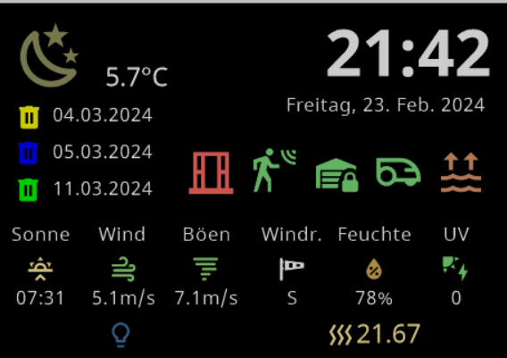

# ioBroker.nspanel-lovelace-ui

[](https://www.npmjs.com/package/iobroker.nspanel-lovelace-ui)
[](https://www.npmjs.com/package/iobroker.nspanel-lovelace-ui)


[](https://nodei.co/npm/iobroker.nspanel-lovelace-ui/)

**Tests:** 

[](https://weblate.iobroker.net/projects/adapters/nspanel-lovelace-ui/)

## nspanel-lovelace-ui adapter for ioBroker

NsPanel Lovelace UI is a Firmware for the nextion screen inside of NSPanel in the Design of Lovelace UI Design.

### Short Description

The NSPanel Lovelace UI is an alternative user interface for the Sonoff NSPanel, specifically designed for integration with iobroker. It typically relies on Tasmota (firmware) and MQTT (messaging protocol) to provide custom controls and displays directly on the NSPanel's small touchscreen.

### What is the NSPanel?

The Sonoff NSPanel is a smart wall switch with:

- two physical relay switches
- a 3.5-inch touchscreen
- temperature and brightness sensors

It was originally developed for the eWeLink app, but can be integrated much more powerfully with ioBroker using alternative firmware

### What does the "NSPanel Lovelace UI" do?

With this custom UI, you can:

- Display Lovelace-like Cards on the NSPanel
- Display sensor values ​​(e.g., temperature, humidity)
- Control scenes and automations
- Control lights, thermostats, and other devices directly on the screen

---

### Installation & Questions

Documentation: https://ticaki.github.io/ioBroker.nspanel-lovelace-ui (German and English, icon overview under `/icons/`)  
Adapter Community (ioBroker Forum): [Forum](https://forum.iobroker.net/topic/80055/alphatest-nspanel-lovelace-ui-v0-1-1)

---

## The following HMI components are already integrated into the NSPanel adapter:

### HMI Cards

- [x] screensaver
- [x] screensaver2
- [x] screensaver3
- [x] cardChart
- [x] cardLChart
- [x] cardPChart
- [ ] cardLChart2 (new - in progress)
- [x] cardEntities
- [x] cardSchedule
- [x] cardGrid
- [x] cardGrid2
- [x] cardGrid3
- [x] cardThermo
- [ ] cardMedia
- [x] cardUnlock
- [x] cardQR
- [ ] cardAlarm
- [x] cardPower

### HMI Popups

- [x] popupInSel
- [x] popupFan
- [x] popupThermo
- [x] popupNotify
- [x] popupShutter
- [x] popupShutter2
- [x] popupLight
- [x] popupLight2
- [x] popupTimer
- [x] popupSlider
- [ ] popupColor (new - in progress)

---

## Buzzer Control

The adapter supports buzzer control for NSPanel devices using the Tasmota `Buzzer` command. This enables button sounds, urgent message notifications, and general buzzer control.

### Prerequisites

To use the buzzer functionality, ensure your NSPanel Tasmota firmware has `SetOption111 1` enabled. This uses BuzzerPwm for piezo buzzer frequency output instead of on/off signal.

### Usage Methods

#### 1. State-based Control

Each panel has a buzzer control state: `panels.{panelName}.cmd.buzzer`

```javascript
// Set buzzer command (tone, duration, count, frequency)
setState('nspanel-lovelace-ui.0.panels.Panel1.cmd.buzzer', '1,2,3,0xF54');

// Examples:
setState('nspanel-lovelace-ui.0.panels.Panel1.cmd.buzzer', '1'); // Single beep
setState('nspanel-lovelace-ui.0.panels.Panel1.cmd.buzzer', '1,5'); // Longer beep
setState('nspanel-lovelace-ui.0.panels.Panel1.cmd.buzzer', '2,3,5'); // 5 beeps
```

#### 2. SendTo Interface

```javascript
// Basic buzzer command
sendTo('nspanel-lovelace-ui.0', 'buzzer', {
    panel: 'panelTopic',
    command: '1,2,3,0xF54',
});

// Button feedback sound
sendTo('nspanel-lovelace-ui.0', 'buzzer', {
    panel: 'kitchen_panel',
    command: '1',
});

// Urgent notification
sendTo('nspanel-lovelace-ui.0', 'buzzer', {
    panel: 'living_room',
    command: '3,5,10,0x800', // High-pitched, multiple beeps
});
```

### Buzzer Command Format

The buzzer command follows Tasmota's format: `tone,duration,count,frequency`

- **tone**: 1-4 (tone type)
- **duration**: 1-10 (duration units, ~100ms each)
- **count**: 1-255 (number of beeps)
- **frequency**: 0x100-0xFFFF (piezo frequency in hex)

**Examples:**

- `1` - Single short beep
- `1,5` - Single longer beep
- `2,3,5` - 5 medium beeps with tone 2
- `1,2,3,0xF54` - 3 short beeps with custom frequency

---

## Changelog

<!--
    Placeholder for the next version (at the beginning of the line):
    ### **WORK IN PROGRESS**
-->
### **WORK IN PROGRESS**
- (ticaki) developer tab: button "Create test states" creates the objects of the test environment (all channel roles, power, chart and trash data) below 0_userdata.0.NSPanelTest / alias.0.NSPanelTest, only the missing ones
- (ticaki) pages: a long headline is shortened with … to the width of the title line of the panel model instead of being cut by the display
- (ticaki) web panel: smartphone models `web-p` (portrait, 320x640) and `web-l` (landscape, 640x320) for standalone web panels; the menu cards, the screensaver and the popups show more items there, the admin shows the places per model
- (ticaki) web panel: the two hardware buttons below the display can be switched off per web panel (off by default on the smartphone models)
- (ticaki) web panel: popups, cardMedia and cardThermo2 use a portrait layout on the us-p model instead of the cut off landscape one; the tiles screensaver shows the 4 bottom and 8 indicator places of us-p
- (ticaki) web panel: cardAlarm, cardUnlock, cardThermo, cardPower, cardQR, cardChart and cardLChart use the portrait layout of the us-p display on us-p and web-p, they were cut off on the right and the right arrow could not be reached; on web-p they start at the top of the screen, headline and navigation no longer move when paging
- (ticaki) web panel: cardPChart lays out its title bar in the width of the portrait models, the right arrow could not be reached on us-p and web-p
- (ticaki) web panel: the color wheel of popupLight sends the color in the scale the adapter expects, whatever its size on the screen
- (ticaki) web panel: the screensaver modes standard, alternate, advanced and EasyView are drawn in the portrait layout of the us-p display on us-p (they were drawn in landscape and cut off)
- (ticaki) web panel: us-p uses the full display width like the us-p HMI (grids, lists and the right arrow were shifted to the left)
- (ticaki) web panel: long names and values end with … instead of a cut letter, big values (cardGrid3, screensaver) and long dates get smaller instead of overlapping, the bottom row of cardMedia and the EasyView MR bars are fully visible, icons in the heading of a screensaver notification are drawn
- (ticaki) web panel: an unknown panel model is reported (adapter log, notice in the browser) instead of drawing the pages for the eu panel
- (ticaki) admin: the developer tab is translated
- (ticaki) screensaver tiles: the indicators can get their own icon font (admin field "icon font"); needs the new screensaver5 page of the HMI, the other screensavers ignore it
- (ticaki) admin: export the configuration of one panel (pages, screensaver with its notifications, hardware buttons, navigation overrides and panel settings) as a JSON file from the panel tile; PINs and passwords are only included after an explicit confirmation
- (ticaki) admin: import a panel configuration file into a panel from the panel tile: choose pages / screensaver / other settings, review the plan (pages without conflict add an assignment or are created, differing pages are renamed, replace the existing one or are skipped, with a list of the differences), the result lists what to check (PINs and passwords to enter again, start page)
- (ticaki) admin: panel import with mode "Overwrite completely" (replaces everything specific to the panel, switches the panel script off, keeps pages for all panels and of the global script, asks first with the list of what goes); "Merge" no longer touches the navigation overrides and "panel uses no script"; the review marks pages that replace a page of the global or panel script, the result lists navigation links to pages that are not on the panel
- (ticaki) navigation: a target without page (e.g. a script page dropped during the conversion) opens the system page "navigation faulty" naming the missing page, with a back arrow to the page it came from, instead of doing nothing; the start log warns about such links
- (ticaki) web panel: the adapter no longer crashes on the first connection of a new web panel (two startups of the browser ran at the same time)
- (ticaki) alarm/unlock page: the status datapoint works on the first start of a new page (writes to it were ignored until the next restart)
- (ticaki) log: the notes at startup that an admin page replaces a script page and that an optional data point falls back to another one are logged as debug instead of info
- (ticaki) screensaver: a long press on an indicator (TFT 6.0.9, screensaver tiles and advanced) can get its own action - set a state, toggle a state or open a page (admin: "Action on long press"); without one it acts like a tap; every long press writes `buttons.indicatorLong-N`; the web panel sends the long press as well; the script templates know the long press fields (`ScreensaverEntityLongPress…`) and `ScreensaverEntityCycle`/`ScreensaverEntityCycleValues`
- (ticaki) panel: a warning is logged when a message to the panel is longer than the 1017 bytes the display can receive
- (ticaki) screensaver: with the new HMI (screensaver tiles and advanced) a tap on an indicator counts like a tap on the screensaver; an indicator without action (and, with "indicators act as buttons", without a state to switch) no longer leaves the screensaver at once but follows the double click setting, `buttons.indicator-N` is still written; the web panel counts the taps the same way
- (tt-tom17) admin: the hint for a page name that already exists as a panel page describes what the adapter really does - a page from the script of the same panel wins, a global one or one of another panel is replaced
- (tt-tom17) admin: the tooltip of the warning sign in the item dialog that asks to press Details... is translated
- (tt-tom17) admin: the field IP of ioBroker in the NSPanel settings shows a hint while no address is selected instead of an empty box
- (tt-tom17) admin: the German label of the slot selection for the internal sum of the power page said the slots were negated, they are summed; the label now exists in all languages
- (tt-tom17) admin: the confirmation dialogs of the Tasmota tools (restart, reset) and the texts of the icon overview are translated instead of fixed English or German
- (tt-tom17) admin: menu page preview: with the arrow presentation the placeholder for the arrow is also reserved on entities and schedule pages, as the panel does, and an entities page assigned only to us-p panels shows five lines like the panel - items of such pages may move to another preview page, nothing is changed in the stored configuration
- (tt-tom17) admin: menu page: the card type `Entities` is labelled with five rows when every assigned panel is a us-p, like `Grid2` already was
- (tt-tom17) admin: menu page: the card type choice keeps its layout - the model note in `Grid2 (9 slots - us-p)` and `Entities (5 rows - us-p)` no longer wraps and pulls the options apart, and the hint that `Grid2` needs identical panel models stands below both columns
- (tt-tom17) admin: an icon field follows an icon that the editor itself changes, for example when `Apply selection` of a trash page clears it - the field kept showing the icon it was opened with
- (tt-tom17) admin: trash page: the number of dates is labelled with its name instead of `Layout`, `Apply selection` fills the page completely again - a slot it fills gets the standard icon `trash-can-outline` and a slot it does not fill loses its waste type, its optional name and its icon, so nothing of a former waste type is left behind (the colour of a slot stays), the messages of the upload and of the state search appear in the form in the admin language instead of browser dialogs; a number of dates outside 1-6 from an old configuration no longer builds a wrong number of lines
- (tt-tom17) admin: chart page: the labels `Data source` and `Database instance` were swapped, the labels of the data points are corrected, the value factor has a tooltip that explains the direction (0.1 = divided by 10) and the number fields have a minimum of 1 (ticks and labels a maximum of 8)
- (tt-tom17) admin: the checkbox `Hide Password` of the QR page is now called `Do not show the password on the panel` and a note below it says that the QR code still contains the password - the behaviour is unchanged
- (tt-tom17) pageQR: a new QR page stores WPA2 as wifi encryption and the fallback for a page without a stored value is WPA2 as well, so the QR code matches what the admin shows - an existing page that never had the field set now writes WPA2 instead of WPA into the code; the migration of the old table `pageQRdata` keeps the encryption type and warns in the log that the wifi password has to be entered again
- (ticaki) screensaver: with the TFT 6.0.8 an indicator sends one event per press, a long press no longer switches twice
- (ticaki) screensaver: with the TFT 6.0.8 the indicators of the advanced screensaver also react to a press on the us-l and us-p panels
- (ticaki) screensaver: the default Bright Sky item for sunrise and sunset no longer stays empty after sunset, it shows the sunrise of the next day
- (ticaki) admin: color suggestions and default colors show the colors the panel really uses and follow the color theme of the instance, including the custom theme; the color scale of a screensaver item no longer stores colors nobody chose
- (ticaki) screensaver: new templates `text.trash.next` and `text.trash.afterNext` show the next two dates of a trash page in the bottom area with the optional name or else the waste type as headline, the admin lists them as next date and date after next once per trash page; the trash dates are also updated daily at 00:01 local time; a date appears there in short form as day.month
- (ticaki) web panel: a panel without a browser no longer writes a warning and no longer fills the log while the browser retries, it reports at most one message
- (ticaki) panel in Tasmota safeboot: the adapter recognises it from `tele/INFO1`, warns once with a hint how to flash the firmware again and stops the startup offers and the display diagnosis until the normal firmware is back
- (ticaki) admin: the color picker of the trash page offers five preset colors (yellow, brown, blue, dark gray, green)
- (ticaki) admin: screensaver places with `text.trash.next` / `text.trash.afterNext` show a readable name instead of the last part of a leftover state; choosing a template that needs no object removes the old state from the item
- (ticaki) screensaver: new action `values to cycle through` for indicators: you maintain an ordered list of values (e.g. `-1,0,1`), each press writes the next value to the state and after the last one it starts again with the first
- (ticaki) screensaver: values, colors, status icons and notifications are only sent when they changed, the display no longer gets the same messages again and again; a press on an indicator shows its new icon without the delay of up to 3 s
- (ticaki) admin: colors chosen for the color scale of a screensaver item are saved now, they were dropped when the dialog was applied

### 2.1.0 (2026-11-05)
- (ticaki) screensaver: a timer can replace the clock - from an on/off and a data state, from patterns for timers in changing slots or from a page item with a timer popup; it shows the remaining minutes in the color of the timer, the first tap switches to the clock; all screensaver modes and the web panel
- (ticaki) popupTimer repaired: an internal timer shows its time in the list, stays at 00:00 with Finish until confirmed and can be controlled through SET and STATUS; external timers count in seconds (ms with unit ms), the alarm clock uses local time and On/Off; a `level.timer` item can use the timer of the screensaver of its panel
- (ticaki) screensaver: new mode tiles with 5 values, 7 indicators (portrait panel: 4 values, 8 indicators), a larger clock, the info icon and two status bars; needs a TFT with the page screensaver5; the web panel draws the mode as well
- (ticaki) screensaver: a blind can be used as element - it shows one of 5 position icons and its position in %; tapping it as indicator only runs the configured action, it never moves the blind
- (ticaki) screensaver: new target "Screensaver" for page items and for prev, next, parent and home of a page (`///screensaver` in the script), new state `panels.<panel>.cmd.screenSaver.activate` shows it at once
- (ticaki) screensaver: a mode this adapter version does not know (e.g. after a downgrade) falls back to `standard` with a warning instead of breaking the screensaver, the stored configuration stays unchanged
- (ticaki) cardPChart: new page type "Pie chart" in the page configuration (needs the beta TFT 6.0.5 or newer on the EU panel) - up to five slices from numeric states with name, unit and color, optionally the average over a time range from a history/sql/influxdb instance, alternatively a script data point with the finished text; the web panel renders the card as well
- (ticaki) admin screensaver: page item templates can be configured per place, with the instances of the adapter as suggestions and template options (e.g. SOC limits of `text.battery.bydhvs`); on an indicator a template can act on tap; a new screensaver starts with two status icons coupled to the relays of the panel
- (ticaki) admin screensaver: uniform paging arrows for all areas except favorit, the alternate area can hold several items the panel rotates through, the notifications and options buttons moved below the panel picture; items of areas the chosen version does not show are no longer reported as a problem
- (ticaki) admin navigation: a start page no longer has a prev/next/parent of its own, its neighbours follow from the pages pointing at it (stored values are kept and apply again without the flag); a page named `main` without the flag counts as start page and asks for the flag in the log; empty fields show the neighbours the adapter resolved, a click on the label opens the target page, conflicting links get a warning; an explicit `next` is no longer overwritten when other pages chain in behind it
- (tt-tom17) page configuration: the unique id of a page is fixed once it was created, because renaming left the navigation of other pages pointing at the old name; the delete confirmation names the pages pointing at the page and offers to connect its previous and next page
- (tt-tom17) cardQR: a page with "No Password" (or free text, url or telephone code) no longer sends the stored wifi password to the panel - it was shown in clear text and was part of the scanned code
- (tt-tom17) cardThermo: the set temperature reached the panel multiplied by the step width (19.0 °C became 79.0 °C with a step of 0.5 °C)
- (tt-tom17) cardThermo2: the humidity row uses its own unit, the unit of the first row also applies to the set temperature
- (tt-tom17) cardAlarm: the disarm buttons also work without an arm button in the same row; a new page starts with "Arm" and "Disarm" filled in, the top button of both columns is mandatory, because the card cannot be left without them (the type "unlock" still needs one button only)
- (ticaki) panel: fewer page updates (at most one list update per 2 s for running timers, at least 1 s between updates of a page)
- (ticaki) the beta option now also applies to Tasmota: update and update indicator use the `tasmota-beta` version
- (tt-tom17) admin: the two hardware button buttons of a panel tile sit one below the other and show the relay state in their color, with a tooltip
- (tt-tom17) documentation: rewritten for the admin, complete in English as well and published on GitHub Pages, the admin links point there; missing translations of the page configuration are filled in

### 2.0.2 (2026-11-01)
- (ticaki) admin: page item text size shows the pixel size of each font; icons only offer fonts 1, 3 and 4 (the others have no icons), font 5 is marked "ASCII only"
- (ticaki) admin: the "..." button next to the item name is now "Dynamic name" (used only while the name is empty) and no longer offers unit and date format, which were ignored
- (ticaki) admin: on cardThermo2 and cardMedia the name field notes that the name is only the popup title
- (ticaki) admin: screensaver item dialog: "icon per value range" and the visibility settings are available without expert mode
- (ticaki) web panel: the font `¬<n>` of page items works on every card; cardThermo2 uses the slot sizes and positions of the HMI

### 2.0.1 (2026-11-01)
- (ticaki) screensaver editor: areas with more items than places page with arrows instead of hiding the extra items, they are no longer reported as "no place in this version"; items with a condition (enabled / visible condition, also in raw data) are marked
- (ticaki) admin: the "..." button of the media page player opens a list of all players found (alexa2 Echo devices, sonos speakers, squeezebox players, spotify-premium/mpd instances) grouped by adapter with search instead of the object tree; the id can still be typed by hand
- (ticaki) admin: screensaver items show readable names (headline, object name or template name) instead of regex fragments; the full name is in the tooltip
- (ticaki) admin: a script weather instance with a trailing dot (`pirate-weather.0.`) is recognized as installed and saved without the dot

### 2.0.0 (2026-10-31)
- (ticaki) maintain: new button "Take script over into admin" on every panel tile - converts the pages, the screensaver and the hardware buttons of a panel script into the admin configuration (preview with all problems, backup of the script, pages of the global script per panel, items the editor cannot express are taken over as raw data)
- (ticaki) a configuration script is no longer required; new panel option "Panel uses no script" - the panel is configured in the admin only and a script sent for it is rejected
- (ticaki) page configuration: new page types "Media player" (cardMedia), "Thermostat (classic)" (cardThermo) and "Page link"; paging of menu, thermostat and media pages can be set
- (ticaki) page configuration: the old tabs "Page Power" and "Page Chart" are moved into the page configuration automatically at adapter start
- (ticaki) item dialog: raw data (JSON) for page and screensaver items, many more fields (value conditions, slider ranges, `secondRow`, `colormode`, target page for buttons); long press is offered on grid pages only, like on the HMI
- (tt-tom17) panel settings: the hardware buttons (relay decoupling and action) are configured in the panel tile
- (ticaki) navigation flow: edit mode for prev/next/home/parent links (also for script pages, stored as override), auto layout, collapsible sub trees
- (ticaki) icons: Material Design Icons 7.4.47 (546 new icons), own window and shutter icons, blinds show their position as icon - needs HMI/TFT 6.0.2 (beta TFT EU is 6.0.2)
- (ticaki) global script: an admin page assigned to a panel replaces the global page of the same name
- (ticaki, tt-tom17) web panel: tap and hold behave like on the HMI (grid tiles, cardMedia, cardThermo2, list rows), hardware buttons 20px higher
- (ticaki) error in the log when Tasmota runs but the display never answers (hint to the NSPanel template / GPIO4)
- (ticaki) fix: prefix and suffix of admin page item values were swapped - if you entered them the other way round, swap them back
- (ticaki) fixes: `colorScale.color_best` ignored, font size lost while an item is off, long press also triggered the short press, media item of an admin page without media sub page, screensaver clock stopped, "show system pages" in the navigation flow
- (tt-tom17) fixes: deactivated panels (`cmd.activated`) are left alone at adapter start and report `deactivated`, `cmd.hideCards` keeps its value at adapter start

### 1.7.0 (2026-10-25)
- (ticaki) web panels: the panel UI in a web browser via http://<host>:8090/<topic>, no Tasmota needed - one web panel per address, all browsers on it stay in sync (new admin tab "Web panels")
- (ticaki) web panels: a real panel can be opened in the browser - the clone navigates on its own and shares the states tree `panels.<id>` with the panel
- (ticaki) web panels: standalone web panels without hardware - "Add web panel" in the panel overview (name, topic, model), configured by topic like a real panel
- (ticaki) web panels: optional PIN (`webPin`) for all web panels, asked once per browser; HTTPS with the ioBroker certificates (`webSecure`); a FIDO2 security key can replace the PIN (HTTPS only)
- (ticaki) web panels: look of the HMI - Noto Sans, Nextion font sizes, all page types, popups, the four screensaver layouts and the boot animation
- (ticaki) web panels: a lost connection to the adapter is shown (greyed out page), the browser reconnects after an adapter restart on its own
- (ticaki) admin: a button opens the web panel of a panel in a new tab (Maintain, panel settings, panel info), the host name of the links is configurable (`webHost`)
- (ticaki) screensaver: the indicator buttons (and the state `buttons.indicator-N`) work again when the screensaver is the first page of the configuration
- (ticaki) screensaver: a tap on an indicator sets `buttons.indicator-N` again when the indicators do not act as buttons, and the command of the indicator runs once instead of twice (a switch was flipped back at once)
- (ticaki) a panel that is offline gets the startup page offered every 5 s again (the panel loop never rescheduled itself)
- (ticaki) script config: `fontSize: 0` on a grid item is no longer ignored

### 1.6.0 (2026-10-24)
- (ticaki) panel: tapping the screensaver several times no longer ends in a black page - a resent page got its pageType but no content
- (ticaki) template text.battery.bydhvs: charging icon is now shown when the battery is charging (negative power)
- (ticaki) admin screensaver: notifications (bell next to the gear) - headline, text, states with condition, priority, dismiss group and buzzer
- (ticaki) admin screensaver: one notification list shared by all screensavers - a checkbox switches a notification on per screensaver (switched on ones first, then by priority)
- (tt-tom17) admin: the credential selection (MQTT, Tasmota WebUI, wifi password of a QR page) shows its default `use login / password field` again instead of an empty field
- (tt-tom17) admin: global settings - the weather instance is visible again; the list of instances is loaded when the page opens and not only when the field is opened, and a stored instance stays visible even if its adapter is gone

### 1.5.0 (2026-10-20)
- (ticaki) screensaver: weather forecast items (2 values) no longer lose icon and weekday when the temperature is 0°
- (ticaki) panel: a repeated acknowledgement from tasmota (bad wifi, mqtt broker like mosquitto 2) no longer drops the next message - e.g. screensaver colors and weather updates got lost
- (ticaki) mqtt: no overlapping subscriptions at the broker anymore, so every message arrives only once
- (ticaki) templates: brightsky bottom items show the hourly weather icon again (brightsky sets role `text` on `hourly.xx.icon`), unknown weather icons fall back to `alert-circle-outline`
- (tt-tom17) admin: the MQTT login of an external broker, the Tasmota WebUI password and the wifi password of a QR page can come from the central credentials (Admin → System settings → Credentials). Optional - without a selection the fields keep working as before. Only the id is stored; changed values restart the adapter, renaming a credential does not
- (tt-tom17) fix: the Tasmota WebUI password field of the MQTT settings stored the change event instead of the typed text

### 1.4.0 (2026-10-14)
- (tt-tom17) admin: new tab `Screensaver` - configure the screensaver without script: version (standard / alternate / advanced / easyview), the panels that use it, every place of the card with its own dialog (state or page item template, icons incl. icon per value range, colors, value, text, indicator action), MR icons, clock and date format, weather instance, rotation time, swipe and indicator buttons. The entry replaces the screensaver of the script for the listed panels. Documentation `doc/de|en/Screensaver-Admin.md`
- (ticaki) admin: page configuration - panel filter `All panels` and new page type `Main pages`; a field label cut off with `…` shows its full text on mouse over

### 1.3.0 (2026-10-13)
- (ticaki) cardMedia: support for the squeezeboxrpc adapter (Logitech Media Server) – media id `squeezeboxrpc.X.Players.<name>`; speaker grid to sync other rooms (control follows the sync master), group volume changes every member by the same amount, 3-step shuffle, seek via logo, favorites, saved playlists (requested from the LMS) and current playlist
- (ticaki) fix: a page `main` in the panel script was reported as coming from the global script configuration when the global configuration also has a page `main` (log message and colour in the admin navigation view); the page of the panel script was used, only its origin was wrong
- (tt-tom17) admin: thermostat pages (`cardThermo2`) can be created in the PageConfig tab like the other page types. The editor draws the page like the panel: tabs for up to eight heat circuits (an airCondition channel gives two), a click on the headline, the set temperature, the value lines or the mode text opens the settings of that spot (alias channel or single data points, headline, min/max/step, icons, colors, units, mode list, circuit icon), the nine slots around the ring (the ninth between - and +) show the real order of the panel - selector slots, the buttons the adapter generates from the alias, then the configured items, each bound to one heat circuit or to all (new field `Heat circuit` in the item dialog, `filter` of the script), with paging and the `sortOrder` of the slots. The admin page goes through the same code as the script page (`PageThermo2.getPage`), so the result on the panel is identical
- (tt-tom17) fix: the MAINTAIN indicator of `cardThermo2` was added twice to the page items

### 1.2.0 (2026-10-11)
- (tt-tom17) fix: the item role `lock` accepts `sensor.lock` as role of the ACTUAL state in addition to `state`; before, an ACTUAL state with `sensor.lock` was skipped and the item silently showed the SET state instead. The log now reports when a channel falls back to its alternate state (e.g. ACTUAL → SET)
- (tt-tom17) admin: chart pages (column and line) can be created in the PageConfig tab like the other page types; the page gets its own editor with chart type, color, data source (script states or a history/sql/influxdb instance), range, factor, x-axis ticks and labels. The classic way (script page plus the `Page Chart` tab) keeps working, both share one code path in the adapter. The DB instance is stored in the short form (`influxdb.0`); the alive check accepts both forms. The history query now asks for averages (bar: one per hour, line: 5-minute grid) instead of raw values, the x-axis is computed from the time stamps, line values keep one decimal
- (tt-tom17) fix: the line chart scales large values automatically — the panel prints a y-axis tick with at most two characters, so 152 W used to show up as "15"; values are now divided by 10, 100, … until the ticks fit and the y-axis label shows the factor (e.g. `W x10`). The y-ticks use round 1-2-5 steps from the minimum to the maximum of the data; the former two extra ticks below the minimum are gone — the panel never showed them, but they forced the factor on a winter day (-5 … 3 °C ended up as `°C x10`)
- (tt-tom17) admin: the timezone field of the panel setup sits in the same row and has the same width as the other fields again
- (tt-tom17) admin: light items with the roles rgbSingle, rgb, ct and hue get a `Mode list` dialog in the item editor to configure `inSel_Alias` (a writable string state) and `modeList` (one entry per line); items with the role select get the same dialog with the list only, they select through the channel's SET state and, without a list, the adapter uses its common.states. The dialog checks the state, warns about `?` in entries, about more than 48 entries and about lists longer than 900 characters, and can take the list from the state's `common.states` (a state with own `common.states` is listed by the adapter directly from them, the mode list is only a fallback); the `Color Settings` and `Mode list` buttons turn green once they hold data
- (tt-tom17) fix: the popup of a select item with a configured mode list showed the raw value of ACTUAL (the index) as current mode instead of the list entry, so no entry was marked; the entry is looked up by index now, `label?value` entries by their value
- (tt-tom17) fix: selecting an entry of a mode list configured for a select item wrote the index into the read-only ACTUAL state (Forbidden write attempts on a read-only state); the writeable SET state is used now, light items are unaffected because both point to inSel_Alias

### 1.1.2 (2026-09-18)

- (ticaki) fix: a panel could get stuck in "wait for connection" after a WiFi drop or a burst of screensaver updates, because the display's serial buffer overflowed. The adapter now spaces out messages to the display, sends screensaver updates at most every 3 seconds, and restarts tasmota automatically when the display reports an overflow

### 1.1.1 (2026-09-16)
- (tt-tom17) fix: a cardPower page created in the admin tab showed white icons although the color scale was switched on. The scale was only built when both its lower and its upper bound had been typed in; a bound that was left at its displayed default was never stored. The defaults of the classic accordion (0 / 10000 / 0) apply now
- (tt-tom17) admin: a newly added power slot of a cardPower page stores its color and speed scale bounds explicitly (0 / 10000 / 0 and 0 / 10000), the same way the classic accordion did, instead of only displaying them
- (tt-tom17) the expert tab `Navigation Overview` has been removed. It never made it into productive use; the navigation of a panel is configured in its script or in the `Navigation Flow` tab
- (ticaki) a page named `main` in the global script configuration is used as start page of every panel that has none of its own. That is unchanged, but it is now logged and the navigation view of the admin marks such pages as `page from the global script configuration`
- (tt-tom17) admin: the navigation assignment panel can show system pages (the `///`-prefixed ones) in the prev/next/parent/home dropdowns via a new checkbox; `///unlock` is always listed
- (tt-tom17) admin: the navigation flow tab remembers the last selected panel and restores it on reload, instead of always jumping back to the first one
- (tt-tom17) fix: the info panel of the navigation flow left the icon row out whenever the icon was read from a state instead of being set as a constant. It now shows the icon the panel really displays - the current value of that state, together with a hint which state it comes from, or `empty` when the state holds nothing
- (tt-tom17) fix: setting the prev or next of a page to the service page `///unlock` in the admin had no effect. The dropdowns offer page names, the adapter resolves navigation node names, and the service entry point is the one place where the two differ - it is mapped now

### 1.1.0 (2026-09-06)
- (ticaki) fix: a panel card marked with `Check!` was hard to read - white text on the beige card in the dark themes, almost invisible input frames in the new light one. The icons of the icon picker were invisible in the `blue` theme
- (ticaki) fix: passwords no longer reach the log in plain text
- (ticaki) fix: setting a panel up failed with `Invalid response from adapter` or `the message from the admin is incomplete`. It runs as three steps now and shows how far it got
- (ticaki) fix: the timezone dropdown froze the browser, is a searchable field now, and the chosen zone reaches the panel at last
- (ticaki) fix: a switched off panel was marked as such in english and german only, and hard to tell from an offline one
- (ticaki) the start page can now be set in the admin: a checkbox marks any admin page as start page, it replaces the one from the configuration script and is marked with `(main)`
- (ticaki) a panel no longer needs a page named `main` in the configuration script, so it can be set up in the admin alone (script version 0.21.1)
- (ticaki) navigation flow: nodes are coloured by origin, pages linked with `next` and `prev` share one edge, a long press target and a navigation target read from a state get a connection of their own, and hovering or clicking highlights what belongs together
- (ticaki) navigation flow: an option shows the states and channels each page works with as nodes of their own, with an info panel listing what a page item makes of them
- (ticaki) navigation flow: the page info starts with the page name and its headline and links to the page configuration of an admin page
- (ticaki) admin: the navigation assignment marks a navigation target that does not exist on an assigned panel
- (ticaki) fixed: replacing a script page from the admin tore the navigation apart and could cut off the access to the service pages
- (ticaki) fixed: a panel without its own start page could show the start page of another panel
- (ticaki) fixed: after sending the configuration script the reloaded panel lost the pages of all other panels until the adapter was restarted
- (ticaki) fixed: a `cardQR`, `cardAlarm` or `cardUnlock` page in the configuration script stopped all following pages from being created
- (ticaki) fixed: the page configuration of a cardTrash page did not open when the entry carries no waste types yet
- (ticaki) fixed: the state `mainNavigationPoint` was not translated

### 1.0.1 (2026-09-01)
- (tt-tom17) cardChart (line): the x-axis no longer uses a fixed 24 h window, it now follows the configured hours range
- (tt-tom17) admin: the trash page now shows a status line after an .ics upload, including the number of appointments found
- (ticaki) admin: fixed the target page selection in the page item dialog – the dropdown stayed empty and could crash the page config tab (`null is not an object (evaluating 'x.current.removeAttribute')`)

### 1.0.0 (2026-08-18)
- (copilot) **BREAKING:** Adapter requires node.js >= 22 now
- (GermanBluefox) **BREAKING:** Admin UI migrated to React 19 / MUI 9 / `@iobroker/gui-components` – requires admin 8.0.0 or newer
- (ticaki) cardPower configuration migrated to the new react based page config tab
- (ticaki) admin: previous/next buttons in the navigation assignment panel were swapped
- (ticaki) berry driver generation 11 added (beta), the automatic berry driver update was removed

### 0.17.8 (2026-04-25)
- (ticaki) fixed: Cannot read properties of undefined (reading 'trim')

### 0.17.7 (2026-04-24)
- (ticaki) Added `panels.{id}.cmd.activated` state to enable/disable a panel; toggle visible in TabMaintain and TabPanelinfo admin UI
- (ticaki) Fixed `textSize`/`fontSize` value `0` being rejected by the admin and ignored in some cases

### 0.17.6 (2026-04-22)
- (ticaki) Added `useValueConditions` to `pageItem`. This can be used to set conditions for when the value and when the icon should be displayed.
- (ticaki) textSize=0 was rejected by the admin

### 0.17.5 (2026-04-18)
- (ticaki) When the panel was restarted by the script, the model was set to ‘eu’

### 0.17.4 (2026-04-16)
- (ticaki) The admin navigation has been assembled incorrectly.
- (ticaki) Improved selection of custom button IDs
- (tt-tom17) fixed: ChannelConfigDialog bottom cut off on small laptop screens (save/color buttons not reachable)

### 0.17.3 (2026-04-14)
- (ticaki) fixed: textSize/fontSize 0-5 and tooltip, us-p admin layout, not update emu berry, textSize for custom item, activate trigger for custom id

### 0.17.2 (2026-04-13)
- (ticaki) bugfix: pageitem name / icon as id for most roles / textSize

### 0.17.1 (2026-04-12)
- (ticaki) bugfix: longpress

### 0.17.0 (2026-04-12)
- (tt-tom17) added: ChannelColorDialog
- (ticaki) added: customItem, longPress, targetPageLongPress, icons as id, div.

### 0.16.2 (2026-04-09)
- (ticaki) fixed: channel duplicate error
- (tt-tom17) fixed: ChannelConfigDialog – error messages (datapointErrors, datapointDuplicates, checkResult) are now properly reset when reopening the dialog

### 0.16.1 (2026-04-09)
- (ticaki) The native configuration in pageitems is available to everyone. It corresponds exactly to the script configuration for a page item.

### 0.16.0 (2026-04-09)
- (ticaki) feat: new visual page editor in the admin UI – configure cardGrid, cardGrid2, cardGrid3, cardEntities and cardSchedule pages including their items directly in the admin.

### 0.15.4 (2026-04-04)
- (tt-tom17) fixed: iCal / trash page – date display year format (2-digit vs. 4-digit) was swapped for short and long item lists
- (ticaki) fixed: panel rule timer increased from 120 s to 140 s to reduce false "panel disconnected" events after startup
- (ticaki) fixed: `setPopupNotification` now returns `{ error: 'No Panels Online' }` via callback when no panel is online instead of silently ignoring the call

### 0.15.2 (2026-03-26)
- (tt-tom17) added: message dialog when berry installation fails due to missing internet access on the panel
- (ticaki) added: improved offline detection for panels
- (ticaki) improved: version info caching (15–60 min) to reduce external API calls
- (ticaki) fixed: admin panel info tab now displays state labels in the correct system language

### 0.15.1 (2026-03-18)
- (ticaki) added: internet access check for Tasmota device before berry installation

### 0.15.0 (2026-03-16)
- (ticaki) added: `ScreensaverEntityFillIfBelowMin` – fills screensaver slots when too few items are visible (default: true)
- (ticaki) fixed: various bug fixes and improvements in the admin UI

### 0.14.0 (2026-03-14)
- (tt-tom17) refactored: timezone selection code moved from adapter to admin handler (internal, no UI changes)
- (ticaki) added: TempOffset configurable in objects and admin tab (#629)
- (ticaki) added: "Update scripts for all panels" button in Maintain tab

### 0.13.4 (2026-03-07)
- (ticaki) added: buttonOnDelayOff / buttonOffDelayOn / buttonDelayOn / buttonDelayOff modes for HW button actions

### 0.13.3 (2026-03-04)
- (ticaki) fixed critical bug when using internal MQTT server

### 0.13.2 (2026-03-02)
- (ticaki) Maintain table: proper semver comparison for Tasmota and TFT versions (upgrade vs. downgrade detection)
- (ticaki) TabPanelinfo: openTasmotaConsole button fixed
- (ticaki) Some minor fixes (settings model, tab model, field types)

### 0.13.1 (2026-03-01)
- (ticaki) New Admin tab for quick overview and minor settings
- (tt-tom17)(ticaki) Panel status system with badge (online/offline/setup/flashing states)
- (tt-tom17) Panel management improvements (IP selector, delete/edit panels, init button)
- (tt-tom17) MQTT configuration UI design improvements
- (tt-tom17)(ticaki) Various fixes (badge flickering, tab focus, jsonConfig, translations, hex colors)

### 0.12.1 (2026-02-20)
- (ticaki) fixed: brightsky template
- (ticaki) fixed: malfunction of the update icon in the screensaver
- (ticaki) fixed: When sending the script, the restart was confirmed with the wrong panel name.

### 0.12.0 (2026-02-19)
- (ticaki) NSPanel TFT version is displayed correctly depending on the model.
- (ticaki)(tt-tom17) Option to write Tasmota telemetry data into states.  
- (tt-tom17) Admin-Tab globalSetting convert to React  
- (tt-tom17) Admin-Tab Maintain convert to React  
- (tt-tom17) Add icon selector to trash entries

### 0.10.0 (2026-01-17)
- (ticaki) Confirmation click for role button
- (ticaki) Some duplicate unique names were overlooked during script transfer.
- (tt-tom17) bug fixes for role 'blind'
- (ticaki) minor bug fixes

### 0.9.1 (2025-11-29)
- (ticaki) Fixed: Under certain circumstances, the adapter crashes when a pop-up is called.

### 0.9.0 (2025-11-21)
- (armilar) HMI: long press added (v5.1.1)
- (ticaki) Replace double-click with long press 
- (ticaki) pageItem type=button long press added
- (ticaki) custom pageitem added
- (ticaki) script ID is found uniquely

### 0.8.1 (2025-11-15)
- (ticaki) first Version at latest
- (ticaki) New attempt to get MQTT TLS keys into the backup

### 0.8.0 (2025-11-13)
- (Armilar) IMPORTANT: update to TFT Version 5.1.0
- (ticaki) pagePopup added
- (ticaki) color for brightsky favorit/bottom day fixed
- (ticaki) unlock pin fail fixed

[Older changelogs can be found there](CHANGELOG_OLD.md)

## License

MIT License

Copyright (c) 2024-2026 ticaki <github@renopoint.de>  
Copyright (c) 2024-2026 tt-tom17 <tgb@kabelmail.de>

Permission is hereby granted, free of charge, to any person obtaining a copy
of this software and associated documentation files (the "Software"), to deal
in the Software without restriction, including without limitation the rights
to use, copy, modify, merge, publish, distribute, sublicense, and/or sell
copies of the Software, and to permit persons to whom the Software is
furnished to do so, subject to the following conditions:

The above copyright notice and this permission notice shall be included in all
copies or substantial portions of the Software.

THE SOFTWARE IS PROVIDED "AS IS", WITHOUT WARRANTY OF ANY KIND, EXPRESS OR
IMPLIED, INCLUDING BUT NOT LIMITED TO THE WARRANTIES OF MERCHANTABILITY,
FITNESS FOR A PARTICULAR PURPOSE AND NONINFRINGEMENT. IN NO EVENT SHALL THE
AUTHORS OR COPYRIGHT HOLDERS BE LIABLE FOR ANY CLAIM, DAMAGES OR OTHER
LIABILITY, WHETHER IN AN ACTION OF CONTRACT, TORT OR OTHERWISE, ARISING FROM,
OUT OF OR IN CONNECTION WITH THE SOFTWARE OR THE USE OR OTHER DEALINGS IN THE
SOFTWARE.
