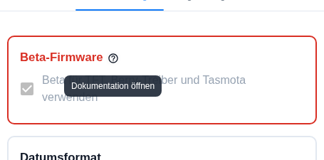

# Hilfe-Links im Admin

Viele Bereiche der Adapter-Einstellungen haben jetzt einen direkten Weg in die Dokumentation.

## Das kleine Fragezeichen

Neben Überschriften, Einstellungen und in Dialogen steht ein blasses **?**. Wenn du mit der Maus darauf
zeigst, wird es kräftiger und ein Hinweis nennt den Abschnitt der Dokumentation, z. B.
„Hilfe: Seitentyp“. Ein Klick öffnet die Dokumentation in einem neuen Browser-Tab, direkt an dieser Stelle.
Die Einstellung daneben bleibt dabei unverändert – ein Klick auf das **?** setzt keinen Haken und wählt
nichts aus.

Auch in Auswahllisten kann ein **?** stehen, z. B. bei den Seitentypen. Es führt zur Beschreibung des
jeweiligen Typs.

Im Pageitem-Dialog führt das **?** neben dem Titel zur Beschreibung der Rolle des gewählten Kanals
(im Bild `button`).

## Der Knopf „Dokumentation“

Größere Bereiche – z. B. der Seiten-Editor, der Bildschirmschoner, die Panel-Übersicht oder Panelinfo –
haben zusätzlich einen Knopf **Dokumentation** mit einem Buch-Symbol. Er öffnet die ganze passende Seite
der Dokumentation, im Seiten-Editor die Seite zum gewählten Kartentyp.

## Sprache

Die Dokumentation gibt es auf Deutsch und Englisch. Welche geöffnet wird, richtet sich nach der
**Systemsprache von ioBroker** (System → Einstellungen → Sprache): bei Deutsch die deutsche
Dokumentation, bei jeder anderen Sprache die englische.

## Aussehen in den Admin-Themen

Die Fragezeichen passen sich dem gewählten Admin-Thema an und sind im hellen wie im dunklen Thema
sichtbar.

## Prüftabelle

| Bild | Szenario | Was prüfen |
| --- | --- | --- |
| `00-tooltip-hover.png` | Thema „modernLight“, Global Settings, Maus auf dem **?** neben „Beta-Firmware“ | Hinweis erscheint, Icon beim Zeigen kräftiger |
| `modernLight-maintain.png` | Maintain-Tab | **?** an den Abschnitten auch auf farbigem Hintergrund (Warnkasten) erkennbar |
| `modernLight-pageconfig-seitentyp.png` | PageConfig, Liste „Seitentyp“ geöffnet | **?** am rechten Rand jeder Typ-Zeile, „Alle“/„Hauptseiten“ ohne **?** |
| `<thema>-pageconfig-seite.png` | PageConfig, Seite `e2eList` (Entities) gewählt; je Thema light, dark, blue, colored, modernLight, modernDark | **?** bei Panel-Filter, Seitentyp, Seiten, Kartentyp, Einträge, „Seite hinzufügen“, Navigation rechts; Knopf „Dokumentation“ links unten |
| `<thema>-pageitem-dialog.png` | Pageitem-Dialog des ersten Eintrags (Rolle `button`), je Thema | **?** neben dem Titel (Rolle), an Kanal, Name, Zielseite, „Bedingung ist wahr“; Knopf „Dokumentation“ unten links |
| `<thema>-screensaver-editor.png` | Screensaver, Eintrag „Test eu“ (Advanced, EU) gewählt, je Thema | **?** an Version, Wetter, den Hinweistexten unter dem Bild und im blauen Infokasten; Knopf „Dokumentation“ unter der Liste |
| `modernDark-screensaver-uhrzeit-dialog.png` | Screensaver, Klick auf die Uhrzeit | **?** im Dialogtitel und bei „Timer anzeigen“; Klick auf das **?** setzt den Haken nicht |
| `modernDark-panel-uebersicht.png` | Tab Nspanel-Einstellungen | Knöpfe „Dokumentation“ und **?** bei Panel anlegen / Karten |
