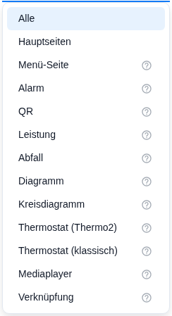
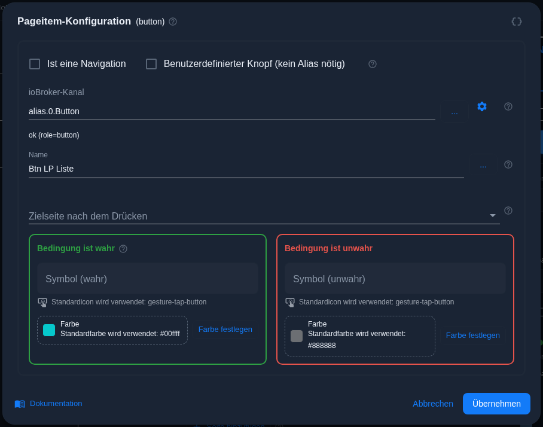
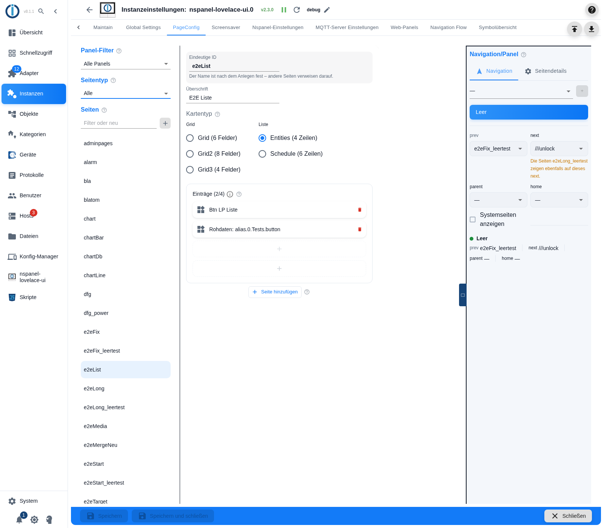
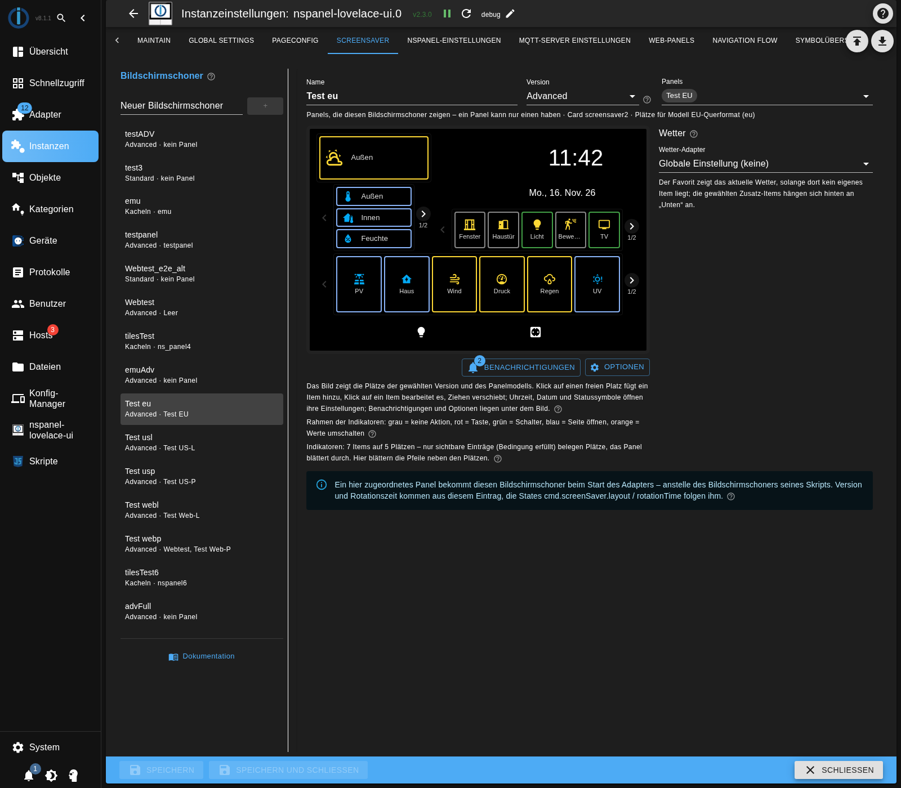

# Hilfe-Links im Admin

Viele Bereiche der Adapter-Einstellungen haben jetzt einen direkten Weg in die Dokumentation.

## Das kleine Fragezeichen

Neben Überschriften, Einstellungen und in Dialogen steht ein blasses **?**. Wenn du mit der Maus darauf
zeigst, wird es kräftiger und ein Hinweis nennt den Abschnitt der Dokumentation, z. B.
„Hilfe: Seitentyp“. Ein Klick öffnet die Dokumentation in einem neuen Browser-Tab, direkt an dieser Stelle.
Die Einstellung daneben bleibt dabei unverändert – ein Klick auf das **?** setzt keinen Haken und wählt
nichts aus.

Auch in Auswahllisten kann ein **?** stehen, z. B. bei den Seitentypen. Es führt zur Beschreibung des
jeweiligen Typs.

Im Pageitem-Dialog führt das **?** neben dem Titel zur Beschreibung der Rolle des gewählten Kanals
(im Bild `button`).

## Der Knopf „Dokumentation“

Größere Bereiche – z. B. der Seiten-Editor, der Bildschirmschoner, die Panel-Übersicht oder Panelinfo –
haben zusätzlich einen Knopf **Dokumentation** mit einem Buch-Symbol. Er öffnet die ganze passende Seite
der Dokumentation, im Seiten-Editor die Seite zum gewählten Kartentyp.

## Hilfe in den Panel-Kacheln

In den Kacheln, die es für jedes Panel einmal gibt (Tab **Maintain**, **Schnellzugriff/Panelinfo** und die
Panel-Übersicht im Tab **Nspanel-Einstellungen**), sitzt ein kleines **?** ganz oben rechts in der Ecke. Es
führt zur Beschreibung der ganzen Kachel.

Knöpfe und Felder, zu denen es einen eigenen Abschnitt gibt (z. B. die Update-Knöpfe, die Versionsfelder,
„Skript in Admin übernehmen“, Export/Import, die HW-Buttons oder der Temperaturoffset), zeigen beim Darüberfahren
einen Hinweis mit einem unterstrichenen Link „Hilfe: …“ und einem kleinen Pfeil – ein Kasten in den Farben der
Seite mit farbigem Rand und Schatten, im dunklen Thema dunkel. Mit der Maus kannst du in den Hinweis
hineinfahren, er bleibt offen, und ein Klick auf den Link öffnet die Dokumentation in einem neuen Tab. Ist ein
Knopf grau, steht zusätzlich ein Link auf „Wenn ein Knopf grau bleibt“ dabei. Auch der Knopf **Web-Panel
hinzufügen** hat seine Hilfe im Hinweis. Auf Tablet und Smartphone öffnet ein **langer Druck** den Hinweis;
danach bleiben drei Sekunden, um auf den Link zu tippen.

## Sprache

Die Dokumentation gibt es auf Deutsch und Englisch. Welche geöffnet wird, richtet sich nach der
**Systemsprache von ioBroker** (System → Einstellungen → Sprache): bei Deutsch die deutsche
Dokumentation, bei jeder anderen Sprache die englische.

## Aussehen in den Admin-Themen

Die Fragezeichen passen sich dem gewählten Admin-Thema an und sind im hellen wie im dunklen Thema
sichtbar.

## Prüftabelle

| Bild | Szenario | Was prüfen |
| --- | --- | --- |
| `00-tooltip-hover.png` | Thema „modernLight“, Global Settings, Maus auf dem **?** neben „Beta-Firmware“ | Hinweis erscheint, Icon beim Zeigen kräftiger |
| `modernLight-maintain.png` | Maintain-Tab | **?** an den Abschnitten auch auf farbigem Hintergrund (Warnkasten) erkennbar |
| `modernLight-pageconfig-seitentyp.png` | PageConfig, Liste „Seitentyp“ geöffnet | **?** am rechten Rand jeder Typ-Zeile, „Alle“/„Hauptseiten“ ohne **?** |
| `<thema>-pageconfig-seite.png` | PageConfig, Seite `e2eList` (Entities) gewählt; je Thema light, dark, blue, colored, modernLight, modernDark | **?** bei Panel-Filter, Seitentyp, Seiten, Kartentyp, Einträge, „Seite hinzufügen“, Navigation rechts; Knopf „Dokumentation“ links unten |
| `<thema>-pageitem-dialog.png` | Pageitem-Dialog des ersten Eintrags (Rolle `button`), je Thema | **?** neben dem Titel (Rolle), an Kanal, Name, Zielseite, „Bedingung ist wahr“; Knopf „Dokumentation“ unten links |
| `<thema>-screensaver-editor.png` | Screensaver, Eintrag „Test eu“ (Advanced, EU) gewählt, je Thema | **?** an Version, Wetter, den Hinweistexten unter dem Bild und im blauen Infokasten; Knopf „Dokumentation“ unter der Liste |
| `modernDark-screensaver-uhrzeit-dialog.png` | Screensaver, Klick auf die Uhrzeit | **?** im Dialogtitel und bei „Timer anzeigen“; Klick auf das **?** setzt den Haken nicht |
| `modernDark-panel-uebersicht.png` | Tab Nspanel-Einstellungen | Knöpfe „Dokumentation“ und **?** bei Panel anlegen; je Karte ein kleines **?** in der oberen rechten Ecke, keine **?**-Zeile über den Karten, kein **?** neben „Web-Panel hinzufügen“ (Hilfe im Tooltip) |
| *(nur geprüft)* | Maintain, Maus auf **TASMOTA UPDATE** (grau), Thema light und dark | Tooltip mit „Hilfe: TASMOTA UPDATE“ und „Hilfe: 8. Wenn ein Knopf grau bleibt“; Tooltip in den Farben der Seite (paper, 2px Rand in `primary.main`, Schatten), auch auf orange/grauer Karte; Link in Linkfarbe und unterstrichen, Pfeil-Symbol in Linkfarbe; Maus in den Tooltip → bleibt offen; Klick öffnet neuen Tab |
| *(nur geprüft)* | Maintain: TFT/BERRY/SCRIPT UPDATE, „Skript in Admin übernehmen“, Versionsfelder, Kennzeichen **Web**, blauer Web-Hinweis, Symbol „Web-Panel öffnen“ | je ein Link auf den eigenen Abschnitt; der Übernahme-Knopf bei „Panel benutzt kein Skript“ zeigt weiter den Grund als Text über dem Link; „Panel aktiv“ und Tasmota-Konsole ohne Tooltip-Link (das ? der Kachel deckt sie ab); kleines **?** oben rechts in der Ecke → „2. Die Karte eines Panels“; das **?** neben „Skripte für alle Panels aktualisieren“ ist entfallen |
| *(nur geprüft)* | Schnellzugriff (Panelinfo), Maus auf **Temperaturoffset**, light und dark | Link „Hilfe: Temperaturoffset“; Layout, Timeout, Tagesmodus, Zeitplan, Temperature1, Skriptname bei „kein Skript“ mit eigenem Link; Panel aktiv, Panelmodell, Seitenzahl, Signal, Skriptname und Konsole ohne Link; kleines **?** in der Ecke über dem Zahnrad → „Was die Kachel zeigt“ |
| *(nur geprüft)* | Nspanel-Einstellungen, Maus auf **HW-Button links**, light und dark | bisheriger Hinweistext des Knopfes plus zwei Links (Hardware-Taster, Farbe der Knöpfe); Export, Import, „kein Skript“, Kennzeichen **Web** mit eigenem Link; Stift, Papierkorb, Web öffnen, Felder und Konsole nur mit ihrem normalen Hinweis; kleines **?** in der Ecke über den Symbolen → „4. Die Panelkachel“ |
