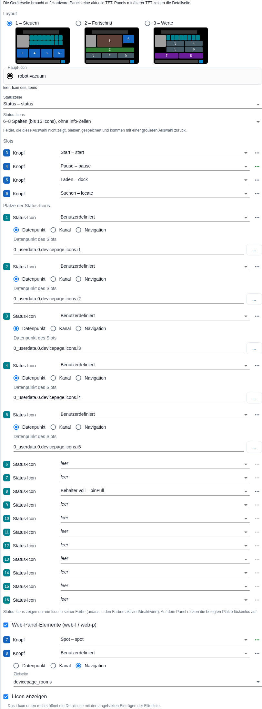
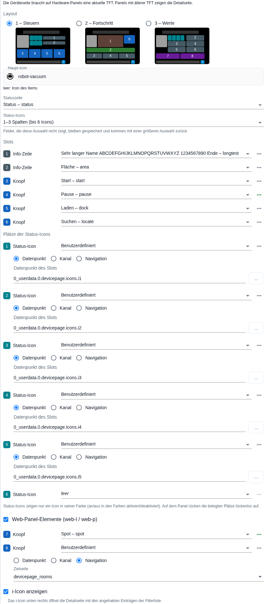
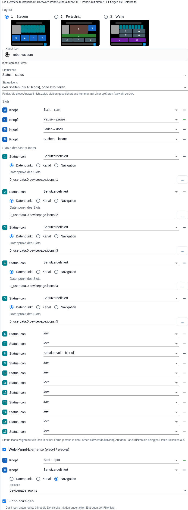
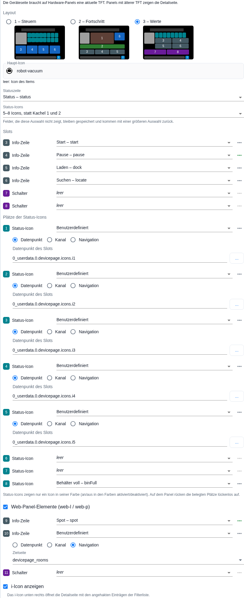

# Geräteseite: Status-Icons auswählen

Die Geräteseiten „Steuern“ (Layout 1) und „Werte“ (Layout 3) können eine Reihe kleiner Status-Icons zeigen, z. B.
Tür offen, Akku leer oder Verbindung. Wie viele Plätze es dafür gibt, stellst du je Geräteseite ein.

Die ausführliche Anleitung mit den Bildern am Panel steht in der Nutzer-Doku:
[doc/de/deviceDetails.md, „Status-Icons“](../../de/deviceDetails.md#status-icons) (englisch:
[doc/en/deviceDetails.md, „Status icons“](../../en/deviceDetails.md#status-icons)). Die übrigen Bilder und die
Prüftabelle der Geräteseite: [../device-page/README.md](../device-page/README.md).

## So geht's

1. Öffne im Tab **Seitenkonfiguration** (PageConfig) das Item „Gerät mit Details“, wähle bei **Long-Press öffnet** die **Geräteseite** und
   ein Layout.
2. Unter **Status-Icons** wählst du, wie viel Platz die Icons bekommen (die **Stufe**):

   | Layout | Auswahl | Was du auf dem Panel bekommst |
   |---|---|---|
   | 1 – Steuern | Keine Status-Icons | die beiden Info-Zeilen in voller Breite |
   | | 1–3 Spalten (bis 6 Icons) | Icons links, die Info-Zeilen mit kurzem Namen daneben |
   | | 4–5 Spalten (bis 10 Icons), Info-Zeilen ohne Namen | Icons links, die Info-Zeilen nur noch mit Icon und Wert |
   | | 6–8 Spalten (bis 16 Icons), ohne Info-Zeilen | nur Icons, die Info-Zeilen entfallen |
   | 3 – Werte | Keine Status-Icons | alle sechs Kacheln |
   | | 1–4 Icons, statt Kachel 1 | die Icons stehen statt Kachel 1 |
   | | 5–8 Icons, statt Kachel 1 und 2 | die Icons stehen statt Kachel 1 und 2 |

   Das Layout „Fortschritt“ (2) hat keine Status-Icons, dort gibt es keine Auswahl.
3. Darunter erscheinen unter **Plätze der Status-Icons** so viele Plätze, wie die Auswahl fasst. Jeden Platz belegst du
   wie einen Slot: einen Datenpunkt des Geräts oder „Benutzerdefiniert“ (Datenpunkt, Kanal, Navigation). Über **…**
   stellst du Icon und Farbe, Farbverlauf und den kurzen Tipp ein; liegt ein Alias-Kanal Steckdose oder Taster auf dem
   Platz, auch den langen Druck.
4. Die kleine Vorschau oben beim Layout zeigt, wie die Seite mit deiner Auswahl aufgeteilt ist.

Auf dem Panel rücken die belegten Plätze lückenlos auf. Lässt du einen Platz leer, entsteht dort keine Lücke. Es
erscheinen nur so viele Spalten, wie belegt sind, höchstens die der Stufe; Info-Zeilen und Kacheln richten sich
trotzdem nur nach der Stufe.

### Nichts geht verloren

Was deine Auswahl nicht zeigt, wird nur ausgeblendet, nicht gelöscht: Plätze über der gewählten Anzahl, bei „Steuern“
mit 6–8 Spalten die beiden Info-Zeilen und bei „Werte“ die ersetzten Kacheln. Wählst du später wieder mehr Platz, ist
die alte Belegung zurück.

Wechselst du das Layout, bleiben deine Auswahl und die Plätze gespeichert. Passt die Auswahl nicht zum neuen Layout
(z. B. 6–8 Spalten auf „Werte“), nimmt die Seite die größte Auswahl, die das Layout hat.

## Bilder zum Prüfen

Aufgenommen im Dev-Server-Admin (Puppeteer, 2026-11-28, neu mit bereinigten Testdaten), Seite `devicepage_test`, Gerät
Robbi (Layout 1) bzw. ID.3 (Layout 3). Alle Änderungen nur im offenen Dialog, nicht gespeichert. Kein Bild zeigt rote
Hinweise.

| Bild | Szenario | Was Tim prüfen soll |
|---|---|---|
| [layout1-stage0.png](layout1-stage0.png) | Robbi, „Keine Status-Icons“ | keine Plätze der Status-Icons; Vorschau Layout 1 ohne Raster, Info-Zeilen 1/2 breit (ab x 126); Vorschau Layout 3 mit allen 8 Kacheln |
| [layout1-stage1.png](layout1-stage1.png) | Robbi, „1–3 Spalten (bis 6 Icons)“ | 6 Plätze; Raster 3 × 2, Info-Zeilen im Satz B (ab x 241); Slots 1/2 sichtbar |
| [layout1-stage2.png](layout1-stage2.png) | Robbi, „4–5 Spalten (bis 10 Icons)“ | 10 Plätze; Raster 5 × 2, Info-Zeilen im Satz C (ab x 315) |
| [layout1-stage3.png](layout1-stage3.png) | Robbi, „6–8 Spalten (bis 16 Icons)“ | 16 Plätze; Raster 8 × 2, keine Info-Zeilen in der Vorschau; Slots 1/2 in der Liste ausgeblendet |
| [shrink-0-before.png](shrink-0-before.png) | Robbi, 6–8 Spalten, Platz 8 im Dialog mit „Behälter voll“ belegt | Platz 8 belegt |
| [shrink-1-smaller.png](shrink-1-smaller.png) | danach auf „1–3 Spalten“ verkleinert | nur Plätze 1–6; Slots 1/2 wieder da mit ihrer alten Belegung |
| [shrink-2-back.png](shrink-2-back.png) | danach wieder „6–8 Spalten“ | Platz 8 wieder „Behälter voll“, Plätze 1–5 unverändert |
| [layout-change-1to3.png](layout-change-1to3.png) | Robbi mit 6–8 Spalten auf Layout 3 umgestellt | Auswahl zeigt „5–8 Icons, statt Kachel 1 und 2“, 8 Plätze, Slots 1/2 ausgeblendet; gespeichert bleibt 6–8 (zurück auf Layout 1 = wieder 16 Plätze) |
| [layout3-stage0.png](layout3-stage0.png) | ID.3, „Keine Status-Icons“ | alle 8 Slots, keine Plätze; Vorschau mit allen Kacheln |
| [layout3-stage1.png](layout3-stage1.png) | ID.3, „1–4 Icons“ | 4 Plätze; Slot 1 ausgeblendet; Vorschau: 4 Zellen statt Kachel 1 (x 114–262) |
| [layout3-stage2.png](layout3-stage2.png) | ID.3, „5–8 Icons“ | 8 Plätze; Slots 1/2 ausgeblendet; Vorschau: 8 Zellen über Kachel 1 und 2 (x 114–411) |
