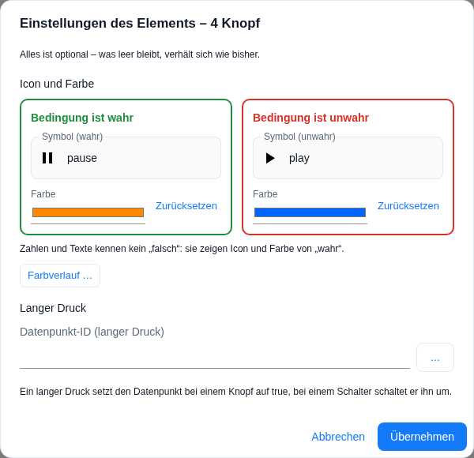
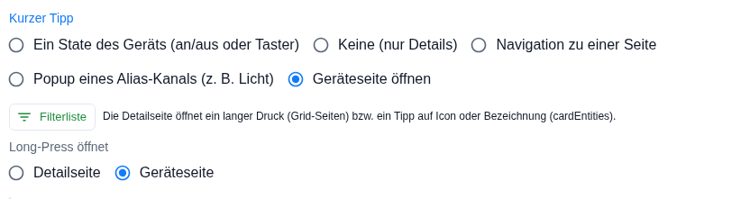

# Geräteseite für „Gerät mit Details“

Ein Item der Art **Gerät mit Details** öffnet mit einem langen Druck (Grid-Seiten) bzw. einem Tipp auf Icon oder
Bezeichnung (cardEntities) bisher immer die **Detailseite** – eine Liste mit allen angehakten Werten des Geräts.
Jetzt kannst du stattdessen eine **Geräteseite** öffnen lassen: ein großes Geräte-Icon, feste Plätze (Slots) für
Werte, einen Fortschrittsbalken, Knöpfe, Schalter oder kleine Status-Icons, eine Statuszeile und unten rechts ein kleines „i“, das die
Detailseite öffnet. Das passt z. B. für Waschmaschine, Saugroboter, Rasenmäher oder Auto.

## So stellst du es ein

1. Öffne im Seiten-Editor das Item und wähle oben die Art **Gerät mit Details** und dein Gerät.
2. Unter der Filterliste steht **Long-Press öffnet**. Wähle **Geräteseite**.
   - **Detailseite** ist die Vorgabe und verhält sich wie bisher.
   - Du kannst hin- und herschalten, ohne etwas zu verlieren, solange der Dialog offen ist. Gespeichert wird die
     Geräteseite nur, wenn beim Übernehmen **Geräteseite** gewählt ist.

   

3. Wähle das **Layout**. Die kleinen Bilder zeigen, wo welcher Slot sitzt; die Nummern gehören zu den Zeilen
   weiter unten.
4. **Haupt-Icon**: das große Icon oben links. Leer lassen = das Icon des Items.
5. **Statuszeile**: ein beliebiger Wert des Geräts als Text in der breiten Zeile unten, z. B. das Programm der
   Waschmaschine. Leer = leere Zeile.
   - Ganz oben in der Auswahl steht **Benutzerdefinierter Datenpunkt**. Damit zeigt die Statuszeile einen eigenen
     Datenpunkt, der nicht zum Gerät gehören muss – z. B. einen Text unter `0_userdata.0`, den du per Skript selbst
     zusammenbaust. Nach der Auswahl erscheint darunter ein Feld: ID eintippen oder mit dem Knopf **...** im
     Objektbaum aussuchen. Solange das Feld leer ist oder es den Datenpunkt nicht gibt, bleibt die Zeile leer.

     

6. **Slots**: Für jeden Slot steht die Nummer, die Art und eine Auswahl der Werte des Geräts. Angeboten werden nur
   Werte, die zur Art passen – „leer“ geht immer.
   - **Benutzerdefiniert** (zweiter Eintrag nach „leer“): der Slot zeigt etwas, das nicht zum Gerät gehören muss.
     Darunter wählst du **Datenpunkt** (irgendein Datenpunkt, z. B. unter `0_userdata.0`) oder **Kanal** (z. B.
     ein Licht, ein Rollladen, eine Steckdose aus `alias.0`) und trägst die ID ein oder suchst sie mit **...** aus.
     Ein Alias-Kanal sieht aus und lässt sich bedienen wie auf einer Grid-Seite: Tipp schaltet, Rollladen, Auswahl
     und Timer öffnen ihr Popup, ein dimmbares Licht öffnet es beim Halten. Passt etwas nicht zur Art des Slots oder
     gibt es die ID nicht, wird der Slot rot markiert und bleibt am Panel leer.

     

   - **…** rechts in jeder belegten Zeile öffnet die **Einstellungen des Elements**: eigenes Icon und eigene Farbe
     für „wahr“ und „unwahr“, ein Farbverlauf und – bei Knöpfen und Schaltern – ein Datenpunkt, den ein langer Druck
     schreibt. Alles ist freiwillig; der Knopf ist grün, sobald etwas eingestellt ist. Beispiel: ein Knopf für
     „läuft / Pause“ – wähle einen An/Aus-Wert, Icon „pause“ bei wahr und „play“ bei unwahr. Der Tipp schaltet um,
     das Icon wechselt mit.

     

   - **Von der Geräteseite auf eine andere Seite springen** – zwei Wege:
     - **Ein belegter Slot navigiert:** **…** der Zeile öffnen, bei **Kurzer Tipp** statt „Standard“ **Navigation**
       wählen und die **Zielseite** aussuchen. Der Slot sieht aus wie vorher (Icon, Name, Wert), aber der Tipp öffnet
       jetzt die Seite und tut sonst nichts – ein Knopf drückt nicht mehr, ein An/Aus-Wert schaltet nicht mehr. Beim
       Schalter-Slot navigiert der Tipp auf Icon und Name, der Schalter selbst schaltet weiter. Bei Kanälen, die ihr
       Popup sofort öffnen (Rollladen, Tor, Schloss, Auswahl, Timer), fehlt „Kurzer Tipp“ – dort kommt immer das Popup.
     - **Ein Platz nur zum Springen:** in der Auswahl des Slots **Benutzerdefiniert** und darunter **Navigation**
       wählen (gibt es bei Info-Zeile, Knopf und Status-Icon). Dann **Zielseite** aussuchen und, wenn du willst, eine
       **Beschriftung** eintragen (leer = Name der Zielseite). Icon und Farbe stellst du über **…** ein.
     - Steht unter der Zeile rot **Zielseite nicht gefunden**, gibt es die Seite nicht (mehr). Am Panel passiert beim
       Tipp dann nichts, im Log steht einmal eine Warnung – das gilt auch, wenn die Seite dem Panel nicht zugeordnet
       ist.
     - **Zurück:** Die Pfeile der Zielseite führen dorthin, wo du es für diese Seite eingerichtet hast – nicht
       automatisch zurück zur Geräteseite. Soll „hoch“ wieder zur Seite mit dem Gerät führen, trage diese Seite bei
       der Zielseite als übergeordnete Seite ein; die Geräteseite öffnest du von dort wieder über das Item.
   - **Status-Icon** (nur Layout 1, Slots 7–10): zeigt nur ein kleines Icon in seiner Farbe, ohne Name und Wert.
     Das Icon kommt automatisch (wie bei der Info-Zeile desselben Werts); ein eigenes wählst du über **…**, z. B.
     „delete-empty“ für „Behälter leeren“ oder „air-filter“ für den Filter. Die Farbe kommt automatisch: An/Aus-Werte
     in den Farben aktiviert/deaktiviert, andere Werte in der Farbe ihrer Gruppe.
7. **i-Icon anzeigen** (Vorgabe an): das „i“ unten rechts öffnet die Detailseite mit den Einträgen, die du in der
   **Filterliste** angehakt hast. Die Filterliste erreichst du weiter über ihren Knopf.
8. **Übernehmen**.

**Geräteseite schon beim ersten Tipp:** Unter **Kurzer Tipp** gibt es zusätzlich **Geräteseite öffnen**. Dann öffnet
schon der kurze Tipp auf das Item die Geräteseite (der lange Druck weiterhin auch). Die Auswahl ist nur möglich, wenn
bei „Long-Press öffnet“ die Geräteseite gewählt ist. Auf Panels ohne Geräteseite öffnet der Tipp die Detailseite.

Beim ersten Einschalten der Geräteseite werden die Info-Slots mit den angehakten Einträgen der Filterliste
vorbelegt. Knöpfe, Schalter, Fortschrittsbalken, Status-Icons und die Statuszeile bleiben leer – die wählst du selbst.

Wechselst du das Layout, bleiben die Slots nach ihrer Position erhalten (Slot 1 bleibt Slot 1 usw.). Passt ein Wert
danach nicht mehr zur Art des Slots, wird er rot mit „passt nicht zu diesem Slot“ angezeigt. Ein Wert, den es im
Gerät nicht mehr gibt, steht rot mit „nicht im Gerät gefunden“ da und bleibt gespeichert, bis du ihn änderst.

Ist der Adapter gerade nicht gestartet, zeigen die Auswahlen nur die gespeicherten Werte; das Item lässt sich
trotzdem unverändert speichern.

## Die drei Layouts

### 1 – Steuern (Saugroboter, Rasenmäher)

Zwei Info-Zeilen neben dem Icon, darunter vier Knöpfe. Optional vier kleine **Status-Icons** in einem 2×2-Raster
direkt rechts neben dem großen Icon (z. B. WLAN, Behälter, Filter, Fehler). Sind alle vier leer, sieht die Seite aus
wie ohne sie; ist mindestens eines belegt, erscheint das ganze Raster (leere Felder bleiben als leere Kästchen
stehen) und die beiden Info-Zeilen werden schmaler – lange Namen werden dann früher abgeschnitten.

### 2 – Fortschritt (Waschmaschine, Trockner, Geschirrspüler)

Ein großer Wert (z. B. Restzeit), ein Fortschrittsbalken, drei kleine Info-Kacheln und ein Knopf oben rechts.

### 3 – Werte (Auto, Sensoren)

Sechs Info-Kacheln und zwei Schalter.

## Was in welchen Slot passt

| Art | Welche Werte (Gerät oder eigener Datenpunkt) | Welche Alias-Kanäle |
|---|---|---|
| Info-Zeile | alle | alle (Licht, Steckdose, Rollladen, Auswahl, Regler, Timer, Sensoren …) |
| großer Wert | alle | alles mit einem lesbaren Wert: Sensoren, Regler, Auswahl, Timer, Licht/Steckdose (An/Aus) |
| Fortschrittsbalken | Zahlen (0–100 %, mit Min/Max des Werts umgerechnet) | Regler (slider), Lautstärke |
| Knopf | Taster (nur schreibbar) oder schaltbare An/Aus-Werte | alle |
| Schalter | schaltbare An/Aus-Werte | Steckdose, Licht (auch dimmbar/farbig), Ventilator |
| Status-Icon | alle (nur Icon und Farbe) | alle |

Medien-Kanäle und Fahrpläne gehen in keinem Slot.

## Wo es die Geräteseite gibt

Auf **allen Panels**: EU, US quer (us-l), US hochkant (us-p) und Web-Panels (auch Smartphone quer / hochkant).
Hardware-Panels brauchen eine aktuelle TFT – mit älterer TFT öffnet sich wie bisher die Detailseite.

## Web-Panel-Elemente (web-l / web-p)

Eigenständige Web-Panels der Modelle **web-l** (Smartphone quer) und **web-p** (Smartphone hochkant) haben mehr Platz
und können je Layout zusätzliche Elemente zeigen:

| Layout | zusätzlich |
|---|---|
| 1 – Steuern | 2 Knöpfe (Slots 11–12) |
| 2 – Fortschritt | 1 Info-Zeile, 2 Knöpfe (Slots 7–9) |
| 3 – Werte | 2 Info-Zeilen, 1 Schalter (Slots 9–11) |

- Im Abschnitt „Slots“ das Häkchen **Web-Panel-Elemente (web-l / web-p)** setzen – darunter erscheinen die
  zusätzlichen Slots. Sie werden eingestellt wie jeder andere Slot derselben Art.
- Ohne Häkchen ist davon nichts zu sehen, und die Web-Panels zeigen die Seite ohne zusätzliche Elemente.
- Häkchen wieder entfernen: die Slots verschwinden aus dem Dialog und vom Web-Panel, ihre Einstellungen bleiben
  gespeichert und sind nach erneutem Anhaken wieder da.
- Alle anderen Panels (EU, US, Web-Klone von Hardware-Panels) zeigen die Seite immer ohne diese Elemente.

## Was Tim prüfen soll

Spalte **Im Browser geprüft (2026-11-23)**: ✓ = im Admin des Dev-Servers per Puppeteer geprüft, „✓ nur Admin“ = der Admin-Teil der Zeile geprüft, der Teil am Panel nicht; leer = nicht geprüft.

| # | Prüfung | Erwartung | Im Browser geprüft (2026-11-23) |
|---|---|---|---|
| 1 | Item „Gerät mit Details“ öffnen, das noch keine Geräteseite hat | „Long-Press öffnet“ steht auf **Detailseite**, kein Geräteseiten-Bereich sichtbar | |
| 2 | Auf **Geräteseite** umschalten | Layout 1 gewählt, Info-Slots 1 und 2 mit den ersten angehakten Einträgen vorbelegt, Knöpfe leer, Statuszeile leer, „i-Icon anzeigen“ an | |
| 3 | Etwas ändern, auf **Detailseite** und zurück auf **Geräteseite** schalten | alle Änderungen sind wieder da | ✓ |
| 4 | Layout 1 mit belegten Status-Slots 7–10, dann Layout 2 und zurück auf Layout 1 wählen (Gegenprobe: Layout 3 → Layout 1) | Slots bleiben nach Position; Layout 2 hat nur 6 Slots – die Status-Slots 7–10 gehen dabei verloren und sind zurück auf Layout 1 leer. Von Layout 3 (8 Slots) nach Layout 1 (10 Slots) geht nichts verloren, die Slots 9/10 sind leer | |
| 5 | Auswahl eines Knopf-/Schalter-/Fortschritts-Slots aufklappen | nur passende States (Knopf: Taster und schaltbare boolean, Schalter: schaltbare boolean, Balken: Zahlen), „leer“ oben | ✓ |
| 6 | Statuszeile aufklappen | alle States des Geräts, Name + ID wie in der Filterliste | ✓ |
| 6a | Statuszeile: **Benutzerdefinierter Datenpunkt** wählen (zweiter Eintrag nach „leer“) | darunter erscheint das Feld für die ID mit Knopf „...“; mit leerem Feld bleibt die Auswahl stehen (springt nicht auf „leer“), nichts ist rot markiert. ID außerhalb des Geräts eintragen (z. B. `0_userdata.0.status`), übernehmen, neu öffnen: Auswahl und ID sind da; am Panel zeigt die Statuszeile den Wert und folgt Änderungen | ✓ nur Admin |
| 7 | Haupt-Icon wählen und wieder leeren | Icon wird gespeichert bzw. entfällt | |
| 8 | Übernehmen, Dialog neu öffnen | Geräteseite mit allen Einstellungen da; Rohdaten zeigen `device.devicePage` | ✓ |
| 9 | Auf **Detailseite** stellen und übernehmen | `device.devicePage` ist aus den Rohdaten verschwunden | |
| 10 | Einen gespeicherten Slot-State im Objektbaum löschen, Dialog öffnen | Slot zeigt den State rot „nicht im Gerät gefunden“, nach Übernehmen weiter gespeichert | |
| 11 | Adapter stoppen, Dialog öffnen, Übernehmen | gespeicherte Geräteseite bleibt unverändert | |
| 12 | Long-Press am EU-, us-l- und us-p-Panel (neue TFT) und am Web-Panel quer / hochkant | Geräteseite erscheint mit den gewählten Slots | |
| 13 | Dialog in hellem und dunklem Thema, schmales Fenster | Vorschaubilder und Slot-Zeilen lesbar, nichts abgeschnitten | |
| 14 | Item mit einer Geräteseite Layout 1 von vor den Status-Icons (6 Slots) öffnen | Slots 1–6 unverändert, Slots 7–10 „Status-Icon“ leer; Übernehmen speichert 10 Slots | |
| 15 | Layout 1: unter den Slots | Hinweis, dass die Info-Zeilen schmaler werden, sobald ein Status-Icon belegt ist | ✓ |
| 16 | Status-Slot 8 einen Wert geben | der „…“-Knopf der Zeile wird aktiv; die Vorschau von Layout 1 zeigt jetzt das 2×2-Raster und schmalere Info-Zeilen | |
| 17 | Über „…“ ein eigenes Icon wählen, dann einen anderen Wert für denselben Slot | das Icon bleibt, „…“ ist grün; Wert auf „leer“ → Einstellungen sind weg, „…“ ausgegraut | ✓ |
| 18 | Alle Status-Slots wieder leeren | Vorschau ohne Raster, Info-Zeilen wieder breit | |
| 19 | Layout 1 mit Status-Icons → Layout 3 → Layout 1 | Slots 7/8 bekommen bei Layout 3 die Werte von Status 7/8 nur, wenn sie zum Schalter passen (sonst rot); das eigene Icon geht beim Wechsel auf Layout 3 verloren | |
| 20 | Am Panel: Layout 1 mit einem An/Aus-Wert (z. B. Tür) als Status-Icon | Icon grün/rot (aktiviert/deaktiviert) wechselt mit dem Wert, kein Name, kein Wert, Tipp ohne Wirkung | |
| 21 | Am Panel: Status-Icons ein- und ausblenden (Wert im Admin setzen/leeren) | Raster erscheint/verschwindet, Info-Zeilen springen schmal/breit | |
| 22 | Slot-Auswahl aufklappen (jede Art) | Reihenfolge: „leer“, **Benutzerdefiniert**, dann die Werte des Geräts | ✓ |
| 23 | Info-Slot: Benutzerdefiniert → Datenpunkt, ID außerhalb des Geräts eintragen, übernehmen, neu öffnen | Auswahl und ID sind da, nichts rot; am Panel Name des Datenpunkts und Wert mit Einheit, folgt Änderungen. Leeres Feld: Auswahl bleibt stehen, Slot am Panel leer | ✓ nur Admin |
| 24 | Fortschritts-Slot: eigenen Datenpunkt wählen, der keine Zahl ist; danach eine ID, die es nicht gibt | rot „passt nicht zu diesem Slot“ bzw. „Datenpunkt nicht gefunden“; am Panel bleibt der Slot leer (Warnung im Log) | ✓ nur Admin |
| 25 | Knopf-Slot: Benutzerdefiniert → Kanal, mit „...“ ein Licht aussuchen (State unter dem Kanal anklicken) | die ID wird auf den Kanal gekürzt; angeboten werden nur Kanäle, die zur Slot-Art passen | ✓ |
| 26 | Schalter-Slot: Kanal-ID eines Rollladens eintippen | rot „passt nicht zu diesem Slot“ | ✓ |
| 27 | Am Panel: Steckdose (socket) und einfaches Licht (light) in Info- und Knopf-Slot | Tipp schaltet, Icon/Farbe wechseln, **kein** popupLight beim Halten; Info-Zeile zeigt An/Aus | |
| 28 | Am Panel: dimmbares Licht im Knopf-Slot, Rollladen und Auswahl (select) im Info-Slot, Regler (slider) im Fortschritts-Slot | Licht: Tipp schaltet, Halten öffnet popupLight; Rollladen/Auswahl öffnen ihr Popup sofort, Wertfeld des Rollladens leer; Balken folgt dem Regler | |
| 29 | Am Panel: Steckdose im Schalter-Slot (Layout 3), Temperatur-Kanal im Info-Slot und als großer Wert | Schalter schaltet und zeigt den Zustand; Temperatur mit Icon (nicht Zahl statt Icon) und Wert mit Einheit | |
| 30 | „…“ eines Knopf-Slots mit An/Aus-Wert: Icon „pause“ bei wahr, „play“ bei unwahr, zwei Farben, übernehmen | „…“ grün; am Panel wechseln Icon und Farbe mit dem Wert, der Tipp schaltet um | ✓ nur Admin |
| 31 | „…“ eines Info-Slots mit Zahl: Icon bei wahr und Farbe setzen; „Farbverlauf …“ mit Min/Max | Icon/Farbe gelten immer (kein „unwahr“); mit Farbverlauf ändert sich die Farbe mit dem Wert; beim Fortschritts-Slot die Balkenfarbe | |
| 32 | „…“ eines Knopf- und eines Schalter-Slots | Abschnitt Long-Press mit Datenpunkt-Auswahl; bei Info-/Wert-/Status-Slots fehlt er. Am Panel (HMI ab device5): langer Druck setzt den Datenpunkt (Knopf) bzw. schaltet ihn um (Schalter), kein Tipp dabei | ✓ nur Admin |
| 33 | „…“ eines Kanal-Slots: eigenes Icon und Farbe | überschreiben die Vorgaben der Rolle am Panel | |
| 34 | Altes Item mit Status-Icon (Feld `icon`) öffnen, „…“ des Slots | Dialog zeigt das Icon bei wahr und unwahr, „…“ grün; ohne Änderung bleibt alles wie vorher | ✓ |
| 35 | Kurzer Tipp: **Geräteseite öffnen** bei „Long-Press öffnet: Detailseite“ | ausgegraut; mit Geräteseite wählbar. Wählen, dann auf Detailseite schalten → Kurzer Tipp springt auf „Keine“ | ✓ |
| 36 | Am Panel: Item mit „Geräteseite öffnen“ kurz antippen (Grid und cardEntities) | Geräteseite erscheint; langer Druck ebenso; Zurück führt zur Seite des Items. Auf der Geräteseite tut ein Tipp auf das große Icon nichts. US-Panel/alte TFT: Detailseite | |
| 37 | Am Panel: langer Druck auf einen Slot ohne Long-Press-Einstellung, auf das große Icon und auf „i“ | nichts passiert (kein Schalten, keine Detailseite) | |
| 38 | „…“ eines Info-, Wert-, Knopf-, Schalter- oder Status-Slots mit einem Wert des Geräts | Abschnitt **Kurzer Tipp** mit „Standard“ und „Navigation“; bei „Navigation“ erscheint die Zielseiten-Auswahl (dieselbe Liste wie beim Standard-Item, mit Screensaver) | |
| 39 | „Navigation“ wählen, Zielseite aussuchen, übernehmen, Item speichern, neu öffnen | „…“ grün; Rohdaten zeigen am Slot `isNavigation: true` und `targetPage`; zurück auf „Standard“ → beide Felder weg | |
| 40 | Zielseite eintippen, die es nicht gibt | Feld rot „Zielseite nicht gefunden“, nach Übernehmen steht dasselbe rot unter der Slot-Zeile; speichern geht trotzdem | |
| 41 | Slot-Auswahl **Benutzerdefiniert** bei Info-Zeile, Knopf, Status-Icon | dritte Wahl **Navigation** neben Datenpunkt und Kanal; bei großem Wert, Fortschrittsbalken und Schalter fehlt sie | |
| 42 | **Navigation** wählen: Zielseite, Beschriftung, über „…“ Icon und Farbe | „…“ ist ohne ID aktiv und zeigt nur eine Spalte (Icon/Farbe), keinen Farbverlauf, keinen „Kurzen Tipp“, keinen Long-Press; neu öffnen: alles da | |
| 43 | „…“ eines Kanal-Slots mit Steckdose/Licht/Sensor und eines mit Rollladen/Auswahl/Timer | Steckdose/Licht/Sensor: „Kurzer Tipp“ vorhanden; Rollladen/Tor/Schloss/Auswahl/Timer: fehlt | |
| 44 | Am Panel und im Web-Panel: Navigations-Platz im Knopf-Slot, in der Info-Zeile und als Status-Icon antippen | Zielseite erscheint; Knopf/Info zeigen Icon und Beschriftung (leer = Seitenname), kein Wert; Status-Icon nur das Icon | |
| 45 | Am Panel: Slot mit Wert und „Navigation“ (Info-Zeile mit Zahl, Knopf mit An/Aus-Wert) antippen | Zielseite erscheint, der Wert wird **nicht** geschaltet/gedrückt; Icon, Farbe und Wert des Slots wie vorher | |
| 46 | Am Panel: Schalter-Slot mit „Navigation“ | Tipp auf Icon/Name öffnet die Zielseite, der Schalter rechts schaltet weiter | |
| 47 | Am Panel: Info-Zeile mit einer Auswahl (schreibbar, mit Werteliste) und „Navigation“ | Zeile zeigt den Text des Werts, der Tipp öffnet die Zielseite statt des Auswahl-Popups | |
| 48 | Am Panel: dimmbares Licht (Kanal) mit „Navigation“ | kurzer Tipp öffnet die Zielseite, Halten öffnet weiter popupLight | |
| 49 | Auf der Zielseite die Pfeile benutzen | sie führen, wie für die Zielseite eingerichtet (nicht automatisch zur Geräteseite); über das Item kommt man wieder auf die Geräteseite | |
| 50 | Zielseite wählen, die dem Panel nicht zugeordnet ist (oder Seite löschen), am Panel antippen | nichts passiert; im Log **eine** Warnung „target page … is not assigned to panel …“, auch bei mehrfachem Tippen | |
| 51 | Kanal-Slot mit einer Kanal-ID, die es nicht gibt, Adapter neu starten | im Log eine Warnung `Page '<Seite>', page item <n>: Device page slot … not found!` – einmal, auch wenn die Seite mehreren Panels zugeordnet ist | |
| 52 | Abschnitt „Slots“: Häkchen **Web-Panel-Elemente (web-l / web-p)** | Vorgabe aus, Tooltip erklärt es; angehakt erscheinen darunter die zusätzlichen Slots des Layouts (Layout 1: 11–12 Knopf; Layout 2: 7 Info-Zeile, 8–9 Knopf; Layout 3: 9–10 Info-Zeile, 11 Schalter), alle leer | |
| 53 | Zusätzlichen Slot belegen (State, Benutzerdefiniert, „…“), übernehmen, neu öffnen | verhält sich wie ein normaler Slot derselben Art; Rohdaten zeigen `webExtras: true` und die Einträge hinten in `slots` | |
| 54 | Häkchen entfernen, übernehmen, neu öffnen; wieder anhaken | Slots weg, in den Rohdaten fehlt `webExtras`, die Einträge in `slots` bleiben; nach dem Anhaken sind sie wieder da | |
| 55 | Layout wechseln mit belegten zusätzlichen Slots | sie bleiben zusätzliche Slots (nach Position), kein Status-Icon entsteht daraus und umgekehrt | |
| 56 | Web-Panel web-l und web-p: Häkchen an / aus | an: die zusätzlichen Elemente erscheinen, Tipp/Long-Press/Popup wie bei den anderen; aus: Seite ohne sie | |
| 57 | EU-/US-Panel und Web-Klon eines Hardware-Panels mit angehakten Web-Panel-Elementen | Seite unverändert, nichts Zusätzliches, Statuszeile wie vorher | |
