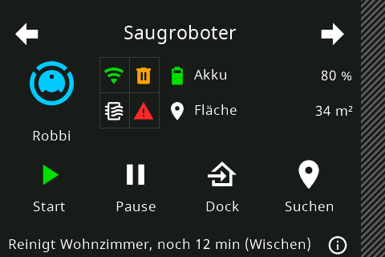
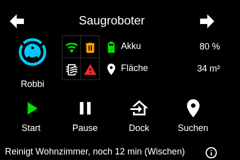
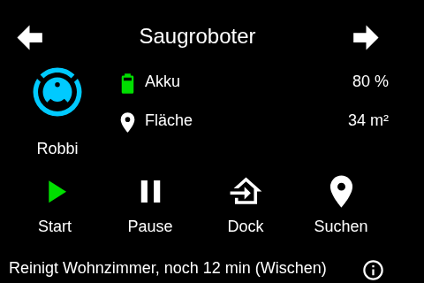
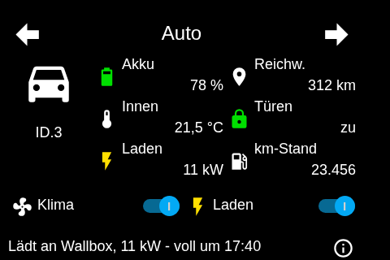

# Geräteseite für „Gerät mit Details“

Dieser Ordner enthält die Bilder zur Geräteseite, eine Kurz-Anleitung und die Prüftabellen für Tim.

- **Ausführliche Anleitung für Nutzer:** [doc/de/deviceDetails.md](../../de/deviceDetails.md) (englisch:
  [doc/en/deviceDetails.md](../../en/deviceDetails.md)).
- **Welche Bilder noch fehlen, wer sie aufnimmt und wie:** [BILDER.md](BILDER.md) – dort steht auch der Abgleich
  Web ↔ HMI.
- Technik (Protokoll, Maße): [doc/ideas/device-details](../../ideas/device-details/README.md).

Stand: 2026-11-24. Beschrieben ist der **Zielstand** (Geräteseite auf allen Modellen, Zusatz-Elemente für
Smartphone-Web-Panels); was davon noch nicht im Branch ist, ist als „nach der Integration“ markiert.

## Kurz-Anleitung

Ein Item der Art **Gerät mit Details** öffnet mit einem langen Druck (Grid-Seiten) bzw. einem Tipp auf Icon oder
Bezeichnung (cardEntities) die **Detailseite** – eine Liste mit allen angehakten Werten des Geräts. Stattdessen
kannst du eine **Geräteseite** öffnen lassen: ein großes Geräte-Icon, feste Plätze (Slots) für Werte, einen
Fortschrittsbalken, Knöpfe, Schalter oder kleine Status-Icons, eine Statuszeile und unten rechts ein kleines „i“,
das die Detailseite öffnet. Das passt z. B. für Waschmaschine, Saugroboter, Rasenmäher oder Auto.

1. Im Seiten-Editor das Item öffnen, oben die Art **Gerät mit Details** und das Gerät wählen.
2. Bei **Long-Press öffnet** **Geräteseite** wählen (Vorgabe ist **Detailseite**). Umschalten verliert nichts,
   solange der Dialog offen ist.

   

3. **Layout** wählen – die kleinen Bilder zeigen, wo welcher Slot sitzt.
4. **Haupt-Icon** wählen (leer = Icon des Items).
5. **Statuszeile**: ein Wert des Geräts oder ganz oben **Benutzerdefinierter Datenpunkt** für einen eigenen
   Datenpunkt, z. B. einen Text unter `0_userdata.0`.

   

6. **Slots** belegen: je Zeile „leer“, **Benutzerdefiniert** oder ein passender Wert des Geräts.
   **Benutzerdefiniert** bietet **Datenpunkt** (irgendein Datenpunkt), **Kanal** (Alias-Kanal, bedient wie auf
   einer Grid-Seite) und – bei Info-Zeile, Knopf und Status-Icon – **Navigation** (Platz nur zum Springen auf eine
   Zielseite). Was nicht passt oder fehlt, ist rot markiert und bleibt am Panel leer.

   

7. **…** rechts in jeder belegten Zeile öffnet die Einstellungen des Elements (grün, sobald etwas gesetzt ist):
   bei Info-Zeile, großem Wert, Fortschrittsbalken, Knopf und Schalter die Pageitem-Konfiguration ohne Kanalauswahl
   (Name, Icon und Farbe für wahr/unwahr, Farbverlauf, Text-/Icongröße, **Ist eine Navigation** mit Zielseite,
   bei Knopf und Schalter **Langer Druck**); bei einem Status-Icon ein kleiner Dialog (Icon, Farbe, Farbverlauf,
   Kurzer Tipp Standard/Navigation).

   

8. **Status-Icons** (nur Layout 1, Slots 7–10): nur ein kleines Icon in seiner Farbe. Sobald eines belegt ist,
   erscheint das 2×2-Raster und die beiden Info-Zeilen werden schmaler.
9. **i-Icon anzeigen** (Vorgabe an): das „i“ öffnet die Detailseite mit den angehakten Einträgen der Filterliste.
10. Für Web-Panels mit den Modellen **Smartphone quer** / **Smartphone hochkant**: das Häkchen für die
    zusätzlichen Elemente setzen, dann erscheinen die Zusatz-Plätze (nach der Integration, Beschriftung steht
    noch nicht fest).
11. **Übernehmen**, dann im Tab **Speichern**.

**Geräteseite schon beim ersten Tipp:** Unter **Kurzer Tipp** gibt es **Geräteseite öffnen** – nur wählbar, wenn
bei „Long-Press öffnet“ die Geräteseite gewählt ist.

Die drei Layouts: **1 – Steuern** (2 Info-Zeilen, 4 Knöpfe, 4 Status-Icons), **2 – Fortschritt** (großer Wert,
Fortschrittsbalken, 3 Info-Kacheln, 1 Knopf), **3 – Werte** (6 Info-Kacheln, 2 Schalter). Auf Smartphone-Web-Panels
zusätzlich: Layout 1 +2 Knöpfe, Layout 2 +1 Info-Zeile und +2 Knöpfe, Layout 3 +2 Info-Zeilen und +1 Schalter.

**Wo es die Geräteseite gibt:** auf allen Modellen (eu, us-l, us-p, web-l, web-p). Ein Hardware-Panel braucht
eine TFT mit den Geräteseiten (Version steht noch nicht fest); mit älterer TFT öffnet sich wie bisher die
Detailseite. Heute im Branch: nur eu und web-l.

## Bilder: Szenario und was Tim prüfen soll

Vorhandene Bilder; die geplanten stehen in [BILDER.md](BILDER.md) und kommen nach dem Aufnehmen hier dazu.

| Bild | Szenario | Was Tim prüfen soll |
|---|---|---|
|  | Dialog mit Geräteseite, Layout 1, alle Slots belegt (Gerät `0_userdata.0.devicepage.robot`) | Aufbau verständlich? Vorschau passt zu den Slot-Nummern? **Veraltet:** der Hinweis „nur auf EU-Panels und Web-Panels im Querformat“ – wird nach der Integration neu aufgenommen |
|  | Kurzer Tipp „Geräteseite öffnen“ gewählt | Auswahl nur mit „Long-Press öffnet: Geräteseite“ möglich |
|  | Statuszeile mit „Benutzerdefinierter Datenpunkt“ | Feld für die ID erscheint, nichts rot bei leerem Feld |
|  | Slots mit Datenpunkt, Alias-Kanal und einem unpassenden Datenpunkt | rote Markierung „passt nicht zu diesem Slot“. **Veraltet:** die Wahl heißt jetzt „Kanal“, dazu kommt „Navigation“ – wird neu aufgenommen |
|  | „…“ eines Knopf-Slots | **Veraltet:** zeigt den früheren kleinen Dialog; Knopf-Slots öffnen jetzt die Pageitem-Konfiguration ohne Kanalauswahl – wird neu aufgenommen. Den kleinen Dialog gibt es nur noch für Status-Icons |
|  | HMI-Vorschau cardDevice1 mit Status-Icons (Werkzeug, Beispieldaten) | Raster an den Info-Zeilen ausgerichtet, Info-Zeilen schmal |
|  | HMI-Vorschau cardDevice1 ohne Status-Icons | kein Raster, Info-Zeilen breit |
|  | HMI-Vorschau cardDevice2 | großer Wert, Balken, drei Kacheln, Knopf oben rechts |
|  | HMI-Vorschau cardDevice3 | sechs Kacheln zeilenweise, zwei Schalter |
|  | Web-Panel (Modell eu), dieselben Beispieldaten wie `hmi-cardDevice1.png` | deckt sich mit der HMI-Vorschau? **Veraltet:** Statuszeile noch linksbündig (heute mittig) – wird neu aufgenommen |
|  | Web-Panel, cardDevice1 ohne Status-Icons | wie `hmi-cardDevice1-plain.png`; Statuszeile wie oben |
|  | Web-Panel, cardDevice2 | wie `hmi-cardDevice2.png` (Balkenlänge, Lage der Kacheln) |
|  | Web-Panel, cardDevice3 | wie `hmi-cardDevice3.png`; Statuszeile noch linksbündig – wird neu aufgenommen |

## Was Tim prüfen soll

Spalte **Im Browser geprüft (2026-11-23)**: ✓ = im Admin des Dev-Servers per Puppeteer geprüft, „✓ nur Admin“ = der Admin-Teil der Zeile geprüft, der Teil am Panel nicht; leer = nicht geprüft. Die Zeilen 30, 32, 38–43 sind an den „…“-Dialog vom 2026-11-24 angepasst (Pageitem-Konfiguration statt des kleinen Dialogs) und deshalb wieder ungeprüft; die Zeilen ab 52 gehören zum Zielstand (alle Modelle, Zusatz-Elemente) und lassen sich erst nach der Integration prüfen.

| # | Prüfung | Erwartung | Im Browser geprüft (2026-11-23) |
|---|---|---|---|
| 1 | Item „Gerät mit Details“ öffnen, das noch keine Geräteseite hat | „Long-Press öffnet“ steht auf **Detailseite**, kein Geräteseiten-Bereich sichtbar | |
| 2 | Auf **Geräteseite** umschalten | Layout 1 gewählt, Info-Slots 1 und 2 mit den ersten angehakten Einträgen vorbelegt, Knöpfe leer, Statuszeile leer, „i-Icon anzeigen“ an | |
| 3 | Etwas ändern, auf **Detailseite** und zurück auf **Geräteseite** schalten | alle Änderungen sind wieder da | ✓ |
| 4 | Layout 1 mit belegten Status-Slots 7–10, dann Layout 2 und zurück auf Layout 1 wählen (Gegenprobe: Layout 3 → Layout 1) | Slots bleiben nach Position; Layout 2 hat nur 6 Slots – die Status-Slots 7–10 gehen dabei verloren und sind zurück auf Layout 1 leer. Von Layout 3 (8 Slots) nach Layout 1 (10 Slots) geht nichts verloren, die Slots 9/10 sind leer | |
| 5 | Auswahl eines Knopf-/Schalter-/Fortschritts-Slots aufklappen | nur passende States (Knopf: Taster und schaltbare boolean, Schalter: schaltbare boolean, Balken: Zahlen), „leer“ oben | ✓ |
| 6 | Statuszeile aufklappen | alle States des Geräts, Name + ID wie in der Filterliste | ✓ |
| 6a | Statuszeile: **Benutzerdefinierter Datenpunkt** wählen (zweiter Eintrag nach „leer“) | darunter erscheint das Feld für die ID mit Knopf „...“; mit leerem Feld bleibt die Auswahl stehen (springt nicht auf „leer“), nichts ist rot markiert. ID außerhalb des Geräts eintragen (z. B. `0_userdata.0.status`), übernehmen, neu öffnen: Auswahl und ID sind da; am Panel zeigt die Statuszeile den Wert und folgt Änderungen | ✓ nur Admin |
| 7 | Haupt-Icon wählen und wieder leeren | Icon wird gespeichert bzw. entfällt | |
| 8 | Übernehmen, Dialog neu öffnen | Geräteseite mit allen Einstellungen da; Rohdaten zeigen `device.devicePage` | ✓ |
| 9 | Auf **Detailseite** stellen und übernehmen | `device.devicePage` ist aus den Rohdaten verschwunden | |
| 10 | Einen gespeicherten Slot-State im Objektbaum löschen, Dialog öffnen | Slot zeigt den State rot „nicht im Gerät gefunden“, nach Übernehmen weiter gespeichert | |
| 11 | Adapter stoppen, Dialog öffnen, Übernehmen | gespeicherte Geräteseite bleibt unverändert | |
| 12 | Long-Press am EU-Panel (neue TFT) und in jedem Web-Panel | Geräteseite erscheint mit den gewählten Slots | |
| 13 | Dialog in hellem und dunklem Thema, schmales Fenster | Vorschaubilder und Slot-Zeilen lesbar, nichts abgeschnitten | |
| 14 | Item mit einer Geräteseite Layout 1 von vor den Status-Icons (6 Slots) öffnen | Slots 1–6 unverändert, Slots 7–10 „Status-Icon“ leer; Übernehmen speichert 10 Slots | |
| 15 | Layout 1: unter den Slots | Hinweis, dass die Info-Zeilen schmaler werden, sobald ein Status-Icon belegt ist | ✓ |
| 16 | Status-Slot 8 einen Wert geben | der „…“-Knopf der Zeile wird aktiv; die Vorschau von Layout 1 zeigt jetzt das 2×2-Raster und schmalere Info-Zeilen | |
| 17 | Über „…“ ein eigenes Icon wählen, dann einen anderen Wert für denselben Slot | das Icon bleibt, „…“ ist grün; Wert auf „leer“ → Einstellungen sind weg, „…“ ausgegraut | ✓ |
| 18 | Alle Status-Slots wieder leeren | Vorschau ohne Raster, Info-Zeilen wieder breit | |
| 19 | Layout 1 mit Status-Icons → Layout 3 → Layout 1 | Slots 7/8 bekommen bei Layout 3 die Werte von Status 7/8 nur, wenn sie zum Schalter passen (sonst rot); das eigene Icon geht beim Wechsel auf Layout 3 verloren | |
| 20 | Am Panel: Layout 1 mit einem An/Aus-Wert (z. B. Tür) als Status-Icon | Icon grün/rot (aktiviert/deaktiviert) wechselt mit dem Wert, kein Name, kein Wert, Tipp ohne Wirkung | |
| 21 | Am Panel: Status-Icons ein- und ausblenden (Wert im Admin setzen/leeren) | Raster erscheint/verschwindet, Info-Zeilen springen schmal/breit | |
| 22 | Slot-Auswahl aufklappen (jede Art) | Reihenfolge: „leer“, **Benutzerdefiniert**, dann die Werte des Geräts | ✓ |
| 23 | Info-Slot: Benutzerdefiniert → Datenpunkt, ID außerhalb des Geräts eintragen, übernehmen, neu öffnen | Auswahl und ID sind da, nichts rot; am Panel Name des Datenpunkts und Wert mit Einheit, folgt Änderungen. Leeres Feld: Auswahl bleibt stehen, Slot am Panel leer | ✓ nur Admin |
| 24 | Fortschritts-Slot: eigenen Datenpunkt wählen, der keine Zahl ist; danach eine ID, die es nicht gibt | rot „passt nicht zu diesem Slot“ bzw. „Datenpunkt nicht gefunden“; am Panel bleibt der Slot leer (Warnung im Log) | ✓ nur Admin |
| 25 | Knopf-Slot: Benutzerdefiniert → Kanal, mit „...“ ein Licht aussuchen (State unter dem Kanal anklicken) | die ID wird auf den Kanal gekürzt; angeboten werden nur Kanäle, die zur Slot-Art passen | ✓ |
| 26 | Schalter-Slot: Kanal-ID eines Rollladens eintippen | rot „passt nicht zu diesem Slot“ | ✓ |
| 27 | Am Panel: Steckdose (socket) und einfaches Licht (light) in Info- und Knopf-Slot | Tipp schaltet, Icon/Farbe wechseln, **kein** popupLight beim Halten; Info-Zeile zeigt An/Aus | |
| 28 | Am Panel: dimmbares Licht im Knopf-Slot, Rollladen und Auswahl (select) im Info-Slot, Regler (slider) im Fortschritts-Slot | Licht: Tipp schaltet, Halten öffnet popupLight; Rollladen/Auswahl öffnen ihr Popup sofort, Wertfeld des Rollladens leer; Balken folgt dem Regler | |
| 29 | Am Panel: Steckdose im Schalter-Slot (Layout 3), Temperatur-Kanal im Info-Slot und als großer Wert | Schalter schaltet und zeigt den Zustand; Temperatur mit Icon (nicht Zahl statt Icon) und Wert mit Einheit | |
| 30 | „…“ eines Knopf-Slots mit An/Aus-Wert: es öffnet die Pageitem-Konfiguration ohne Kanalauswahl (Titel mit Nummer und Art des Slots); Icon „pause“ bei wahr, „play“ bei unwahr, zwei Farben, übernehmen | „…“ grün; am Panel wechseln Icon und Farbe mit dem Wert, der Tipp schaltet um | |
| 31 | „…“ eines Info-Slots mit Zahl: Icon bei wahr und Farbe setzen; „Farbverlauf …“ mit Min/Max | Icon/Farbe gelten immer (kein „unwahr“); mit Farbverlauf ändert sich die Farbe mit dem Wert; beim Fortschritts-Slot die Balkenfarbe | |
| 32 | „…“ eines Knopf- und eines Schalter-Slots | Abschnitt **Langer Druck** mit Datenpunkt-Auswahl (keine Zielseite); bei Info-/Wert-/Fortschritts-Slots fehlt er. Am Panel (HMI ab device5): langer Druck setzt den Datenpunkt (Knopf) bzw. schaltet ihn um (Schalter), kein Tipp dabei | |
| 33 | „…“ eines Kanal-Slots: eigenes Icon und Farbe | überschreiben die Vorgaben der Rolle am Panel | |
| 34 | Altes Item mit Status-Icon (Feld `icon`) öffnen, „…“ des Slots | Dialog zeigt das Icon bei wahr und unwahr, „…“ grün; ohne Änderung bleibt alles wie vorher | ✓ |
| 35 | Kurzer Tipp: **Geräteseite öffnen** bei „Long-Press öffnet: Detailseite“ | ausgegraut; mit Geräteseite wählbar. Wählen, dann auf Detailseite schalten → Kurzer Tipp springt auf „Keine“ | ✓ |
| 36 | Am Panel: Item mit „Geräteseite öffnen“ kurz antippen (Grid und cardEntities) | Geräteseite erscheint; langer Druck ebenso; Zurück führt zur Seite des Items. Auf der Geräteseite tut ein Tipp auf das große Icon nichts. Alte TFT: Detailseite | |
| 37 | Am Panel: langer Druck auf einen Slot ohne Long-Press-Einstellung, auf das große Icon und auf „i“ | nichts passiert (kein Schalten, keine Detailseite) | |
| 38 | „…“ eines Info-, Wert-, Knopf- oder Schalter-Slots mit einem Wert des Geräts; danach „…“ eines Status-Slots | Info/Wert/Knopf/Schalter: Häkchen **Ist eine Navigation**, gesetzt erscheint die **Zielseite** (dieselbe Liste wie beim Standard-Item, mit Screensaver). Status-Slot: kleiner Dialog mit Abschnitt **Kurzer Tipp** („Standard“ / „Navigation“) | |
| 39 | „Ist eine Navigation“ setzen (Status-Slot: „Navigation“ wählen), Zielseite aussuchen, übernehmen, Item speichern, neu öffnen | „…“ grün; Rohdaten zeigen am Slot `isNavigation: true` und `targetPage`; Häkchen wieder entfernen (bzw. „Standard“) → beide Felder weg | |
| 40 | Zielseite eintippen, die es nicht gibt | Feld rot „Zielseite nicht gefunden“, nach Übernehmen steht dasselbe rot unter der Slot-Zeile; speichern geht trotzdem | |
| 41 | Slot-Auswahl **Benutzerdefiniert** bei Info-Zeile, Knopf, Status-Icon | dritte Wahl **Navigation** neben Datenpunkt und Kanal; bei großem Wert, Fortschrittsbalken und Schalter fehlt sie | |
| 42 | **Navigation** wählen: Zielseite in der Zeile, über „…“ Name (Beschriftung), Icon und Farbe | „…“ ist ohne ID aktiv und zeigt Name (Hilfstext „Leer = Name der Zielseite …“) und nur eine Spalte Icon/Farbe, keinen Farbverlauf, kein „Ist eine Navigation“, keinen Langen Druck; neu öffnen: alles da | |
| 43 | „…“ eines Kanal-Slots mit Steckdose/Licht/Sensor und eines mit Rollladen/Auswahl/Timer | Steckdose/Licht/Sensor: „Ist eine Navigation“ vorhanden; Rollladen/Tor/Schloss/Auswahl/Timer: fehlt | |
| 44 | Am Panel und im Web-Panel: Navigations-Platz im Knopf-Slot, in der Info-Zeile und als Status-Icon antippen | Zielseite erscheint; Knopf/Info zeigen Icon und Beschriftung (leer = Seitenname), kein Wert; Status-Icon nur das Icon | |
| 45 | Am Panel: Slot mit Wert und „Navigation“ (Info-Zeile mit Zahl, Knopf mit An/Aus-Wert) antippen | Zielseite erscheint, der Wert wird **nicht** geschaltet/gedrückt; Icon, Farbe und Wert des Slots wie vorher | |
| 46 | Am Panel: Schalter-Slot mit „Navigation“ | Tipp auf Icon/Name öffnet die Zielseite, der Schalter rechts schaltet weiter | |
| 47 | Am Panel: Info-Zeile mit einer Auswahl (schreibbar, mit Werteliste) und „Navigation“ | Zeile zeigt den Text des Werts, der Tipp öffnet die Zielseite statt des Auswahl-Popups | |
| 48 | Am Panel: dimmbares Licht (Kanal) mit „Navigation“ | kurzer Tipp öffnet die Zielseite, Halten öffnet weiter popupLight | |
| 49 | Auf der Zielseite die Pfeile benutzen | sie führen, wie für die Zielseite eingerichtet (nicht automatisch zur Geräteseite); über das Item kommt man wieder auf die Geräteseite | |
| 50 | Zielseite wählen, die dem Panel nicht zugeordnet ist (oder Seite löschen), am Panel antippen | nichts passiert; im Log **eine** Warnung „target page … is not assigned to panel …“, auch bei mehrfachem Tippen | |
| 51 | Kanal-Slot mit einer Kanal-ID, die es nicht gibt, Adapter neu starten | im Log eine Warnung `Page '<Seite>', page item <n>: Device page slot … not found!` – einmal, auch wenn die Seite mehreren Panels zugeordnet ist | |
| 52 | us-l-Panel bzw. Web-Panel mit Modell US-Querformat: Geräteseite aller drei Layouts öffnen | sieht aus wie am EU-Panel (Bilder `us-l-cardDevice*.png` gegen `eu-cardDevice*.png`) | |
| 53 | us-p-Panel bzw. Web-Panel mit Modell US-Hochformat: alle drei Layouts | hochkant neu angeordnet; Layout 1: Haupt-Icon oben links, 2×2-Status-Icons daneben, Info-Zeilen volle Breite, Knöpfe 2×2, Statuszeile unten. Alle belegten Slots sichtbar und bedienbar | |
| 54 | Web-Panel „Smartphone quer“ und „Smartphone hochkant“, Häkchen für Zusatz-Elemente **aus** | eigenes Layout auf voller Bühne (640×320 bzw. 320×640), dieselben Elemente wie am Hardware-Panel, keine Zusatz-Plätze | |
| 55 | Admin: Häkchen für die Zusatz-Elemente setzen und wieder entfernen | gesetzt: unter „Slots“ erscheinen die Zusatz-Plätze (Layout 1 +2 Knöpfe, Layout 2 +1 Info-Zeile +2 Knöpfe, Layout 3 +2 Info-Zeilen +1 Schalter); entfernt: sie verschwinden. Vorgabe bei einer neuen Geräteseite: aus | |
| 56 | Zusatz-Plätze belegen; dieselbe Seite einem Smartphone-Web-Panel **und** einem Hardware-Panel (oder dessen Browser-Bild) zuweisen | Smartphone-Web-Panel zeigt die Zusatz-Elemente und sie lassen sich bedienen; Hardware-Panel und sein Browser-Bild zeigen sie nie, alles andere unverändert | |
| 57 | Langer Name und langer Wert in einem Slot, auf allen fünf Modellen ansehen | Der Text endet überall an derselben Stelle (gleiche Textlängen), ohne eigene „…“ | |
| 58 | Abgleich Web ↔ HMI nach [BILDER.md](BILDER.md) | die fünf Web-Aufnahmen (Modell eu) decken sich mit Tims Aufnahmen – bis auf die dort genannten bekannten Unterschiede | |

