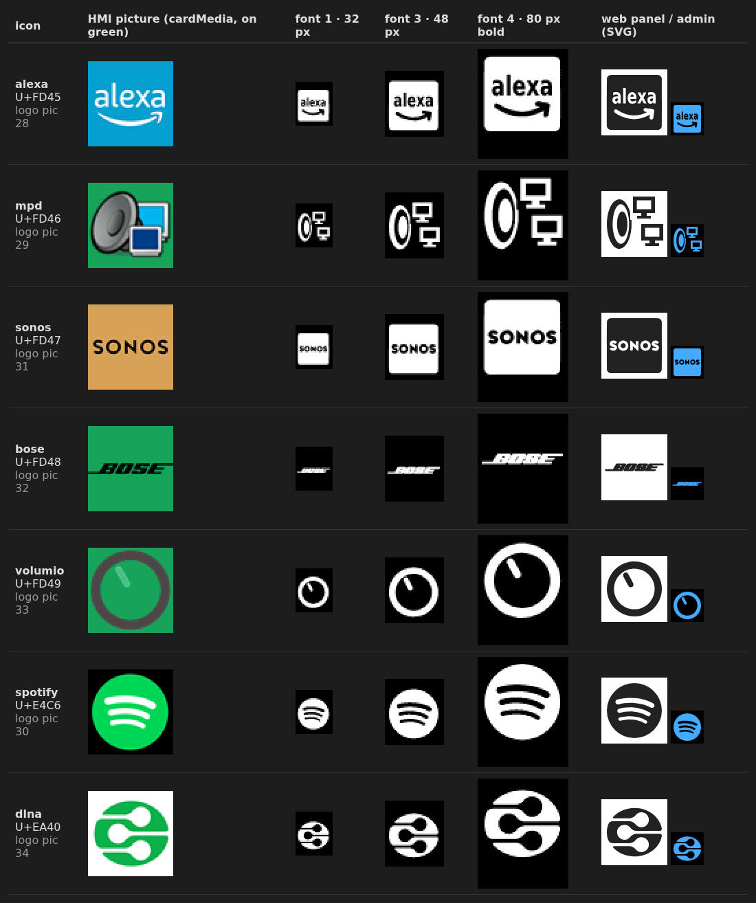

# Player icons (HMI 6.1.0)

The cardMedia page shows the player as a picture (`logo-alexa`, `logo-sonos`, ...; HMI pictures 28–34).
Since HMI 6.1.0 the same players are also normal monochrome icons in the icon fonts 1, 3 and 4
(`4.zi`, `5.zi`, `1.zi`), usable everywhere an icon name is accepted. The cardMedia page itself is unchanged.

Columns: icon name and glyph, the HMI picture, the glyph as rendered into the three icon fonts of the HMI
(2× enlarged, white = opaque), the svg path as admin and web panel draw it.

| Icon      | Glyph  | HMI picture          | Source                                                                    |
| --------- | ------ | -------------------- | ------------------------------------------------------------------------- |
| `alexa`   | U+FD45 | 28 `logo-alexa`      | own drawing: "alexa" + smile arrow cut out of a square (DejaVu Sans Bold) |
| `mpd`     | U+FD46 | 29 `logo-mpd`        | own drawing: speaker with two monitors                                    |
| `sonos`   | U+FD47 | 31 `logo-sonos`      | "SONOS" wordmark from Simple Icons (CC0) cut out of a square              |
| `bose`    | U+FD48 | 32 `logo-bose`       | wordmark from Simple Icons (CC0)                                          |
| `volumio` | U+FD49 | 33 `logo-volumio`    | own drawing: ring with needle (volume knob)                               |
| `spotify` | U+E4C6 | 30/36 `logo-spotify` | MDI `spotify` – already a normal icon, unchanged                          |
| `dlna`    | U+EA40 | 34 `logo-dnla`       | MDI `dlna` – already a normal icon, unchanged                             |

The new icons are own icons (`script/custom-icons.json`, range U+FD40–U+FD7F); MDI 7.4.47 has none of them.
The drawings were composed on a 960 px canvas and traced (potrace) into a 24×24 path, holes wound for the
nonzero fill rule. Older TFTs (before 6.1.0) show nothing for U+FD45–U+FD49.

The web panel draws the `logo-*` names of cardMedia with these icons as well.
