# Panel-Konfiguration exportieren und importieren

## Anleitung

### Wofür

Die Konfiguration eines Panels lässt sich als Datei sichern und wieder einspielen. Das hilft

- als **Sicherung**, bevor Sie größere Änderungen machen: Geht etwas schief, spielen Sie die Datei einfach
  wieder in dasselbe Panel ein;
- zum **Übertragen auf ein anderes Panel**, z. B. wenn ein zweites Panel genauso aussehen soll wie das erste
  oder ein Panel ersetzt wird – auch in eine andere ioBroker-Installation.

Die Datei enthält drei Teile:

- **Seiten** – alle Seiten, die auf dem Panel zu sehen sind, mit ihrer Navigation (vor, zurück, hoch, Home);
- **Screensaver** – der Screensaver des Panels mit seinen Benachrichtigungen;
- **Sonstiges** – die Hardware-Tasten und die Einstellungen des Panels (z. B. Screensaver-Timeout, Helligkeit,
  Tastenkopplung). Außerdem stehen „Panel benutzt kein Skript“ und die geänderte Navigation von Skript-Seiten
  in der Datei; sie werden nur beim Import mit **Komplett überschreiben** übernommen.

Export und Import betreffen die **Admin-Seiten**. Seiten aus Skripten (Panel-Skript, globales Skript) sind nicht
in der Datei.

### Exportieren

1. Im Admin auf den Reiter **Nspanel-Einstellungen** gehen.
2. Auf der Kachel des Panels auf den **Export-Knopf** (Pfeil nach unten) klicken.

   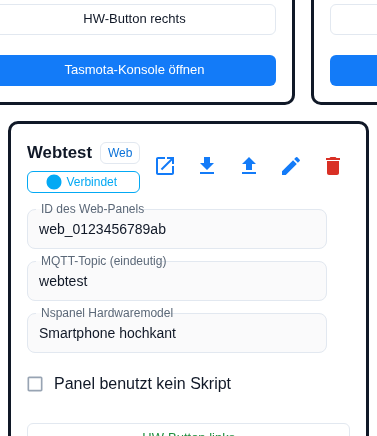

3. Enthalten Seiten des Panels eine **PIN** (Alarm-/Entsperrseite) oder ein **WLAN-Passwort** (QR-Seite),
   fragt der Admin nach, ob diese mit in die Datei sollen:

   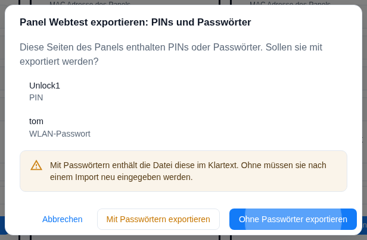

   - **Ohne Passwörter exportieren** (Vorgabe): Die Datei enthält keine Geheimnisse und kann gefahrlos
     weitergegeben werden. Nach einem Import in ein anderes Panel geben Sie PIN bzw. Passwort dort neu ein.
   - **Mit Passwörtern exportieren**: Die Datei enthält PIN und Passwörter im Klartext. Bewahren Sie sie sicher
     auf.

   Eine PIN, die das globale Passwort der Instanz verwendet, ist kein Geheimnis und wird immer mitgenommen.
4. Der Browser lädt die Datei herunter, z. B. `nspanel-Wohnzimmer-2026-11-11.json`.

### Importieren

1. Auf der Kachel des **Ziel-Panels** auf den **Import-Knopf** (Pfeil nach oben) klicken.
2. Auswählen, welche Teile übernommen werden sollen – Seiten, Screensaver, Sonstiges –, dann
   **Datei auswählen**.

   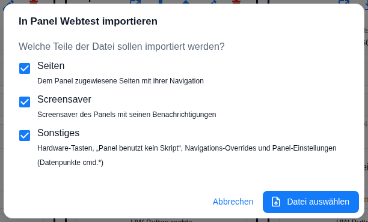

   Ist die Datei beschädigt oder keine Panel-Konfiguration, erscheint eine Fehlermeldung
   ([Beispiel](09-invalid-file.png)). Fehlt ein gewählter Teil in der Datei, wird er übersprungen und angezeigt.
3. Es öffnet sich die **Übersicht**. Ganz oben wählen Sie den **Importmodus**:

   - **Zusammenführen** (Vorgabe): Die Admin-Seiten der Datei kommen auf das Panel. Die bisher diesem Panel
     zugeordneten Admin-Seiten werden vom Panel gelöst. Das Panel-Skript, seine Seiten und die geänderte
     Navigation von Skript-Seiten bleiben, wie sie sind.
   - **Komplett überschreiben**: Alles, was nur zu diesem Panel gehört, wird durch die Datei ersetzt – die
     eigenen Seiten samt Navigation, ausgeblendete „Alle Panels“-Seiten, die geänderte Navigation von
     Skript-Seiten. Das **Panel-Skript wird abgeschaltet** („Panel benutzt kein Skript“), seine Seiten
     verschwinden vom Panel. Seiten, die „allen Panels“ zugeordnet sind, und Seiten des globalen Skripts
     bleiben mit ihrer Navigation auf dem Panel – die Übersicht zeigt sie unter „Bleibt zusätzlich auf dem
     Panel“. Andere Panels ändern sich nicht. Dieser Modus geht nur, wenn der Teil **Seiten** importiert wird.

   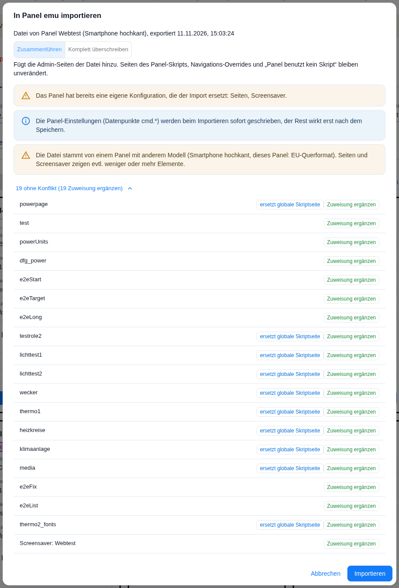

   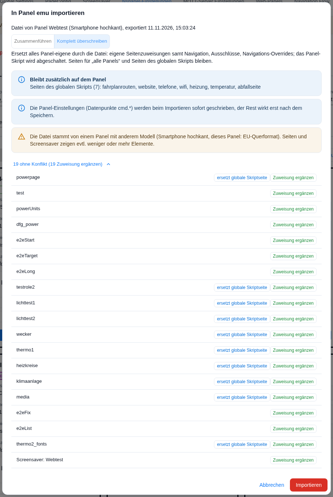

   Darunter stehen Hinweise, z. B. dass vorhandene Einstellungen des Panels
   ersetzt werden, dass die Datei von einem Panel mit anderem Modell stammt oder auf welchen Seiten Sie
   Passwörter neu eingeben müssen. Darunter steht jede Seite der Datei und der Screensaver mit dem, was mit
   ihr passiert:

   | Anzeige | Bedeutung |
   | --- | --- |
   | **unverändert** | Die Seite ist schon genau so auf dem Panel – es passiert nichts. |
   | **Zuweisung ergänzen** | Die Seite gibt es schon (gleicher Inhalt), sie wird zusätzlich diesem Panel zugeordnet. |
   | **Navigation ändern** | Die Seite ist schon auf dem Panel, bekommt aber die Navigation aus der Datei. |
   | **neu anlegen** | Die Seite gibt es noch nicht, sie wird angelegt. |
   | **unterschiedlich** | Es gibt schon eine Seite mit diesem Namen, aber mit anderem Inhalt. Sie wählen: |
   | – umbenennen (Vorschlag) | Die Seite aus der Datei wird unter einem neuen Namen angelegt; den Namen können Sie ändern. Die vorhandene Seite bleibt, wie sie ist. |
   | – vorhandene ersetzen | Die vorhandene Seite bekommt den Inhalt aus der Datei. |
   | – überspringen | Die Seite aus der Datei wird nicht übernommen. |

   Heißt eine Seite der Datei wie eine Seite aus einem Skript, steht ein zweiter Hinweis daneben:

   | Anzeige | Bedeutung |
   | --- | --- |
   | **ersetzt globale Skriptseite** | Das globale Skript hat eine Seite mit diesem Namen. Auf diesem Panel zeigt sich die Admin-Seite statt der Skriptseite. Das ist kein Konflikt. |
   | **ersetzt Skriptseite des Panels** | Die Admin-Seite tritt an die Stelle der gleichnamigen Seite des Panel-Skripts (gilt immer für die Startseite). |
   | **Skriptseite des Panels hat Vorrang** | Das Panel-Skript hat eine Seite mit diesem Namen; die Skriptseite bleibt, die importierte Seite erscheint auf diesem Panel nicht. Abhilfe: umbenennen oder **Komplett überschreiben**. |

   Seiten ohne Konflikt sind zusammengeklappt („23 ohne Konflikt“), ein Klick zeigt sie an. Wird eine Seite
   umbenannt, ändern sich auch die Seiten, die auf sie verweisen – sie erscheinen dann ebenfalls als
   „unterschiedlich“.

   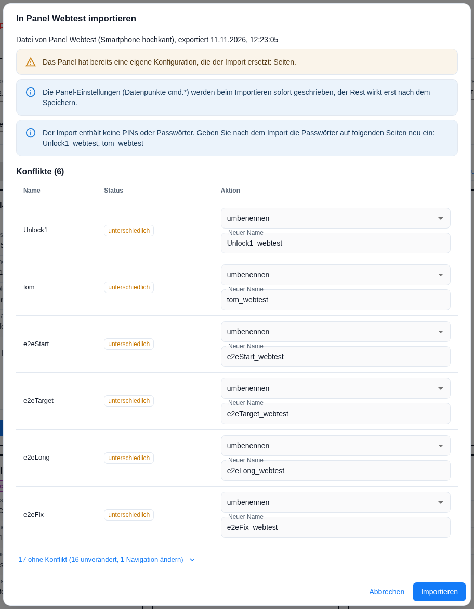

   Ein Klick auf **unterschiedlich** zeigt, was sich genau unterscheidet, z. B. Überschrift, einzelne Elemente
   oder die Navigation:

   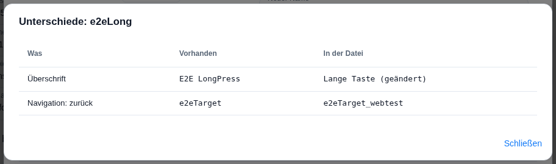

   Wählen Sie **vorhandene ersetzen** für eine Seite, die auch andere Panels zeigen, fragt der Admin noch
   einmal nach und nennt diese Panels – sie ändern sich mit:

   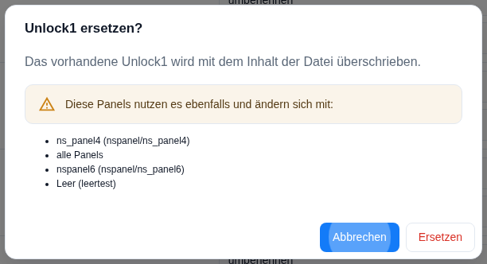

4. Auf **Importieren** klicken. Bei **Komplett überschreiben** fragt der Admin vorher nach und zählt auf, was
   wegfällt: welche eigenen Seiten vom Panel entfernt werden (aufklappbare Liste – die Seiten selbst bleiben
   erhalten), dass das Panel-Skript abgeschaltet wird und welche Skriptseiten verschwinden, welche geänderte
   Navigation gelöscht wird und was unverändert bleibt. Vorausgewählt ist **Abbrechen**.

   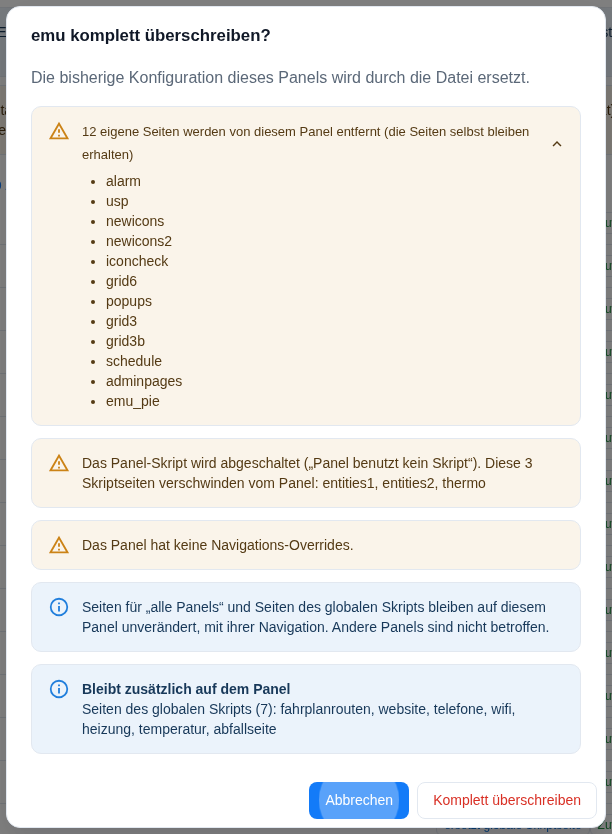

   Im häufigsten Fall – Sicherung ins selbe Panel zurückspielen oder Import in ein
   leeres Panel – ist nichts zu entscheiden, ein Klick genügt.

   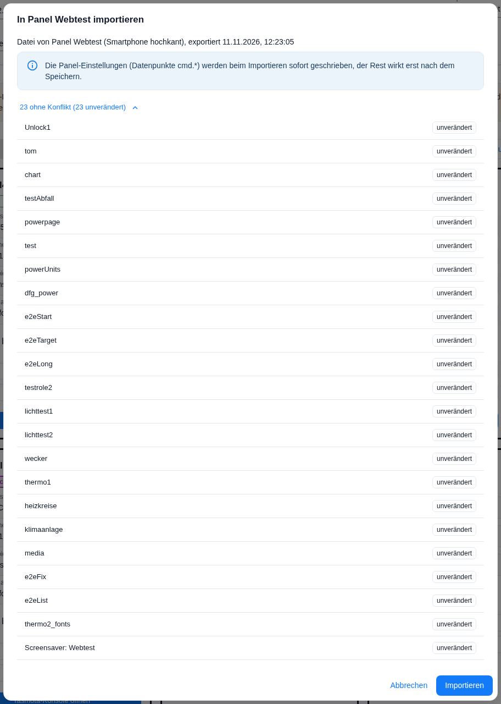

5. Die **Zusammenfassung** zeigt, was angelegt, umbenannt, ersetzt oder übersprungen wurde und wo Sie PIN
   oder Passwort neu eingeben müssen.

   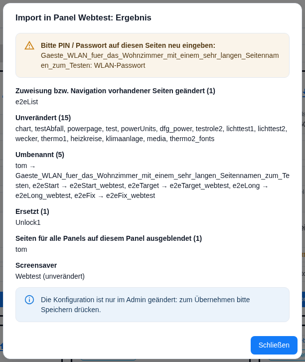

   Zeigt danach ein Navigationsverweis (vor, zurück, hoch, Home) auf eine Seite, die es auf diesem Panel nicht
   gibt, listet die Zusammenfassung ihn unter „Navigation zeigt auf Seiten, die nicht auf diesem Panel sind“.
   Der Admin korrigiert das nicht selbst – bitte die Navigation dieser Seiten prüfen.

   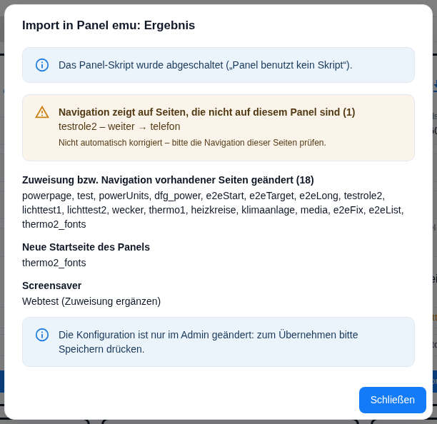

6. **Speichern** drücken. Seiten, Screensaver, Tasten und Navigation gelten erst nach dem Speichern. Die
   **Panel-Einstellungen** (Timeout, Helligkeit usw.) werden dagegen schon beim Importieren sofort
   geschrieben.

### Gut zu wissen

- **Passwörter neu eingeben:** Enthielt die Datei keine PINs/Passwörter, bekommen neu angelegte Alarm- bzw.
  Entsperrseiten das globale Passwort der Instanz und QR-Seiten ein leeres WLAN-Passwort. Tragen Sie die
  richtigen Werte auf den in der Zusammenfassung genannten Seiten nach. Bereits vorhandene Seiten behalten
  ihre PIN.
- **Startseite:** Bringt die Datei eine Startseite mit, wird sie die Startseite des Ziel-Panels. Andere
  Panels, die bisher dieselbe Startseite hatten, behalten sie.
- **Seiten, die mehrere Panels nutzen:** Der Import ändert nur, was das Ziel-Panel zeigt. Nur
  „vorhandene ersetzen“ wirkt auch auf andere Panels – deshalb die Rückfrage.
- **Anderes Modell:** Stammt die Datei von einem Panel mit anderem Modell (z. B. EU-Panel → Smartphone hochkant),
  passen nicht immer gleich viele Elemente auf eine Seite bzw. in den Screensaver. Prüfen Sie die Seiten
  nach dem Import ([Beispiel](02-empty-panel-review.png)).
- Vorher zugeordnete Seiten des Ziel-Panels, die nicht in der Datei stehen, werden nur vom Panel gelöst, nicht
  gelöscht – sie bleiben in der Seitenliste. Das gilt für beide Modi.
- **Skript wieder einschalten:** Nach **Komplett überschreiben** ist „Panel benutzt kein Skript“ gesetzt. Wer das
  Panel-Skript zurückhaben will, entfernt den Haken in den Panel-Einstellungen; die Skriptkonfiguration ist
  nicht gelöscht.

---

## Screenshots für die Durchsicht

Aufgenommen mit Puppeteer gegen den Dev-Server (Admin auf Deutsch). Testdaten: Export von Panel **Webtest**
(web-p, 22 Seiten, Screensaver „Webtest“); **Leer** ist ein leeres Web-Panel (eu), **testpanel** ein
konfiguriertes Panel. Für die Konflikt-Szenarien wurde die exportierte Datei von Hand geändert (Überschriften
von `e2eLong`, `Unlock1` und `tom`).

| Bild | Szenario | Was prüfen |
| --- | --- | --- |
| `export-button.png` | Export-Knopf auf der Kachel (erster Stand) | – |
| `secrets-dialog.png` | Export mit PIN/Passwort-Seiten | Standard ist „Ohne Passwörter exportieren“ |
| `00-tile-export-import-buttons.png` | Kachel mit Export- und Import-Knopf | Reihenfolge der Knöpfe |
| `00b-import-groups.png` | Import, Schritt 1: Teile wählen | Texte der drei Gruppen |
| `01-same-panel-review.png`, `01b-same-panel-result.png` | 1: Export und Re-Import ins selbe Panel | alles „unverändert“, kein Überschreiben- und kein Passwort-Hinweis, Ergebnis „Unverändert (22)“ |
| `02-empty-panel-review.png`, `02b-empty-panel-result.png` | 2: Import in ein leeres Panel (älterer Stand der Texte) | kein Überschreiben-Hinweis; zugleich 8: Modell-Warnung web-p → eu |
| `03-configured-panel-review.png` | 3: Import in ein konfiguriertes Panel | Überschreiben-Hinweis nennt nur Teile, die sich wirklich ändern; Zähler „4 unverändert, 19 Zuweisung ergänzen“ |
| `04-conflicts-review.png` | 4/5: geänderte Seite → „umbenennen“ vorgeschlagen | `e2eLong` geändert; `e2eTarget`, `e2eStart`, `e2eFix` werden über die Verweise ebenfalls zum Konflikt; Passwort-Hinweis nennt nur neu angelegte Seiten |
| `05-diff-dialog.png` | 4: Unterschiede (Klick auf „unterschiedlich“) | lesbare Feldnamen („Überschrift“, „Navigation: zurück“) |
| `05b-diff-ripple.png` | 5: Unterschied nur durch Umbenennung | „Zielseite: e2eLong“ → „e2eLong_webtest“ |
| `06-replace-confirm.png` | 6: „vorhandene ersetzen“ bei geteilter Seite | Liste der mitbetroffenen Panels (inkl. „alle Panels“) |
| `07a-name-validation.png` | eigener Name „main“ (älterer Stand der Texte) | Fehlermeldung, „Importieren“ gesperrt |
| `07b-conflicts-edited.png` | sehr langer eigener Name | Layout bei langen Namen |
| `07c-result-secrets.png` | 7: Ergebnis mit „bitte neu eingeben“ | QR-Seite ohne Passwort; Umbenannt/Ersetzt/Unverändert getrennt |
| `09-invalid-file.png`, `09b-foreign-file.png` | 9: kaputte bzw. fremde Datei | verständliche Fehlermeldung |
| `10-dark-theme-review.png` | Konflikt-Übersicht im dunklen Theme (älterer Stand der Texte) | Kontraste |
| `11-mode-merge.png` | Export von Webtest in Panel **emu** (Skript mit 3 eigenen Seiten), Modus „Zusammenführen“, Liste aufgeklappt | Umschalter oben, Hinweis „ersetzt globale Skriptseite“ bei `wecker`, `media`, `powerpage` usw. |
| `12-mode-overwrite.png` | dieselbe Datei, Modus „Komplett überschreiben“ | Erklärtext, „Bleibt zusätzlich auf dem Panel“ nennt die globalen Skriptseiten ohne die überschriebenen; Importieren-Knopf rot |
| `13-overwrite-confirm.png` | Sicherheitsabfrage, Liste der entfernten Seiten aufgeklappt | 12 eigene Seiten, Skript aus + Skriptseiten `entities1`, `entities2`, `thermo`, Overrides, „alle Panels“/global bleiben; Fokus auf Abbrechen |
| `14-overwrite-result.png` | Ergebnis nach „Komplett überschreiben“ (nicht gespeichert) | „Panel-Skript abgeschaltet“, toter Verweis `testrole2 – weiter → telefon` |
| `15-e2e-overwrite-review.png` | E2E mit Speichern: Datei = Export von **Test Web-P** plus Admin-Seite `wecker` (Name einer globalen Skriptseite), Modus „Komplett überschreiben“ | `wecker` „neu anlegen“ + „ersetzt globale Skriptseite“; `testAbfall` (alle Panels) und 15 globale Skriptseiten bleiben |
| `16-e2e-overwrite-confirm.png` | Sicherheitsabfrage dazu (Test Web-P hatte für den Test ein Panel-Skript mit `entities1`, `entities2`, `thermo`) | Skript aus, genau diese 3 Skriptseiten verschwinden |
| `17-e2e-overwrite-result.png` | Ergebnis, danach gespeichert | „Panel-Skript abgeschaltet“, `wecker` neu |
| `18-e2e-wecker-vorher.png`, `19-e2e-wecker-nachher.png` | Web-Ansicht von Test Web-P, `cmd.goToNavigationPoint` = `wecker` vor bzw. nach dem Import | vorher globale Skriptseite (cardGrid „Wecker“), nachher die importierte Admin-Seite (cardEntities „Wecker Admin“) |
| `20-e2e-merge-review.png`, `21-e2e-merge-result.png` | E2E „Zusammenführen“ mit Speichern; Datei mit `noScript: true`, einem fremden Navigations-Override und einer neuen Seite `e2eMergeNeu` | Hinweistext: Skriptseiten, Overrides und „kein Skript“ bleiben; nur `e2eMergeNeu` neu |

### E2E mit Speichern (2026-11-11)

Dev-Server, Admin per Puppeteer, nach dem Speichern Neustart des Adapters abgewartet; geprüft über die
Instanzkonfiguration (vorher/nachher), das Log und die Web-Ansicht.

**Komplett überschreiben** (Test Web-P, Panel-Skript eingeschaltet):

- `panels[Test Web-P].noScript` = true, Log „Panel Test Web-P without script - admin configuration only“;
  `entities1` und `thermo` sind auf dem Panel nicht mehr erreichbar.
- `wecker` zeigt die importierte Admin-Seite statt der globalen Skriptseite; die Log-Warnung „Navigation of page
  "wecker": target "heizung" has no page“ entfällt für dieses Panel.
- `testAbfall` (alle Panels), `media`, `heizkreise`, `lichttest1` (globales Skript) bleiben; `main` unverändert.
- Andere Panels unverändert: einzige Änderungen in der Konfiguration sind `noScript` und die Zuweisung `wecker` von
  Test Web-P; Test US-P zeigt unter `wecker` weiter die globale Skriptseite. Im gemeinsamen Screensaver-Eintrag
  „Test webp“ ist nur die Reihenfolge der Panels getauscht.
- Keine neuen Warnungen/Fehler durch den Import.

**Zusammenführen** (Test Web-P, Skript wieder eingeschaltet, Override für `lichttest1` gesetzt):

- `noScript` bleibt aus, obwohl die Datei `noScript: true` enthält; der vorhandene Override bleibt unverändert,
  der Override aus der Datei wird nicht übernommen; nur `e2eMergeNeu` kommt hinzu.
- `entities1`, `thermo` (Panel-Skript), `wecker` (Admin), `lichttest1` weiter erreichbar; keine neuen Warnungen.
