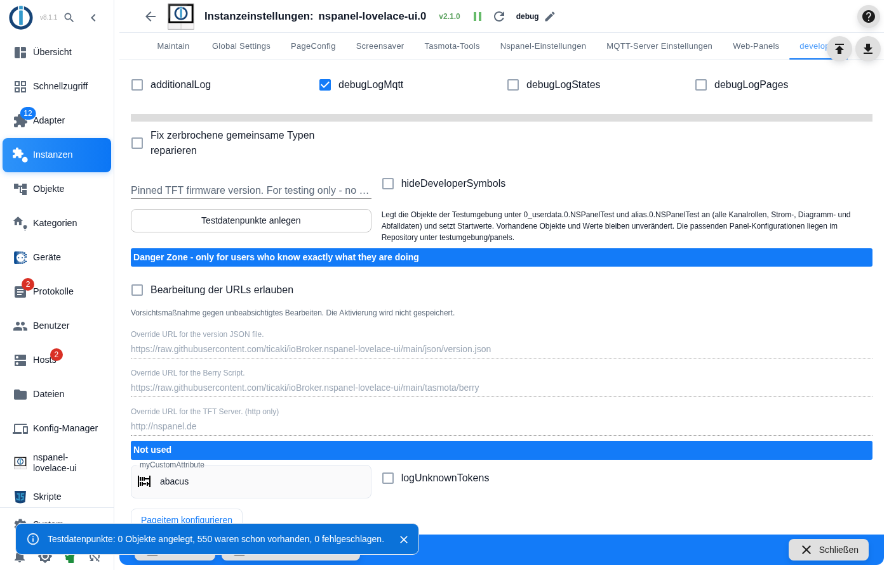

# Developer

Schalter für die Fehlersuche, das Einspielen einer eigenen Display-Firmware und ein Bereich, in dem die fest hinterlegten Download-Adressen übersteuert werden können.

> **Der Tab ist nur im Expertenmodus sichtbar.** Umschalten über das Kopf-Symbol unten links in der Seitenleiste des Admin; die Einstellung gilt nur für die laufende Browsersitzung.

## Protokollierung

| Schalter | Wirkung |
|---|---|
| **additionalLog** | Zusätzliche Meldungen zu Nachrichten, die an ein Panel geschickt wurden und noch offen sind. |
| **debugLogMqtt** | Protokolliert den MQTT-Verkehr ausführlich — nützlich, wenn ein Panel sich nicht meldet. |
| **debugLogStates** | Protokolliert Änderungen an Datenpunkten. |
| **debugLogPages** | Protokolliert den Aufbau und den Wechsel von Seiten. |
| **logUnknownTokens** | Meldet Platzhalter in Texten, die der Adapter nicht auflösen konnte. Der Schalter steht in der Oberfläche weiter unten im Bereich **Not used**, wirkt aber. |

Diese Schalter erzeugen viel Text im Protokoll. Für die Fehlersuche einschalten, danach wieder aus — und die Protokollebene der Instanz auf `debug` stellen, sonst bleibt das meiste unsichtbar.

## Werkzeuge

| Einstellung | Wirkung |
|---|---|
| **Fix zerbrochene gemeinsame Typen reparieren** | Einmalige Reparatur: Beim nächsten Start korrigiert der Adapter Alias-Objekte, deren Typ fälschlich `state` statt `mixed` ist (ein bekannter Fehler aus dem Geräte-Adapter). Danach setzt er den Haken selbst wieder zurück. |
| **Pinned TFT firmware version** | Erzwingt eine bestimmte TFT-Version statt der online ermittelten. **Nur zum Testen**, ohne Unterstützung — der Adapter warnt beim Start, solange hier etwas steht. |
| **hideDeveloperSymbols** | Blendet das Zahnrad aus, das der Bildschirmschoner anzeigt, wenn eine Entwicklerversion der Display-Firmware läuft. |
| **Testdatenpunkte anlegen** | Legt die Datenpunkte der Testumgebung an — alle Kanalrollen auf einmal, ohne eigene Objekte. Vorhandenes bleibt unverändert. Siehe [Testumgebung](Testumgebung). |

## Eigene TFT einspielen

Seit 2.3.0 steht unter den Werkzeugen der Kasten **Eigene TFT einspielen**: eine selbst gebaute oder anderswo bezogene Display-Firmware (`.tft`) auf ein Panel oder auf alle Panels bringen, ohne sie vorher auf einen Webserver legen zu müssen — das Bereitstellen übernimmt der Adapter.

So läuft es:

1. **TFT-Datei auswählen** — nur `.tft`, höchstens 16 MB (so groß ist der Display-Speicher des NSPanels). Der Dateiname erscheint neben dem Knopf; dieselbe Datei lässt sich erneut wählen.
2. **Panel** — *Alle Panels* oder ein einzelnes. Die Liste holt der Admin vom laufenden Adapter; darin stehen nur Panels mit echtem Berry-Treiber: keine Web-Panels, kein Emulator und kein Panel, das noch keine Treiberversion gemeldet hat.
3. **TFT einspielen** — der Admin schickt die Datei in Stücken von 512 KB an den Adapter (der Knopf zeigt den Fortschritt in Prozent). Der Adapter legt sie im temporären Verzeichnis des Systems ab, öffnet dafür einen **freien Port** und schickt den gewählten Panels per MQTT denselben Befehl wie beim normalen TFT-Update, nur mit der eigenen Adresse (`FlashNextionAdv0 http://<IP von ioBroker>:<Port>/<Datei>`). Die Meldung *Flash gestartet* heißt nur, dass der Befehl raus ist — den Flash selbst zeigt die Karte des Panels im Tab [Maintain](Maintain) (`flashing`, Fortschritt in Prozent).

Was dabei zu beachten ist:

- **Die „IP von ioBroker" muss gesetzt und für die Panels erreichbar sein** — das Feld aus dem Tab *MQTT-Server* (siehe [NSPanelsetting](NSPanelsetting)). Der Adapter nimmt den gerade im Admin eingetragenen Wert, auch ungespeichert; fehlt er oder steht dort `127.0.0.1`, meldet er *Die „IP von ioBroker" ist nicht gesetzt*.
- **Der Server lebt nur kurz.** Er stoppt fünf Minuten nach dem letzten Zugriff, spätestens nach 45 Minuten, und löscht die Datei dann wieder; ein Adapterneustart räumt ebenfalls auf. Ein Panel, das die Datei bis dahin nicht geholt hat, bekommt keine.
- **Nur Panels, die gerade laufen.** Für ein ausgewähltes Panel, das der Adapter nicht betreibt, kommt *Für diese Auswahl wurde kein laufendes Panel gefunden*.
- **Keine Prüfung auf das Hardwaremodell.** Der Adapter prüft Endung und Größe, nicht, ob die Firmware zum Panel passt. Eine Entwicklerversion meldet sich nach dem Flash als TFT `0.0.0` — die Karte im Tab Maintain wird orange und bietet *TFT UPDATE* an, der Bildschirmschoner zeigt das Zahnrad (siehe **hideDeveloperSymbols** oben). Zurück zur offiziellen Firmware geht es jederzeit mit *TFT UPDATE*.

| Meldung | Grund |
|---|---|
| *Die Datei muss die Endung .tft haben* / *ist leer* / *ist zu groß (max. 16 MB)* | Der Adapter weist die Datei ab, bevor etwas passiert. |
| *Der Upload wurde unterbrochen - bitte neu starten* | Ein Stück kam nicht an oder ein zweiter Upload hat den ersten verdrängt — es gibt immer nur einen. |
| *Der Adapter läuft nicht oder antwortet nicht* | Ohne laufende Instanz gibt es keine Panel-Liste und keinen Server. |
| *Es läuft kein Panel mit Berry-Treiber* | Keines der Panels kann eine TFT laden, siehe Punkt 2. |
| *Die TFT konnte nicht bereitgestellt werden - siehe Adapter-Log* | Der Server konnte nicht starten oder die Datei nicht abgelegt werden; das Log nennt den Grund. |

## Danger Zone

Der Bereich ist genau so beschriftet, und das ist ernst gemeint: Hier stehen die Adressen, von denen Versionsliste, Berry-Treiber und TFT-Firmware geladen werden.

Die Felder sind gesperrt, bis **Bearbeitung der URLs erlauben** eingeschaltet wird — eine Sicherung gegen versehentliches Tippen. **Dieser Haken wird nicht gespeichert**: Nach dem Neuladen der Seite ist er wieder aus, die geänderten Adressen bleiben dagegen bestehen.

| Feld | Standard |
|---|---|
| Versionsliste | `…/ioBroker.nspanel-lovelace-ui/main/json/version.json` |
| Berry-Treiber | `…/ioBroker.nspanel-lovelace-ui/main/tasmota/berry` |
| TFT-Server | `http://nspanel.de` |

Wer hier etwas ändert, bekommt Firmware aus einer anderen Quelle — im Zweifel also die Standardwerte stehen lassen. Der Abschnitt darunter ist mit **Not used** überschrieben. Das trifft nicht auf alles dort zu: `myCustomAttribute` ist wirklich ohne Funktion, **`logUnknownTokens` dagegen wird ausgewertet** (siehe Protokollierung).
