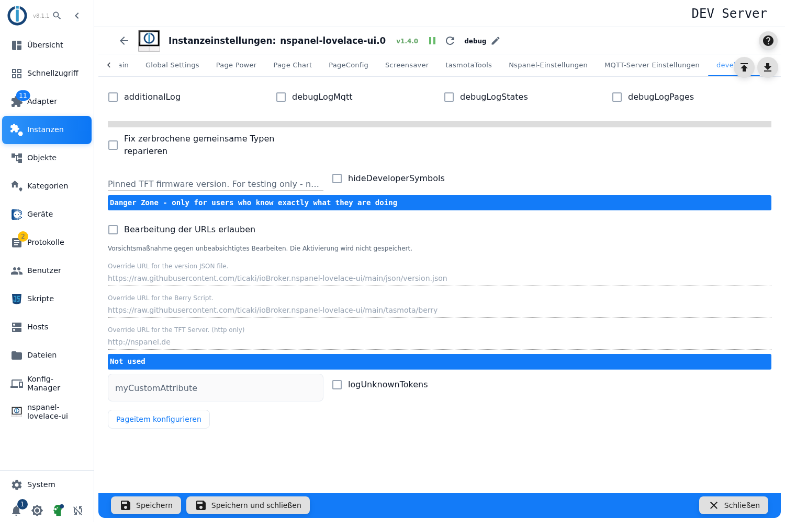

# Developer

Schalter für die Fehlersuche und ein Bereich, in dem die fest hinterlegten Download-Adressen übersteuert werden können.

> **Der Tab ist nur im Expertenmodus sichtbar.** Umschalten über das Kopf-Symbol unten links in der Seitenleiste des Admin; die Einstellung gilt nur für die laufende Browsersitzung.

## Protokollierung

| Schalter | Wirkung |
|---|---|
| **additionalLog** | Zusätzliche Meldungen zu Nachrichten, die an ein Panel geschickt wurden und noch offen sind. |
| **debugLogMqtt** | Protokolliert den MQTT-Verkehr ausführlich — nützlich, wenn ein Panel sich nicht meldet. |
| **debugLogStates** | Protokolliert Änderungen an Datenpunkten. |
| **debugLogPages** | Protokolliert den Aufbau und den Wechsel von Seiten. |
| **logUnknownTokens** | Meldet Platzhalter in Texten, die der Adapter nicht auflösen konnte. |

Diese Schalter erzeugen viel Text im Protokoll. Für die Fehlersuche einschalten, danach wieder aus — und die Protokollebene der Instanz auf `debug` stellen, sonst bleibt das meiste unsichtbar.

## Werkzeuge

| Einstellung | Wirkung |
|---|---|
| **Fix zerbrochene gemeinsame Typen reparieren** | Einmalige Reparatur: Beim nächsten Start korrigiert der Adapter Alias-Objekte, deren Typ fälschlich `state` statt `mixed` ist (ein bekannter Fehler aus dem Geräte-Adapter). Danach setzt er den Haken selbst wieder zurück. |
| **Pinned TFT firmware version** | Erzwingt eine bestimmte TFT-Version statt der online ermittelten. **Nur zum Testen**, ohne Unterstützung — der Adapter warnt beim Start, solange hier etwas steht. |
| **hideDeveloperSymbols** | Blendet das Zahnrad aus, das der Bildschirmschoner anzeigt, wenn eine Entwicklerversion der Display-Firmware läuft. |

## Danger Zone

Der Bereich ist genau so beschriftet, und das ist ernst gemeint: Hier stehen die Adressen, von denen Versionsliste, Berry-Treiber und TFT-Firmware geladen werden.

Die Felder sind gesperrt, bis **Bearbeitung der URLs erlauben** eingeschaltet wird — eine Sicherung gegen versehentliches Tippen. **Dieser Haken wird nicht gespeichert**: Nach dem Neuladen der Seite ist er wieder aus, die geänderten Adressen bleiben dagegen bestehen.

| Feld | Standard |
|---|---|
| Versionsliste | `…/ioBroker.nspanel-lovelace-ui/main/json/version.json` |
| Berry-Treiber | `…/ioBroker.nspanel-lovelace-ui/main/tasmota/berry` |
| TFT-Server | `http://nspanel.de` |

Wer hier etwas ändert, bekommt Firmware aus einer anderen Quelle — im Zweifel also die Standardwerte stehen lassen. Der Abschnitt darunter ist mit **Not used** überschrieben; die Felder dort haben derzeit keine Funktion.
