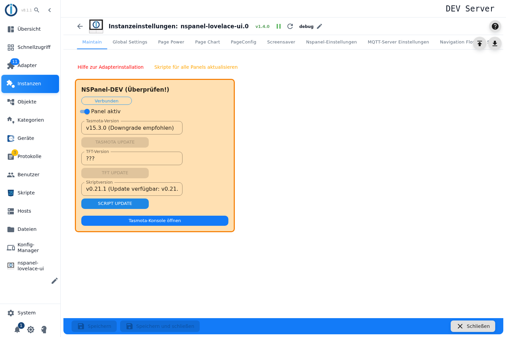

# Maintain

Der Wartungstab: Er zeigt für jedes Panel, welche **Tasmota-Version**, welche **TFT-Firmware** und welche **Skriptversion** darauf läuft, erkennt verfügbare Aktualisierungen und stößt sie an.

## Die Karte eines Panels

Oben steht der Name, daneben der Verbindungsstatus. Die Farbe der Karte sagt, ob etwas zu tun ist: **orange** heißt „es gibt eine Abweichung" (veraltete Firmware, neuere Skriptversion, Entwicklerversion), **gelb** heißt „wird gerade geflasht", **grau** heißt, dass der Adapter selbst nicht läuft.

| Bedienelement | Wirkung |
|---|---|
| **Panel aktiv** | Schaltet das Panel im Adapter an oder aus. Wirkt **sofort** — dieser Schalter schreibt einen Datenpunkt und braucht kein Speichern. |
| **Tasmota-Version** + **TASMOTA UPDATE** | Startet das Tasmota-OTA-Update: Der Adapter ermittelt die passende Version und schickt dem Panel den Update-Befehl. Das Panel startet neu und ist dabei rund 40 Sekunden nicht erreichbar. |
| **TFT-Version** + **TFT UPDATE** | Installiert die Display-Firmware neu — die zum Hardwaremodell passende Datei, auf Wunsch die Beta (siehe [Global Settings](globelSettings)). Ebenfalls mit Neustart des Panels. |
| **Skriptversion** + **SCRIPT UPDATE** | Erzeugt das Konfigurationsskript des Panels neu bzw. hebt es auf den aktuellen Stand. |
| **Tasmota-Konsole öffnen** | Öffnet die Konsole der Tasmota-Weboberfläche in einem neuen Tab. |
| **Skripte für alle Panels aktualisieren** (oben) | Dasselbe wie *SCRIPT UPDATE*, aber für alle Panels, bei denen eine neuere Skriptversion vorliegt. |

Vor dem Tasmota- und dem TFT-Update fragt der Admin sicherheitshalber nach und nennt die rund 40 Sekunden Auszeit.

## Was beim Skript-Update erhalten bleibt

Das Skript hat eine Markierungszeile mit dem Text `END STOP END STOP END - No more configuration - END STOP END STOP END`. **Alles oberhalb davon wird ersetzt, alles darunter bleibt stehen** — eigene Ergänzungen überleben ein Update also, solange sie unterhalb der Markierung stehen. ⚠️ Wer die Markierung aus dem Skript entfernt, kann es nicht mehr aktualisieren: Das Update bricht dann mit einer Fehlermeldung ab.

## Wenn ein Knopf grau bleibt

- **TASMOTA UPDATE**: verlangt eine gültige IP, ein gültiges Topic, vollständige MQTT-Zugangsdaten und ein Panel, das online und nicht gerade am Flashen ist.
- **TFT UPDATE**: braucht nur ein erreichbares Panel mit IP, das nicht gerade flasht.
- **SCRIPT UPDATE**: braucht Panelname und Topic.
- Alle Knöpfe sind gesperrt, solange die Instanz nicht läuft oder bereits ein Update läuft.

## Versionen stehen auf `???`

Dann hat das Panel noch nicht geantwortet. Nach einem Adapterstart dauert das einen Moment; bleibt es dabei, stimmt etwas mit der MQTT-Verbindung, dem Topic oder der Stromversorgung nicht. Steht bei der TFT-Version `0.0.0`, läuft eine Entwicklerversion — der Adapter wertet das als „Update nötig".

Ist die **Beta-TFT** eingeschaltet, blendet der Tab oben einen Hinweis darauf ein.
