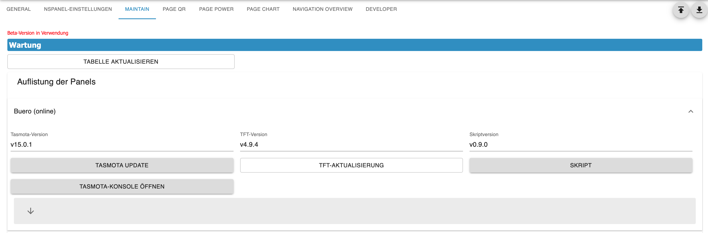
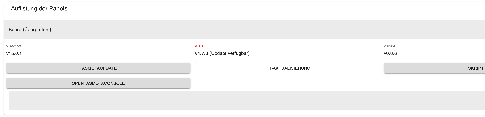

# Maintain  
  

## Skript in den Admin übernehmen

Jede Panel-Kachel hat neben dem Knopf zum Anlegen des Konfig-Skripts den Knopf **Skript in Admin übernehmen**. Damit wandert die Konfiguration, die das Skript des Panels an den Adapter geschickt hat, in die Admin-Konfiguration: Seiten in den Tab `PageConfig`, der Bildschirmschoner in den Tab `Screensaver`, die Hardware-Buttons in die Panel-Kachel unter `NSPanelsetting`. Der Knopf ist nur aktiv, wenn die Instanz läuft und das Panel ein Topic hat.

Was mit dem Skript dabei passiert (Backup, Auskommentieren, was man danach von Hand prüfen sollte) und welche Seiten übernommen werden können, steht unter [Skript in den Admin übernehmen](ScriptConfig#skript-in-den-admin-übernehmen) in der Skript-Doku. Hier geht es nur um den Ablauf im Admin.

### Voraussetzung

Der Adapter übernimmt nicht den Quelltext des Skripts, sondern die Konfiguration, die das Skript zuletzt per `sendTo` an ihn geschickt hat und die er gespeichert hat. Das Skript muss also **mindestens einmal gelaufen sein**. Hat es noch nie gesendet, meldet der Dialog einen Fehler – dann das Skript einmal starten (es schickt seine Konfiguration und beendet sich) und den Knopf erneut drücken.

Ein Skript, das **mehrere Panels** bedient (`panelTopic: ['…', '…']`), wird abgelehnt – der Dialog zeigt die Fehlermeldung des Adapters mit den betroffenen Panels. Der Umbau für ein Panel würde den anderen Panels die Seiten wegnehmen. Das Skript vorher aufteilen (ein Skript je Panel), jedes einmal starten, dann je Panel übernehmen.

### Ablauf

1. **Vorschau.** Nach dem Klick fragt der Admin den Adapter, was übernommen werden kann (es wird noch nichts geändert). Der Dialog zeigt:
   - **Seiten** – pro Seite den `uniqueName`, den Seitentyp (und den Typ des Admin-Eintrags, falls er abweicht), die Anzahl der Elemente, die Navigation und was passiert: `neuer Admin-Eintrag`, `nur Navigation (Eintrag existiert)` oder `nur aus dem Skript entfernt`. Bei der Startseite kann „im Admin gespeichert als `main_<Panelname>` (als Startseite markiert)“ stehen – dann ist `main` im Admin schon durch eine Seite belegt, die dieses Panel nicht abdeckt; das Panel sieht die Seite trotzdem als `main`.
   - **Screensaver** – Name, Version (z. B. Standard, Alternate, Advanced), Anzahl der Elemente und Benachrichtigungen; oder der Grund, warum er nicht übernommen wird.
   - **Hardware-Buttons** – links/rechts mit der Aktion; oder der Grund, warum ein Button übersprungen wird.
   - **Übersprungen** – alle Seiten, die im Skript bleiben, jeweils mit Grund und, wenn möglich, dem betroffenen Feld oder Element (z. B. `items[3].confirm: not available in the admin`).
   
   Dazu Hinweise: ob das Skript-Objekt gefunden wurde (sonst gibt es kein Backup und das Skript bleibt unverändert), ob es überhaupt etwas zu tun gibt, und ob der Admin ungespeicherte Änderungen hat.
2. **Übernehmen.** Der Adapter parkt zuerst die anzulegenden Admin-Einträge in seinem Meta-Objekt (`native.pendingScriptConversion`), sichert und bereinigt dann das Skript, entfernt die übernommenen Teile aus der gespeicherten Skript-Konfiguration und schreibt die Instanz-Konfiguration. Weil er die Instanz-Konfiguration selbst schreibt, startet er anschließend neu. Schlägt das Schreiben der Instanz-Konfiguration fehl, zeigt der Dialog **Teilweise ausgeführt**: Das Skript ist dann bereits gesichert und bereinigt, die geparkten Admin-Einträge übernimmt der Adapter beim nächsten Start (Warnung im Log).
3. **Bericht.** Der Dialog zeigt, wie viele Seiten angelegt, Navigationen zugewiesen und Verweise entfernt wurden, die Id des Backups (und welche älteren Backups nachgerückt oder gelöscht wurden), ob der Skript-Quelltext geändert wurde und eine Liste **Im Skript-Quelltext nicht geändert (bitte von Hand prüfen)** mit allem, was der Adapter im Quelltext nicht eindeutig gefunden hat.
4. **Admin neu laden** – der Knopf im Dialog lädt die Admin-Seite neu. Das ist nötig: Die im Browser geladene Instanz-Konfiguration ist nach der Übernahme veraltet, ein Speichern würde die neuen Einträge wieder überschreiben. Während der Adapter neu startet, zeigt der Admin eventuell kurz „nicht verbunden“.

> [!IMPORTANT]
> Vor der Übernahme alle Änderungen im Admin speichern. Der Adapter schreibt die Instanz-Konfiguration selbst, und das anschließende Neuladen verwirft ungespeicherte Änderungen. Der Dialog warnt, wenn etwas ungespeichert ist.

Ein erneuter Klick nach der Übernahme zeigt in der Vorschau „Nichts zu übernehmen“ – außer es bleiben Seiten übrig, die der Admin nicht abbilden kann; die stehen weiterhin unter **Übersprungen** und bleiben im Skript.