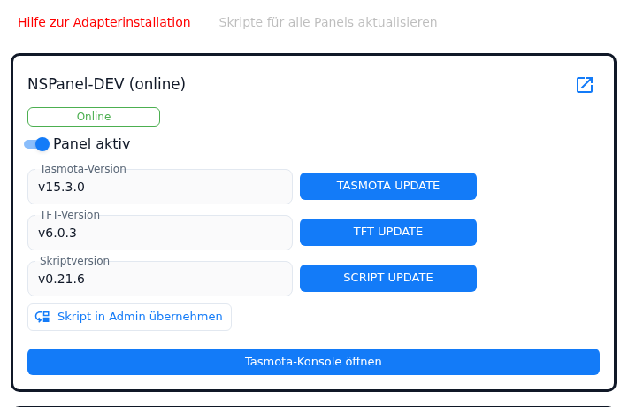
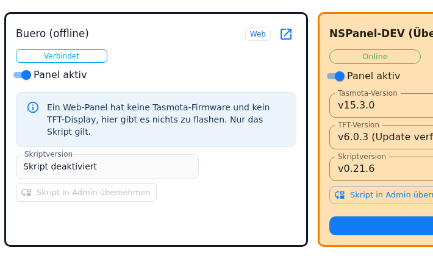

# Maintain

Der erste Tab der Instanz-Einstellungen: Für jedes Panel der Tabelle zeigt er eine **Karte** mit Verbindungsstatus, **Tasmota-Version**, **TFT-Firmware** und **Skriptversion**, erkennt Abweichungen und stößt die Aktualisierungen an. Hier sitzt außerdem der Schalter **Panel aktiv** und der Knopf **Skript in Admin übernehmen**, mit dem eine bestehende Skript-Konfiguration in den Admin wandert.

Inhalt:
- [Der Tab im Überblick](#1-der-tab-im-überblick)
- [Die Karte eines Panels](#2-die-karte-eines-panels)
- [Tasmota und TFT aktualisieren](#3-tasmota-und-tft-aktualisieren)
- [Skriptversion und SCRIPT UPDATE](#4-skriptversion-und-script-update)
- [Panels ohne Skript](#5-panels-ohne-skript)
- [Web-Panels im Tab](#6-web-panels-im-tab)
- [Skript in den Admin übernehmen](#7-skript-in-den-admin-übernehmen)
- [Wenn ein Knopf grau bleibt](#8-wenn-ein-knopf-grau-bleibt)
- [Was die Versionsfelder sagen](#9-was-die-versionsfelder-sagen)
- [Fallstricke](#fallstricke)

## 1. Der Tab im Überblick

Der Tab erscheint erst, wenn die MQTT-Angaben vollständig sind — eigener Server oder Broker-IP, Port und Zugangsdaten (Benutzer und Passwort, bei einem fremden Broker alternativ die zentrale Credential-Id) — und **mindestens ein Panel** in der Tabelle unter [NSPanelsetting](NSPanelsetting) steht. Fehlt davon etwas, ist der Tab nicht sichtbar.

Über den Karten liegen:

| Element | Wirkung |
|---|---|
| **Hilfe zur Adapterinstallation** (roter Text-Knopf) | Öffnet die Wiki-Seite [Adapter-Installation](Adapter-Installation) in einem neuen Tab. |
| **Skripte für alle Panels aktualisieren** | Dasselbe wie *SCRIPT UPDATE*, aber für alle Panels, deren Skriptversion von der mitgelieferten Vorlage abweicht. Panels mit dem Haken **Panel benutzt kein Skript** werden ausgelassen. Der Knopf ist orange, solange es etwas zu tun gibt, und grau, wenn nichts ansteht, die Instanz nicht läuft oder gerade ein anderer Vorgang läuft. |
| Hinweis **Beta-Version in Verwendung** | Erscheint, solange *Beta-Firmware* in den [Global Settings](globelSettings) eingeschaltet ist. |
| Rote Fehlerzeile | Meldung des Adapters zum letzten Vorgang; lässt sich schließen. |

Die Daten holt der Tab beim Öffnen, bei jeder Rückkehr in den Browser-Tab, nach jeder Aktion und etwa fünf Sekunden nach einer Änderung des Online-Status eines Panels beim Adapter ab. **Läuft die Instanz nicht**, gibt es keine Daten: Beim Öffnen bleibt der Tab leer und meldet, dass der Adapter nicht läuft; stirbt die Instanz bei geöffnetem Tab, werden die Karten grau und alle Bedienelemente gesperrt.

## 2. Die Karte eines Panels

Oben steht der Name, in Klammern der Kurzzustand: `online`, `offline`, `flashing`, beim Flashen der Fortschritt (`Update: 42%`) und **Überprüfen!**, wenn etwas abweicht. Darunter die Statusanzeige des Panels (dieselben Zustände wie in der Panel-Übersicht, siehe [PanelStatusBadge](PanelStatusBadge) — hier ohne Symbol und ohne Tooltip).

Die Farbe der Karte sagt, ob etwas zu tun ist: **orange** heißt „es gibt eine Abweichung" (Tasmota-Update verfügbar, TFT-Update oder -Downgrade, Entwicklerversion `0.0.0`, neuere Skriptversion), **gelb** heißt „wird gerade geflasht", **grau** heißt, dass die Instanz nicht läuft. Bei einer Abweichung ist zusätzlich der Knopf, der sie behebt, kräftig blau eingefärbt.

| Bedienelement | Wirkung |
|---|---|
| **Web** (Kennzeichen) | Nur bei einem eigenständigen Web-Panel, siehe [Abschnitt 6](#6-web-panels-im-tab). |
| Symbol **Web-Panel in neuem Tab öffnen** | Öffnet das Panel im Browser; nur sichtbar, wenn die Web-Panels eingeschaltet sind und das Panel ein Topic hat (siehe [WebPanel](WebPanel)). |
| **Panel aktiv** | Schaltet das Panel im Adapter an oder aus. Wirkt **sofort** — der Schalter schreibt den Datenpunkt `panels.<Panel>.cmd.activated` und braucht kein Speichern. Aus: Der Adapter baut das Panel ab, der Status wird **Ausgeschaltet**, `info.isOnline` wird `false`, ein im Browser geöffneter Klon desselben Panels geht mit. An: Das Panel wird ohne Neustart der Instanz wieder aufgebaut. Der Zustand bleibt über einen Adapterneustart erhalten. |
| **Tasmota-Konsole öffnen** | Öffnet die Konsole der Tasmota-Weboberfläche in einem neuen Tab — mit der **in der Panel-Tabelle eingetragenen** IP, nicht mit der vom Panel gemeldeten. Bei einem Web-Panel fehlt der Knopf. |

Ein ausgeschaltetes Panel kennt der Adapter nicht mehr: Die Karte bleibt, die Versionsfelder zeigen aber nur noch `---` bzw. den Platzhalter (siehe [Abschnitt 9](#9-was-die-versionsfelder-sagen)).

## 3. Tasmota und TFT aktualisieren

Vor beiden Updates fragt der Admin nach und nennt die rund **40 Sekunden**, in denen das Panel nicht erreichbar ist.

| Knopf | Was passiert |
|---|---|
| **TASMOTA UPDATE** | Der Adapter liest die empfohlene Tasmota-Version aus der Versionsliste und schickt dem Panel über MQTT den OTA-Befehl auf `tasmota32-<SPRACHE>.bin` von `ota.tasmota.com`. Die Sprache ist die des Admin (Chinesisch fällt auf Englisch zurück). Das Panel lädt selbst und startet neu. Ist in den [Global Settings](globelSettings) die *Beta-Firmware* eingeschaltet, nimmt der Adapter den Eintrag `tasmota-beta` der Versionsliste — fehlt er, die stabile Version; auch das Versionsfeld der Karte vergleicht dann gegen die Beta. |
| **TFT UPDATE** | Der Adapter bestimmt die zum Hardwaremodell passende TFT-Datei (`nspanel[-modell]-v<version>.tft`), berücksichtigt dabei *Beta-Firmware* und eine festgenagelte Version aus den [Global Settings](globelSettings), und schickt dem Panel den Flash-Befehl. Das Panel lädt die Datei **selbst** vom TFT-Server (Internetzugang nötig) und startet neu; das dauert einige Minuten. |

Beide Befehle gehen nur an Panels, die der Adapter gerade betreibt. Dieselben Werkzeuge gibt es — zusätzlich zur Berry-Installation und zum Neustart — im Tab [Tasmota-Tools](tasmotatools), dort über die IP statt über die Panel-Karte. Die Versionsfelder aktualisieren sich von selbst, sobald das Panel sich wieder meldet.

## 4. Skriptversion und SCRIPT UPDATE

Das Feld **Skriptversion** vergleicht die Version im Konfigurationsskript des Panels (`script.js.nspanel-lovelace-ui_<Instanz>.<Panelname>`) mit der Version der Vorlage, die der Adapter mitbringt. **SCRIPT UPDATE** legt das Skript an bzw. hebt es auf diesen Stand — und frischt im selben Zug das **globale Skript** `globalPageConfig` auf.

> **Was beim Skript-Update erhalten bleibt**
>
> Das Panel-Skript hat eine Markierungszeile mit dem Text `END STOP END STOP END - No more configuration - END STOP END STOP END`. **Alles unterhalb davon wird ersetzt, alles darüber bleibt stehen** — eigene Ergänzungen überleben ein Update also nur, wenn sie **oberhalb** der Markierung liegen. Beim globalen Skript übernimmt die Zeile `stopScript(scriptName, undefined)` diese Rolle.
>
> ⚠️ Wer die Markierung aus dem Skript entfernt, kann es nicht mehr aktualisieren: Das Update bricht mit einer Fehlermeldung ab und das Skript bleibt unverändert. Fehlt die Marke nur im globalen Skript, steht der Fehler ausschließlich im Log — das Panel-Skript wird trotzdem geschrieben.

Weiter gilt:

- Der Skriptname folgt dem **Panelnamen**; Zeichen außer `A–Z`, `a–z`, `0–9`, `_` und `-` werden zu `_`. Wird ein Panel umbenannt, sucht der Tab das Skript unter dem **neuen** Namen — das alte bleibt liegen und wird nicht mehr geprüft.
- Ein vorhandenes Skript behält seinen Ein-/Aus-Zustand; nach dem Schreiben startet der JavaScript-Adapter es neu, es sendet dann seine Konfiguration.
- Ein neues Skript bekommt das Topic des Panels und die Instanz des Adapters eingesetzt.
- Für Panels mit dem Haken **Panel benutzt kein Skript** gibt es den Knopf nicht (siehe [Abschnitt 5](#5-panels-ohne-skript)).

Wer vom Skript auf den Admin umsteigen will, braucht diesen Knopf nicht, sondern den aus [Abschnitt 7](#7-skript-in-den-admin-übernehmen).

## 5. Panels ohne Skript

Der Haken **Panel benutzt kein Skript** sitzt in der Panel-Kachel unter [NSPanelsetting](NSPanelsetting); ein Web-Panel kommt ebenfalls ohne Skript aus (siehe [WebPanel](WebPanel)). Alle Folgen und die richtige Reihenfolge beim Umstieg stehen unter [Migration](Migration). **Im Tab Maintain** bedeutet der Haken:

- Das Feld **Skriptversion** zeigt *Skript deaktiviert*; es wird keine Version mehr geprüft.
- Der Knopf **SCRIPT UPDATE** ist nicht vorhanden — die Zeile hat nur noch das Feld und den Übernahme-Knopf.
- **Skripte für alle Panels aktualisieren** lässt das Panel aus.
- **Skript in Admin übernehmen** ist grau; der Tooltip nennt den Grund. Auch ein Aufruf am Adapter vorbei wird abgelehnt: Erst den Haken entfernen, dann übernehmen, dann den Haken wieder setzen.

## 6. Web-Panels im Tab

Ein eigenständiges Web-Panel steht mit einer eigenen Karte im Tab, gekennzeichnet mit **Web**. Es hat keine Tasmota-Firmware und kein TFT-Display: Die Zeilen *Tasmota-Version* und *TFT-Version* und der Knopf zur Tasmota-Konsole fehlen, stattdessen steht ein blauer Hinweis. Geblieben sind die Statusanzeige, **Panel aktiv**, die Skript-Zeile und das Symbol zum Öffnen im Browser.

Ein **Browser-Fenster eines echten Panels** bekommt dagegen keine eigene Karte — es gehört zur Karte seines Hardware-Panels.

## 7. Skript in den Admin übernehmen

Jede Panel-Karte hat in der Skript-Zeile den Knopf **Skript in Admin übernehmen**. Damit wandert die Konfiguration, die das Skript des Panels an den Adapter geschickt hat, in die Admin-Konfiguration: Seiten in den Tab [PageConfig](PageConfig), der Bildschirmschoner in den Tab [Screensaver](screensaver), die Hardware-Buttons in die Panel-Kachel unter [NSPanelsetting](NSPanelsetting).

Welche Seitentypen übernommen werden, was mit dem Skript-Quelltext passiert und wie es danach weitergeht, steht vollständig unter [Migration](Migration). Hier geht es um den Ablauf im Admin.

### Voraussetzungen

- Der Adapter übernimmt **nicht den Quelltext**, sondern die Konfiguration, die das Skript zuletzt gesendet und die er gespeichert hat. Das Skript muss also **mindestens einmal gelaufen sein** — sonst meldet der Dialog genau das, und es hilft nur, das Skript einmal zu starten.
- Das Panel muss mit Topic in der Panel-Tabelle stehen.
- Ein Skript, das **mehrere Panels** bedient (`panelTopic: ['…', '…']`), wird abgelehnt; die Meldung nennt alle betroffenen Panels. Erst aufteilen (ein Skript je Panel), jedes einmal starten, dann je Panel übernehmen.
- Der Haken **Panel benutzt kein Skript** darf nicht gesetzt sein ([Abschnitt 5](#5-panels-ohne-skript)).
- Die Instanz muss laufen, und für dieses Panel darf gerade **kein anderer Vorgang** laufen (Tasmota-, TFT- oder Skript-Update derselben Karte).
- Alle Änderungen im Admin sollten **gespeichert** sein — der Dialog warnt, wenn nicht.

Das Skript-Objekt selbst muss nicht mehr existieren: Dann legt der Adapter kein Backup an, ändert keinen Quelltext und wandelt nur die gespeicherte Konfiguration um. Die Fehlermeldungen des Adapters erscheinen im Dialog auf Englisch; übersetzt ist nur der Hinweis auf den Haken.

### Die Vorschau

Der Klick öffnet den Dialog **Skript in Admin übernehmen – `<Panelname>`** und fragt den Adapter, was übernommen werden kann. Geändert wird dabei nichts. Der Dialog zeigt von oben nach unten:

| Block | Inhalt |
|---|---|
| Skript-Id | Welches Skript-Objekt gemeint ist. |
| Hinweise | Fehlt das Skript-Objekt (kein Backup, Quelltext bleibt), ist nichts zu übernehmen, hat der Admin ungespeicherte Änderungen — und immer der Hinweis auf das Backup bzw. „kein Backup" samt der Warnung, dass der Admin danach neu geladen werden muss. |
| **Zusammenfassung** | Eine Zeile: `Seiten: n werden übernommen (… neu, … nur Navigation, … nur Verweis entfernt), n übersprungen · Screensaver: … · Hardware-Buttons: …`. |
| **Seiten des globalen Skripts, die vom Admin abweichen** | Nur wenn es solche gibt: je Seite die abweichenden Felder und die Wahl **Admin-Stand behalten (Panel zuweisen)**, **Skriptstand übernehmen** oder **Überspringen**. Ist die Seite weiteren Panels zugewiesen, warnt der Dialog, dass *Skriptstand übernehmen* auch dort wirkt. Jede geänderte Entscheidung holt eine neue Vorschau; beim Übernehmen gehen die Entscheidungen mit. |
| **Probleme und Hinweise** | Übersprungener Bildschirmschoner, übersprungene Buttons, übersprungene Seiten — jeweils mit Grund und, wenn möglich, dem betroffenen Feld oder Element (z. B. `items[3].confirm`). Dazu die Seiten, die unter anderem Namen gespeichert werden (`im Admin gespeichert als „main_<Panelname>" (als Startseite markiert)`), und die, von denen nur der Verweis aus dem Skript verschwindet. Gibt es nichts zu melden, steht dort *Keine Probleme – nichts wird übersprungen.* |
| **Als Rohdaten übernommen** | **Kein Problem, nur Information.** Items, für die der Editor keine Felder hat, werden unverändert als Rohdaten übernommen — das Panel verhält sich wie bisher. Je Seite (und für den Bildschirmschoner) die Anzahl der Items und je Item die Position, das Format (`native (Laufzeit-Item)` oder `script (wie im Skript)`) und der Grund. Bearbeiten lassen sie sich später im Item-Dialog über den Knopf `{ }` (siehe [PageConfig-Dialoge](PageConfig-Dialoge)). |
| **Langer Druck verworfen** | Ebenfalls nur Information: Items, deren langer Druck wegfällt. Langer Druck gibt es nur auf den Grid-Seiten (`cardGrid`, `cardGrid2`, `cardGrid3`) — die Items werden ohne `longPress`/`targetPageLongPress` übernommen, alles andere bleibt. |
| **Details: `n` Seiten** | Zugeklappt, damit ein Skript mit vielen Seiten die Probleme nicht zudeckt. Aufgeklappt: je Seite Name, Seitentyp (und der Typ des Admin-Eintrags, falls er abweicht), Anzahl der Elemente, Navigation und die Aktion — *neuer Admin-Eintrag*, *nur Navigation (Eintrag existiert)* oder *nur aus dem Skript entfernt*. Darunter der **Screensaver** (Name, Version, Elemente, Benachrichtigungen) und die **Hardware-Buttons** mit ihrer Aktion. |

Unten liegen **Abbrechen** und **Übernehmen**. Ist nichts zu übernehmen, bleibt nur **Schließen**.

### Übernehmen, Bericht, Neuladen

1. **Übernehmen.** Der Adapter parkt zuerst die Admin-Einträge in seinem Meta-Objekt, sichert und bereinigt dann das Skript, speichert die bereinigte Skript-Konfiguration, **antwortet** dem Dialog und schreibt erst danach die Instanz-Konfiguration. Diese Reihenfolge ist nötig, weil jedes Schreiben der Instanz-Konfiguration den Adapter neu startet. Antwortet der Adapter nicht innerhalb von 60 Sekunden, gibt der Dialog die Anfrage auf und weist darauf hin, dass die Übernahme trotzdem durchgelaufen sein kann — dann **erst das Log prüfen**. Während der Adapter arbeitet, lässt sich der Dialog nicht schließen.
2. **Bericht.** Bei Erfolg steht **Übernommen** mit der Bilanz (`n Seiten angelegt, n Navigationen zugewiesen, n Verweise entfernt`, dazu Bildschirmschoner und Buttons). Darunter der Abschnitt **Skript**: Backup-Id, nachgerückte und gelöschte Backups, ob der Quelltext geändert wurde, und die Warnliste **Im Skript-Quelltext nicht geändert (bitte von Hand prüfen)** mit allem, was der Adapter im Quelltext nicht eindeutig gefunden hat.
3. **Admin neu laden.** Der Knopf im Dialog lädt die Admin-Seite neu. Das ist nicht optional: Die im Browser geladene Instanz-Konfiguration ist nach der Übernahme veraltet, ein Speichern würde die neuen Einträge wieder überschreiben. Während der Adapter neu startet, zeigt der Admin eventuell kurz „nicht verbunden".

Andere Ergebnisse: **Es wurde nichts geändert** (der Lauf brach ab, bevor etwas geschrieben war), **Teilweise ausgeführt** (ein Schreibvorgang scheiterte, nachdem der erste schon durch war — der Dialog nennt die Backup-Id und sagt, ob der geparkte Plan beim nächsten Adapterstart angewendet wird) und **Übernommen** mit dem Zusatz, dass kein Neustart angekündigt wurde (die Einträge gelten dann mit dem nächsten Start). Die Einzelfälle stehen unter [Migration](Migration).

> [!IMPORTANT]
> Vor der Übernahme alle Änderungen im Admin speichern. Der Adapter schreibt die Instanz-Konfiguration selbst, und das anschließende Neuladen verwirft ungespeicherte Änderungen. Der Dialog warnt, erzwingen kann er es nicht.

Ein erneuter Klick nach der Übernahme zeigt *Nichts zu übernehmen* — außer es bleiben Seiten übrig, die der Admin nicht abbilden kann; die stehen weiterhin unter **Probleme und Hinweise** und bleiben im Skript.

## 8. Wenn ein Knopf grau bleibt

| Knopf | Bedingungen |
|---|---|
| **TASMOTA UPDATE** | Gültige IP und gültiges Topic, vollständige MQTT-Angaben (Port und Benutzer/Passwort, oder bei fremdem Broker die zentrale Credential-Id), beim eigenen Server zusätzlich eine brauchbare *interne Server-IP* (nicht `127.0.0.1`), und ein Panel, das online ist und nicht gerade flasht. |
| **TFT UPDATE** | Ein erreichbares Panel mit IP, das nicht gerade flasht. |
| **SCRIPT UPDATE** | Panelname und Topic; fehlt der Haken *Panel benutzt kein Skript* nicht, ist der Knopf gar nicht da. |
| **Skript in Admin übernehmen** | Topic vorhanden und Haken *Panel benutzt kein Skript* nicht gesetzt. |
| alle | Die Instanz läuft, und für **dieses** Panel läuft gerade kein anderer Vorgang. |

„Online" ist dabei strenger als die Kopfzeile: Die Knöpfe verlangen ein Panel, das sich gemeldet **und** seine Einrichtung abgeschlossen hat. Direkt nach einem Adapterstart kann in der Kopfzeile also `online` stehen, während die Knöpfe noch grau sind.

## 9. Was die Versionsfelder sagen

| Anzeige | Bedeutung |
|---|---|
| `v1.2.3` | Vom Panel gemeldete bzw. im Skript gefundene Version. |
| `(Update verfügbar)` / `(Downgrade empfohlen)` | Die Version weicht von der empfohlenen ab. |
| `(Developer version!)` bei TFT `0.0.0` | Eine Entwicklerversion; der Adapter wertet das als „Update nötig". |
| `???` bei Tasmota oder TFT | Das Panel hat noch nicht geantwortet. Nach einem Adapterstart dauert das einen Moment; bleibt es dabei, stimmt etwas mit der MQTT-Verbindung, dem Topic oder der Stromversorgung nicht. |
| `???` bei der Skriptversion | Es gibt **kein Skript-Objekt** mit dem Namen des Panels — nie angelegt, oder das Panel wurde umbenannt. Mit dem Panel hat das nichts zu tun. |
| `---` | Der Adapter betreibt dieses Panel gerade nicht (ausgeschaltet oder noch nie verbunden). |
| `Skript deaktiviert` | Der Haken *Panel benutzt kein Skript* ist gesetzt ([Abschnitt 5](#5-panels-ohne-skript)). |

Dieselben Werte stehen als Datenpunkte unter `panels.<Panel>.info.*`, siehe [Panelinfo](Panelinfo).

## Fallstricke

- **Eigene Ergänzungen im Skript gehören über die Markierung.** *SCRIPT UPDATE* ersetzt alles **unterhalb** von `END STOP END STOP END - No more configuration - END STOP END STOP END`; nur was darüber steht, bleibt. Wer die Markierung löscht, kann das Skript nicht mehr aktualisieren.
- **Der Sammelknopf schweigt bei Fehlern.** *Skripte für alle Panels aktualisieren* zeigt keine Fehlermeldung einzelner Panels an. Wurde ein Skript nicht aufgefrischt, hilft der Knopf auf der Karte dieses Panels — oder das Log.
- **Zwei Vorgänge gleichzeitig vermeiden.** Während der Sammellauf arbeitet, bleiben die Knöpfe der einzelnen Karten bedienbar; gesperrt wird nur, was zum gerade bearbeiteten Panel gehört.
- **Panel umbenannt heißt Skript verwaist.** Der Tab prüft nur das Skript, das zum aktuellen Panelnamen passt. Das alte Skript läuft weiter und sendet weiter — es gehört deaktiviert oder gelöscht.
- **Die Skriptversion eines ausgeschalteten Panels sieht aktuell aus.** Für Panels, die der Adapter nicht betreibt, zeigt das Feld die Version der mitgelieferten Vorlage, wenn gar kein Skript-Objekt existiert. Verlässlich ist die Anzeige nur bei verbundenen Panels.
- **Ein empfohlenes Tasmota-Downgrade färbt die Karte nicht.** Es steht nur im Versionsfeld; die Karte bleibt unauffällig. Bei der TFT-Firmware wird sie dagegen orange.
- **Der Hinweis bei Web-Panels endet falsch.** Er schließt mit „Nur das Skript gilt." — das stimmt seit 2.0.0 nicht mehr: Ein Web-Panel bekommt seine Seiten im Tab [PageConfig](PageConfig) und braucht kein Skript (siehe [WebPanel](WebPanel)).
- **Die Tasmota-Konsole nimmt die eingetragene IP.** Steht in der Panel-Tabelle eine veraltete Adresse, öffnet der Knopf das falsche Gerät — auch wenn im Feld *Tasmota-Version* längst die richtige Adresse mitgelesen wurde.
- **„Panel aktiv" wirkt ohne Speichern.** Der Schalter schreibt einen Datenpunkt, nicht die Konfiguration. Ein ausgeschaltetes Panel bleibt auch nach einem Adapterneustart aus — das fällt leicht als „Panel kaputt" auf.
- **Vor der Übernahme speichern, danach neu laden.** Sonst überschreibt ein späteres Speichern die neu angelegten Einträge wieder.
