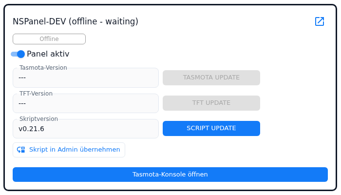
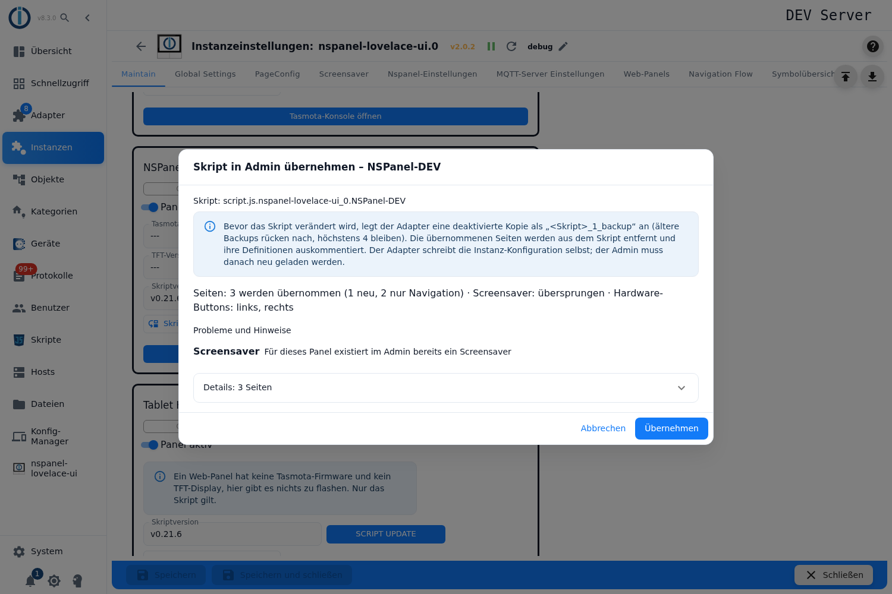
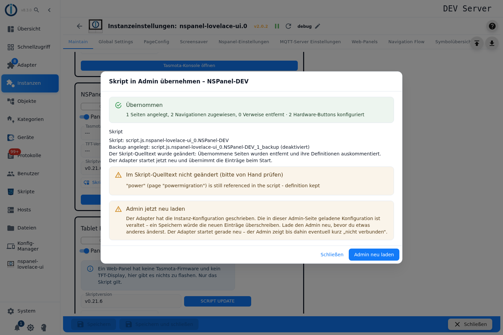
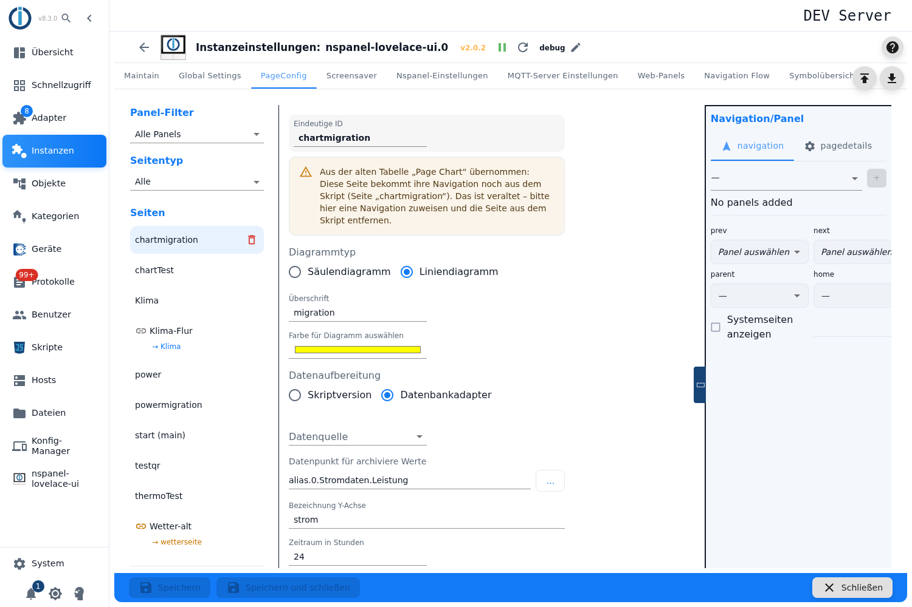
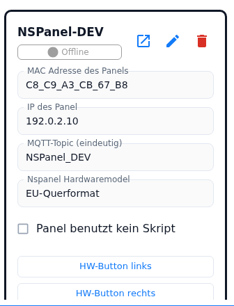

# Migration – vom Konfigurationsskript in den Admin

Diese Seite beschreibt den Weg von einem bestehenden Konfigurationsskript in den Admin. Sie ist die einzige Seite der Doku, die das Skript noch erwähnt: Alles andere beschreibt den Admin als den Weg, auf dem Panels eingerichtet werden. Drei Dinge gehören dazu — der Knopf **Skript in Admin übernehmen** im Tab `Maintain`, die automatische Übernahme der alten Tabs *Page Power* und *Page Chart* beim Adapterstart und der Haken **Panel benutzt kein Skript**, mit dem ein übernommenes Panel das Skript endgültig los wird.

Inhalt:
- [Voraussetzungen](#1-voraussetzungen)
- [Der Knopf „Skript in Admin übernehmen"](#2-der-knopf-skript-in-admin-übernehmen)
- [Die Vorschau](#3-die-vorschau)
- [Was übernommen wird](#4-was-übernommen-wird)
- [Was mit dem Skript passiert](#5-was-mit-dem-skript-passiert)
- [Ablauf der Übernahme](#6-ablauf-der-übernahme)
- [Fehlerfälle](#7-fehlerfälle)
- [Die alten Tabs „Page Power" und „Page Chart"](#8-die-alten-tabs-page-power-und-page-chart)
- [„Panel benutzt kein Skript"](#9-panel-benutzt-kein-skript)
- [Fallstricke](#fallstricke)

## 1. Voraussetzungen

Der Adapter übernimmt **nicht den Quelltext** des Skripts, sondern die Konfiguration, die das Skript zuletzt an ihn geschickt und die er in seinem Meta-Objekt gespeichert hat. Daraus folgen die Voraussetzungen:

| Voraussetzung | Was sonst passiert |
|---|---|
| Das Skript ist **mindestens einmal gelaufen** | Der Dialog meldet, dass das Skript seine Konfiguration noch nicht gesendet hat — das Skript einmal starten und den Knopf erneut drücken. |
| Das Panel steht in der Panel-Tabelle unter `NSPanelsetting` (mit Topic) | Der Adapter meldet, dass das Panel im Admin nicht konfiguriert ist. |
| Das Skript bedient **genau ein Panel** | Ein Skript mit `panelTopic: [...]` wird abgelehnt; die Meldung nennt alle betroffenen Panels. Erst aufteilen (ein Skript je Panel), jedes einmal starten, dann je Panel übernehmen. |
| Der Haken **Panel benutzt kein Skript** ist **nicht** gesetzt | Der Adapter lehnt mit eigener Meldung ab: der Haken muss entfernt, das Skript übernommen und der Haken danach wieder gesetzt werden. |
| Die Instanz läuft | Der Knopf bleibt grau. |
| Alle Änderungen im Admin sind **gespeichert** | Die Vorschau warnt. Der Adapter schreibt die Instanz-Konfiguration selbst, das anschließend nötige Neuladen verwirft ungespeicherte Änderungen. |

Das Skript-Objekt selbst muss nicht mehr existieren. Fehlt es, legt der Adapter kein Backup an und ändert keinen Quelltext — er wandelt nur die gespeicherte Konfiguration um und weist in der Vorschau darauf hin.

## 2. Der Knopf „Skript in Admin übernehmen"

Tab `Maintain`, in jeder Panel-Kachel in der Zeile **Skriptversion** neben **SCRIPT UPDATE**.

| Zustand | Bedeutung |
|---|---|
| aktiv | Das Panel hat ein Topic, die Instanz läuft, der Haken **Panel benutzt kein Skript** ist nicht gesetzt und für dieses Panel läuft gerade kein anderer Vorgang. |
| grau, Tooltip mit Hinweis auf den Haken | Das Panel ist auf **Panel benutzt kein Skript** gestellt. |
| grau ohne Tooltip | Kein Topic, Instanz läuft nicht, oder für dieses Panel läuft gerade ein Tasmota-, TFT- oder Skript-Update. |

Der Klick öffnet den Dialog **Skript in Admin übernehmen – `<Panelname>`** und fragt den Adapter nach einer Vorschau. Geändert wird dabei nichts.

## 3. Die Vorschau

Der Dialog zeigt zuerst die Id des Skripts, dann die Hinweise, dann eine einzeilige Zusammenfassung und darunter die Blöcke. Die Liste aller geplanten Seiten ist zugeklappt (**Details: `n` Seiten**), damit ein Skript mit vielen Seiten die Probleme nicht zudeckt.

| Block | Inhalt |
|---|---|
| Hinweise (oben) | Fehlt das Skript-Objekt, ist nichts zu übernehmen, hat der Admin ungespeicherte Änderungen — und immer der Hinweis auf Backup bzw. „kein Backup" sowie darauf, dass der Admin danach neu geladen werden muss. |
| Zusammenfassung | Eine Zeile: `Seiten: n werden übernommen (… neu, … nur Navigation, … nur Verweis entfernt), n übersprungen · Screensaver: … · Hardware-Buttons: …`. |
| **Seiten des globalen Skripts, die vom Admin abweichen** | Nur wenn es solche gibt. Je Seite die Wahl **Admin-Stand behalten (Panel zuweisen)**, **Skriptstand übernehmen** oder **Überspringen**, dazu die Liste der abweichenden Felder und, falls die Seite weiteren Panels zugewiesen ist, der Hinweis, dass die Änderung auch dort wirkt. Jede geänderte Entscheidung holt eine neue Vorschau; beim Übernehmen gehen die Entscheidungen mit. |
| **Probleme und Hinweise** | Übersprungener Screensaver, übersprungene Buttons, übersprungene Seiten — jeweils mit Grund und, wenn möglich, dem betroffenen Feld oder Element. Dazu die Seiten, die unter anderem Namen gespeichert werden, und die, von denen nur der Verweis aus dem Skript verschwindet. Gibt es nichts zu melden: *Keine Probleme – nichts wird übersprungen.* |
| **Als Rohdaten übernommen** | Kein Problem, nur Information: Items, für die der Editor keine Felder hat. Sie werden unverändert übernommen, das Panel verhält sich wie bisher; bearbeitbar sind sie im Item-Dialog über den Knopf `{ }` (siehe `PageConfig-Dialoge`). Je Eintrag die Position (`items[3]`), das Format (`native` oder `script`) und der Grund. |
| **Langer Druck verworfen** | Items auf Seiten ohne langen Druck. Langer Druck gibt es nur auf Grid-Seiten (`cardGrid`, `cardGrid2`, `cardGrid3`) — wie am HMI. Die Items werden ohne `longPress`/`targetPageLongPress` übernommen. |
| **Details: `n` Seiten** (zugeklappt) | Je Seite Name, Seitentyp, Anzahl Elemente, Navigation und die Aktion: *neuer Admin-Eintrag*, *nur Navigation (Eintrag existiert)* oder *nur aus dem Skript entfernt*. Darunter der **Screensaver** (Name, Version, Elemente, Benachrichtigungen) und die **Hardware-Buttons**. |

Unten liegen **Übernehmen** und der Knopf zum Schließen. Ist nichts zu übernehmen, bleibt nur das Schließen.

## 4. Was übernommen wird

### Seiten

| Seitentyp im Skript | Was der Adapter macht |
|---|---|
| `cardGrid`, `cardGrid2`, `cardGrid3`, `cardEntities`, `cardSchedule`, `cardThermo`, `cardThermo2`, `cardMedia` | **Neuer Admin-Eintrag** im Tab `PageConfig`, mit allen Items und der Navigation des Panels. |
| `cardPower`, `cardChart`, `cardLChart` | **Kein neuer Eintrag.** Diese Seiten gibt es nur im Admin (`cardPower`, `cardChart`). Der Adapter sucht den vorhandenen Eintrag, hängt die Navigation des Panels an ihn und entfernt die Seite aus dem Skript. Findet er keinen Eintrag, bleibt die Seite im Skript (*Für diese Skript-Seite wurde kein passender Admin-Eintrag gefunden*). Hat der Eintrag schon eine eigene Navigation im Admin, ist der Verweis im Skript tot und wird nur entfernt. |
| `cardQR`, `cardAlarm`, `cardUnlock` | Werden ausschließlich im Admin konfiguriert (`PageQR`, `PageAlarm`): Der Verweis wird nur aus dem Skript entfernt. |
| alles andere, `globalLink`, Seiten ohne `type` (native Seiten) | Bleiben im Skript, mit Grund in **Probleme und Hinweise**. |

Die frühere Grundregel „nur ganze Seiten" gilt **nicht mehr**: Ein einzelnes Item, das der Konverter nicht abbilden kann, verhindert die Übernahme der Seite nicht — es wandert als Rohdaten in den Eintrag und steht in **Als Rohdaten übernommen**. Eine Seite wird nur noch dann ganz übersprungen, wenn ein **Feld der Seite** selbst nicht abbildbar ist, die Item-Liste gar keine Liste ist, der Name schon belegt ist oder das Skript die Navigationslinks der Seite überschreibt.

**Startseite.** Trägt der Admin schon einen Eintrag mit dem Namen `main`, der für dieses Panel keine Seite erzeugt, speichert der Adapter die Skript-Startseite unter `main_<Panelname>` und markiert sie als Startseite — das Panel sieht sie trotzdem als `main`. In der Vorschau steht dann *im Admin gespeichert als „main_…" (als Startseite markiert)*. Zeichen außer `A–Z`, `a–z`, `0–9`, `_` und `-` werden im Panelnamen zu `_`. Ist auch dieser Name belegt, wird die Seite übersprungen. Veröffentlicht der vorhandene `main`-Eintrag (oder eine andere als Startseite markierte Seite) für dieses Panel bereits eine Startseite, wird die Skript-Startseite mit *Eine Seite mit diesem Namen existiert im Admin bereits* übersprungen.

### Screensaver

Der Screensaver des Skripts wird **ein** Eintrag im Tab `Screensaver`, benannt nach dem Panel und diesem Panel zugewiesen (siehe `screensaver`). Die Version (Standard, Alternate, Advanced) nimmt der Adapter vom laufenden Panel; antwortet es nicht, leitet er sie aus den benutzten Bereichen ab (linke oder Indicator-Elemente ⇒ Advanced, Alternate-Element ⇒ Alternate, sonst Standard). Benachrichtigungen des Skripts werden eigene Einträge in der Benachrichtigungsliste und am Screensaver-Eintrag verlinkt. Die Wetter-Instanz wandert mit, sofern in den globalen Einstellungen keine gesetzt ist — dann gilt ohnehin die globale.

Nicht übernommen wird der Screensaver, wenn

- für dieses Panel im Admin **schon ein Screensaver** existiert,
- das Skript **native Page-Items** verwendet,
- ein Element nicht abbildbar ist (z. B. ein Statusicon ohne Datenpunkt und ohne Wert),
- oder er leer ist und nur Standardeinstellungen hat (*nichts zu übernehmen*, kein Problem).

### Hardware-Buttons

`buttonLeft` und `buttonRight` wandern in die Panel-Kachel unter `NSPanelsetting` (**HW-Button links** / **HW-Button rechts**). Ein Button wird übersprungen, wenn er im Admin **bereits konfiguriert** ist (auch „keine Aktion" zählt als konfiguriert) oder wenn die Aktion im Admin nicht abbildbar ist. Ein Skript-Button ohne Aktion ist kein Thema — dort gibt es nichts zu übernehmen.

### Gründe in „Probleme und Hinweise"

| Meldung | Bedeutung |
|---|---|
| *Dieser Seitentyp lässt sich im Admin nicht konfigurieren* | Seitentyp ohne Admin-Editor, `globalLink`, native Seite. |
| *Eine Seite mit diesem Namen existiert im Admin bereits* | Namenskollision. |
| *Ein Element der Seite lässt sich im Admin nicht abbilden* | Item-Liste strukturell unbrauchbar (einzelne Items werden heute als Rohdaten übernommen). |
| *Ein Feld der Seite lässt sich im Admin nicht abbilden* | z. B. `uniqueName` fehlt, das Skript überschreibt die Navigationslinks, Navigationskopie einer umbenannten Seite des globalen Skripts. |
| *Dieser Seitentyp wird nur im Admin konfiguriert – der Verweis im Skript ist tot und wird entfernt* | `cardQR`, `cardAlarm`, `cardUnlock`. |
| *Der Admin-Eintrag hat bereits eine eigene Navigation – der Verweis im Skript ist tot und wird entfernt* | `cardPower`/`cardChart` mit Admin-Navigation. |
| *Für diese Skript-Seite wurde kein passender Admin-Eintrag gefunden* | `cardPower`/`cardChart` ohne Gegenstück im Admin. |
| *Für dieses Panel existiert im Admin bereits ein Screensaver* / *Der Skript-Screensaver hat keine Elemente und nur Standardeinstellungen* / *Ein Element des Screensavers lässt sich im Admin nicht abbilden* | Screensaver. |
| *Dieser Button ist im Admin bereits konfiguriert* / *Die Button-Aktion lässt sich im Admin nicht abbilden* | Hardware-Buttons. |

## 5. Was mit dem Skript passiert

**Backup.** Bevor der Adapter das Skript anfasst, legt er eine **deaktivierte** Kopie als `<Skript>_1_backup` an. Vorhandene Backups rücken eine Nummer weiter (`_1_backup` → `_2_backup` …), höchstens vier bleiben, ältere werden gelöscht. Die Kopie behält alles außer Name, Id und Zustand; ihr Name ist `<Skriptname> backup <n>`.

**Quelltext.** Danach ändert der Adapter den Quelltext:

- Die übernommenen Seiten werden aus `pages` bzw. `subPages` des Konfigurationsobjekts entfernt.
- Steht die Seite dort als Variable, wird ihre **Definition auskommentiert** — aber nur, wenn die Variable nirgends sonst im Skript benutzt wird. Der Kommentar trägt eine Markierung mit Datum (`NSPanel: converted to the admin page configuration on <Datum>`).
- Beim übernommenen Screensaver werden die Element-Arrays geleert, die Statusicon-Objekte zurückgesetzt und `screensaverSwipe`/`screensaverIndicatorButtons` entfernt.
- Übernommene Buttons werden auf `null` gesetzt.

Der Scanner liest den Quelltext, ohne ihn auszuführen. Was er nicht eindeutig findet, lässt er stehen und meldet es im Bericht unter **Im Skript-Quelltext nicht geändert (bitte von Hand prüfen)** — etwa „Seite nicht in pages/subPages gefunden", „Definition nicht gefunden", „wird noch im Skript referenziert – Definition behalten". Diese Stellen gehören von Hand nachgearbeitet, sonst schickt das Skript die betroffene Seite beim nächsten Lauf wieder.

Nach der Änderung startet der JavaScript-Adapter das Skript neu; es sendet dann die reduzierte Konfiguration. Parallel ersetzt der Adapter die von ihm gespeicherte Skript-Konfiguration durch die bereinigte Fassung.

## 6. Ablauf der Übernahme

1. **Vorschau** (siehe oben) — es wird nichts geschrieben.
2. **Übernehmen.** Der Adapter parkt zuerst den Admin-Teil in seinem Meta-Objekt, sichert und ändert dann das Skript, speichert die bereinigte Skript-Konfiguration, **antwortet** dem Dialog und schreibt erst eine knappe halbe Sekunde später die Instanz-Konfiguration. Diese Reihenfolge ist nötig, weil jedes Schreiben der Instanz-Konfiguration den Adapter neu startet — die Antwort muss vorher draußen sein.
3. **Bericht.** Der Dialog zeigt **Übernommen** mit der Bilanz (`n Seiten angelegt, n Navigationen zugewiesen, n Verweise entfernt`, dazu Screensaver und Buttons), den Abschnitt **Skript** mit Backup-Id, nachgerückten und gelöschten Backups, ob der Quelltext geändert wurde, und gegebenenfalls die Liste der von Hand zu prüfenden Stellen.
4. **Admin neu laden.** Der Knopf im Dialog lädt die Admin-Seite neu. Das ist nicht optional: Die im Browser geladene Instanz-Konfiguration ist nach der Übernahme veraltet, ein Speichern würde die neuen Einträge wieder überschreiben. Während der Adapter neu startet, zeigt der Admin eventuell kurz „nicht verbunden".

Nach dem Neuladen stehen die Seiten im Tab `PageConfig` (Menü-Seiten siehe `pageMenu`, Thermostatseiten siehe `cardThermo2`), der Screensaver im Tab `Screensaver` und die Buttons in der Panel-Kachel unter `NSPanelsetting`.

Ein erneuter Klick zeigt *Nichts zu übernehmen* — es sei denn, es bleiben Seiten übrig, die der Admin nicht abbilden kann; die stehen weiterhin unter **Probleme und Hinweise** und bleiben im Skript.

## 7. Fehlerfälle

| Anzeige | Lage | Was zu tun ist |
|---|---|---|
| **Die Übernahme ist nicht möglich** | Der Adapter lehnt ab: Konfiguration noch nie gesendet, Panel im Admin unbekannt, Skript für mehrere Panels, Haken **Panel benutzt kein Skript** gesetzt. | Die genannte Voraussetzung herstellen (Abschnitt 1) und erneut übernehmen. Es wurde nichts geändert. |
| **Der Adapter hat nicht rechtzeitig geantwortet.** | Nach 60 Sekunden gibt der Dialog die Anfrage auf. | Bei der Vorschau harmlos. Bei der Ausführung weist der Dialog darauf hin, dass der Adapter sie trotzdem abgeschlossen haben kann: **erst das Log der Instanz prüfen**, und wenn der Adapter neu gestartet ist, den Admin neu laden, bevor etwas anderes geändert wird. |
| **Es wurde nichts geändert** | Der Lauf brach ab, bevor irgendetwas geschrieben war. | Grund im Log suchen, erneut versuchen. |
| **Teilweise ausgeführt** | Ein Schreibvorgang scheiterte, nachdem der erste schon durch war. Das Skript ist bereits gesichert und möglicherweise schon geändert. | Der Dialog nennt die Backup-Id und sagt, ob der geparkte Plan beim nächsten Adapterstart angewendet wird (dann Adapter neu starten) oder ob nichts geparkt ist (dann das Skript aus dem Backup zurückholen). Das Log nennt beides noch einmal. |
| **Übernommen** mit dem Zusatz, dass kein Neustart angekündigt wurde | Die Einträge sind geschrieben, der Adapter startet aber nicht von selbst neu. | Die Einträge gelten mit dem nächsten Start. |
| **Der Adapter hat bei der Übernahme einen Fehler gemeldet** zusammen mit **Übernommen** | Häufigster Fall: Der Config-Manager hat die bereinigte Skript-Konfiguration abgelehnt. | Die Admin-Einträge sind trotzdem geschrieben — das ist der wertvolle Teil. Die gespeicherte Skript-Konfiguration frischt sich auf, sobald das Skript das nächste Mal sendet. |
| **Der Adapter hat eine unerwartete Antwort geschickt.** | Die Antwort passt nicht zum Vertrag. | Prüfen, ob die Instanz läuft und aktuell ist. |

Scheitert das Schreiben der Instanz-Konfiguration, holt der Adapter den geparkten Admin-Teil zurück ins Meta-Objekt und wendet ihn beim nächsten Start an. Dabei ergänzt er nur, was fehlt: Seiten, deren Name noch nicht vorkommt, den Screensaver, wenn kein Eintrag das Panel abdeckt, Benachrichtigungen nach Id und Buttons nur, wenn das Panel keine hat. Jede dieser Ergänzungen steht als Meldung im Log.

## 8. Die alten Tabs „Page Power" und „Page Chart"

Die Tabellen hinter den alten Tabs *Page Power* und *Page Chart* gibt es nicht mehr. Der Adapter räumt sie **selbst** auf — ohne Knopf, ohne Rückfrage.

**Wann.** Beim Start, in demselben Durchgang, der auch andere alte Felder der Instanz-Konfiguration aufräumt, und nur solange das Feld überhaupt noch existiert: zuerst *Page Chart*, dann *Page Power*. Danach löscht der Adapter die Tabelle, schreibt die Instanz-Konfiguration, meldet *Updated configuration … to the latest version. Restart adapter!* und wird vom js-controller neu gestartet. Beim nächsten Start ist nichts mehr zu tun.

**Was dabei entsteht.** Je Zeile ein Eintrag im Tab `PageConfig` — Seitentyp **Leistung** (`cardPower`) bzw. **Diagramm** (`cardChart`, Säulen- oder Liniendiagramm). Alle Felder der Zeile wandern mit; Felder vom falschen Typ fallen auf die Vorgaben des Adapters zurück, genau wie die alte Tabelle sie gelesen hat. Zeilen ohne Namen werden übersprungen, bereits übernommene Zeilen erkennt der Adapter und lässt sie in Ruhe.

| Fall | Verhalten |
|---|---|
| **Namenskollision** | Ist der Name schon von einer anderen Seite belegt, bekommt der neue Eintrag das Suffix `_chart` bzw. `_power`, bei weiteren Kollisionen `_chart2`, `_power2` usw. Der ursprüngliche Name bleibt als Skriptname am Eintrag gespeichert, das Skript spricht die Seite also weiter unter dem alten Namen an. Im Log steht eine Warnung mit beiden Namen. |
| **Einheit eines Datenpunkts** (nur *Page Power*) | Der Adapter liest `common.unit` des Datenpunkts und benutzt sie — so wie die alte Tabelle sie angezeigt hat. Sie hat also Vorrang vor der in der Tabelle gewählten Einheit. Erst wenn der Datenpunkt keine Einheit hat oder die Id ungültig ist, gilt die Einheit aus der Tabelle, und ganz zuletzt `W`. Die interne Summe unter dem Haus-Symbol hat keinen Datenpunkt — dort gilt immer die Einheit aus der Tabelle. |
| **Navigation** | Der neue Eintrag hat **keine** Navigation im Admin. Er bekommt sie weiterhin von der Skript-Seite desselben Namens: Das Skript liefert Platz und Verlinkung, der Inhalt kommt aus dem Admin-Eintrag. Der Adapter schreibt dazu bei jedem Start eine Warnung ins Log („the navigation from the script is deprecated – assign it in the admin"), und der Editor der Seite zeigt oben einen gelben Kasten: *Aus der alten Tabelle „Page Chart" übernommen: Diese Seite bekommt ihre Navigation noch aus dem Skript (Seite „…"). Das ist veraltet – bitte hier eine Navigation zuweisen und die Seite aus dem Skript entfernen.* |
| **Navigation im Admin zugewiesen** | Sobald der Eintrag eine Panel-Zuweisung im Admin hat, endet die Skript-Navigation. Die Skript-Seite ist dann ein toter Verweis: Der Adapter überspringt sie und schreibt *gets its navigation in the admin (tab PageConfig) – remove it from the script. Skipped!* ins Log. |
| **Doppelte Namen** | Entstehen beim Aufräumen zwei Einträge mit demselben Namen, behält der Adapter den ersten und warnt (*Duplicate uniqueName … found in pageConfig!*). |

**Der Rest der Arbeit.** Die Zeile ist umgezogen, die Skript-Seite nicht. Den letzten Schritt macht entweder die Hand (Navigation im Admin zuweisen, Seite aus dem Skript löschen) oder der Knopf aus Teil 1: Er hängt die Navigation an den vorhandenen Eintrag und entfernt die Seite aus dem Skript — für `cardPower` und `cardChart` legt er bewusst **keinen** neuen Eintrag an.

## 9. „Panel benutzt kein Skript"

Der Haken sitzt in der Panel-Kachel unter `NSPanelsetting`, unter dem Modell:

**Beschriftung:** *Panel benutzt kein Skript* — *Das Panel wird nur über den Admin (und das globale Skript) konfiguriert. Ein dafür gesendetes Panel-Skript wird abgelehnt, ein Skript-Update wird nicht angeboten.*

| Wirkung | Im Detail |
|---|---|
| Gesendete Panel-Skripte werden abgewiesen | Schickt ein Skript trotzdem eine Konfiguration für dieses Panel, speichert der Adapter sie nicht und lädt das Panel nicht neu. Er schreibt einen Fehler ins Log und schickt ihn an den Absender zurück: das Skript im JavaScript-Adapter deaktivieren oder löschen, sonst sendet es bei jedem Start erneut. Das **globale Skript** ist nie betroffen. |
| Keine Skriptversionsprüfung, kein Update-Angebot | Im Tab `Maintain` steht bei **Skriptversion** *Skript deaktiviert*; der Knopf **SCRIPT UPDATE** verschwindet, und das Panel zählt nicht mehr zu **Skripte für alle Panels aktualisieren**. Ein Auftrag zum Erzeugen des Skripts wird mit Meldung abgelehnt. |
| Aufbau nur aus Admin + globalem Skript | Die zuletzt gespeicherte Skript-Konfiguration des Panels wird beim Adapterstart nicht mehr benutzt, auch nicht als Nebenlieferant für andere Panels. Fehlt eine Startseite, legt der Adapter still eine an, ohne die sonst übliche Log-Meldung. |
| Die Übernahme ist gesperrt | Bei gesetztem Haken lehnt der Adapter **Skript in Admin übernehmen** ab. |

**Wann man ihn setzt:** **nach** der Übernahme. Die Reihenfolge ist also: Skript übernehmen → Admin neu laden → prüfen, dass Seiten, Screensaver und Buttons stimmen → Skript im JavaScript-Adapter deaktivieren → Haken setzen → **speichern**. Der Haken ist eine normale Einstellung der Instanz-Konfiguration; er wirkt erst mit dem Speichern, und das Speichern startet den Adapter neu.

Alte Skripte senden das vollständige Kommando-Topic (`<topic>.cmnd.CustomSend`). Der Adapter schneidet den Zusatz ab, bevor er das Panel sucht — der Haken greift also auch für solche Skripte.

## Fallstricke

- **Vor der Übernahme speichern.** Der Adapter schreibt die Instanz-Konfiguration selbst, und das danach nötige Neuladen verwirft alles Ungespeicherte. Der Dialog warnt, aber er kann das Speichern nicht erzwingen.
- **Nach der Übernahme nichts anderes ändern, ohne neu zu laden.** Die im Browser geladene Konfiguration ist veraltet; ein Speichern darüber löscht die neu angelegten Einträge wieder.
- **Das Skript muss gelaufen sein.** Der Adapter liest nicht den Quelltext, sondern die gesendete Konfiguration. Ein Skript, das noch nie gesendet hat, ist für ihn leer.
- **Ein Skript für mehrere Panels zuerst aufteilen.** Der Umbau für ein Panel würde den anderen die Seiten wegnehmen; der Adapter verweigert das darum.
- **Die Liste „Im Skript-Quelltext nicht geändert" ernst nehmen.** Was der Adapter im Quelltext nicht eindeutig gefunden hat, steht noch im Skript und kommt beim nächsten Lauf zurück.
- **Eine auskommentierte Seitendefinition bleibt stehen, wenn die Variable noch benutzt wird.** Dann ist Handarbeit nötig.
- **Backups werden rotiert, nicht gesammelt.** Es bleiben höchstens vier; der fünfte Lauf löscht den ältesten. Wer einen bestimmten Stand braucht, sichert ihn außerhalb.
- **Der Haken „Panel benutzt kein Skript" sperrt die Übernahme.** Erst übernehmen, dann den Haken setzen — nicht umgekehrt.
- **Nach dem Umzug von *Page Power* / *Page Chart* ist die Arbeit nicht fertig.** Solange die Navigation aus dem Skript kommt, warnt der Adapter bei jedem Start. Erst die Zuweisung im Admin plus das Entfernen der Seite aus dem Skript beendet das.
- **Suffix beachten.** Bei einer Namenskollision heißt der Eintrag `…_chart` bzw. `…_power`, der Skriptname bleibt der alte. Wer die Seite in einer Navigation von Hand einträgt, braucht den **Eintragsnamen**, nicht den Skriptnamen.
- **Eine übernommene Startseite kann unter `main_<Panelname>` liegen.** Am Panel heißt sie trotzdem `main` — in der Admin-Liste ist sie unter dem längeren Namen zu finden.
- **Langer Druck gibt es nur auf Grid-Seiten.** Auf allen anderen Seiten geht er bei der Übernahme verloren; die Vorschau nennt die betroffenen Positionen.
