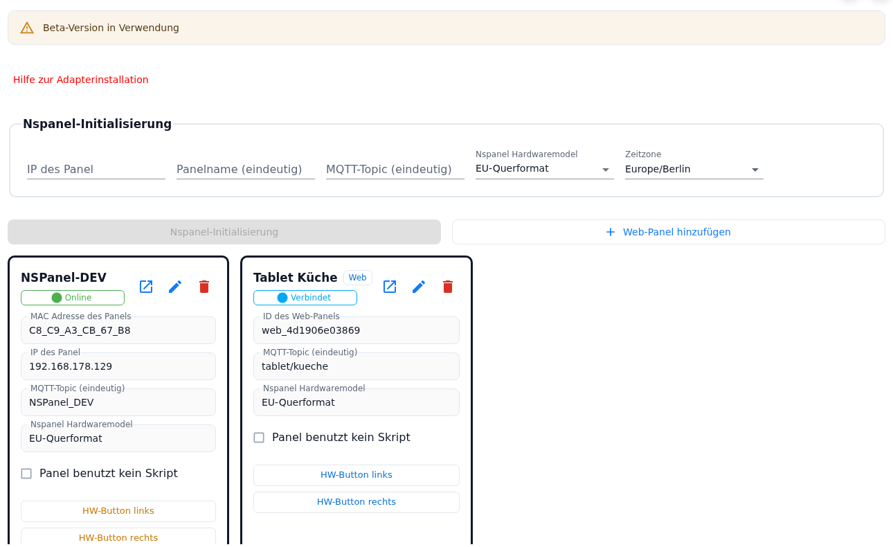
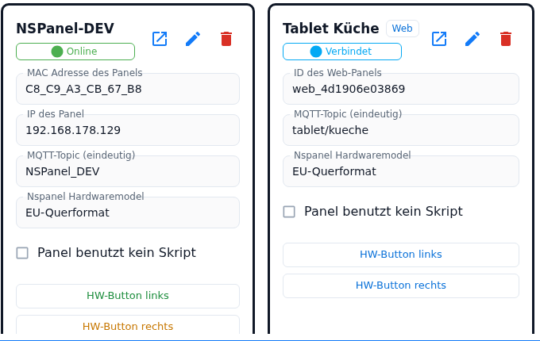
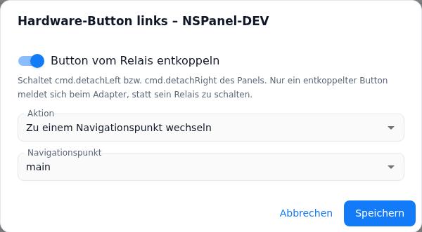

# Nspanel-Einstellungen

Der Tab **Nspanel-Einstellungen** ist die Panelverwaltung des Adapters: Oben steht das Einrichtungsformular, mit dem ein NSPanel angelegt oder neu übertragen wird, daneben der Knopf für ein Web-Panel, darunter für jedes bekannte Panel eine Kachel. In der Kachel sitzen auch die beiden Einstellungen, die es erst seit 2.0.0 gibt: der Haken **Panel benutzt kein Skript** und je ein Knopf für die **Aktion der beiden Hardware-Taster** unter dem Display.

**Was wann wirkt** — das gilt für den ganzen Tab:

- Panelname, Topic, Modell, der Haken *Panel benutzt kein Skript* und die Aktionen der Hardware-Taster sind Teil der Instanz-Konfiguration (`native.panels[]`). Sie werden erst mit dem **Speichern der Instanz-Einstellungen** gültig, und das Speichern startet den Adapter neu.
- Die **Entkopplung** eines Hardware-Tasters ist dagegen ein Datenpunkt (`panels.<ID>.cmd.detachLeft` / `.detachRight`). Der Schalter im Dialog wirkt sofort und unabhängig vom Speichern.

Inhalt:
- [Wann der Tab erscheint](#1-wann-der-tab-erscheint)
- [Panel anlegen oder aktualisieren](#2-panel-anlegen-oder-aktualisieren)
- [Web-Panel hinzufügen](#3-web-panel-hinzufügen)
- [Die Panelkachel](#4-die-panelkachel)
- [Panel benutzt kein Skript](#5-panel-benutzt-kein-skript)
- [Die Hardware-Taster: zwei Knöpfe, zwei Dialoge](#6-die-hardware-taster-zwei-knöpfe-zwei-dialoge)
- [Relais entkoppeln](#7-relais-entkoppeln)
- [Die Funktionsarten](#8-die-funktionsarten)
- [Farbe der Knöpfe in der Kachel](#9-farbe-der-knöpfe-in-der-kachel)
- [Fallstricke](#fallstricke)

## 1. Wann der Tab erscheint

Der Tab ist sichtbar, sobald die MQTT-Angaben vollständig sind: ein Broker (eingebauter Server **oder** eine Broker-Adresse), ein Port und ein Login — beim externen Broker genügt statt Benutzer und Passwort auch eine zentrale Zugangsdaten-ID. Ein Panel muss dafür noch nicht existieren, denn hier entsteht das erste. Die Felder dazu stehen im Tab [MQTT-Server Einstellungen](General).

Über dem Formular liegt der rote Link **Hilfe zur Adapterinstallation** (öffnet das Wiki in einem neuen Tab). Ist im Tab [Global Settings](globelSettings) die Beta-TFT eingeschaltet, steht hier zusätzlich die Warnung *Beta-Version in Verwendung*.

## 2. Panel anlegen oder aktualisieren

| Feld | Bedeutung |
|---|---|
| **IP von ioBroker** | Nur beim eingebauten MQTT-Server: die Adresse, unter der das Panel den ioBroker erreicht. Muss eine vollständige IPv4-Adresse sein. |
| **IP des Panel** | Feste IP des Panels; wird auf vollständiges IPv4-Format geprüft. |
| **Panelname (eindeutig)** | Name des Panels; er taucht als Name der Datenpunkte und des Konfigurationsskripts auf. |
| **MQTT-Topic (eindeutig)** | Topic des Panels. Mindestens vier Zeichen, beginnt mit einem Buchstaben, danach Buchstaben, Ziffern, `_` und `/`. |
| **Nspanel Hardwaremodel** | EU-Querformat, US-Querformat oder US-Hochformat. |
| **Zeitzone** | Suchfeld mit allen Tasmota-Zeitzonen. Die Einstellung gilt **instanzweit** und wird im zweiten Einrichtungsschritt an das Panel übertragen, das gerade eingerichtet wird. |

Der Knopf darunter heißt **Nspanel-Initialisierung**, wenn das Topic neu ist, und **NSPanelkonfiguration aktualisieren**, wenn es bereits ein Panel mit diesem Topic gibt. Er ist nur aktiv, wenn die Instanz läuft und alle Felder gültig sind — einschließlich der MQTT-Angaben aus dem anderen Tab.

Nach der Rückfrage laufen drei Schritte nacheinander; der Admin meldet nach jedem Schritt einen Meilenstein. Antwortet der Adapter länger als 30 Sekunden nicht, meldet der Admin das und die Einrichtung läuft im Hintergrund weiter — das Instanz-Log zeigt den Fortgang. Was die Schritte im Einzelnen tun (MQTT-Zugang, Grundeinstellungen und Zeitzone, Berry-Treiber, TFT-Firmware, Skripte), steht unter [Adapterinstallation](Adapter-Installation).

⚠️ **Am Ende erscheint ein Dialog mit „Speichern" und „Stornieren": erst „Speichern" übernimmt das Panel in die Konfiguration.** Dieses Speichern setzt die **gesamte Paneltabelle** auf den Stand, den der Adapter kennt — siehe [Fallstricke](#fallstricke).

## 3. Web-Panel hinzufügen

Neben dem Initialisierungsknopf steht **Web-Panel hinzufügen**. Der Knopf erscheint nur, wenn die Web-Panels eingeschaltet sind, und braucht keine laufende Instanz: Ein Web-Panel ist ein reiner Konfigurationseintrag ohne Hardware. Der Dialog fragt Name, Topic (wird zum Pfad der Adresse) und Hardwaremodell ab und zeigt die fertige Adresse zur Kontrolle.

Alles weitere — Adresse, Bedienung im Browser, PIN und HTTPS, Grenzen eines Web-Panels — steht auf der Seite [Web-Panel](WebPanel).

## 4. Die Panelkachel

Im Kopf der Kachel stehen der Panelname, bei einem Web-Panel das Kennzeichen **Web** und darunter der Verbindungsstatus (siehe [Panel-Status](PanelStatusBadge)). Rechts daneben liegen die Symbolknöpfe:

| Bedienelement | Wirkung |
|---|---|
| **⧉ (Web-Panel in neuem Tab öffnen)** | Erscheint, wenn die Web-Panels eingeschaltet sind und das Panel ein Topic hat — auch bei einem echten NSPanel. Öffnet `http(s)://<Host>:<Port>/<Topic>` in einem neuen Tab; eine hinterlegte PIN baut der Admin in die Adresse ein. Mehr unter [Web-Panel](WebPanel). |
| **↓ (Panel-Konfiguration exportieren)** | Schreibt die Konfiguration dieses Panels als JSON-Datei — Seiten, Screensaver, Hardware-Tasten und Panel-Einstellungen. Nur aktiv, wenn das Panel eine ID und ein Topic hat. Siehe [Panel-Konfiguration exportieren und importieren](panelConfigTransfer). |
| **↑ (Panel-Konfiguration importieren)** | Liest so eine Datei wieder ein. Vor der Übernahme zeigt der Admin eine Übersicht mit jeder einzelnen Seite, dem Importmodus und den Konflikten. Siehe [Panel-Konfiguration exportieren und importieren](panelConfigTransfer). |
| **Stift** | Bei einem NSPanel: kopiert IP, Name, Topic und Modell nach oben ins Formular, der Rahmen blinkt kurz. **Die Änderung passiert erst**, wenn anschließend *NSPanelkonfiguration aktualisieren* läuft. Bei einem Web-Panel öffnet der Stift dessen Dialog — das geht auch bei stehender Instanz. |
| **Papierkorb** | Fragt nach und entfernt den Eintrag danach **aus der Paneltabelle**. Nur bei laufender Instanz. Das Gerät behält seine Tasmota-Einstellungen; soll es wirklich leer sein, hilft der Werksreset in den [Tasmota-Tools](tasmotatools). |

Darunter als reine Anzeige die **MAC-Adresse** (beim Web-Panel die automatisch erzeugte **ID** `web_…`), die **IP** (nur NSPanel), das **MQTT-Topic** und das **Hardwaremodell**. Dann folgen der Haken *Panel benutzt kein Skript*, die beiden Knöpfe **HW-Button links** und **HW-Button rechts** und — nur beim NSPanel — **Tasmota-Konsole öffnen**, das die Konsole der Tasmota-Weboberfläche in einem neuen Tab öffnet.

Steht die Instanz, ist die Kachel blass und fast alles gesperrt. Bedienbar bleiben der Haken und die beiden Hardware-Taster-Knöpfe: beides ist Konfiguration und braucht kein laufendes Panel.

## 5. Panel benutzt kein Skript

Der Haken (`native.panels[].noScript`) stellt das Panel auf **Admin-Betrieb**: Es wird nur noch aus der Admin-Konfiguration und dem globalen Skript aufgebaut. Der Tooltip sagt es kurz: *Das Panel wird nur über den Admin (und das globale Skript) konfiguriert. Ein dafür gesendetes Panel-Skript wird abgelehnt, ein Skript-Update wird nicht angeboten.*

| Wirkung | Im Detail |
|---|---|
| **Panel-Skripte werden abgewiesen** | Schickt ein Skript eine Konfiguration für dieses Topic, speichert der Adapter sie nicht und lädt das Panel nicht neu. Er schreibt einen Fehler ins Log und schickt ihn an den Absender zurück: das Skript im JavaScript-Adapter deaktivieren oder löschen, sonst sendet es bei jedem Start erneut. Das **globale Skript** ist nie betroffen; es gilt weiter und wird bei Änderungen sogar in die laufenden Panels nachgeladen. Alte Skripte, die das vollständige Kommando-Topic (`<Topic>.cmnd.CustomSend`) senden, erkennt der Adapter dabei mit. |
| **Gespeicherte Skript-Konfiguration bleibt liegen** | Die zuletzt gespeicherte Konfiguration des Panels wird beim Adapterstart nicht mehr benutzt — auch nicht als Nebenlieferant für die Seiten der anderen Panels. Gelöscht wird sie nicht: Wer den Haken entfernt, hat sie wieder. |
| **Aufbau aus leerer Vorlage** | Statt der Platzhalter-Startseite („Die Leere") startet der Adapter mit einer leeren Seitenliste und nimmt die Seiten aus dem Admin; fehlt eine Startseite, ergänzt er seine eigene und schreibt eine Info ins Log. |
| **Keine Versionsprüfung, kein Update-Angebot** | Im Tab [Maintain](Maintain) steht bei *Skriptversion* **Skript deaktiviert**, der Knopf *SCRIPT UPDATE* wird nicht angezeigt, und *Skripte für alle Panels aktualisieren* lässt das Panel aus. Ein Auftrag, das Panel-Skript zu erzeugen, wird mit Meldung abgelehnt; bei der Initialisierung legt der Adapter nur noch das globale Skript an. Im Tab [Panelinfo](Panelinfo) zeigt der Skriptname ebenfalls *Skript deaktiviert*. |
| **Übernahme gesperrt** | Bei gesetztem Haken lehnt der Adapter *Skript in Admin übernehmen* ab: Haken entfernen, konvertieren, danach wieder setzen. |
| **Hardware-Taster brauchen den Admin** | Ohne Skript gibt es niemanden, der für einen Taster entscheiden könnte. Steht seine Aktion auf *hier nicht konfiguriert*, hat die Taste keine Funktion; der Dialog weist darauf hin. |

Die richtige Reihenfolge beim Umstieg von einem Skript — übernehmen, prüfen, Skript abschalten, dann den Haken setzen — steht auf der Seite [Migration](Migration).

## 6. Die Hardware-Taster: zwei Knöpfe, zwei Dialoge

Die beiden Tasten unter dem Display sind seit 2.0.0 im Admin einstellbar. **HW-Button links** und **HW-Button rechts** in der Kachel öffnen je einen Dialog *Hardware-Button links/rechts – <Panelname>*; gespeichert wird das Ergebnis als `buttonLeft` bzw. `buttonRight` des Panels.

**Der Admin überschreibt das Skript.** Beim Aufbau der Panel-Konfiguration legt der Adapter die Aktionen des Admins über die des Konfigurationsskripts, und zwar getrennt für jede Seite:

- Eine im Admin eingestellte Seite **gewinnt** gegen das Skript.
- Eine Seite, die im Admin nie angefasst wurde (*hier nicht konfiguriert*), behält den Wert aus dem Skript. Ein per Skript konfiguriertes Panel verhält sich also unverändert, solange niemand den Dialog benutzt.
- Ein unbrauchbarer Admin-Eintrag (etwa ein Datenpunkt, der auf einen Punkt endet) wird verworfen; der Adapter schreibt eine Warnung ins Log und behält den Skriptwert.

Der Dialog schließt nur über seine Knöpfe — ein Klick daneben schließt ihn nicht. **Speichern** ist gesperrt, solange die Eingaben unvollständig sind; **Stornieren** verwirft die Eingaben, nicht aber einen inzwischen umgelegten Entkopplungsschalter.

## 7. Relais entkoppeln

Ein Hardware-Taster des NSPanels schaltet von Haus aus **sein Relais** und meldet sich nicht beim Adapter. Deshalb bietet der Dialog zuerst die Entkopplung an und erst danach die Aktion.

| Element | Bedeutung |
|---|---|
| **Button vom Relais entkoppeln** | Schaltet `panels.<ID>.cmd.detachLeft` bzw. `.detachRight`. Der Adapter schickt daraufhin sofort die passende Tasmota-Regel, die den Tastendruck als Ereignis veröffentlicht. Der Dialog liest den Datenpunkt live mit und zeigt immer den echten Zustand. Der Schalter braucht eine **laufende Instanz**. |
| Hinweis **„Erst entkoppeln, dann lässt sich die Aktion einstellen"** | Steht da, solange der Taster gekoppelt ist und keine Aktion gespeichert ist. Die Auswahl der Aktion wird gar nicht angezeigt. |
| Hinweis **„Die für diesen Button gespeicherte Aktion bleibt erhalten"** | Steht da, wenn für den gekoppelten Taster schon eine Aktion in der Konfiguration liegt. Sie wird nicht gelöscht und wirkt wieder, sobald der Taster entkoppelt ist. |
| **Speichern bei gekoppeltem Relais** | Schließt den Dialog nur. Es gibt nichts zu speichern: Die Entkopplung ist beim Umlegen des Schalters schon geschrieben, die gespeicherte Aktion bleibt unangetastet. |
| **Instanz läuft nicht** | Warnung im Dialog, der Schalter ist gesperrt. Die Aktion lässt sich trotzdem einstellen — sie steht in der Konfiguration, nicht im Panel. |
| **Web-Panel** | Hat kein Relais. Der Dialog sagt das und bietet die Aktion immer an; die beiden Tastenleisten im Browser lösen sie direkt aus. |

Die Entkopplung bleibt über Adapterneustarts erhalten (der Adapter liest den Datenpunkt beim Panelstart zurück), Standard ist **gekoppelt**. Zwei Nebenwirkungen sind nützlich zu wissen:

- Für jede entkoppelte Seite entsteht der Datenpunkt `panels.<ID>.cmd.buttons.left` bzw. `.right`. Wer ihn schreibt, löst die eingestellte Aktion aus, als wäre die Taste gedrückt worden. Sind beide Seiten wieder gekoppelt, verschwindet der ganze Zweig.
- Jeder Druck einer entkoppelten Taste schreibt zusätzlich `panels.<ID>.buttons.left` bzw. `.right` auf `true` — unabhängig davon, ob eine Aktion eingestellt ist. Damit lässt sich die Taste auch in eigenen Skripten oder Szenen auswerten.

## 8. Die Funktionsarten

Das Feld **Aktion** hat neben *hier nicht konfiguriert* sieben Einträge:

| Aktion | Was der Taster tut |
|---|---|
| **hier nicht konfiguriert** | Der Admin stellt nichts ein; es gilt, was das Konfigurationsskript über diesen Taster sagt. Beim Speichern wird das Feld aus der Konfiguration entfernt. Bei *Panel benutzt kein Skript* bedeutet das: keine Funktion. |
| **Zu einem Navigationspunkt wechseln** | Das Panel springt auf die gewählte Seite. |
| **Datenpunkt umschalten** | Kippt einen booleschen Datenpunkt. |
| **Datenpunkt auf true setzen** | Setzt den Datenpunkt auf `true` (Taster-Verhalten). |
| **Auf true setzen, nach der Verzögerung zurück auf false** | Setzt sofort `true`, nach der Verzögerung `false`. |
| **Auf false setzen, nach der Verzögerung zurück auf true** | Setzt sofort `false`, nach der Verzögerung `true`. |
| **Nach der Verzögerung auf true setzen** | Setzt erst nach Ablauf der Verzögerung `true`. |
| **Nach der Verzögerung auf false setzen** | Setzt erst nach Ablauf der Verzögerung `false`. |

Je nach Auswahl erscheinen die passenden Felder:

- **Navigationspunkt** — eine Auswahlliste mit den Navigationspunkten dieses Panels; es sind genau die Werte, die der Datenpunkt `cmd.goToNavigationPoint` kennt, inklusive der Systemseiten (Namen mit `///`). Ist die Liste leer, bietet der Dialog ein Textfeld mit dem Hinweis, den Namen so einzutragen, wie er in `cmd.goToNavigationPoint` steht. Ein gespeicherter Name, den das Panel nicht (mehr) meldet, bleibt in der Liste sichtbar und geht nicht verloren.
- **Datenpunkt** — Auswahl über den Objektbaum; angeboten werden nur **beschreibbare** Datenpunkte.
- **Verzögerung (s)** — nur bei den vier Verzögerungsarten. Leer bedeutet **0,25 s**; erlaubt sind 0,001 bis 2 147 483 Sekunden. Ein Wert außerhalb dieser Grenzen sperrt *Speichern*; käme am Panel trotzdem ein unbrauchbarer Wert an, rechnet es mit 250 ms. Ein erneuter Tastendruck während der Verzögerung setzt die laufende Zeit neu.

## 9. Farbe der Knöpfe in der Kachel

Die beiden Knöpfe stehen **untereinander** über die volle Breite der Kachel und zeigen an ihrer Farbe,
woran man ist. Jede Farbe hat einen eigenen Tooltip, der den Zustand ausspricht:

| Farbe | Bedeutung |
|---|---|
| **Grün** | Eine Aktion ist im Admin konfiguriert und kann wirken: Der Taster ist vom Relais entkoppelt — oder es ist ein Web-Panel, das gar keins hat. |
| **Orange** | Eine Aktion ist konfiguriert, der Taster hängt aber noch an seinem Relais: *Aktion konfiguriert, aber der Button ist mit seinem Relais gekoppelt – sie wirkt erst nach dem Entkoppeln.* |
| **Blau** | Im Admin ist für diese Seite **nichts** konfiguriert, das Relais ist aber **entkoppelt** — der Tastendruck erreicht also den Adapter, und es gilt, was das Konfigurationsskript für diesen Taster sagt. |
| **Grau** | Nichts konfiguriert und der Taster schaltet sein Relais — der Werkszustand. |

Lässt sich die Entkopplung nicht lesen — etwa bei stehender Instanz —, gilt sie als entkoppelt; der Knopf ist dann grün. Dieselbe Regel benutzt der Dialog, wenn er entscheidet, ob er die Aktion anbietet.

## Fallstricke

- **Vor der Initialisierung speichern.** Das „Speichern" im Erfolgsdialog setzt die Paneltabelle auf die Liste, die der **Adapter** kennt — also auf den gespeicherten Stand plus das neue Panel. Noch nicht gespeicherte Änderungen in den Kacheln (ein gesetzter Haken *Panel benutzt kein Skript*, eine neue Taster-Aktion, ein eben angelegtes Web-Panel) sind danach weg.
- **Entkoppeln wirkt sofort, die Aktion erst nach dem Speichern.** Der Schalter schreibt einen Datenpunkt; *Stornieren* nimmt ihn nicht zurück. Die Aktion dagegen liegt in der Instanz-Konfiguration und greift erst, wenn gespeichert ist und der Adapter das Panel neu aufgebaut hat.
- **Die Zeitzone geht nur beim Einrichten mit.** Der Adapter liest die **gespeicherte** Zeitzone und schickt sie im zweiten Schritt an genau das Panel, das gerade eingerichtet wird. Eine neu gewählte Zeitzone also erst speichern; andere, längst eingerichtete Panels bekommen sie nur über *NSPanelkonfiguration aktualisieren*.
- **Topic schon vergeben:** Zwei Panels dürfen nicht dasselbe Topic haben. Der Knopf wechselt sonst auf *NSPanelkonfiguration aktualisieren* und überträgt auf das bestehende Panel. Gehören IP und Topic zu verschiedenen Einträgen, bricht der Adapter mit einer Meldung ab.
- **Taster tut nichts, obwohl eine Aktion eingestellt ist:** Existiert der angegebene Datenpunkt beim Panelstart nicht (umbenannt, gelöscht, Alias weg), verwirft der Adapter die Aktion still — der Taster bleibt wirkungslos. Zweite Ursache: Der Taster ist noch am Relais, dann ist der Knopf in der Kachel orange.
- **Falscher Navigationspunkt:** Ein Name, den die Navigation des Panels nicht kennt, führt nur zu einer Warnung im Log; am Panel passiert nichts. Besser aus der Liste wählen, als ihn zu tippen.
- **Der Haken sperrt die Übernahme.** *Skript in Admin übernehmen* lehnt ein Panel mit *Panel benutzt kein Skript* ab — erst übernehmen, dann den Haken setzen ([Migration](Migration)).
- **Panel war vorher an einem anderen Host:** Vor der Initialisierung einmal `reset 4` auf der Tasmota-Konsole ausführen.
- **Kein Internet am Panel:** Der dritte Schritt prüft, ob das Panel die Download-Adresse erreicht, und bricht sonst mit einem Hinweis ab — Berry-Treiber und TFT-Firmware lädt das Panel selbst herunter.
- **Verbindung nach einem Wiederherstellen aus dem Backup:** Topic und IP im Formular prüfen und *NSPanelkonfiguration aktualisieren* laufen lassen; damit gehen MQTT-Zugang und Grundeinstellungen neu auf das Panel. Das Zertifikat des eingebauten Brokers liegt im Instanzobjekt und wird dabei nicht neu erzeugt — das Panel prüft es ohnehin nicht.
