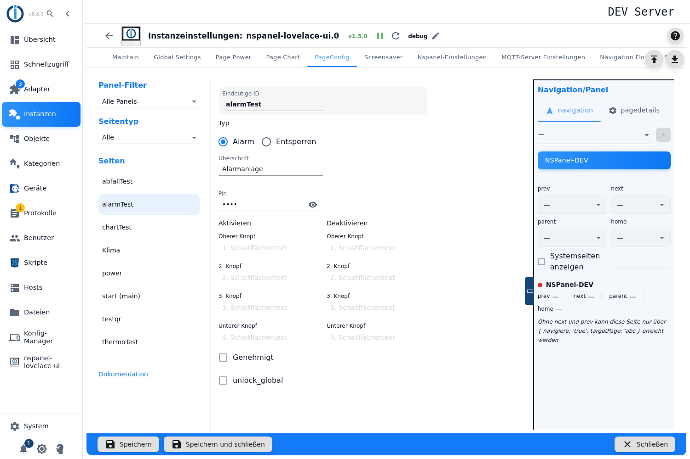
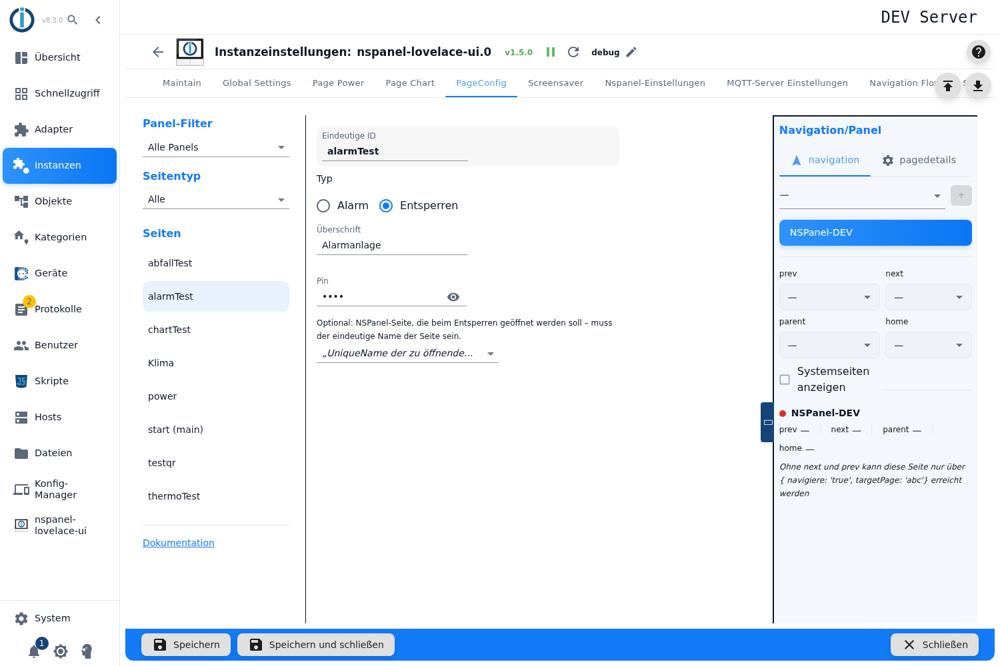

# Alarm- und Entsperrseite – Konfiguration im Admin

Eine Alarm-Seite macht aus dem Panel die Bedieneinheit einer Alarmanlage: vier Schaltflächen zum Aktivieren, vier zum Deaktivieren, eine PIN-Tastatur und Statusdatenpunkte, über die eine echte Anlage angebunden wird. Dieselbe Karte dient als **Entsperrseite** — dann fragt sie nur die PIN ab und springt danach auf eine Seite weiter.

> **Diesen Kartentyp gibt es ausschließlich im Admin.** Ein Konfigurationsskript weist ihn ausdrücklich ab („is only supported in the admin configuration! Skipped!"). Hier gibt es also gar keinen zweiten Weg.

Inhalt:
- [Seite anlegen](#1-seite-anlegen)
- [Betriebsart: Alarm oder Entsperren](#2-betriebsart-alarm-oder-entsperren)
- [PIN](#3-pin)
- [Die Schaltflächen der Alarm-Seite](#4-die-schaltflächen-der-alarm-seite)
- [Zustände und was sie zeigen](#5-zustände-und-was-sie-zeigen)
- [Genehmigt: Zwischenschritt beim Schalten](#6-genehmigt-zwischenschritt-beim-schalten)
- [Der Haken `unlock_global`](#7-der-haken-unlock_global)
- [Die Entsperrseite und ihr Sprungziel](#8-die-entsperrseite-und-ihr-sprungziel)
- [Die Datenpunkte des Adapters](#9-die-datenpunkte-des-adapters)
- [Panel-Zuweisung und Navigation](#10-panel-zuweisung-und-navigation)

## 1. Seite anlegen

1. Instanz-Einstellungen öffnen → Tab **PageConfig**.
2. Links als Seitentyp **Alarm** wählen, einen Namen eintragen, **+** drücken.
3. Die Seite erscheint in der Liste, rechts öffnet sich der Editor.

> Wie bei allen Kartentypen sind die Felder gesperrt, solange die Instanz nicht läuft.

## 2. Betriebsart: Alarm oder Entsperren

Direkt unter der ID steht **Typ** mit zwei Möglichkeiten:

| Auswahl | Ergebnis |
|---|---|
| **Alarm** | Die vollständige Alarmbedienung: acht Schaltflächen, Zustandsautomat, Statusdatenpunkte. |
| **Entsperren** | Nur PIN-Abfrage und ein Sprung auf eine andere Seite. |

Die **Entsperrseite ist kein eigener Seitentyp** — sie entsteht genau hier, aus einer Alarm-Seite. Deshalb findet man sie in der Auswahl beim Anlegen nicht.

> ⚠️ **Eine neue Seite hat noch keine Betriebsart.** Beim Anlegen wird nichts vorbelegt: Es ist **keine** der beiden Schaltflächen aktiv, und weil der Editor die weiteren Felder je Betriebsart einblendet, sieht man zunächst **nur** ID, Typ, Überschrift und PIN — die Seite wirkt halb leer. **Zuerst den Typ wählen**, dann erscheint der Rest.
>
> Bleibt der Typ ungesetzt, baut der Adapter die Seite als **Entsperrseite** — obwohl der Seitentyp beim Anlegen „Alarm" hieß. Wer eine Alarmseite will, muss *Alarm* also aktiv anklicken.

**Umschalten später** blendet die Felder der anderen Betriebsart nur aus; eingetragene Werte bleiben in der Konfiguration stehen. Ein vorher gesetzter Haken *Genehmigt* oder `unlock_global` wirkt also weiter, obwohl man ihn nicht mehr sieht.

**Überschrift** ist die Kopfzeile am Panel. Beim Anlegen wird der Seitenname eingetragen; bleibt sie leer, zeigt das Panel den Seitennamen.

## 3. PIN

Das Feld **Pin** nimmt nur Ziffern; das Augensymbol zeigt sie im Klartext. Die PIN gilt für beide Betriebsarten: Auf der Alarm-Seite schützt sie jede Schaltfläche, auf der Entsperrseite ist sie der ganze Zweck.

Vier Eigenheiten, die man kennen sollte:

- **Eine Seite ohne PIN lässt sich hier nicht einstellen.** Ein leeres Feld wird als `0` gespeichert, und `0` ist eine gültige PIN — abgefragt wird also trotzdem.
- **Führende Nullen fallen weg.** Die Eingabe wird in eine Zahl verwandelt: Aus `0123` wird `123`. Wer eine PIN mit führender Null plant, muss sie anders wählen.
- **Es gibt keine Längenprüfung** — weder nach unten noch nach oben, und keine Fehlermeldung.
- **Der zentrale Service-Pin ist von hier nicht erreichbar.** Der Adapter kennt einen verschlüsselt gespeicherten Service-Pin (Feld *Service-Pin* in den [globalen Einstellungen](globelSettings)), nutzt ihn aber nur für seine eingebaute Systemseite. Im PIN-Feld dieser Seite lässt er sich nicht hinterlegen.

> **Die PIN steht im Klartext** in der Adapterkonfiguration (`native.pageConfig[].pin`) — anders als der Service-Pin, der verschlüsselt liegt. Jeder mit Objekt-Leserecht in ioBroker kann sie lesen. Das ist derselbe Punkt wie beim WLAN-Passwort der QR-Seite und wird mit PR [#782](https://github.com/ticaki/ioBroker.nspanel-lovelace-ui/pull/782) angegangen.

> ⚠️ **Nach einem Fehlversuch sperrt die Karte — und zwar immer länger.** Die Wartezeit verdoppelt sich mit jedem Fehlversuch (2 s, 4 s, 8 s …) und ist **nicht begrenzt**: nach zehn Fehlversuchen über 17 Minuten, nach sechzehn über 18 Stunden. Zurückgesetzt wird der Zähler nur durch die richtige PIN oder durch einen Neustart des Adapters. Während der Sperre zeigt die Karte „Gesperrt für *n* s" und die Tastatur bleibt tot.

## 4. Die Schaltflächen der Alarm-Seite

Zwei Spalten mit je vier Feldern. Was man einträgt, ist der **Text** der Schaltfläche; welche Aktion sie auslöst, steht fest.

| Spalte | Felder | Erscheint im Zustand | Wirkung |
|---|---|---|---|
| **Aktivieren** | Oberer Knopf, 2. Knopf, 3. Knopf, Unterer Knopf | `disarmed` | armiert die Anlage (vier Varianten, z. B. „Anwesend" und „Abwesend") |
| **Deaktivieren** | dieselben vier Beschriftungen | `armed` | deaktiviert die Anlage |

Ein leeres Feld bedeutet: diese Schaltfläche gibt es nicht. Man kann also auch nur eine Variante anbieten.

> Die vier Felder der rechten Spalte tragen in der Oberfläche **dieselben Beschriftungen** wie die der linken — es gibt keine eigenen Texte für „5. Knopf" bis „8. Knopf". Man unterscheidet sie nur an der Spaltenüberschrift.
>
> Und die deutschen Überschriften *Aktivieren* / *Deaktivieren* lesen sich wie eine Aufforderung, benennen aber den **Zustand, in dem die Schaltflächen erscheinen**: Die Spalte *Aktivieren* sieht man, wenn die Anlage **aus** ist. Die englische Fassung sagt dazu „Armed" / „Disarmed" und bezieht sich damit auf den jeweils anderen Punkt — die beiden Sprachfassungen widersprechen sich hier.

> ⚠️ **Die „Deaktivieren"-Spalte wird nur übernommen, wenn auch die „Aktivieren"-Spalte gefüllt ist.** Beim Erzeugen der Panel-Seite prüft der Adapter die falschen Felder: Für den unteren Knopf der rechten Spalte schaut er nach, ob der **untere Knopf der linken** Spalte gefüllt ist. Wer nur die rechte Spalte ausfüllt, bekommt am Panel im Zustand `armed` **keine einzige Schaltfläche** und kommt dort nur noch über den Datenpunkt `.status` heraus.
>
> **Bis das behoben ist: immer paarweise füllen** — zu jedem Text in der Spalte *Aktivieren* auch einen in derselben Zeile der Spalte *Deaktivieren*.

## 5. Zustände und was sie zeigen

Die Karte kennt fünf Zustände. Den aktuellen hält der Datenpunkt `.status`, über den auch eine fremde Anlage den Zustand vorgeben kann.

| Zustand | Was die Karte zeigt | Tastatur |
|---|---|---|
| `disarmed` | die vier Schaltflächen der Spalte *Aktivieren* | frei |
| `armed` | die vier Schaltflächen der Spalte *Deaktivieren* | frei |
| `arming` | eine Textschaltfläche, die Karte blinkt | gesperrt |
| `pending` | dasselbe, auf dem Weg zurück | gesperrt |
| `triggered` | Textschaltfläche mit Glockensymbol `bell-ring` | frei |

Beim Start normalisiert der Adapter: `pending` wird zu `armed`, `arming` zu `disarmed` — ein Zwischenzustand übersteht also keinen Neustart.

> ⚠️ **Die Zustandstexte erscheinen englisch.** Dem Adapter fehlen die Übersetzungen für `armed`, `disarmed`, `arming`, `pending`, `triggered` und `locked`; in diesem Fall zeigt er den Schlüssel selbst. Auf dem Panel steht also wörtlich „arming", „pending", „triggered". Übersetzt sind nur „Gesperrt für" und „entsperren". Kurios: In einer anderen Datei des Adapters liegen diese Begriffe mehrsprachig vor, werden an dieser Stelle aber nicht herangezogen.

## 6. Genehmigt: Zwischenschritt beim Schalten

Mit dem Haken **Genehmigt** läuft das Schalten nicht sofort durch, sondern über einen Zwischenzustand: Ein Druck auf *Aktivieren* setzt die Karte auf `arming` und wartet auf eine **Bestätigung von außen** — jemand schreibt `true` in den Datenpunkt `.approve`. Erst dann wird daraus `armed`. Rückwärts dasselbe über `pending`.

Gedacht ist das für eine echte Anlage, die selbst melden soll, dass sie wirklich armiert ist (etwa nach dem Türkontakt-Check). Ohne Haken schaltet die Karte direkt um.

## 7. Der Haken `unlock_global`

> ⚠️ **Diese Checkbox zeigt zurzeit den Schlüssel `unlock_global` statt einer Beschriftung** — dem Adapter fehlt die Übersetzung, in allen Sprachen. Sie ist aber keine Kleinigkeit, deshalb hier, was sie tut:

Der Haken verlegt die Statusdatenpunkte der Seite von `panels.<panel>.alarm.<seite>` nach **`alarm.<seite>`** und hält den Zustand damit **über alle Panels hinweg gleich**. Wer dieselbe Alarmseite auf mehreren Panels zeigt, will das — sonst ist die Anlage auf dem einen Panel armiert und auf dem anderen nicht.

Wer nur ein Panel hat, lässt den Haken aus. Zu beachten: Nach dem Umstellen liegen die Datenpunkte **an einem anderen Ort** — Skripte und Visualisierungen, die darauf zeigen, müssen nachgezogen werden.

## 8. Die Entsperrseite und ihr Sprungziel

Bei der Betriebsart **Entsperren** fallen alle Schaltflächen weg. Die Karte zeigt ein Schloss (`lock-remove`), eine Tastatur und die Beschriftung „entsperren". Nach der richtigen PIN springt sie auf das eingestellte Ziel.

Das Auswahlfeld darunter bietet die Seiten dieses Panels an; die eigene Seite und die internen Systemseiten (`///…`) sind ausgenommen.

> Der Hinweistext nennt das Ziel **optional** — das ist zwar richtig, aber irreführend: **Ohne Ziel passiert nach der richtigen PIN nichts Sichtbares.** Die Karte bleibt stehen, intern werden lediglich die Statusdatenpunkte kurz durchgeschaltet. Eine Entsperrseite ohne Ziel ist damit praktisch wirkungslos — gewarnt wird nicht, weder im Admin noch im Log.

Nützlich ist die Entsperrseite als **Vorschaltseite**: Man setzt sie als Navigationsziel vor eine Seite, die nicht jeder bedienen soll, und trägt als Sprungziel die eigentliche Seite ein.

## 9. Die Datenpunkte des Adapters

Für jede Alarm-Seite legt der Adapter drei Datenpunkte an, unter `panels.<panel>.alarm.<seitenname>` (oder `alarm.<seitenname>`, siehe [Abschnitt 7](#7-der-haken-unlock_global)):

| Datenpunkt | Typ | Bedeutung |
|---|---|---|
| `.status` | Zahl, schreibbar | Der Zustand, mit Klartextliste `disarmed`, `armed`, `arming`, `pending`, `triggered`. **Von außen beschreibbar** — so meldet eine fremde Anlage ihren Zustand ans Panel, und so kommt man aus einem hängenden Zustand heraus. |
| `.mode` | Text, nur lesbar | Das letzte gedrückte Ereignis (`A1`…`A4` beim Aktivieren, `D1`…`D4` beim Deaktivieren). **Das ist der Anschluss für die eigene Alarmanlage:** ein Skript hört darauf und schaltet die Anlage entsprechend. |
| `.approve` | Boolesch, schreibbar | Die Bestätigung für [Genehmigt](#6-genehmigt-zwischenschritt-beim-schalten). |

Die Anbindung einer realen Anlage läuft also über diese drei Punkte — Datenpunkte oder Alias-Rollen werden im Editor **nicht** eingetragen und auch nicht ausgewertet.

## 10. Panel-Zuweisung und Navigation

Panel, Navigationsziele, *Startseite*, *Versteckt* und *Verhalten des Bildschirmschoners* liegen in der rechten Spalte, beschrieben unter [PageConfig – Übersicht](PageConfig#panelzuweisung-und-navigation).

Für eine Alarmseite lohnt ein Blick auf **Verhalten des Bildschirmschoners**: Mit *Niemals aktivieren* bleibt die Seite stehen, statt nach der Wartezeit in den Bildschirmschoner zu wechseln — sinnvoll, wenn der Zustand der Anlage dauerhaft sichtbar sein soll.
