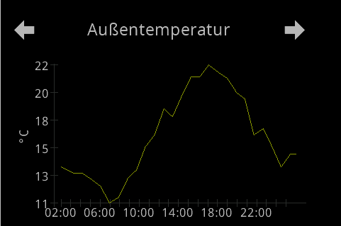
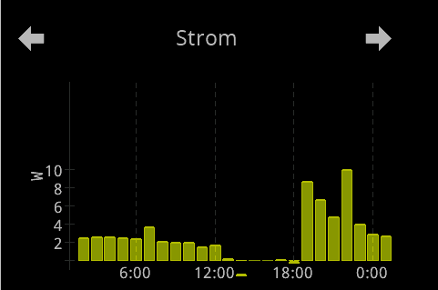
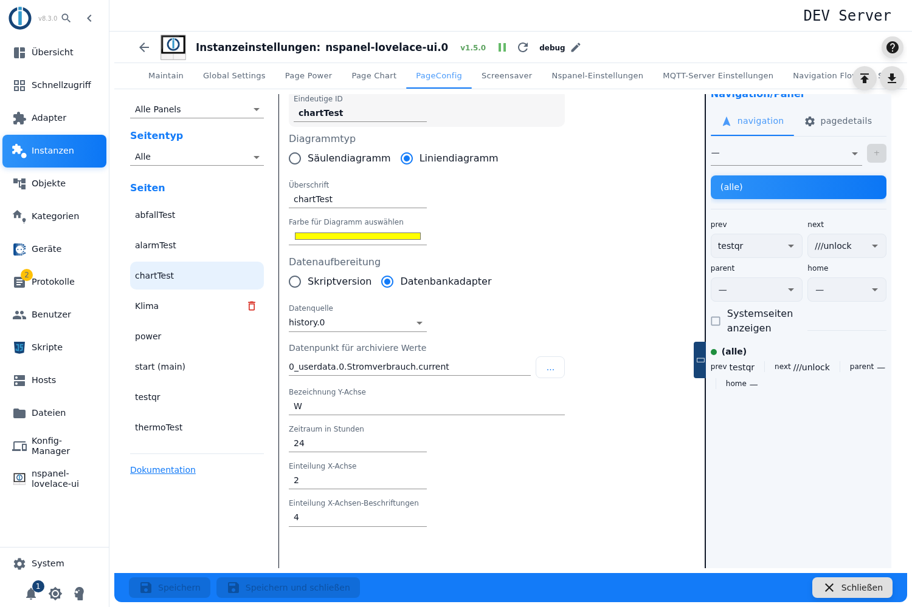
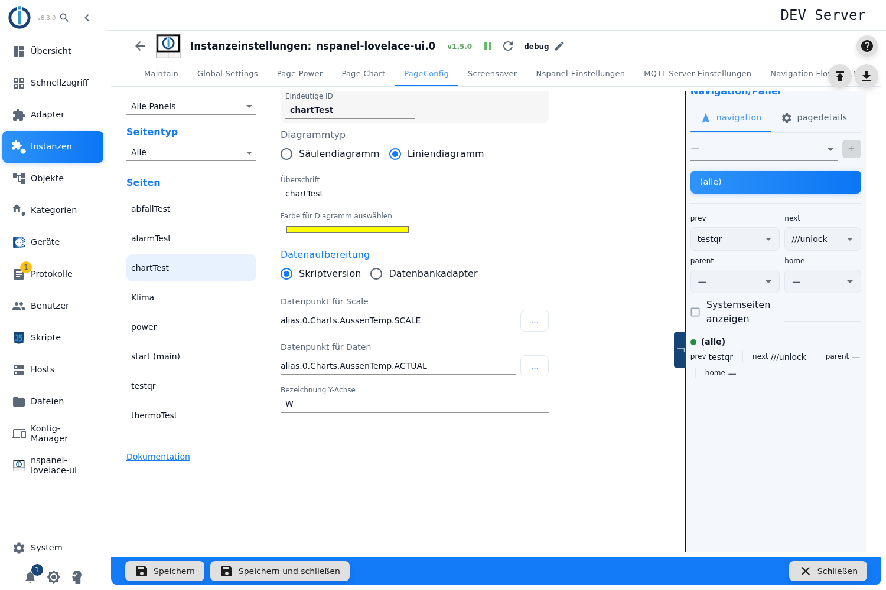

# Diagramm-Seite – Konfiguration im Admin

Die Diagramm-Seite zeichnet einen Messwert über die Zeit — als **Säulendiagramm** oder als **Liniendiagramm**. Die Daten holt sie wahlweise selbst aus einem Verlaufsadapter (InfluxDB, History, SQL) oder sie übernimmt einen fertig aufbereiteten Wert aus einem Datenpunkt.

Angelegt wird sie im Tab **PageConfig**, Seitentyp **Diagramm**.

Inhalt:
- [Seite anlegen](#1-seite-anlegen)
- [Diagrammtyp: Säulen oder Linie](#2-diagrammtyp-säulen-oder-linie)
- [Datenaufbereitung: Datenbank oder Skript](#3-datenaufbereitung-datenbank-oder-skript)
- [Weg A: Daten aus einem Verlaufsadapter](#4-weg-a-daten-aus-einem-verlaufsadapter)
- [Weg B: Daten aus eigenen Datenpunkten](#5-weg-b-daten-aus-eigenen-datenpunkten)
- [Die Y-Achse und die Zwei-Zeichen-Regel](#6-die-y-achse-und-die-zwei-zeichen-regel)
- [Die Zeitachse](#7-die-zeitachse)
- [Farbe und Beschriftung](#8-farbe-und-beschriftung)
- [Panel-Zuweisung und Navigation](#9-panel-zuweisung-und-navigation)

## 1. Seite anlegen

1. Instanz-Einstellungen öffnen → Tab **PageConfig**.
2. Links als Seitentyp **Diagramm** wählen, einen Namen eintragen, **+** drücken.
3. Die Seite erscheint in der Liste, rechts öffnet sich der Editor.

**Überschrift** ist die Kopfzeile am Panel; beim Anlegen wird der Seitenname eingetragen, leer zeigt das Panel `Page Chart`.

> Wie bei allen Kartentypen sind sämtliche Felder gesperrt, solange die Instanz nicht läuft — ohne erklärenden Hinweis.

## 2. Diagrammtyp: Säulen oder Linie

Unter **Diagrammtyp** stehen zwei Möglichkeiten, und die Wahl entscheidet mehr als nur das Aussehen:

| | **Säulendiagramm** | **Liniendiagramm** |
|---|---|---|
| Auflösung aus der Datenbank | ein Mittelwert **je Stunde** | **5-Minuten-Raster**, höchstens 500 Punkte |
| Y-Achse | Minimum fest **0** | spannt über die Daten |
| Umgang mit großen Zahlen | **Wertefaktor von Hand** | **automatisch** |
| Einteilung der X-Achse | nur Beschriftungen | Striche **und** Beschriftungen getrennt einstellbar |

Faustregel: **Säulen** für Tages- oder Stundensummen (Verbrauch je Stunde), **Linie** für einen Verlauf (Temperatur).

 

An den beiden Bildern lassen sich die Unterschiede ablesen: Das **Liniendiagramm** (links) spannt die Y-Achse über die Daten — hier 11 bis 22 °C. Das **Säulendiagramm** (rechts) beginnt immer bei **0** und zeigt je Stunde eine Säule. Beide Achsenbeschriftungen bleiben **zweistellig**, das ist die Grenze des Panels (siehe [Abschnitt 6](#6-die-y-achse-und-die-zwei-zeichen-regel)). Und an den Zeitangaben sieht man die Einteilung: links alle vier Stunden, rechts an jeder durch sechs teilbaren Uhrzeit.

## 3. Datenaufbereitung: Datenbank oder Skript

Die Auswahl **Datenaufbereitung** ist die eigentliche Weiche:

| Auswahl | Bedeutung |
|---|---|
| **Datenbankadapter** | Der Adapter fragt selbst einen Verlaufsadapter ab und rechnet die Darstellung aus. Das ist der Weg ohne Skript. |
| **Skriptversion** | Du lieferst Achse und Werte fertig in zwei eigenen Datenpunkten. Für Sonderfälle, die die Automatik nicht abdeckt. |

> Die Beschriftungen sind hier **vertauscht und verwirrend**: Die Auswahl heißt *Datenaufbereitung*, entscheidet aber über die **Datenquelle**; das Feld darunter heißt *Datenquelle*, meint aber die **Instanz des Datenbankadapters**. Beim Lesen also auf die Funktion achten, nicht auf den Namen.

## 4. Weg A: Daten aus einem Verlaufsadapter

Bei **Datenbankadapter** erscheinen zwei Felder.

**Datenquelle** (gemeint: die Instanz) listet die laufenden Instanzen von **InfluxDB**, **History** und **SQL**. Andere Verlaufsadapter kennt der Editor nicht. Ist keine passende Instanz aktiv, steht dort *Keine Instanz gefunden*.

**Datenpunkt für archiviere Werte** (der Grammatikfehler steht so in der Oberfläche) nimmt den Messwert. Die Auswahl zeigt **nur Datenpunkte, die in dieser Instanz tatsächlich aufgezeichnet werden** — ein nicht protokollierter Datenpunkt taucht gar nicht erst auf. Das ist die nützlichste Prüfung des ganzen Editors.

**Zeitraum in Stunden** legt fest, wie weit zurück gezeichnet wird; das Fenster endet immer „jetzt". Vorgabe 24.

Der Adapter fragt die Daten als Mittelwerte ab (`getHistory` mit `aggregate: average`). Läuft die gewählte Instanz gerade nicht, bleibt das Diagramm leer und es gibt nur eine Warnung im Log.

> **Ohne Instanz oder ohne Datenpunkt fällt die Seite stillschweigend auf den Skript-Weg zurück** — und zeigt dann ein leeres Diagramm, weil die Skript-Datenpunkte leer sind. Im Admin erscheint dazu **keine** Meldung. Wer ein leeres Diagramm sieht, prüft also zuerst, ob beide Felder gefüllt sind.

> **Verschwundene Instanz:** Wird die gewählte Instanz später deaktiviert oder entfernt, zeigt das Feld **leer** — gespeichert ist sie aber weiterhin. Die Seite sieht dann unkonfiguriert aus, obwohl sie es nicht ist.

**Wertefaktor für Diagramm** gibt es nur beim **Säulendiagramm**. Er teilt die Werte, bevor sie ans Panel gehen — Watt zu Kilowatt, damit die Beschriftung der Y-Achse in zwei Zeichen passt (siehe [Abschnitt 6](#6-die-y-achse-und-die-zwei-zeichen-regel)).

> Das Feld zeigt `1`, `0,1`, `0,01`, `0,001` — gemeint ist ein **Teiler**: `0,001` bedeutet „durch 1000", also Watt → Kilowatt. Ein Tooltip fehlt, die Richtung ist aus der Beschriftung nicht zu erraten.

## 5. Weg B: Daten aus eigenen Datenpunkten

Bei **Skriptversion** erscheinen zwei andere Felder. Hier rechnet der Adapter **nichts** — er reicht durch, was in den Datenpunkten steht. Entsprechend musst du das Panel-Format selbst erzeugen:

| Feld | Erwarteter Inhalt |
|---|---|
| **Datenpunkt für Scale** | Ein **JSON-Array** mit den Werten der Y-Achse. Ist der Inhalt kein Array, wird er ignoriert. |
| **Datenpunkt für Daten** | Eine **Zeichenkette im Panel-Format**, die unverändert ans Panel geht: beim Säulendiagramm `wert^beschriftung~wert~…`, beim Liniendiagramm `ticks+labels~position:wert~…`. |

Beide Datenpunkte werden beobachtet — ändert sich einer, zeichnet die Karte neu (höchstens einmal pro Minute).

Dieser Weg ist für erfahrene Nutzer gedacht, deren Fall die Automatik nicht trifft. **Es gibt dabei keine automatische Skalierung**: Die Zwei-Zeichen-Regel des Panels musst du selbst einhalten.

## 6. Die Y-Achse und die Zwei-Zeichen-Regel

Hier lohnt es, den Panel-Kontrakt zu kennen, denn er erklärt fast jedes seltsam aussehende Diagramm:

- Werte und Achsenmarken gehen **mit dem Faktor 10** ans Panel; das Panel teilt wieder durch 10 und druckt jede Marke als **ganze Zahl mit höchstens zwei Zeichen**. Aus 1520 wird „15".
- Das Panel spannt die Achse **genau über die Daten** und zeigt **nur Marken in diesem Bereich**. Zusätzliche Marken darüber oder darunter sind unsichtbar — man kann der Kurve auf diesem Weg also keine Luft verschaffen.

Daraus folgt für die beiden Diagrammtypen:

**Liniendiagramm — macht das von selbst.** Der Adapter wählt die Schrittweite als kleinsten 1-2-5-Wert, der höchstens fünf Schritte über die Spanne ergibt, und setzt Marken vom Schritt unter dem Minimum bis zum Schritt darüber. Passt eine Marke nicht in zwei Zeichen, **erhöht er den Faktor in Zehnerschritten**, bis es passt, und hängt ihn an die Achsenbeschriftung an — aus „W" wird dann `W x10`. Zu tun ist dafür nichts.

**Säulendiagramm — hier musst du selbst ran.** Es rechnet einfacher: Minimum immer **0**, Schrittweite aus dem Maximum abgeleitet. Eine automatische Sicherung gegen zu lange Beschriftungen gibt es **nicht** — dafür ist der **Wertefaktor** da. Zeigt die Achse Unsinn, ist der Faktor der erste Hebel.

Eine Einstellung für Minimum, Maximum oder Schrittweite der Y-Achse gibt es in keinem der beiden Fälle.

## 7. Die Zeitachse

Zwei Felder, beide nur im Datenbank-Weg:

| Feld | Gilt für | Bedeutung |
|---|---|---|
| **Einteilung X-Achse** | nur Liniendiagramm | Abstand der Striche in **Stunden**. Vorgabe 2. |
| **Einteilung X-Achsen-Beschriftungen** | beide | Abstand der Zeitangaben in **Stunden**. Vorgabe 4. |

> Beim **Säulendiagramm** wirkt die Beschriftungs-Einteilung anders, als der Name vermuten lässt: Beschriftet werden die Säulen, deren **Uhrzeit** durch den Wert teilbar ist — bei 4 also 0, 4, 8, 12, 16, 20 Uhr. Es ist also kein Abstand „ab jetzt", sondern ein Raster an der Uhr.

> Die Felder nehmen **jede** Zahl größer null an; eine Obergrenze gibt es nicht, `0` oder negative Werte leeren das Feld stillschweigend und es gilt wieder die Vorgabe. Die alte Tabelle begrenzte dieselben Felder auf 1 bis 8 — ein guter Anhalt für sinnvolle Werte.

**Zeitraum und Auflösung hängen zusammen**, ohne dass der Editor darauf hinweist: Das Liniendiagramm holt höchstens 500 Punkte, also wird das 5-Minuten-Raster ab etwa 42 Stunden gröber. Das Säulendiagramm erzeugt eine Säule je Stunde — bei einem Zeitraum von einer Woche sind das 168 Säulen auf einem schmalen Display.

## 8. Farbe und Beschriftung

**Farbe für Diagramm auswählen** setzt die Farbe der Kurve beziehungsweise der Säulen; Vorgabe ist Gelb. **Bezeichnung Y-Achse** ist der Text neben der Achse — dort hängt das Liniendiagramm bei Bedarf seinen Faktor an.

> Es gibt **eine** Farbe und **eine** Messreihe je Seite. Mehrere Kurven in einem Diagramm kann die Karte nicht, eine Legende gibt es entsprechend auch nicht — die „Legende" besteht aus Überschrift und Achsenbeschriftung.

## 9. Panel-Zuweisung und Navigation

Panel, Navigationsziele, *Startseite*, *Versteckt* und *Verhalten des Bildschirmschoners* liegen in der rechten Spalte, beschrieben unter [PageConfig – Übersicht](PageConfig#panelzuweisung-und-navigation).

> Der Verweis **Dokumentation** unten links im Tab führt bei einer Diagramm-Seite immer auf die Seite zum Säulendiagramm — auch wenn ein Liniendiagramm eingestellt ist. Intern tragen beide denselben Kartentyp.
