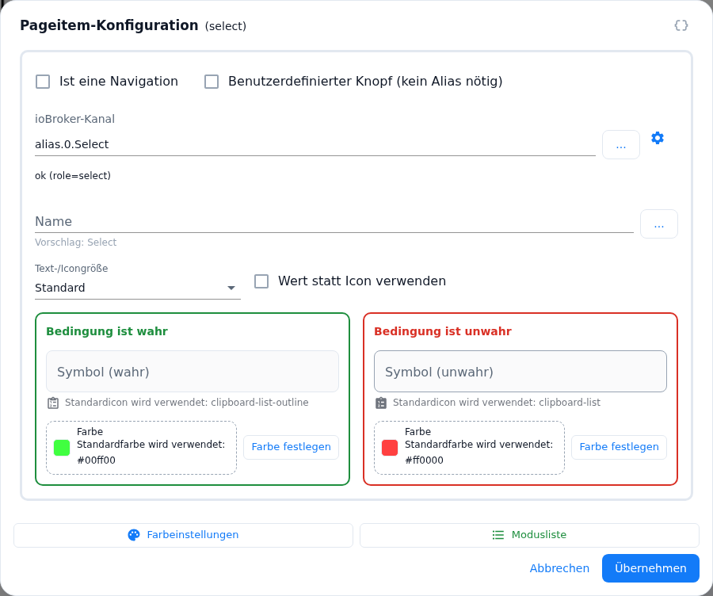
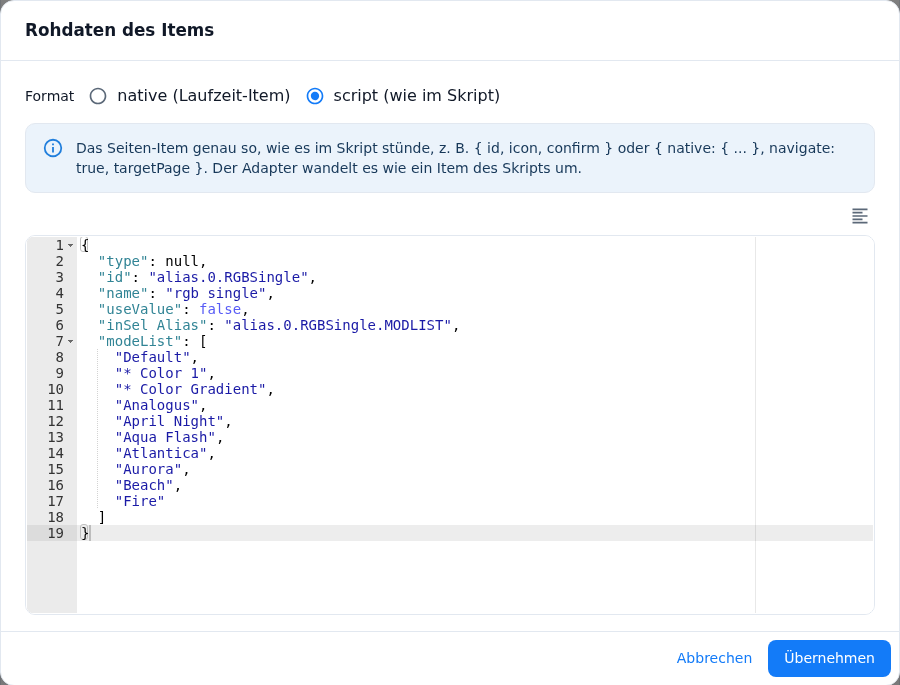
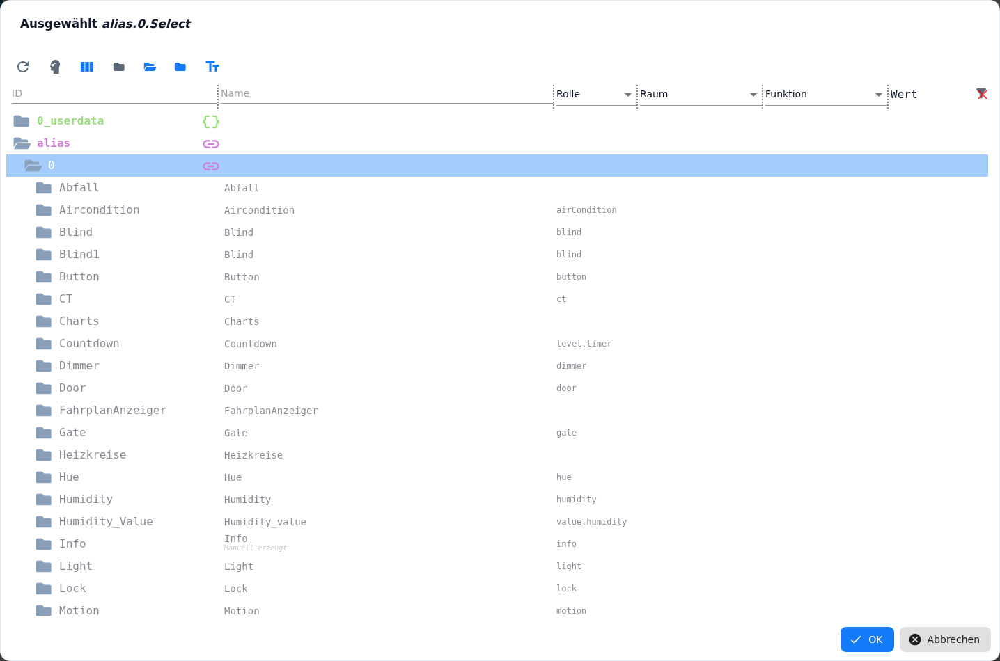
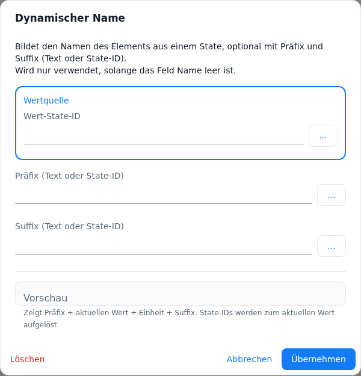
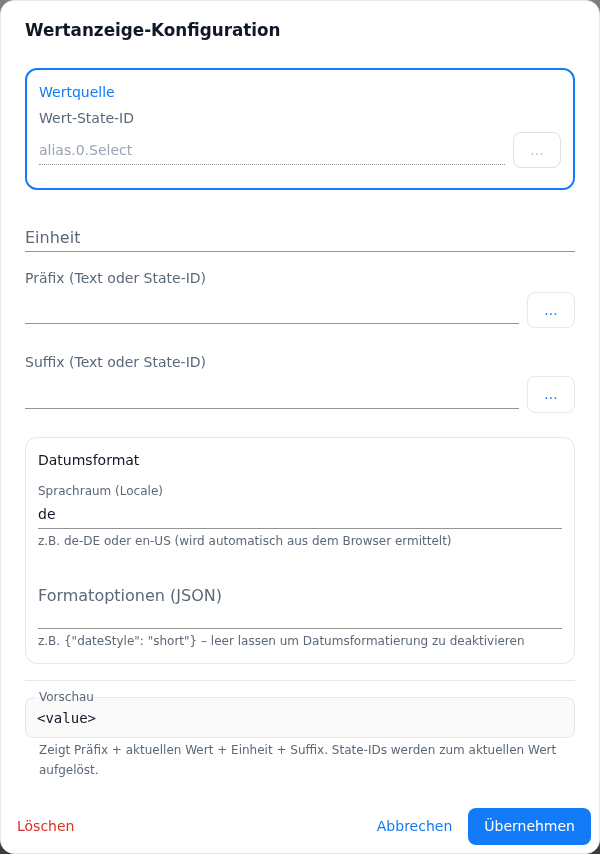
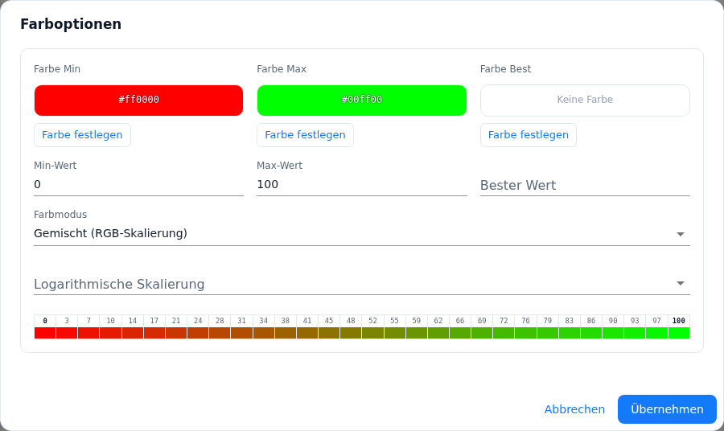
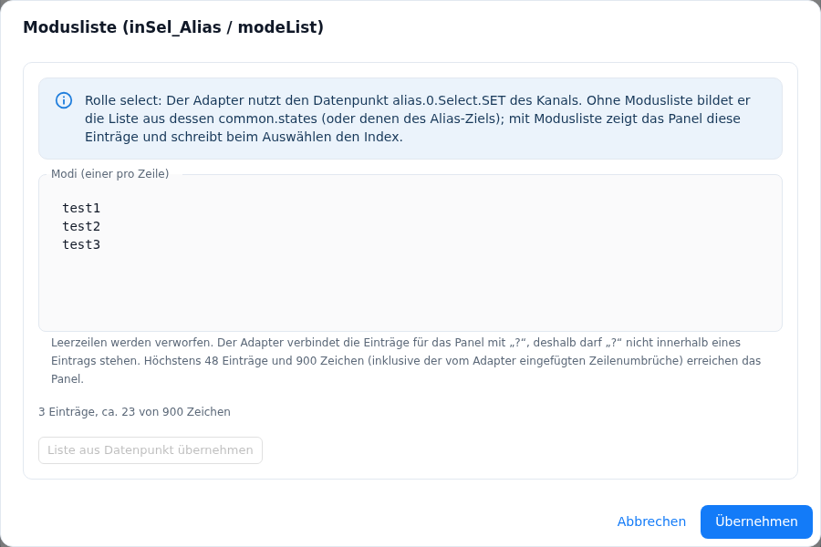

# Wiederkehrende Dialoge im PageConfig

Die Editoren der einzelnen Kartentypen sehen unterschiedlich aus, greifen aber auf dieselben Dialoge zurück. Wer einmal verstanden hat, wie die **Pageitem-Konfiguration** arbeitet, kennt sie auf jeder Seite wieder. Diese Seite beschreibt diese Dialoge einmal vollständig; die Seiten der Kartentypen verweisen hierher.

**Wo die Pageitem-Konfiguration vorkommt:** auf der [Menü-Seite](pageMenu) in allen fünf Varianten, auf der [Thermostat-Seite](cardThermo2) und auf der [Mediaplayer-Seite](cardMedia). Die Editoren für Alarm, Energie, Diagramm, QR, Müllkalender und Verknüpfung binden den Dialog **nicht** ein — dort gibt es keine freien Flächen, die ein Pageitem aufnehmen.

Alle Dialoge haben zwei Eigenschaften gemeinsam:

- **Ein Klick daneben schließt sie nicht.** Pageitem-Konfiguration, Rohdaten, Dynamischer Name und Wertanzeige gehen zusätzlich mit **Esc** zu; **Farboptionen** und **Modusliste** reagieren auf Esc gar nicht — sie gehen nur über ihre eigenen Knöpfe zu. Das verhindert, dass eine halbe Eingabe verloren geht.
- **Ihr *Übernehmen* speichert noch nichts.** Es schreibt die Einstellung nur in das Formular des Admins zurück. Wirksam wird alles erst mit **Speichern** im Tab PageConfig, und dafür startet der Adapter neu (siehe [PageConfig – Übersicht](PageConfig#speichern)).

Inhalt:
- [Pageitem-Konfiguration](#1-pageitem-konfiguration)
- [Rohdaten des Items](#2-rohdaten-des-items)
- [Die Objektauswahl](#3-die-objektauswahl)
- [Dynamischer Name](#4-dynamischer-name)
- [Wertanzeige-Konfiguration am Kanal](#5-wertanzeige-konfiguration-am-kanal)
- [Farboptionen](#6-farboptionen)
- [Modusliste](#7-modusliste)
- [Die Prüfung beim Übernehmen](#8-die-prüfung-beim-übernehmen)
- [Fallstricke](#fallstricke)

## 1. Pageitem-Konfiguration

Das ist der Dialog, der hinter jeder einzelnen Fläche einer Karte steckt. Geöffnet wird er durch **Klick auf die Fläche** im Editor — auf einer Menü-Seite auf eines der Felder, auf der Thermostat-Seite auf eine der Flächen rings um die Solltemperatur, auf der Mediaplayer-Seite auf einen Platz der unteren Leiste. Eine freie Fläche legt dabei ein neues Pageitem an, eine belegte öffnet das vorhandene.

Oben neben dem Titel *Pageitem-Konfiguration* steht in Klammern, womit man es zu tun hat: die **Rolle** des gewählten Kanals (`dimmer`, `socket` …), bei einer Rolle, die der Adapter nicht kennt, zusätzlich *(unbekannte Rolle)*, sonst *kein Channel ausgewählt* oder *Objekt nicht in ioBroker gefunden*.

Rechts in der Titelzeile sitzt der kleine Knopf **`{ }`** — der Weg zu den [Rohdaten des Items](#2-rohdaten-des-items).

### Was ein Pageitem anzeigen soll: die drei Grundfälle

Zwei Haken am Kopf des Dialogs entscheiden, welche Art von Element entsteht:

| Haken | Ergebnis |
|---|---|
| keiner von beiden | **Gerät.** Das Pageitem bedient einen ioBroker-Kanal (einen Alias oder ein Gerät mit `role`). Der Adapter liest aus der Rolle, welche Datenpunkte dazugehören und wie die Fläche aussehen muss. |
| **Ist eine Navigation** | **Sprung auf eine andere Seite.** Statt eines Geräts wird eine **Zielseite** gewählt. Die Kanal-ID darf dann leer bleiben — der Dialog sagt das ausdrücklich („Leere ID ist erlaubt (Navigation)"). |
| **Benutzerdefinierter Knopf (kein Alias nötig)** | **Ein einzelner Datenpunkt.** Kein Kanal, kein Alias: die ID muss direkt auf einen Datenpunkt mit `type=boolean` zeigen. Der Dialog prüft das und schreibt unter das Feld, was er gefunden hat — *beschreibbar*, *nur lesbar*, *kein boolean State* oder *kein State*. |

Ist *Ist eine Navigation* gesetzt, erscheint das Feld **Zielseite**. Es listet die Seiten auf, die dieses Panel kennt — die eigene Seite ist aus der Liste genommen, `main` steht vorn, der Rest alphabetisch. Das Feld nimmt auch einen frei getippten Namen an; praktisch für eine Seite, die erst noch entsteht, aber auch die Stelle, an der ein Tippfehler unbemerkt bleibt.

### Der ioBroker-Kanal und seine Prüfzeichen

<!-- Bild folgt: Kanalfeld mit rotem Fehlerzeichen links daneben, offener Tooltip „Fehlende Pflicht-Datenpunkte: …", darunter die Klartextzeile -->

Das Feld heißt **ioBroker-Kanal**, beim benutzerdefinierten Knopf dagegen **ioBroker-Datenpunkt**. Die Auswahl über „…" ist nach der **Rolle** gefiltert, nicht nach dem Kartentyp: Angeboten werden die 30 Kanalrollen, für die der Adapter Datenpunkte kennt, und alles, was unter einem solchen Kanal liegt. Die Wahl eines Datenpunkts wird dabei **auf seinen Kanal gekürzt**. Die vollständige Rollentabelle steht unter [Alias Table](ALIAS).

Während und nach der Eingabe prüft der Admin den Kanal und zeigt das Ergebnis **links neben dem Feld**:

| Zeichen | Bedeutung |
|---|---|
| Drehender Kreis | Die Prüfung läuft noch. Beim Tippen startet sie nach einer kurzen Pause, beim Verlassen des Feldes sofort. |
| Rotes ✖ | **Fehlende Pflicht-Datenpunkte.** Der Tooltip nennt sie namentlich. Die Rolle verlangt Datenpunkte, die der Kanal nicht hat. |
| Rotes ⚠ | **Doppelte Datenpunkte** — mehrere Datenpunkte des Kanals passen auf dieselbe Rolle, der Adapter kann sich nicht entscheiden. Der Tooltip nennt sie. Dasselbe Zeichen erscheint auch, wenn der Knopf am Fuß auf **Details…** steht. |

Unter dem Feld steht zusätzlich eine Zeile Klartext: *ok (role=…)* wenn alles passt, *Objekt nicht in ioBroker gefunden*, *Fehlende ID*, der Hinweistext des benutzerdefinierten Knopfs, oder — wenn die Rolle keiner bekannten Kanalrolle entspricht — *Die Objekt-Rolle entspricht keinem bekannten Gerätetyp*. Im letzten Fall lässt sich das Pageitem nicht sinnvoll speichern; der Knopf am Fuß wird zu **Details…**.

Das **Zahnrad** rechts neben dem Feld öffnet die [Wertanzeige-Konfiguration](#5-wertanzeige-konfiguration-am-kanal) **für die Kanal-ID selbst** — dort stehen Einheit, Präfix, Suffix und Datumsformat des angezeigten Werts. Beim benutzerdefinierten Knopf fehlt das Zahnrad.

### Name und dynamischer Name

**Name** ist die Beschriftung der Fläche am Panel. Bleibt das Feld leer, zeigt der Hilfstext darunter, was stattdessen passiert: entweder *Vorschlag: …* (der Name aus `common.name` des Kanals) oder *Standardname wird verwendet*.

> **Auf der Thermostat- und der Mediaplayer-Seite beschriftet der Name die Fläche nicht.** Dort ist er nur die **Überschrift des Popups**, das die Fläche öffnet; unter dem Symbol erscheint er nicht. Der Dialog sagt das als Hilfstext unter dem Feld: *„Auf dieser Seite nur Titel des Popups – wird auf dem Panel nicht unter dem Icon angezeigt."* Siehe [cardThermo2](cardThermo2) und [cardMedia](cardMedia).

Der Knopf **…** daneben öffnet den [dynamischen Namen](#4-dynamischer-name) — eine Beschriftung, die aus einem Datenpunkt entsteht. Ist einer eingerichtet, steht seine Vorschau als blasser Platzhaltertext im Namensfeld.

### Weitere Felder, je nach Kartentyp

Diese Felder erscheinen nur dort, wo der Adapter sie auswertet:

| Feld | Wann sichtbar | Bedeutung |
|---|---|---|
| **Heizkreis** | nur auf der Thermostat-Seite | Ordnet das Pageitem einem Heizkreis zu, oder *alle Heizkreise* — dann erscheint es bei jedem. |
| **Text-/Icongröße** | auf den drei Grid-Varianten, auf der Thermostat- und auf der Mediaplayer-Seite — **nicht** bei *Entities* und *Schedule* | Die Nextion-Schrift, mit der das Panel Symbol oder Wert dieses Elements zeichnet (siehe unten). |
| **Wert statt Icon verwenden** | dieselben fünf Kartentypen, nicht beim benutzerdefinierten Knopf | Die Fläche zeigt den Wert als Text statt des Symbols. Der Adapter macht das nur, wenn der `ACTUAL`-Datenpunkt eine Zahl, eine Zeichenkette oder `mixed` ist; sonst bleibt es beim Symbol. |
| **Langer Druck** | **nur** auf den drei Grid-Varianten, und nur bei Navigation, benutzerdefiniertem Knopf oder `role=button` | Zweite Funktion derselben Fläche. |

**Langer Druck** ist mit Absicht so eng gefasst: Nur die Grid-Seiten melden dem Adapter überhaupt einen langen Druck, und nur Items ohne eigenes Popup können ihn gebrauchen — bei allen anderen würde er mit dem Popup kollidieren. Er kann **entweder** einen Datenpunkt schalten **oder** auf eine Seite springen, nie beides; darum verschwindet das jeweils andere Feld, sobald eines gefüllt ist. Der Datenpunkt muss `type=boolean` und `write=true` haben, die Objektauswahl zeigt von vornherein nur solche. Ist das Feldbündel nicht sichtbar, speichert der Dialog auch keinen alten Wert mehr mit.

### Die Text-/Icongröße

Die Auswahl nennt je Schrift ihre Pixelgröße, z. B. *0 – 24 px (nur Text)*, *4 – 80 px fett*, *5 – 128 px fett (nur ASCII)*. Dahinter steht diese Tabelle:

| ID | Größe | Symbole | Zeichensatz |
|---|---|---|---|
| **0** | 24 px | nein | viele Sonderzeichen |
| **1** | 32 px | ja | begrenzt |
| **2** | 32 px | nein | viele Sonderzeichen |
| **3** | 48 px | ja | begrenzt |
| **4** | 80 px, fett | ja | begrenzt |
| **5** | 128 px, fett | nein | nur ASCII — kein °, keine Umlaute |

- Solange die Fläche ein **Symbol** zeigt, stehen nur die Schriften **1, 3 und 4** zur Wahl — nur sie enthalten die Symbole. Ein gespeicherter Wert außerhalb davon wird nicht stillschweigend verworfen: er bleibt **orange** in der Liste, und unter dem Feld steht *„Diese Schrift enthält keine Icons - das Icon bleibt auf dem Panel leer"*.
- Mit **Wert statt Icon verwenden** stehen alle sechs Schriften zur Wahl; bei Schrift 5 erscheint der ASCII-Hinweis.
- Ohne eigene Wahl steht *Standard* — dann nimmt das Panel die Schrift, die zur Fläche gehört.

### Felder, die nur bestimmte Rollen auswerten

Diese Felder erscheinen nur bei einem Pageitem mit gültiger Kanal-ID und passender Rolle (nicht beim benutzerdefinierten Knopf und nicht im Rohdaten-Modus):

| Feld | Rollen | Bedeutung |
|---|---|---|
| **Bedingung für den Wert** | `info`, `slider`, `motion`, `door`, `window`, `temperature`, `value.temperature`, `thermostat`, `airCondition`, `humidity`, `value.humidity` — bei Navigations-Items nur `thermostat` und `humidity` | JavaScript-Ausdruck über `val` (den aktuellen Wert), z. B. `val && val < 100`. Der Wert wird nur statt des Symbols angezeigt, solange der Ausdruck wahr ist, sonst das Symbol. |
| **Minimalwert** / **Maximalwert** | `volume` | Der Bereich des Lautstärke-Schiebers; leer oder 0 = Panel-Standard. |
| **Zweite Zeile** | `blind` | Text der zweiten Zeile im Rollladen-Popup; leer = keine. |
| **Minimale / Maximale Helligkeit** | `dimmer`, `ct`, `rgb`, `rgbSingle`, `hue` | Der Wertebereich des Geräts, den der Adapter auf den **0–100-Schieber des Panels** abbildet; leer oder 0 = Panel-Standard, dann nimmt er `common.min`/`common.max` des Datenpunkts. |
| **Minimale / Maximale Farbtemperatur** | `ct`, `rgb`, `rgbSingle`, `hue` | Dasselbe für den Farbtemperatur-Schieber. |
| **Farbmodus (colormode)** | `dimmer`, `ct`, `rgb`, `rgbSingle`, `hue` | Gesetzt: das Panel färbt das Symbol immer aus **Farbton/RGB**. Nicht gesetzt: der Adapter entscheidet selbst — er nimmt die Quelle, deren Datenpunkt zuletzt geschrieben wurde (Farbtemperatur oder Farbe). |
| **Zielseite nach dem Drücken** | `button` (kein Navigations-Item, kein benutzerdefinierter Knopf) | Ein Druck schaltet den Button **und** wechselt auf diese Seite — typisch, um nach der Auswahl einer Option zur vorigen Seite zurückzukehren. Das Feld nimmt wie die Navigations-Zielseite auch einen frei getippten Seitennamen. |

### Symbol und Farbe für „wahr" und „unwahr"

Darunter stehen zwei gleich aufgebaute Spalten: **Bedingung ist wahr** (grün umrandet) und **Bedingung ist unwahr** (rot umrandet) — also eingeschaltet und ausgeschaltet, offen und zu. Je Spalte:

- **Symbol (wahr)** bzw. **Symbol (unwahr)**: die Symbolauswahl (Übersicht unter [Symbole](symbolOverview)). Bleibt sie leer, zeigt der Dialog das Symbol, das der Adapter von sich aus nimmt, als kleines Bild samt Namen (*Standardicon wird verwendet: …*).
- **Farbe**: ohne eigene Wahl steht hier *Standardfarbe wird verwendet* samt Farbwert — die Farbe aus der Rolle und dem eingestellten [Farbthema](colorTheme) der Instanz. **Farbe festlegen** übernimmt genau diesen Wert als Startpunkt, **Zurücksetzen** gibt die Farbe an Rolle und Farbthema zurück.

So bleibt eine Seite, an der man nichts einstellt, trotzdem stimmig: Jede Lücke füllt der Adapter aus Rolle und Farbthema.

> **Bei der Rolle `blind` folgt das Symbol der Position.** Sind **Symbol (wahr)** und **Symbol (unwahr)** beide leer, setzt der Adapter keinen festen Namen, sondern einen Platzhalter, den das Panel je Position auflöst: 0–5 % → das Symbol für „geschlossen", 95–100 % → das für „offen", dazwischen der nächstliegende Viertelschritt (`window-shutter-25` / `-50` / `-75`; bei Gleichstand wird aufgerundet). Diese drei Symbole sind Eigenbau und brauchen **HMI/TFT 6.0.2** oder neuer. Sobald **ein** eigenes Symbol gesetzt ist, ist die Automatik aus. Der Admin zeigt in der Vorschau weiter die Endlagen-Symbole — Panel und Vorschau weichen hier bewusst ab.

### Die Knöpfe am Fuß

| Knopf | Wirkung |
|---|---|
| **Farbeinstellungen** | Öffnet die [Farboptionen](#6-farboptionen) — Farbverlauf über einen Wertebereich. |
| **Modusliste** | Nur bei den Rollen `rgbSingle`, `rgb`, `ct`, `hue` und `select`: öffnet die [Modusliste](#7-modusliste). |

Beide werden **grün**, sobald dahinter etwas eingestellt ist. So sieht man an der Farbe des Knopfes, ob es sich lohnt hineinzuschauen.

**Welcher Knopf da steht, entscheidet die Rolle.** **Farbeinstellungen** gibt es nur bei Rollen, deren Pageitem einen Zahlenwert führt: `blind`, `thermostat`, `airCondition`, `temperature`, `value.temperature`, `humidity`, `value.humidity`, `info`, `volume`, `select`, `slider`, `warning`, `level.timer` und `level.mode.fan`. Bei den rein schaltenden Rollen (`socket`, `light`, `dimmer`, `ct`, `rgb`, `rgbSingle`, `hue`, `button`, `gate`, `motion`, `door`, `window`, `lock`, `media`) fehlt er — ein Farbverlauf über einen Wertebereich ergibt dort keinen Sinn. Bei den Lichtrollen bleibt die **Modusliste**, bei `socket`, `button` und den Sensorrollen bleibt die Zeile ganz leer. Nur bei `select` stehen **beide** Knöpfe da. Beim benutzerdefinierten Knopf und im Rohdaten-Modus verschwinden beide.

Unten rechts stehen **Abbrechen** und **Übernehmen**. Während der Prüfung heißt der rechte Knopf *Prüfe…*, bei erkannten Problemen **Details…** (orange) — dazu [Abschnitt 8](#8-die-prüfung-beim-übernehmen).

## 2. Rohdaten des Items

Der Knopf **`{ }`** rechts in der Titelzeile der Pageitem-Konfiguration (Tooltip *„Item als Rohdaten (JSON) eingeben"*) öffnet den Dialog **Rohdaten des Items**. Er ist **immer** da — kein Expertenmodus nötig. Hier wird das Pageitem als rohes JSON eingegeben, für Einstellungen, für die es noch keine Oberfläche gibt. Denselben Knopf hat der Item-Dialog des [Bildschirmschoners](screensaver#4-items-der-item-dialog).

**Format** — zwei Möglichkeiten, die der Hinweiskasten im Dialog jeweils erklärt:

| Format | Bedeutung |
|---|---|
| **native (Laufzeit-Item)** | Das Item, wie der Adapter es zur Laufzeit verwendet (z. B. `{ "template": …, "dpInit": … }`). Es wird **unverändert** übernommen und hat keine Navigationsfelder. Entspricht `{ native: { … } }` im Skript. |
| **script (wie im Skript)** | Das Seiten-Item genau so, wie es in einem Konfigurationsskript stünde, z. B. `{ "id": …, "icon": …, "confirm": … }` oder `{ "native": { … }, "navigate": true, "targetPage": … }`. Der Adapter wandelt es um wie ein Item des Skripts. |

- Der Dialog **prüft laufend**: Ist der Text kein JSON-Objekt, wird der Rahmen rot, der Grund steht darunter (*„Ungültiges JSON: …"* oder *„Die Konfiguration muss ein JSON-Objekt { … } sein"*) und **Übernehmen** ist gesperrt.
- Das Symbol über dem Editor (**JSON formatieren**) rückt gültiges JSON neu ein.
- Beim ersten Öffnen steht nicht `{}` da, sondern ein **Vorschlag**: das Skript-Item, das der Adapter aus den bereits gefüllten Feldern bauen würde, im Format *script*. Nur wenn weder eine Kanal-ID noch ein Navigationsziel gesetzt ist, startet der Dialog leer im Format *native*.
- **Rohdaten entfernen (zurück zum Standard)** (links unten, nur bei bereits aktivem Rohmodus) bringt das Item zu den Feldern des Dialogs zurück. Die Standardfelder bleiben nämlich im Hintergrund erhalten, solange der Rohmodus läuft.

**Solange Rohdaten aktiv sind**, ist der `{ }`-Knopf **orange**, und der ganze Inhalt der Pageitem-Konfiguration ist durch einen Warnkasten ersetzt: *„Rohkonfiguration aktiv (Format …)"*, darunter die erkennbare ID bzw. das Template und der Satz *„Das Item wird allein aus den Rohdaten gebaut, die Felder dieses Dialogs werden nicht verwendet."* Ein Knopf **Rohdaten bearbeiten** führt zurück in den JSON-Editor. Ein Rohdaten-Item braucht **keine Kanal-ID** — **Übernehmen** ist deshalb auch ohne Kanal möglich, und die Rollen- und Datenpunktprüfungen entfallen.

Im Editor sind solche Items an der Beschriftung **„Rohdaten"** zu erkennen (mit `id`, `template` oder `dpInit` dahinter, wenn die Konfiguration eines davon enthält); ein Symbol zeigen sie nicht.

Hier landen auch die Items, die die [Übernahme eines Konfigurationsskripts](Migration#4-was-übernommen-wird) nicht in Felder abbilden konnte — sie stehen dort in der Liste *Als Rohdaten übernommen*.

> Fehlt im Dialog etwas, das das Pageitem können müsste, ist der richtige Weg eine Meldung an das Entwicklerteam — nicht der dauerhafte Umbau als Rohdaten: <https://github.com/ticaki/ioBroker.nspanel-lovelace-ui/issues>

## 3. Die Objektauswahl

Überall, wo eine ioBroker-ID gebraucht wird, steht dasselbe Paar: ein **Textfeld** und daneben der Knopf **…**.

- Das Textfeld nimmt eine getippte ID — und bei Präfix, Suffix, Wertquelle und Modusliste auch freien Text.
- **…** öffnet die Objektauswahl von ioBroker. Sie ist **vorgefiltert**: Je Stelle sind nur die Objekte wählbar, die dort Sinn haben — beim langen Druck nur beschreibbare boolesche Datenpunkte, beim Auswahl-Datenpunkt der Modusliste nur Zeichenketten, bei Präfix und Suffix Zeichenketten und Zahlen, beim Kanal die Datenpunkte unterhalb eines Kanals mit passender Rolle (die Wahl wird auf den Kanal gekürzt).

Übernommen wird der Wert beim **Verlassen des Feldes** oder mit **Enter** — erst dann prüft der Admin die ID. Wer tippt und sofort auf *Übernehmen* klickt, löst die Prüfung mit dem Klick aus; der Dialog wartet sie ab, statt den Klick zu verschlucken.

## 4. Dynamischer Name

Der Knopf **…** am Namensfeld öffnet den Dialog **Dynamischer Name** (Tooltip *„Dynamischer Name (aus einem State)"*). Oben steht, was er tut: *„Bildet den Namen des Elements aus einem State, optional mit Präfix und Suffix (Text oder State-ID). Wird nur verwendet, solange das Feld Name leer ist."*

| Feld | Bedeutung |
|---|---|
| **Wertquelle / Wert-State-ID** | Der Datenpunkt (`string` oder `number`), dessen Wert zur Beschriftung wird. Steht hier kein Datenpunkt, sondern Text, wird der Text angezeigt. Darunter erscheint der **erkannte Typ**. |
| **Präfix** | Text **vor** dem Wert — oder ein Datenpunkt, dessen Wert davorgesetzt wird. |
| **Suffix** | Dasselbe **hinter** dem Wert. |
| **Vorschau** | Zeigt laufend das Ergebnis mit dem **echten aktuellen Wert**; Datenpunkte in Präfix und Suffix werden aufgelöst. Dieselbe Vorschau steht danach als blasser Platzhaltertext im Namensfeld. |
| **Löschen** | Entfernt den dynamischen Namen wieder. |

**Der getippte Name hat Vorrang.** Steht im Feld *Name* etwas, wertet der Adapter den dynamischen Namen gar nicht aus — er wird dann auch nicht mitgespeichert.

**Einheit und Datumsformat gibt es hier nicht.** Der Adapter liest sie an dieser Stelle nicht, deshalb zeigt der Dialog die Felder nicht — und **leert gespeicherte Altwerte beim Öffnen und beim Übernehmen**. Wer eine Einheit in der Beschriftung braucht, schreibt sie ins Suffix. Einheit und Datumsformat des **Werts** stehen hinter dem Zahnrad am Kanalfeld ([Abschnitt 5](#5-wertanzeige-konfiguration-am-kanal)).

Auf der Thermostat- und der Mediaplayer-Seite nennt der Hinweis zusätzlich, dass der Name dort nur die Popup-Überschrift ist.

## 5. Wertanzeige-Konfiguration am Kanal

Das **Zahnrad** am Kanalfeld öffnet den Dialog *Wertanzeige-Konfiguration* (Tooltip *„Kanal-ID erweitert konfigurieren"*). Er beschreibt, wie der **Wert** des Kanals am Panel erscheint. Die Wertquelle ist hier der Kanal selbst und **schreibgeschützt** — geändert wird sie im Kanalfeld.

| Feld | Bedeutung |
|---|---|
| **Wertquelle / Wert-State-ID** | Die Kanal-ID, nur zur Ansicht. Eine Typangabe erscheint hier nicht, weil ein Kanal keinen Typ hat. |
| **Einheit** | Wird hinter den Wert gesetzt. Sichtbar, sobald die Wertquelle eine Zahl ist — am Zahnrad außerdem immer dann, wenn **Wert statt Icon verwenden** gesetzt ist oder das Item auf einer Grid-, Thermostat- oder Mediaplayer-Seite liegt. Leer gelassen nimmt der Adapter `common.unit` des Datenpunkts. |
| **Präfix** | Text **vor** dem Wert — oder ein Datenpunkt, dessen Wert davorgesetzt wird. |
| **Suffix** | Dasselbe **hinter** dem Wert. |
| **Datumsformat** | Eigener Kasten, hier immer vorhanden: macht aus einem Zeitstempel ein lesbares Datum. |
| **Vorschau** | Zeigt den Aufbau: Präfix und Suffix werden zum aktuellen Wert aufgelöst, der Hauptwert steht als Platzhalter **`<value>`** da. |
| **Löschen** | **Leert die ganze Kanal-ID**, nicht nur die Wertanzeige — siehe [Fallstricke](#fallstricke). |

> ### Präfix und Suffix aus einer 1.x-Konfiguration prüfen
>
> Bis einschließlich 1.7.x hat der Adapter **Präfix und Suffix der Item-Werte vertauscht** an das Panel gegeben: Was im Präfix stand, erschien hinter dem Wert, und umgekehrt. **Version 2.0.0 hat das behoben.** Wer damals bewusst verdreht ausgefüllt hat, damit es am Panel richtig aussieht, sieht es nach dem Update **falsch** — und muss die beiden Felder **einmal zurücktauschen**.
>
> Das betrifft die Felder **Präfix** und **Suffix** hinter dem **Zahnrad der Kanal-ID**, bei allen im Admin konfigurierten Seiten-Items. Wer sie auch am [dynamischen Namen](#4-dynamischer-name) verdreht gefüllt hat, prüft sie dort mit. Wer sie immer so ausgefüllt hat, wie sie heißen, muss nichts tun. Außer im Changelog stand diese Änderung bisher nirgends.

**Datumsformat** im Einzelnen:

- **Sprachraum (Locale)** — z. B. `de-DE`. Wird aus dem Browser vorbelegt.
- **Formatoptionen (JSON)** — die Optionen von `Intl.DateTimeFormat`, z. B. `{"dateStyle": "short"}`. Das Feld wird **sofort geprüft**: Ungültiges JSON färbt es rot (*„Ungültige Formatoptionen"*). Leer lassen schaltet die Datumsformatierung ab.
- Eine **Zahl** wird als Zeitstempel in Millisekunden gelesen, eine **Zeichenkette** als Datumstext.

> **Die Einheit kommt auch an eine Zeichenkette.** Der Adapter hängt sie an jeden Wert an, egal ob Zahl oder Text; nur die **Vorschau** im Admin lässt sie bei allem, was keine Zahl ist, weg — und weil ein Kanal keinen Typ hat, zeigt die Vorschau am Zahnrad sie nie. Was wirklich am Panel steht, zeigt also erst das Panel.

## 6. Farboptionen

Titel *Farboptionen*. Hier wird aus einem Zahlenwert eine Farbe — ein Symbol, das von Blau nach Rot läuft, je wärmer der Messwert ist.

**Die drei Farbfelder:** **Farbe Min**, **Farbe Max** und **Farbe Best**. *Farbe Min* und *Farbe Max* sind **dieselben Werte** wie *Farbe* in den Spalten *Bedingung ist unwahr* bzw. *wahr* — eine Änderung hier ändert sie auch dort. Solange keine eigene Farbe gesetzt ist, steht *Keine Farbe* bzw. die Standardfarbe als Vorschau da, und **Farbe festlegen** übernimmt genau diesen Standardwert als Startpunkt. **Zurücksetzen** gibt die Farbe an Rolle und [Farbthema](colorTheme) zurück.

| Feld | Bedeutung |
|---|---|
| **Min-Wert** / **Max-Wert** | Der Wertebereich, über den die Farbe läuft. Voreingestellt 0 und 100. |
| **Bester Wert** | Optional. Ein Punkt innerhalb des Bereichs, der **Farbe Best** bekommt — etwa die Wunschtemperatur in der Mitte. Ohne Angabe steht hier *kein Bestwert*. |
| **Farbmodus** | Wie zwischen den Farben gerechnet wird: *Gemischt (RGB-Skalierung)*, *Farbton (HSV-Skalierung)*, *CIE (Farbtabelle)*, *Tri-Gradient (Rot-Grün)* und *Quad-Gradient (RYGB)*, die beiden Gradienten jeweils auch **verankert**. Voreingestellt ist *Gemischt*. |
| **Logarithmische Skalierung** | *Linear (keine)*, *Log10 zu Max* oder *Log10 zu Min* — für Messwerte, die über mehrere Größenordnungen laufen. |

Darunter liegt eine **Farbvorschau**: eine Tabelle mit Zahlenwerten über farbigen Feldern, gerechnet mit genau derselben Funktion, die später am Panel die Farbe bestimmt. Minimum, Maximum und der Bestwert stehen fett. Die Vorschau erscheint erst, wenn zwischen Min und Max **mehr als 1** liegt, und zeigt höchstens 30 Spalten.

> **Die Gradienten-Modi ignorieren die drei Farbfelder.** *Tri-Gradient* und *Quad-Gradient* (auch verankert) rechnen mit einem **festen** Verlauf — Tri-Gradient fest **Rot → Gelb → Grün**, mit Rot an **beiden** Enden und Grün am besten Wert. Die Farbvorschau zeigt das richtig; die Farbfelder bleiben in diesen Modi ohne Wirkung.

## 7. Modusliste

Titel *Modusliste (inSel_Alias / modeList)*. Damit bekommt ein Pageitem eine **Auswahlliste** am Panel — etwa die Lichtszenen einer RGB-Lampe. Der Dialog gilt für die Rollen `rgbSingle`, `rgb`, `ct`, `hue` und `select`.

| Feld | Bedeutung |
|---|---|
| **Auswahl-Datenpunkt (inSel_Alias)** | Der Datenpunkt vom Typ `string`, in den der gewählte Eintrag geschrieben wird. Wird nur für `rgbSingle`, `rgb`, `ct` und `hue` ausgewertet. Bei der Rolle `select` entfällt das Feld: dort nimmt der Adapter den `SET`-Datenpunkt des Kanals, und ein Hinweis oben nennt ihn beim Namen. |
| **Modi (einer pro Zeile)** | Die Einträge, einer je Zeile. Leerzeilen werden verworfen. |
| **Liste aus Datenpunkt übernehmen** | Füllt die Liste aus `common.states` des Datenpunkts. Der Knopf ist gesperrt, wenn kein Datenpunkt gewählt ist oder er keine `common.states` hat — der Tooltip sagt, welches von beidem. |

**Der Auswahl-Datenpunkt wird geprüft**, und das Ergebnis steht als farbige Meldung im Dialog: *Datenpunkt vorhanden, Typ string, beschreibbar* (grün), oder eine Warnung — *existiert nicht* (der Adapter ignoriert ihn dann), *kein State*, falscher Typ, *nicht beschreibbar*. Beim Übernehmen mit fehlgeschlagener Prüfung kommt die Rückfrage **Prüfung fehlgeschlagen — trotzdem übernehmen?**; der Weg bleibt also offen, aber nicht versehentlich.

**Grenzen, die der Dialog mitzählt** (unter dem Textfeld steht laufend „*n* Einträge, ca. *x* von 900 Zeichen"):

- Höchstens **48 Einträge** — alles darüber gibt der Adapter nicht an das Panel weiter.
- Höchstens **900 Zeichen** die ganze Liste — darüber wird sie abgeschnitten.
- **Kein `?` innerhalb eines Eintrags.** Damit trennt der Adapter die Einträge; ein `?` im Text kann das Panel nicht darstellen. Der Dialog warnt und nennt die betroffenen Einträge. `?` und `_` werden beim Anzeigen zu Leerzeichen.
- Jeder Eintrag wird am Panel auf **zwei Zeilen à 12 Zeichen** umbrochen, die zweite notfalls gekürzt. Die Zeichenzahl im Dialog rechnet die eingefügten Umbrüche schon mit ein.

> Hat der Datenpunkt **eigene `common.states`**, baut der Adapter die Liste am Panel direkt daraus — die Modusliste ist dann nur noch Ersatz, falls die `states` fehlen. Der Dialog weist darauf hin, sobald er welche findet. Bei der Rolle `select` ist es umgekehrt gewichtet: ohne Modusliste bildet der Adapter die Liste aus den `common.states`, mit Modusliste zeigt das Panel deren Einträge und schreibt beim Auswählen den **Index**.

## 8. Die Prüfung beim Übernehmen

**Übernehmen** in der Pageitem-Konfiguration schließt den Dialog nicht sofort. Der Admin schickt das Pageitem zuerst **an den laufenden Adapter**, der daraus ein echtes Panel-Item baut und zurückmeldet, was ihm auffällt. Daraus ergeben sich drei Fälle:

| Ergebnis | Was passiert |
|---|---|
| Keine Meldung | Das Pageitem wird übernommen, der Dialog schließt. |
| Hinweise, kein Fehler | Ein Fenster **Konfigurationsprüfung** listet sie auf. **Speichern** übernimmt trotzdem, **Abbrechen** führt zurück in den Dialog. |
| Fehler | Fenster **Konfigurationsfehler**, nur **Schließen**. Der Dialog bleibt offen, damit man es richtigstellen kann. |

Die Meldungen sind die **englischen Logtexte** des Adapters, unabhängig von der Sprache des Admins.

Sind schon vorher Datenpunkte als fehlend oder doppelt erkannt oder passt die Rolle nicht, heißt der Knopf nicht *Übernehmen*, sondern **Details…** und ist orange — er führt direkt in dieses Fenster.

> **Ein fehlendes Objekt ist etwas anderes als ein fehlender Datenpunkt.** Steht unter dem Kanalfeld *Objekt nicht in ioBroker gefunden*, sperrt der Dialog alle Felder außer der ID, und der Knopf heißt zwar **Details…**, bleibt aber **grau und ohne Funktion** (er ist derselbe Knopf wie *Übernehmen* und braucht einen existierenden Kanal). Der einzige Weg aus diesem Zustand ist, die ID richtigzustellen — oder **Abbrechen**.

> **Läuft der Adapter nicht**, ist keine Prüfung möglich; der Dialog übernimmt dann ohne sie. Dass ein Item ohne Beanstandung durchgeht, heißt bei gestopptem Adapter also nichts. Im Tab PageConfig ist der Editor bei gestopptem Adapter ohnehin ausgegraut (siehe [PageConfig – Übersicht](PageConfig)).

## Fallstricke

- **„Löschen" im Dialog am Zahnrad leert die Kanal-ID.** Der Knopf entfernt nicht nur Einheit, Präfix, Suffix und Datumsformat, sondern setzt die ganze Kanal-ID zurück — das Pageitem hat danach kein Gerät mehr und alle Felder sind gesperrt. Wer nur Präfix und Suffix loswerden will, leert die beiden Felder und drückt *Übernehmen*.
- **Präfix und Suffix am Zahnrad erreichen nur *Entities* und *Schedule*.** Der Adapter wertet sie ausschließlich auf diesen beiden Kartentypen aus. Auf den drei Grid-Varianten, auf der Thermostat- und auf der Mediaplayer-Seite nimmt der Dialog sie an, speichert sie und zeigt sie in der Vorschau — am Panel erscheinen sie nicht. Die **Einheit** ist davon nicht betroffen, sie wirkt überall.
- **Der dynamische Name wirkt nur bei leerem Namensfeld.** Wer beides füllt, sieht am Panel den getippten Namen; der dynamische Name wird gar nicht gespeichert. Die blasse Vorschau im Namensfeld verschwindet dann.
- **Einheit und Datumsformat am dynamischen Namen gehen verloren.** Ein Eintrag aus einer älteren Version wird beim Öffnen des Dialogs stillschweigend geleert, weil der Adapter ihn dort nicht liest.
- **Die Vorschau zeigt nicht, was am Panel steht.** Am Zahnrad steht der Hauptwert nur als `<value>` da, und die Einheit fehlt in der Vorschau grundsätzlich, sobald die Wertquelle keine Zahl ist — am Panel wird sie trotzdem angehängt.
- **Die Farboptionen schreiben beim Übernehmen immer eine Skala.** Auch wer nichts ändert und nur *Übernehmen* drückt, legt eine Farbskala mit 0–100 und *Gemischt* an; der Knopf **Farbeinstellungen** bleibt danach grün. Eine Möglichkeit, die Skala im Dialog wieder zu entfernen, gibt es nicht — nur noch über die Rohdaten oder ein neues Pageitem.
- **Die Farboptionen merken sich Werte vom vorigen Pageitem.** Hat das gerade geöffnete Item keine Skala, stehen Min-Wert, Max-Wert, Bester Wert, Farbmodus und Farbe Best noch so, wie sie beim letzten Item im selben Editor waren. Vor dem *Übernehmen* also nachsehen.
- **Tri- und Quad-Gradient ignorieren die gewählten Farben.** Der Verlauf ist fest; nur die Vorschau zeigt den tatsächlichen Verlauf. Trifft der Messwert genau den **besten** Wert und ist dieser gleich dem **Max-Wert**, rechnet der Adapter 0/0 — die Farbe wird unbrauchbar. Bester Wert und Max-Wert also nie gleich setzen.
- **Beide Haken am Kopf lassen sich gleichzeitig setzen.** *Ist eine Navigation* und *Benutzerdefinierter Knopf* schließen sich im Dialog nicht aus; der Adapter nimmt dann die **Navigation** und behandelt den Rest als Beiwerk. Immer nur einen Haken setzen.
- **Die Zielseite nimmt jeden Text an.** Navigations-Zielseite, *Zielseite nach dem Drücken* und die Zielseite des langen Drucks sind freie Felder. Ein Tippfehler fällt erst am Panel auf, wo der Sprung dann ins Leere geht.
- **Im Rohdaten-Modus prüft nichts mehr mit.** Kanal, Rolle und Pflicht-Datenpunkte werden nicht geprüft, und *Übernehmen* ist auch ohne Kanal möglich. Ob das JSON zum Kartentyp passt, zeigt erst die [Prüfung beim Übernehmen](#8-die-prüfung-beim-übernehmen) — und die auch nur, wenn der Adapter läuft.
- **„Rohdaten entfernen" bringt die alten Felder zurück, nicht einen leeren Dialog.** Die Standardfelder bleiben im Hintergrund erhalten, solange Rohdaten aktiv sind; nach dem Entfernen stehen sie wieder da — unter Umständen mit Werten, die man längst vergessen hat.
- **Eine Schrift ohne Symbole lässt die Fläche leer.** Wählt man bei einer Fläche mit Symbol die Schrift 0, 2 oder 5 (nur möglich, wenn der Wert aus einer alten Konfiguration stammt oder *Wert statt Icon* gesetzt war), zeichnet das Panel kein Symbol. Der orange Eintrag in der Liste und der Hinweis unter dem Feld sind die einzige Warnung.
- **„Wert statt Icon verwenden" braucht einen lesbaren Wert.** Der Adapter zeigt den Text nur, wenn der `ACTUAL`-Datenpunkt des Kanals eine Zahl, eine Zeichenkette oder `mixed` ist. Bei einem booleschen Datenpunkt bleibt es beim Symbol, ohne Meldung.
- **„Minimale/Maximale Helligkeit" begrenzen den Schieber nicht.** Der Schieber am Panel bleibt 0–100; die beiden Werte sagen dem Adapter nur, welchen Ausschnitt der **Geräteskala** er darauf abbildet. Dasselbe gilt für die Farbtemperatur und für *Minimalwert/Maximalwert* bei `volume`. Eine 0 gilt überall als „nicht gesetzt".
- **„Farbmodus (colormode)" kann nur eine Richtung erzwingen.** Gesetzt heißt immer Farbton/RGB. Die Farbtemperatur lässt sich im Admin nicht erzwingen — ohne den Haken entscheidet der Adapter nach dem jüngeren Zeitstempel.
- **Eine kaputte „Bedingung für den Wert" fällt nicht auf.** Der Ausdruck läuft im Adapter; wirft er einen Fehler, landet eine Warnung im Log und der Wert wird **immer** angezeigt — als hätte man nie eine Bedingung gesetzt. Der Dialog prüft den Ausdruck nicht.
- **Der Rollladen sieht im Admin anders aus als am Panel.** Bei `blind` ohne eigene Symbole zeigt die Vorschau die Endlagen-Symbole, das Panel das Symbol zur aktuellen Position. Dafür braucht das Panel HMI/TFT 6.0.2 oder neuer; auf älterer Firmware bleibt die Fläche leer.
- **Ein langer Druck geht verloren, wenn die Seite umgestellt wird.** Ein aus einer Grid-Variante nach *Entities* oder *Schedule* übernommenes Item zeigt das Feldbündel nicht mehr — und speichert den alten langen Druck dann auch nicht mehr mit.
