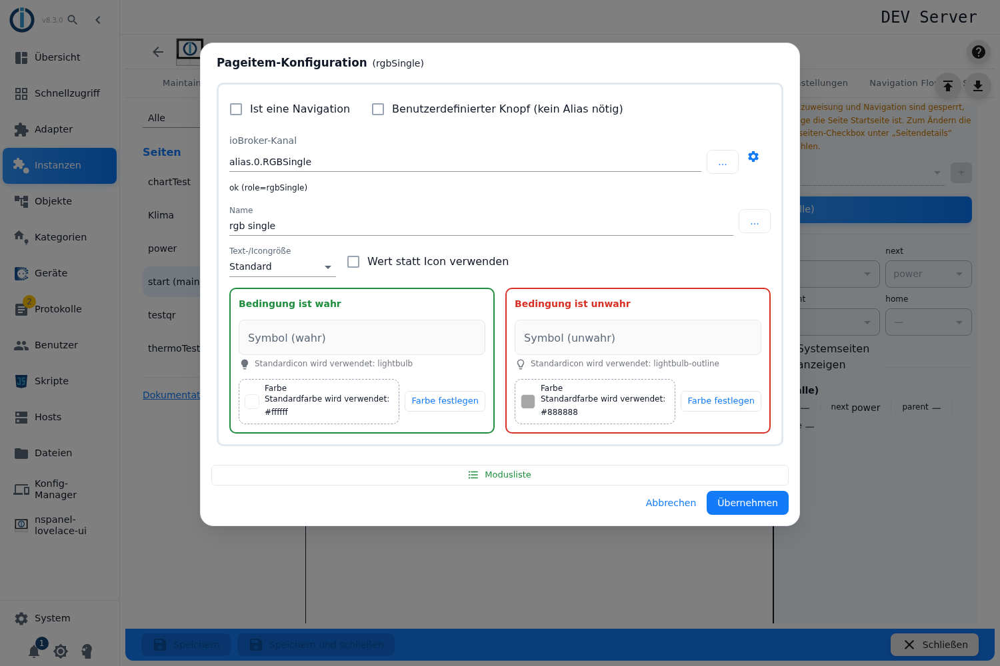
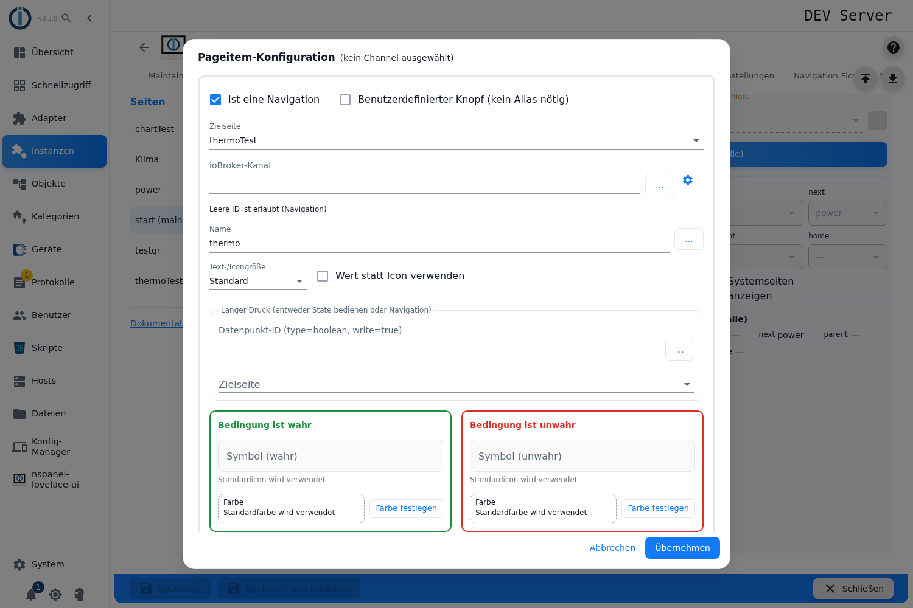
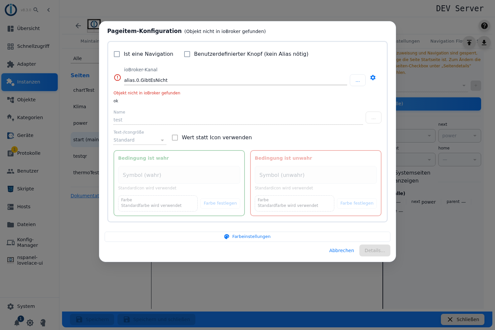
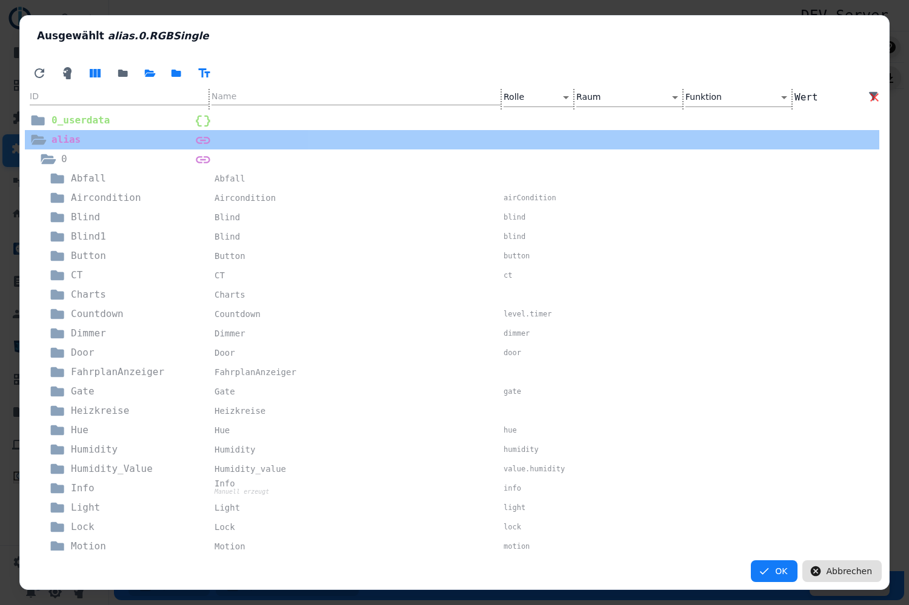
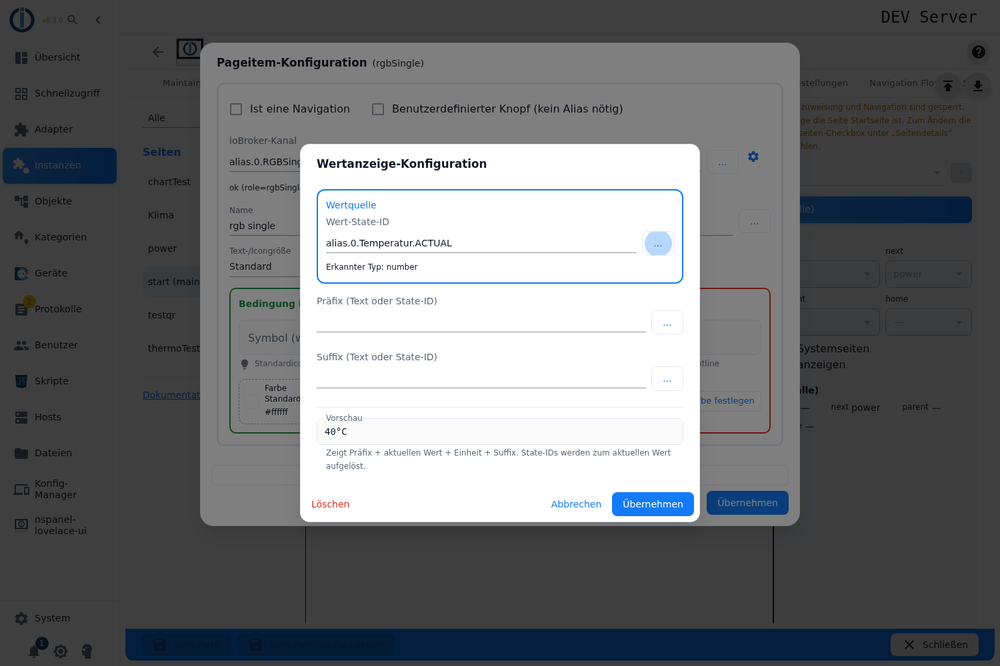
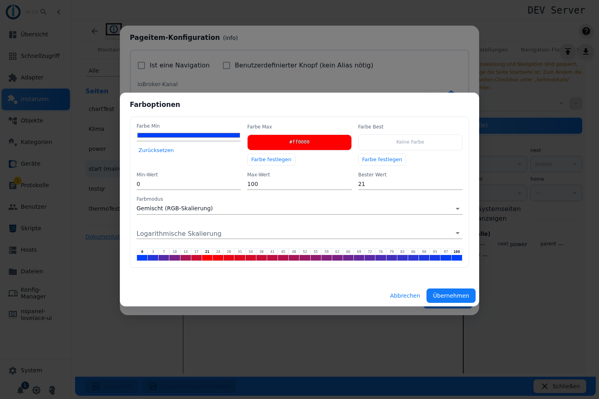
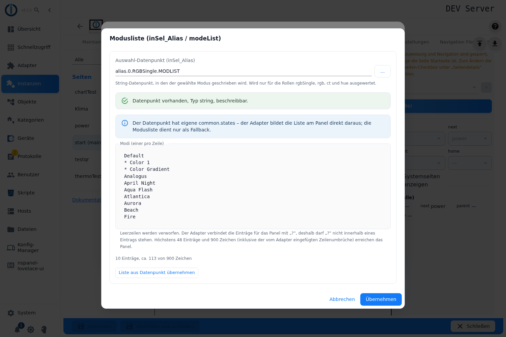

# Wiederkehrende Dialoge im PageConfig

Die Editoren der einzelnen Kartentypen sehen unterschiedlich aus, greifen aber auf dieselben Dialoge zurück. Wer einmal verstanden hat, wie die **Pageitem-Konfiguration** arbeitet, kennt sie auf jeder Seite wieder — ob auf einer Menü-Seite, einer Thermostat-Seite oder einer Alarm-Seite. Diese Seite beschreibt diese Dialoge einmal vollständig; die Seiten der Kartentypen verweisen hierher.

Alle Dialoge haben zwei Eigenschaften gemeinsam:

- **Ein Klick daneben schließt sie nicht.** Sie gehen nur über ihre eigenen Knöpfe zu — das verhindert, dass eine halbe Eingabe verloren geht.
- **Ihr *Übernehmen* speichert noch nichts.** Es schreibt die Einstellung nur in das Formular des Admins zurück. Wirksam wird alles erst mit **Speichern** im Tab PageConfig, und dafür startet der Adapter neu (siehe [PageConfig – Übersicht](PageConfig#speichern)).

Inhalt:
- [Pageitem-Konfiguration](#1-pageitem-konfiguration)
- [Die Objektauswahl: Textfeld und „…"](#2-die-objektauswahl-textfeld-und-)
- [Wertanzeige-Konfiguration](#3-wertanzeige-konfiguration)
- [Farboptionen](#4-farboptionen)
- [Modusliste](#5-modusliste)
- [Die Konfigurationsprüfung beim Speichern](#6-die-konfigurationsprüfung-beim-speichern)

## 1. Pageitem-Konfiguration

Das ist der Dialog, der hinter jeder einzelnen Fläche einer Karte steckt. Geöffnet wird er durch **Klick auf die Fläche** im Editor — auf einer Menü-Seite also auf eines der Felder, auf der Thermostat-Seite auf eine der neun Flächen rings um die Solltemperatur. Eine freie Fläche legt dabei ein neues Pageitem an, eine belegte öffnet das vorhandene.

Oben neben dem Titel *Pageitem-Konfiguration* steht, womit man es zu tun hat: die **Rolle** des gewählten Kanals (`role=dimmer`, `role=socket` …), oder *kein Channel ausgewählt*, oder *Objekt nicht in ioBroker gefunden*.

### Was ein Pageitem anzeigen soll: die drei Grundfälle

Zwei Haken am Kopf des Dialogs entscheiden, welche Art von Element entsteht:

| Haken | Ergebnis |
|---|---|
| keiner von beiden | **Gerät.** Das Pageitem bedient einen ioBroker-Kanal (einen Alias oder ein Gerät mit `role`). Der Adapter liest aus der Rolle, welche Datenpunkte dazugehören und wie die Fläche aussehen muss. |
| **Ist eine Navigation** | **Sprung auf eine andere Seite.** Statt eines Geräts wird eine **Zielseite** gewählt. Die Kanal-ID darf dann leer bleiben — der Dialog sagt das ausdrücklich („Leere ID ist erlaubt (Navigation)"). |
| **Benutzerdefinierter Knopf (kein Alias nötig)** | **Ein einzelner Datenpunkt.** Kein Kanal, kein Alias: die ID muss direkt auf einen Datenpunkt mit `type=boolean` zeigen. Der Dialog prüft das und schreibt unter das Feld, was er gefunden hat — *beschreibbar*, *read-only*, *kein boolescher Datenpunkt* oder *kein Datenpunkt*. |

Ist *Ist eine Navigation* gesetzt, erscheint das Feld **Zielseite**. Es listet die Seiten auf, die dieses Panel kennt, nimmt aber auch einen frei getippten Namen an — praktisch für eine Seite, die erst noch entsteht, aber auch die Stelle, an der ein Tippfehler unbemerkt bleibt.

### Der ioBroker-Kanal und seine Prüfzeichen

Das Feld heißt **ioBroker-Kanal**, beim benutzerdefinierten Knopf dagegen **ioBroker-Datenpunkt**. Die Auswahl über „…" zeigt nur Objekte, die zum gewählten Kartentyp passen.

Während und nach der Eingabe prüft der Admin den Kanal und zeigt das Ergebnis **links neben dem Feld**:

| Zeichen | Bedeutung |
|---|---|
| Drehender Kreis | Die Prüfung läuft noch. |
| Rotes ✖ | **Fehlende Pflicht-Datenpunkte.** Der Tooltip nennt sie namentlich. Die Rolle verlangt Datenpunkte, die der Kanal nicht hat. |
| Rotes ⚠ | **Doppelte Datenpunkte** — mehrere Datenpunkte des Kanals passen auf dieselbe Rolle, der Adapter kann sich nicht entscheiden. Der Tooltip nennt sie. |

Unter dem Feld steht zusätzlich eine Zeile Klartext: *ok (role=…)* wenn alles passt, *Objekt nicht in ioBroker gefunden*, *Fehlende ID*, oder — wenn die Rolle keinem bekannten Gerätetyp entspricht — *Die Objekt-Rolle entspricht keinem bekannten Gerätetyp*. Im letzten Fall lässt sich das Pageitem trotzdem speichern; das Panel kann damit aber nichts anfangen.

Das Zahnrad rechts neben dem Feld öffnet die [Wertanzeige-Konfiguration](#3-wertanzeige-konfiguration) **für die Kanal-ID selbst**. Das braucht man selten — es ist der Weg, aus einem Kanal einen zusammengesetzten Wert zu machen.

### Name und Wertanzeige

**Name** ist die Beschriftung der Fläche am Panel. Bleibt das Feld leer, zeigt der Hilfstext darunter, was stattdessen passiert: entweder *Vorschlag: …* (der Name, den der Adapter aus dem Kanal ableiten würde) oder *Standardname wird verwendet*.

Der Knopf **…** daneben öffnet die [Wertanzeige-Konfiguration](#3-wertanzeige-konfiguration). Damit wird aus der Beschriftung ein **lebender Wert** — Präfix, Zahl aus einem Datenpunkt, Einheit, Suffix. Ist eine Wertanzeige eingerichtet, steht ihre Vorschau als blasser Platzhaltertext im Namensfeld.

### Weitere Einstellungen, je nach Kartentyp

Diese Felder erscheinen nur dort, wo sie etwas bewirken:

| Feld | Wann sichtbar | Bedeutung |
|---|---|---|
| **Heizkreis** | nur auf der Thermostat-Seite | Ordnet das Pageitem einem Heizkreis zu, oder *(alle)* — dann erscheint es bei jedem. |
| **Text-/Icongröße** | nur auf Menü-Seiten | Schriftgröße 0–5 statt der Standardgröße. Der Tooltip listet die sechs Schriften mit ihren Eigenheiten auf: Schrift 0 (Größe 24) und 2 (32) können **keine Symbole**, dafür Sonderzeichen vieler Sprachen; 1, 3 und 4 können Symbole, aber nur einen begrenzten Zeichensatz; 5 (128) nur ASCII. |
| **Wert statt Icon verwenden** | nur auf Menü-Seiten, nicht beim benutzerdefinierten Knopf | Die Fläche zeigt den Wert als Text, nicht als Symbol. |
| **Langer Druck** | nur auf Menü-Seiten, und nur bei Navigation, benutzerdefiniertem Knopf oder `role=button` | Zweite Funktion derselben Fläche. |

**Langer Druck** kann **entweder** einen Datenpunkt schalten **oder** auf eine Seite springen — nie beides. Darum verschwindet das jeweils andere Feld, sobald eines gefüllt ist. Der Datenpunkt muss `type=boolean` und `write=true` haben; die Objektauswahl zeigt von vornherein nur solche.

### Symbol und Farbe für „wahr" und „unwahr"

Darunter stehen zwei gleich aufgebaute Spalten: **Bedingung ist wahr** und **Bedingung ist unwahr** — also eingeschaltet und ausgeschaltet, offen und zu. Je Spalte:

- **Symbol (wahr)** bzw. **Symbol (unwahr)**: die Symbolauswahl. Bleibt sie leer, zeigt der Dialog, welches Symbol der Adapter von sich aus nimmt (*Standardicon wird verwendet: …*).
- **Farbe**: ohne eigene Wahl steht hier *Standardfarbe wird verwendet* samt Farbwert — die Farbe aus der Rolle und dem eingestellten [Farbthema](colorTheme). **Farbe festlegen** schaltet auf eine eigene Farbe um, **Zurücksetzen** nimmt sie wieder weg.

So bleibt eine Seite, an der man nichts einstellt, trotzdem stimmig: Jede Lücke füllt der Adapter aus Rolle und Farbthema.

### Die Knöpfe am Fuß

| Knopf | Wirkung |
|---|---|
| **Farbeinstellungen** | Öffnet die [Farboptionen](#4-farboptionen) — Farbverlauf über einen Wertebereich. |
| **Modusliste** | Nur bei den Rollen `rgbSingle`, `rgb`, `ct`, `hue` und `select`: öffnet die [Modusliste](#5-modusliste). |

Beide werden **grün**, sobald dahinter etwas eingestellt ist. So sieht man an der Farbe des Knopfes, ob es sich lohnt hineinzuschauen.

**In der Regel steht nur einer der beiden da.** Bei den Lichtrollen `rgbSingle`, `rgb`, `ct` und `hue` ist der Farbknopf gesperrt — die Vorgabe dieser Pageitems ist `type: 'boolean'`, eine Farbe über einen Wertebereich ergibt dort keinen Sinn; es bleibt die Modusliste. Bei allen anderen Rollen ist es umgekehrt: nur **Farbeinstellungen**. Im Native-Modus verschwinden beide.

### Native (nur im Expertenmodus)

Links unten sitzt im Expertenmodus der Umschalter **Native**. Er ersetzt den ganzen Dialog durch das rohe JSON des Pageitems. Das ist der Notausgang für Einstellungen, für die es noch keine Oberfläche gibt — nicht der normale Weg. Bei ungültigem JSON bleibt **Speichern** gesperrt und die Fehlermeldung steht unter dem Feld.

> Fehlt im Dialog etwas, das das Pageitem können müsste, ist der richtige Weg eine Meldung an das Entwicklerteam — nicht der Umbau im Native-Modus oder im Konfigurationsskript: <https://github.com/ticaki/ioBroker.nspanel-lovelace-ui/issues>

## 2. Die Objektauswahl: Textfeld und „…"

Überall, wo eine ioBroker-ID gebraucht wird, steht dasselbe Paar: ein **Textfeld** und daneben der Knopf **…**.

- Das Textfeld nimmt eine getippte ID — und bei Präfix, Suffix und Modusliste auch freien Text.
- **…** öffnet die Objektauswahl von ioBroker. Sie ist **vorgefiltert**: Je Stelle sind nur die Objekte wählbar, die dort Sinn haben — beim langen Druck nur beschreibbare boolesche Datenpunkte, beim Auswahl-Datenpunkt der Modusliste nur Zeichenketten, bei einem Kanal nur Kanäle.

Übernommen wird der Wert beim **Verlassen des Feldes** oder mit **Enter** — erst dann prüft der Admin die ID. Wer tippt und sofort auf *Übernehmen* klickt, löst die Prüfung mit dem Klick aus; der Dialog wartet sie ab, statt den Klick zu verschlucken.

## 3. Wertanzeige-Konfiguration

Dieser Dialog (Titel *Wertanzeige-Konfiguration*) baut aus mehreren Teilen **einen** Text, den das Panel anzeigt. Er steckt hinter jedem „…"-Knopf an einem Namensfeld und hinter den Wertzeilen der Thermostat-Seite.

**Der Dialog zeigt nicht an jeder Stelle dieselben Felder.** Am **Namensfeld** eines Pageitems stehen Wertquelle, Präfix, Suffix und die **Vorschau** — **Einheit** und **Datumsformat** fehlen dort. Hinter dem **Zahnrad an der Kanal-ID** ist es umgekehrt: dort gibt es **Einheit** und **Datumsformat**, dafür keine Vorschau, und die Wertquelle selbst ist schreibgeschützt. Das Bild oben zeigt den Aufruf am Namensfeld.

| Feld | Bedeutung |
|---|---|
| **Wertquelle / Wert-State-ID** | Der Datenpunkt, dessen Wert angezeigt wird. Steht hier kein Datenpunkt, sondern Text, wird der Text angezeigt. Darunter steht der **erkannte Typ** (`number`, `string`, `boolean`) — an ihm hängt, welche weiteren Felder erscheinen. |
| **Einheit** | Nur bei Zahlen — und nur am Zahnrad der Kanal-ID. Wird aus `common.unit` des Datenpunkts **automatisch vorbelegt**, sobald man ihn auswählt. |
| **Präfix** | Text **vor** dem Wert — oder ein Datenpunkt, dessen Wert davor gesetzt wird. |
| **Suffix** | Dasselbe **hinter** dem Wert. |
| **Vorschau** | Zeigt laufend das Ergebnis mit dem **echten aktuellen Wert**. Datenpunkte in Präfix und Suffix werden dabei aufgelöst. |

> Die Einheit erscheint in der Vorschau **nur bei Zahlen**. Bei einer Zeichenkette als Wertquelle wird sie weder angezeigt noch ans Panel gegeben — wer dort eine Einheit braucht, schreibt sie ins Suffix.

**Datumsformat** (eigener Kasten, bei Zahlen und Zeichenketten — ebenfalls nur am Zahnrad der Kanal-ID): Damit wird aus einem Zeitstempel ein lesbares Datum.

- **Sprachraum (Locale)** — z. B. `de-DE`. Wird aus dem Browser vorbelegt.
- **Formatoptionen (JSON)** — die Optionen von `Intl.DateTimeFormat`, z. B. `{"dateStyle": "short"}`. Das Feld wird **sofort geprüft**: Ungültiges JSON färbt es rot. Leer lassen schaltet die Datumsformatierung ab.
- Eine **Zahl** wird als Zeitstempel in Millisekunden gelesen, eine **Zeichenkette** als Datumstext.

**Löschen** (links unten, nur wo der aufrufende Editor es vorsieht) entfernt die Wertanzeige wieder.

## 4. Farboptionen

Titel *Farboptionen*. Hier wird aus einem Zahlenwert eine Farbe — ein Symbol, das von Blau nach Rot läuft, je wärmer der Messwert ist.

**Die drei Farbfelder:** **Farbe Min**, **Farbe Max** und **Farbe Best**. Solange keine eigene Farbe gesetzt ist, steht *Keine Farbe* bzw. die Standardfarbe als Vorschau da, und **Farbe festlegen** übernimmt genau diesen Standardwert als Startpunkt. **Zurücksetzen** gibt die Farbe an Rolle und Farbthema zurück.

| Feld | Bedeutung |
|---|---|
| **Min-Wert** / **Max-Wert** | Der Wertebereich, über den die Farbe läuft. Voreingestellt 0 und 100. |
| **Bester Wert** | Optional. Ein Punkt innerhalb des Bereichs, der **Farbe Best** bekommt — etwa die Wunschtemperatur in der Mitte. Ohne Angabe steht hier *kein Bestwert*. |
| **Farbmodus** | Wie zwischen den Farben gerechnet wird: *Gemischt (RGB-Skalierung)*, *Farbton (HSV-Skalierung)*, *CIE (Farbtabelle)*, *Tri-Gradient (Rot-Grün)* und *Quad-Gradient (RYGB)*, die beiden Gradienten jeweils auch **verankert**. Voreingestellt ist *Gemischt*. |
| **Logarithmische Skalierung** | *Linear (keine)*, *Log10 zu Max* oder *Log10 zu Min* — für Messwerte, die über mehrere Größenordnungen laufen. |

Darunter liegt eine **Farbvorschau**: eine Tabelle mit Zahlenwerten über farbigen Feldern, gerechnet mit genau derselben Funktion, die später am Panel die Farbe bestimmt. Minimum, Maximum und der Bestwert stehen fett. Die Vorschau erscheint erst, wenn zwischen Min und Max mehr als 1 liegt.

## 5. Modusliste

Titel *Modusliste (inSel_Alias / modeList)*. Damit bekommt ein Pageitem eine **Auswahlliste** am Panel — etwa die Lichtszenen einer RGB-Lampe. Der Dialog gilt für die Rollen `rgbSingle`, `rgb`, `ct`, `hue` und `select`.

| Feld | Bedeutung |
|---|---|
| **Auswahl-Datenpunkt (inSel_Alias)** | Der Datenpunkt vom Typ `string`, in den der gewählte Eintrag geschrieben wird. Bei der Rolle `select` entfällt das Feld: dort nimmt der Adapter den `SET`-Datenpunkt des Kanals, und ein Hinweis oben nennt ihn beim Namen. |
| **Modi (einer pro Zeile)** | Die Einträge, einer je Zeile. Leerzeilen werden verworfen. |
| **Liste aus Datenpunkt übernehmen** | Füllt die Liste aus `common.states` des Datenpunkts. Der Knopf ist gesperrt, wenn kein Datenpunkt gewählt ist oder er keine `common.states` hat — der Tooltip sagt, welches von beidem. |

**Der Auswahl-Datenpunkt wird geprüft**, und das Ergebnis steht als farbige Meldung im Dialog: *vorhanden, Typ string, beschreibbar* (grün), oder eine Warnung — *existiert nicht*, *kein State*, *falscher Typ*, *nicht beschreibbar*. Beim Speichern mit fehlgeschlagener Prüfung kommt die Rückfrage **Prüfung fehlgeschlagen — trotzdem übernehmen?**; der Weg bleibt also offen, aber nicht versehentlich.

**Grenzen, die der Dialog mitzählt** (unter dem Textfeld steht laufend „*n* Einträge, ca. *x* von 900 Zeichen"):

- Höchstens **48 Einträge** — alles darüber verwirft der Adapter.
- Höchstens **900 Zeichen** die ganze Liste — darüber wird sie abgeschnitten.
- **Kein `?` innerhalb eines Eintrags.** Damit trennt der Adapter die Einträge; ein `?` im Text kann das Panel nicht darstellen. Der Dialog warnt und nennt die betroffenen Einträge.
- Jeder Eintrag wird am Panel auf **zwei Zeilen à 12 Zeichen** umbrochen, die zweite notfalls gekürzt. Die Zeichenzahl im Dialog rechnet das schon mit ein.

> Hat der Datenpunkt **eigene `common.states`**, baut der Adapter die Liste am Panel direkt daraus — die Modusliste ist dann nur noch Ersatz, falls die `states` fehlen. Der Dialog weist darauf hin, sobald er welche findet.

## 6. Die Konfigurationsprüfung beim Speichern

**Speichern** in der Pageitem-Konfiguration schließt den Dialog nicht sofort. Der Admin schickt das Pageitem zuerst **an den laufenden Adapter**, der es gegen den Kartentyp prüft und zurückmeldet, was ihm auffällt. Daraus ergeben sich drei Fälle:

| Ergebnis | Was passiert |
|---|---|
| Keine Meldung | Das Pageitem wird übernommen, der Dialog schließt. |
| Hinweise, kein Fehler | Ein Fenster **Konfigurationsprüfung** listet sie auf. **Speichern** übernimmt trotzdem, **Abbrechen** führt zurück in den Dialog. |
| Fehler | Fenster **Konfigurationsfehler**, nur **Schließen**. Der Dialog bleibt offen, damit man es richtigstellen kann. |

Sind schon vorher Datenpunkte als fehlend oder doppelt erkannt, heißt der Knopf nicht *Speichern*, sondern **Details…** und ist orange — er führt direkt in dieses Fenster.

> **Läuft der Adapter nicht**, ist keine Prüfung möglich; der Dialog speichert dann ohne sie. Dass eine Seite ohne Beanstandung durchgeht, heißt bei gestopptem Adapter also nichts. Im Tab PageConfig ist der Editor bei gestopptem Adapter ohnehin ausgegraut (siehe [PageConfig – Übersicht](PageConfig)).
