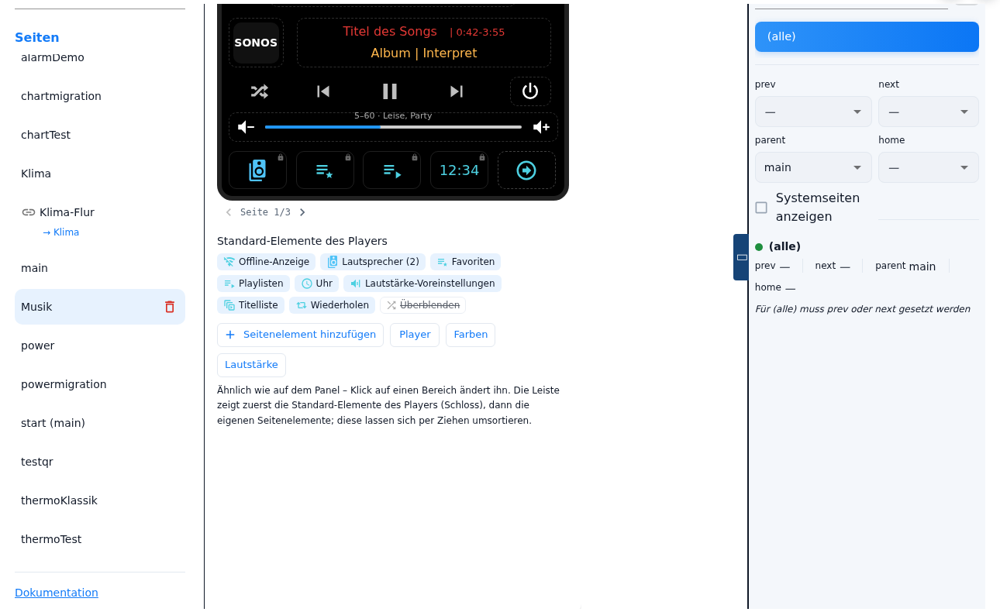
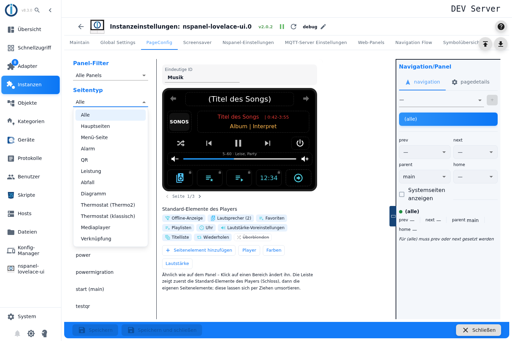
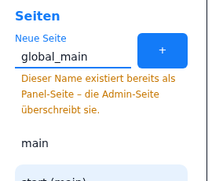
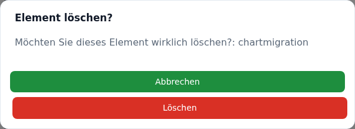
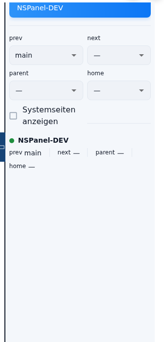
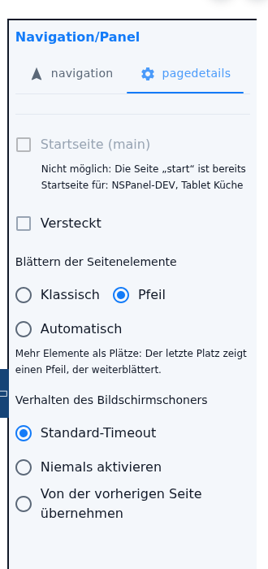

# PageConfig – Übersicht

Im Tab **PageConfig** entstehen die Seiten der Panels: anlegen, einrichten, einem Panel zuweisen und untereinander verknüpfen. Alles, was hier eingestellt wird, liegt in der Konfiguration der Instanz — **ein Konfigurationsskript wird dafür nicht gebraucht**. Wer von einem Skript kommt, findet den Weg in den Admin unter [Migration](Migration).

Dieser Tab ist die gemeinsame Hülle für **zehn Seitentypen**. Was in der Mitte zu sehen ist, hängt am Typ der gewählten Seite; alles ringsherum — Liste, Filter, Panelzuweisung, Navigation, Seitendetails, Speichern — ist für alle Typen gleich und steht auf dieser Seite. Die Einstellungen der einzelnen Karten stehen auf eigenen Seiten, siehe [Unterseiten je Kartentyp](#unterseiten-je-kartentyp).

Inhalt:
- [Wann der Tab erscheint](#wann-der-tab-erscheint)
- [Aufbau des Tabs](#aufbau-des-tabs)
- [Panel-Filter](#panel-filter)
- [Seitentyp](#seitentyp)
- [Seiten anlegen, umbenennen, löschen](#seiten-anlegen-umbenennen-löschen)
- [Panelzuweisung und Navigation](#panelzuweisung-und-navigation)
- [Seitendetails](#seitendetails)
- [Der Knopf *Dokumentation*](#der-knopf-dokumentation)
- [Speichern](#speichern)
- [Unterseiten je Kartentyp](#unterseiten-je-kartentyp)
- [Fallstricke](#fallstricke)

## Wann der Tab erscheint

Der Tab ist **ausgeblendet**, solange eine der beiden Voraussetzungen fehlt:

- Die **MQTT-Angaben** sind vollständig: eigener Adapter-Server oder IP eines externen Servers, dazu der Port und die Zugangsdaten (beim eigenen Server Benutzer und Passwort, beim externen Server entweder ein Zugangsdaten-Eintrag oder Benutzer und Passwort). Siehe [MQTT-Server Einstellungen](General).
- Es ist **mindestens ein Panel** angelegt, siehe [NSPanel-Einstellungen](NSPanelsetting).

Geprüft werden dabei nur die **Einträge im Formular**, nicht eine tatsächlich stehende Verbindung.

Zusätzlich muss die **Instanz laufen**. Bei gestoppter Instanz bleiben *Seitentyp*, das Feld *Neue Seite*, der **+**-Knopf, die Papierkorb-Symbole der Liste, die drei Reiter der rechten Spalte und die Felder der Editoren gesperrt; Panel-Filter und Seitenliste lassen sich weiter lesen. Grund: Der Admin fragt die **vorhandenen Seitennamen live beim laufenden Adapter** ab (Kommando `getAllPages`) — bleibt die Antwort leer, versucht er es alle drei Sekunden erneut.

## Aufbau des Tabs

| Bereich | Inhalt |
|---|---|
| **Links** | Panel-Filter, Seitentyp, das Feld *Neue Seite*, die Seitenliste und der Knopf *Dokumentation*. |
| **Mitte** | Der Editor der ausgewählten Seite — je Seitentyp ein eigener. Ist keine Seite gewählt, steht hier *Wählen Sie eine Seite aus*. |
| **Rechts** | **Navigation/Panel** mit drei Reitern: Panelzuweisung und Navigationsziele, die Seitendetails und ein leerer dritter Reiter. |

Die rechte Spalte lässt sich am **Griff** an ihrer linken Kante zuklappen (⏷ offen, ⏶ geschlossen). Solange keine Seite ausgewählt ist, ist sie zugeklappt und der Griff ohne Funktion. Auf einem schmalen Schirm (Telefon, Tablet) gibt es keinen Griff: Die Spalte rutscht dann unter den Editor und trägt oben eine Leiste mit der Beschriftung *Navigation/Panel*.

## Panel-Filter

Legt fest, welche Seiten die Liste zeigt — er verändert nichts an der Konfiguration.

| Auswahl | Zeigt |
|---|---|
| **Alle Panels** | Alle Seiten, unabhängig von der Zuweisung. |
| **Nicht zugewiesen** | Seiten ohne Panelzuweisung. Die sind am Panel **nicht vorhanden** — hier findet man sie wieder. |
| **&lt;Panelname&gt;** | Seiten, die diesem Panel zugewiesen sind, und zusätzlich alle Seiten, die auf *(alle)* stehen. |

Zur Auswahl stehen alle Panels der Panel-Tabelle, auch die [Web-Panels](WebPanel). Der Web-Panel-**Spiegel** eines Hardware-Panels ist kein eigener Eintrag: Er bekommt die Seiten des Panels, aus dem er entsteht, und erscheint deshalb nicht in der Liste.

## Seitentyp

Der Seitentyp filtert die Liste **und** bestimmt, was ein Klick auf **+** anlegt. Die Auswahl hat zwölf Einträge: zwei reine Filter und die zehn Seitentypen.

| Eintrag | Bedeutung | Beschrieben unter |
|---|---|---|
| **Alle** | Filter: zeigt alle Seiten. | — |
| **Hauptseiten** | Filter: zeigt die Seiten, die als Startseite markiert sind. | [Seitendetails](#seitendetails) |
| **Menü-Seite** | Fünf Varianten in einem Typ: Grid (6 Felder), Grid2 (8 Felder, auf *us-p* 9), Grid3 (4 Felder), Entities (4 Zeilen), Schedule (6 Zeilen). | [Menü-Seiten](pageMenu) |
| **Alarm** | Alarmanlage; mit der Betriebsart *Unlock* wird daraus die Entsperrseite. | [Alarm und Entsperrseite](cardAlarm) |
| **QR** | WLAN-Zugang, Telefonnummer oder Adresse als QR-Code. | [QR-Code](cardQR) |
| **Leistung** | Energiefluss mit Erzeugern und Verbrauchern. | [Energie](cardPower) |
| **Abfall** | Abfuhrtermine. | [Abfall](cardTrash) |
| **Diagramm** | Verlauf aus der History, als Linie oder Säulen. | [Verlaufsdiagramm](cardChart) |
| **Thermostat (Thermo2)** | Heizung und Klima, bis zu acht Heizkreise. | [Thermostat](cardThermo2) |
| **Thermostat (klassisch)** | Die ältere Thermostatkarte mit acht Plätzen. | [Thermostat (klassisch)](cardThermo) |
| **Mediaplayer** | Musik, Lautsprecher, Playlisten und Favoriten. | [Mediaplayer](cardMedia) |
| **Verknüpfung** | Zeigt eine andere Admin-Seite unter eigenem Namen und eigener Navigation. | [Verknüpfung](pageLink) |

Dazu:

- Unter **Alle** und **Hauptseiten** lässt sich nichts anlegen — das Feld *Neue Seite* ist dann ausgeblendet.
- **Hauptseiten** ist kein Kartentyp, sondern eine Markierung. In der Liste steht hinter einer markierten Seite `(main)`, gespeichert bleibt ihr eigener Name.
- **Menü-Seite** legt zunächst ein **Grid (6 Felder)** an; welche der fünf Varianten es wird, entscheidet die Radiogruppe *Kartentyp* im Editor. Dort kann es auch später noch geändert werden.
- Eine Seite, die von außen angesprungen wird — über den Knopf am Knoten im [Navigation Flow](naviFlow) oder über das Ziel einer Verknüpfung —, setzt den Filter auf **Alle** zurück, wenn sie sonst unsichtbar wäre.

## Seiten anlegen, umbenennen, löschen

**Anlegen:** Seitentyp wählen, im Feld *Neue Seite* einen Namen eintragen, **+** drücken. Der Name ist die **eindeutige ID** der Seite: Unter ihm sprechen andere Seiten sie in ihren Navigationszielen an, und unter ihm wird sie von einem Pageitem mit Navigationsziel oder aus einem Skript heraus angesprungen.

- `main` ist reserviert; der **+**-Knopf bleibt gesperrt und ein Hinweis nennt den Grund — die Startseite entsteht über die Markierung, nicht über den Namen.
- Ein **bereits vergebener** Name lässt sich nicht anlegen, der Knopf bleibt gesperrt.
- Kennt der laufende Adapter den Namen schon von einer Seite, die **nicht** aus dem Admin kommt, erscheint der Hinweis *„Dieser Name existiert bereits als Panel-Seite – die Admin-Seite überschreibt sie."* Der Hinweis greift für Seiten aus jedem Konfigurationsskript und für die Seiten **aller** Panels, nicht nur des gerade gefilterten.

> ⚠️ **Der Hinweis verspricht zu viel.** Eine gleichnamige Seite aus dem **Skript dieses Panels** gewinnt: Der Adapter überspringt dann die Admin-Seite und schreibt *„Page with name … already exists, skipping!"* ins Log. Überschrieben wird nur in drei Fällen — die **Startseite** (die ersetzt eine `main` aus dem Skript immer), eine Seite der **globalen** Skript-Konfiguration (nur wenn das Panel der Admin-Seite **namentlich** zugewiesen ist; eine Zuweisung *(alle)* genügt dafür nicht) und eine Seite, die nur aus dem **Skript eines anderen Panels** hereingereicht wurde. Wer eine Skriptseite ersetzen will, entfernt sie aus dem Skript — oder übernimmt das Skript gleich ganz, siehe [Migration](Migration).

**Umbenennen:** nicht in der Liste, sondern im Editor über das Feld **Eindeutige ID**. Bei der Startseite ist es gesperrt, mit dem Hinweis, dass der Name unverändert gespeichert bleibt. Das Feld wirkt bei **jedem Tastendruck**: Zwischenstände des Tippens sind jeweils kurzzeitig der echte Name. Eine leere Eingabe und der Name `main` werden stillschweigend verworfen.

> ⚠️ **Umbenennen zieht die Navigation nicht mit.** Jedes *prev*, *next*, *parent* und *home* **anderer Seiten**, das auf den alten Namen zeigte, bleibt stehen und läuft ins Leere — ebenso ein Navigationsziel an einem Pageitem und jeder Verweis aus einem Konfigurationsskript. Nur eine [Verknüpfung](pageLink) folgt ihrem umbenannten Ziel von selbst. Und anders als beim Anlegen wird beim Umbenennen ein **bereits vergebener Name nicht abgewiesen** — dann gibt es die ID zweimal, und aus diesem Zustand führt die Oberfläche nicht von allein heraus. Nach dem Umbenennen deshalb alle Verbindungen zu dieser Seite noch einmal setzen; welche das sind, zeigt der [Navigation Flow](naviFlow). Im Zweifel ist es sicherer, die Seite neu anzulegen, als sie umzubenennen.

**Reihenfolge:** Die Liste ist immer alphabetisch sortiert; eine eigene Reihenfolge gibt es nicht und ist auch nicht nötig — was das Panel anzeigt, ergibt sich aus der Navigation, nicht aus der Listenposition. In den Auswahllisten der Navigationsziele steht `main` vorn, der Rest alphabetisch.

**Kopieren:** Eine ganze Seite lässt sich **nicht** duplizieren. Soll derselbe Inhalt an zwei Stellen der Navigation auftauchen, ist die [Verknüpfung](pageLink) der Weg. Kopierbar sind **einzelne Pageitems einer Menü-Seite**: Rechtsklick auf die Fläche, *Element kopieren*, Rechtsklick auf die Zielfläche, *Element einfügen* — auch von einer Menü-Seite in eine andere. Einen Weg per Tipp oder Tastenkürzel gibt es nicht, auf Tablet und Telefon ist die Funktion damit nicht erreichbar. Die Einzelheiten stehen unter [Menü-Seiten](pageMenu#5-flächen-kopieren-und-einfügen).

**Löschen:** über das Papierkorb-Symbol in der Zeile — auf dem Schreibtisch erscheint es beim Überfahren der Zeile, auf einem Berührungsschirm steht es immer da. Es folgt die Rückfrage *Element löschen?* mit dem Namen der Seite. Danach wählt die Liste die erste Seite des aktuellen Filters aus.

> ⚠️ **Beim Löschen werden Verweise anderer Seiten nicht mitgeräumt.** Zeigte ein *prev*, *next*, *parent* oder *home* auf die gelöschte Seite, bleibt dieser Eintrag stehen und läuft ins Leere; eine [Verknüpfung](pageLink) auf die gelöschte Seite wird vom Adapter gemeldet und übersprungen. Vor dem Löschen lohnt ein Blick in den [Navigation Flow](naviFlow), wer auf die Seite zeigt.

## Panelzuweisung und Navigation

Der erste Reiter der rechten Spalte bestimmt, **auf welchem Panel** eine Seite erscheint und **wie man sie erreicht**.

**Panel zuweisen:** im Auswahlfeld ein Panel wählen und mit **+** hinzufügen. Zusätzlich gibt es den Eintrag **(alle)** — damit gilt die Seite für jedes Panel, auch für später hinzugekommene. Bereits zugewiesene Panels verschwinden aus der Auswahl. Ein zugewiesenes Panel entfernt das Papierkorb-Symbol daneben; der **erste Klick markiert nur** (das Symbol wird dunkelrot hinterlegt), der zweite löscht, und nach drei Sekunden ohne zweiten Klick verfällt die Markierung.

> Eine Seite **ohne** Panelzuweisung wird gar nicht erst gebaut und ist am Panel nicht vorhanden. Das ist der häufigste Grund für „die Seite ist weg" — der Panel-Filter *Nicht zugewiesen* zeigt alle Betroffenen.

**Ein einzelnes Panel ausnehmen:** Steht die Seite auf *(alle)*, lässt sich ein Panel davon ausschließen, indem es **zusätzlich** zugewiesen und seine Navigation **leer** gelassen wird. Der Adapter überspringt die Seite dann für genau dieses Panel; in der Zusammenfassung steht dazu der Hinweis *Seite wird nicht hinzugefügt*.

**Navigationsziele:** Für das in der Liste **angeklickte** Panel gibt es vier Felder. Sie entsprechen den Wischgesten am Panel:

| Feld | Geste am Panel |
|---|---|
| **next** | einmal nach rechts wischen |
| **prev** | einmal nach links wischen |
| **home** | zweimal nach rechts wischen |
| **parent** | zweimal nach links wischen |

Zur Auswahl stehen die Seiten, die dieses Panel kennt, und die Admin-Seiten, die ihm zugewiesen sind — die eigene Seite ist ausgenommen. Der Haken **Systemseiten anzeigen** nimmt zusätzlich die internen Seiten (`///…`) in die Liste; die Entsperrseite `///unlock` wird nie ausgeblendet. Ein bereits eingetragenes Ziel bleibt immer sichtbar, auch wenn es eine Systemseite ist.

Unter den Feldern steht je zugewiesenem Panel eine **Zusammenfassung**: ein Punkt (grün, sobald irgendein Ziel gesetzt ist, sonst rot), der Panelname und die vier Werte.

Zu wissen:

- **Die Gegenrichtung entsteht nicht von selbst.** Wer bei Seite A `next = B` setzt, muss bei B `prev = A` selbst nachtragen, sonst kommt man nicht zurück. Die endgültige Verkettung von *prev* und *next* rechnet erst der Adapter beim Bauen aus; bei Konflikten hat *prev* Vorrang.
- Eine Seite, die **gar kein Ziel** gesetzt hat und nicht Startseite ist, bekommt beim Bauen automatisch `home` auf die Startseite — ein Notausgang, keine Navigation.
- Ein Ziel, das auf die **eigene Seite** zeigt, wird bei *home* und *parent* vom Adapter entfernt und ins Log geschrieben.
- Ein **⚠** am Wert bedeutet: Das Ziel ist auf dem genannten Panel nicht vorhanden. Meldet ein Panel noch gar keine Seiten (weil es nie online war), bleibt die Warnung aus.
- Bei der Zuweisung **(alle)** muss *prev* oder *next* gesetzt sein, sonst ist die Seite nur über ein Navigationsziel an einem Pageitem erreichbar. Der Admin weist darauf hin.
- Wird die Seite als **Startseite** markiert, sind Panelauswahl, Papierkorb und die vier Felder gesperrt; ein Hinweis oben nennt den Grund. Zum Ändern den Haken unter *Seitendetails* abwählen.
- Bei einer **Menü-Seite in der Variante Grid2** hängt die Auswahl an der Zuweisung: Grid2 verlangt, dass alle zugewiesenen Panels dasselbe Modell haben — sonst ist die Variante gesperrt und der Editor fällt auf Grid zurück.
- Seiten vom Typ **Leistung** oder **Diagramm**, die aus den alten Tabs *Page Power* / *Page Chart* stammen, holen ihre Navigation zunächst weiter aus dem Skript. Die **erste Panelzuweisung im Admin beendet das**; die Skriptseite ist danach ein toter Verweis. Siehe [Migration](Migration#8-die-alten-tabs-page-power-und-page-chart).

## Seitendetails

Der zweite Reiter der rechten Spalte. Er gilt für jeden Seitentyp; die drei Blätter-Einstellungen erscheinen nur bei den Karten, die eine Liste von Seitenelementen blättern.

| Einstellung | Bedeutung |
|---|---|
| **Startseite (main)** | Die Seite wird auf den zugewiesenen Panels unter der ID `main` veröffentlicht und ersetzt dort die Startseite aus dem Skript oder die vom Adapter erzeugte. Erst zuweisen, dann markieren: Ohne Panelzuweisung bleibt der Haken gesperrt (*„Erst ein Panel zuweisen"*), ebenso bei gestoppter Instanz und dann, wenn für ein betroffenes Panel schon eine andere Seite Startseite ist — der Hinweis nennt sie. Solange die Markierung sitzt, sind Name, Panelzuweisung und Navigationsziele gesperrt; die Startseite erbt Platz und Verknüpfungen der Seite, die sie ersetzt. |
| **Versteckt** | Die Seite wird gebaut, erscheint aber nicht im normalen Durchwischen. Erreichbar bleibt sie über ein gezieltes Navigationsziel. |
| **Blättern der Seitenelemente** | *Klassisch* (die Doppelpfeile des Panels blättern), *Pfeil* (der letzte Platz der Seite wird zum Blätterpfeil) oder *Automatisch* (wie klassisch, blättert zusätzlich von selbst weiter). Vorgabe: klassisch. |
| **Weiterblättern um** | *Eine ganze Seite* oder *eine halbe Seite*. Erscheint nur bei *Klassisch* und *Automatisch*. |
| **Sekunden bis zur nächsten Seite** | Nur bei *Automatisch*; leer = 15 Sekunden. |
| **Verhalten des Bildschirmschoners** | *Standard-Timeout* (die Zeit des Panels gilt), *Niemals aktivieren* (der Bildschirmschoner startet nicht, solange diese Seite zu sehen ist — etwa eine Alarmseite) oder *Von der vorherigen Seite übernehmen* (die Seite schickt dem Panel keine neue Zeit, es gilt weiter die der vorher gezeigten Seite). |

Die drei Blätter-Zeilen erscheinen bei **Menü-Seiten** (Grid, Grid2, Grid3, Entities, Schedule), bei der **Thermostat-Seite (Thermo2)** und beim **Mediaplayer**. *Eine halbe Seite* gibt es nur bei den drei Grid-Varianten und bei Thermo2 — und bei Thermo2 wird die Wahl vom Adapter wieder auf *ganze Seite* zurückgesetzt. Was die drei Modi auf der jeweiligen Karte bedeuten, steht unter [Menü-Seiten](pageMenu#6-mehr-einträge-seiten-und-blättern), [Thermostat](cardThermo2) und [Mediaplayer](cardMedia#9-blättern-der-optionsleiste).

Der **dritte Reiter** der Spalte ist ein Platzhalter für spätere Einstellungen. Er zeigt den unübersetzten englischen Satz *„Placeholder content for this tab."*

> Die Reiterbeschriftungen zeigen zurzeit die Schlüssel `navigation`, `pagedetails` und `placeholder` statt der Übersetzungen (auf schmalem Schirm `nav`, `details`, `free`) — ein bekannter Punkt in der Admin-Oberfläche, inhaltlich ohne Folgen. Diese Seite nennt die Reiter deshalb bei ihrer Funktion und nicht bei ihrer Beschriftung.

## Der Knopf *Dokumentation*

Unter der Seitenliste führt **Dokumentation** in einem neuen Tab zur Wiki-Seite des gerade gewählten Seitentyps. Steht die Auswahl auf *Alle* oder *Hauptseiten*, entscheidet die ausgewählte Seite: Der Knopf führt zur Seite ihrer Karte — bei einer Menü-Seite also zu *cardGrid*, *cardGrid2*, *cardGrid3*, *cardEntities* oder *cardSchedule*, die alle auf [Menü-Seiten](pageMenu) weiterleiten. Ist **keine** Seite ausgewählt, landet der Knopf auf dieser Übersicht.

## Speichern

Alle Änderungen an den Seiten sammelt der Admin im Formular; wirksam werden sie erst mit **Speichern**. Der Adapter startet danach neu und baut die Seiten. Wer die Instanz-Einstellungen schließt oder den Browser neu lädt, verliert alles Ungespeicherte.

Eine Ausnahme: Das **Zuweisen eines Panels** trägt den Seitennamen **sofort** in die gemerkte Seitenliste des Panelobjekts ein, damit die Auswahllisten der anderen Seiten vollständig sind. Das ist nur ein Zwischenspeicher der Oberfläche — die Seite selbst entsteht trotzdem erst beim Speichern.

## Unterseiten je Kartentyp

Die Einstellungen der einzelnen Seitentypen, in der Reihenfolge der Auswahl *Seitentyp*:

- [Menü-Seiten](pageMenu) — Grid, Grid2, Grid3, Entities, Schedule
- [Alarm und Entsperrseite](cardAlarm)
- [QR-Code](cardQR)
- [Energie](cardPower)
- [Abfall](cardTrash)
- [Verlaufsdiagramm](cardChart)
- [Thermostat](cardThermo2)
- [Thermostat (klassisch)](cardThermo)
- [Mediaplayer](cardMedia)
- [Verknüpfung](pageLink)

Dazu die Dialoge, die in mehreren Editoren gleich aussehen: [Wiederkehrende Dialoge](PageConfig-Dialoge) — Pageitem, Objektauswahl, Farben, Modusliste, Rohdaten.

Die **Entsperrseite** ist kein eigener Seitentyp: Sie entsteht aus einer Alarm-Seite, bei der im Editor statt *Alarm* die Betriebsart *Unlock* gewählt wird; dazu kommt das Ziel, auf das nach der richtigen PIN gesprungen wird.

Welche Datenpunkte die Karten erwarten, steht in der [Alias-Tabelle](ALIAS); den Weg aus einem bestehenden Konfigurationsskript in den Admin beschreibt [Migration](Migration).

## Fallstricke

- **Ohne laufende Instanz geht fast nichts.** Anlegen, Löschen, Umbenennen und die ganze rechte Spalte sind gesperrt, weil der Admin die vorhandenen Seitennamen beim Adapter erfragt. Einen Hinweis darauf gibt die Oberfläche nicht — die Felder sind einfach grau.
- **Eine Seite ohne Panelzuweisung existiert nicht.** Sie steht in der Liste, wird aber nicht gebaut. Der Filter *Nicht zugewiesen* findet sie.
- **Umbenennen bricht die Navigation still.** Verweise anderer Seiten bleiben auf dem alten Namen stehen, und ein doppelter Name wird nicht abgewiesen. Neu anlegen ist sicherer.
- **Löschen räumt nicht auf.** Wer auf die gelöschte Seite zeigte, zeigt danach ins Leere.
- **Der Hinweis „die Admin-Seite überschreibt sie" gilt nur in drei Fällen.** Gegen die Seite aus dem Skript **desselben** Panels verliert die Admin-Seite und wird beim Bauen übersprungen; zu sehen ist das nur im Log.
- **Die Startseite sperrt ihre eigene Zuweisung.** Panel und Navigationsziele lassen sich erst nach Abwählen der Markierung ändern. Was vor dem Markieren eingetragen war, bleibt dabei wirksam.
- **Ein zugewiesenes Panel merkt sich die Seite auch ohne Speichern.** Der Name landet sofort in der gemerkten Seitenliste des Panels und steht dann in den Auswahllisten anderer Seiten, obwohl die Seite noch nicht existiert — auch dann, wenn die Zuweisung gleich wieder entfernt oder nicht gespeichert wird. Beim nächsten Start des Adapters wird die Liste neu geschrieben und der Eintrag verschwindet; bis dahin unterbleibt für dieses Ziel auch die ⚠-Warnung.
- **Kopieren nur mit der Maus.** *Element kopieren* und *Element einfügen* hängen am Rechtsklick; auf Tablet und Telefon gibt es keinen Ersatz. Eingefügt wird ohne Rückfrage über eine belegte Fläche.
- **„Eine halbe Seite" ist nicht überall wirksam.** Bei Thermo2 wird die Wahl immer auf *ganze Seite* zurückgesetzt, und wer eine Grid-Seite nachträglich auf Entities oder Schedule umstellt, behält den gespeicherten Wert, den der Adapter dann ebenfalls verwirft.
- **Ein aus einem Skript übernommenes „alwaysOn: action" ist nicht wählbar.** Für diesen vierten Modus (die Seite hält den Bildschirmschoner nach jeder Aktion zurück) gibt es keinen Knopf. Der Wert bleibt gespeichert, zeigt im Reiter *Seitendetails* aber **keinen** ausgewählten Punkt — und der erste Klick in die Gruppe löscht ihn endgültig.
- **Drei Reiterbeschriftungen sind unübersetzt**, der dritte Reiter ist leer und zeigt einen englischen Satz. Beides ist harmlos.
