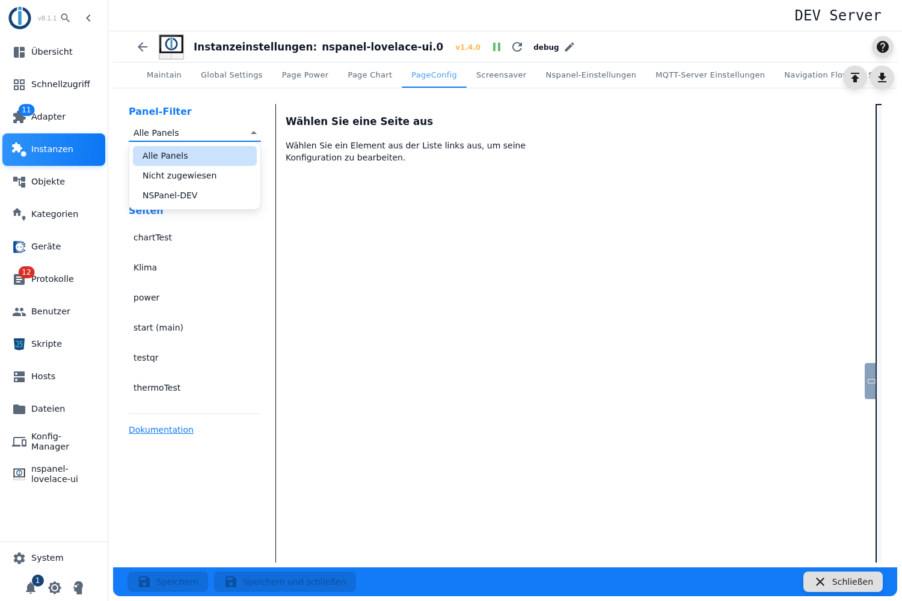
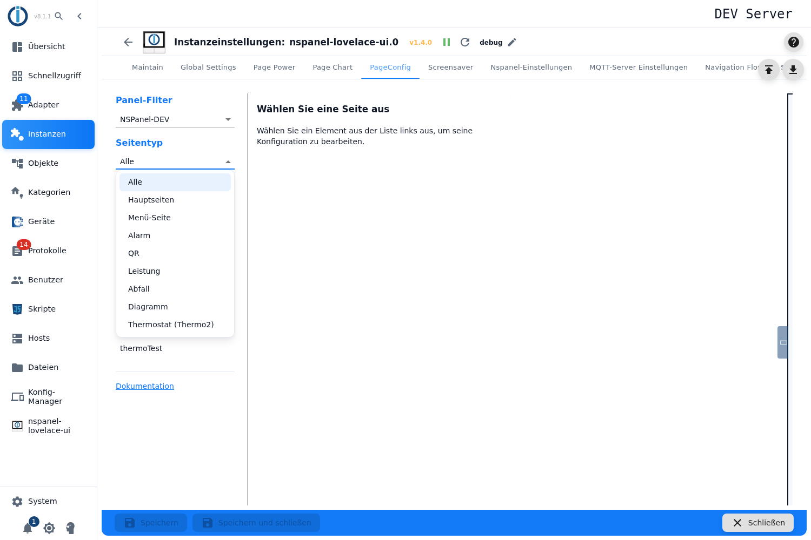
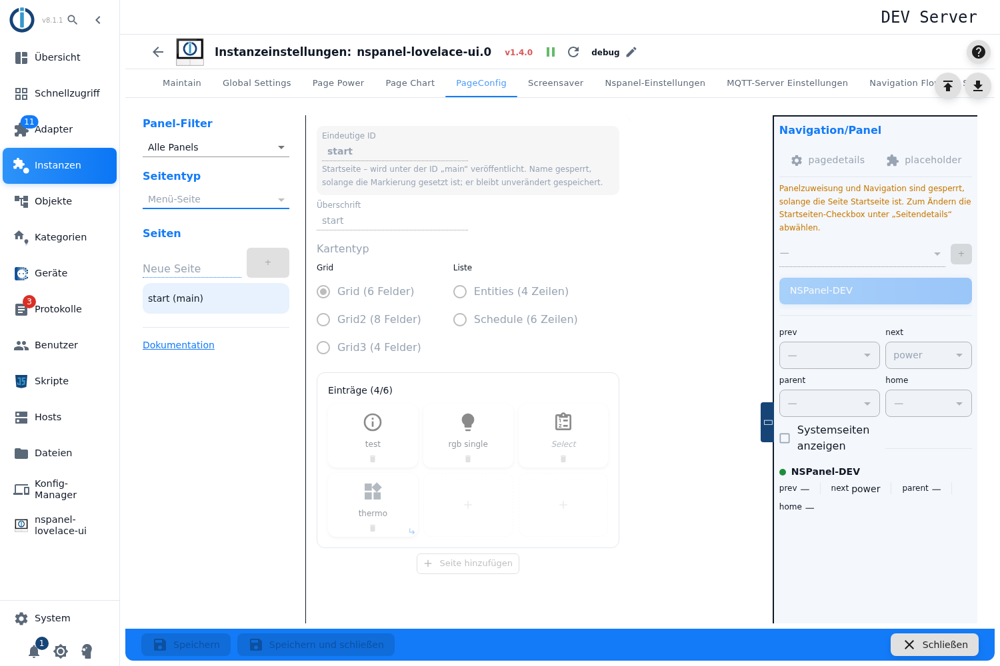
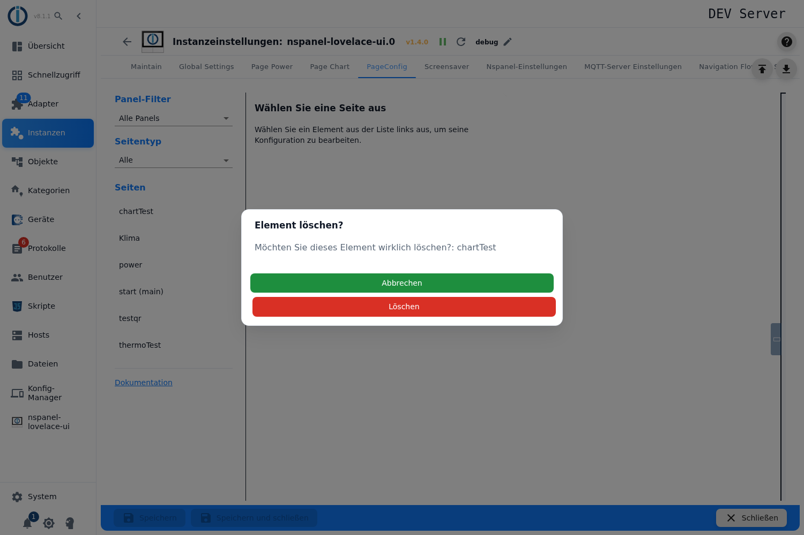
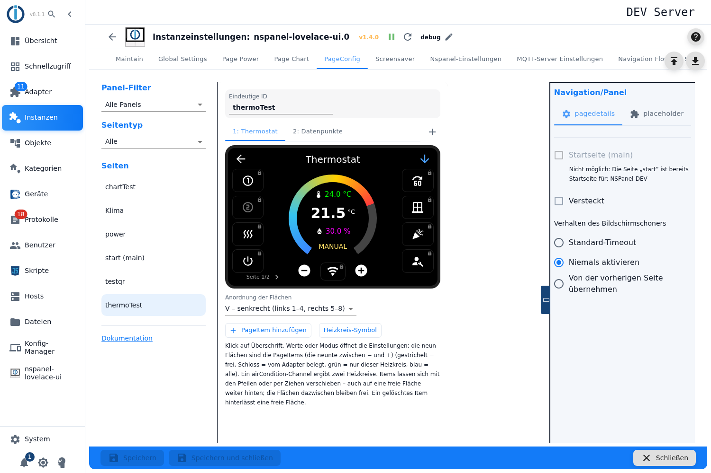

# PageConfig – Übersicht

Im Tab **PageConfig** entstehen die Seiten des Panels: anlegen, einrichten, einem Panel zuweisen und untereinander verknüpfen. Alles, was hier eingestellt wird, liegt in der Adapterkonfiguration — ein Konfigurationsskript ist dafür nicht nötig.

Der Tab erscheint erst, wenn die MQTT-Verbindung steht und mindestens ein Panel eingerichtet ist. Außerdem muss die **Instanz laufen**: bei gestopptem Adapter sind Seitentyp, Anlegen und die gesamte rechte Spalte ausgegraut, weil der Admin die vorhandenen Seiten live beim Adapter erfragt.

## Aufbau

| Bereich | Inhalt |
|---|---|
| **Links** | Panel-Filter, Seitentyp, die Seitenliste und der Link zu dieser Dokumentation. |
| **Mitte** | Der Editor der ausgewählten Seite — je Kartentyp ein eigener (siehe [Unterseiten](#unterseiten-je-kartentyp)). |
| **Rechts** | **Navigation/Panel**: Panelzuweisung, Navigationsziele und die Seitendetails. Die Spalte lässt sich am Griff zuklappen. |

## Panel-Filter

Legt fest, welche Seiten die Liste zeigt — er verändert nichts an der Konfiguration.

| Auswahl | Zeigt |
|---|---|
| **Alle Panels** | Alle Seiten, unabhängig von der Zuweisung. |
| **Nicht zugewiesen** | Seiten ohne Panelzuweisung. Die sind am Panel **nicht erreichbar** — hier findet man sie wieder. |
| **&lt;Panelname&gt;** | Seiten, die diesem Panel zugewiesen sind, und zusätzlich alle Seiten, die auf *(alle)* stehen. |

## Seitentyp

Der Seitentyp filtert die Liste **und** bestimmt, was ein Klick auf **+** anlegt.

- **Alle** und **Hauptseiten** sind reine Filter — darunter lässt sich nichts anlegen, das Eingabefeld ist dann ausgeblendet.
- **Menü-Seite** fasst die fünf Menüvarianten zusammen (Grid mit 6, 8 oder 4 Feldern, Entities, Schedule); welche davon es wird, entscheidet man anschließend im Editor.
- Die übrigen Einträge — **Alarm**, **QR**, **Leistung**, **Abfall**, **Diagramm**, **Thermostat (Thermo2)** — sind je ein Kartentyp.

**Hauptseiten** ist kein eigener Kartentyp, sondern eine Markierung: Jede Seite kann Startseite sein (siehe [Seitendetails](#seitendetails)). In der Liste steht hinter ihr `(main)`.

## Seiten anlegen, umbenennen, löschen

**Anlegen:** Seitentyp wählen, im Feld *Neue Seite* einen Namen eintragen, **+** drücken. Der Name ist die eindeutige ID der Seite: Unter ihm sprechen die anderen Seiten sie in ihren Navigationszielen an, und unter ihm wird sie in einem `navigate`-Befehl eines Buttons angesprungen.

- `main` ist reserviert und wird abgewiesen — die Startseite entsteht über die Markierung, nicht über den Namen.
- Ein bereits vergebener Name lässt sich nicht anlegen, der Knopf bleibt gesperrt.
- Trägt der Name eine Seite, die schon aus dem Konfigurationsskript kommt, weist ein Hinweis darauf hin: Die Admin-Seite **ersetzt** dann die gleichnamige Skriptseite. (Auch ein Konfigurationsskript spricht seine Seiten über diesen Namen an — deshalb fällt eine Namensgleichheit überhaupt auf.)

**Umbenennen:** nicht in der Liste, sondern im Editor über das Feld *Eindeutige ID*. Bei der Startseite ist es gesperrt, solange die Markierung gesetzt ist.

> ⚠️ **Umbenennen zieht die Navigation nicht mit.** Jedes *prev*, *next*, *parent* und *home* **anderer Seiten**, das auf den alten Namen zeigte, bleibt unverändert stehen und läuft danach ins Leere — ebenso ein `navigate`-Befehl in einem Button und ein Verweis aus dem Konfigurationsskript. Nach dem Umbenennen deshalb alle Verbindungen zu dieser Seite noch einmal setzen; welche das sind, zeigt der Tab [Navigation Flow](naviFlow). Und anders als beim Anlegen wird beim Umbenennen ein **bereits vergebener Name nicht abgewiesen** — dann gibt es die ID zweimal. Im Zweifel ist es sicherer, die Seite neu anzulegen, als sie umzubenennen.

**Reihenfolge:** Die Liste ist immer alphabetisch sortiert; eine eigene Reihenfolge gibt es nicht und ist auch nicht nötig — was das Panel anzeigt, ergibt sich aus der Navigation, nicht aus der Listenposition.

**Kopieren:** Eine ganze Seite lässt sich nicht duplizieren — wohl aber **einzelne PageItems einer Menü-Seite**: Rechtsklick auf die Fläche, *Element kopieren*, Rechtsklick auf die Zielfläche, *Element einfügen*. Das geht auch von einer Menü-Seite in eine andere. Die Einzelheiten stehen auf der Seite zur Menü-Seite *(folgt)*.

**Löschen:** über das Papierkorb-Symbol in der Zeile, mit Rückfrage.

> ⚠️ Beim Löschen werden **Verweise anderer Seiten nicht mitgeräumt**. Zeigte ein *prev*, *next*, *parent* oder *home* auf die gelöschte Seite, bleibt dieser Eintrag stehen und läuft ins Leere. Vor dem Löschen lohnt ein Blick in den Tab [Navigation Flow](naviFlow), wer auf die Seite zeigt.

## Panelzuweisung und Navigation

Die rechte Spalte bestimmt, **auf welchem Panel** eine Seite erscheint und **wie man sie erreicht**.

**Panel zuweisen:** im Auswahlfeld ein Panel wählen und mit **+** hinzufügen. Zusätzlich gibt es den Eintrag **(alle)** — damit gilt die Seite für jedes Panel, auch für später hinzugekommene. Ein zugewiesenes Panel entfernt das Papierkorb-Symbol daneben (am Telefon zweimal tippen: der erste Tipp markiert nur).

> Eine Seite **ohne** Panelzuweisung wird gar nicht erst gebaut und ist am Panel nicht vorhanden. Das ist der häufigste Grund für „die Seite ist weg" — der Panel-Filter *Nicht zugewiesen* zeigt alle Betroffenen.

**Navigationsziele:** Für das ausgewählte Panel gibt es vier Felder. Sie entsprechen den Wischgesten am Panel:

| Feld | Geste am Panel |
|---|---|
| **next** | einmal nach rechts wischen |
| **prev** | einmal nach links wischen |
| **home** | zweimal nach rechts wischen |
| **parent** | zweimal nach links wischen |

Zur Auswahl stehen die Seiten, die dieses Panel kennt — die eigene Seite ist ausgenommen. Der Haken **Systemseiten anzeigen** nimmt zusätzlich die internen Seiten (`///…`) in die Liste; die Entsperrseite `///unlock` steht immer zur Verfügung.

Zu wissen:

- **Die Gegenrichtung entsteht nicht von selbst.** Wer bei Seite A `next = B` setzt, muss bei B `prev = A` selbst nachtragen, sonst kommt man nicht zurück.
- Eine Seite, die gar kein Ziel gesetzt hat und nicht Startseite ist, bekommt beim Bauen automatisch `home` auf die Startseite — ein Notausgang, keine Navigation.
- Ein ⚠️ am Feld bedeutet: Das Ziel ist auf dem betroffenen Panel nicht vorhanden. Meldet ein Panel noch gar keine Seiten (weil es nie online war), bleibt die Warnung aus.
- Bei der Zuweisung **(alle)** muss *prev* oder *next* gesetzt sein, sonst ist die Seite nur noch über einen Button mit `navigate`-Befehl erreichbar. Der Admin weist darauf hin.

## Seitendetails

| Einstellung | Bedeutung |
|---|---|
| **Startseite (main)** | Die Seite wird unter der ID `main` veröffentlicht und ersetzt die Startseite des Konfigurationsskripts. Pro Panel darf es nur eine geben — ist bereits eine andere gesetzt, bleibt der Haken gesperrt und der Hinweis nennt die Seite, die im Weg steht. Solange die Markierung sitzt, sind Name, Panelzuweisung und Navigationsziele gesperrt: Die Startseite erbt die Verknüpfungen ihrer Vorgängerin. |
| **Versteckt** | Die Seite wird gebaut, erscheint aber nicht im normalen Durchwischen. Erreichbar bleibt sie über ein gezieltes Navigationsziel oder einen Button. |
| **Verhalten des Bildschirmschoners** | *Standard-Timeout* (die Einstellung des Panels), *Niemals aktivieren* (die Seite bleibt stehen — etwa eine Alarmseite) oder *Von der vorherigen Seite übernehmen*. |

Der dritte Reiter der Spalte (*placeholder*) ist ohne Funktion und für spätere Einstellungen vorgesehen.

> Die Reiterbeschriftungen zeigen zurzeit die Schlüssel `navigation`, `pagedetails` und `placeholder` statt der Übersetzungen — ein bekannter Punkt in der Admin-Oberfläche, inhaltlich ohne Folgen.

## Speichern

Alle Änderungen an den Seiten sammelt der Admin im Formular; wirksam werden sie erst mit **Speichern**, und der Adapter startet dafür neu. Es gibt **keine Warnung beim Verlassen des Tabs** — wer ungespeichert wegklickt, verliert die Arbeit.

Eine Ausnahme: Das Zuweisen eines Panels trägt den Seitennamen sofort beim Panel ein, damit die Auswahllisten vollständig sind. Das ist nur ein Zwischenspeicher der Oberfläche — die Seite selbst entsteht trotzdem erst beim Speichern.

## Unterseiten je Kartentyp

Die Einstellungen der einzelnen Karten stehen auf eigenen Seiten:

- Menü-Seite *(folgt)*
- Alarm und Entsperrseite *(folgt)*
- QR-Code *(folgt)*
- Energie *(folgt)*
- Verlaufsdiagramm *(folgt)*
- Abfall *(folgt)*
- [Thermostat](PageThermo2-Admin)
- [Wiederkehrende Dialoge](PageConfig-Dialoge)

Die **Entsperrseite** ist kein eigener Seitentyp: Sie entsteht aus einer Alarm-Seite, bei der im Editor statt *Alarm* die Betriebsart *Unlock* gewählt wird; dazu kommt das Ziel, auf das nach der richtigen PIN gesprungen wird.
