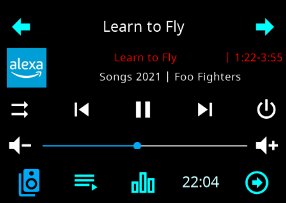
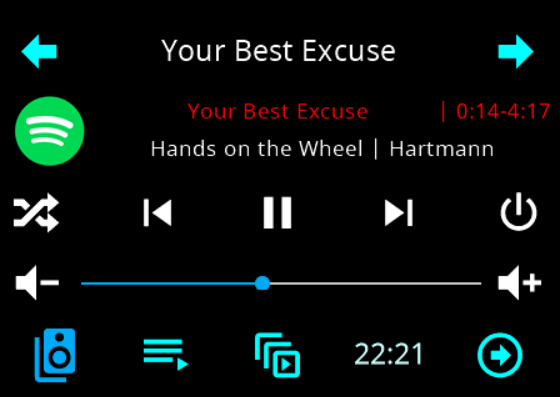
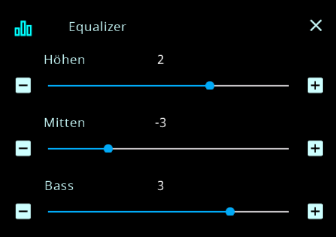
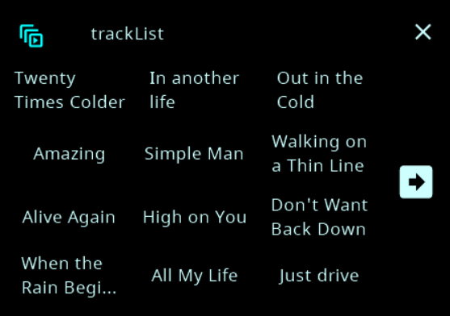
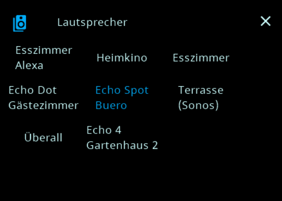
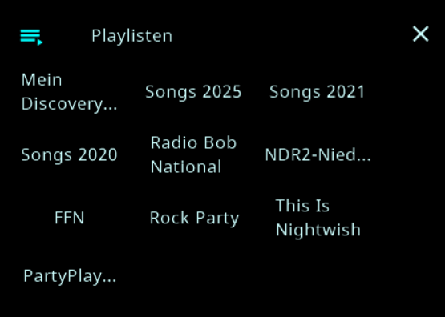

# Page Media (cardMedia)

Die Medienseite zeigt einen Player mit Titel- und Künstlerzeile, Lautstärkeregler, Play/Pause, Ein/Aus und
— je nach Quelle — Lautsprecherwahl, Playlisten, Favoriten, Titelliste, Shuffle, Wiederholung und Equalizer.

> **Diese Karte gibt es nur im Konfigurationsskript.** Der Admin kennt den Seitentyp `cardMedia` bisher
> nicht; im Tab *PageConfig* lässt sich keine Medienseite anlegen. Sie ist damit die Ausnahme von der Regel
> „alles im Admin".

**Unterstützte Adapter — genau diese fünf:** `alexa2`, `spotify-premium`, `mpd`, `sonos` und
`squeezeboxrpc`. Alles andere lehnt der Adapter mit einer Logzeile ab („not supported - only alexa2,
spotify-premium, mpd, sonos and squeezeboxrpc!"). Ältere Namen wie `volumio`, `bosesoundtouch` oder
`squeezebox` stehen zwar noch in den Typdateien, werden aber nirgends mehr ausgewertet.

---

## Minimal-Setup

```ts
const pageMediaTest1: PageType = {
  type: 'cardMedia',
  heading: 'main',
  uniqueName: 'main',
  media: {
    id: 'sonos.0.root.192_168_178_209', // Dein Player
  },
  items: [],
};
```

> **`heading` wird bei dieser Karte nicht angezeigt.** Die Überschrift kommt aus `media.name`; fehlt die,
> ermittelt der Adapter sie selbst aus dem Gerät.

### `media.id` – Beispiele

- **alexa2**: `alexa2.0.Echo-Devices.<DEINE_ID>`
- **spotify-premium**: `spotify-premium.0`
- **mpd**: `mpd.0`
- **sonos**: `sonos.0.root.192_168_178_209`
- **squeezeboxrpc**: `squeezeboxrpc.0.Players.<PLAYERNAME>` (Name wie im Objektbaum, z. B. `K_che` für „Küche")

> Steht dort **nur der Adaptername** (`spotify-premium`, `mpd`, …), nimmt der Adapter die **kleinste
> vorhandene Instanz**. Der Name muss dabei genau stimmen — `spotify` findet keine Instanz, die Seite
> bleibt leer und das Log sagt, dass der Adapter nicht gefunden wurde.

---

## Der zweite Weg: ein Alias mit der Rolle `media`

Ein Pageitem auf einer Menü-Seite kann auf einen **Alias-Kanal mit der Rolle `media`** zeigen. Der Kanal
braucht genau einen Datenpunkt `STATE` (`media.state`, boolean), und dieser muss ein **Alias** auf einen
der fünf unterstützten Adapter sein. Passt alles, legt der Adapter die Medienseite selbst an (`media-<id>`)
und verlinkt das Pageitem dorthin. Stimmt etwas nicht — kein `STATE`, kein Alias, falsches Ziel —, bricht
der Aufbau mit einer deutlichen Meldung im Log ab.

---

## Eigene PageItems

`items` verhält sich wie bei `cardGrid`/`cardEntities`; eigene Pageitems sind möglich. Zu beachten: Die
**Optionsleiste hat höchstens fünf Plätze**. Was der Adapter an Standard-Items erzeugt, zählt mit; mehr
Einträge werden durchgeblättert.

---

## Wichtige `media`-Optionen

| Option | Bedeutung | Hinweise |
|---|---|---|
| `id` | Quelle/Player (Ordner, Device oder Channel — **kein State**) | siehe oben |
| `name` | Überschrift der Seite | leer → der Adapter ermittelt sie |
| `colorMediaIcon`, `colorMediaArtist`, `colorMediaTitle` | Farben für Symbol, Künstler- und Titelzeile | Farbnamen wie `Blue`, `MSRed` oder `{ r, g, b }` |
| `speakerList` | Welche Lautsprecher im Auswahlgitter erscheinen | **leer = alle**; bei Sonos und Squeezebox erscheint der Eintrag erst ab zwei Playern |
| `favoriteList` | Whitelist für Favoriten | leer = alle |
| `playList` | Whitelist für Playlisten | **mpd hat keine Listen** — dort gibt es weder Playlisten noch Titel- oder Lautsprecherauswahl |
| `minValue` / `maxValue` | Lautstärkebereich des **Geräts** | wird auf die Panelskala 0–100 umgerechnet, siehe unten |
| `volumePresets` | Feste Lautstärken als `"Name?Wert"` | werden an `minValue`/`maxValue` angepasst |
| `itemsColorOn` / `itemsColorOff` | Farben einzelner Standard-Items | Namen siehe unten |
| `deactivateDefaultItems` | Standard-Items gezielt ausblenden | nur Items, die es bei diesem Adapter gibt |

**Standard-Items:** `online`, `speakerList`, `playList`, `trackList`, `favoriteList`, `repeat`,
`equalizer`, `crossfade`, `clock`, `reminder`, `volumePresets`.

Nicht jeder Adapter kennt jedes davon:

| Item | alexa2 | spotify-premium | mpd | sonos | squeezeboxrpc |
|---|:--:|:--:|:--:|:--:|:--:|
| `online` | ✓ | ✓ | ✓ | ✓ | ✓ |
| `speakerList` | ✓ | ✓ | – | ✓ | ✓ |
| `playList` | ✓ | ✓ | – | ✓ | ✓ |
| `trackList` | – | ✓ | – | ✓ | ✓ |
| `favoriteList` | – | – | – | ✓ | ✓ |
| `repeat` | ✓ | ✓ | ✓ | ✓ | ✓ |
| `equalizer` | ✓ | – | – | – | – |
| `crossfade` | – | – | ✓ | ✓ | – |
| `clock` | ✓ | ✓ | ✓ | ✓ | ✓ |
| `reminder` | ✓ | – | – | – | – |
| `volumePresets` | ✓ | ✓ | ✓ | ✓ | ✓ |

`reminder` ist standardmäßig **aus** und erscheint erst, wenn man es ausdrücklich einschaltet
(`deactivateDefaultItems: { reminder: false }`). Ein Item auszublenden, das die Quelle gar nicht hat, hat
keine Wirkung.

> **Lautstärke: `minValue`/`maxValue` begrenzen nichts.** Sie sagen dem Adapter, welchen Bereich das
> **Gerät** benutzt; er rechnet ihn auf die 0–100 des Panels um. Der Schieberegler am Panel bleibt also
> immer 0–100 — er trifft nur einen anderen Ausschnitt der Geräteskala.

---

## Beispiele

### 1) Farben pro Item überschreiben

```ts
media: {
  id: 'spotify-premium.0',
  itemsColorOn: {
    playList: Blue,
    speakerList: MSRed,
  },
  itemsColorOff: {
    playList: Gray,
  },
}
```

### 2) Standard-Items ausblenden

```ts
media: {
  id: 'alexa2.0.Echo-Devices.DEINE_ID',
  deactivateDefaultItems: {
    equalizer: true,
    playList: true,
    clock: true,
  },
}
```

### 3) Whitelist für Favoriten und Playlisten

```ts
media: {
  id: 'sonos.0.root.192_168_178_209',
  favoriteList: ['Best of 90s', 'Morning Vibes'],
  playList: ['Living Room Mix', 'Party'],
}
```

### 4) Gerätebereich der Lautstärke angeben

```ts
media: {
  id: 'mpd.0',
  minValue: 5,   // 0 % am Panel entspricht 5 am Gerät
  maxValue: 80,  // 100 % am Panel entspricht 80 am Gerät
}
```

---

## Squeezebox (`squeezeboxrpc`)

Die Seite gehört zu einem **Raum-Player** (`media.id`). Ist der Player Teil einer Sync-Gruppe, steuert die
Seite automatisch den **Master** der Gruppe (wie bei Sonos der Koordinator).

- **Lautsprecher-Liste:** öffnet ein Gitter mit allen Playern (oder denen aus `speakerList`). Antippen
  nimmt einen Raum in die Gruppe auf oder heraus, der Regler stellt die Lautstärke dieses Raums.
- **Gruppenlautstärke:** Bei aktiver Gruppe wird eine Änderung am Hauptregler auf **jeden** Player addiert
  (begrenzt auf 0–100); die Abstände bleiben erhalten, solange kein Raum an 0 oder 100 anstößt.
- **Shuffle** schaltet reihum: aus → Titel → Alben. **Wiederholung**: aus → Playlist → Titel.
- **Ein/Aus** schaltet `Power` des Players.
- **Logo:** Seek-Regler über die Titellänge (`Time`/`Duration` → `cmdGoTime`).
- **Favoriten** kommen zur Laufzeit aus `squeezeboxrpc.X.Favorites.*` (nur abspielbare Einträge) und
  starten über `cmdPlayFavorite`.
- **Playlisten** holt der Adapter beim Öffnen per `sendTo` vom LMS und startet sie mit
  `playlistcontrol cmd:load`.
- **Titelliste** aus `Players.<NAME>.Playlist`, Sprung über `PlaylistCurrentIndex`.
- Bei Stummschaltung zeigt der Regler 0.

**Voraussetzungen im squeezeboxrpc-Adapter:** „Favoriten laden" und „Playlist-Informationen bereitstellen"
aktivieren. Empfohlen ist außerdem die Telnet-Signalisierung (`usetelnet`), sonst kommen Titel- und
Listenänderungen erst mit bis zu ~10 s Verzögerung an.

```ts
media: {
  id: 'squeezeboxrpc.0.Players.Wohnzimmer',
  speakerList: ['Wohnzimmer', 'Küche', 'Bad'], // optional: nur diese Räume im Gitter
  favoriteList: ['Radio: Deutschlandfunk'],    // optional: Whitelist
}
```

---

## Was der Adapter von selbst erkennt

Der Adapter sucht sich die passenden Datenpunkte der Quelle zusammen — Titel, Künstler, Wiedergabestatus,
Lautstärke, Shuffle, vor/zurück. **Was er nicht findet, fällt lautlos weg**: Die Taste erscheint dann
nicht, und die Seite baut sich trotzdem auf. Das ist der häufigste Grund für eine Karte ohne Vor- und
Zurück-Tasten.

---

## Bilder zur cardMedia

Hauptseite z. B. Alexa oder Spotify  
   
  
Equalizer und Titelliste  
   
  
Lautsprecher und Playlist  
   
  
Die Bilder können je nach Konfiguration abweichen oder nicht vorhanden sein.
