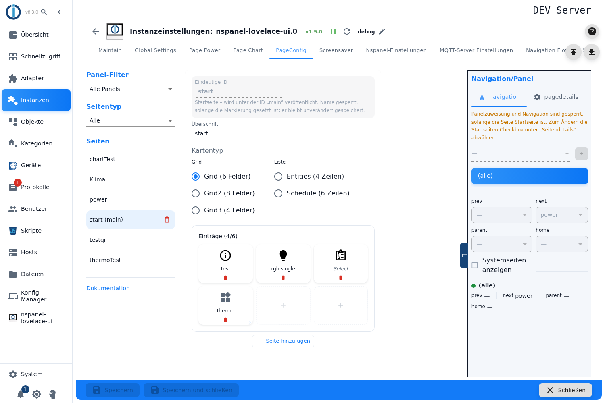
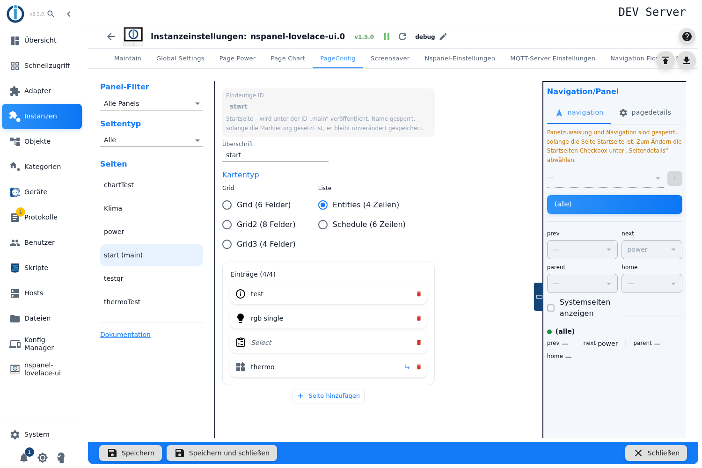
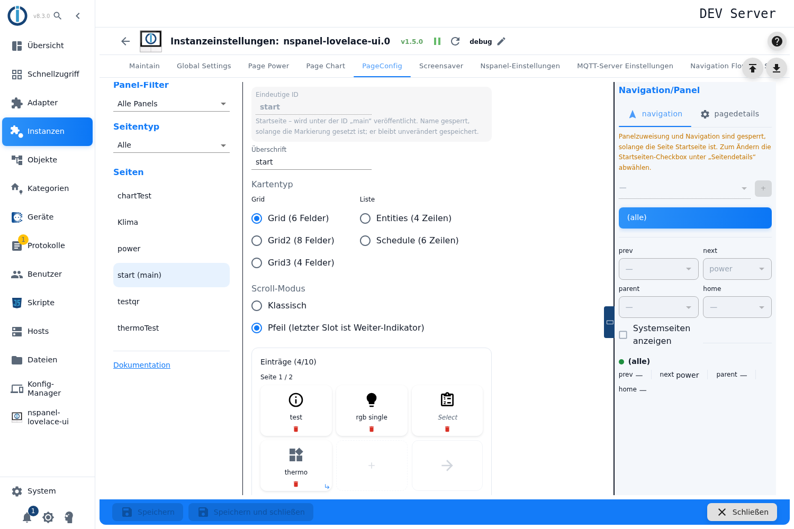

# Menü-Seite – Konfiguration im Admin

Die Menü-Seite ist der Arbeitspferd-Kartentyp: eine Seite aus **Flächen**, die Geräte schalten, Werte zeigen oder auf andere Seiten springen. Fünf Varianten stecken dahinter — drei Raster und zwei Listen. Angelegt wird sie im Tab **PageConfig**, Seitentyp **Menü-Seite**.

Inhalt:
- [Seite anlegen](#1-seite-anlegen)
- [Die fünf Varianten](#2-die-fünf-varianten)
- [Flächen belegen](#3-flächen-belegen)
- [Flächen umsortieren](#4-flächen-umsortieren)
- [Flächen kopieren und einfügen](#5-flächen-kopieren-und-einfügen)
- [Mehr Einträge: Seiten und Blättern](#6-mehr-einträge-seiten-und-blättern)
- [Was die Flächen anzeigen](#7-was-die-flächen-anzeigen)
- [Panel-Zuweisung und Navigation](#8-panel-zuweisung-und-navigation)

## 1. Seite anlegen

1. Instanz-Einstellungen öffnen → Tab **PageConfig**.
2. Links als Seitentyp **Menü-Seite** wählen, einen Namen eintragen, **+** drücken.
3. Die Seite entsteht als **Grid mit 6 Feldern** — die Variante stellt man anschließend im Editor um.

**Überschrift** ist die Kopfzeile am Panel; bleibt sie leer, nimmt das Panel den Seitennamen.

> Das Feld **Eindeutige ID** verwirft eine **leere** Eingabe und den reservierten Namen `main` **stillschweigend**: Weil das Feld seinen Wert aus der Konfiguration bezieht, erscheinen die getippten Zeichen einfach nicht. Das sieht nach einem Fehler aus, ist aber Absicht. Zum Umbenennen und seinen Fallstricken siehe [PageConfig – Übersicht](PageConfig#seiten-anlegen-umbenennen-löschen).

## 2. Die fünf Varianten

Unter **Kartentyp** stehen sie in zwei Gruppen:

| Gruppe | Variante | Felder je Seite | Darstellung |
|---|---|---|---|
| **Grid** | Grid (6 Felder) | 6 | Kacheln, drei Spalten |
| | Grid2 (8 Felder) | 8, auf einem **us-p**-Panel **9** | Kacheln, vier Spalten (us-p: drei) |
| | Grid3 (4 Felder) | 4 | Kacheln, zwei Spalten |
| **Liste** | Entities (4 Zeilen) | 4 | Zeilen, eine Spalte |
| | Schedule (6 Zeilen) | 6 | Zeilen, Zeitplan-Darstellung |

**Grids** zeigen große Kacheln mit Symbol, **Listen** schmale Zeilen — für viele Werte auf einmal.

> Es sind technisch **zwei getrennte Auswahlgruppen**. Wählt man eine Liste, verschwindet die Markierung bei den Grids nur deshalb, weil die andere Gruppe dann keinen gültigen Wert hat. Optisch wirkt es wie eine Auswahl, verhält sich aber wie zwei.

**Beim Umschalten der Variante bleiben alle Flächen erhalten** — auch wenn die neue Variante weniger Felder hat. Es wird nichts gelöscht und nicht gewarnt: Die überzähligen Flächen rutschen auf eine zweite Seite (siehe [Abschnitt 6](#6-mehr-einträge-seiten-und-blättern)).

**Grid2 und das Panelmodell:** Die Variante gibt es nur, wenn alle zugewiesenen Panels dasselbe Modell haben. Bei gemischten Modellen ist sie gesperrt, und ein bereits gesetztes Grid2 wird **selbsttätig auf Grid zurückgestellt** — ein Hinweis erklärt das, solange der Konflikt besteht. Ohne Panel-Zuweisung rechnet der Editor mit 8 Feldern; weist man später ein us-p-Panel zu, werden daraus 9.

> **Bei *Entities* unterschlägt der Editor auf einem us-p-Panel eine Zeile.** Er rechnet immer mit vier Zeilen, das Panel zeigt dort aber **fünf**. Die fünfte ist im Editor nur über eine zusätzliche Seite und Blättern erreichbar. Bei Grid2 ist die Modellabhängigkeit eingebaut, bei Entities nicht.

## 3. Flächen belegen

Ein Klick auf eine **gestrichelte, leere Fläche** öffnet die [Pageitem-Konfiguration](PageConfig-Dialoge#1-pageitem-konfiguration) — denselben Dialog, den alle Kartentypen benutzen. Dort entscheidet sich, ob die Fläche ein **Gerät** bedient, auf eine **andere Seite springt** oder einen **einzelnen Datenpunkt** schaltet.

Ein Klick auf eine **belegte** Fläche öffnet sie zum Bearbeiten. Das **rote Papierkorb-Symbol** in der Fläche leert sie wieder — **ohne Rückfrage und ohne Rücknahme**.

Nur auf Menü-Seiten gibt es im Dialog drei zusätzliche Einstellungen:

| Einstellung | Wirkung |
|---|---|
| **Text-/Icongröße** | Schriftgröße 0–5 statt der Standardgröße. Achtung: Die Schriften 0 und 2 können **keine Symbole**. |
| **Wert statt Icon verwenden** | Die Fläche zeigt den Wert als Text. |
| **Langer Druck** | Zweite Funktion derselben Fläche — entweder einen Datenpunkt schalten **oder** auf eine Seite springen. |

> Eine Lücke mitten in der Reihe ist erlaubt: Klickt man eine hintere freie Fläche an, landet das Item genau dort, die Flächen davor bleiben leer. Am Panel **verbrauchen diese Lücken trotzdem ihren Platz** — sie werden als leere Felder mitgesendet. Nur Lücken **am Ende** fallen weg.

## 4. Flächen umsortieren

Belegte Flächen lassen sich **mit der Maus aufnehmen und auf eine andere Fläche ziehen**. Das funktioniert auch über Seitengrenzen hinweg.

> **Das Ziehen tauscht, es verschiebt nicht.** Zieht man Fläche 1 auf Fläche 5, sitzt anschließend das Item von 5 auf Platz 1 — die Flächen dazwischen rücken **nicht** nach. Wer eine Reihenfolge umbauen will, tauscht also schrittweise. In der Oberfläche steht das nirgends.

Ziehen braucht ein Zeigegerät; auf einem Touchgerät steht es nicht zur Verfügung.

## 5. Flächen kopieren und einfügen

Eine fertig eingerichtete Fläche lässt sich übertragen, statt sie neu einzutragen — das ist bei einer Reihe gleichartiger Lampen die meiste gesparte Arbeit.

1. **Rechtsklick** auf die belegte Fläche → **Element kopieren**.
2. **Rechtsklick** auf die Zielfläche → **Element einfügen**.

Das klappt **auch von einer Menü-Seite in eine andere**: Seite wechseln, Rechtsklick, einfügen.

Was man dazu wissen muss:

- Auf einer **leeren** Fläche öffnet sich das Menü **überhaupt nur dann**, wenn vorher etwas kopiert wurde. Auf einer belegten Fläche erscheinen beide Einträge, *Einfügen* ist ohne Zwischenspeicher ausgegraut.
- **Es gibt keine Anzeige des Zwischenspeichers.** Dass etwas darin liegt, erkennt man nur daran, dass sich das Menü auf leeren Flächen öffnet.
- **Der Zwischenspeicher hängt am Menü-Editor.** Er übersteht den Wechsel zu einer anderen **Menü**-Seite, aber **nicht** den Umweg über eine Seite anderen Typs (Thermostat, QR, Alarm …) — dann ist er weg. Ein Neuladen der Oberfläche leert ihn ebenfalls.
- **Einfügen auf eine belegte Fläche überschreibt ohne Rückfrage.** Es gibt keine Rücknahme.
- **Einfügen weiter hinten füllt die Lücken davor mit leeren Flächen** — und die verbrauchen am Panel ihren Platz.
- **Kein Lang-Druck:** Ohne Rechtsklick ist Kopieren und Einfügen **nicht erreichbar**, auf Tablet und Telefon also nicht nutzbar. Tastenkürzel wie Strg+C gibt es ebenfalls nicht.
- **Der Kartentyp wird beim Einfügen nicht geprüft.** Eine auf einem Grid kopierte Fläche nimmt ihre Grid-Einstellungen (Textgröße, *Wert statt Icon*, langer Druck) mit auf eine Entities- oder Schedule-Zeile, wo sie nichts bewirken.

## 6. Mehr Einträge: Seiten und Blättern

Mehr Einträge als Felder? Dann entstehen **weitere Seiten**, durch die das Panel blättert.

- **Seite hinzufügen** legt eine weitere leere Seite an.
- Zusätzliche Seiten entstehen auch **von selbst**, sobald eine Fläche jenseits der Kapazität belegt wird.
- Ein Trenner **Seite *n* / *m*** zeigt, wo man sich befindet; eine leere letzte Seite lässt sich wieder entfernen.
- Eine Obergrenze für die Zahl der Einträge gibt es nicht.

> **Eine per „Seite hinzufügen" angelegte leere Seite ist nicht dauerhaft.** Sie lebt nur in der Oberfläche: Nach einem Seitenwechsel, einem Neuladen oder dem Umschalten der Variante ist sie wieder weg. Erst eine **belegte** Fläche macht eine Seite dauerhaft.

**Scroll-Modus** — dieses Auswahlfeld erscheint nur bei Grid-Varianten **und nur, wenn es mehr als eine Seite gibt**:

| Auswahl | Verhalten am Panel |
|---|---|
| **Klassisch** | Das Panel blättert seitenweise weiter. Alle Felder sind belegbar. |
| **Pfeil** | Das **letzte Feld jeder Seite** wird zum Weiter-Pfeil und steht nicht zur Belegung bereit. Auf der letzten Seite springt der Pfeil zurück zur ersten. |

> ⚠️ **Hier weichen Editor und Panel auseinander.** Solange der Scroll-Modus nie angefasst wurde, **rechnet der Editor mit „Pfeil"** — er zeichnet also den Pfeil-Platzhalter und nimmt dir ein Feld je Seite weg. Beim Bauen der Seite setzt der Adapter aber **„Klassisch"**. Am Panel ist das Feld dann belegbar, im Editor nicht. Erschwerend: Das Feld ist unsichtbar, solange nur eine Seite existiert — man kann es nicht vorab richtigstellen.
>
> **Bis das behoben ist:** Sobald eine zweite Seite entsteht, den Scroll-Modus **einmal bewusst anklicken** — auch wenn die gewünschte Einstellung schon markiert aussieht.

> Zwei weitere Blätter-Einstellungen kennt der Adapter, der Admin bietet sie aber nicht an: das **Halbseiten-Blättern** (springt um die halbe Seitenlänge, nur für Grids) und der Modus **`auto`**. Beide sind nur über ein Konfigurationsskript erreichbar. Fehlt dir das, ist eine Meldung an das Entwicklerteam der richtige Weg: <https://github.com/ticaki/ioBroker.nspanel-lovelace-ui/issues>

## 7. Was die Flächen anzeigen

Die Beschriftung einer Fläche im Editor folgt einer Rangfolge:

1. der **Name** aus der Pageitem-Konfiguration,
2. sonst der Name des **ioBroker-Kanals** — dann **grau und kursiv**, damit man sieht, dass er nicht selbst gesetzt ist,
3. sonst eine technische Angabe wie `3: (dimmer)` oder `3: [native]`.

Ein kleines Abzweig-Symbol markiert Flächen, die auf eine **andere Seite springen**. Der Tooltip zeigt die ioBroker-ID dahinter.

Am Panel bleiben unbelegte Felder leer. Wie viele Zeichen eine Beschriftung verträgt, hängt von Schriftgröße und Panelmodell ab und ist nicht festgelegt — im Zweifel kurz halten und am Panel prüfen.

## 8. Panel-Zuweisung und Navigation

Panel, Navigationsziele, *Startseite*, *Versteckt* und *Verhalten des Bildschirmschoners* liegen in der rechten Spalte, beschrieben unter [PageConfig – Übersicht](PageConfig#panelzuweisung-und-navigation).

Für Menü-Seiten ist die Panel-Zuweisung doppelt wichtig: Sie entscheidet nicht nur, wo die Seite erscheint, sondern über das Panelmodell auch, **wie viele Felder** zur Verfügung stehen und ob die Variante Grid2 überhaupt wählbar ist.
