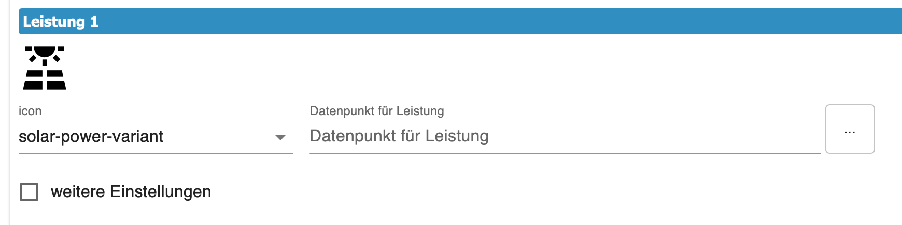
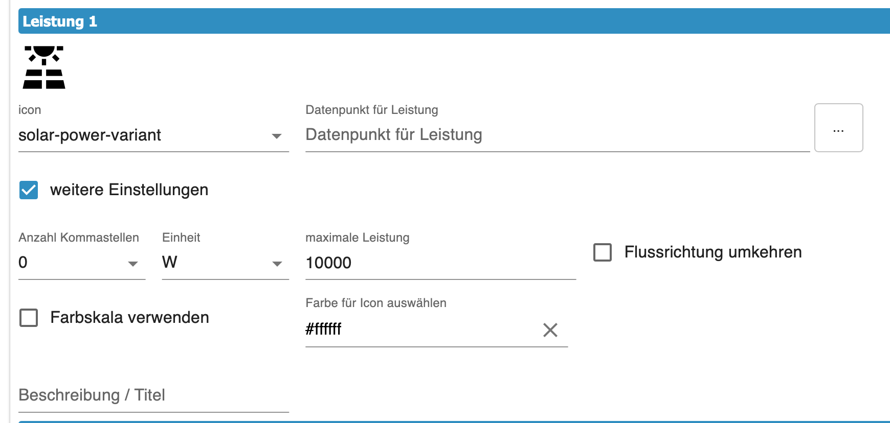
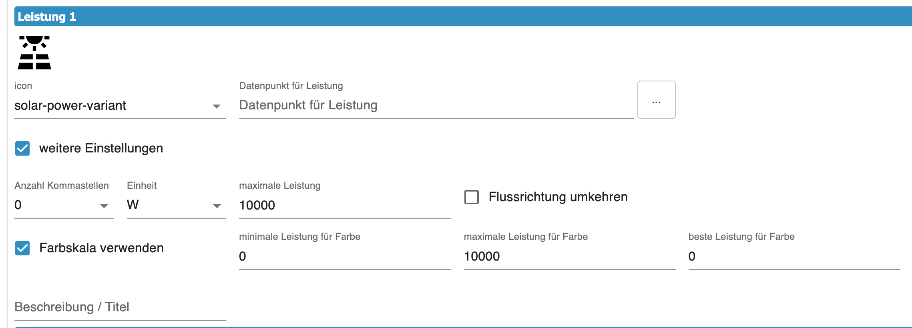

# PagePower  
  
**Content**
+ [Grundeinstellung](#grundeinstellung)  
    + [Erzeuger / Verbraucher](#erzeuger--verbraucher)  
    + [Home ](#home)    
+ [Übernahme der alten Tabelle `PagePower`](#übernahme-der-alten-tabelle-pagepower)   

 Die Page Power ermöglicht bis zu 6 Verbraucher / Erzeuger darzustellen und zu verrechnen. Sie soll die Stromverteilung in eurem Smarthome abbilden. Icons, Farbverläufe, Geschwidigkeit der Flußrichtung sowie die Flußrichtung selbst lassen sich hier einstellen. Die Einstellmöglichkeiten erklären wir an einem Beispiel. Ihr könnt mehrere dieser Seiten erstellen.  
  
 Eine Energie-Seite wird im Tab `PageConfig` angelegt: alles im Editor einstellen, Navigation im Panel-Bereich zuweisen. Kein Script nötig. Den früheren Tab `PagePower` gibt es nicht mehr — siehe [Übernahme der alten Tabelle](#übernahme-der-alten-tabelle-pagepower).  
  
---
## Grundeinstellung  
  
 Im Tab `PageConfig` legt ihr mit dem PLUS-Zeichen eine neue Seite an und wählt den Kartentyp `cardPower`. Der Editor zeigt die Seite so, wie das Panel sie aufbaut: links und rechts die drei Plätze je Seite, in der Mitte das Haus.  
1. Zuerst legt ihr den Seitennamen fest, dieser darf sich im gesamten Panel nicht wiederholen. Es ist die ID für diese Seite und ist identisch mit dem `uniqueName`.
2. Die Überschrift auf der Seite festlegen.
3. Wenn ihr den Haken bei `alwaysOnDisplay` setzt, bleibt die Seite permanent sichtbar und spring nicht automatisch in den Screensaver. Damit der Screensaver wieder aktiv wird, müsst ihr auf eine andere Seite springen.  
4. Option `Seite ausblenden` ermöglicht die Seite aus der Navigation zu entfernen, wenn in der Serviceseite `System`die Option `hide Page` aktiv ist.
  
---  
## Erzeuger / Verbraucher  
  
  

+ **Icon** -> über das Selctfeld kann ein Icon ausgewählt werden, dabei unterstütz euch die Selectivesuche und schlägt Varianten vor.  
+ **Datenpunkt für Leistung** -> den Datenpunkt auswählen, der die Leistung (Watt) enthält   
  
   
   
 + **Anzahl der Dezimalstellen**, die dargestellt werden sollen, unabhängig von der Anzahl im Datenpunkt  
 + **Einheit** Hiermit wird die kleinste darzustellende Einheit ausgewählt. Durch die AutoUnit-Funktion wird die Einheit erhöht, wenn die Zahl vierstellig wird. z.B 999W werden bei Erhöhung zu 1kW. Wenn im Datenpunkt eine Einheit definiert ist, ist diese führend und überschreibt diese hier im Admin.  
 + **maximale Leistung** -> den maximalen Wert eintragen der vom Datenpunkt zu erwarten ist. Der max-Wert bedeutet 100% Geschwindigkeit der Anzeige für die Flussrichtung. Bei 0W bleibt der Punkt stehen und wird bei Erhöhung der Leistung prozentual dann schneller.  
 + Durch setzen des Haken kann die **Flußrichtung umgekehrt** werden. Alle Erzeuger sollten zur Mitte fließen und Verbraucher davon weg. Die Mitte der Seite spiegelt den Verteilerkasten wieder, wo alle Verbraucher und Erzeuger zusammen kommen.  
 + **Iconfarbe** -> mit dem ColorPicture kann die Farbe des Icon ausgewählt werden. Soll das Icon nach Höhe der Leistung seine Farbe ändern, dann aktiviert `Farbskale verwenden`.  
   
 

Mit den Werten `min Leistung`, `max Leistung`, `best Leistung` wird der Farbverlauf von Grün nach Rot festgelegt. Es gibt mehrere Möglichkeiten den Verlauf einzustellen. Welcher Wert Grün ist entscheidet der Wert von `best Leistung`.
+ **Beispiel 1**  
    0W soll grün sein und 100W Rot  
    + `min Leistung` = 0
    + `max Leistung` = 100  
    + `best Leistung` = 0
  
 + **Beispiel 2**  
    0W soll Rot sein und 100W Grün  
    + `min Leistung` = 0
    + `max Leistung` = 100  
    + `best Leistung` = 100
  
 + **Beispiel 3**  
    -50W soll Rot sein 0W ist Grün und 100W wieder Rot
    + `min Leistung` = -50
    + `max Leistung` = 100  
    + `best Leistung` = 0  
  
Mit **Beschreibung/Titel** könnt ihr über der Flussanzeige einen Text einblenden z.B. welcher Verbraucher das ist.

---  
### Home  

  
  
Home ist der mittlere Teil der Page, hier laufen alle Leistungen zusammen. Es ist der virtuelle Stromkasten mit seinem Zähler. Es gibt hier zwei Felder die Ihr nutzen könnt um Werte anzeigen zu lassen.  

+ `Haus oben` ist der Wert über dem Haus-Symbol. Ihr legt den Datenpunkt fest den ihr anzeigen wollt und könnt über `weitere Einstellungen` zusätzlich noch Dezimalstellen und Einheit auswählen. Hier gilt auch das der Admin die Einheit vom Datenpunkt überschreibt.  
+ `Haus unten` hat zwei Funktionen. Wenn `interne Berechnung` nicht aktiv ist, dann gleicht es dem Feld `Haus oben`. Bei Aktivierung könnt ihr über `Auswahl Stromeinseisungen` die Felder auswählen, die euer Smarthome versorgen (z.B. Stromnetz, Batterie, Solarpanel)  
---  
## Übernahme der alten Tabelle `PagePower`

Bis Version 1.7 gab es zusätzlich den Tab `PagePower`, dessen Seiten über einen Verweis im Konfig-Script in die Navigation kamen. Beim ersten Start nach dem Update übernimmt der Adapter alle Einträge dieser Tabelle in den Tab `PageConfig` (Kartentyp `cardPower`) und löscht die alte Tabelle. Ist ein Seitenname dort schon vergeben, bekommt die Seite den Zusatz `_power` (Warnung im Log) — das Script findet sie trotzdem unter dem alten Namen.

Die Navigation kommt bei diesen Seiten vorerst weiter aus dem Konfig-Script, der bisherige Verweis funktioniert unverändert:

```typescript
    const powerGrid: ScriptConfig.PagePower = {
        uniqueName: 'seitenname',
        type: 'cardPower'
    };
```

Das ist eine Übergangslösung und veraltet: der Editor zeigt bei solchen Seiten einen Hinweis, das Log eine Warnung. Sobald der Seite im Tab `PageConfig` eine Navigation zugewiesen ist, gilt diese; die Seite dann aus dem Script entfernen — sonst wird sie dort mit einer Warnung übersprungen.