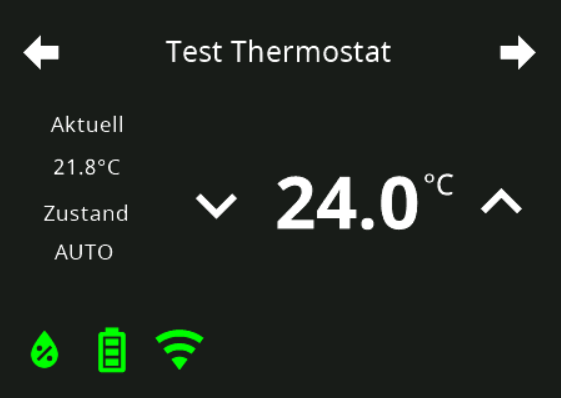
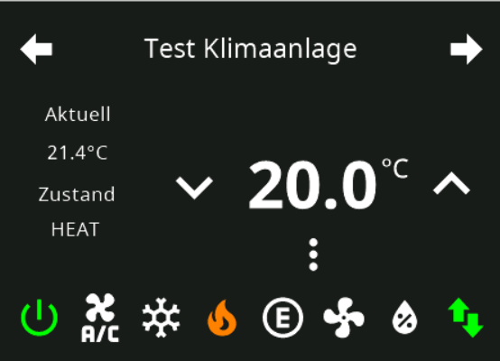
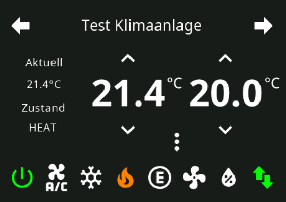
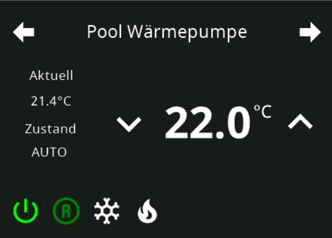

# Page Thermo (klassisch) – Konfiguration im Admin

Die klassische Thermostat-Seite `cardThermo` lässt sich ohne Skript im Admin anlegen: Tab **PageConfig**, Seitentyp **Thermostat (klassisch)**. Im Adapter läuft die Admin-Seite durch denselben Code wie die Skript-Seite (`ConfigManager.getPageThermo`), das Ergebnis auf dem Panel ist identisch.

Die Seite zeigt **ein** Thermostat: einen Alias-Channel mit der Rolle `thermostat` oder `airCondition`. Konfiguriert werden nur Überschrift, Channel, Einheit und die Grenzen der Solltemperatur – alles andere (Ist-Temperatur, Luftfeuchte, zweiter Sollwert, Modus-Symbole und Schaltflächen unten) leitet der Adapter aus den Datenpunkten ab, die er unterhalb des Channels findet. Es gibt keine eigenen PageItems. Wer mehrere Heizkreise oder eigene Schaltflächen auf einer Seite braucht, nimmt [Page Thermo2](PageThermo2-Admin).

Inhalt:
- [Seite anlegen](#1-seite-anlegen)
- [Felder](#2-felder)
- [Minimum, Maximum, Schrittweite](#3-minimum-maximum-schrittweite)
- [Darstellung je Alias-Datenpunkten](#4-darstellung-je-alias-datenpunkten)
- [Speichern, Panel-Zuweisung, Navigation](#5-speichern-panel-zuweisung-navigation)
- [Übernahme aus dem Skript](#6-übernahme-aus-dem-skript)

## 1. Seite anlegen

1. Instanz-Einstellungen öffnen → Tab **PageConfig**.
2. Links in der Liste **Seiten** auf das PLUS klicken, als Typ **Thermostat (klassisch)** wählen und eine **eindeutige ID** vergeben (der Seitenname, über den die Seite in der Navigation angesprochen wird).
3. Die neue Seite erscheint in der Liste; rechts öffnet sich der Editor. Eine neue Seite hat noch keinen Channel – ohne Channel baut der Adapter die Seite nicht (Meldung im Log).

## 2. Felder

| Feld | Bedeutung |
|---|---|
| **Eindeutige ID** | Seitenname; bei der Startseite (`main`) gesperrt. |
| **Überschrift** | Überschrift der Seite auf dem Panel. Leer = eindeutige ID. |
| **Thermostat-Channel** | Alias-Channel (Channel, Device oder Ordner) mit `common.role` `thermostat` oder `airCondition` – entspricht `items[0].id` im Skript. Der Auswahldialog zeigt nur passende Objekte; bei einem fehlenden Objekt oder einer anderen Rolle warnt der Editor. Welche Datenpunkte der Adapter unterhalb des Channels sucht, steht in [Abschnitt 4](#4-darstellung-je-alias-datenpunkten) und in der [Alias-Tabelle](ALIAS). |
| **Einheit** | Text hinter Ist- und Solltemperatur (z. B. `°C`). Leer = `common.unit` des Solltemperatur-Datenpunkts. |
| **Minimale / Maximale Temperatur, Schrittweite** | Grenzen und Schrittweite der Solltemperatur, siehe [unten](#3-minimum-maximum-schrittweite). |

**Versteckt**, **Immer an**, **Startseite** und die **Navigation** werden rechts im Bereich *Navigation/Panel* gesetzt – wie bei allen Seitentypen.

## 3. Minimum, Maximum, Schrittweite

Die drei Werte werden **genau so gespeichert, wie das Skript sie hat** (`minValue`, `maxValue`, `stepValue` von `items[0]`), damit eine aus dem Skript übernommene Seite ihre Zahlen behält. Der Adapter (`pageThermo.ts`) legt die Einheit anhand des Maximums fest:

- **Maximum ≥ 100**: alle drei Werte sind **Zehntelgrad** – `minValue: 100, maxValue: 300, stepValue: 1` heißt 10 °C bis 30 °C in Schritten von 0,1 °C; `stepValue: 5` wäre 0,5 °C.
- **Maximum < 100**: alle drei Werte gelten als **Grad** und werden mit 10 multipliziert – `minValue: 15, maxValue: 28, stepValue: 0.5` heißt 15 °C bis 28 °C in Schritten von 0,5 °C.
- Eine Schrittweite unter einem Zehntelgrad hebt der Adapter auf ein Zehntel an.
- **Leere Felder**: der Adapter nimmt `common.min` / `common.max` / `common.step` des Solltemperatur-Datenpunkts; fehlen auch die, gelten 15 °C bis 30 °C in Schritten von 0,5 °C.

Die Option *Werte in Zehnteln* (`defaultValueCardThermo`) in den NSPanel-Einstellungen betrifft nur `cardThermo2`, nicht diese Seite.

## 4. Darstellung je Alias-Datenpunkten

Was das Panel unterhalb der Überschrift zeigt, wird **nicht konfiguriert**, sondern aus den Datenpunkten abgeleitet, die der Adapter unter dem Channel findet (gesucht wird nach `common.role` und `common.type`, siehe [Alias-Tabelle](ALIAS)). Die Bilder zeigen die vier typischen Ergebnisse.

### Thermostat: ein Sollwert

Rolle `thermostat`. Links **Aktuell** (`ACTUAL`, `value.temperature`) und – wenn ein `HUMIDITY`-Datenpunkt (`value.humidity`) da ist – die **Luftfeuchte**; in der Mitte der Sollwert `SET` (`level.temperature`, Pflicht) mit den Tasten − und +. Die Schaltflächen unten kommen aus den optionalen Datenpunkten des Channels, je gefundenem Datenpunkt eine: `POWER` (`switch.power`), `BOOST` (`switch.mode.boost`), `WINDOWOPEN` (`sensor.window`), `PARTY` (`switch.mode.party`), `MAINTAIN` (`indicator.maintenance`), `UNREACH`, `LOWBAT`, `ERROR`, `VACATION`, `WORKING`. Die Auto-/Manuell-Schaltflächen des Bildes stammen aus dem Original-Skript; der Adapter erzeugt sie für diese Rolle nicht, ein `MODE`-Datenpunkt wird bei `thermostat` nicht als Symbolleiste gezeigt.

### Klimaanlage: Modus-Symbole

Rolle `airCondition` mit einem `MODE`-Datenpunkt (`value.mode.airconditioner`, Zahl). Die Symbole unten leitet der Adapter aus `common.states` des `MODE`-Datenpunkts ab – je bekanntem Zustand ein Symbol, in dieser Reihenfolge: `OFF` (power-off), `AUTO` (A im Kreis), `COOL` (Schneeflocke), `HEAT` (Flamme), `ECO` (E im Kreis), `FAN_ONLY` (Ventilator), `DRY` (Tropfen). Fehlt `common.states`, gilt die Liste `OFF, AUTO, COOL, HEAT, ECO, FAN, DRY` (Index = Wert). Danach folgen wie oben die Schaltflächen der optionalen Datenpunkte (`POWER`, `BOOST`, `MAINTAIN`, `UNREACH`, `ERROR`, …).

### Klimaanlage: zwei Sollwerte

Rolle `airCondition` mit `SET` **und** `SET2` (beide `level.temperature`, `SET2` muss genau so heißen): das Panel zeigt zwei Sollwerte nebeneinander, z. B. Heizen und Kühlen. Die Symbolleiste darunter wie im Bild davor.

### Wärmepumpe: vier Modi

Rolle `airCondition`, deren `MODE`-Datenpunkt in `common.states` nur `OFF`, `AUTO`, `COOL` und `HEAT` kennt – entsprechend erscheinen genau vier Symbole. Zustände, die in `common.states` fehlen, bekommen kein Symbol.

### Skriptfelder ohne Wirkung

Das Skript kennt am Thermo-Item die Felder `iconArray`, `popupThermoMode1`, `popupThermoMode2`, `popupThermoMode3`, `popUpThermoName`, `setThermoAlias` und `setThermoDestTemp2` (das Modus-Popup mit bis zu drei Listen aus dem Original-Skript). Der Adapter liest sie **nicht** – sie haben keine Wirkung auf dem Panel, und der Konverter übergeht sie ohne Meldung. Gleiches gilt für Symbol-, Farb- und Namensfelder des Items.

## 5. Speichern, Panel-Zuweisung, Navigation

- Rechts im Bereich **Navigation/Panel** das Panel zuweisen und die Navigation (`prev`, `next`, `parent`, `home`) setzen – wie bei den anderen Seitentypen. Ohne `next`/`prev` ist die Seite nur über eine Navigation (`targetPage`) erreichbar.
- Unten **Speichern** bzw. **Speichern und schließen**. Die Instanz startet danach neu und baut die Seite auf.
- Baut der Adapter die Seite nicht (kein Channel, Objekt fehlt, falsche Rolle, `SET` nicht gefunden), steht der Grund im Log der Instanz.

## 6. Übernahme aus dem Skript

Beim [Übernehmen eines Skripts in den Admin](ScriptConfig#skript-in-den-admin-übernehmen) wird eine `cardThermo`-Seite zu diesem Seitentyp: `heading` → Überschrift, `items[0].id` → Channel, `items[0].unit` → Einheit, `items[0].minValue`/`maxValue`/`stepValue` → die drei Zahlen (unverändert). Alle anderen Felder des Items ([siehe oben](#skriptfelder-ohne-wirkung)) und weitere Items liest der Adapter auch im Skript nie – sie fallen ohne Meldung weg, das Panel zeigt dasselbe wie vorher.

Übersprungen wird die Seite nur, wenn die Übernahme das Panel verändern würde: kein Item, `items[0]` ohne `id` (oder ein Navigations-/`native`-Item), eine `unit`, die kein Text oder leer ist, ein `minValue`/`maxValue`/`stepValue`, das keine Zahl ist.
