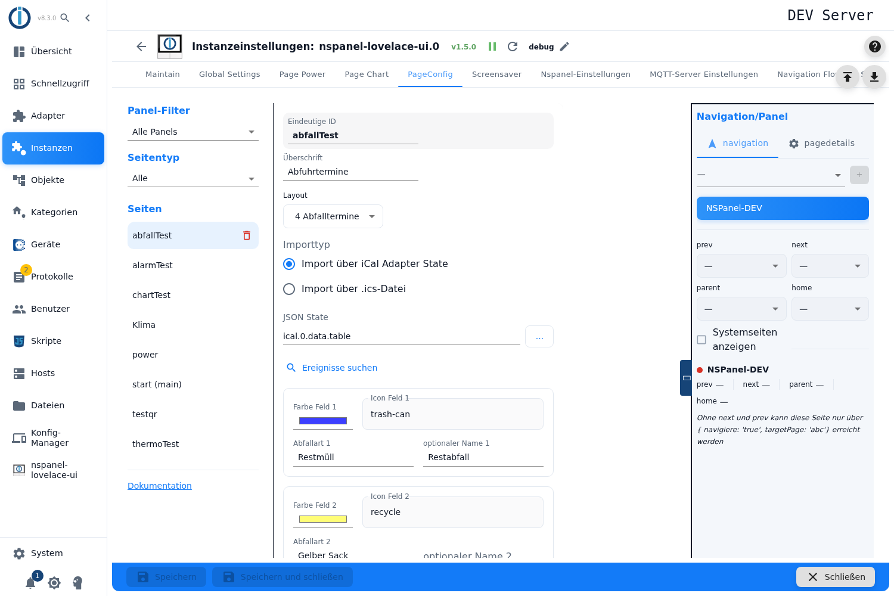
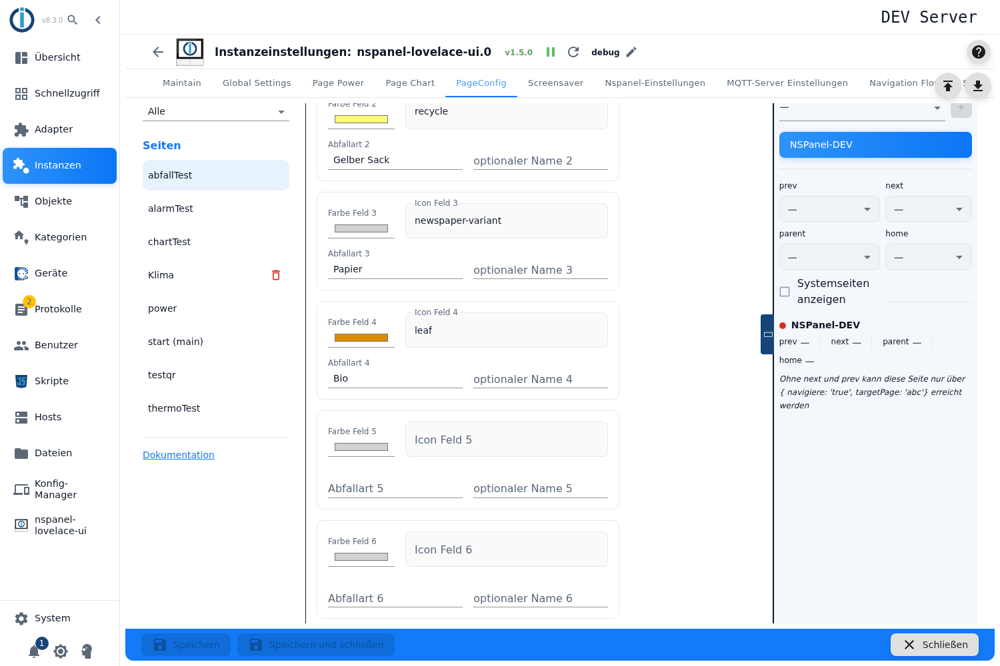

# Abfall-Seite – Konfiguration im Admin

Die Abfall-Seite zeigt die nächsten **Müllabfuhr-Termine**: je Zeile ein farbiges Symbol, die Abfallart und das Datum — „heute", „morgen", der Wochentag oder das Datum. Die Termine kommen aus dem **ical-Adapter** oder aus einer hochgeladenen **`.ics`-Datei**.

Angelegt wird sie im Tab **PageConfig**, Seitentyp **Abfall**.

Inhalt:
- [Seite anlegen](#1-seite-anlegen)
- [Vier oder sechs Termine](#2-vier-oder-sechs-termine)
- [Woher die Termine kommen](#3-woher-die-termine-kommen)
- [Die Ereignisse einlesen und zuordnen](#4-die-ereignisse-einlesen-und-zuordnen)
- [Die sechs Abfallarten](#5-die-sechs-abfallarten)
- [Wie ein Termin seine Zeile findet](#6-wie-ein-termin-seine-zeile-findet)
- [Was auf dem Panel erscheint](#7-was-auf-dem-panel-erscheint)
- [Wann die Termine aktualisiert werden](#8-wann-die-termine-aktualisiert-werden)
- [Panel-Zuweisung und Navigation](#9-panel-zuweisung-und-navigation)

## 1. Seite anlegen

1. Instanz-Einstellungen öffnen → Tab **PageConfig**.
2. Links als Seitentyp **Abfall** wählen, einen Namen eintragen, **+** drücken.

**Überschrift** ist die Kopfzeile am Panel; leer zeigt das Panel `Trash`.

> Der Kartentyp heißt intern `cardTrash`, erreicht das Panel aber nie unter diesem Namen: Der Adapter baut daraus eine Entitäten-Karte (bei vier Terminen) oder eine Terminkarte (bei sechs). Für die Einrichtung spielt das keine Rolle — es erklärt nur, warum am Panel manchmal von anderen Kartentypen die Rede ist.

## 2. Vier oder sechs Termine

Die Auswahl über die Zahl der Terminzeilen trägt in der Oberfläche die Beschriftung **„Layout"** und bietet *4 Abfalltermine* oder *6 Abfalltermine*.

> Die Beschriftung ist unglücklich: „Layout" lässt an die Anordnung denken, gemeint ist die **Anzahl der Termine**. Der richtige Text steckt nur im Tooltip (*Anzahl der Abfalltermine auf der Seite*) und ist damit praktisch unsichtbar.

Die Zahl entscheidet auch über die Darstellung: Bei **vier** Terminen ist mehr Platz je Zeile (langer Wochentag, Datum vierstellig im Jahr), bei **sechs** wird es knapper (kurzer Wochentag, zweistelliges Jahr).

> **Eine eigene Abfall-Karte gibt es nicht.** Der Adapter baut aus dem Eintrag eine gewöhnliche Listenseite — bei vier Terminen eine `cardEntities`, bei sechs eine `cardSchedule`, beide über die Vorlage `entities.waste-calendar`. Deshalb lässt sich eine Abfall-Seite auch nicht im Konfigurationsskript anlegen: den Kartentyp `cardTrash` kennt nur der Admin.

## 3. Woher die Termine kommen

Unter **Importtyp** stehen zwei Wege:

| Auswahl | Was gebraucht wird |
|---|---|
| **Import über iCal Adapter State** | Ein Datenpunkt des ical-Adapters mit der Termintabelle. |
| **Import über .ics-Datei** | Eine Kalenderdatei, die du hier hochlädst. |

**Weg 1 — ical-Adapter.** Das Feld **JSON State** nimmt den Datenpunkt mit der Terminliste. Erwartet wird eine Liste von Terminen mit Datum und Ereignisnamen, so wie der ical-Adapter sie bereitstellt. Vergangene Termine (vor heute null Uhr) werden verworfen.

> Die Objektauswahl zeigt **nur Datenpunkte, deren ID mit `ical.` beginnt**. Wer seine Termine über ein Skript oder in `0_userdata` bereitstellt, findet seinen Datenpunkt im Dialog nicht und muss die ID **von Hand in das Feld tippen** — das funktioniert, nur weist nichts darauf hin.

> Die Beschriftung *JSON State* lautet in beiden Sprachen gleich und sagt nicht, dass die Termintabelle des ical-Adapters gemeint ist.

**Weg 2 — `.ics`-Datei.** Mit **Datei hochladen** wählst du eine Kalenderdatei; der Pfad trägt sich danach selbst in das Feld **.ics-Datei inkl. Pfad** ein. Eine Rückmeldung nennt die Zahl der gefundenen Termine — oder meldet, dass keine gefunden wurden. Auch hier zählen nur Termine ab heute; sie werden nach Datum sortiert.

> Beim Weg über den ical-Adapter wird **nicht sortiert** — es gilt die Reihenfolge, die der Adapter liefert.

## 4. Die Ereignisse einlesen und zuordnen

Damit die Karte etwas anzeigen kann, muss sie wissen, **welcher Ereignisname zu welcher Abfallart gehört**. Dafür gibt es eine Hilfe:

1. **Ereignisse suchen** (bzw. **Ereignisse auswählen** beim Datei-Weg) liest die Quelle und sammelt alle vorkommenden Ereignisnamen.
2. Die Namen erscheinen als Liste zum Ankreuzen — **höchstens sechs** lassen sich auswählen.
3. **Auswahl übernehmen** trägt sie der Reihe nach in die Felder *Abfallart 1* bis *6* ein.

> ⚠️ **„Auswahl übernehmen" überschreibt eigene Eintragungen.** Die Funktion schreibt in **alle sechs** Felder — was du vorher von Hand eingetragen hast und was jetzt nicht angekreuzt ist, wird **geleert**. Wer die Felder bereits gepflegt hat, trägt besser von Hand nach, statt die Übernahme ein zweites Mal zu benutzen.

> Fehlermeldungen dieser Suche erscheinen als kleine Hinweisfenster und sind **teils deutsch, teils englisch** fest eingebaut — unabhängig von der Sprache des Admins.

## 5. Die sechs Abfallarten

Darunter stehen **sechs gleich aufgebaute Blöcke**, einer je Abfallart:

| Feld | Bedeutung |
|---|---|
| **Farbe Feld *n*** | Die Farbe des Symbols — Blau für Papier, Gelb für den Gelben Sack, Grau für Restmüll, Braun für Bio. Die Vorgaben sind bereits in dieser Richtung gesetzt. |
| **Icon Feld *n*** | Das Symbol. Ohne Angabe nimmt die Karte einen Kalender. |
| **Abfallart *n*** | **Der Suchbegriff**, mit dem Termine dieser Zeile zugeordnet werden — siehe [Abschnitt 6](#6-wie-ein-termin-seine-zeile-findet). |
| **optionaler Name *n*** | Was am Panel **angezeigt** wird, wenn es vom Suchbegriff abweichen soll. Praktisch, wenn der Kalender „Restabfallbehaelter 240l" liefert, am Panel aber „Restmüll" stehen soll. |

> **Es werden immer sechs Blöcke angezeigt**, auch wenn oben „4 Abfalltermine" eingestellt ist. Die Blöcke 5 und 6 sind dann wirkungslos — ein Hinweis darauf fehlt.

## 6. Wie ein Termin seine Zeile findet

Das ist der Kern der Einrichtung und nirgends in der Oberfläche erklärt:

- Der Adapter prüft für jeden Termin, ob der Ereignisname den Text aus **Abfallart *n*** **enthält** — es ist eine Teilstring-Suche, keine genaue Übereinstimmung. „Bio" trifft also auch „Biotonne 14-täglich".
- Geprüft wird **von 1 nach 6**, der **erste Treffer gewinnt**. Bei überlappenden Begriffen entscheidet die Reihenfolge: Steht „Papier" in Feld 1 und „Altpapier" in Feld 3, landen beide in Zeile 1.
- **Leere Felder werden übersprungen.**
- **Termine ohne Treffer werden verworfen** — sie erscheinen gar nicht.

Daraus folgt die häufigste Ursache für eine leere Karte: Ist **keine** Abfallart eingetragen, passt kein einziger Termin, und die Seite bleibt dauerhaft leer. Eine Warnung gibt es dafür nicht.

Am besten **kurze, eindeutige Begriffe** wählen und die genaue Schreibweise über *Ereignisse suchen* abholen.

## 7. Was auf dem Panel erscheint

Je Termin eine Zeile: Symbol in der gewählten Farbe, der Name (der optionale Name, sonst die Abfallart) und das Datum.

Das Datum wird abgestuft dargestellt: **heute** und **morgen** als Wort, innerhalb der nächsten sieben Tage als **Wochentag**, danach als **Datum**. Bei sechs Terminen in der kurzen Form (kurzer Wochentag, zweistelliges Jahr), bei vieren in der langen.

> Die Wörter für „heute" und „morgen" sind **fest englisch** eingebaut (`today`, `tomorrow`), das Datumsformat dagegen fest auf **Deutsch**. Auf einem deutschen Panel steht also „today" über einem Datum im Format `15.11.2026`.

Der Adapter hält intern immer bis zu sechs Termine bereit; bei der Einstellung „4" werden die beiden letzten nicht gezeigt.

## 8. Wann die Termine aktualisiert werden

> Die Termine werden beim Start des Adapters geholt und danach **alle sechs Stunden** — die Stundenschleife fragt sie zu den vollen Stunden 0, 6, 12 und 18 Uhr ab (`controller.ts`, `hourNow % 6 === 0`). Nach einer Änderung an der Konfiguration oder einem neuen Termin im Kalender kann die Karte also bis zu sechs Stunden lang den alten Stand zeigen. Wer nicht warten will, startet die Instanz neu.

## 9. Panel-Zuweisung und Navigation

Panel, Navigationsziele, *Startseite*, *Versteckt* und *Verhalten des Bildschirmschoners* liegen in der rechten Spalte, beschrieben unter [PageConfig – Übersicht](PageConfig#panelzuweisung-und-navigation).
