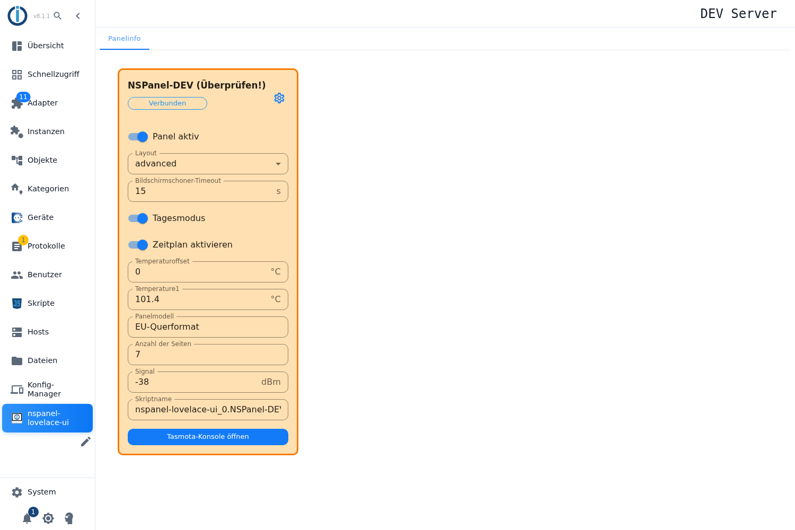

# Panelinfo

Der Adapter bringt einen **eigenen Eintrag in der linken Seitenleiste des Admin** mit — unter dem Adaptersymbol, unterhalb von „Dateien" und „Konfig-Manager". Er öffnet den Tab **Panelinfo**: eine Kachel je Panel mit den wichtigsten Werten, und zwar nicht nur zum Ansehen, sondern auch zum Bedienen.

Anders als die Instanz-Einstellungen ist dieser Tab für den **täglichen Blick** gedacht: Läuft das Panel, wie stark ist das WLAN, wie viele Seiten hat es, welches Skript gehört dazu. Oben rechts in der Kachel führt das **Zahnrad** zu den Instanz-Einstellungen, wenn doch etwas konfiguriert werden muss.

## Was die Kachel zeigt

Kopfzeile: Name des Panels, der Verbindungsstatus und — falls der Adapter eine Abweichung erkannt hat — der Zusatz **(Überprüfen!)** samt oranger Umrandung. Dann folgen die Werte:

| Anzeige | Datenpunkt unter `panels.<Panel>.` | Bedeutung |
|---|---|---|
| **Panel aktiv** | `cmd.activated` | Schaltet das Panel im Adapter an und aus. |
| **Layout** | `cmd.screenSaver.layout` | Version des Bildschirmschoners (z. B. `advanced`). |
| **Bildschirmschoner-Timeout** | `cmd.screenSaver.timeout` | Sekunden bis zum Bildschirmschoner. |
| **Tagesmodus** | `cmd.dim.dayMode` | Umschaltung zwischen Tag- und Nachthelligkeit. |
| **Zeitplan aktivieren** | `cmd.dim.schedule` | Schaltet die zeitgesteuerte Helligkeit ein. |
| **Temperaturoffset** | `cmd.tempOffset` | Korrekturwert für den eingebauten Temperatursensor. |
| **Temperature1** | `info.tasmota.sensors.ANALOG.Temperature1` | Messwert des Sensors im Panel. |
| **Panelmodell** | `info.nspanel.model` | Hardwaremodell, z. B. EU-Querformat. |
| **Anzahl der Seiten** | `info.internal.pageCount` | Wie viele Seiten das Panel aktuell kennt. |
| **Signal** | `info.tasmota.sts.Wifi.Signal` | WLAN-Pegel in dBm — je näher an 0, desto besser. |
| **Skriptname** | `info.internal.scriptName` | Das Konfigurationsskript, das zu diesem Panel gehört. |

Unten führt **Tasmota-Konsole öffnen** direkt in die Weboberfläche des Panels.

## Bedienen statt nur ansehen

Die Felder, die zu einem **schreibbaren** Datenpunkt gehören, sind echte Bedienelemente: Schalter kippen sofort, eine Auswahl übernimmt den Wert beim Auswählen, ein Textfeld, wenn man **Eingabe** drückt oder es verlässt. **Gespeichert wird nichts und neu gestartet auch nicht** — der Wert geht direkt in den Datenpunkt, das Panel reagiert unmittelbar. Reine Messwerte (Temperatur, Signal, Seitenzahl, Skriptname) lassen sich nicht ändern.

Praktisch heißt das: Bildschirmschoner-Zeit oder Tagesmodus probiert man hier aus, ohne die Instanz-Einstellungen zu öffnen und ohne den Adapter neu zu starten.

## Hinweise

- Läuft die Instanz nicht, erscheint statt der Kacheln ein Hinweis darauf — dann hilft ein Blick ins Protokoll.
- Die Farbe der Kachel folgt derselben Logik wie im Tab [Maintain](Maintain): orange heißt „der Adapter hat etwas gefunden", etwa eine veraltete Firmware oder eine neuere Skriptversion.
- Welche Werte eine Kachel zeigt, ist im Adapter festgelegt; die vollständige Liste aller Datenpunkte eines Panels steht im Objektbaum unter `nspanel-lovelace-ui.<Instanz>.panels.<Panel>`.
