# Screensaver – Konfiguration im Admin

Der Bildschirmschoner lässt sich ohne Skript im Admin anlegen: Tab **Screensaver** in den Instanz-Einstellungen. Ein Eintrag beschreibt einen Bildschirmschoner – Version, die Panels, die ihn zeigen, und die Items auf den Plätzen. Der Editor zeichnet das Panel so, wie die gewählte Version es zeigt; jeder Platz ist anklickbar und öffnet die passenden Einstellungen. Im Adapter läuft der Admin-Eintrag durch denselben Code wie der Skript-Screensaver (`getScreensaverConfig`), das Ergebnis auf dem Panel ist identisch.

Was ein Screensaver ist, welche Versionen es gibt und wie er im Skript konfiguriert wird, steht unter [Screensaver](screensaver). Diese Seite beschreibt nur den Weg über den Admin.

Inhalt:
- [Bildschirmschoner anlegen](#1-bildschirmschoner-anlegen)
- [Der Editor im Überblick](#2-der-editor-im-überblick)
- [Version und Panels](#3-version-und-panels)
- [Items: der Item-Dialog](#4-items-der-item-dialog)
- [Templates als Item](#5-templates-als-item)
- [Indikatoren und Tasten](#6-indikatoren-und-tasten)
- [Statussymbole](#7-statussymbole)
- [Uhrzeit und Datum](#8-uhrzeit-und-datum)
- [Wetter](#9-wetter)
- [Optionen: Rotation, Wischen, Indikator-Tasten](#10-optionen-rotation-wischen-indikator-tasten)
- [Speichern – was der Adapter daraus macht](#11-speichern--was-der-adapter-daraus-macht)
- [Wenn etwas nicht wie erwartet aussieht](#12-wenn-etwas-nicht-wie-erwartet-aussieht)

## 1. Bildschirmschoner anlegen

1. Instanz-Einstellungen öffnen → Tab **Screensaver**.
2. Links im Feld **Neuer Bildschirmschoner** einen Namen eintippen und auf das PLUS klicken. Der Name muss eindeutig sein; er dient nur der Liste und dem Log.
3. Der Eintrag erscheint in der Liste, rechts öffnet sich der Editor. Ein neuer Eintrag startet als Version **Standard** ohne Panel – die Plätze erscheinen, sobald ein Panel gewählt ist (siehe [Version und Panels](#3-version-und-panels)).

Der Papierkorb am Listeneintrag löscht ihn (mit Rückfrage). Unter der Liste stehen die **Panels ohne Eintrag** – sie behalten den Bildschirmschoner ihres Skripts.

## 2. Der Editor im Überblick

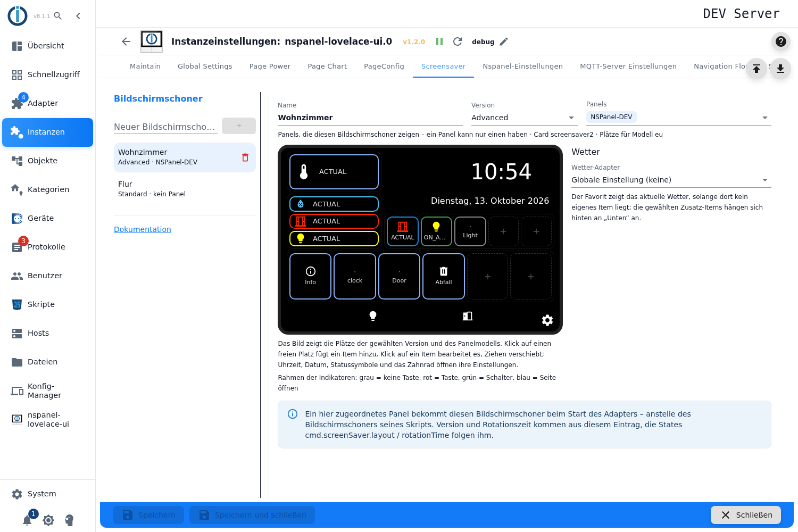

| Element | Bedeutung |
|---|---|
| **Name** | Name des Eintrags (umbenennen möglich, muss eindeutig bleiben). |
| **Version** | `Standard`, `Alternate`, `Advanced` oder `Easyview` – die Card (`screensaver`, `screensaver2`, `screensaver3`) folgt daraus. Die Zeile darunter nennt Card und Panelmodell, für das die Plätze gezeichnet werden. |
| **Panels** | Mehrfachauswahl der Panels, die diesen Bildschirmschoner zeigen. Ein Panel kann nur einen haben. |
| **Panelbild** | Die Plätze der gewählten Version: **Favorit** (groß), **Links**, **Unten**, **Indikatoren** (Advanced) bzw. **Alternate**. Gestrichelt mit **+** = frei (Klick legt ein Item an), belegt = Klick bearbeitet, Ziehen verschiebt – auch zwischen den Bereichen. Jedes Item zeigt sein Symbol in seiner Farbe und als Text den letzten Teil der Datenpunkt-ID bzw. den Template-Namen. |
| **Uhrzeit**, **Datum** | Klick öffnet den Dialog für 12h/24h bzw. das Datumsformat. |
| **Zwei Symbole unten** | Die Statussymbole (`mrIcon1`, `mrIcon2`), Klick öffnet ihren Dialog; grau = nicht belegt. |
| **Zahnrad** | Optionen: Rotationszeit, Wischgesten, Indikator-Tasten. |
| **Wetter** (rechts) | Wetter-Adapter und seine Zusatz-Items, siehe [Wetter](#9-wetter). |
| **Rahmen der Indikatoren** | grau = keine Taste, rot = Taste, grün = Schalter, blau = Seite öffnen (siehe [Indikatoren](#6-indikatoren-und-tasten)). |

Der Hinweis ganz unten erinnert daran, dass ein hier zugeordnetes Panel diesen Bildschirmschoner beim Start des Adapters bekommt – anstelle des Bildschirmschoners seines Skripts.

## 3. Version und Panels

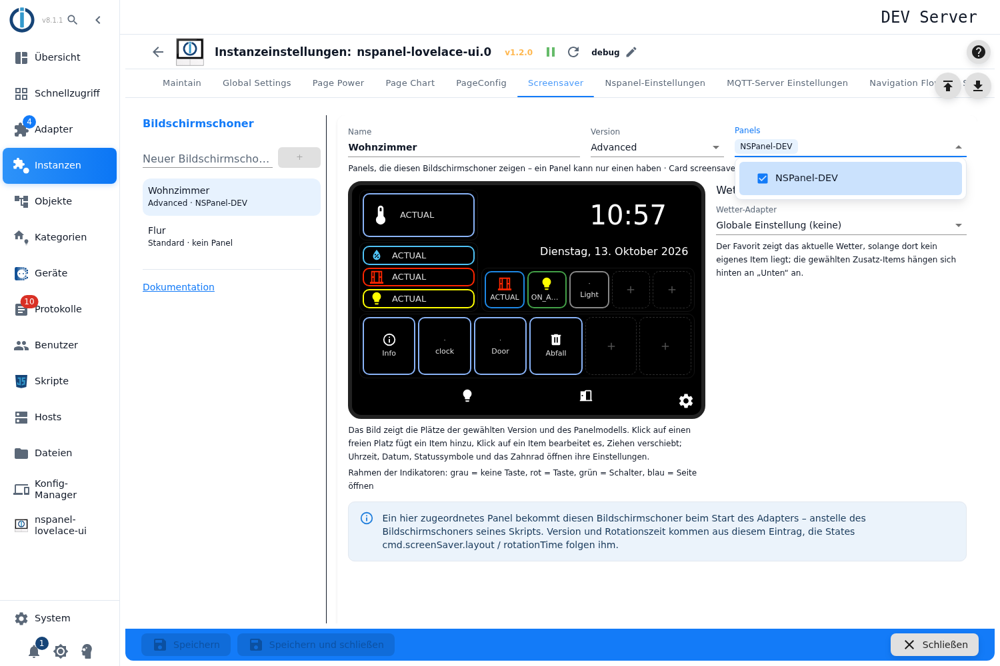

- **Panels**: Die Liste zeigt alle Panels der Instanz (Tooltip mit Topic, IP und Modell). Das **Modell des ersten gewählten Panels** bestimmt, wie viele Plätze die Bereiche haben – `eu` und `us-l` im Querformat, `us-p` im Hochformat mit eigenem Layout. Haben die gewählten Panels verschiedene Modelle, sagt der Editor, für welches er zeichnet. Steht ein Panel in zwei Einträgen, gewinnt der erste in der Liste; der Editor und das Log warnen.
- **Version wechseln**: Items, die in der neuen Version keinen Platz haben, bleiben erhalten und werden oben gemeldet – mit dem Knopf **Entfernen** lassen sie sich auf einmal löschen. Wer zurück zur alten Version wechselt, hat sie wieder.

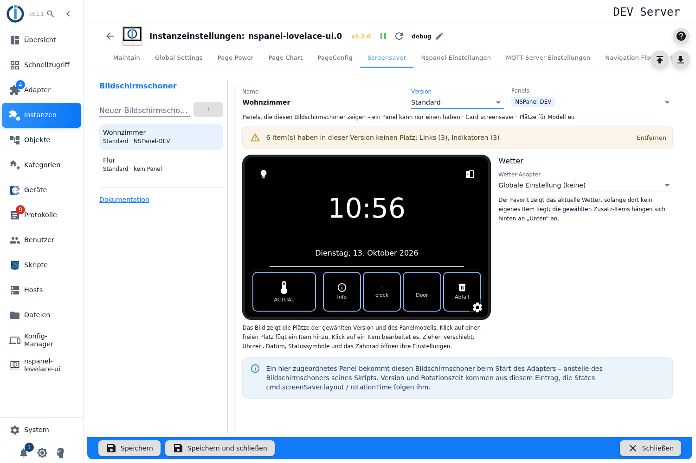

Die Plätze je Version und Modell entsprechen dem Skript (`ScreenSaverConst`): Standard und Easyview haben Favorit und Unten, Alternate zusätzlich den Alternate-Platz, Advanced außerdem Links und Indikatoren.

## 4. Items: der Item-Dialog

Klick auf einen freien Platz öffnet den Item-Dialog, Klick auf ein belegtes Item bearbeitet es. Die Felder richten sich nach dem Platz und nach dem Typ des Datenpunkts; rechts oben zeigt eine Vorschau das Item so, wie der Platz es darstellt.

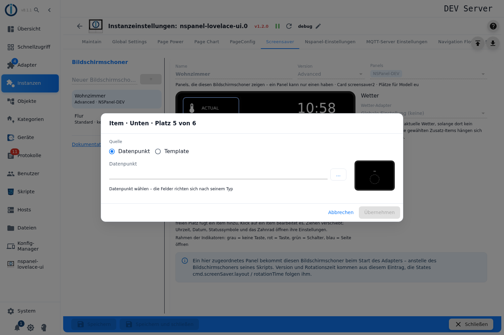

**Quelle**: *Datenpunkt* (ein State mit eigenen Feldern, wie `type: 'script'` im Skript) oder *Template* (ein PageItem-Template des Adapters, siehe [Templates](#5-templates-als-item)).

**Datenpunkt**: Die ID lässt sich eintippen oder über **…** aus dem Objektbaum wählen. Es muss ein **Datenpunkt** sein (`type: state`) – ein Kanal oder Gerät wird mit Hinweis abgelehnt, ebenso eine ID, die es nicht gibt. Sobald der Datenpunkt bekannt ist, zeigt der Dialog Name, Typ und Einheit sowie die Rolle und blendet die Felder ein, die zum Typ passen:

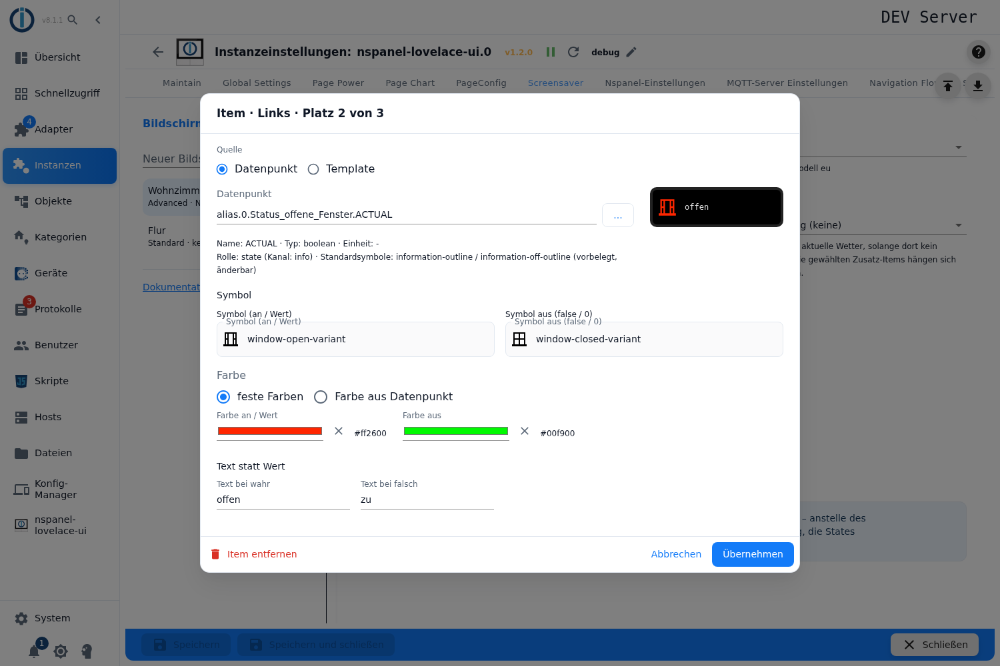

| Typ des Datenpunkts | Felder |
|---|---|
| **boolean** | Symbol an / aus, Farbe an / aus, Text bei wahr / falsch |
| **number** | Symbol (Expertenmodus: auch eine Icon-Liste je Wertebereich), feste Farbe oder Farbskala nach Wert, Einheit (leer = vom Datenpunkt), Faktor, Nachkommastellen |
| Datum/Zeit (Rolle `date`/`time`) | Symbol, Farbe, Datumsformat (`Intl.DateTimeFormat`-Optionen, Vorgaben zur Auswahl, Expertenmodus: eigenes JSON) |
| sonst (string …) | Symbol, Farbe |

Je nach Platz kommen Felder dazu oder fallen weg: **Unten** hat die **Überschrift** (leer = Name des Datenpunkts), **Indikatoren** zeigen nur das Symbol und haben dafür die **Aktion** (siehe [Indikatoren](#6-indikatoren-und-tasten)).

**Symbol**: Ein Item braucht ein Symbol – ohne Symbol kann das Panel es nicht darstellen, der Dialog lässt **Übernehmen** dann nicht zu. Aus der Rolle werden **Standardsymbole vorbelegt** (und bleiben änderbar): zuerst zählt die Rolle des Kanals über dem Datenpunkt (ein `light`-Kanal gibt die Glühbirne auch für seinen `.ACTUAL`), sonst die Rolle des Datenpunkts selbst (`value.humidity`, `switch.light`, `sensor.door`, `value.temperature` …). Die Zeile „Rolle: …“ nennt beides. Kennt die Rolle keine Symbole, bitte eines wählen.

**Farbe**: *feste Farben* (bei boolean getrennt an/aus, Pipette oder Hex-Wert), bei Zahlen alternativ *Farbskala nach Wert* (Dialog mit Skala, Minimum/Maximum, Bestwert, Modus – wie bei den PageItems):

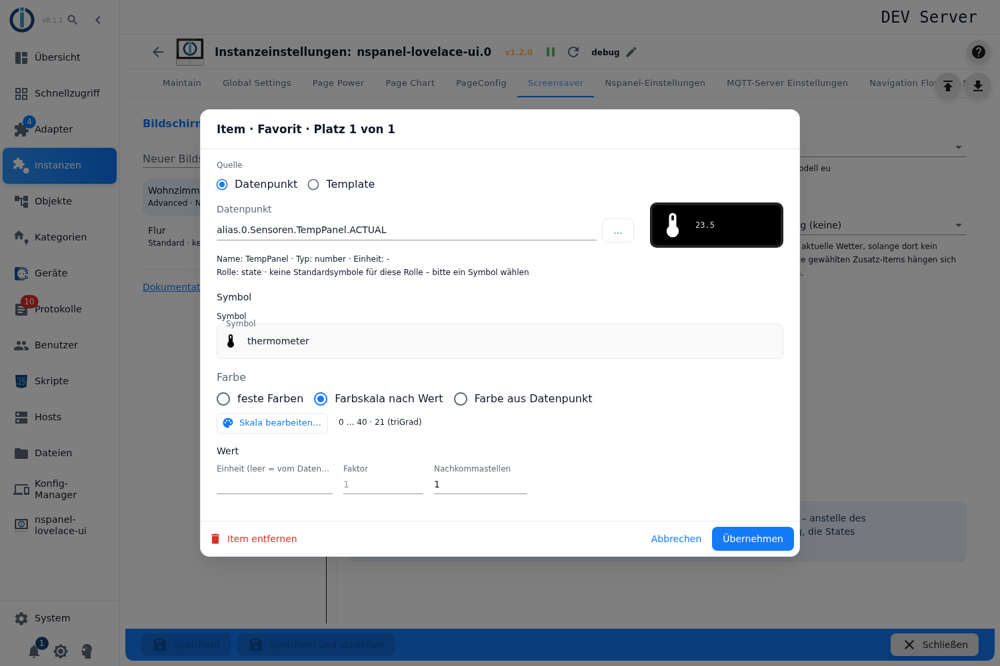

Dritte Möglichkeit *Farbe aus Datenpunkt*: ein State, dessen Wert die Farbe ist – `#rrggbb`, `{"r":…,"g":…,"b":…}` (auch als JSON-String) oder eine Dezimalzahl. Bei Ein/Aus-Datenpunkten gilt er für „an“, „aus“ nimmt die Standardfarbe. Der State muss existieren und ein Datenpunkt sein.

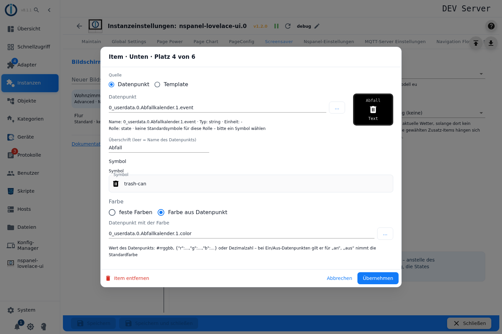

**Icon je Wertebereich** (nur Zahlen): Statt eines festen Symbols kann eine Liste „bis Wert → Symbol“ hinterlegt werden – das Panel wechselt das Icon dann mit dem Wert. Der Knopf **Icon je Wert…** steht im **Expertenmodus** unter dem Symbolfeld; eine bereits gespeicherte Liste wird mit ihren Symbolen auch ohne Expertenmodus angezeigt und lässt sich dort über den Papierkorb wieder entfernen.

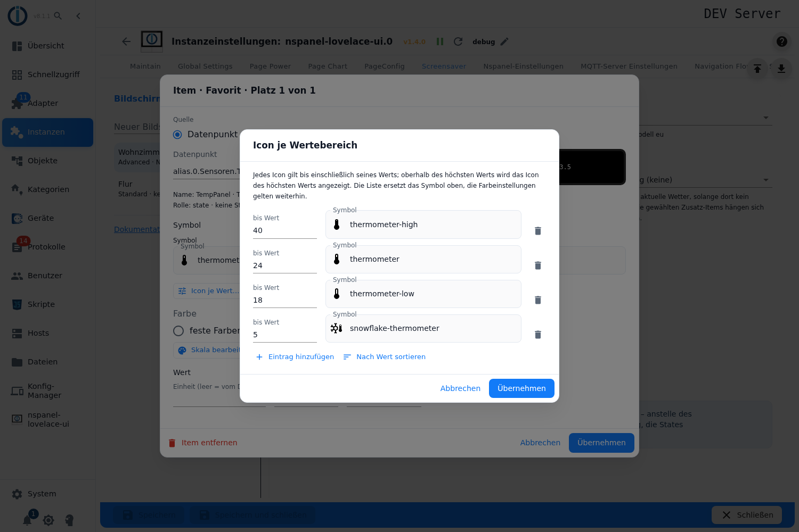

- Jede Zeile besteht aus **bis Wert** und einem **Symbol**. Ein Icon gilt **bis einschließlich** seines Werts, oberhalb des höchsten Werts bleibt dessen Icon stehen. Im Bild: bis 5 `snowflake-thermometer`, bis 18 `thermometer-low`, bis 24 `thermometer`, darüber `thermometer-high` – 23,5 °C zeigt also das mittlere Symbol (siehe Vorschau).
- **Eintrag hinzufügen** hängt eine Zeile an, der Papierkorb rechts entfernt sie. **Nach Wert sortieren** ordnet die Liste nur für die Übersicht – auf die Reihenfolge kommt es nicht an, der Adapter sortiert selbst.
- **Übernehmen** bleibt gesperrt, solange eine angefangene Zeile unvollständig ist (jede Zeile braucht eine Zahl **und** ein Symbol); kommt ein Wert doppelt vor, meldet der Dialog es – wirksam ist dann nur einer der Einträge. Eine leere Liste löscht die Einstellung.
- Die Liste **ersetzt das Symbol** aus dem Feld darüber. Farbe bzw. Farbskala, Einheit, Faktor und Nachkommastellen gelten unverändert weiter.
- Im Skript entspricht das `ScreensaverEntityIconSelect`; der Adapter macht daraus dieselbe Lesefunktion wie auf dem Skript-Weg, das Ergebnis auf dem Panel ist also identisch.

**Text statt Wert** (boolean): Statt `true`/`false` zeigt das Panel den Text bei wahr bzw. falsch. In jedes Feld kann auch die **ID eines Datenpunkts** – dann wird dessen Wert gezeigt. Ein leeres Feld lässt den Rohwert stehen.

**Sichtbarkeit** (Expertenmodus): ein Datenpunkt, der das Item bei `false` ausblendet, und optional eine Bedingung über `val` (wie `ScreensaverEntityEnabled` / `ScreensaverEntityVisibleCondition` im Skript). `val` ist der Wert des Item-Datenpunkts – `val > 0` zeigt das Item also nur bei positiven Werten.

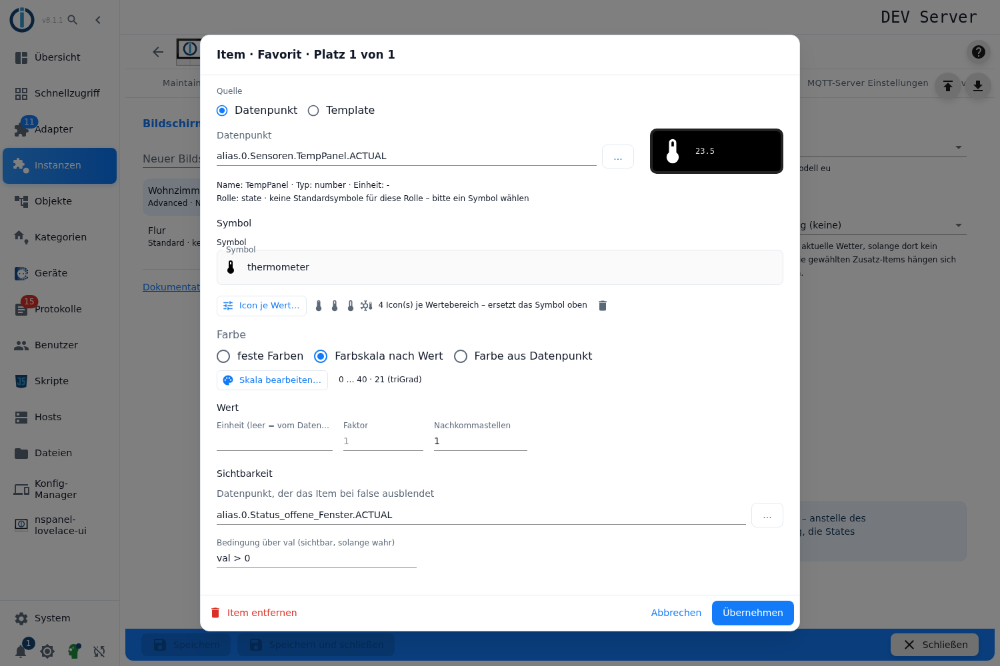

Das Bild zeigt denselben Favoriten mit eingeschaltetem Expertenmodus (Symbol unten links in der Admin-Leiste): der Knopf **Icon je Wert…** sitzt unter dem Symbolfeld, unten stehen Sichtbarkeits-Datenpunkt und Bedingung. Ohne Expertenmodus fehlen beide Blöcke – eine gespeicherte Icon-Liste bleibt trotzdem sichtbar.

**Item entfernen** links unten löscht das Item vom Platz.

## 5. Templates als Item

Mit der Quelle **Template** nimmt ein Platz ein PageItem-Template des Adapters (z. B. `text.clock`, `text.lock`, `script.light`, `shutter.basic`, die `pirate-weather.*`-Templates). Das Template bringt Symbol, Farben und Texte selbst mit, darum entfallen diese Felder.

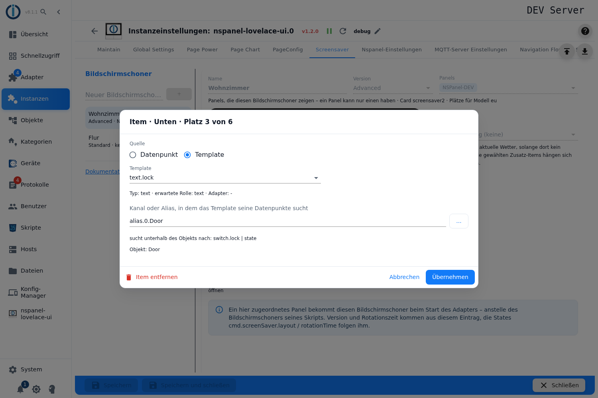

- Die Liste der Templates liefert der **laufende Adapter** (gruppiert nach Präfix). Läuft die Instanz nicht, ist die Liste leer und der Dialog sagt es.
- Unter der Auswahl stehen Typ, erwartete Rolle und – bei Adapter-Templates – der Adapter.
- Die meisten Templates suchen ihre Datenpunkte **unterhalb eines Objekts**: Dann wird ein **Kanal oder Alias** gewählt (der Objektbaum zeigt Kanäle, Geräte und Ordner), und der Dialog nennt, wonach das Template darunter sucht (z. B. `.ACTUAL`, `switch.lock | state`). Ein einzelner Datenpunkt an dieser Stelle wird als Warnung gemeldet.
- Templates ohne Objekt (`text.clock`, `text.wlan`, `button.service.*` …) brauchen kein Objekt – das Feld entfällt.

Das entspricht `type: 'template'` mit `dpInit` im Skript.

## 6. Indikatoren und Tasten

Die Indikatoren (Version Advanced) zeigen nur ein Symbol. Im Item-Dialog gibt es dafür die **Aktion beim Drücken**:

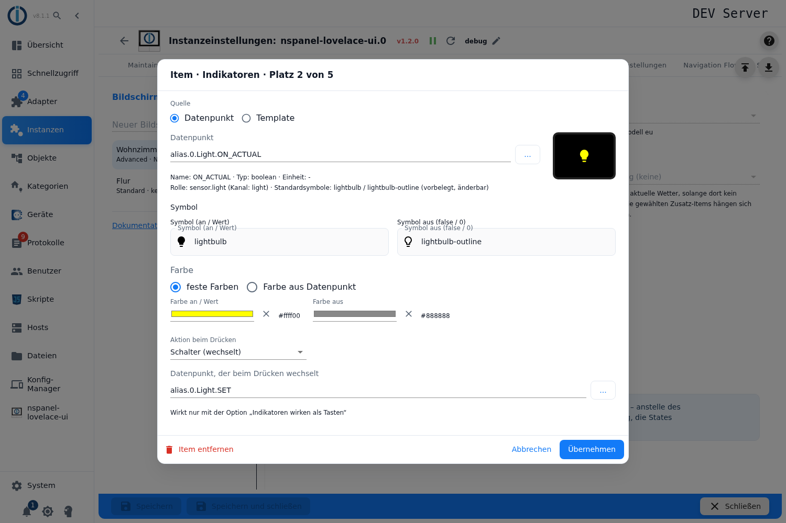

| Aktion | Wirkung | Skript |
|---|---|---|
| keine | Tipp führt zur Hauptseite | – |
| **Taste (schreibt true)** | schreibt `true` in den gewählten Datenpunkt | `ScreensaverEntityButton` |
| **Schalter (wechselt)** | kippt den gewählten Datenpunkt zwischen `true` und `false` | `ScreensaverEntitySwitch` |
| **Seite öffnen** | öffnet die gewählte Seite der Instanz | `ScreensaverEntityNaviToPage` |

Taste und Schalter brauchen einen **beschreibbaren** Datenpunkt (`common.write`); der Dialog prüft das und lässt sonst nicht übernehmen. Alle drei Aktionen wirken nur, wenn in den [Optionen](#10-optionen-rotation-wischen-indikator-tasten) **Indikatoren wirken als Tasten** eingeschaltet ist – ohne die Option führt ein Tipp auf einen Indikator zur Hauptseite. Im Panelbild zeigt der Rahmen die Aktion: rot = Taste, grün = Schalter, blau = Seite, grau = keine.

## 7. Statussymbole

Die beiden Symbole in der Fußzeile (`mrIcon1`, `mrIcon2`) folgen je einem Datenpunkt: Symbol „an“ bei `true`, sonst „aus“, jeweils mit eigener Farbe. Ein optionaler zweiter Datenpunkt wird als Wert daneben gezeigt (mit Nachkommastellen und Einheit). Ohne Datenpunkt bleibt das Symbol ungenutzt.

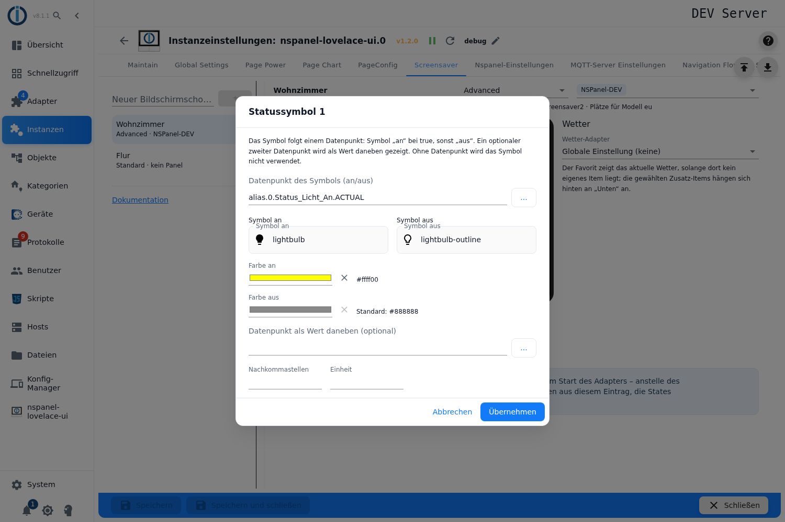

## 8. Uhrzeit und Datum

Klick auf die Uhrzeit: **Adapter-Standard**, **24 Stunden** oder **12 Stunden**, mit Vorschau.


Klick auf das Datum: Format von **Wochentag**, **Monat** und **Jahr** (lang, kurz, numerisch, zweistellig …). „Globale Einstellung“ nimmt das Format aus den Instanzeinstellungen; ein Wert hier gilt nur für diesen Bildschirmschoner. Die Vorschau zeigt das Ergebnis mit dem heutigen Datum.

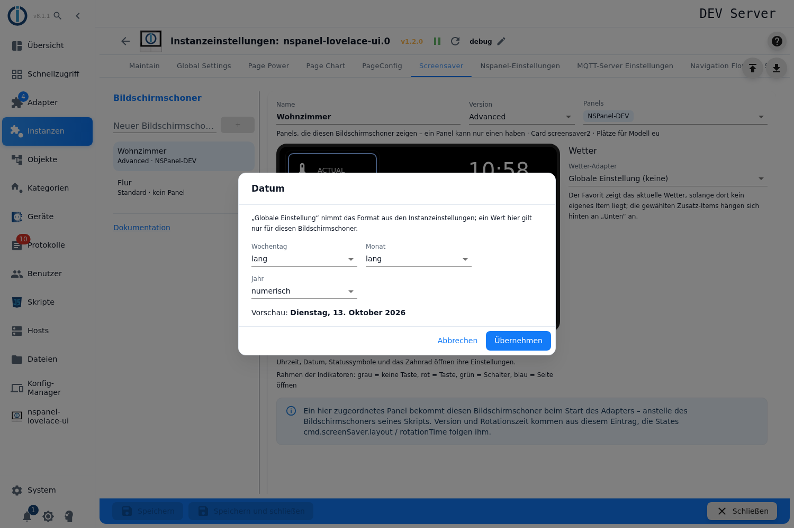

## 9. Wetter

Rechts neben dem Panelbild steht der **Wetter-Adapter** dieses Bildschirmschoners:

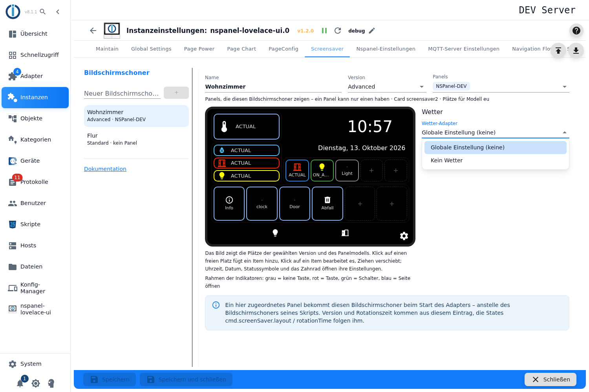

- **Globale Einstellung** – die Wetter-Instanz aus den Instanzeinstellungen (in Klammern genannt), **Kein Wetter**, oder eine der installierten Wetter-Instanzen.
- Mit gewähltem Adapter erscheinen Häkchen für seine **Zusatz-Items** (Sonnenauf-/-untergang, Vorhersagetage, Wind …). Sie hängen sich hinter die eigenen Items im Bereich **Unten**; gibt es mehr Items als Plätze, blättert der Bereich (Rotationszeit) und der Editor zeigt eine Scrollleiste mit der Zahl der Items.
- Der **Favorit** zeigt das aktuelle Wetter, solange dort kein eigenes Item liegt – ein eigenes Item verdrängt es.

## 10. Optionen: Rotation, Wischen, Indikator-Tasten

Das Zahnrad im Panelbild öffnet die Optionen:

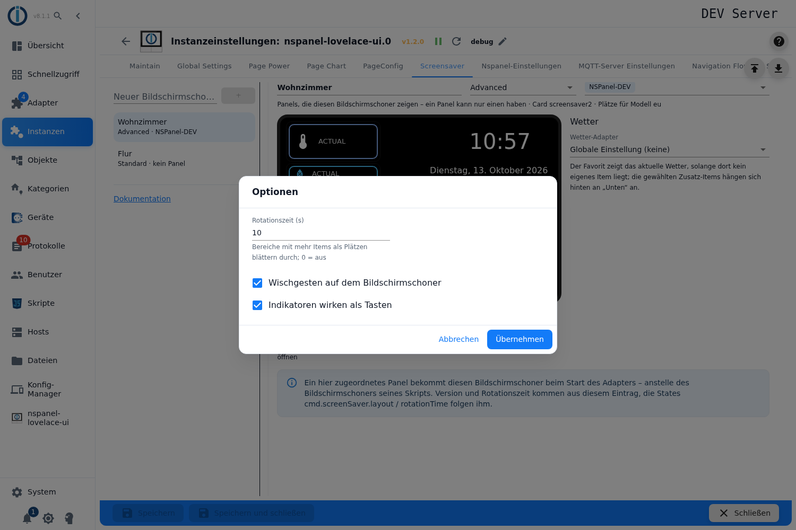

- **Rotationszeit (s)**: Bereiche mit mehr Items als Plätzen blättern durch; `0` = aus (`rotationTime`).
- **Wischgesten auf dem Bildschirmschoner** (`screensaverSwipe`).
- **Indikatoren wirken als Tasten** (`screensaverIndicatorButtons`) – Voraussetzung für die Aktionen aus [Indikatoren](#6-indikatoren-und-tasten).

## 11. Speichern – was der Adapter daraus macht

Unten **Speichern** bzw. **Speichern und schließen**; die Instanz startet neu. Beim Start sucht der Adapter für jedes Panel den ersten Eintrag, der sein Topic enthält, und baut daraus den Bildschirmschoner – über denselben Weg wie das Skript. Im Log steht dann z. B.:

```
Screensaver 'Wohnzimmer' (advanced) from the admin configuration replaces the script screensaver of panel 'NSPanel-Wohnzimmer'
```

- Der Bildschirmschoner des Skripts wird für dieses Panel ersetzt; Panels ohne Eintrag behalten ihn.
- Version und Rotationszeit kommen aus dem Eintrag; die States `panels.<Panel>.cmd.screenSaver.layout` und `…rotationTime` folgen ihm (sie überschreiben den Eintrag nicht).
- Ein Item ohne Symbol bekommt die Standardsymbole seiner Rolle, ohne bekannte Rolle `help-circle-outline` – der Dialog lässt es allerdings gar nicht erst ohne Symbol zu.
- Die gespeicherte Form liegt unter `native.screensaverConfig` der Instanz (ein Objekt je Eintrag).

## 12. Wenn etwas nicht wie erwartet aussieht

- **Alles ausgegraut:** Die Instanz läuft nicht. Der Editor ist nur bei laufender Instanz bedienbar, die Template-Liste kommt vom laufenden Adapter.
- **Keine Plätze im Panelbild:** Noch kein Panel gewählt.
- **Übernehmen bleibt gesperrt:** Datenpunkt fehlt oder ist kein Datenpunkt (Kanal gewählt?), kein Symbol, bei Taste/Schalter kein beschreibbarer Datenpunkt, bei „Farbe aus Datenpunkt“ kein gültiger State – der Dialog nennt den Grund in einer gelben Zeile.
- **Das Symbol wechselt nicht mit dem Wert:** Eine Icon-Liste gibt es nur für Zahlen-Datenpunkte, und jedes Icon gilt bis einschließlich seines Werts – oberhalb des höchsten Werts bleibt dessen Symbol stehen. Doppelte Werte meldet der Dialog, wirksam ist dann nur einer.
- **Falsches Symbol vorbelegt:** Die Rolle des Kanals über dem Datenpunkt zählt zuerst – einfach das Symbol ändern.
- **Panel zeigt den Skript-Screensaver:** Das Panel steht in keinem Eintrag, oder es steht in einem zweiten Eintrag weiter unten (der erste gewinnt) – siehe Log.
- **Items fehlen nach einem Versionswechsel:** Sie liegen in Bereichen, die die Version nicht hat (Meldung oben im Editor); Version zurückstellen oder **Entfernen**.
- **Indikator reagiert nicht auf die Aktion:** Option **Indikatoren wirken als Tasten** einschalten.
