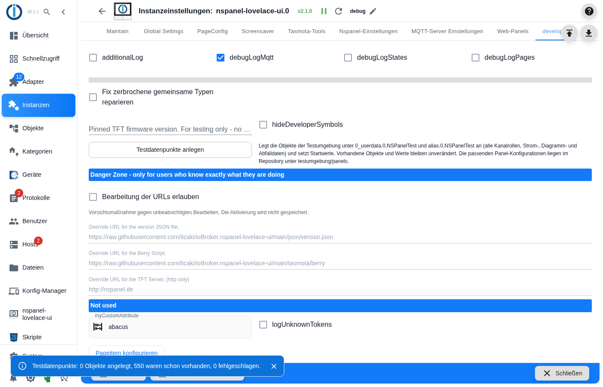
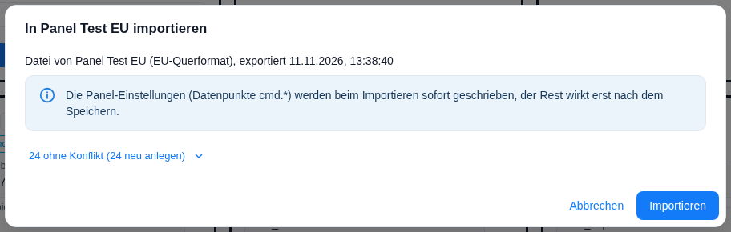
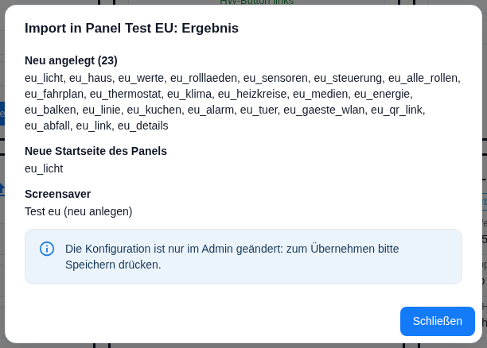

# Testumgebung

Fertige Testdaten für alle Panel-Modelle: Datenpunkte für **jede Kanalrolle** des Adapters und je Modell eine Panel-Konfiguration mit **allen Kartentypen**, voll belegten Seiten und einem voll belegten Bildschirmschoner. Damit lässt sich eine Änderung in Minuten auf fünf Formaten durchklicken, ohne eigene Datenpunkte anzulegen — und für einen Hardware-Test liegt sofort eine Konfiguration bereit.

Gedacht ist das für alle, die am Adapter mitarbeiten oder einen Fehler nachstellen wollen. Für den täglichen Betrieb wird nichts davon gebraucht.

Inhalt:
- [Wozu das gut ist](#1-wozu-das-gut-ist)
- [Testdatenpunkte anlegen](#2-testdatenpunkte-anlegen)
- [Panel-Konfiguration importieren](#3-panel-konfiguration-importieren)
- [Was auf dem Panel zu sehen ist](#4-was-auf-dem-panel-zu-sehen-ist)
- [Bildschirmschoner](#5-bildschirmschoner)
- [Systemseite „Navigation fehlerhaft"](#6-systemseite-navigation-fehlerhaft)
- [Grenzen](#7-grenzen)
- [Aufbau und eigene Erweiterungen](#8-aufbau-und-eigene-erweiterungen)

## 1. Wozu das gut ist

Die Testumgebung ist dafür gebaut, **Darstellungsfehler sichtbar zu machen**, bevor sie jemand im Alltag findet. Jede Seite ist bis auf den letzten Platz gefüllt, die Werte sind absichtlich unbequem (lange Namen, breite Zahlen, Einheiten), und dieselbe Konfiguration läuft auf allen fünf Formaten. Was auf dem EU-Panel noch passt, läuft auf dem hochkanten US-Panel über.

Eine Reihe von Fehlern ist genau so gefunden worden — abgeschnittene Werte, überlappende Namen, ein Bildschirmschoner im falschen Format. Die Gegenüberstellung steht in der Bildseite unter [Vorher und nachher](Testumgebung-Bilder#vorher-und-nachher).

## 2. Testdatenpunkte anlegen

Instanz-Einstellungen → Reiter **Entwickler** → Knopf **Testdatenpunkte anlegen**.

> **Der Reiter ist nur im Expertenmodus sichtbar.** Umgeschaltet wird er im Admin selbst (Symbol unten links in der Seitenleiste), nicht in den Instanz-Einstellungen; die Einstellung gilt für die laufende Browsersitzung. Mehr dazu auf der Seite [Developer](Developer).

Der Adapter legt die Objekte unter `0_userdata.0.NSPanelTest` und `alias.0.NSPanelTest` an und setzt Startwerte. Beim heutigen Stand der mitgelieferten Daten sind das **550 Objekte** (Ordner, Werte und Aliase zusammen); die Zahl wächst, wenn die Testdaten erweitert werden.

Die Meldung darunter nennt **drei** Zahlen: angelegt, schon vorhanden, fehlgeschlagen.

| Voraussetzung | Warum |
|---|---|
| Die Instanz muss **laufen** | Der Knopf schickt eine Nachricht an die Instanz; steht sie, verweigert der Admin mit „Instance … is not alive". |
| `0_userdata.0` und `alias.0` müssen **existieren** | Angelegt wird erst ab `NSPanelTest` abwärts. Fehlt der Zweig darüber, zählt jedes Objekt als *fehlgeschlagen*. |

**Vorhandene Objekte und Werte bleiben unverändert.** Der Adapter prüft jedes Objekt einzeln und überspringt es, wenn es schon da ist — Startwerte schreibt er nur für neu angelegte Objekte. Der Knopf darf also beliebig oft gedrückt werden; beim zweiten Mal meldet er „0 angelegt". Das hat eine Kehrseite: **Zeitwerte werden dabei nicht erneuert** (siehe [Grenzen](#7-grenzen)).

Schlägt etwas fehl, bricht der Lauf nicht ab — jedes einzelne Objekt wird mit einer Warnung ins Protokoll geschrieben, und die dritte Zahl der Meldung zeigt, wie viele es waren.

## 3. Panel-Konfiguration importieren

Die fertigen Konfigurationen liegen im Repository unter `testumgebung/panels/`. Für jedes Modell gibt es eine Datei:

| Modell | Auflösung | Datei |
|---|---|---|
| EU | 480 × 320 quer | `nspanel-eu.json` |
| US quer | 480 × 320 quer | `nspanel-us-l.json` |
| US hochkant | 320 × 480 hoch | `nspanel-us-p.json` |
| Smartphone quer | 640 × 320 quer | `nspanel-web-l.json` |
| Smartphone hochkant | 320 × 640 hoch | `nspanel-web-p.json` |

Der Weg: Reiter **Nspanel-Einstellungen** → auf der Kachel des Panels **Panel-Konfiguration importieren** → Datei wählen → in der Übersicht **Importieren** → danach die Instanz-Einstellungen **speichern**.

In ein leeres Panel passt alles ohne Konflikt: **24 Zeilen** — 23 Seiten und der Bildschirmschoner.

> **Zwei Dinge wirken zu verschiedenen Zeitpunkten.** Die Panel-Einstellungen (Datenpunkte `cmd.*`) werden beim Importieren sofort geschrieben, alles andere erst beim **Speichern** der Instanz-Einstellungen. Ein Neustart von Hand ist nicht nötig — das Speichern startet den Adapter mit.

Alles Weitere zum Dialog — Teileauswahl, Importmodus, Namenskonflikte, Sicherheitsabfragen — steht auf der Seite [Panel-Konfiguration übertragen](panelConfigTransfer).

**Die Dateien enthalten keine Geheimnisse.** Sie sind ohne Zugangsdaten exportiert (`secretsIncluded: false`); Alarm- und Türseite tragen keinen eigenen PIN, es greift also das globale Passwort der Instanz, und das Gäste-WLAN ist als offenes Netz konfiguriert.

**Mehrere Modelle in dieselbe Instanz** sind kein Problem: die Seitennamen tragen je Modell ein eigenes Präfix (`eu_`, `usl_`, `usp_`, `webl_`, `webp_`), es gibt also keine Namenskonflikte.

### Ohne Hardware: ein Web-Panel

Am schnellsten geht es ganz ohne Gerät: Reiter **Nspanel-Einstellungen** → **Web-Panel hinzufügen** → Modell wählen → Instanz-Einstellungen speichern → danach wie oben importieren. Der Knopf erscheint nur, wenn die Web-Panels in den Instanz-Einstellungen eingeschaltet sind.

Aufgerufen wird es im Browser unter `http://<ioBroker>:8090/<topic>` — Port 8090 ist die Vorgabe, bei eingeschaltetem HTTPS ist es `https`, und mit gesetzter PIN kommt eine Anmeldeseite davor. Die Einzelheiten stehen auf der Seite [Web-Panel](WebPanel).

Übrigens sind **alle fünf mitgelieferten Dateien aus Web-Panels exportiert** — auch die für EU und US. Für ein echtes Gerät importiert man dieselbe Datei; die Herkunftsangabe im Export sagt nichts darüber aus, wohin sie darf.

## 4. Was auf dem Panel zu sehen ist

23 Seiten, in dieser Reihenfolge erreichbar. Der Pfeil nach rechts führt durch alle Seiten und von der letzten zurück zur Startseite. Die Zahlen sind die **belegten Plätze je Modell** — jede Seite ist bis zur Kapazität des Modells gefüllt.

| # | Seite | Karte | eu | us-l | us-p | web-l | web-p |
|---|---|---|---|---|---|---|---|
| 1 | Licht *(Startseite)* | `cardGrid` | 6 | 6 | 6 | 8 | 10 |
| 2 | Haus | `cardGrid2` | 8 | 8 | 9 | 10 | 15 |
| 3 | Messwerte | `cardGrid3` | 4 | 4 | 4 | 6 | 8 |
| 4 | Rollläden & Tore | `cardEntities` | 4 | 4 | 5 | 4 | 8 |
| 5 | Sensoren | `cardEntities` | 4 | 4 | 5 | 4 | 8 |
| 6 | Steuerung | `cardEntities` | 4 | 4 | 5 | 4 | 8 |
| 7 | Alle Rollen | `cardEntities` | 28 | 28 | 28 | 28 | 28 |
| 8 | Abfahrten | `cardSchedule` | 6 | 6 | 6 | 6 | 11 |
| 9 | Wohnzimmer | `cardThermo` | – | – | – | – | – |
| 10 | Klimaanlage | `cardThermo` | – | – | – | – | – |
| 11 | Heizkreise | `cardThermo2` | 9 | 9 | 9 | 9 | 9 |
| 12 | *(Medien, ohne Titel)* | `cardMedia` | 5 | 5 | 5 | 6 | 8 |
| 13 | Energiefluss | `cardPower` | – | – | – | – | – |
| 14 | Strom 24 h | `cardChart` | – | – | – | – | – |
| 15 | Außentemperatur | `cardLChart` | – | – | – | – | – |
| 16 | Energie heute | `cardPChart` | – | – | – | – | – |
| 17 | Alarmanlage | `cardAlarm` | – | – | – | – | – |
| 18 | Tür öffnen | `cardAlarm` *(unlock)* | – | – | – | – | – |
| 19 | Gäste-WLAN | `cardQR` | – | – | – | – | – |
| 20 | Anleitung | `cardQR` | – | – | – | – | – |
| 21 | Abfuhrtermine | `cardTrash` | – | – | – | – | – |
| 22 | Licht *(Seitenlink)* | `pageLink` | – | – | – | – | – |
| 23 | Details | `cardEntities` | 4 | 4 | 5 | 4 | 8 |

„–" heißt: die Karte hat keine frei belegbaren Plätze, ihr Inhalt steht in der Karte selbst.

Ein paar Eigenheiten, die beim Durchklicken auffallen und **so gewollt** sind:

- **Alle Rollen** trägt bewusst 28 Einträge und damit mehr, als auf eine Seite passt — so hat der Blätterpfeil etwas zu tun. Es sind 28 der 30 Kanalrollen; die beiden fehlenden stehen unter [Grenzen](#7-grenzen).
- **Details** ist eine Unterseite und nur über den letzten Platz auf *Haus* erreichbar; der Rückweg führt wieder dorthin. Ab dem hochkanten US-Modell wiederholen sich dort Einträge, weil nur vier Info-Kanäle vorhanden sind und die Seite zyklisch aufgefüllt wird.
- **Die Medienseite trägt keinen Titel** — `cardMedia` zeigt stattdessen den Namen des Players.
- **Heizkreise** zeigt bei neun Plätzen **sechs wählbare Kreise** aus fünf Einträgen: vier Heizkreise und eine Klimaanlage, die als Heiz- *und* Kühlkreis zählt. Einer der Kreise ist bewusst nicht über einen Alias, sondern über Einzel-Datenpunkte angebunden.
- **Was auf einer Seite steht, hängt vom Modell ab.** Auf *Haus* stehen bei EU nur Steckdosen, Szenen, Rollladen und Tor; Schloss kommt ab US hochkant dazu, Lüfter ab Smartphone quer, Heizung, Klima, Auswahl, Timer und Lautstärke erst beim hochkanten Smartphone. Auf *Messwerte* gibt es Strompreis und Restlaufzeit erst ab sechs Plätzen.

Alle Seiten auf allen fünf Modellen im Bild: [Testumgebung – Bilder → Seiten je Modell](Testumgebung-Bilder#seiten-je-modell).

## 5. Bildschirmschoner

Je Modell ein Eintrag, Startmodus **advanced**. Jeder Bereich ist bis zur Kapazität des Modells gefüllt — und zwar für den jeweils größten Modus, sodass auch nach einem Moduswechsel kein Platz leer bleibt.

| Bereich | eu | us-l | us-p | web-l | web-p |
|---|---|---|---|---|---|
| links | 3 | 3 | 3 | 3 | 4 |
| unten | 6 | 6 | 6 | 8 | 8 |
| Indikatoren | 7 | 7 | 8 | 11 | 12 |
| Favorit | 1 | 1 | 1 | 1 | 1 |
| Wechselzeile | 1 | 1 | 1 | 1 | 1 |
| MR-Icons | 2 | 2 | 2 | 2 | 2 |
| Benachrichtigungen | 2 | 2 | 2 | 2 | 2 |

Die Indikatoren sind absichtlich gemischt: reine Anzeige, Tippen schaltet oder öffnet eine Seite, langes Drücken mit eigener Aktion, oder beides zusammen.

**Modus wechseln** — den Datenpunkt `<instanz>.panels.<Panel-ID>.cmd.screenSaver.layout` setzen:

| Wert | Modus |
|---|---|
| 0 | standard |
| 1 | alternate |
| 2 | advanced |
| 3 | easyview |
| 4 | tiles |

Der Wechsel wirkt sofort. Die Klartextnamen stehen auch als Auswahlwerte am Datenpunkt selbst.

> **Nach einem Neustart des Adapters gilt wieder der Modus aus dem Admin** — hier also *advanced*. Das gilt für Bildschirmschoner, die im Admin angelegt sind, und damit für die Testumgebung. Stammt der Bildschirmschoner aus einem Konfigurationsskript, überlebt der gesetzte Modus den Neustart. Dauerhaft ändert man ihn im Reiter **Screensaver** am Eintrag „Test …".

**Die beiden Benachrichtigungen** erscheinen, wenn `0_userdata.0.NSPanelTest.Hinweis.Waschmaschine_fertig` auf `true` steht oder `0_userdata.0.NSPanelTest.Hinweis.Fenster_offen` größer als 0 ist. Die erste lässt sich wegtippen, die zweite nicht — sie verschwindet erst, wenn der Wert wieder 0 ist.

Alle fünf Modi auf allen fünf Modellen im Bild: [Testumgebung – Bilder → Bildschirmschoner-Modi](Testumgebung-Bilder#bildschirmschoner-modi).

## 6. Systemseite „Navigation fehlerhaft"

Zeigt eine Navigation auf eine Seite, die es nicht gibt, blendet das Panel eine Systemseite ein: Titel **Navi-Fehler**, dazu das fehlende Ziel, die Seite, von der der Sprung kam, und der Hinweis, die Konfiguration zu prüfen. Der Pfeil zurück führt wieder auf die Ausgangsseite.

> **Mit den fünf Panel-Dateien aus `testumgebung/panels/` lässt sich das nicht nachstellen.** Deren Navigation ist vollständig. Die Aufnahmen stammen aus dem älteren, skriptkonfigurierten Testaufbau (`testumgebung/Global_Script.ts`), in dem eine Seite bewusst auf ein leeres Ziel zeigt. Wer die Seite sehen will, trägt in einer beliebigen Seite von Hand ein Navigationsziel ein, das es nicht gibt.

Die Seite in beiden Systemsprachen und auf allen fünf Modellen: [Testumgebung – Bilder → Systemseite „Navigation fehlerhaft"](Testumgebung-Bilder#systemseite-navigation-fehlerhaft).

## 7. Grenzen

| Thema | Was zu beachten ist |
|---|---|
| **Medienseite** | Sie braucht einen echten Player. Die Dateien verweisen auf `squeezeboxrpc.0.Players.Familienzimmer` — das ist der **einzige** Verweis auf einen fremden Adapter in der ganzen Konfiguration. Nach dem Import im Admin den eigenen Player eintragen (alexa2, sonos, spotify-premium, mpd, squeezeboxrpc) oder die Seite ausblenden. |
| **Zwei Rollen ohne Seite** | `media` steht auf keiner Seite — ein Element dieser Rolle braucht einen Alias auf einen echten Player. `sensor.alarm.flood` ist als Seitenelement im Adapter nicht umgesetzt; als Indikator des Bildschirmschoners taucht der Wassermelder nur bei den beiden Smartphone-Formaten auf, weil erst die genug Indikatorplätze haben. |
| **Zeitwerte veralten** | Abfahrten und Abfuhrtermine werden beim Anlegen relativ zur aktuellen Zeit gesetzt. Weil der Knopf nichts überschreibt, bleiben sie danach stehen. Zum Erneuern die betroffenen Datenpunkte löschen und den Knopf noch einmal drücken. |
| **Nur Startwerte** | Die Datenpunkte bewegen sich nicht von selbst. Wer einen Verlauf im Diagramm sehen will, muss Werte selbst schreiben. |

## 8. Aufbau und eigene Erweiterungen

Woher die Datenpunkte kommen, wie sich eigene ergänzen lassen, wie die fünf Panel-Dateien erzeugt werden und was der Unit-Test absichert, steht auf der Seite [Testumgebung – Aufbau](Testumgebung-Aufbau).
