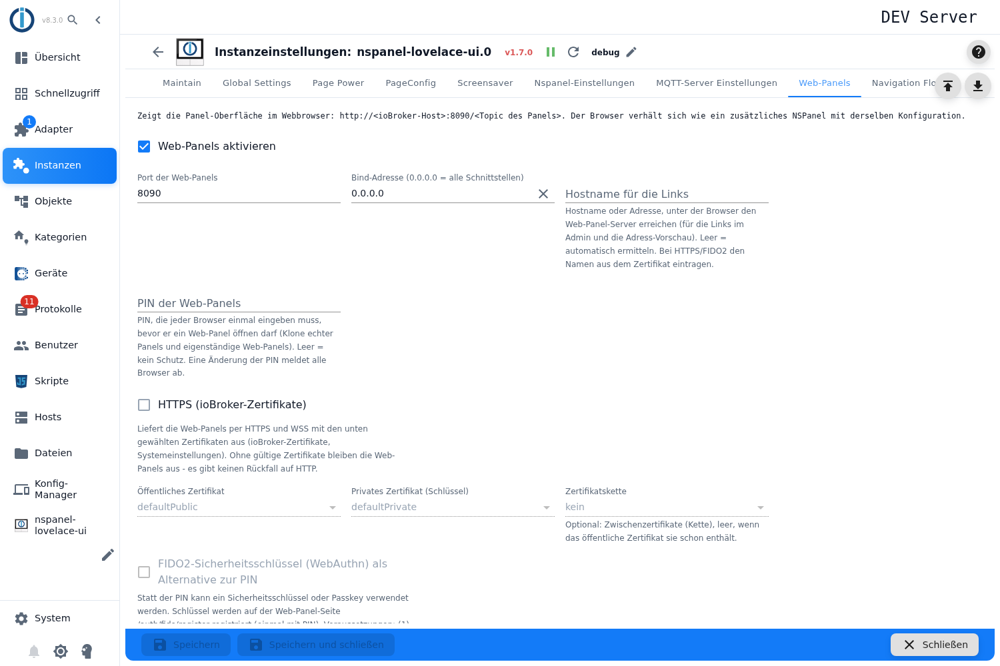
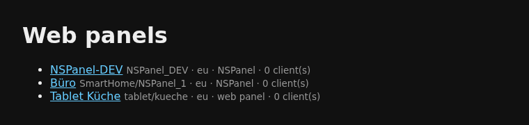
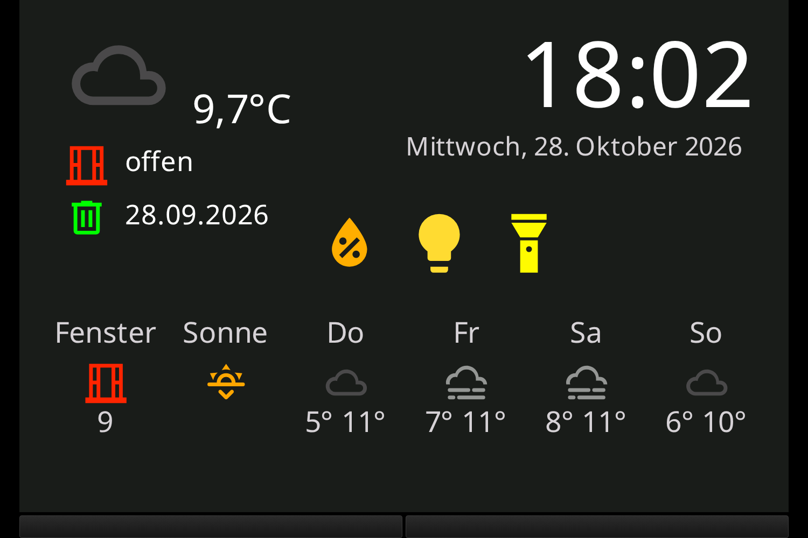
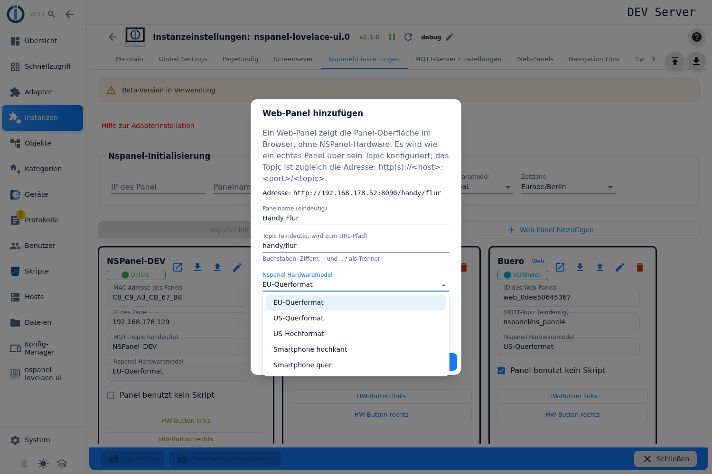
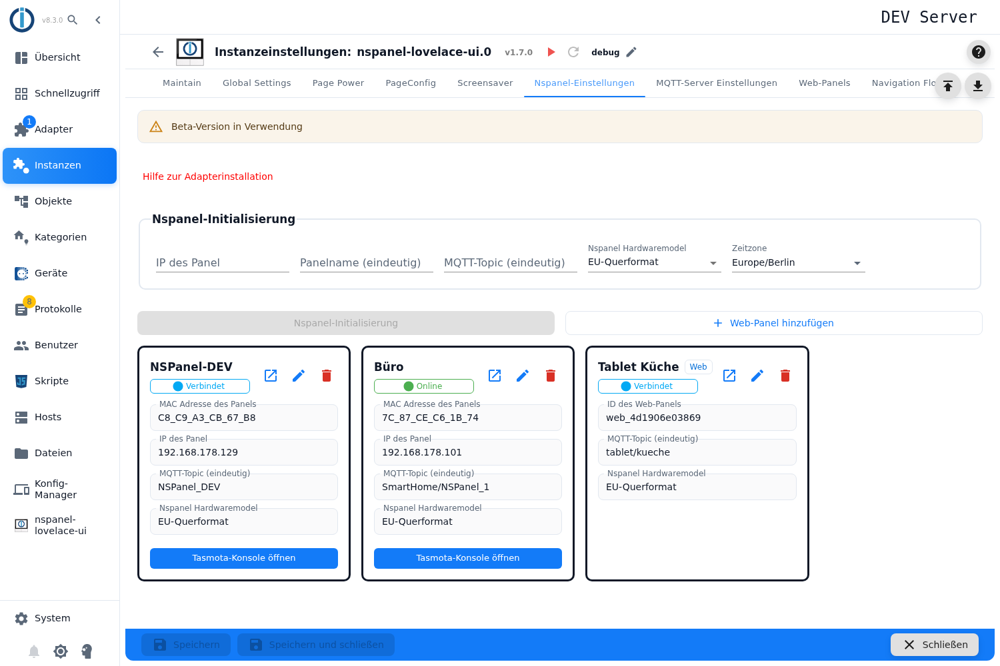

# Web-Panel

Seit Version **1.7.0** zeigt der Adapter die Panel-Oberfläche auch **im Webbrowser** — mit denselben Seiten,
Popups und Bildschirmschonern wie auf dem NSPanel. Dafür bringt er einen eigenen kleinen Webserver mit;
Tasmota und Panel-Hardware braucht es dafür nicht.

Es gibt zwei Arten:

- **Ein echtes Panel im Browser:** Jedes eingerichtete NSPanel lässt sich zusätzlich im Browser öffnen.
  Der Browser verhält sich wie ein **weiteres** Panel mit derselben Konfiguration.
- **Ein eigenständiges Web-Panel:** ein Panel **ganz ohne Hardware**, etwa für ein Tablet an der Wand, ein
  Smartphone oder zum Ausprobieren von Seiten am Schreibtisch.

Inhalt:

1. [Einschalten und Adresse](#1-einschalten-und-adresse)
2. [Ein echtes Panel im Browser öffnen](#2-ein-echtes-panel-im-browser-öffnen)
3. [Ein eigenständiges Web-Panel anlegen](#3-ein-eigenständiges-web-panel-anlegen)
4. [Modell wählen: Format und Plätze](#4-modell-wählen-format-und-plätze)
5. [Bedienung im Browser](#5-bedienung-im-browser)
6. [Zugang schützen: PIN, HTTPS, Sicherheitsschlüssel](#6-zugang-schützen-pin-https-sicherheitsschlüssel)
7. [Was ein Web-Panel nicht kann](#7-was-ein-web-panel-nicht-kann)
8. [Fallstricke](#8-fallstricke)

## 1. Einschalten und Adresse

Die Einstellungen stehen in den Instanz-Einstellungen im Tab **Web-Panels**. Oben zeigt der Tab, unter
welcher Adresse die Panels erreichbar sind.



| Feld | Bedeutung |
|---|---|
| **Web-Panels aktivieren** | Schaltet den Webserver ein. **Ab Werk eingeschaltet.** |
| **Port der Web-Panels** | Vorgabe `8090`. |
| **Bind-Adresse** | Netzwerkschnittstelle, auf der der Server lauscht. `0.0.0.0` (Vorgabe) = alle. |
| **Hostname für die Links** | Nur für die Links im Admin, die Adressvorschau und die Meldung im Log. Leer = der Adapter ermittelt ihn selbst. Bei HTTPS den Namen aus dem Zertifikat eintragen. |
| **PIN**, **HTTPS**, **FIDO2** | siehe [Abschnitt 6](#6-zugang-schützen-pin-https-sicherheitsschlüssel) |

Jedes Panel hat eine eigene Adresse, gebildet aus seinem **Topic**:

```
http://<ioBroker-Host>:8090/<Topic des Panels>
```

Die Startseite `http://<ioBroker-Host>:8090/` listet alle Panels mit Modell und Anzahl verbundener Browser.



Bequemer geht es aus dem Admin: Der Knopf **Web-Panel in neuem Tab öffnen** steht in der Panel-Übersicht
(Tab *Nspanel-Einstellungen*), im Tab [Maintain](Maintain) und in der [Panelinfo](Panelinfo). Ist eine PIN
gesetzt, meldet dieser Knopf den Browser gleich mit an.

> Alle Einstellungen dieses Tabs gelten erst nach dem **Speichern** — die Instanz startet dabei neu.

## 2. Ein echtes Panel im Browser öffnen

Dafür ist nichts einzurichten: Sind die Web-Panels eingeschaltet, ist **jedes** NSPanel unter seinem Topic
erreichbar. Statt des Topics funktioniert auch die ID des Panels.



Wichtig zu wissen:

- **Der Browser blättert unabhängig vom echten Panel.** Er ist ein zusätzliches Panel mit derselben
  Konfiguration — wer im Browser eine andere Seite öffnet, ändert nichts am Display an der Wand.
- **Alle Browser auf derselben Adresse laufen synchron**: Öffnen zwei Geräte dasselbe Panel, sehen beide
  dieselbe Seite.
- Die **Datenpunkte** teilt sich der Browser mit dem echten Panel (`panels.<Panel>.*`). Befehle unter
  `cmd.*` — etwa Bildschirmschoner oder Helligkeit — wirken also auch im Browser. Die Werte unter `info.*`
  (Firmware, WLAN, Status) schreibt nur das echte Panel.
- Ist das echte Panel **deaktiviert** oder gerade nicht in Betrieb, zeigt auch der Browser nichts an und
  versucht es später erneut.

## 3. Ein eigenständiges Web-Panel anlegen

1. Tab **Nspanel-Einstellungen** öffnen. Neben *Nspanel-Initialisierung* steht der Knopf
   **Web-Panel hinzufügen** — er erscheint nur, wenn die Web-Panels eingeschaltet sind.
2. Im Dialog ausfüllen:
   - **Panelname** — eindeutig.
   - **Topic** — eindeutig, wird zum Pfad der Adresse. Erlaubt sind Buchstaben, Ziffern, `_` und `-`,
     dazu `/` als Trenner. Nicht erlaubt als erster Teil: `assets`, `fonts`, `icons`, `auth`, `ws` (die
     braucht der Webserver selbst). Unter dem Feld zeigt der Dialog die fertige Adresse.
   - **Nspanel Hardwaremodel** — bestimmt Format und Seitenverhältnis der Darstellung. Zur Wahl stehen die
     drei Panel-Formate und die beiden Smartphone-Modelle **Smartphone hochkant** und **Smartphone quer**;
     alles dazu in [Abschnitt 4](#4-modell-wählen-format-und-plätze).
   - **Hardware-Tasten anzeigen** — „Zeigt die zwei Tasten des NSPanels unter dem Display; das Bild wird
     dadurch etwas kleiner.“ Bei den Panel-Formaten ab Werk **an**, bei den Smartphone-Modellen **aus**.
     Solange das Häkchen im Dialog nicht von Hand gesetzt wurde, folgt es beim Wechsel des Modells dessen
     Vorgabe.

   

3. Mit **Speichern** übernehmen, dann die Instanz-Einstellungen speichern.

Das Web-Panel bekommt automatisch eine ID der Form `web_` + 12 Zeichen und erscheint in der
Panel-Übersicht mit dem Kennzeichen **Web**. Über den **Stift** lassen sich Name, Topic, Modell und das
Häkchen der Hardware-Tasten ändern — ein neues Topic ist auch eine neue Adresse. Gelöscht wird es über
den **Papierkorb**; das geht nur, solange die Instanz läuft.



**Seiten bekommt es wie jedes andere Panel:** Im Tab [PageConfig](PageConfig) taucht das Web-Panel in der
Panel-Auswahl auf, Seiten und Navigation werden genauso zugewiesen. Ein Konfigurationsskript ist
**nicht nötig** — ohne Skript startet es mit der Admin-Konfiguration (ab der Version nach 1.7.0; in 1.7.0
selbst brauchte auch ein Web-Panel noch ein Skript).

Die Datenpunkte liegen unter `panels.web_<…>.*`. Ist kein Browser mehr verbunden, meldet es sich als
offline.

## 4. Modell wählen: Format und Plätze

Das Modell bestimmt, in welchem Format ein Web-Panel zeichnet — und damit auch, **wie viele Plätze** eine
Menükarte, der Bildschirmschoner und eine Benachrichtigung haben. Neben den drei Panel-Formaten gibt es für
eigenständige Web-Panels zwei **Smartphone-Modelle**: Sie bilden kein NSPanel nach, sondern füllen ein
Handy oder Tablet aus.

| Auswahl im Dialog | Format | Gedacht für |
|---|---|---|
| **EU-Querformat** | quer, 480 × 320 | Bild eines NSPanels (EU) |
| **US-Querformat** | quer, 480 × 320 | Bild eines NSPanels (US) |
| **US-Hochformat** | hochkant, 320 × 480 | Bild eines NSPanels im Hochformat |
| **Smartphone quer** | quer, 640 × 320 | Handy oder Tablet quer, bildschirmfüllend |
| **Smartphone hochkant** | hochkant, 320 × 640 | Handy hochkant, bildschirmfüllend |

Die Maße sind die feste Zeichenfläche, nicht die Auflösung des Geräts: Der Browser skaliert sie auf das
Fenster. Die Smartphone-Modelle haben das Verhältnis 2:1 und lassen auf üblichen Handys (16:9 bis 20:9) nur
schmale Ränder, während ein Panel-Format (3:2) auf demselben Gerät breite schwarze Balken übrig lässt.

**Die Ausrichtung gehört zum Modell.** Ein Web-Panel dreht sich **nicht** mit dem Gerät: Wer ein Panel mit
*Smartphone hochkant* quer hält, sieht dasselbe Bild kleiner und mit Rändern. Wer beide Haltungen will,
legt zwei Web-Panels mit eigenen Topics an.

**Die Smartphone-Modelle gibt es nur für eigenständige Web-Panels:**

- Im Dialog eines **echten** NSPanels stehen weiterhin nur die drei Panel-Formate.
- Trägt ein Hardware-Panel trotzdem ein Smartphone-Modell, **legt der Adapter dieses Panel nicht an** und
  schreibt einen Fehler ins Log („… is a hardware panel with the web model … - not created. Choose eu,
  us-l or us-p.“). Abhilfe: in der Panel-Übersicht wieder ein Panel-Format wählen.
- Das **Browser-Bild eines echten Panels** (Abschnitt 2) behält immer dessen Panel-Format.

### Plätze der Menükarten

Mehr zugewiesene Elemente als Plätze sind kein Fehler — der Rest rutscht auf die folgenden Seiten der
Karte (Blättern, siehe [pageMenu](pageMenu)).

| Menükarte | EU-/US-Querformat | US-Hochformat | Smartphone quer | Smartphone hochkant |
|---|---|---|---|---|
| `cardEntities` | 4 | 5 | 4 | 8 |
| `cardSchedule` | 6 | 6 | 6 | 11 |
| `cardGrid` | 6 | 6 | 8 | 10 |
| `cardGrid2` | 8 | 9 | 10 | 15 |
| `cardGrid3` | 4 | 4 | 6 | 8 |
| `cardMedia` (Optionen) | 5 | 5 | 6 | 8 |
| `cardThermo2` (Plätze) | 9 | 9 | 9 | 9 |

Der Editor der Menükarten nennt das neben der Karte: „Elemente pro Seite je Panel-Modell: …“. Ist dieselbe
Seite Panels mit verschiedenen Modellen zugewiesen, warnt er: „Die zugewiesenen Panels zeigen
unterschiedlich viele Elemente pro Seite. Der Editor zeigt die größte Anzahl; auf Panels mit weniger
Plätzen rutschen die Elemente auf die folgenden Seiten.“

Auch die **Überschrift** einer Seite ist unterschiedlich breit: Sie wird auf 28 Zeichen im Querformat,
13 im US-Hochformat, 16 bei *Smartphone hochkant* und 45 bei *Smartphone quer* gekürzt; längerer Text
endet mit „…“.

### Plätze des Bildschirmschoners

Angaben als **unten / Indikatoren / linke Spalte**; „–“ heißt: gibt es in dieser Version nicht.

| Version | EU-/US-Querformat | US-Hochformat | Smartphone quer | Smartphone hochkant |
|---|---|---|---|---|
| Standard | 4 / – / – | 4 / – / – | 6 / – / – | 8 / – / – |
| Alternate | 3 / – / – | 3 / – / – | 5 / – / – | 7 / – / – |
| Advanced | 6 / 5 / 3 | 6 / 5 / 3 | 8 / 8 / 3 | 8 / 12 / 4 |
| EasyView | 3 / – / – | 4 / – / – | 4 / – / – | 8 / – / – |
| Kacheln (tiles) | 5 / 7 / – | 4 / 8 / – | 7 / 11 / – | 8 / 8 / – |

Alles andere bleibt gleich: ein Platz für Favorit bzw. Wechselanzeige, zwei Statussymbole, Uhrzeit und
Datum. Der [Bildschirmschoner-Editor](screensaver) zeichnet die Plätze des gewählten Modells und schreibt
darüber „Plätze für Modell …“; ohne zugewiesenes Panel steht dort „die Plätze erscheinen, sobald ein Panel
gewählt ist“.

### Zeilen einer Benachrichtigung

Wie viele Zeilen eine [Benachrichtigung](Screensaver-Notify) zeigt, hängt von der Textgröße ab:

| Textgröße | 0 | 1 | 2 | 3 | 4 | 5 |
|---|---|---|---|---|---|---|
| Panel-Formate und *Smartphone quer* | 7 | 5 | 5 | 4 | 2 | 1 |
| *Smartphone hochkant* | 20 | 15 | 15 | 10 | 6 | 3 |

Der Browser bricht den Text selbst um; eine feste Zeichenzahl pro Zeile gibt es nicht.

## 5. Bedienung im Browser

- **Tippen oder Klicken** wirkt wie ein Druck aufs Display — mit Maus und Touch gleich.
- **Halten** (ab etwa 0,6 Sekunden) ist der lange Druck: Auf einer Kachel einer Menüseite schaltet ein
  kurzer Druck, Halten öffnet das Detail-Popup — wie am echten Panel. Auf einem **Indikator des
  Bildschirmschoners** löst das Halten nach 0,5 Sekunden die [Aktion bei langem Drücken](screensaver#aktion-bei-langem-drücken)
  aus; anders als am echten Panel bricht eine Bewegung von mehr als etwa 20 Pixeln den langen Druck ab.
- **Die zwei Hardwaretasten** liegen als Leisten unter dem Display. Sie lösen die Aktion aus, die für die
  Tasten eingestellt ist, und setzen `panels.<Panel>.buttons.left`/`right`. **Relais schalten sie nicht.**
  Beim Browser-Bild eines echten Panels sind die Leisten immer da; bei einem eigenständigen Web-Panel
  entscheidet das Häkchen **Hardware-Tasten anzeigen** (Abschnitt 3). Bei den Smartphone-Modellen ist es ab
  Werk aus — dann bleibt die ganze Fläche der Oberfläche.
- **Summer:** Der Browser spielt die Töne selbst ab — aber erst, nachdem einmal getippt wurde. Das ist eine
  Vorgabe der Browser; Töne davor fallen still weg.
- **Bildschirmschoner und Dimmen** laufen wie am Panel: Nach der eingestellten Zeit wird gedimmt, ein Tippen
  weckt das Panel.
- **Größe:** Die Darstellung wird mit dem **Seitenverhältnis des Modells**
  ([Abschnitt 4](#4-modell-wählen-format-und-plätze)) auf das Fenster skaliert, freie Fläche bleibt schwarz. **Drehen des Geräts dreht die Oberfläche nicht** —
  sie wird nur neu skaliert. Einen eigenen Vollbild-Knopf gibt es nicht; dafür das Vollbild des Browsers
  nehmen (am Rechner meist `F11`, am Handy der Vollbildmodus des Browsers oder ein Kiosk-Browser).
- **Verbindung weg:** Die Seite wird grau mit einem Hinweis. Nach einem Neustart des Adapters verbindet sich
  der Browser von selbst wieder.

## 6. Zugang schützen: PIN, HTTPS, Sicherheitsschlüssel

> ⚠️ **Ohne PIN ist jedes Web-Panel offen** — wer den Port im Netz erreicht, kann es bedienen. Da die
> Web-Panels ab Werk eingeschaltet sind, gilt das auch für jedes echte Panel. Das Log warnt beim Start
> davor. Wer die Web-Panels nicht braucht, schaltet sie aus; wer sie braucht, setzt eine PIN.

**PIN der Web-Panels** — eine gemeinsame PIN für alle Web-Panels, echte wie eigenständige. Jeder Browser
gibt sie **einmal** ein und bleibt danach angemeldet. Eine **neue PIN meldet alle Browser ab**. Nach fünf
falschen Eingaben in einer Minute muss dieser Rechner eine Minute warten.

**HTTPS (ioBroker-Zertifikate)** — liefert die Panels verschlüsselt aus. Die Zertifikate werden aus den
ioBroker-Zertifikaten gewählt (Systemeinstellungen): **öffentliches Zertifikat**, **privates Zertifikat**
und, falls nötig, die **Zertifikatskette**. Ohne gültige Zertifikate bleiben die Web-Panels **aus** — einen
Rückfall auf unverschlüsseltes HTTP gibt es nicht.

**FIDO2-Sicherheitsschlüssel** — statt der PIN lässt sich ein Sicherheitsschlüssel oder Passkey nutzen. Die
PIN bleibt dabei bestehen; der Schlüssel ist eine bequemere Art, sich anzumelden. Voraussetzungen:

1. HTTPS ist eingeschaltet,
2. das Web-Panel wird über einen **Hostnamen** aufgerufen, **nicht über eine IP-Adresse**,
3. der Browser vertraut dem Zertifikat (ein selbst signiertes geht, wenn es im Browser oder System als
   vertrauenswürdig hinterlegt ist).

Registriert wird der Schlüssel **im Browser**, nicht im Admin: auf der Startseite der Web-Panels dem Link zur
Registrierung folgen (`/auth/fido/register`), einmal mit der PIN anmelden, einen Namen vergeben. Danach
bietet die Anmeldeseite *Sign in with a security key* an. Im Admin listet der Tab *Web-Panels* alle
registrierten Schlüssel mit Datum der letzten Nutzung; dort werden sie auch **entfernt** (nur bei laufender
Instanz).

## 7. Was ein Web-Panel nicht kann

Ein Web-Panel hat weder Tasmota noch ein Nextion-Display. Deshalb gibt es dort:

- **kein Firmware- oder TFT-Update** und nichts zu flashen; die Smartphone-Modelle haben auch **keine
  TFT-Version** — sie melden den Platzhalter `1.0.0`,
- **keine App:** Es gibt kein Web-Manifest und keine PWA; ein Web-Panel läuft immer im Browser. Für fest
  montierte Geräte eignet sich ein Kiosk-Browser (etwa Fully Kiosk),
- **kein Drehen der Oberfläche** mit dem Gerät — die Ausrichtung gehört zum Modell
  ([Abschnitt 4](#4-modell-wählen-format-und-plätze)),
- **keine Relais** — auch nicht beim Browser-Bild eines echten Panels; die Relais des echten Panels bleiben
  unberührt,
- **keinen Temperatursensor** (und damit keinen Temperaturoffset),
- **keine Tasmota-Befehle** außer dem Summer, keinen Tasmota-Neustart,
- **kein Update-Symbol** im Bildschirmschoner.

> **Umgekehrt ist das der Grund, ein Web-Panel zum Ausprobieren anzulegen:** Außer den Relais lässt sich
> damit alles testen — Seiten, Navigation, Bildschirmschoner, Popups, Blätterung, Farben. Dafür braucht es
> weder ein zweites Gerät noch einen Emulator; ein Web-Panel ist in einer Minute angelegt (Abschnitt 3).

## 8. Fallstricke

- **Port belegt:** Läuft auf dem Port schon etwas anderes, bleiben die Web-Panels aus; das Log nennt den
  nächsten freien Port. Den dann im Tab eintragen.
- **Einstellungen greifen nicht:** Alle Felder des Tabs gelten erst nach dem Speichern und Neustart der
  Instanz.
- **FIDO2 wird nicht angeboten:** HTTPS aus, Aufruf über eine IP-Adresse oder Zertifikat nicht
  vertrauenswürdig — die drei Voraussetzungen aus Abschnitt 6 prüfen.
- **Breite schwarze Ränder auf dem Handy:** Das Web-Panel benutzt ein Panel-Format. Für ein Bild ohne
  Balken eines der Smartphone-Modelle wählen ([Abschnitt 4](#4-modell-wählen-format-und-plätze)).
- **Das Panel wird nicht angelegt, das Log meldet „hardware panel with the web model“:** Ein echtes
  NSPanel hat ein Smartphone-Modell bekommen. Diese Modelle gibt es nur für eigenständige Web-Panels.
- **Nach dem Wechsel des Modells fehlen Elemente auf der Seite:** Das neue Modell hat weniger Plätze, die
  übrigen Elemente stehen auf der nächsten Seite der Karte (Abschnitt 4).
- **Die Seiten des Webservers** (Startseite, Anmeldung, „Panel not found“) gibt es nur auf Englisch; die
  Panel-Oberfläche selbst spricht die eingestellte Sprache.
