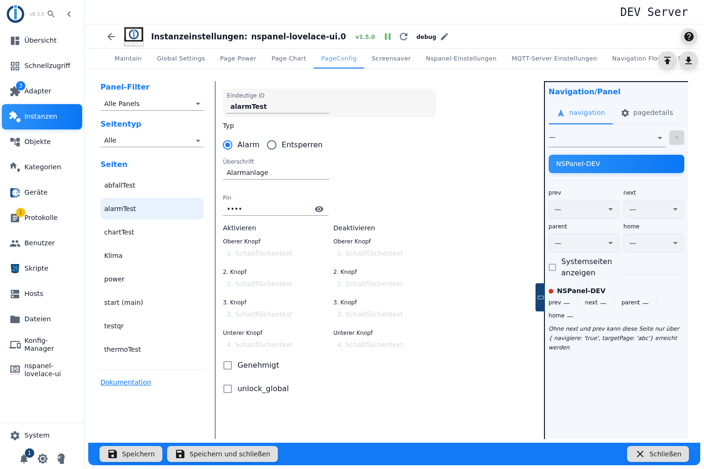
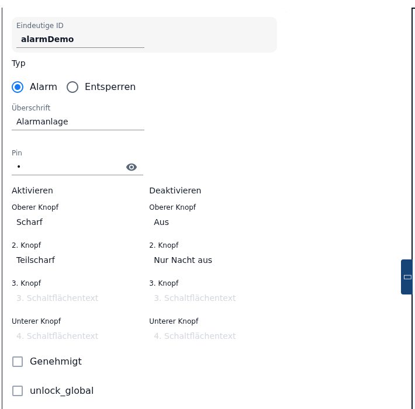
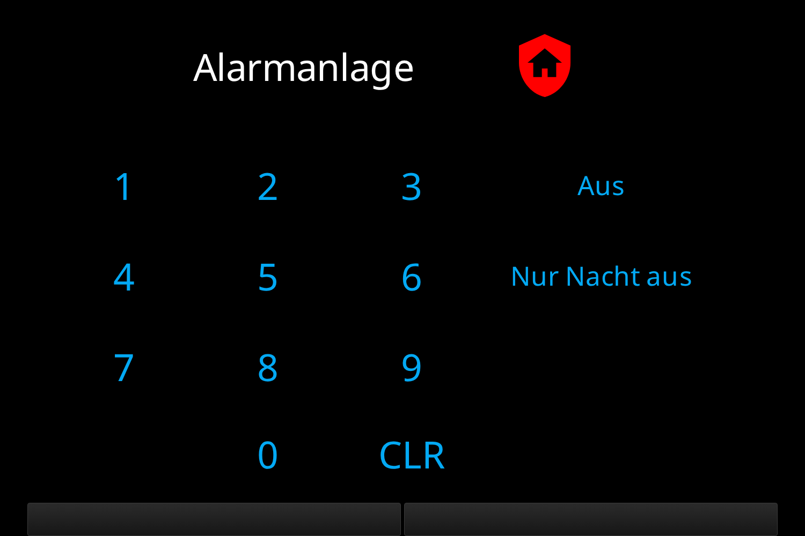
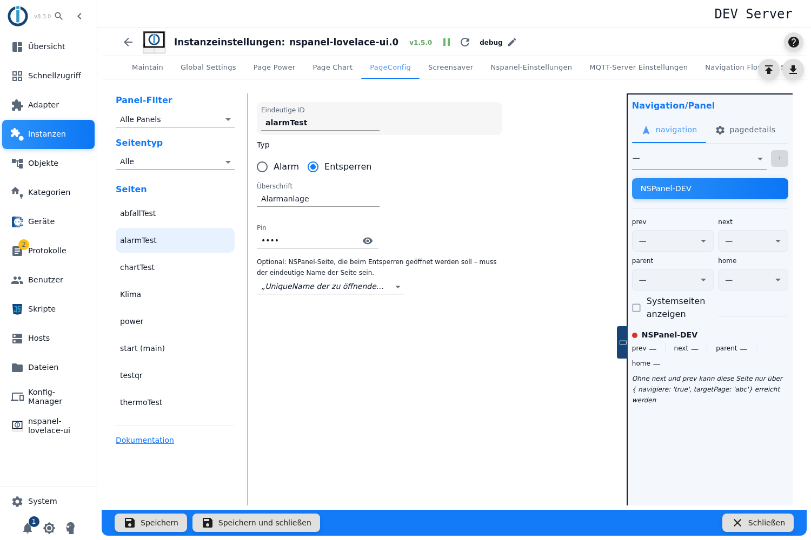

# Alarm- und Entsperrseite – Konfiguration im Admin

Eine Alarm-Seite macht aus dem Panel die Bedieneinheit einer Alarmanlage: vier Schaltflächen zum Aktivieren, vier zum Deaktivieren, eine PIN-Tastatur und drei Datenpunkte, über die eine echte Anlage angebunden wird. Dieselbe Karte dient als **Entsperrseite** — dann fragt sie nur die PIN ab und springt danach auf eine andere Seite.

Angelegt wird sie im Tab **PageConfig**, Seitentyp **Alarm**. Ein Konfigurationsskript ist dafür nicht nötig — und auch nicht möglich: Der Adapter überspringt eine Seite mit dem Kartentyp `cardAlarm` oder `cardUnlock` aus einer Skript-Konfiguration ausdrücklich und protokolliert `is only supported in the admin configuration! Skipped!`. Für diesen Kartentyp gibt es damit genau einen Weg.

Inhalt:
- [Seite anlegen](#1-seite-anlegen)
- [Betriebsart: Alarm oder Entsperren](#2-betriebsart-alarm-oder-entsperren)
- [PIN](#3-pin)
- [Die Schaltflächen der Alarm-Seite](#4-die-schaltflächen-der-alarm-seite)
- [Zustände und was die Karte zeigt](#5-zustände-und-was-die-karte-zeigt)
- [Genehmigt: Bestätigung von außen](#6-genehmigt-bestätigung-von-außen)
- [Ein Zustand für mehrere Panels](#7-ein-zustand-für-mehrere-panels)
- [Die Entsperrseite und ihr Sprungziel](#8-die-entsperrseite-und-ihr-sprungziel)
- [Die Datenpunkte des Adapters](#9-die-datenpunkte-des-adapters)
- [Panel-Zuweisung und Navigation](#10-panel-zuweisung-und-navigation)
- [Fallstricke](#fallstricke)

## 1. Seite anlegen

1. Instanz-Einstellungen öffnen → Tab **PageConfig**.
2. Links als Seitentyp **Alarm** wählen, im Feld *Neue Seite* einen Namen eintragen, **+** drücken.
3. Die Seite erscheint in der Liste **Seiten**, rechts öffnet sich der Editor.

Der Name ist die **Eindeutige ID** der Seite — unter ihm sprechen andere Seiten sie in ihren Navigationszielen an. Der Name ist nach dem Anlegen fest; warum, steht unter [PageConfig – Übersicht](PageConfig#seiten-anlegen-und-löschen).

Die neue Seite bringt mit: die **Überschrift** gleich dem Seitennamen, die **Pin** `0`, die Betriebsart **Alarm** und in beiden Schaltflächenspalten den **oberen Knopf** vorbelegt — *Aktivieren* und *Deaktivieren* (siehe [Abschnitt 2](#2-betriebsart-alarm-oder-entsperren) und [Abschnitt 4](#4-die-schaltflächen-der-alarm-seite)).

> **Alle Felder sind ausgegraut, wenn die Instanz nicht läuft.** Der Editor beobachtet dazu den Datenpunkt `alive` der Instanz; bei gestopptem Adapter lässt sich nichts eintragen. Einen erklärenden Hinweis gibt die Oberfläche nicht.

Der Verweis **Dokumentation** unten in der linken Spalte öffnet genau diese Seite im Wiki — er wird aus dem Kartentyp gebaut.

## 2. Betriebsart: Alarm oder Entsperren

Direkt unter der ID steht **Typ** mit zwei Möglichkeiten:

| Feld | Wirkung |
|---|---|
| **Alarm** | Die vollständige Alarmbedienung: acht Schaltflächen, Zustandsautomat, Statusdatenpunkte. |
| **Entsperren** | Nur PIN-Abfrage und ein Sprung auf eine andere Seite. |

Die **Entsperrseite ist kein eigener Seitentyp** — sie entsteht genau hier, aus einer Alarm-Seite. Deshalb findet man sie in der Auswahl beim Anlegen nicht.

> **Vorbelegt ist *Alarm*.** Eine neue Seite entsteht als Alarmanlage, der Editor zeigt also sofort alle Felder. Für eine Entsperrseite genügt ein Klick auf *Entsperren*; die Schaltflächentexte verschwinden dann aus der Ansicht, bleiben aber in der Konfiguration stehen.

**Umschalten später** blendet die Felder der anderen Betriebsart nur aus; eingetragene Werte bleiben in der Konfiguration stehen und werden weiter in die Seite übernommen. Wirksam ist jeweils nur, was zur gewählten Betriebsart gehört — die Schaltflächentexte und *Genehmigt* bei *Alarm*, das Sprungziel bei *Entsperren*. Eine Ausnahme ist die Checkbox `unlock_global`: Sie ist nur im Modus *Alarm* sichtbar, der Adapter liest sie aber in **beiden** Betriebsarten (siehe [Abschnitt 7](#7-ein-zustand-für-mehrere-panels)).

**Überschrift** ist die Kopfzeile am Panel. Beim Anlegen wird der Seitenname eingetragen.

> ⚠️ **Eine leere Überschrift ergibt am Panel das Wort `Unlock`** — auch bei einer Alarmseite und in jeder Sprache. Der Adapter setzt diesen Ersatzwert beim Bauen der Seite ein; der Seitenname erscheint nicht.

Überschrift und Schaltflächentexte laufen außerdem durch die Übersetzungstabelle des Adapters: Ein Text, der zufällig einem Übersetzungsschlüssel entspricht, wird ersetzt — `on` wird zu „an“, `off` zu „aus“, `Start` zu „Starten“, `unlock` zu „entsperren“.

## 3. PIN

Das Feld **Pin** nimmt nur Ziffern; das Augensymbol zeigt sie im Klartext. Die PIN gilt für beide Betriebsarten: Auf der Alarm-Seite schützt sie jede Schaltfläche, auf der Entsperrseite ist sie der ganze Zweck.

Vier Eigenheiten, die man kennen sollte:

- **Eine Seite ohne PIN lässt sich hier nicht einstellen.** Ein leeres Feld wird als `0` gespeichert, und `0` ist eine gültige PIN — abgefragt wird also trotzdem, und am Panel ist dann die `0` einzugeben.
- **Führende Nullen fallen weg.** Die Eingabe wird in eine Zahl verwandelt: Aus `0123` wird `123`. Am Panel muss dann `123` eingetippt werden; `0123` gilt als Fehlversuch.
- **Es gibt keine Längenprüfung** — weder nach unten noch nach oben, und keine Fehlermeldung.
- **Der zentrale Service-Pin ist von hier nicht erreichbar.** Der Adapter kennt dafür den Sonderwert `-1`: Steht er als PIN, verwendet die Karte den *Service-Pin* aus den [globalen Einstellungen](globelSettings). Das Eingabefeld entfernt aber jedes Zeichen außer Ziffern, das Minus also mit — den Wert setzt nur die eingebaute Systemseite `///unlock` des Adapters.

> **Die PIN steht im Klartext** in der Adapterkonfiguration (`native.pageConfig[].pin`). Jeder mit Objekt-Leserecht in ioBroker kann sie lesen. Die zentralen Credentials (Admin → Systemeinstellungen → Credentials) deckt diese Karte **nicht** ab — anders als das WLAN-Passwort einer [QR-Seite](cardQR), das seit 1.5.0 aus einem Credential kommen kann.

> ⚠️ **Nach einem Fehlversuch sperrt die Karte — und zwar immer länger.** Die Wartezeit verdoppelt sich mit jedem Fehlversuch (2 s, 4 s, 8 s …) und ist **nicht begrenzt**: nach zehn Fehlversuchen über 17 Minuten, nach sechzehn über 18 Stunden. Zurückgesetzt wird der Zähler nur durch die richtige PIN oder durch einen Neustart des Adapters. Während der Sperre zeigt die Karte „Gesperrt für“ und in der zweiten Zeile die Zeit, blinkt, trägt ein rotes `key-alert-outline` und die Tastatur bleibt tot. Die Zeitangabe **zählt nicht herunter** — sie ist eine einzige Meldung und steht unverändert, bis die Sperre abläuft.

## 4. Die Schaltflächen der Alarm-Seite

Zwei Spalten mit je vier Feldern. Was man einträgt, ist der **Text** der Schaltfläche; welche Aktion sie auslöst, steht fest. Ein leeres Feld bedeutet: diese Schaltfläche gibt es nicht. Man kann also auch nur eine Variante anbieten.

| Feld | Wirkung |
|---|---|
| Spalte **Aktivieren**, vier Felder | Erscheint im Zustand `disarmed`. Ein Druck meldet `A1`…`A4` und armiert die Anlage (vier Varianten, z. B. „Anwesend“ und „Abwesend“). **Das obere Feld ist Pflicht.** |
| Spalte **Deaktivieren**, vier Felder | Erscheint im Zustand `armed`. Ein Druck meldet `D1`…`D4` und deaktiviert die Anlage. **Das obere Feld ist Pflicht.** |

Und so sieht die Seite am Panel aus – eine frisch angelegte Alarmseite startet im Zustand `armed`, gezeigt werden deshalb die Schaltflächen der Spalte *Deaktivieren*:

> Die vier Felder beider Spalten tragen in der Oberfläche **dieselben Beschriftungen** — *Oberer Knopf*, *2. Knopf*, *3. Knopf*, *Unterer Knopf*, mit den Platzhaltern *1. Schaltflächentext* bis *4. Schaltflächentext*. Es gibt keine eigenen Texte für „5. Knopf“ bis „8. Knopf“; unterschieden werden die Spalten nur an ihrer Überschrift.
>
> Die Überschriften benennen die **Aktion**, nicht den Zustand: Die Spalte *Aktivieren* enthält die Schaltflächen, die armieren — sichtbar sind sie folglich, wenn die Anlage **aus** ist. Die englische Fassung sagt an dieser Stelle „Armed“ / „Disarmed“ und liest sich damit wie eine Zustandsangabe; gemeint ist dasselbe.

> **Der obere Knopf beider Spalten ist Pflicht.** Ohne ihn wäre die Karte in einem ihrer beiden Zustände ohne jede Schaltfläche — und aus diesem Zustand käme man nur noch über den Datenpunkt `.status` heraus. Beim Anlegen stehen deshalb *Aktivieren* und *Deaktivieren* in den beiden Feldern; leert man eines, färbt der Editor es rot, nennt den Grund und **sperrt das Speichern**, bis wieder ein Text darin steht. Die übrigen sechs Felder sind frei. Bei der Betriebsart *Entsperren* gibt es keine Pflichtfelder — dort genügt der eine eingebaute Knopf.
>
> Jedes Feld wird für sich übernommen: Ein Text in der Spalte *Deaktivieren* braucht **keinen** Partner in derselben Zeile der Spalte *Aktivieren*.

> **Eine neue Alarmseite startet im Zustand `armed`**, nicht `disarmed`. Sie zeigt also zuerst die Spalte *Deaktivieren* — mit dem vorbelegten Knopf *Deaktivieren* ist sie damit sofort bedienbar.

Symbole und Farben der Karte sind fest und nicht einstellbar; ein Symbolfeld gibt es für diesen Kartentyp nicht.

## 5. Zustände und was die Karte zeigt

Die Karte kennt fünf Zustände. Den aktuellen hält der Datenpunkt `.status`, über den auch eine fremde Anlage den Zustand vorgeben kann.

| Zustand | Was die Karte zeigt | Tastatur |
|---|---|---|
| `disarmed` | die Schaltflächen der Spalte *Aktivieren*, Symbol `shield-off` in Grün | frei |
| `armed` | die Schaltflächen der Spalte *Deaktivieren*, Symbol `shield-home` in Rot | frei |
| `arming` | eine Textschaltfläche mit dem Zustandsnamen, `shield` in Bernstein, die Karte blinkt | gesperrt |
| `pending` | dasselbe mit `shield-off` — der Weg zurück | gesperrt |
| `triggered` | eine Textschaltfläche, Glocke `bell-ring` in Rot, die Karte blinkt | sichtbar, aber ohne Funktion |

- **`triggered` setzt die Karte nie selbst.** Dieser Zustand kommt ausschließlich von außen, über `.status` = `4` — gedacht für die Anlage, die einen Alarm meldet.
- **Aus `triggered` führt kein Weg über das Panel.** Die Tastatur wird zwar freigegeben, der Adapter verwirft in diesem Zustand aber jedes Schaltflächen-Ereignis. Zurück geht es nur durch einen neuen Wert in `.status`.
- **Beim Start normalisiert der Adapter** `pending` zu `armed` und `arming` zu `disarmed` — ein Zwischenzustand übersteht keinen Neustart. `triggered` und die beiden Ruhezustände bleiben erhalten.

> ⚠️ **Die Zustandstexte erscheinen englisch.** Dem Adapter fehlen die Übersetzungen für `armed`, `disarmed`, `arming`, `pending`, `triggered` und `locked` — in allen Sprachen; in diesem Fall zeigt er den Schlüssel selbst. Auf dem Panel steht also wörtlich „arming“, „pending“, „triggered“. Übersetzt sind nur „Gesperrt für“ und „entsperren“. Dasselbe betrifft die Klartextliste des Datenpunkts `.status`.

## 6. Genehmigt: Bestätigung von außen

Mit dem Haken **Genehmigt** läuft das Schalten nicht sofort durch, sondern über einen Zwischenzustand: Ein Druck in der Spalte *Aktivieren* setzt die Karte auf `arming`, schreibt das Ereignis nach `.mode` und wartet auf eine Bestätigung von außen. Rückwärts dasselbe über `pending`.

| Schreibt jemand in `.approve` | Wirkung |
|---|---|
| `true` | `arming` → `armed`, `pending` → `disarmed` — die Schaltung gilt. |
| `false` | `arming` → `disarmed`, `pending` → `armed` — die Schaltung wird zurückgenommen. |

Gedacht ist das für eine echte Anlage, die selbst melden soll, dass sie wirklich armiert ist (etwa nach dem Türkontakt-Check). Ohne Haken schaltet die Karte direkt um, ohne Zwischenzustand.

Zu beachten:

- Der Haken muss gesetzt sein, sonst bleibt `.approve` wirkungslos — der Adapter wertet den Datenpunkt nur aus, wenn *Genehmigt* an ist.
- Geschrieben werden muss **ohne Bestätigung** (`ack = false`), also so, wie ein Skript oder die Objektansicht es normalerweise tun. Werte mit `ack = true` ignoriert die Karte. Nach der Auswertung bestätigt der Adapter den Wert selbst.
- ⚠️ **Ohne Bestätigung bleibt die Seite hängen.** `arming` und `pending` sperren die Tastatur; wenn niemand `.approve` beschreibt, blinkt die Karte dauerhaft weiter. Ausweg ist nur ein neuer Wert in `.status`.

## 7. Ein Zustand für mehrere Panels

> ⚠️ **Diese Checkbox zeigt zurzeit den Schlüssel `unlock_global` statt einer Beschriftung** — dem Adapter fehlt die Übersetzung, in allen Sprachen. Sie ist aber keine Kleinigkeit, deshalb hier, was sie tut:

Der Haken verlegt die Statusdatenpunkte der Seite von `panels.<panel>.alarm.<seite>` nach **`alarm.<seite>`** und hält den Zustand damit **über alle Panels hinweg gleich**: Schaltet ein Panel die Anlage, zieht der Adapter alle anderen Alarmseiten **gleichen Namens** nach. Wer dieselbe Alarmseite auf mehreren Panels zeigt, will das — sonst ist die Anlage auf dem einen Panel armiert und auf dem anderen nicht.

Zu beachten:

- Der Abgleich greift nur, wenn der Haken bei **jedem** Vorkommen der Seite gesetzt ist; verglichen wird der Seitenname.
- Nach dem Umstellen liegen die Datenpunkte **an einem anderen Ort** — Skripte und Visualisierungen, die darauf zeigen, müssen nachgezogen werden. Die alten Datenpunkte bleiben als Reste liegen.
- Wer nur ein Panel hat, lässt den Haken aus.

## 8. Die Entsperrseite und ihr Sprungziel

Bei der Betriebsart **Entsperren** fallen alle Schaltflächen weg. Die Karte zeigt ein Schloss (`lock-remove`), eine Tastatur und die Beschriftung „entsperren“. Nach der richtigen PIN springt sie auf das eingestellte Ziel.

Das Auswahlfeld darunter trägt den Hinweis *Optional: NSPanel-Seite, die beim Entsperren geöffnet werden soll – muss der eindeutige Name der Seite sein.*

| Feld | Wirkung |
|---|---|
| **Auswahlliste** | Alle Seiten, die der Adapter kennt — **über alle Panels hinweg**, ohne die internen Systemseiten (`///…`) und ohne die eigene Seite. Ein bereits gespeicherter Name, den der Adapter nicht (mehr) kennt, bleibt als zusätzlicher Eintrag sichtbar. |
| leer gelassen | Nach der richtigen PIN passiert nichts Sichtbares. |

- ⚠️ **Die Liste ist nicht auf das zugewiesene Panel begrenzt.** Steht die gewählte Seite auf dem Panel, das diese Entsperrseite zeigt, nicht zur Verfügung, bleibt der Sprung aus und im Log steht nur `Dont find navigation target for <name>`. Die Navigationsfelder in der rechten Spalte verhalten sich anders — die zeigen nur die Seiten des jeweiligen Panels.
- ⚠️ **Ohne Ziel ist die Seite praktisch wirkungslos.** Der Hinweistext nennt das Ziel *optional*; tatsächlich schaltet der Adapter dann nur die Statusdatenpunkte kurz durch und bleibt stehen. Gewarnt wird nicht, weder im Admin noch im Log.
- Auch eine Entsperrseite reagiert auf `.status` = `4`: Sie zeigt dann „locked“, blinkt und die Tastatur ist tot — dauerhaft, bis `.status` neu beschrieben wird.

Nützlich ist die Entsperrseite als **Vorschaltseite**: Man setzt sie als Navigationsziel vor eine Seite, die nicht jeder bedienen soll, und trägt als Sprungziel die eigentliche Seite ein.

## 9. Die Datenpunkte des Adapters

Für jede Alarm-Seite legt der Adapter Datenpunkte unter `panels.<panel>.alarm.<seitenname>` an (oder unter `alarm.<seitenname>`, siehe [Abschnitt 7](#7-ein-zustand-für-mehrere-panels)):

| Datenpunkt | Typ | Bedeutung |
|---|---|---|
| `.status` | Zahl, schreibbar | Der Zustand, mit Klartextliste `disarmed` (0), `armed` (1), `arming` (2), `pending` (3), `triggered` (4). **Von außen beschreibbar** — so meldet eine fremde Anlage ihren Zustand ans Panel, und so kommt man aus einem hängenden Zustand heraus. Werte über 4 setzen `disarmed`. |
| `.mode` | Text, nur lesbar | Das letzte gedrückte Ereignis (`A1`…`A4` beim Aktivieren, `D1`…`D4` beim Deaktivieren). **Das ist der Anschluss für die eigene Alarmanlage:** ein Skript hört darauf und schaltet die Anlage entsprechend. Nur in der Betriebsart *Alarm* vorhanden. |
| `.approve` | Boolesch, schreibbar | Die Bestätigung für [Genehmigt](#6-genehmigt-bestätigung-von-außen); beim Start auf `false` gesetzt. |

Die Anbindung einer realen Anlage läuft ausschließlich über diese Datenpunkte — Datenpunkte oder Alias-Rollen werden im Editor **nicht** eingetragen und auch nicht ausgewertet. Geschrieben wird immer **ohne** Bestätigung (`ack = false`); bestätigte Werte lösen nichts aus.

> In der Objektansicht tragen die drei Datenpunkte zurzeit ihre Rohnamen `StateObjects.alarmstatus`, `StateObjects.alarmmode` und `StateObjects.approve` — auch diese Übersetzungen fehlen dem Adapter.

## 10. Panel-Zuweisung und Navigation

Panel, Navigationsziele, *Startseite (main)*, *Versteckt* und *Verhalten des Bildschirmschoners* liegen in der rechten Spalte **Navigation/Panel**, beschrieben unter [PageConfig – Übersicht](PageConfig#panelzuweisung-und-navigation) und [Seitendetails](PageConfig#seitendetails).

- Für eine Alarmseite lohnt ein Blick auf **Verhalten des Bildschirmschoners**: Mit *Niemals aktivieren* bleibt die Seite stehen, statt nach der Wartezeit in den [Bildschirmschoner](screensaver) zu wechseln — sinnvoll, wenn der Zustand der Anlage dauerhaft sichtbar sein soll.
- Eine Seite **ohne Panelzuweisung** wird nicht gebaut.
- **PageItems kennt dieser Kartentyp nicht** — die Karte besteht nur aus den Schaltflächen, die der Zustandsautomat vorgibt.
- Wirksam werden alle Änderungen erst mit **Speichern**; der Adapter startet dafür neu.

## Fallstricke

- **Das Speichern ist gesperrt und ein Schaltflächenfeld ist rot.** Der obere Knopf einer der beiden Spalten ist leer; beide sind bei der Betriebsart *Alarm* Pflicht.
- **Die Karte blinkt und reagiert nicht.** Entweder steht sie in `arming`/`pending` und wartet auf `.approve` (Haken *Genehmigt*), oder sie steht in `triggered`. Beides endet nur über `.status`.
- **Die PIN wird abgefragt, obwohl keine eingetragen wurde.** Das leere Feld steht als `0` in der Konfiguration, und `0` ist eine gültige PIN.
- **Die PIN wird nicht angenommen.** Führende Nullen sind beim Speichern verloren gegangen — eingegeben werden muss die Zahl ohne sie.
- **Die Karte ist minutenlang gesperrt.** Die Wartezeit verdoppelt sich mit jedem Fehlversuch und ist nicht begrenzt; zurückgesetzt wird sie nur durch die richtige PIN oder einen Neustart des Adapters.
- **Am Panel steht „Unlock“.** Die Überschrift ist leer; der Adapter setzt diesen Ersatzwert ein.
- **Ein Schaltflächentext erscheint anders als eingetippt.** Der Text entspricht einem Übersetzungsschlüssel des Adapters (`on`, `off`, `Start`, `unlock` …) und wird ersetzt.
- **Die Zustände stehen englisch auf dem Panel.** Die Übersetzungen fehlen dem Adapter; er zeigt dann den Schlüssel.
- **Das Entsperren springt nicht.** Entweder ist kein Ziel eingetragen, oder das Ziel gibt es auf dem zugewiesenen Panel nicht — die Auswahlliste bietet die Seiten aller Panels an. Prüfen lässt sich das am Log (`Dont find navigation target`).
- **Skripte finden die Datenpunkte nicht mehr.** Der Haken `unlock_global` verschiebt sie von `panels.<panel>.alarm.<seite>` nach `alarm.<seite>`.
- **Ein Schreibzugriff bleibt ohne Wirkung.** `.status` und `.approve` müssen ohne Bestätigung (`ack = false`) geschrieben werden.
- **Alles ausgegraut:** Die Instanz läuft nicht. Der Editor ist nur bei laufender Instanz bedienbar.
