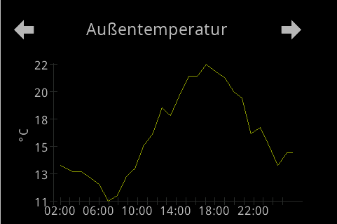
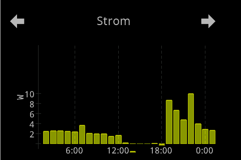
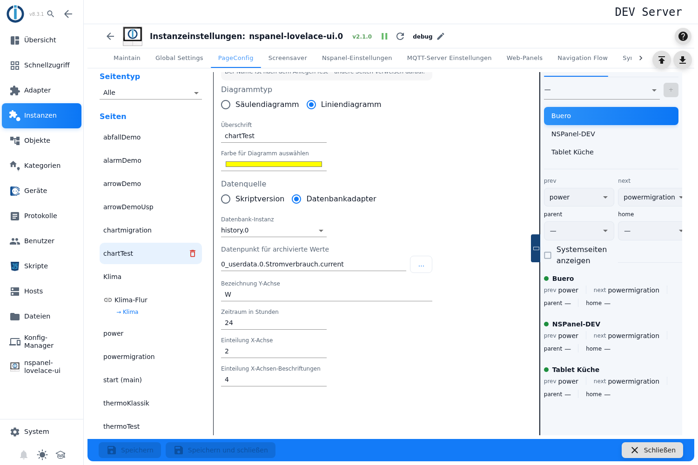
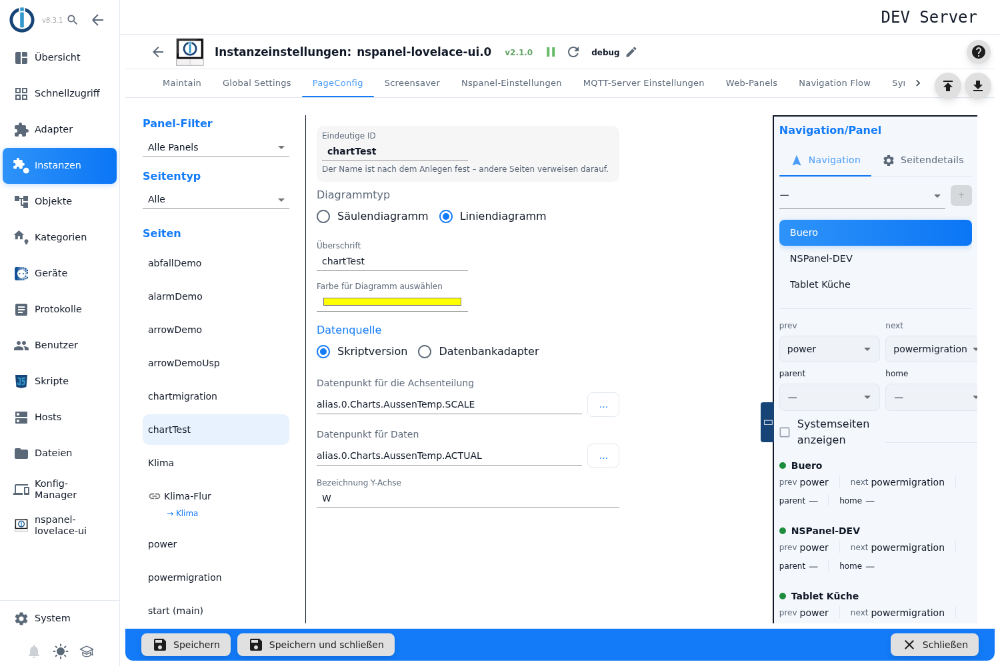
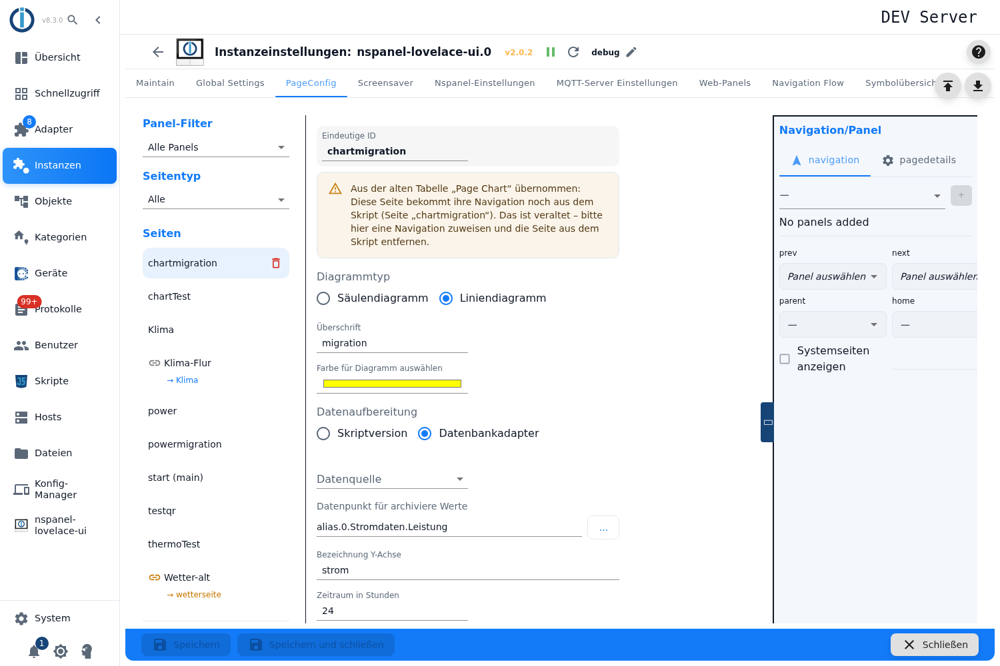

# Diagramm-Seite – Konfiguration im Admin

Die Diagramm-Seite zeichnet **einen** Messwert über die Zeit — als **Säulendiagramm** oder als **Liniendiagramm**. Die Daten holt sie entweder selbst aus einem Verlaufsadapter (InfluxDB, History, SQL) oder sie übernimmt fertig aufbereitete Werte aus zwei eigenen Datenpunkten.

Angelegt wird sie im Tab **PageConfig**, Seitentyp **Diagramm**. Ein Konfigurationsskript ist dafür nicht nötig; Seiten aus der alten Tabelle *Page Chart* kommen über die [Migration](Migration) in diesen Seitentyp.

Inhalt:
- [Seite anlegen](#1-seite-anlegen)
- [Diagrammtyp: Säulen oder Linie](#2-diagrammtyp-säulen-oder-linie)
- [Überschrift, Farbe, Achsenbeschriftung](#3-überschrift-farbe-achsenbeschriftung)
- [Datenquelle: die Weiche](#4-datenquelle-die-weiche)
- [Weg A: Daten aus einem Verlaufsadapter](#5-weg-a-daten-aus-einem-verlaufsadapter)
- [Weg B: Daten aus eigenen Datenpunkten](#6-weg-b-daten-aus-eigenen-datenpunkten)
- [Die Y-Achse und die Zwei-Zeichen-Regel](#7-die-y-achse-und-die-zwei-zeichen-regel)
- [Die Zeitachse](#8-die-zeitachse)
- [Wann das Panel neu zeichnet](#9-wann-das-panel-neu-zeichnet)
- [Panel-Zuweisung und Navigation](#10-panel-zuweisung-und-navigation)
- [Seiten aus der alten Tabelle „Page Chart"](#11-seiten-aus-der-alten-tabelle-page-chart)
- [Fallstricke](#fallstricke)

## 1. Seite anlegen

1. Instanz-Einstellungen öffnen → Tab **PageConfig**.
2. Links als Seitentyp **Diagramm** wählen, im Feld **Neue Seite** einen Namen eintragen, **+** drücken.
3. Die Seite erscheint in der Liste, rechts öffnet sich der Editor.

Eine frisch angelegte Seite steht auf **Säulendiagramm**, **Skriptversion**, Farbe **Gelb**, **Zeitraum in Stunden** 24, **Einteilung X-Achse** 2, **Einteilung X-Achsen-Beschriftungen** 4 und **Wertefaktor für Diagramm** 1. Die **Überschrift** wird mit dem Seitennamen vorbelegt.

> Wie bei allen Kartentypen sind sämtliche Felder gesperrt, solange die Instanz nicht läuft — ohne erklärenden Hinweis im Editor.

## 2. Diagrammtyp: Säulen oder Linie

**Diagrammtyp** bietet **Säulendiagramm** und **Liniendiagramm**. Die Wahl entscheidet mehr als nur das Aussehen:

| | **Säulendiagramm** | **Liniendiagramm** |
|---|---|---|
| Auflösung aus der Datenbank | ein Mittelwert **je Stunde** | **5-Minuten-Raster**, höchstens 500 Punkte |
| Y-Achse | Minimum fest **0** | spannt über die Daten |
| Umgang mit großen Zahlen | **Wertefaktor von Hand** | **automatisch** |
| Einteilung der X-Achse | nur Beschriftungen | Striche **und** Beschriftungen getrennt einstellbar |

Faustregel: **Säulen** für Stundenwerte (Verbrauch je Stunde), **Linie** für einen Verlauf (Temperatur).

 

An den beiden Bildern lassen sich die Unterschiede ablesen: Das **Liniendiagramm** (links) spannt die Y-Achse über die Daten — hier 11 bis 22 °C. Das **Säulendiagramm** (rechts) beginnt immer bei **0** und zeigt je Stunde eine Säule. Beide Achsenbeschriftungen bleiben **zweistellig**, das ist die Grenze des Panels (siehe [Abschnitt 7](#7-die-y-achse-und-die-zwei-zeichen-regel)). An den Zeitangaben sieht man die Einteilung: links alle vier Stunden, rechts an jeder durch vier teilbaren Uhrzeit.

Intern tragen beide Varianten denselben Kartentyp `cardChart`; der Diagrammtyp ist ein Feld der Seite. Das erklärt, warum ein Wechsel zwischen Säulen und Linie keine neue Seite braucht — und warum der Verweis **Dokumentation** für beide gleich lautet (siehe [Abschnitt 10](#10-panel-zuweisung-und-navigation)).

## 3. Überschrift, Farbe, Achsenbeschriftung

| Feld | Wirkung |
|---|---|
| **Eindeutige ID** | Seitenname; unter ihm sprechen andere Seiten die Seite in ihren Navigationszielen an. Nur lesbar — der Name ist nach dem Anlegen fest (*„Der Name ist nach dem Anlegen fest – andere Seiten verweisen darauf."*); bei der Startseite steht dort ihr eigener Hinweis: *Startseite – wird unter der ID „main" veröffentlicht.* Siehe [PageConfig – Übersicht](PageConfig#seiten-anlegen-und-löschen). |
| **Überschrift** | Kopfzeile am Panel. Leer zeigt das Panel `Page Chart`. |
| **Farbe für Diagramm auswählen** | Farbe der Kurve beziehungsweise der Säulen, als Farbwähler. Vorgabe Gelb. |
| **Bezeichnung Y-Achse** | Text neben der Achse, zum Beispiel `W`. Das Liniendiagramm hängt hier bei Bedarf seinen automatischen Faktor an — aus `W` wird dann `W x10`. Das Feld steht bei beiden Datenquellen. |

> Es gibt **eine** Farbe und **eine** Messreihe je Seite. Mehrere Kurven in einem Diagramm kann die Karte nicht, eine Legende gibt es entsprechend auch nicht — die „Legende" besteht aus Überschrift und Achsenbeschriftung.

## 4. Datenquelle: die Weiche

Die Auswahl **Datenquelle** entscheidet, woher die Werte kommen:

| Auswahl | Bedeutung |
|---|---|
| **Datenbankadapter** | Der Adapter fragt selbst einen Verlaufsadapter ab und rechnet die Darstellung aus. Erst damit erscheinen die **Datenbank-Instanz**, der Zeitraum, der Wertefaktor und die Achseneinteilung. |
| **Skriptversion** | Achse und Werte kommen fertig aus zwei eigenen Datenpunkten. Für Sonderfälle, die die Automatik nicht abdeckt. |

> Welche Felder darunter stehen, hängt allein an dieser Auswahl; die beiden folgenden Abschnitte beschreiben die zwei Wege. Ein Wechsel blendet die Felder des anderen Wegs nur aus — ihre Werte bleiben gespeichert und sind nach dem Zurückschalten wieder da.

## 5. Weg A: Daten aus einem Verlaufsadapter

| Feld | Wirkung |
|---|---|
| **Datenbank-Instanz** | Die Instanz des Verlaufsadapters. Die Liste enthält die **aktivierten** Instanzen von **InfluxDB**, **History** und **SQL** — andere Verlaufsadapter kennt der Editor nicht. Gibt es keine, steht dort *Keine Instanz gefunden*. |
| **Datenpunkt für archivierte Werte** | Der Messwert. Der Auswahldialog zeigt **nur Datenpunkte, die in der gewählten Instanz tatsächlich aufgezeichnet werden**; ohne gewählte Instanz alle, die irgendein Verlaufsadapter aufzeichnet. Das ist die nützlichste Prüfung des ganzen Editors. |
| **Zeitraum in Stunden** | Wie weit zurück gezeichnet wird; das Fenster endet immer „jetzt". Vorgabe 24, kleinster Wert 1 — nach oben gibt es keine Grenze. |
| **Wertefaktor für Diagramm** | Nur beim **Säulendiagramm**. Rechnet die Werte um, bevor sie ans Panel gehen — `0,001` macht aus Watt Kilowatt, damit die Beschriftung der Y-Achse in zwei Zeichen passt (siehe [Abschnitt 7](#7-die-y-achse-und-die-zwei-zeichen-regel)). Ein Tooltip am Feld nennt die Richtung. |

Der Adapter fragt die Daten als Mittelwerte ab (`getHistory` mit `aggregate: average`) — beim Säulendiagramm einen Wert je Stunde, beim Liniendiagramm im 5-Minuten-Raster und höchstens 500 Punkte. Läuft die gewählte Instanz gerade nicht, bleibt das Diagramm leer und es gibt nur eine Warnung im Log. Antwortet sie nicht, bricht die Abfrage nach 15 Sekunden mit einem Fehler im Log ab.

> **Ohne Instanz oder ohne Datenpunkt fällt die Seite stillschweigend auf den Skript-Weg zurück** — und zeigt dann ein leeres Diagramm, weil die Skript-Datenpunkte leer sind. Im Admin erscheint dazu **keine** Meldung. Wer ein leeres Diagramm sieht, prüft also zuerst, ob beide Felder gefüllt sind.

> **Verschwundene Instanz:** Wird die gewählte Instanz später deaktiviert oder entfernt, zeigt das Feld **leer** — gespeichert ist sie aber weiterhin. Die Seite sieht dann unkonfiguriert aus, obwohl sie es nicht ist.

> Der **Wertefaktor** bietet `1`, `0,1`, `0,01`, `0,001`. Der gewählte Faktor wird auf den Messwert angewendet, bevor er ans Panel geht: `0,001` bedeutet „durch 1000", also Watt → Kilowatt. Der Tooltip am Feld sagt es wörtlich: *Die Werte aus der Datenbank werden vor der Anzeige mit diesem Faktor multipliziert (0,1 = durch 10 geteilt).*

## 6. Weg B: Daten aus eigenen Datenpunkten

Bei **Skriptversion** erscheinen zwei andere Felder. Hier rechnet der Adapter **nichts** — er reicht durch, was in den Datenpunkten steht. Entsprechend muss das Panel-Format dort schon fertig vorliegen.

| Feld | Wirkung |
|---|---|
| **Datenpunkt für die Achsenteilung** | Ein **JSON-Array** mit den Werten der Y-Achse. Ist der Inhalt kein Array oder leer, wird er ignoriert. |
| **Datenpunkt für Daten** | Eine **Zeichenkette im Panel-Format**, die unverändert ans Panel geht: beim Säulendiagramm `wert^beschriftung~wert~…`, beim Liniendiagramm `striche+beschriftungen~position:wert~…`. |

Beide Datenpunkte werden beobachtet (siehe [Abschnitt 9](#9-wann-das-panel-neu-zeichnet)). Zeitraum, Wertefaktor und Achseneinteilung gibt es in diesem Weg nicht — sie stecken in den gelieferten Werten.

Dieser Weg ist für Fälle gedacht, die die Automatik nicht trifft. **Es gibt dabei keine automatische Skalierung**: Die Zwei-Zeichen-Regel des Panels ist selbst einzuhalten.

## 7. Die Y-Achse und die Zwei-Zeichen-Regel

Hier lohnt es, den Panel-Kontrakt zu kennen, denn er erklärt fast jedes seltsam aussehende Diagramm:

- Werte und Achsenmarken gehen **mit dem Faktor 10** ans Panel; das Panel teilt wieder durch 10 und druckt jede Marke als **ganze Zahl mit höchstens zwei Zeichen** — darstellbar ist damit der Bereich **−9 bis 99**. Aus 1520 wird „15".
- Das Panel spannt die Achse **genau über die Daten** und zeigt **nur Marken in diesem Bereich**. Zusätzliche Marken darüber oder darunter sind unsichtbar — man kann der Kurve auf diesem Weg also keine Luft verschaffen.

Daraus folgt für die beiden Diagrammtypen:

**Liniendiagramm — macht das von selbst.** Der Adapter wählt die Schrittweite als kleinsten 1-2-5-Wert, der höchstens fünf Schritte über die Spanne ergibt, und setzt Marken vom Schritt unter dem Minimum bis zum Schritt darüber, mindestens zwei. Passt eine Marke nicht in zwei Zeichen, **erhöht er den Faktor in Zehnerschritten** (bis maximal 1 000 000), bis es passt, und hängt ihn an die Achsenbeschriftung an — aus `W` wird dann `W x10`. Zu tun ist dafür nichts.

**Säulendiagramm — hier ist Handarbeit nötig.** Es rechnet einfacher: Minimum immer **0**, Schrittweite etwa ein Fünftel des Maximums mit einer Untergrenze, die mit dem Maximum wächst. Eine automatische Sicherung gegen zu lange Beschriftungen gibt es **nicht** — dafür ist der **Wertefaktor** da. Zeigt die Achse Unsinn, ist der Faktor der erste Hebel.

Eine Einstellung für Minimum, Maximum oder Schrittweite der Y-Achse gibt es in keinem der beiden Fälle.

## 8. Die Zeitachse

Zwei Felder, beide nur im Weg **Datenbankadapter**:

| Feld | Wirkung |
|---|---|
| **Einteilung X-Achse** | Nur Liniendiagramm. Abstand der Striche in **Stunden**. Vorgabe 2. Tooltip: *Intervall in Stunden zwischen den X-Achsen-Ticks (z.B. 2 für alle 2 Stunden ein Tick)*. |
| **Einteilung X-Achsen-Beschriftungen** | Beide Diagrammtypen. Abstand der Zeitangaben in **Stunden**. Vorgabe 4. Tooltip: *Intervall in Stunden zwischen den X-Achsen-Beschriftungen (z.B. 4 für alle 4 Stunden eine Beschriftung)*. |

> Beim **Säulendiagramm** wirkt die Beschriftungs-Einteilung anders, als der Name vermuten lässt: Beschriftet werden die Säulen, deren **Uhrzeit** durch den Wert teilbar ist — bei 4 also 0, 4, 8, 12, 16, 20 Uhr. Es ist also kein Abstand „ab jetzt", sondern ein Raster an der Uhr.

> Beim **Liniendiagramm** sitzen die Beschriftungen **auf den Strichen**: Beschriftet wird nur ein Strich, dessen Abstand zum Anfang durch den Beschriftungsabstand teilbar ist. Ist der Beschriftungsabstand **kein Vielfaches** des Strichabstands — etwa Striche 4, Beschriftungen 6 —, fallen Beschriftungen aus; beschriftet wird dann nur noch im kleinsten gemeinsamen Vielfachen, hier alle 12 Stunden.

> Beide Felder sind auf **1 bis 8** gestellt: Die Pfeile am Feld laufen nicht darüber hinaus. Ein von Hand getippter Wert außerhalb wird trotzdem übernommen, ohne Meldung — das Diagramm zeigt dann, was dabei herauskommt. `0`, negative Werte und Text leeren das Feld, das dann die Vorgabe als blassen Platzhalter zeigt — und die Vorgabe gilt auch. **Zeitraum in Stunden** hat nur die Untergrenze 1, nach oben keine.

**Zeitraum und Auflösung hängen zusammen**, ohne dass der Editor darauf hinweist: Das Liniendiagramm holt höchstens 500 Punkte, also wird das 5-Minuten-Raster ab 42 Stunden gröber. Das Säulendiagramm erzeugt eine Säule je Stunde — bei einem Zeitraum von einer Woche sind das 168 Säulen auf einem schmalen Display.

## 9. Wann das Panel neu zeichnet

Die Seite zeichnet nicht in festem Takt, sondern auf Anlass:

- **Beim Aufruf der Seite.** Wird die Seite am Panel sichtbar, holt der Adapter die Daten neu. Das Zeitfenster endet also immer beim Öffnen.
- **Bei einer Wertänderung.** Im Weg *Datenbankadapter* ist der gewählte **Datenpunkt für archivierte Werte** selbst der Auslöser; im Weg *Skriptversion* sind es die beiden Datenpunkte für Achsenteilung und Daten.
- **Höchstens einmal pro Minute.** Weitere Auslöser innerhalb der Minute werden gesammelt und danach in einem Durchgang nachgeholt.
- **Nur bei sichtbarer Seite.** Solange eine andere Seite oder der [screensaver](screensaver) am Panel steht, werden Auslöser verworfen.

Läuft noch eine Datenbankabfrage, liefert der Adapter die zuletzt gelesenen Daten; antwortet die Instanz 15 Sekunden nicht, steht ein Fehler im Log.

## 10. Panel-Zuweisung und Navigation

Panel, Navigationsziele, *Startseite*, *Versteckt* und *Verhalten des Bildschirmschoners* liegen in der rechten Spalte, beschrieben unter [PageConfig – Übersicht](PageConfig#panelzuweisung-und-navigation). Eine Seite **ohne** Panelzuweisung wird gar nicht gebaut.

> Der Verweis **Dokumentation** unten links im Tab baut seine Adresse aus dem **Kartentyp**, nicht aus dem Diagrammtyp: Säulen- und Liniendiagramm sind beide `cardChart`, der Verweis führt also in beiden Fällen auf **diese** Seite. Steht der Seitentyp-Filter auf *Alle* oder *Hauptseiten*, nimmt der Verweis den Kartentyp der **ausgewählten** Seite; ist keine Seite ausgewählt, führt er auf [PageConfig](PageConfig).

## 11. Seiten aus der alten Tabelle „Page Chart"

Seiten, die aus der alten Tabelle *Page Chart* übernommen wurden, zeigen im Editor oben einen **gelben Warnkasten**:

*Aus der alten Tabelle „Page Chart" übernommen: Diese Seite bekommt ihre Navigation noch aus dem Skript (Seite „…"). Das ist veraltet – bitte hier eine Navigation zuweisen und die Seite aus dem Skript entfernen.*

Gemeint ist: Der **Inhalt** dieser Seite steht vollständig in diesem Editor, ihr **Platz in der Navigation** kommt aber noch von einer Seite des Konfigurationsskripts. Der im Kasten genannte Name ist der **Skriptname** — er weicht vom Namen des Eintrags ab, wenn die Übernahme wegen einer Namenskollision ein Suffix angehängt hat.

Solange dieser Zustand besteht:

| Umstand | Wirkung |
|---|---|
| Der Adapter warnt bei jedem Start | *the navigation from the script is deprecated – assign it in the admin (tab PageConfig, page …) and remove the page from the script* |
| Die Skript-Seite liefert nur Navigation | Seitenelemente der Skript-Seite werden immer verworfen; eine dort gesetzte Überschrift gewinnt dagegen gegen die **Überschrift** dieses Editors. |
| *Seite dauerhaft anzeigen* / *Seite verbergen* im Skript | wirken zusätzlich zu den Einstellungen dieses Editors — gesetzt ist gesetzt, abwählen lässt sich das nur im Skript. |
| Der Kasten verschwindet | sobald die Seite hier eine **Panel-Zuweisung** hat. Die Skript-Seite ist dann ein toter Verweis: Der Adapter überspringt sie und schreibt *gets its navigation in the admin (tab PageConfig) – remove it from the script. Skipped!* ins Log. |
| Es gibt keinen Admin-Eintrag zum Skriptnamen | Die Seite entsteht gar nicht: *No chart page … found in the admin configuration*. |

Wie die Übernahme abläuft, welche Suffixe entstehen und wie der Knopf **Skript in Admin übernehmen** den letzten Schritt erledigt, steht auf [Migration](Migration).

## Fallstricke

> ⚠️ **Leeres Diagramm trotz gewählter Datenbank.** Fehlt die **Datenbank-Instanz** oder der **Datenpunkt für archivierte Werte**, arbeitet die Seite stillschweigend als *Skriptversion* — mit leeren Datenpunkten und damit leerem Diagramm. Im Admin erscheint dazu keine Meldung.

> **Die Liste der Datenbank-Instanzen zeigt aktivierte, nicht laufende Instanzen.** Der Editor liest die Instanzobjekte und filtert auf „aktiviert"; ob die Instanz läuft, prüft erst der Adapter. Eine aktivierte, aber hängende Instanz steht in der Liste und ergibt zur Laufzeit nur eine Log-Warnung und ein leeres Diagramm.

> **Das Datenpunktfeld lässt sich von Hand füllen.** Der Filter „nur aufgezeichnete Datenpunkte" gilt nur im Auswahldialog hinter **…**; eine getippte ID wird ungeprüft übernommen. Dann ist das leere Diagramm die einzige Rückmeldung.

> **Der Wertefaktor wirkt als Teiler.** `0,001` heißt „durch 1000" — so steht es auch im Tooltip des Felds. Ihn gibt es nur beim Säulendiagramm im Datenbank-Weg, und dort ist er der einzige Schutz gegen zu lange Achsenbeschriftungen.

> **Luft über oder unter der Kurve gibt es nicht.** Das Panel spannt die Y-Achse genau über die Daten und zeigt nur Marken in diesem Bereich. Mehr Marken zu setzen hilft nicht — das gilt auch für die Skriptversion.

> **Ein großer Zeitraum macht das Diagramm nicht genauer.** Beim Liniendiagramm wird das 5-Minuten-Raster ab 42 Stunden gröber (500-Punkte-Grenze), beim Säulendiagramm wächst nur die Zahl der Säulen — eine Woche ergibt 168.

> **Die rechte Beschriftung der Linie liegt nicht bei „jetzt".** Der Adapter setzt am rechten Rand immer einen zusätzlichen beschrifteten Strich 50 Minuten vor der aktuellen Zeit, unabhängig von der eingestellten Einteilung.

> **Eine Messreihe, eine Farbe.** Mehrere Kurven, zwei Y-Achsen oder eine Legende kennt die Karte nicht.

> **Alle Felder bleiben gesperrt, solange die Instanz nicht läuft.** Der Editor sagt nicht, warum.

> **Nach dem Umzug aus der alten Tabelle ist die Arbeit nicht fertig.** Solange die Navigation aus dem Skript kommt, warnt der Adapter bei jedem Start; erst eine Panel-Zuweisung hier plus das Entfernen der Seite aus dem Skript beendet das. Der Weg dorthin steht auf [Migration](Migration).
