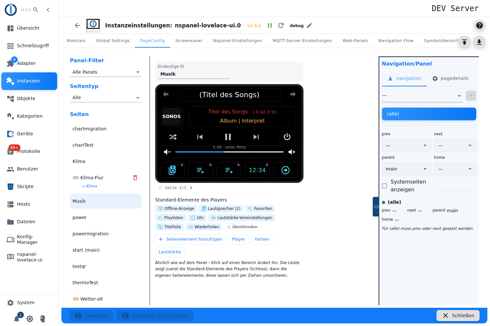
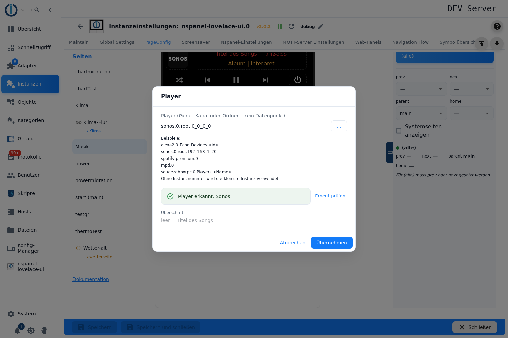
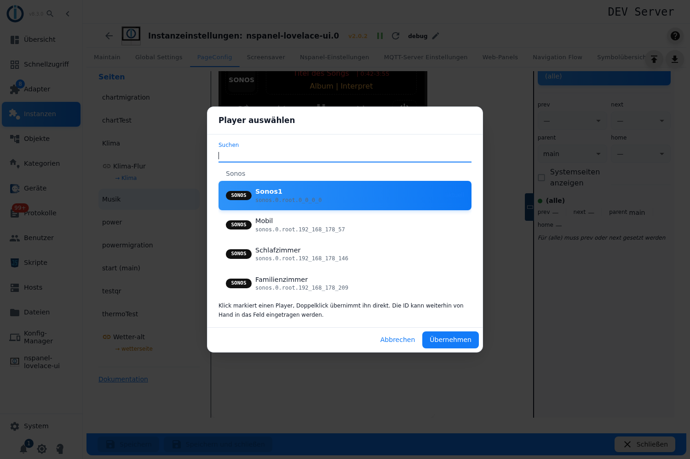
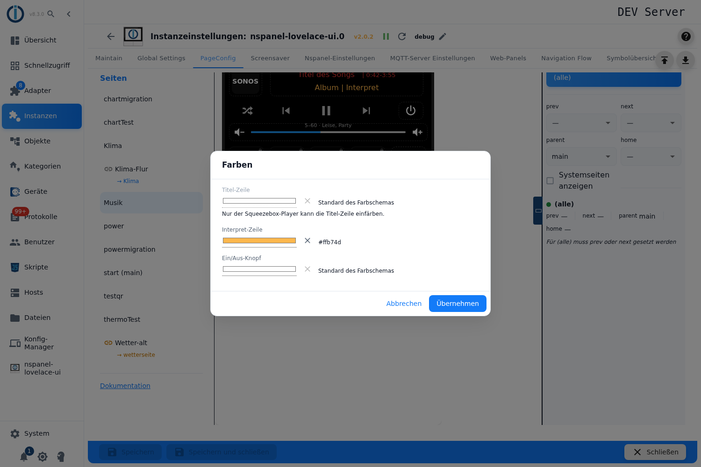
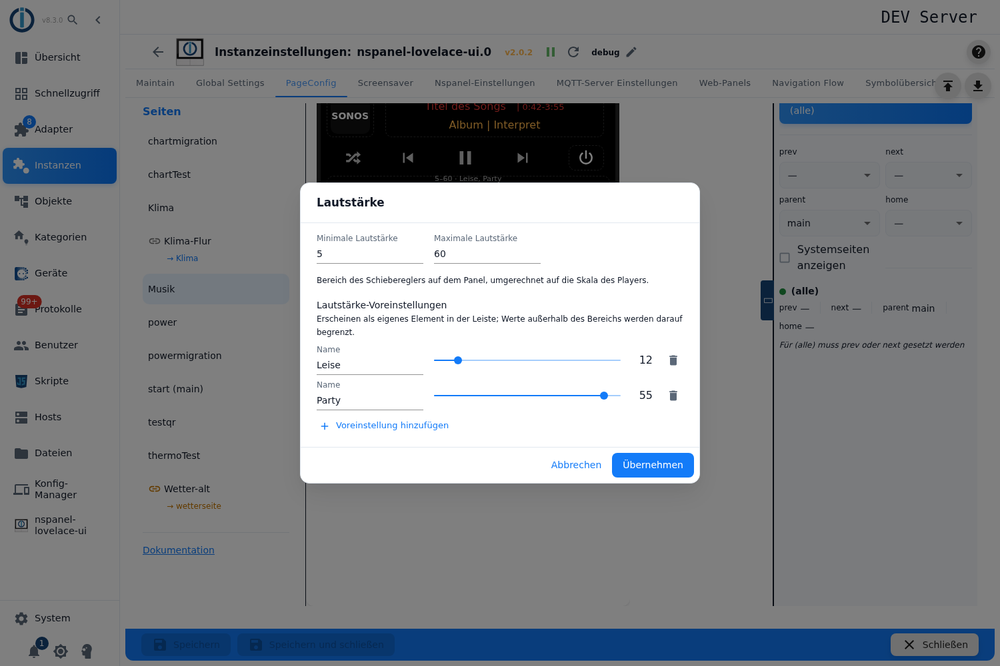
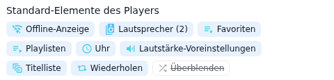
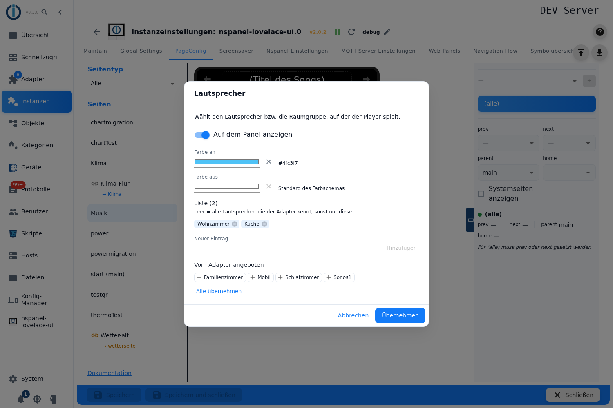
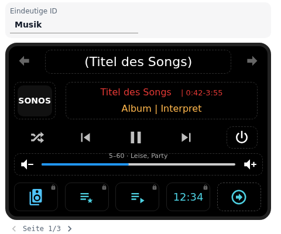

# Mediaplayer-Seite – Konfiguration im Admin

Die Mediaplayer-Seite `cardMedia` steuert **einen** Player: Kopfzeile, Logo, Titel- und Interpret-Zeile mit Laufzeit, die Transporttasten (Zufall, Zurück, Play/Pause, Weiter), einen Ein/Aus-Knopf, den Lautstärkeregler und darunter eine Leiste mit **fünf** Plätzen. Die Leiste füllt der Adapter zuerst mit den Standard-Elementen, die der Player hergibt (Lautsprecher, Playlisten, Favoriten, Uhr …), danach kommen die eigenen Seitenelemente.

Angelegt wird sie im Tab **PageConfig**, Seitentyp **Mediaplayer**. Der Editor zeichnet die Seite ähnlich wie das Panel – jede Stelle der Karte ist anklickbar und öffnet die passenden Einstellungen.

**Unterstützt werden genau fünf Adapter:** `alexa2`, `sonos`, `spotify-premium`, `mpd` und `squeezeboxrpc`. Jede andere ID lehnt der Adapter ab; der Editor meldet das sofort mit *„Diese ID gehört zu keinem unterstützten Adapter (alexa2, sonos, spotify-premium, mpd, squeezeboxrpc)."*

Inhalt:
- [Seite anlegen](#1-seite-anlegen)
- [Der Editor im Überblick](#2-der-editor-im-überblick)
- [Player, Prüfung und Überschrift](#3-player-prüfung-und-überschrift)
- [Farben](#4-farben)
- [Lautstärke: Bereich und Voreinstellungen](#5-lautstärke-bereich-und-voreinstellungen)
- [Standard-Elemente des Players](#6-standard-elemente-des-players)
- [Die drei Listen: Lautsprecher, Playlisten, Favoriten](#7-die-drei-listen-lautsprecher-playlisten-favoriten)
- [Eigene Seitenelemente](#8-eigene-seitenelemente)
- [Blättern der Optionsleiste](#9-blättern-der-optionsleiste)
- [Panel-Zuweisung und Navigation](#10-panel-zuweisung-und-navigation)
- [Fallstricke](#fallstricke)

## 1. Seite anlegen

1. Instanz-Einstellungen öffnen → Tab **PageConfig**.
2. Links als Seitentyp **Mediaplayer** wählen, einen Namen eintragen, **+** drücken.
3. Die Seite erscheint in der Liste, rechts öffnet sich der Editor. Eine neue Seite hat noch keinen Player: Oben steht *„Noch kein Player ausgewählt."* mit dem Knopf **Player**, der direkt in den Player-Dialog führt.

**Eindeutige ID** über der Vorschau ist der Seitenname; bei der Startseite ist das Feld gesperrt.

> Wie bei allen Kartentypen sind sämtliche Felder gesperrt, solange die Instanz nicht läuft. Der Editor sagt das nur an einer Stelle, nämlich im Player-Dialog: *„Der Adapter läuft nicht – der Player kann nicht geprüft und es können keine Namen gelesen werden."*

## 2. Der Editor im Überblick



Unter der Vorschau steht der Hinweis, der die Arbeitsweise zusammenfasst: *„Ähnlich wie auf dem Panel – Klick auf einen Bereich ändert ihn. Die Leiste zeigt zuerst die Standard-Elemente des Players (Schloss), dann die eigenen Seitenelemente; diese lassen sich per Ziehen umsortieren."*

| Element | Wirkung |
|---|---|
| **Kopfzeile** und **Logo** | Klick → Dialog *Player* (Tooltip *Player und Name*). |
| **Titel- und Interpret-Zeile**, **Ein/Aus-Knopf** | Klick → Dialog *Farben* (Tooltip *Farben von Titel, Interpret und Ein/Aus-Knopf*). |
| **Lautstärkeleiste** | Klick → Dialog *Lautstärke* (Tooltip *Lautstärkebereich und Voreinstellungen*). Über der Leiste stehen der eingestellte Bereich und die Namen der Voreinstellungen. |
| **Transporttasten** in der Mitte | Nicht einstellbar: *„Zufall, Zurück, Play/Pause und Weiter fügt der Adapter hinzu, wenn der Player sie anbietet."* |
| **Pfeile oben links/rechts** | Die Navigationspfeile des Panels, vom Panel vorgegeben. |
| **Plätze der Leiste** | Elemente mit **Schloss** sind Standard-Elemente des Players (*Standard-Element des Players – klicken zum Ändern*). Elemente mit **blauem Rahmen** sind eigene Seitenelemente. Ein Platz mit **+** ist frei und legt ein neues Seitenelement an. |
| **Seite x/y** mit Pfeilen | Erscheint, sobald die Elemente nicht auf eine Leiste passen. |
| **Standard-Elemente des Players** | Die Marken unter der Vorschau: alle Elemente, die das gewählte Backend kennt – auch die abgeschalteten (durchgestrichen). Klick öffnet die Einstellungen des Elements. |
| **Seitenelement hinzufügen** | Neues eigenes Seitenelement, gleichbedeutend mit dem Klick auf einen freien Platz. |
| **Player** / **Farben** / **Lautstärke** | Dieselben drei Dialoge als Knöpfe. |

Rechts daneben liegt wie bei allen Seiten der Bereich **Navigation/Panel**.

Alle vier Dialoge arbeiten auf einer Kopie des Eintrags: **Übernehmen** schreibt die Änderungen in die Seite, **Abbrechen** verwirft sie.

## 3. Player, Prüfung und Überschrift



**Player (Gerät, Kanal oder Ordner – kein Datenpunkt)** nimmt die ID des Players. Sie lässt sich eintippen oder über **…** aus der Liste wählen. Der Hilfstext nennt die Beispiele:

```
alexa2.0.Echo-Devices.<id>
sonos.0.root.192_168_1_20
spotify-premium.0
mpd.0
squeezeboxrpc.0.Players.<Name>
```

*„Ohne Instanznummer wird die kleinste Instanz verwendet."* — `spotify-premium` genügt also, `spotify` nicht.

**Die Auswahlliste** (Knopf **…**) ist kein Objektbaum, sondern eine Suche: Sie liest die Objekte der fünf Adapter und zeigt alles, was als Player in Frage kommt, nach Adapter gruppiert und mit Logo-Marke.



| Feld | Wirkung |
|---|---|
| **Suchen** | Filtert über ID, Name und Adapternamen. |
| Zeile anklicken | Markiert den Player; **Übernehmen** trägt ihn ein. Doppelklick übernimmt direkt. |
| **aktuell** | Markierung des Players, der in der Seite steht. |
| **Instanz deaktiviert** | Die Adapterinstanz ist abgeschaltet – der Player lässt sich trotzdem wählen. |

Der Hinweis unter der Liste: *„Klick markiert einen Player, Doppelklick übernimmt ihn direkt. Die ID kann weiterhin von Hand in das Feld eingetragen werden."* Findet die Suche nichts, erscheint *„Kein unterstützter Mediaplayer gefunden – installiere und richte einen dieser Adapter ein: …"*; lassen sich die Objekte eines Adapters nicht lesen, steht *„Die Objekte dieser Adapter konnten nicht gelesen werden: …"*.

**Die Prüfung.** Sobald eine ID eingetragen ist, fragt der Editor den Adapter. Der prüft die ID auf demselben Weg, auf dem er später die Seite baut, und liefert gleich die Namen für die drei Listen mit.

| Rückmeldung | Bedeutung |
|---|---|
| *Der Adapter prüft den Player …* | Die Prüfung läuft. |
| **Player erkannt: Alexa / Sonos / Spotify / MPD / Squeezebox (LMS)** | Der Adapter nimmt die ID. |
| **Der Adapter akzeptiert diesen Player nicht:** | Darunter stehen die Befunde des Adapters im Wortlaut. |
| *Diese ID gehört zu keinem unterstützten Adapter …* | Das erste Segment der ID ist keiner der fünf Adapter. |
| *Der Adapter läuft nicht – …* | Die Instanz läuft nicht; es wird nicht geprüft. |

**Erneut prüfen** wiederholt die Prüfung. Das ist nötig, weil der Editor sich das Ergebnis je ID merkt.

**Überschrift** (Platzhalter *leer = Titel des Songs*) ist die Kopfzeile der Karte am Panel. Bleibt sie leer, baut der Adapter die Zeile selbst: aus dem Namen des Players und dem Titel des laufenden Songs, und wenn es keinen gibt, aus dem Namen des Dienstes (`Alexa`, `Sonos`, `Spotify`, `MPD`, `Squeezebox`).

## 4. Farben



Drei gleich aufgebaute Felder. Jedes zeigt neben der Farbe ein **×** (*Zurück auf Standard*) und, solange nichts gesetzt ist, den Text *Standard des Farbschemas*.

| Feld | Wirkung |
|---|---|
| **Titel-Zeile** | Farbe der Titelzeile – **nur bei Squeezebox bedienbar**, sonst gesperrt mit dem Hinweis *„Nur der Squeezebox-Player kann die Titel-Zeile einfärben."* |
| **Interpret-Zeile** | Farbe der Zeile mit Album und Interpret. Bei den vier übrigen Backends färbt dieses Feld **auch die Titelzeile**. |
| **Ein/Aus-Knopf** | Farbe des Ein/Aus-Knopfs rechts neben den Transporttasten. |

## 5. Lautstärke: Bereich und Voreinstellungen



| Feld | Wirkung |
|---|---|
| **Minimale Lautstärke** / **Maximale Lautstärke** | Der Ausschnitt der Player-Skala, den das Panel auf seinen Regler abbildet. Leer = 0 bzw. 100. Erlaubt sind 0 bis 100; ein verdrehter Bereich wird beim Bauen der Seite getauscht. |
| **Lautstärke-Voreinstellungen** | Feste Lautstärken, je Zeile ein **Name** und ein Schieberegler innerhalb des eingestellten Bereichs. **Voreinstellung hinzufügen** legt eine neue an, der Papierkorb löscht sie. |

Die Hilfstexte lauten *„Bereich des Schiebereglers auf dem Panel, umgerechnet auf die Skala des Players."* und *„Erscheinen als eigenes Element in der Leiste; Werte außerhalb des Bereichs werden darauf begrenzt."*

Ein leeres Namensfeld wird rot markiert und sperrt **Übernehmen**. Die Werte werden beim Speichern auf ganze Zahlen gerundet und auf den Bereich begrenzt.

## 6. Standard-Elemente des Players



Welche Elemente es gibt und in welcher Reihenfolge sie in die Leiste kommen, bestimmt der Player – nicht die Reihenfolge im Editor:

| Backend | Standard-Elemente in der Reihenfolge des Adapters |
|---|---|
| **Alexa** | Erinnerungen · Offline-Anzeige · Lautsprecher · Playlisten · Equalizer · Uhr · Lautstärke-Voreinstellungen · Wiederholen |
| **Sonos** | Offline-Anzeige · Lautsprecher · Favoriten · Playlisten · Uhr · Lautstärke-Voreinstellungen · Titelliste · Wiederholen · Überblenden |
| **Spotify** | Offline-Anzeige · Lautsprecher · Playlisten · Titelliste · Uhr · Lautstärke-Voreinstellungen · Wiederholen |
| **MPD** | Offline-Anzeige · Wiederholen · Uhr · Lautstärke-Voreinstellungen · Überblenden |
| **Squeezebox (LMS)** | Offline-Anzeige · Lautsprecher · Favoriten · Playlisten · Uhr · Lautstärke-Voreinstellungen · Titelliste · Wiederholen |

Ein Klick auf eine Marke oder auf den Platz in der Leiste öffnet die Einstellungen des Elements:

| Feld | Wirkung |
|---|---|
| **Auf dem Panel anzeigen** | Schalter; aus = der Adapter legt das Element nicht an. Bei den **Lautstärke-Voreinstellungen** gibt es ihn nicht – dort steht stattdessen **Voreinstellungen bearbeiten**, das in den Lautstärke-Dialog wechselt. |
| **Farbe an** / **Farbe aus** | Zwei Farben, wenn das Element einen Aus-Zustand hat. |
| **Farbe** | Eine Farbe, wenn es nur einen Zustand gibt. |
| **Liste** | Nur bei *Lautsprecher*, *Playlisten* und *Favoriten* – siehe [Abschnitt 7](#7-die-drei-listen-lautsprecher-playlisten-favoriten). |

Welche Farbfelder erscheinen, hängt am Element und am Backend:

| Element | Farbfelder |
|---|---|
| **Offline-Anzeige**, **Lautsprecher**, **Wiederholen** | *Farbe an* und *Farbe aus* |
| **Überblenden** | *Farbe an* und *Farbe aus* bei Sonos; bei MPD **keine** |
| **Playlisten**, **Favoriten**, **Equalizer**, **Uhr**, **Lautstärke-Voreinstellungen** | nur *Farbe* |
| **Erinnerungen** | nur *Farbe aus* |
| **Titelliste** | keine |

Die Hilfstexte der Dialoge beschreiben, was ein Element tut, zum Beispiel *„Wählt den Lautsprecher bzw. die Raumgruppe, auf der der Player spielt."*, *„Springt zu einem Titel der aktuellen Warteschlange."*, *„Bässe, Mitten und Höhen des Echo-Geräts."* oder *„Erscheint, sobald mindestens eine Lautstärke-Voreinstellung angelegt ist."*

> Die **Offline-Anzeige** belegt in der Vorschau keinen Platz: *„Erscheint nur, solange der Player nicht erreichbar ist – sonst belegt es keinen Platz."* Nur als Marke unter der Vorschau ist sie zu sehen.

## 7. Die drei Listen: Lautsprecher, Playlisten, Favoriten



Die drei Elemente *Lautsprecher*, *Playlisten* und *Favoriten* führen eine Namensliste. Sie wirkt als Auswahl: **leer bedeutet alles**, was der Player hergibt.

| Feld | Wirkung |
|---|---|
| **Liste (n)** | Die eigenen Einträge als Marken; das × an der Marke löscht sie. Ohne Eintrag steht *Leer*. |
| **Neuer Eintrag** + **Hinzufügen** | Trägt einen Namen von Hand ein; die Eingabetaste wirkt wie der Knopf. Doppelte Namen werden nicht aufgenommen. |
| **Vom Adapter angeboten** | Die Namen, die der Adapter beim Prüfen des Players gelesen hat, und die noch nicht in der Liste stehen. Klick auf eine Marke übernimmt sie. |
| **Alle übernehmen** | Hängt **alle** angebotenen Namen an die eigene Liste an. Vorhandene Einträge bleiben erhalten. |

Steht dort *„Der Adapter bietet für diese Liste keine weiteren Namen an."*, kennt der Adapter für diese Liste nichts (oder alles steht schon in der Liste). Gelesen werden:

| Backend | Lautsprecher | Playlisten | Favoriten |
|---|---|---|---|
| **Alexa** | aus `Echo-Devices` | – | – |
| **Sonos** | aus `root` | – | aus der Favoritenliste des Players |
| **Spotify** | aus der Geräteliste | aus der Playlistenliste | – |
| **Squeezebox (LMS)** | aus `Players` | beim LMS abgefragt | abspielbare Favoriten |
| **MPD** | – | – | – |

Die Hinweise im Dialog sind je Liste und Backend unterschiedlich:

- **Lautsprecher:** *„Leer = alle Lautsprecher, die der Adapter kennt, sonst nur diese."*
- **Favoriten:** *„Leer = alle Favoriten, sonst nur diese."*
- **Playlisten** allgemein: *„Leer = alle Playlisten, sonst nur diese."*
- **Playlisten bei Sonos:** *„Der sonos-Adapter kann die Playlisten nicht lesen – trage hier die Namen der Sonos-Playlisten ein. Ohne Liste bleibt das Element ohne Funktion."*
- **Playlisten bei Alexa:** *„Einträge als `<Ende des Datenpunkts>.<Wert>`, z. B. `Apple-Music-Playlist.Rock` – der Teil nach dem Punkt wird in den Datenpunkt geschrieben."*

## 8. Eigene Seitenelemente

Eigene Seitenelemente kommen **hinter** die Standard-Elemente des Players. Angelegt werden sie über einen freien Platz der Leiste (**+**) oder über **Seitenelement hinzufügen**; beides öffnet die [Pageitem-Konfiguration](PageConfig-Dialoge#1-pageitem-konfiguration).

| Griff | Wirkung |
|---|---|
| Klick auf das Element | Öffnet seine Einstellungen. |
| **‹** / **›** beim Überfahren | Tauscht das Element mit dem Nachbarn. |
| **Papierkorb** beim Überfahren | Löscht das Element; die folgenden rutschen nach. |
| **Ziehen** auf ein anderes eigenes Element | Die beiden tauschen die Plätze. |

Zwei Besonderheiten dieser Karte gelten für die eigenen Elemente:

- **Der Name erscheint nicht unter dem Symbol.** Der Dialog weist darauf hin: *„Auf dieser Seite nur Titel des Popups – wird auf dem Panel nicht unter dem Icon angezeigt."*
- **Einen langen Druck gibt es hier nicht.** Das Feld fehlt, weil die Elemente dieser Karte am Panel keinen langen Druck melden.

## 9. Blättern der Optionsleiste



Die Leiste hat **fünf** Plätze. Passt nicht alles hinein, wird geblättert; wie, steht rechts im Bereich **Navigation/Panel** unter **Blättern der Seitenelemente**:

| Auswahl | Wirkung |
|---|---|
| **Klassisch** | *„Mehr Elemente als Plätze: Die Doppelpfeile des Panels blättern weiter."* |
| **Pfeil** | *„Mehr Elemente als Plätze: Der letzte Platz zeigt einen Pfeil, der weiterblättert."* – es bleiben vier Plätze für Elemente. |
| **Automatisch** | *„Wie klassisch, zusätzlich blättert die Seite nach der eingestellten Zeit von selbst weiter."* – dazu **Sekunden bis zur nächsten Seite** (leer = 15). |

Im Editor blättert die Anzeige **Seite x/y** unter der Vorschau; in der Einstellung *Pfeil* tut es auch der Pfeil auf dem letzten Platz (*„Blätterpfeil (Blättern „Pfeil") – Klick zeigt die nächste Seite"*).

**Weiterblättern um** eine halbe Seite gibt es bei dieser Karte nicht – die Auswahl erscheint nur bei den Grid- und Thermostat-Seiten.

## 10. Panel-Zuweisung und Navigation

Panel, Navigationsziele, *Startseite*, *Versteckt* und *Verhalten des Bildschirmschoners* liegen in der rechten Spalte, beschrieben unter [PageConfig – Übersicht](PageConfig#panelzuweisung-und-navigation).

Unten **Speichern** bzw. **Speichern und schließen**. Die Instanz startet danach neu und baut die Seite auf.

## Fallstricke

- **Ohne laufende Instanz geht nichts.** Alle Felder sind gesperrt, die Prüfung des Players läuft nicht und die Listen bleiben leer. Den Grund nennt nur der Player-Dialog.
- **Das Prüfergebnis wird je ID gemerkt.** Wird der Player-Adapter erst nach der Prüfung gestartet oder das Gerät angelegt, bleibt die alte Fehlermeldung stehen, bis **Erneut prüfen** gedrückt wird.
- **Ein abgelehnter Player lässt sich trotzdem speichern.** *Übernehmen* im Player-Dialog ist nicht gesperrt. Die Seite entsteht dann ohne Inhalt; der Grund steht als Warnung im ioBroker-Log.
- **Die Befunde der Prüfung sind die englischen Logtexte des Adapters** („… is not a valid sonos device!"), unabhängig von der Sprache des Admins.
- **„Überschrift" kann heimlich zum Datenpunkt werden.** Ist der eingetragene Text die ID eines vorhandenen Datenpunkts, nimmt der Adapter dessen **Wert** als Kopfzeile statt des Textes. Nützlich für eine lebende Überschrift, überraschend, wenn es nicht beabsichtigt war.
- **Die Überschrift einer Verknüpfung wirkt hier nicht.** Zeigt eine [Verknüpfung](pageLink) auf die Mediaplayer-Seite, bleibt ihr Überschriftenfeld ohne Folgen: Die Kopfzeile der Karte baut der Adapter allein aus **Überschrift** im Player-Dialog.
- **„Minimale/Maximale Lautstärke" begrenzen den Regler nicht.** Der Schieberegler am Panel bleibt 0–100; die beiden Werte sagen dem Adapter nur, welchen Ausschnitt der **Player-Skala** er darauf abbildet. Der Hilfstext im Dialog legt das Gegenteil nahe. Dieselbe Skala gilt für die Werte der Voreinstellungen.
- **Farben für Titel und Interpret greifen nur, solange gespielt wird.** In Pause nimmt das Panel seine eigenen Aus-Farben, die eingestellte Farbe ist dann nicht zu sehen.
- **„Titel-Zeile" ist bei vier von fünf Backends gesperrt** – und bei genau diesen vier färbt **„Interpret-Zeile"** zusätzlich die Titelzeile. Wer dort nur den Interpreten einfärben will, hat keine Möglichkeit dazu.
- **Eine eigene Farbe am Ein/Aus-Knopf gilt für beide Zustände.** Ohne eigene Farbe unterscheidet das Panel ein und aus; sobald eine Farbe gesetzt ist, bleibt der Knopf in beiden Zuständen gleich.
- **„Erinnerungen" erreicht das Panel nie.** Der Editor zeigt das Element bei Alexa als eingeschaltet und gibt ihm einen Platz in der Leiste, der Adapter legt es aber nur an, wenn es ausdrücklich eingeschaltet wurde – und genau das schreibt der Admin nicht, auch nicht über die Migration aus einem Skript. Der Platz in der Vorschau verschiebt dadurch die Blätterung gegenüber dem Panel.
- **Playlisten bei Sonos sind ohne eigene Liste wirkungslos.** Der Adapter kann sie nicht lesen, bietet also auch keine Namen an; das Element bleibt ohne Funktion, bis die Namen von Hand eingetragen sind.
- **MPD kennt keine Listen** – Lautsprecher, Playlisten, Favoriten und Titelliste gibt es dort gar nicht; die Marken erscheinen nicht.
- **Die Vorschau zählt einen Platz mehr als das Panel.** Der Editor hält immer einen freien Platz zum Anlegen offen. Bei genau fünf Elementen zeigt die Vorschau deshalb zwei Seiten (und in der Einstellung *Pfeil* schon einen Blätterpfeil), während das Panel alle fünf auf einer Leiste unterbringt.
- **Der Pageitem-Dialog öffnet in der Grid-Variante.** Darum stehen dort **Wert statt Icon verwenden** und die Text-/Icongröße – und beide wirken hier auch: der Adapter zählt die Mediaplayer-Seite zu den Grid-Karten. Nur der **lange Druck** bleibt den drei Grid-Varianten vorbehalten.
- **Die Lautstärke-Voreinstellungen verschwinden mit ihrem letzten Eintrag.** Das Element hat keinen Schalter; es erscheint genau dann, wenn mindestens eine Voreinstellung angelegt ist.
