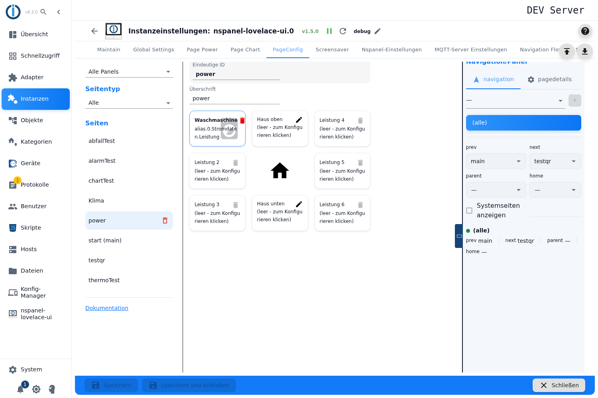
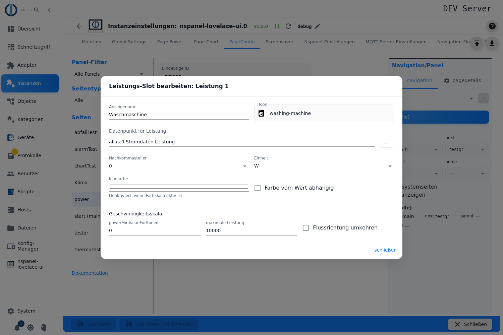
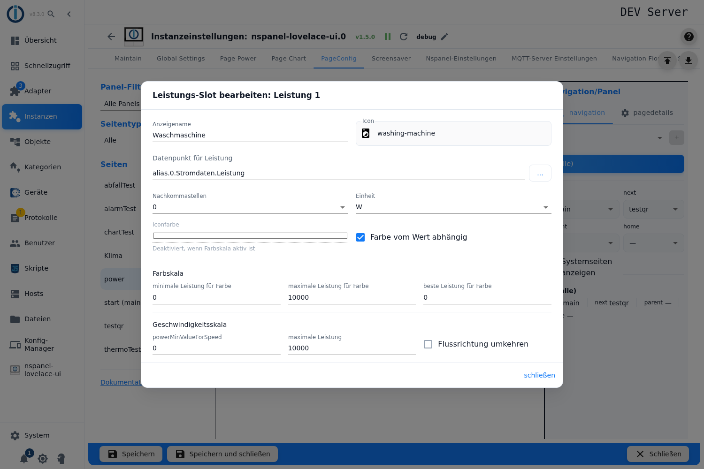
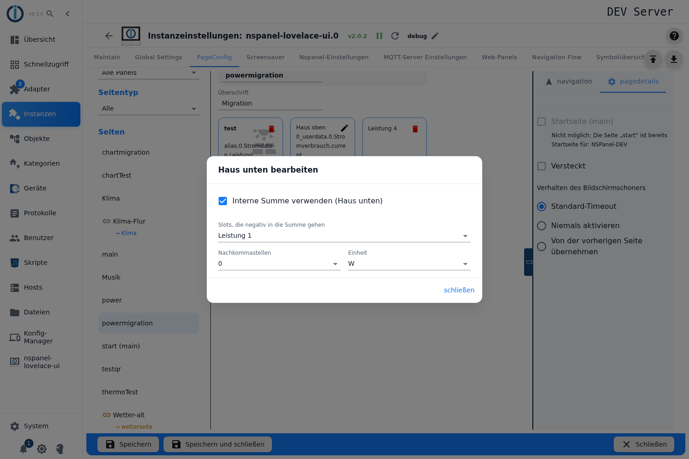
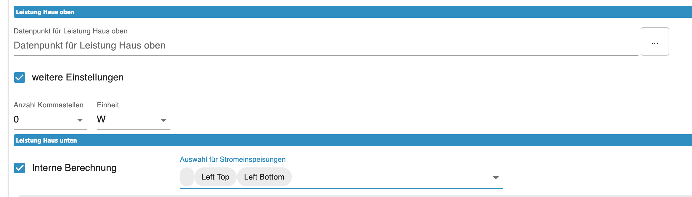

# Energie-Seite – Konfiguration im Admin

Die Energie-Seite zeigt ein Haus in der Mitte und bis zu **sechs Energieflüsse** darum herum — Photovoltaik, Netzbezug, Batterie, Wärmepumpe, Wallbox. Zu jedem Fluss gehören ein Symbol, ein Wert und eine **Animation**, deren Geschwindigkeit sich nach der Leistung richtet. Die Mitte ist der virtuelle Verteilerkasten: dort laufen alle Flüsse zusammen, über und unter dem Haussymbol steht je ein eigener Wert.

Angelegt wird sie im Tab **PageConfig**, Seitentyp **Leistung**. Es sind mehrere Energie-Seiten möglich, und auf welchem Panel eine Seite erscheint, legt die Navigationszuweisung im selben Tab fest — ein Konfigurationsskript ist dafür nicht nötig. Seiten, die aus der früheren Tabelle *Page Power* oder aus einem Skript stammen, kommen nur über die [Migration](Migration) in diesen Tab.

Inhalt:
- [Seite anlegen](#1-seite-anlegen)
- [Das Raster: sechs Flächen um das Haus](#2-das-raster-sechs-flächen-um-das-haus)
- [Einen Fluss einrichten](#3-einen-fluss-einrichten)
- [Farbe nach Wert: die Farbskala](#4-farbe-nach-wert-die-farbskala)
- [Geschwindigkeit und Flussrichtung](#5-geschwindigkeit-und-flussrichtung)
- [Die beiden Hauswerte](#6-die-beiden-hauswerte)
- [Die interne Summe](#7-die-interne-summe)
- [Was auf dem Panel ankommt](#8-was-auf-dem-panel-ankommt)
- [Panel-Zuweisung und Navigation](#9-panel-zuweisung-und-navigation)
- [Fallstricke](#fallstricke)

## 1. Seite anlegen

1. Instanz-Einstellungen öffnen → Tab **PageConfig**.
2. Links als Seitentyp **Leistung** wählen, einen Namen eintragen, **+** drücken.
3. Die Seite erscheint in der Liste, rechts öffnet sich der Editor.

**Eindeutige ID** über dem Raster ist der Seitenname; das Feld ist nur lesbar, der Name ist nach dem Anlegen fest. **Überschrift** ist die Kopfzeile am Panel — beim Anlegen wird der Seitenname eingetragen, ein leeres Feld zeigt am Panel wieder den Seitennamen.

> Wie bei allen Kartentypen sind die Felder der Hauptmaske gesperrt, solange die Instanz nicht läuft — ohne erklärenden Hinweis. Für die drei Dialoge dieser Seite gilt das nur teilweise, siehe [Abschnitt 3](#3-einen-fluss-einrichten).

> Stammt die Seite aus der alten Tabelle *Page Power* und hat im Admin noch keine Navigation, steht über dem Raster ein gelber Kasten: *Aus der alten Tabelle „Page Power" übernommen: Diese Seite bekommt ihre Navigation noch aus dem Skript (Seite „…"). Das ist veraltet – bitte hier eine Navigation zuweisen und die Seite aus dem Skript entfernen.* Was dahinter steckt, steht unter [Migration](Migration).

## 2. Das Raster: sechs Flächen um das Haus

Der Editor bildet die Karte als **Raster von drei mal drei** ab: links drei Flächen, rechts drei Flächen, in der Mitte oben **Haus oben**, in der Mitte das Haussymbol und darunter **Haus unten**.

| Bedienung | Wirkung |
|---|---|
| **Klick auf eine der sechs Flächen** | öffnet den Dialog *Leistungs-Slot bearbeiten: Leistung `n`*. |
| **Klick auf Haus oben / Haus unten** | öffnet *Haus oben bearbeiten* bzw. *Haus unten bearbeiten*. |
| **Ziehen einer Fläche auf eine andere** | **tauscht** die beiden Inhalte. So lassen sich die Flüsse umordnen, ohne sie neu einzutragen. |
| **Papierkorb-Symbol** | leert die Fläche. Der Knopf ist grau, solange die Fläche leer ist. |

Eine leere Fläche zeigt *(leer - zum Konfigurieren klicken)*, eine belegte den Anzeigenamen und darunter die ID des Datenpunkts. **Es sind immer genau sechs Flächen** — nicht mehr, nicht weniger. Nicht belegte bleiben leer.

> Das Ziehen funktioniert nur mit einem Zeigegerät und nur, wenn die Instanz läuft; getauscht werden ausschließlich die sechs Flächen, nicht die beiden Hausfelder.

> **Das Haussymbol selbst ist nicht einstellbar.** Der Adapter setzt dort immer das Symbol `home` in Weiß. Ein Name neben dem Haus ist nicht möglich: Das Feld dafür existiert im Datenmodell, wird aber nie gefüllt, und die Oberfläche bietet es gar nicht erst an.

## 3. Einen Fluss einrichten

Im Dialog *Leistungs-Slot bearbeiten*:

| Feld | Wirkung |
|---|---|
| **Anzeigename** | Die Beschriftung über der Flussanzeige, zum Beispiel der Name des Verbrauchers. Bleibt sie leer, steht am Panel **kein** Text; die Fläche im Editor zeigt dann ersatzweise „Leistung" mit ihrer Nummer. |
| **Icon** | Das Symbol des Flusses, aus der Symbolliste. Die Suche schlägt Varianten vor. |
| **Datenpunkt für Leistung** | Der Messwert. Die Auswahl zeigt nur Datenpunkte vom Typ Zahl. **Ohne ihn bleibt die Fläche am Panel leer** — gewarnt wird nicht. |
| **Nachkommastellen** | 0, 1 oder 2. |
| **Einheit** | Die Einheit, in der der Wert **im Datenpunkt** steht: W, kW oder MW. Der Adapter rechnet selbst auf die passende Stufe hoch oder herunter. |
| **Iconfarbe** | Eine feste Farbe für das Symbol. Gesperrt, sobald die Farbskala aktiv ist — der Hilfstext sagt das: *Deaktiviert, wenn Farbskala aktiv ist*. |
| **Farbe vom Wert abhängig** | Schaltet die Farbskala ein, siehe [Abschnitt 4](#4-farbe-nach-wert-die-farbskala). |

Derselbe Datenpunkt versorgt **Wert, Farbe und Animation** zugleich.

> ⚠️ **Die Einheit ist eine Angabe über den Datenpunkt, keine Zieleinheit.** Der Adapter liest sie als Einheit des Rohwerts und rechnet in die Basiseinheit um: Bei **kW** multipliziert er den Wert mit 1000, bei **MW** mit einer Million. Für einen Datenpunkt, der Watt liefert, steht hier also **W** — mit **kW** zeigt das Panel Werte um den Faktor 1000 zu hoch.

> **Die im Dialog gewählte Einheit gilt.** Eine Einheit am Datenpunkt (`common.unit`) wird im Betrieb nicht gelesen. Sie kommt genau einmal zum Tragen, nämlich bei der Übernahme aus der alten Tabelle (siehe [Migration](Migration)) — danach steht sie als Wert im Feld. Stammt die Seite von dort und trägt eine andere Einheit als W, kW oder MW (etwa kWh), ergänzt die Auswahlliste diese Einheit als vierten Eintrag. Wird sie einmal abgewählt, ist sie aus der Liste verschwunden.

> **Erzeugung und Verbrauch werden nicht eingestellt**, sie ergeben sich aus dem **Vorzeichen** des Messwerts und dem Haken *Flussrichtung umkehren*. Die Konvention lautet: Erzeuger fließen **zum Haus hin**, Verbraucher **davon weg**. In der Oberfläche steht dieser Satz nirgends — er ist aber der Schlüssel zu einer stimmigen Darstellung.

> Die drei Dialoge dieser Seite haben nur **schließen**, kein Abbrechen: Jede Eingabe wirkt sofort auf die Seite. Und anders als die Hauptmaske bleiben die Felder **auch bei gestoppter Instanz** bedienbar — mit Ausnahme von *Datenpunkt für Leistung* und *Icon*, die beide eine laufende Instanz brauchen.

## 4. Farbe nach Wert: die Farbskala

Mit **Farbe vom Wert abhängig** färbt sich das Symbol je nach Leistung ein. Dann erscheint der Abschnitt **Farbskala** mit drei Feldern:

| Feld | Wirkung |
|---|---|
| **minimale Leistung für Farbe** | Der untere Rand der Skala. Vorgabe 0. |
| **maximale Leistung für Farbe** | Der obere Rand. Vorgabe 10000. |
| **beste Leistung für Farbe** | Der Wert, der als „gut" gilt. Vorgabe 0. |

Gerechnet wird mit einem festen Verlauf **von Rot über Gelb nach Grün**. Die Farben sind nicht einstellbar — die Themenfarben des Panels und die Iconfarbe wirken hier nicht. Die Zuordnung ist:

- **beste Leistung** bekommt **Grün**,
- **minimale** und **maximale Leistung** bekommen **beide Rot**,
- dazwischen läuft der Verlauf über Gelb.

Daraus ergeben sich die üblichen drei Einstellungen:

- **Beispiel 1 — 0 W grün, 100 W rot:** minimale Leistung `0`, maximale Leistung `100`, beste Leistung `0`.
- **Beispiel 2 — 0 W rot, 100 W grün:** minimale Leistung `0`, maximale Leistung `100`, beste Leistung `100`.
- **Beispiel 3 — −50 W rot, 0 W grün, 100 W rot:** minimale Leistung `-50`, maximale Leistung `100`, beste Leistung `0`.

> **Die drei Grenzen gelten für den Rohwert des Datenpunkts**, nicht für die angezeigte Stufe. Bei einem Datenpunkt in Watt ist `10000` also 10 kW.

> **Ein Messwert außerhalb der Spanne erweitert sie stillschweigend.** Liegt der Wert unter dem Minimum oder über dem Maximum, rechnet der Adapter mit dem Messwert als neuem Rand — die Farbe läuft also nicht in Rot „an", sondern der Verlauf wird gedehnt.

> Die Felder nehmen **jede** Zahl an. Liegt das Maximum unter dem Minimum, tauscht der Adapter die beiden Grenzen und **dreht den Verlauf um** — dann bekommt die *beste Leistung* Rot. Ein leeres Feld ergibt keinen gültigen Wert.

> Die zuvor gesetzte **Iconfarbe bleibt gespeichert**, auch wenn die Skala aktiv ist und das Feld gesperrt erscheint. Schaltet man die Skala später ab, ist die alte Farbe wieder da. Ist **keine** Iconfarbe gesetzt und die Skala aus, zeichnet das Panel das Symbol **weiß**.

> **Nachkontrolle bei Seiten aus der alten Tabelle:** Dort wurde die statische Iconfarbe nur übernommen, wenn der Haken für die Farbskala ausdrücklich auf „aus" stand. Zeilen, deren Haken nie angefasst wurde, kommen **ohne** Iconfarbe an und das Symbol ist weiß. Die Farbskala selbst gilt nur als übernommen, wenn der Haken gesetzt **und** alle drei Grenzen Zahlen waren. Nach einer [Migration](Migration) also die sechs Flächen einmal durchsehen.

## 5. Geschwindigkeit und Flussrichtung

Der Abschnitt **Geschwindigkeitsskala** steuert die Animation — sie läuft umso schneller, je größer die Leistung.

| Feld | Wirkung |
|---|---|
| **minimale Leistung** | Die Leistung, bei der der Punkt **steht**. Vorgabe 0 — mit ihr steht der Punkt bei 0 W still. |
| **maximale Leistung** | Die Leistung, bei der die Animation mit **100 %** läuft, also am schnellsten. Vorgabe 10000. Dazwischen wächst die Geschwindigkeit gleichmäßig mit der Leistung. |
| **Flussrichtung umkehren** | Dreht die Laufrichtung um — für Flüsse, deren Datenpunkt das Vorzeichen andersherum führt. |

Die Laufrichtung kommt aus dem **Vorzeichen**: Ein negativer Messwert lässt den Punkt in die andere Richtung laufen, der Haken *Flussrichtung umkehren* dreht beides um.

> Die Beschriftung **maximale Leistung** gibt es faktisch zweimal: hier für die Animation, weiter oben als *maximale Leistung für Farbe* für den Farbverlauf. Auseinanderhalten kann man sie nur über die Abschnittsüberschriften *Farbskala* und *Geschwindigkeitsskala*.

> **Die Geschwindigkeit wird nicht begrenzt.** Über der *maximalen Leistung* rechnet der Adapter weiter über 100 % hinaus, unter der minimalen ins Negative — dort kippt die Laufrichtung. Auch diese beiden Grenzen gelten für den **Rohwert** des Datenpunkts.

## 6. Die beiden Hauswerte

Über und unter dem Haussymbol steht je ein Wert, eingerichtet über die Flächen **Haus oben** und **Haus unten**. Beide Dialoge kennen nur **Datenpunkt für Leistung Haus oben** bzw. **Haus unten**, **Nachkommastellen** und **Einheit** — kein Symbol, keinen Namen, keine Farbe, keine Animation.

Üblich: oben der aktuelle Verbrauch des Hauses, unten die Bilanz oder die Einspeisung.

> ⚠️ **Die Hauswerte rechnen nicht um und kürzen nicht.** Anders als die sechs Flächen bekommen sie keine automatische Einheitenstufe und keine Platzprüfung: Der Adapter formatiert den Rohwert mit den eingestellten Nachkommastellen und hängt die gewählte Einheit unverändert an. Die Einheit muss hier also zu dem passen, was im Datenpunkt steht — aus 1234,5 W wird hier **nicht** 1.2 kW, sondern `1234,5 W`.

> Nebeneffekt derselben Rechnung: Die Hauswerte schreiben das Dezimal**komma** (`1234,5 W`), die sechs Flächen einen Dezimal**punkt** (`1.2 kW`).

## 7. Die interne Summe

Statt eines eigenen Datenpunkts kann **Haus unten** eine Summe aus den sechs Flüssen zeigen. Dafür den Haken **Interne Summe verwenden (Haus unten)** setzen; das Feld für den Datenpunkt verschwindet, stattdessen erscheint eine Mehrfachauswahl mit den Einträgen **Leistung 1** bis **Leistung 6**.

Die ausgewählten Flächen werden **addiert**, die übrigen zählen als null.

> ⚠️ **Die deutsche Beschriftung sagt das Gegenteil.** Dort steht *Slots, die negativ in die Summe gehen* — tatsächlich gehen die ausgewählten Flächen **unverändert, also positiv** in die Summe ein, und alle nicht ausgewählten mit null. Negiert wird nichts. Die englische Fassung (*Slots that contribute to the sum*) beschreibt es richtig. Beim Einrichten also: **die Flächen auswählen, die zur Summe beitragen sollen.**

> **Leere Auswahl bedeutet „alle sechs".** Setzt man den Haken und wählt nichts aus, summiert der Adapter **alle** Flächen. Der Haken liefert also sofort ein Ergebnis, das man so nicht ausgewählt hat.

> **Die Summe addiert Rohwerte.** Sie rechnet keine Einheiten um: Eine Fläche in kW und eine in W werden als nackte Zahlen addiert. Auch *Flussrichtung umkehren* wirkt nicht auf die Summe — der Haken dreht nur die Animation, nicht das Vorzeichen des Summanden. Wer eine Bilanz braucht, deren Teile verschiedene Vorzeichen haben, muss das im Datenpunkt selbst abbilden.

## 8. Was auf dem Panel ankommt

Die Karte ist fest aufgebaut: Überschrift, Haussymbol mit zwei Werten, sechs Flüsse mit Symbol, Name, Wert und Animation. Aktualisiert wird höchstens alle zwei Sekunden.

> **Für den Wert einer Fläche stehen sechs Zeichen zur Verfügung.** Reicht der Platz nicht, rechnet der Adapter selbsttätig auf die nächstgrößere Einheit hoch — oder bei sehr kleinen Werten herunter — und **kürzt notfalls die Nachkommastellen**. Die Einstellung *Nachkommastellen* ist damit ein Wunsch, keine Zusage: Aus `1234.5 W` wird eher `1.2 kW`. Das gilt **nur für die sechs Flächen**, nicht für die Hauswerte (siehe [Abschnitt 6](#6-die-beiden-hauswerte)).

> **Auf der Karte ist nichts bedienbar.** Die Energie-Seite hat keine Seitenelemente und keine Popups; anklickbar sind nur die Navigationspfeile des Panels.

## 9. Panel-Zuweisung und Navigation

Panel, Navigationsziele, *Startseite*, *Versteckt* und *Verhalten des Bildschirmschoners* liegen in der rechten Spalte, beschrieben unter [PageConfig – Übersicht](PageConfig#panelzuweisung-und-navigation).

Der Verweis **Dokumentation** unten links im Tab baut seine Adresse aus dem **gewählten Seitentyp** — bei **Leistung** führt er auf diese Seite. Steht der Filter auf *Alle* oder *Hauptseiten*, richtet er sich nach dem Kartentyp des ausgewählten Eintrags.

Soll eine Seite, die heute noch aus einem Skript kommt, hier verwaltet werden, führt der Weg über die [Migration](Migration). Dort stehen auch die Regeln für Seiten, die aus der alten Tabelle *Page Power* übernommen wurden, und warum der Adapter so lange warnt, wie die Navigation noch aus dem Skript stammt.

## Fallstricke

- **Die Einheit beschreibt den Datenpunkt, nicht die Anzeige.** **kW** bei einem Watt-Datenpunkt liefert Werte um den Faktor 1000 zu hoch. Die Stufe der Anzeige wählt der Adapter selbst.
- **`common.unit` am Datenpunkt wird im Betrieb ignoriert.** Es zählt allein die Auswahl im Dialog; die Einheit des Objekts floss nur einmalig bei der [Migration](Migration) ein.
- **Der Farbverlauf ist Rot–Gelb–Grün und nicht einstellbar.** Grün sitzt auf der *besten Leistung*, Rot auf **beiden** Rändern. Wer nur einen Anstieg von Rot nach Grün will, setzt die *beste Leistung* auf das Maximum (Beispiel 2).
- **Beste und maximale Leistung auf demselben Wert sind erlaubt, aber heikel.** Trifft der Messwert diesen Wert genau, rechnet der Adapter mit einer Division durch null und die Farbe ist für diesen Takt unbestimmt. Ein kleiner Abstand zwischen den beiden Feldern vermeidet das.
- **Alle Grenzen für Farbe und Geschwindigkeit gelten für den Rohwert** des Datenpunkts, nicht für die Einheit, die das Panel zeigt.
- **Ohne Iconfarbe und ohne Farbskala ist das Symbol weiß.** Bei Seiten aus der alten Tabelle ist das der Normalfall, wenn der Haken *Farbe vom Wert abhängig* dort nie angefasst wurde.
- **Ein Messwert außerhalb der Farbskala dehnt sie**, statt am Rand stehen zu bleiben — die Farben verschieben sich dann für alle anderen Werte mit.
- **„maximale Leistung" steht zweimal im Dialog** — einmal für die Farbe, einmal für die Geschwindigkeit. Nur die Abschnittsüberschrift unterscheidet sie.
- **Die Hauswerte kürzen nicht und rechnen nicht um.** Ein zu langer Wert läuft dort über, und eine falsche Einheit fällt nicht auf, weil niemand sie prüft.
- **„Slots, die negativ in die Summe gehen" ist falsch beschriftet.** Ausgewählt werden die Flächen, die **beitragen**.
- **Haken für die interne Summe ohne Auswahl summiert alle sechs Flächen.**
- **Die interne Summe addiert nackte Zahlen** — gemischte Einheiten und *Flussrichtung umkehren* bleiben dabei unberücksichtigt.
- **Ohne Datenpunkt bleibt eine Fläche am Panel leer**, ohne Hinweis im Admin.
- **Die Dialoge kennen kein Abbrechen.** Jede Eingabe wirkt sofort; nur *Datenpunkt für Leistung* und *Icon* brauchen eine laufende Instanz, alles andere ist auch bei gestoppter Instanz veränderbar.
- **Das Ziehen der Flächen braucht eine laufende Instanz** und ein Zeigegerät; die beiden Hausfelder lassen sich nicht tauschen.
