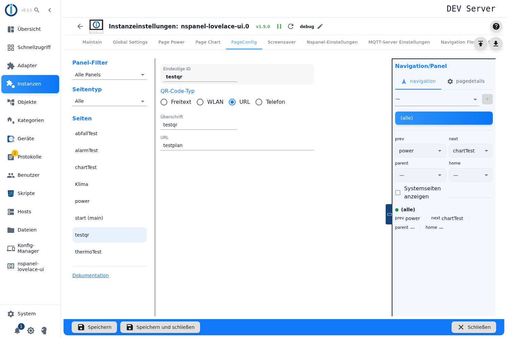
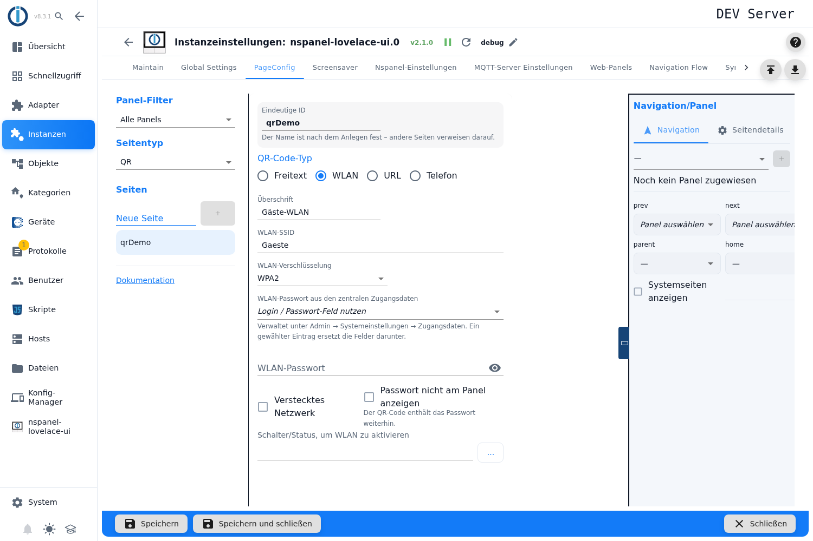
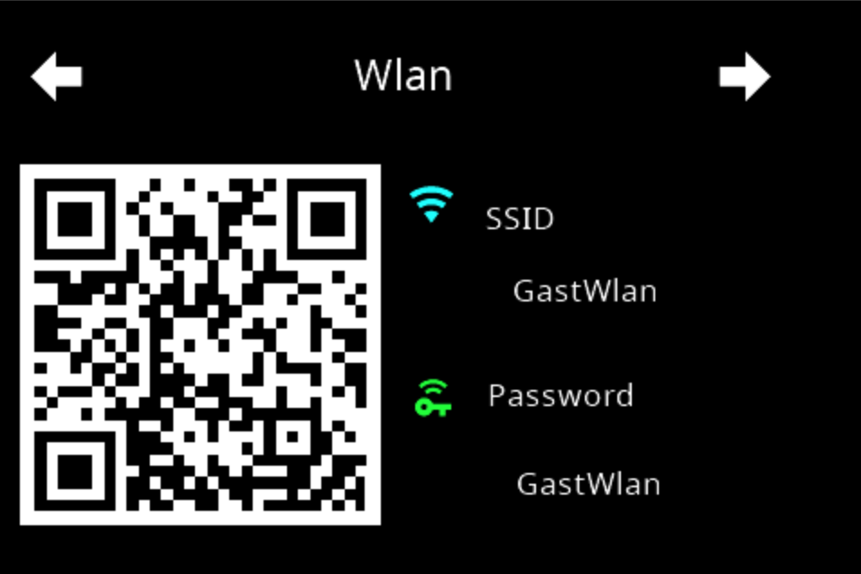
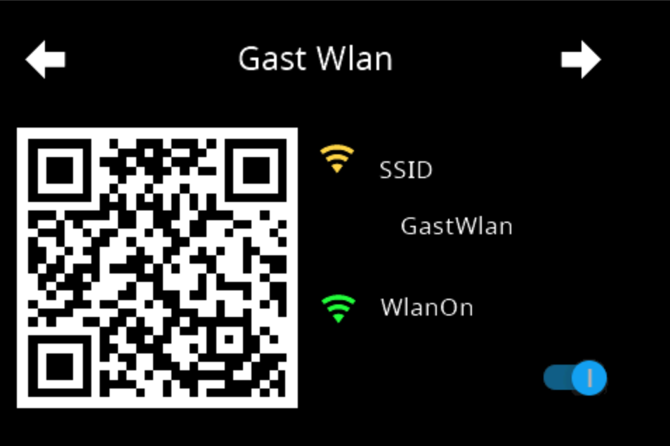
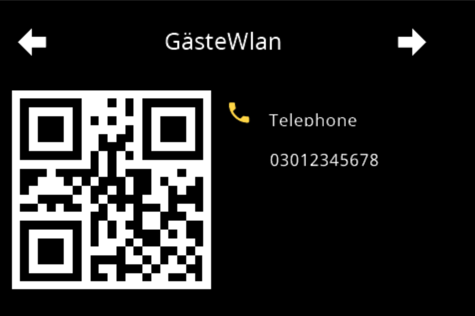
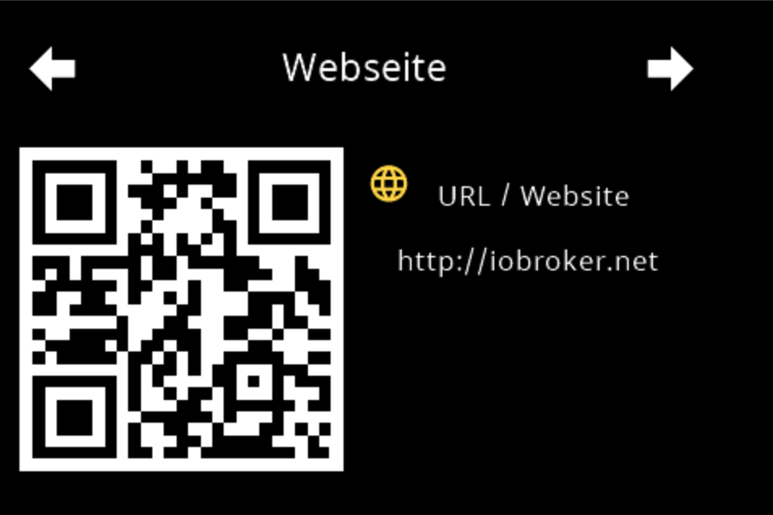

# QR-Code-Seite – Konfiguration im Admin

Die QR-Seite zeigt auf dem Panel einen **QR-Code** mit zwei Textzeilen darunter. Der häufigste Zweck: Gäste scannen den Code und sind im WLAN, ohne das Passwort abzutippen. Die Karte kann aber auch einen beliebigen Text, eine Internetadresse oder eine Telefonnummer übertragen.

Angelegt wird sie im Tab **PageConfig**, Seitentyp **QR**. Das ist der einzige Weg: Eine Seite mit dem Kartentyp `cardQR` im Konfigurationsskript verwirft der Adapter mit `Page: <Name> with card type cardQR is only supported in the admin configuration! Skipped!` und baut sie nicht (`config-manager.ts`).

Den QR-Code zeichnet die Panel-Firmware. Der Adapter schickt nur die Zeichenkette — sehr lange Inhalte werden dadurch auf dem kleinen Display schnell unleserlich.

Inhalt:
- [Seite anlegen](#1-seite-anlegen)
- [QR-Code-Typ](#2-qr-code-typ)
- [Überschrift und Inhalt](#3-überschrift-und-inhalt)
- [WLAN: Verschlüsselung, Passwort, verstecktes Netz](#4-wlan-verschlüsselung-passwort-verstecktes-netz)
- [Das Passwort aus den zentralen Zugangsdaten](#5-das-passwort-aus-den-zentralen-zugangsdaten)
- [Das WLAN per Schalter freigeben](#6-das-wlan-per-schalter-freigeben)
- [Was auf dem Panel erscheint](#7-was-auf-dem-panel-erscheint)
- [Panel-Zuweisung und Navigation](#8-panel-zuweisung-und-navigation)
- [Übernahme aus der alten Tabelle](#9-übernahme-aus-der-alten-tabelle)
- [Fallstricke](#fallstricke)

## 1. Seite anlegen

1. Instanz-Einstellungen öffnen → Tab **PageConfig**.
2. Links unter **Seitentyp** den Eintrag **QR** wählen, im Feld **Neue Seite** einen Namen eintragen, **+** drücken.
3. Die Seite erscheint in der Liste **Seiten**, rechts öffnet sich der Editor.

Der Name steht im Editor als **Eindeutige ID** und ist die ID der Seite — unter ihr sprechen andere Seiten sie in ihren Navigationszielen an. Das Feld ist gesperrt, solange die Seite als Startseite markiert ist; der Editor zeigt dann den Hinweis *Startseite – wird unter der ID „main" veröffentlicht…*. Zum Umbenennen und zu den Fallstricken dabei siehe [PageConfig – Übersicht](PageConfig#seiten-anlegen-umbenennen-löschen).

Die Felder **Panel-Filter** und **Seitentyp** über der Liste filtern nur die Anzeige.

> **Alle Felder sind ausgegraut, wenn die Instanz nicht läuft.** Der Editor fragt den Adapter live ab; bei gestopptem Adapter lässt sich nichts eintragen und auch nichts anlegen. Einen erklärenden Hinweis dazu gibt die Oberfläche nicht — das ausgegraute Formular ist der einzige Hinweis.

Der Verweis **Dokumentation** unten rechts im Tab führt auf genau diese Wiki-Seite (`cardQR`).

## 2. QR-Code-Typ

Vier Auswahlknöpfe unter **QR-Code-Typ** entscheiden, **was** der Code enthält. Davon hängt ab, welche Felder darunter erscheinen:

| Typ | Zeichenkette im Code | Weitere Felder |
|---|---|---|
| **Freitext** | der Inhalt unverändert | keine |
| **WLAN** | `WIFI:T:<Verschlüsselung>;S:<SSID>;P:<Passwort>;H:true;` — ohne den Haken *Verstecktes Netzwerk* endet sie auf `H:;` | WLAN-Verschlüsselung, zentrale Zugangsdaten, WLAN-Passwort, Verstecktes Netzwerk, Passwort verbergen, Schalter |
| **URL** | `URL:<Adresse>` | keine |
| **Telefon** | `TEL:<Nummer>` | keine |

Der Typ ist bei einer neuen Seite mit **Freitext** vorbelegt. Bei **Telefon** gehört die Ländervorwahl in die Nummer (`+49…`), sonst kann das Handy sie nicht wählen.

## 3. Überschrift und Inhalt

**Überschrift** steht als Kopfzeile über dem Code. Beim Anlegen wird der Seitenname eingetragen; bleibt das Feld leer, zeigt das Panel `Page QR`.

Das Feld darunter trägt den eigentlichen Inhalt und **wechselt seine Beschriftung** mit dem Typ: *QR Zeichenkette*, *WLAN-SSID*, *URL* oder *Telefonnummer*.

> **Geprüft wird hier nichts.** Keine Pflichtangabe, keine Längengrenze, keine Prüfung, ob eine Adresse wie eine Adresse aussieht. Ein leeres Feld erzeugt einen leeren QR-Code — zu sehen ist das erst am Panel, der Editor hat keine Vorschau.

Drei Dinge, die der Adapter mit den Texten macht und die man wissen muss, wenn ein Code nicht funktioniert:

- **Eine Tilde `~` wird durch `-` ersetzt.** Das gilt für die ganze Nachricht ans Panel, also auch für SSID und Passwort. Ein Passwort mit Tilde kommt am Panel verändert an — ohne jede Meldung.
- **Sonderzeichen im WLAN-Code werden nicht geschützt.** Enthält SSID oder Passwort ein `;`, `:`, `,` oder `\`, bricht das die Struktur des `WIFI:`-Codes, und der Scanner liest Unsinn. Wer solche Zeichen im Passwort hat, muss die QR-Karte dafür abschreiben.
- **Die Überschrift läuft durch das Wörterbuch des Adapters.** Trägt sie zufällig ein Schlüsselwort der Adapter-Übersetzung (etwa `hidden`), zeigt das Panel den übersetzten Text statt der Eingabe.

## 4. WLAN: Verschlüsselung, Passwort, verstecktes Netz

Diese Felder erscheinen nur beim Typ **WLAN**, in dieser Reihenfolge: WLAN-Verschlüsselung, zentrale Zugangsdaten, WLAN-Passwort, die beiden Haken, Schalter.

**WLAN-Verschlüsselung** — zur Wahl stehen *No Password*, *WPA*, *WPA2*, *WPA3* und *WEP*. Die Einträge sind in der Oberfläche englisch, auch in der deutschen Fassung.

> ⚠️ **Solange das Feld nicht angefasst wurde, zeigt die Oberfläche `WPA2`, in den QR-Code schreibt der Adapter aber `WPA`.** Die Anzeige ist eine Vorbelegung der Oberfläche, gespeichert wird erst beim Anfassen; ohne gespeicherten Wert greift der Fallback `WPA` — und zwar zweimal, beim Bauen der Seite und beim Senden. Viele Geräte verbinden sich trotzdem, manche nicht — und dann sucht man den Fehler bei der SSID. **Das Feld deshalb einmal bewusst setzen**, auch wenn „WPA2" schon dasteht.

**WLAN-Passwort** — das Passwort im Klartext; das Augensymbol schaltet die Anzeige um. Das Feld entfällt, wenn als Verschlüsselung *No Password* gewählt ist, und ist gesperrt, solange unter *WLAN-Passwort aus den zentralen Zugangsdaten* ein Eintrag gewählt ist (siehe [Abschnitt 5](#5-das-passwort-aus-den-zentralen-zugangsdaten)).

> ⚠️ **Ein hier eingetragenes Passwort steht unverschlüsselt in der Instanzkonfiguration** (`native.pageConfig[].qrPass`) und ist für jeden mit Objekt-Leserecht lesbar. Verschlüsselt liegt es nur, wenn es aus den zentralen Zugangsdaten kommt. Wer das nicht möchte, nimmt für die Gäste ein eigenes Gastnetz mit einem Passwort, dessen Verlust nicht schmerzt.

> ℹ️ **`No Password` nimmt das Passwort vom Panel, nicht aus der Konfiguration.** Der Adapter löst das Passwort nur auf, wenn es zum Code gehört: WLAN-Code **und** eine Verschlüsselung außer *No Password*. Bei *No Password* bleibt die zweite Zeile der Karte leer und der Code trägt ein leeres Passwortfeld (`WIFI:T:nopass;S:<SSID>;P:;H:;`); bei den Typen Freitext, URL und Telefon spielt das Passwort ohnehin keine Rolle mehr. **Gespeichert bleibt der Wert aber:** Wird später wieder eine Verschlüsselung gewählt, ist das alte Passwort da — ein Umschalten zerstört also nichts. Wer es endgültig los werden will, leert das Feld, solange der Typ auf WLAN und die Verschlüsselung nicht auf *No Password* steht.

**Verstecktes Netzwerk** — schreibt `H:true` in den Code, damit sich der Scanner auch mit einem Netz verbindet, das seinen Namen nicht aussendet. Ohne den Haken endet die Zeichenkette auf `H:;`.

**Passwort verbergen** — lässt die Passwortzeile am Panel leer.

> ⚠️ **Das ist keine Sicherheitsfunktion.** Der Haken verbirgt nur die Textzeile; **im QR-Code steht das Passwort weiterhin** und jeder Scanner liest es aus. Genau dafür ist die Karte da. Der Haken hilft gegen Mitlesen über die Schulter, nicht gegen Abfotografieren des Codes.

## 5. Das Passwort aus den zentralen Zugangsdaten

Das WLAN-Passwort muss nicht in der Instanzkonfiguration stehen. Das Auswahlfeld **WLAN-Passwort aus den zentralen Zugangsdaten** über dem Passwortfeld verweist stattdessen auf einen Eintrag aus *Admin → Systemeinstellungen → Zugangsdaten*; gespeichert wird dann nur dessen Objekt-ID (`system.credentials.<Name>`), den Wert liest und entschlüsselt der Adapter zur Laufzeit. Der Hinweis unter dem Feld sagt es kurz: *Verwaltet unter Admin → Systemeinstellungen → Zugangsdaten. Ein gewählter Eintrag ersetzt die Felder darunter.*

| Eintrag in der Liste | Wirkung |
|---|---|
| **Login / Passwort-Feld nutzen** (erster Eintrag) | kein zentraler Eintrag; es gilt das Feld **WLAN-Passwort**. |
| `<Name> (Login & Passwort)` | der Adapter nimmt das **Passwort** des Eintrags, der Benutzername wird ignoriert. |
| `<Name> (Schlüssel)` | der Adapter nimmt den **Schlüssel** des Eintrags. |

Die Liste wird bei jedem Öffnen neu geladen, ein zwischenzeitlich in den Systemeinstellungen angelegter Eintrag erscheint also ohne Neuladen der Seite. Die Geheimnisse selbst erreichen den Browser nie.

Was ohne brauchbaren Eintrag passiert:

| Lage | Verhalten |
|---|---|
| kein Eintrag gewählt | das Feld **WLAN-Passwort** gilt. |
| Eintrag gewählt, aber leer | Warnung im Log (`Credential "…" is empty - using the field of the instance settings instead`), es gilt das Feld **WLAN-Passwort**. |
| Eintrag gelöscht oder nicht lesbar | Warnung im Log (`Cannot read credential "…"`), es gilt das Feld **WLAN-Passwort**. Im Editor steht als Fehlertext *Der gewählte Eintrag existiert nicht mehr – die Felder darunter werden verwendet*. |
| Liste nicht ladbar | *Die Liste der Zugangsdaten konnte nicht geladen werden*; das gespeicherte Feld bleibt unverändert. |
| weder Eintrag noch Feld gefüllt | der Code wird mit leerem `P:` gebaut, ohne Meldung. |

> ⚠️ **Fällt der Eintrag weg, bleibt das Passwortfeld gesperrt.** Die Sperre hängt allein daran, *dass* eine ID gespeichert ist — nicht daran, ob sie noch auflösbar ist. Der Editor meldet zwar, dass nun „die Felder darunter" gelten, lässt aber keine Eingabe zu. Zum Nachtragen zuerst das Auswahlfeld auf **Login / Passwort-Feld nutzen** zurückstellen.

> **Führende und abschließende Leerzeichen gehen verloren.** Der Adapter beschneidet den gelesenen Wert (`trim`) — beide Wege, zentraler Eintrag und Feld. Ein Passwort, das mit einem Leerzeichen anfängt oder endet, kommt gekürzt im Code an.

Der Adapter beobachtet jeden benutzten Eintrag: **Ändert sich sein Wert, startet die Instanz neu** und baut die Seiten mit dem neuen Passwort (`Credential "…" has new values - restarting the adapter to apply them`). Umbenennen oder ein neues Symbol lösen keinen Neustart aus — verglichen wird ein Fingerabdruck der Werte, nicht das Objekt. Wird der Eintrag **gelöscht**, läuft die Instanz mit dem beim Start gelesenen Wert weiter und meldet nur `Credential "…" was deleted - after a restart the fields of the instance settings are used instead`.

> Dass das Passwort aus einem zentralen Eintrag kam, steht nur im **Debug**-Log (`QR page '<Name>': password taken from credential "<Name>"`). Bei den anderen Zugangsdaten des Adapters (MQTT, Tasmota-WebUI) meldet der Adapter das als Info.

## 6. Das WLAN per Schalter freigeben

**Schalter/Status, um WLAN zu aktivieren** nimmt einen Datenpunkt mit `type=boolean`, der sowohl lesbar als auch beschreibbar ist (die Objektauswahl zeigt nur solche). Üblicher Fall: das Gastnetz im Router ist normalerweise aus und wird nur eingeschaltet, wenn Besuch da ist.

Was dieser Datenpunkt **wirklich** bewirkt, steht so nicht in der Oberfläche:

- Die **zweite Zeile der Karte wird zum Schalter**. Sie zeigt ein grünes `wifi`-Symbol mit `WlanOn` bzw. ein graues `wifi-off` mit `WlanOff`, und ein Druck darauf schaltet den Datenpunkt um.
- **Die Passwortzeile verschwindet damit**, denn es gibt nur diese eine Zeile. Wer Schalter *und* Passwortanzeige möchte, kann das auf dieser Karte nicht haben. Der Haken *Passwort verbergen* ist in dieser Variante ohne Wirkung.
- Der QR-Code selbst bleibt unverändert sichtbar — auch wenn das Netz gerade aus ist.

> ⚠️ **Das Feld erscheint nur bei WLAN, wirkt aber bei jedem Typ.** Wird der QR-Typ später auf *Freitext*, *URL* oder *Telefon* umgestellt, bleibt der Datenpunkt gespeichert, und die zweite Zeile zeigt weiter den WLAN-Schalter mit `WlanOn`/`WlanOff` — auf einer URL-Karte. Zum Entfernen den Typ wieder auf **WLAN** stellen und das Feld leeren.

Links die Karte **ohne** Schalter, rechts **mit**: Die zweite Zeile trägt einmal das Passwort und einmal die Schaltfläche — beides zugleich geht nicht.

 

## 7. Was auf dem Panel erscheint

Die Karte ist fest aufgebaut: Überschrift, QR-Code, darunter **genau zwei Zeilen**.

| Zeile | Inhalt |
|---|---|
| **1** | Symbol und Beschriftung je Typ — **Freitext**: `qrcode-scan`, *ohne* Beschriftung und **ohne Wert** · **WLAN**: `wifi` mit „SSID" · **URL**: `web` mit „URL / Website" · **Telefon**: `phone` mit „Telephone". Bei WLAN, URL und Telefon steht der eingetragene Inhalt als Wert. |
| **2** | Ohne Schalter: Symbol `key-wireless` mit „Password" und dem Passwort als Wert — leer, wenn *Passwort verbergen* gesetzt ist. Bei Freitext, URL und Telefon bleibt diese Zeile ohne Symbol und ohne Text. Mit Schalter: die Schaltfläche aus [Abschnitt 6](#6-das-wlan-per-schalter-freigeben). |

Dieselbe Karte als Telefonnummer und als Internetadresse:

 

> Die Beschriftungen dieser beiden Zeilen — „SSID", „Password", „URL / Website", „Telephone", „WlanOn", „WlanOff" — stehen im Adapter **englisch** im Quelltext und haben keinen Eintrag im deutschen Wörterbuch. Auf einem deutschen Panel steht dort also „Password", nicht „Passwort".

Die Karte aktualisiert sich höchstens einmal pro Sekunde. Wie viele QR-Seiten man anlegt, ist nicht begrenzt.

## 8. Panel-Zuweisung und Navigation

Panel, Navigationsziele, **Startseite (main)**, **Versteckt** und **Verhalten des Bildschirmschoners** liegen — wie bei allen Kartentypen — in der rechten Spalte und sind unter [PageConfig – Übersicht](PageConfig#panelzuweisung-und-navigation) beschrieben. Die QR-Seite hat dort keine Besonderheiten; sie kann auch als Startseite dienen.

Erinnerung: Eine Seite **ohne Panel-Zuweisung** wird nicht gebaut und ist am Panel nicht vorhanden.

## 9. Übernahme aus der alten Tabelle

Wer die QR-Seiten früher in der eigenen Tabelle `pageQRdata` gepflegt hat, findet sie nach dem Update als Seiten im Tab PageConfig wieder. Die Umstellung passiert beim ersten Start von selbst, die alte Tabelle wird danach entfernt.

Übernommen werden: eindeutige ID, Überschrift, QR-Code-Typ, Inhalt, Schalter-Datenpunkt, *Verstecktes Netzwerk*, *Passwort verbergen*, *Versteckt* und *Verhalten des Bildschirmschoners*.

> ⚠️ **Passwort und Verschlüsselungsart sind neu einzutragen.** Beide überträgt die Umstellung **nicht**. Danach steht das Passwortfeld leer und die Verschlüsselung fällt auf `WPA` zurück. Der QR-Code wird trotzdem gebaut und sieht gültig aus; nur verbindet sich niemand mehr. Eine Log-Meldung dazu gibt es nicht — anders als bei den später umgezogenen Tabellen *Page Power* und *Page Chart*, die ihre Übernahme melden.
>
> Nach einem Update einer bestehenden Anlage also: **jede QR-Seite einmal öffnen**, Passwort eintragen und die Verschlüsselung bewusst setzen.

Seit **2.0.0** räumt der Knopf **Skript in Admin übernehmen** im Tab `Maintain` auch die Verweise auf QR-Seiten aus einem Konfigurationsskript heraus. In der Vorschau steht dazu *Dieser Seitentyp wird nur im Admin konfiguriert – der Verweis im Skript ist tot und wird entfernt*; ein Admin-Eintrag entsteht dabei nicht, die Seite selbst war ja schon immer nur im Admin konfigurierbar. Der Ablauf steht unter [Migration](Migration). Anschließend lässt sich das Panel mit **Panel benutzt kein Skript** (siehe [NSPanelsetting](NSPanelsetting)) ganz vom Skript lösen.

## Fallstricke

- **`WPA2` steht da, `WPA` wird gesendet.** Die Vorbelegung der Oberfläche ist nicht gespeichert; ohne gespeicherten Wert schreibt der Adapter `WPA`. Das Feld **WLAN-Verschlüsselung** einmal bewusst setzen.
- **Nach der Übernahme aus `pageQRdata` fehlen Passwort und Verschlüsselungsart.** Beide neu eintragen, siehe [Abschnitt 9](#9-übernahme-aus-der-alten-tabelle).
- **`No Password` löscht das gespeicherte Passwort nicht.** Aufs Panel gelangt es nicht mehr, in der Konfiguration bleibt es stehen und erscheint wieder, sobald eine Verschlüsselung gewählt wird.
- **Ein gesetzter Schalter-Datenpunkt wirkt auch nach einem Typwechsel.** Dann hängt ein WLAN-Schalter an einer URL- oder Telefonkarte.
- **Gesperrtes Passwortfeld trotz fehlendem Zugangsdaten-Eintrag.** Erst das Auswahlfeld auf **Login / Passwort-Feld nutzen** zurückstellen.
- **Sonderzeichen brechen den WLAN-Code**: `;`, `:`, `,`, `\` werden nicht geschützt, `~` wird zu `-`, führende und abschließende Leerzeichen werden abgeschnitten.
- **Kein Feld ist Pflicht, keine Prüfung läuft.** Ein leeres Inhaltsfeld erzeugt einen leeren Code; auffällig wird das erst am Panel, denn der Editor hat keine Vorschau.
- **Alles ausgegraut:** Die Instanz läuft nicht. Der Editor ist nur bei laufender Instanz bedienbar.
- **Die Seite fehlt am Panel:** Panel-Zuweisung prüfen — ohne Zuweisung wird die Seite nicht gebaut.
- **Eine QR-Seite im Konfigurationsskript bleibt wirkungslos.** Der Adapter überspringt sie mit einer Warnung; die Konfiguration gehört in den Admin.
