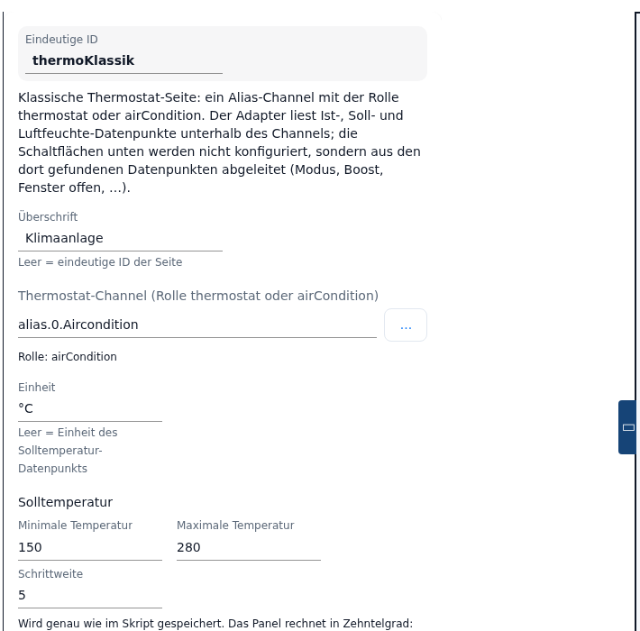
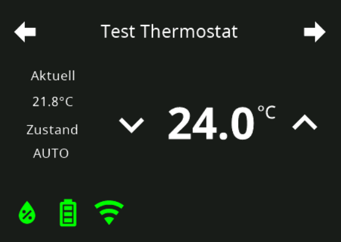
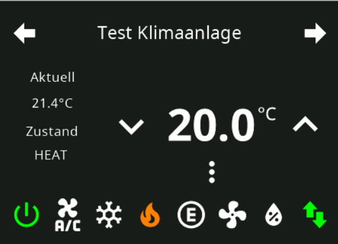
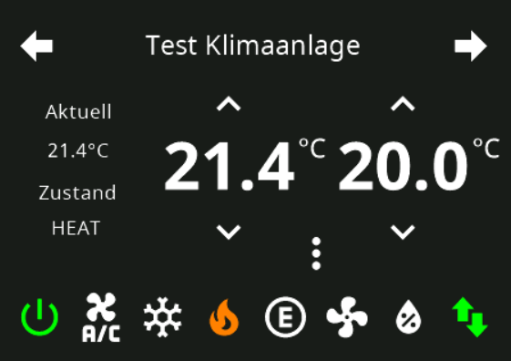
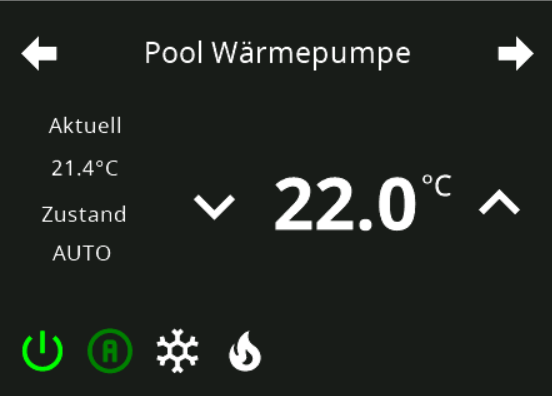
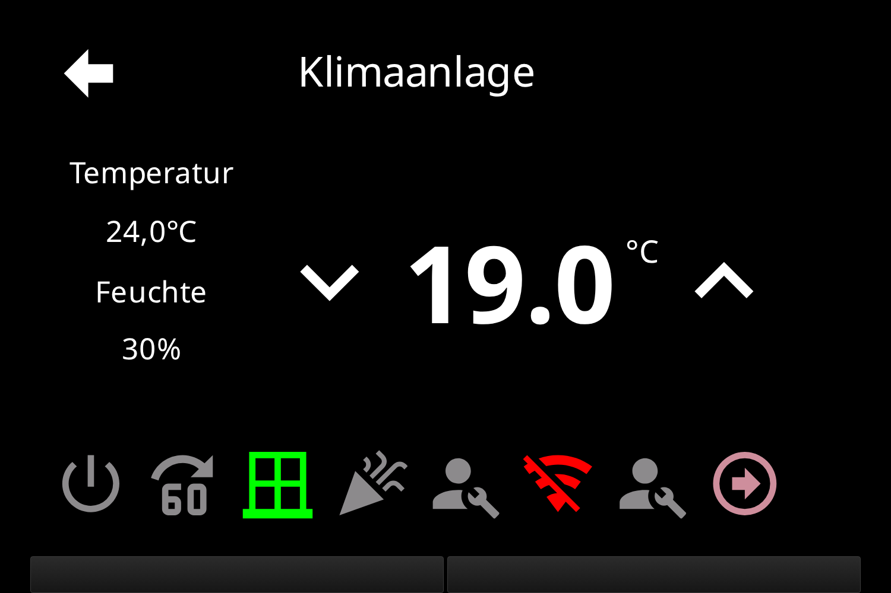

# Page Thermo (klassisch) – Konfiguration im Admin

Die klassische Thermostat-Seite `cardThermo` zeigt **ein** Thermostat: links die Ist-Temperatur und die Luftfeuchte, in der Mitte den Sollwert mit den Tasten − und +, darunter eine Leiste mit **acht** Plätzen für Modus-Symbole und Zustandsanzeigen. Angelegt wird sie im Tab **PageConfig**, Seitentyp **Thermostat (klassisch)**.

Konfiguriert werden nur **Überschrift**, **Thermostat-Channel**, **Einheit** und die Grenzen der Solltemperatur. Alles andere leitet der Adapter aus den Datenpunkten ab, die er unterhalb des Channels findet – der Editor sagt das selbst: *„Klassische Thermostat-Seite: ein Alias-Channel mit der Rolle thermostat oder airCondition. Der Adapter liest Ist-, Soll- und Luftfeuchte-Datenpunkte unterhalb des Channels; die Schaltflächen unten werden nicht konfiguriert, sondern aus den dort gefundenen Datenpunkten abgeleitet (Modus, Boost, Fenster offen, …)."*

Im Adapter läuft die Admin-Seite durch denselben Code wie eine `cardThermo`-Seite aus einem Skript (`ConfigManager.getPageThermo`); bei gleichen Angaben ist das Ergebnis auf dem Panel identisch.

Inhalt:
- [Seite anlegen](#1-seite-anlegen)
- [cardThermo oder cardThermo2](#2-cardthermo-oder-cardthermo2)
- [Die Felder des Editors](#3-die-felder-des-editors)
- [Minimum, Maximum, Schrittweite](#4-minimum-maximum-schrittweite)
- [Was der Adapter aus den Datenpunkten baut](#5-was-der-adapter-aus-den-datenpunkten-baut)
- [Acht Plätze und der Blätterpfeil](#6-acht-plätze-und-der-blätterpfeil)
- [Speichern, Panel-Zuweisung, Navigation](#7-speichern-panel-zuweisung-navigation)
- [Übernahme aus dem Skript](#8-übernahme-aus-dem-skript)
- [Fallstricke](#fallstricke)

## 1. Seite anlegen

1. Instanz-Einstellungen öffnen → Tab **PageConfig**.
2. Links in der Liste **Seiten** auf das PLUS klicken, als Typ **Thermostat (klassisch)** wählen und eine **eindeutige ID** vergeben (der Seitenname, über den die Seite in der Navigation angesprochen wird).
3. Die neue Seite erscheint in der Liste; rechts öffnet sich der Editor. Eine neue Seite hat noch keinen Channel – ohne Channel baut der Adapter eine leere Karte und schreibt den Grund als Fehler ins Log der Instanz.

Die Felder **Panel-Filter** und **Seitentyp** über der Liste filtern nur die Anzeige der Liste.

## 2. cardThermo oder cardThermo2

Beide Karten steuern Heizung und Klima, sie unterscheiden sich im Umfang:

| | `cardThermo` (klassisch) | [`cardThermo2`](cardThermo2) |
|---|---|---|
| Datenquellen je Seite | genau **eine** | bis zu **acht** |
| Eigene Flächen (PageItems) | im Admin keine – die acht Plätze füllt allein der Adapter | eigene PageItems je Heizkreis, zusätzlich zu den erzeugten Schaltflächen |
| `airCondition` mit `SET` **und** `SET2` | zeigt **zwei Sollwerte nebeneinander** auf einer Karte | wird zu **zwei Heizkreisen** (Heizen und Kühlen) mit je einem Sollwert |
| Modus-Symbole | nur aus dem `MODE`-Datenpunkt eines `airCondition`-Channels; bei der Rolle `thermostat` gibt es keine | eigene **Modusanzeige** mit frei vergebenen Modustexten |
| Symbol, Farbe und Einheit der Wertzeilen | nicht konfigurierbar | je Zeile einstellbar |
| Blättern | automatisch, sobald mehr als acht Flächen zusammenkommen – nicht einstellbar | drei Blätter-Modi in den Seitendetails |
| Option *Werte in Zehnteln* (Tab **Global Settings**) | ohne Wirkung | gilt für die Grenzen der Solltemperatur |

Kurz: `cardThermo` ist die schnelle Karte für **ein** Thermostat, dessen Alias viele Zustände mitbringt (Fenster, Party, Urlaub, Störung …), und die einzige Karte, die zwei Sollwerte eines `airCondition`-Channels nebeneinander zeigt. Wer mehrere Heizkreise, eigene Schaltflächen oder ein einstellbares Aussehen braucht, nimmt [cardThermo2](cardThermo2).

## 3. Die Felder des Editors

| Feld | Bedeutung |
|---|---|
| **Eindeutige ID** | Seitenname; nur lesbar, nach dem Anlegen fest. Bei der Startseite nennt der Hinweis die ID `main`. |
| **Überschrift** | Kopfzeile der Seite auf dem Panel. Hilfetext: *Leer = eindeutige ID der Seite*. |
| **Thermostat-Channel (Rolle thermostat oder airCondition)** | Alias-Channel, Device oder Ordner mit `common.role` `thermostat` oder `airCondition`. Der Objektbaum hinter **…** zeigt nur Objekte mit diesen Rollen; eine von Hand eingetippte ID prüft der Editor beim Verlassen des Feldes. Passt sie, steht darunter *Rolle: …*, sonst eine Warnung: *Das Objekt … wurde nicht gefunden* bzw. *Der Channel … hat die Rolle „…" – erwartet wird thermostat oder airCondition*. Welche Datenpunkte der Adapter unterhalb des Channels sucht, steht in [Abschnitt 5](#5-was-der-adapter-aus-den-datenpunkten-baut) und in der [Alias-Tabelle](ALIAS). |
| **Einheit** | Text hinter den Temperaturen (z. B. `°C`). Hilfetext: *Leer = Einheit des Solltemperatur-Datenpunkts* – das gilt für die große Zahl, die Zeile der Ist-Temperatur bleibt dann ohne Einheit (siehe [Fallstricke](#fallstricke)). Die Luftfeuchte zeigt immer `%`. |
| **Solltemperatur** mit **Minimale Temperatur**, **Maximale Temperatur**, **Schrittweite** | Grenzen und Schrittweite des Sollwerts, siehe [Abschnitt 4](#4-minimum-maximum-schrittweite). |

Die Beschriftungen der Wertzeilen am Panel sind fest: *Temperatur* über der Ist-Temperatur, *Feuchte* über der Luftfeuchte. Die Ist-Temperatur zeigt eine Dezimalstelle, die Luftfeuchte keine.

**Startseite (main)**, **Versteckt**, **Verhalten des Bildschirmschoners** und die Navigationsziele liegen rechts in der Spalte **Navigation/Panel** – beschrieben unter [PageConfig](PageConfig#panelzuweisung-und-navigation) und [Seitendetails](PageConfig#seitendetails). Blätter-Einstellungen erscheinen dort für diese Karte nicht; sie gehören nur zu den Menü-, Thermo2- und Medienseiten.

## 4. Minimum, Maximum, Schrittweite

Die drei Werte werden **genau so gespeichert, wie das Skript sie hätte** – damit eine übernommene Seite ihre Zahlen behält. Welche Einheit sie haben, entscheidet der Adapter am **Maximum**; der Hilfetext unter den Feldern sagt es ebenso:

- **Maximum ≥ 100**: alle drei Werte sind **Zehntelgrad** – `100 / 300 / 1` heißt 10 °C bis 30 °C in Schritten von 0,1 °C; eine Schrittweite von `5` wäre 0,5 °C.
- **Maximum < 100**: alle drei Werte gelten als **Grad** und werden mit 10 multipliziert – `15 / 28 / 0,5` heißt 15 °C bis 28 °C in Schritten von 0,5 °C.
- Eine Schrittweite unter einem Zehntelgrad hebt der Adapter auf ein Zehntel an.
- **Leere Felder**: der Adapter nimmt `common.min` / `common.max` / `common.step` des Solltemperatur-Datenpunkts; fehlen auch die, gelten 15 °C bis 30 °C in Schritten von 0,5 °C. Eine `0` bleibt dagegen ein gültiges Minimum.

Die Option *Werte in Zehnteln* im Tab **Global Settings** betrifft nur `cardThermo2`, nicht diese Seite – ihr Hilfetext sagt das ausdrücklich.

## 5. Was der Adapter aus den Datenpunkten baut

Unterhalb der Überschrift wird **nichts konfiguriert**. Der Adapter sucht unter dem Channel nach `common.role` und `common.type` (siehe [Alias-Tabelle](ALIAS)) und baut daraus die Werte und die Leiste. **Pflicht ist allein der Sollwert `SET`**; fehlt er, bricht der Aufbau der Seite mit einem Fehler im Log ab.

Welche Datenpunkte überhaupt gesucht werden, hängt an der Rolle des Channels:

| Rolle | ausgewertet |
|---|---|
| `thermostat` | `SET` (`level.temperature`, Pflicht), `ACTUAL` (`value.temperature`, ersatzweise `SET`), `HUMIDITY` (`value.humidity`) · Leiste: `POWER` (`switch.power`), `BOOST` (`switch.mode.boost` / `switch.boost`), `WINDOWOPEN` (`sensor.window`), `PARTY` (`switch.mode.party`), `MAINTAIN` (`indicator.maintenance`), `UNREACH` (`indicator.maintenance.unreach`), `LOWBAT` (`indicator.maintenance.lowbat`), `ERROR` (`indicator.error`), `VACATION` (Datenpunkt **genau diesen Namens**), `WORKING` (`indicator.working`) |
| `airCondition` | `SET` und `SET2` (beide `level.temperature`, beide müssen **genau so heißen**), `ACTUAL`, `HUMIDITY` · Leiste: `MODE` (`value.mode.airconditioner`), `POWER` (`switch`), `BOOST`, `MAINTAIN`, `UNREACH`, `ERROR` |

Nicht ausgewertet werden `MODE` und `MODESET` bei der Rolle `thermostat` sowie `USERICON`, `SPEED`, `SWING` und `SWING2`; `WINDOWOPEN`, `PARTY`, `LOWBAT`, `VACATION` und `WORKING` kennt nur die Rolle `thermostat`.

Schaltbar sind nur die Flächen, deren Datenpunkt geschrieben werden darf: die Modus-Symbole, `POWER`, `BOOST` und `PARTY`. `WINDOWOPEN`, `MAINTAIN`, `UNREACH`, `LOWBAT`, `ERROR`, `VACATION` und `WORKING` sind reine Anzeigen – ein Druck darauf tut nichts.

Die folgenden Bilder zeigen die vier typischen Ergebnisse.

### Thermostat: ein Sollwert

Rolle `thermostat`. Links **Temperatur** (`ACTUAL`) und – wenn ein `HUMIDITY`-Datenpunkt da ist – **Feuchte**; in der Mitte der Sollwert `SET` mit den Tasten − und +. Die Leiste unten füllen die oben genannten optionalen Datenpunkte, je gefundenem Datenpunkt eine Fläche. Die Auto-/Manuell-Schaltflächen des Bildes stammen aus dem Original-Skript: der Adapter sucht für diese Rolle keine Datenpunkte `AUTOMATIC`, `MANUAL` oder `OFF` und erzeugt die Schaltflächen deshalb nie. Ein `MODE`-Datenpunkt wird bei `thermostat` ebenfalls nicht zu Symbolen.

### Klimaanlage: Modus-Symbole

Rolle `airCondition` mit einem `MODE`-Datenpunkt. Die Symbole leitet der Adapter aus `common.states` dieses Datenpunkts ab – es muss eine **Liste** der englischen Schlüsselwörter sein, die Position in der Liste ist der Wert, den die Fläche schreibt. Erkannt werden in dieser Reihenfolge: `OFF` (`power-off`), `AUTO` (`alpha-a-circle`), `COOL` (`snowflake`), `HEAT` (`fire`), `ECO` (`alpha-e-circle-outline`), `FAN_ONLY` (`fan`), `DRY` (`water-percent`). Schlüsselwörter, die in der Liste fehlen, bekommen kein Symbol; eine Zuordnung Wert → Text (`{"0": "Aus", "1": "Automatik"}`) erkennt der Adapter nicht – dann erscheint überhaupt kein Modus-Symbol. Fehlt `common.states` ganz, gilt die eingebaute Liste `OFF, AUTO, COOL, HEAT, ECO, FAN, DRY` (Index = Wert), die sechs Symbole ergibt (siehe [Fallstricke](#fallstricke)). Danach folgen die Flächen der übrigen Datenpunkte (`POWER`, `BOOST`, `MAINTAIN`, `UNREACH`, `ERROR`).

### Klimaanlage: zwei Sollwerte

Rolle `airCondition` mit `SET` **und** `SET2`: das Panel zeigt zwei Sollwerte nebeneinander, z. B. Heizen und Kühlen. Beide Datenpunkte müssen genau `SET` und `SET2` heißen, sonst findet der Adapter sie nicht. Die Leiste darunter wie im Bild davor.

### Wärmepumpe: vier Modi

Rolle `airCondition`, deren `MODE`-Datenpunkt in `common.states` nur `OFF`, `AUTO`, `COOL` und `HEAT` auflistet – entsprechend erscheinen genau vier Symbole.

## 6. Acht Plätze und der Blätterpfeil

Die Leiste unten hat **genau acht Plätze**. Der Adapter füllt sie in dieser Reihenfolge:

1. die Modus-Symbole eines `airCondition`-Channels (`OFF`, `AUTO`, `COOL`, `HEAT`, `ECO`, `FAN_ONLY`, `DRY`),
2. `POWER`, `BOOST`, `WINDOWOPEN`, `PARTY`, `MAINTAIN`, `UNREACH`, **`MAINTAIN` ein zweites Mal**, `LOWBAT`, `ERROR`, `VACATION`, `WORKING` – jeweils nur, wenn der Datenpunkt vorhanden ist.

Daraus folgt:

- **Bis zu acht Flächen** erscheinen alle. Sind es sieben oder acht, beginnen sie am ersten Platz; bei sechs und weniger rückt der Adapter sie zur Mitte hin ein.
- **Ab der neunten Fläche** wird der achte Platz zum **Blätterpfeil** (Pfeil nach rechts), und je Seite bleiben sieben Flächen. Der Pfeil ist nicht konfigurierbar, lässt sich nicht verschieben und blättert im Kreis.
- Ein vollständig ausgestatteter Alias überschreitet die acht Plätze leicht: `thermostat` kann elf Flächen erzeugen, `airCondition` mit sieben Modi dreizehn. Dann ist die Leiste immer zweiseitig.
- Jede erzeugte Fläche kostet einen Platz. Wer die Reihenfolge oder die Auswahl beeinflussen will, muss Datenpunkte aus dem Alias entfernen – im Admin gibt es für diese Karte keine eigenen PageItems.

Das Bild zeigt einen vollständigen `thermostat`-Alias: Ein/Aus, Boost, Fenster offen (grün, weil offen),
Party, Wartung, nicht erreichbar, noch einmal Wartung — und auf dem achten Platz den Blätterpfeil. Die
beiden gleichen Schraubenschlüssel sind der doppelte `MAINTAIN`-Block aus den [Fallstricken](#fallstricke).

## 7. Speichern, Panel-Zuweisung, Navigation

- Rechts im Bereich **Navigation/Panel** das Panel zuweisen und die Navigation (`prev`, `next`, `parent`, `home`) setzen – wie bei den anderen Seitentypen. Ohne eigene `next`/`prev` ist die Seite nur erreichbar, wenn eine **andere** Seite mit ihrem `prev`/`next` auf sie zeigt oder ein Pageitem sie als Ziel hat; das Feld zeigt einen so entstandenen Nachbarn grau an.
- Unten **Speichern** bzw. **Speichern und schließen**. Die Instanz startet danach neu und baut die Seite auf.
- Bleibt die Karte leer (kein Channel, Objekt fehlt, falsche Rolle, `SET` nicht gefunden), steht der Grund als Fehler im Log der Instanz.

## 8. Übernahme aus dem Skript

Die [Migration](Migration) macht aus einer `cardThermo`-Seite des Skripts einen Eintrag dieses Seitentyps. Übernommen werden: `heading` → **Überschrift**, `items[0].id` → **Thermostat-Channel**, `items[0].unit` → **Einheit**, `minValue`/`maxValue`/`stepValue` → die drei Zahlen (unverändert, siehe [Abschnitt 4](#4-minimum-maximum-schrittweite)).

**Dabei geht Gestaltung verloren, die das Panel vorher gezeigt hat** – der Admin kennt für diese Karte keine Entsprechung:

- **Weitere Items.** Alle `items` nach `items[0]` baut der Adapter auf dem Skript-Weg als eigene Flächen hinter die erzeugten Schaltflächen. Die Übernahme verwirft sie ohne Meldung; die Vorschau zählt für die Seite 0 Elemente.
- **Das Modus-Popup.** Mit `setThermoAlias` und `popupThermoMode1` bis `popupThermoMode3` entstehen auf dem Skript-Weg bis zu drei Auswahllisten; erst dadurch schaltet das Panel den zusätzlichen Knopf frei, der dieses Popup öffnet. `name` liefert dessen Überschrift, `onColor` die Farbe; das Symbol im Popup ist fest. Die Listen belegen keinen der acht Plätze. Die Übernahme verwirft auch das; danach fehlt der Knopf am Panel.
- Ohne Wirkung sind auf beiden Wegen nur `iconArray`, `setThermoDestTemp2` und `popUpThermoName` sowie die Symbol-, Farb- und Namensfelder von `items[0]` außer `name` und `onColor`.

Übersprungen – und damit im Skript gelassen – wird die Seite nur, wenn der Admin-Eintrag eine **andere** Seite bauen würde: kein Item, `items[0]` ohne `id` (oder ein Navigations- bzw. `native`-Item), eine `unit`, die kein Text oder leer ist, ein `minValue`/`maxValue`/`stepValue`, das keine Zahl ist, oder ein Feld, das diese Seite nicht hat (etwa die Blätter-Felder).

## Fallstricke

- **Ohne laufende Instanz geht nichts.** Alle Felder sind gesperrt und der Channel wird nicht geprüft.
- **Ein unbrauchbarer Channel lässt sich speichern.** Der Editor warnt nur. Die Seite entsteht dann als leere Karte, der Grund steht als Fehler im Log.
- **„Verhalten des Bildschirmschoners" wirkt auf dieser Karte nicht.** Der Adapter setzt die Einstellung beim Bauen der Seite auf *Standard-Timeout* zurück – auch *Niemals aktivieren* und *Von der vorherigen Seite übernehmen* bleiben ohne Folgen (bekannter Fehler). **Versteckt** und **Startseite (main)** wirken normal.
- **Eine leere Einheit kostet die Einheit der Ist-Temperatur.** Die große Zahl bekommt dann `common.unit` des Solltemperatur-Datenpunkts, die Zeile der Ist-Temperatur aber gar keine Einheit. Wer `°C` sehen will, trägt es ein.
- **Die Einheit der Luftfeuchte ist fest `%`** und lässt sich nicht ändern.
- **Das Maximum bestimmt die Einheit aller drei Zahlen.** Wird nur das Maximum leer gelassen, gelten Minimum und Schrittweite als Zehntelgrad, während das Maximum aus dem Datenpunkt kommt – eine `15` im Minimum wird so zu 1,5 °C. Entweder alle drei Felder füllen oder alle drei leer lassen.
- **`MAINTAIN` belegt zwei Plätze.** `getPageThermo` enthält den Block zweimal: ein Channel mit `indicator.maintenance` erzeugt zwei Flächen mit demselben Schraubenschlüssel und demselben Datenpunkt, die sich nur in der Farbe des aktiven Zustands unterscheiden (bekannter Fehler). Beim Zählen der acht Plätze mitrechnen.
- **Inaktive Modus-Symbole können falsch aussehen.** Steht `AUTO` in `common.states`, zeigen die danach erzeugten Symbole (`COOL`, `HEAT`, `ECO`, `FAN_ONLY`, `DRY`) im inaktiven Zustand das Umriss-A der Automatik statt ihres eigenen Symbols; nur das aktive Symbol ist richtig (bekannter Fehler). Ohne `AUTO` in der Liste tritt das nicht auf.
- **Ohne `common.states` fehlt das Ventilator-Symbol.** Die eingebaute Ersatzliste enthält `FAN`, der Adapter sucht aber nach `FAN_ONLY` – es bleiben sechs Symbole (`OFF`, `AUTO`, `COOL`, `HEAT`, `ECO`, `DRY`).
- **`SET`, `SET2` und `VACATION` werden über den Namen gefunden.** Bei einem `airCondition`-Channel müssen die Sollwert-Datenpunkte genau `SET` und `SET2` heißen, `VACATION` genau `VACATION` (nicht `Vacation`). Bei der Rolle `thermostat` genügt für den Sollwert die Rolle `level.temperature`.
- **Die Leiste lässt sich nicht sortieren.** Reihenfolge, Symbole und Farben der erzeugten Flächen sind fest. Eigene Flächen und das Modus-Popup kennt diese Karte nur in einer Skript-Konfiguration; die [Migration](Migration) nimmt sie nicht mit (siehe [Abschnitt 8](#8-übernahme-aus-dem-skript)).
