# Page Thermo2 – Konfiguration im Admin

Die Thermostat-Seite `cardThermo2` wird im Admin angelegt: Tab **PageConfig**, Seitentyp **Thermostat (Thermo2)**. Der Editor zeichnet die Seite so, wie das Panel sie zeigt – jede Stelle der Karte ist anklickbar und öffnet die passenden Einstellungen. Im Adapter läuft die Admin-Seite durch denselben Code wie eine aus einem Skript übernommene Seite (`PageThermo2.getPage`), das Ergebnis auf dem Panel ist identisch.

Die Seite verwaltet **mehrere Heizkreise**, zeigt je Heizkreis drei Wertzeilen (Ist-Temperatur, Solltemperatur im Stellring, Luftfeuchte) sowie eine Modusanzeige und nimmt rund um den Stellring **neun Flächen** für PageItems auf – vier links, vier rechts und eine zwischen − und +. Wer nur ein einzelnes Thermostat ohne eigene Flächen braucht, nimmt [Page Thermo (klassisch)](cardThermo).

**Welche Datenpunkte ein Heizkreis braucht** – das gilt unabhängig davon, wie die Seite entsteht:

- Als Datenquelle dient ein Alias-Channel mit der Rolle **`thermostat`** oder **`airCondition`**; jede andere Rolle lehnt der Adapter ab. Ein `airCondition`-Channel ergibt **zwei** Heizkreise: Heizen über `SET`, Kühlen über `SET2`.
- **Pflicht ist allein `SET`**, die beschreibbare Solltemperatur (`level.temperature`). Optional sind `ACTUAL` (Isttemperatur), `HUMIDITY`, `MODE` bzw. `MODESET` (Betriebsart) und die Datenpunkte, aus denen der Adapter Schaltflächen erzeugt (siehe [Abschnitt 4](#4-die-schaltflächen-aus-dem-alias)). Fehlt einer davon, bleibt die Stelle frei.
- **Nicht ausgewertet wird allein `USERICON`.** Die Alias-Tabelle führt bei `ERROR`, `MAINTAIN`, `PARTY`, `VACATION` und `WORKING` noch den Vermerk *Not supported in cardThermo2* – der ist veraltet, aus allen fünf entstehen Schaltflächen. Bei `airCondition` bleiben zusätzlich `SPEED`, `SWING` und `SWING2` ungenutzt.
- Die vollständige Tabelle aller Rollen steht unter [Alias Table](ALIAS).

Alternativ lässt sich ein Heizkreis aus **einzelnen Datenpunkten** zusammensetzen (Soll, Ist, Luftfeuchte, Modus). Dann erzeugt der Adapter keine Schaltflächen.

Inhalt:
- [Seite anlegen](#1-seite-anlegen)
- [Der Editor im Überblick](#2-der-editor-im-überblick)
- [Heizkreis: Datenquelle und Überschrift](#3-heizkreis-datenquelle-und-überschrift)
- [Die Schaltflächen aus dem Alias](#4-die-schaltflächen-aus-dem-alias)
- [Solltemperatur: Minimum, Maximum, Schrittweite](#5-solltemperatur-minimum-maximum-schrittweite)
- [Anzeige der Werte: Symbol, Farbe, Einheit](#6-anzeige-der-werte-symbol-farbe-einheit)
- [Modusanzeige](#7-modusanzeige)
- [Heizkreis-Symbol](#8-heizkreis-symbol)
- [PageItems: anlegen, verschieben, freie Flächen](#9-pageitems-anlegen-verschieben-freie-flächen)
- [Anordnung der Flächen](#10-anordnung-der-flächen)
- [Blättern der Flächen](#11-blättern-der-flächen)
- [Panel-Zuweisung, Navigation, Speichern](#12-panel-zuweisung-navigation-speichern)
- [Übernahme aus einem Skript](#13-übernahme-aus-einem-skript)
- [Fallstricke](#fallstricke)

## 1. Seite anlegen

1. Instanz-Einstellungen öffnen → Tab **PageConfig**.
2. Links in der Liste **Seiten** auf das PLUS klicken, als Typ **Thermostat (Thermo2)** wählen und eine **eindeutige ID** vergeben (der Seitenname, über den die Seite in der Navigation angesprochen wird).
3. Die neue Seite erscheint in der Liste; rechts öffnet sich der Editor. Eine neue Seite hat noch keinen Heizkreis – der Editor meldet *„Mindestens ein Heizkreis mit Channel ist nötig, sonst zeigt die Seite nichts an"* und bietet den Knopf **Heizkreis** an (siehe [Abschnitt 3](#3-heizkreis-datenquelle-und-überschrift)).

Die Felder **Panel-Filter** und **Seitentyp** über der Liste filtern nur die Anzeige der Liste. Der allgemeine Umgang mit der Seitenliste steht unter [PageConfig – Übersicht](PageConfig).

## 2. Der Editor im Überblick

| Feld | Wirkung |
|---|---|
| **Eindeutige ID** | Seitenname; nur lesbar, nach dem Anlegen fest. Bei der Startseite steht dort ihr eigener Hinweis (*„Startseite – wird unter der ID ‚main' veröffentlicht …"*). |
| **Reiter über der Vorschau** | Ein Reiter je Heizkreis, so wie das Panel zählt: ein `airCondition`-Channel ergibt zwei Reiter (Heizen und Kühlen, der zweite mit dem Zusatz *(Kühlen)*). Das **+** rechts legt einen Heizkreis an; ab acht gespeicherten Datenquellen ist es gesperrt (*„Höchstens 8 Heizkreise (eine airCondition zählt doppelt)"*). |
| **Überschrift** in der Vorschau | Klick → Dialog **Heizkreis** (Datenquelle, Überschrift, Reihenfolge, Entfernen). |
| **Zeile 1** (Thermometer, Ist-Temperatur) und **Zeile 3** (Tropfen, Luftfeuchte) | Klick → Dialog **Anzeige der Werte** (Symbol, Farbe, Einheit). |
| **Große Zahl** im Stellring | Klick → Dialog **Solltemperatur** (Minimale/Maximale Temperatur, Schrittweite). |
| **Modustext** unter dem Ring | Klick → Dialog **Modusanzeige** (Modustexte). |
| **Die neun Flächen** | Die PageItems in der Reihenfolge des Panels: vier links, vier rechts, die neunte zwischen − und +. Gestrichelt = frei, Schloss = vom Adapter belegt, grüner Rahmen = Item nur für diesen Heizkreis, blauer Rahmen = Item für alle Heizkreise. |
| **Seite x** mit Pfeilen | Reichen die neun Flächen nicht, verteilt der Editor die Flächen auf mehrere Seiten. |
| **Anordnung der Flächen** | Reihenfolge, in der der Adapter die Flächen füllt, siehe [Abschnitt 10](#10-anordnung-der-flächen). |
| **PageItem hinzufügen** | Neues Item für den gewählten Heizkreis – gleichbedeutend mit dem Klick auf eine freie Fläche. |
| **Heizkreis-Symbol** | Dialog für Symbol und Farben der Heizkreis-Auswahlflächen. |

Der Hinweistext unter der Vorschau fasst dasselbe zusammen: *„Klick auf Überschrift, Werte oder Modus öffnet die Einstellungen; die neun Flächen sind die PageItems (die neunte zwischen − und +) … Ein airCondition-Channel ergibt zwei Heizkreise."*

Die Flächen werden in dieser Reihenfolge belegt – das ist genau die Reihenfolge, in der der Adapter sie zur Laufzeit füllt:

1. bei **mehr als einem** Heizkreis je Heizkreis eine **Auswahlfläche** (①, ② …) – sie erscheinen in jedem Heizkreis,
2. die **Schaltflächen**, die der Adapter aus den Datenpunkten des Alias erzeugt – nur beim jeweiligen Heizkreis,
3. die **eigenen PageItems** in gespeicherter Reihenfolge.

Rechts daneben liegt wie bei allen Seiten die Spalte **Navigation/Panel** (Panelzuweisung, Navigationsziele, Seitendetails), siehe [Abschnitt 12](#12-panel-zuweisung-navigation-speichern).

## 3. Heizkreis: Datenquelle und Überschrift

Klick auf die **Überschrift** öffnet den Dialog für den gewählten Heizkreis, das **+** über der Vorschau den Dialog für einen neuen.

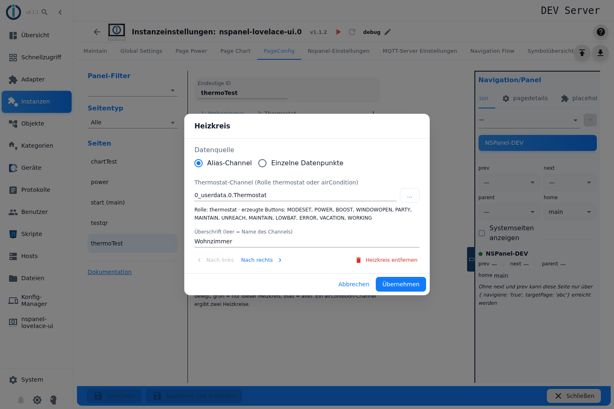

**Datenquelle** ist eine Radiogruppe mit **Alias-Channel** und **Einzelne Datenpunkte**.

**Alias-Channel:** Feld **Thermostat-Channel (Rolle thermostat oder airCondition)**. Die ID lässt sich eintippen oder über **…** aus dem Objektbaum wählen; der Baum zeigt Channels, Geräte und Ordner mit passender Rolle.

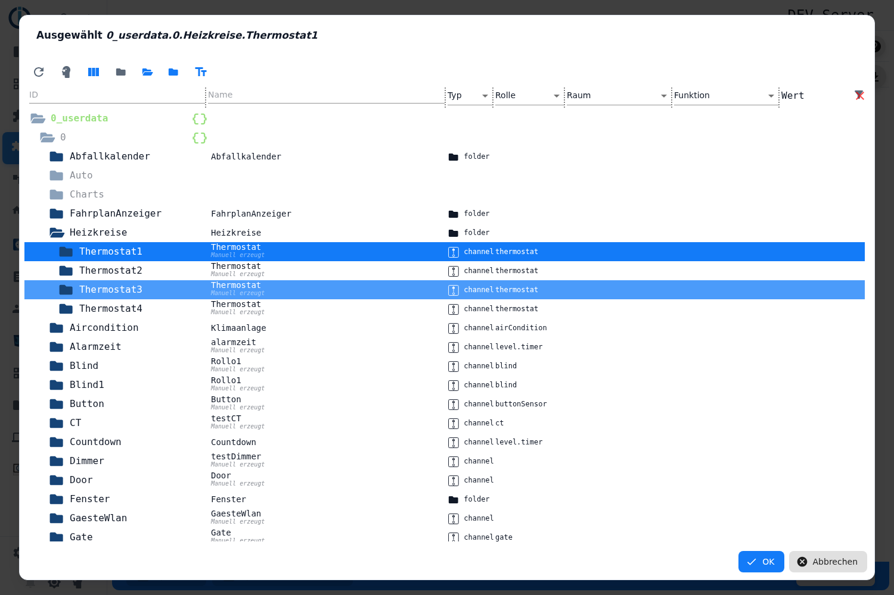

Direkt nach der Auswahl prüft der Editor das Objekt und zeigt darunter **Rolle: …** und **erzeugte Buttons: …** – die Liste der Schaltflächen, die der Adapter aus den gefundenen Datenpunkten baut. Fehlt das Objekt oder hat es eine andere Rolle, erscheint eine Warnung (*„Das Objekt %s wurde nicht gefunden"* bzw. *„Der Channel %s hat die Rolle ‚%s' – erwartet wird thermostat oder airCondition"*):

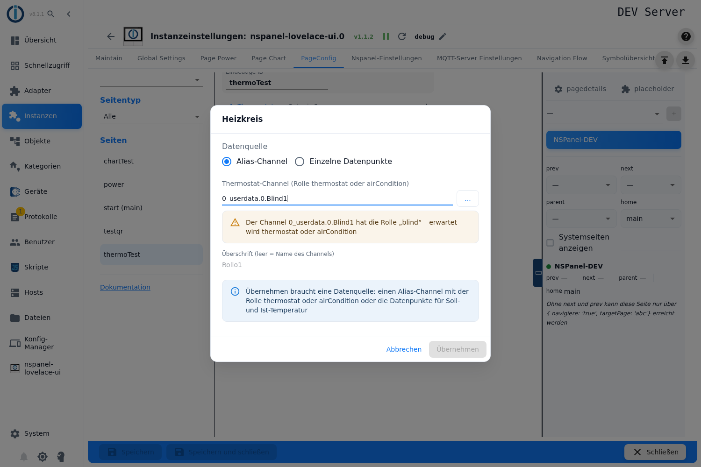

**Einzelne Datenpunkte:** Statt eines Alias werden vier Datenpunkte direkt angegeben – **Solltemperatur (schreibbar)**, **Ist-Temperatur**, **Luftfeuchte (optional)** und **Modus (optional, Zahl oder Text)**. Soll und Ist sind Pflicht, ein Heizkreis ohne beide wird nicht gespeichert. In diesem Modus erzeugt der Adapter keine Schaltflächen; Ein/Aus leitet er aus dem Modus-Datenpunkt ab (0 = aus).

**Überschrift (leer = Name des Channels):** Diese Überschrift zeigt das Panel über dem Stellring. Bei einem `airCondition`-Channel gibt es zusätzlich **Überschrift Kühlen (airCondition)** für den zweiten Reiter (leer = `COOLING`).

**Nach links / Nach rechts** ändert die Reihenfolge der Heizkreise – und damit die Nummern der Auswahlflächen; die Items wandern mit. **Heizkreis entfernen** löscht ihn samt der Items, die nur an ihn gebunden sind.

**Übernehmen** ist erst möglich, wenn die Datenquelle plausibel ist; andernfalls steht im Dialog *„Übernehmen braucht eine Datenquelle: einen Alias-Channel mit der Rolle thermostat oder airCondition oder die Datenpunkte für Soll- und Ist-Temperatur"*. Ein neuer Heizkreis entsteht erst mit **Übernehmen** – **Abbrechen** hinterlässt nichts.

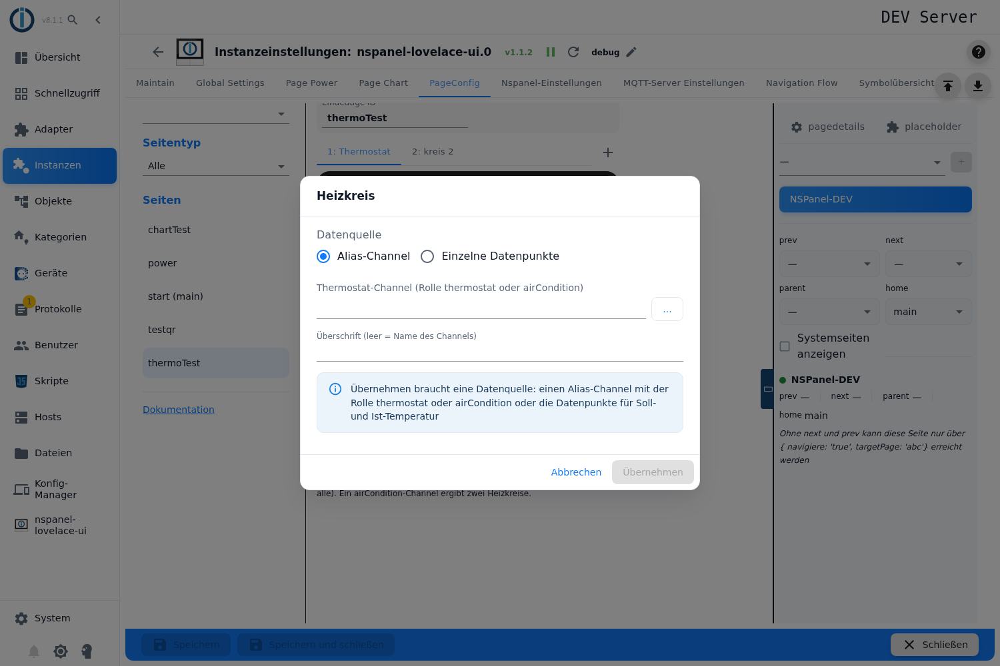

Enthält eine ältere Konfiguration Heizkreise ohne Datenquelle, meldet der Editor das über den Reitern (*„%s Heizkreis(e) ohne Datenquelle – der Adapter überspringt sie"*) und bietet **Entfernen** an; beim Entfernen behalten die Items ihre Heizkreise.

## 4. Die Schaltflächen aus dem Alias

Was unter **erzeugte Buttons** steht, wird **nicht konfiguriert**: Der Adapter sucht unterhalb des Channels nach `common.role` und `common.type` (die Namen der Datenpunkte sind bis auf die unten genannten Ausnahmen beliebig) und legt je gefundenem Datenpunkt eine Fläche an – **jede davon verbraucht einen der neun Plätze**, in dieser Reihenfolge:

| Datenpunkt | Fläche am Panel | Rolle |
|---|---|---|
| `MODESET` | Auswahlliste der Betriebsart; das Symbol folgt dem Wert (0 power-off, 1 heat-wave, 2 snowflake, 3 refresh-auto), die Überschrift des Popups ist der `common.name` des Datenpunkts | beide |
| `POWER` | `power-standby`, ein/aus | beide |
| `BOOST` | `fast-forward-60`, ein/aus | beide |
| `WINDOWOPEN` | `window-open-variant` / `window-closed-variant` | nur `thermostat` |
| `PARTY` | `party-popper` | nur `thermostat` |
| `MAINTAIN` | `account-wrench` | beide |
| `UNREACH` | `wifi-off` / `wifi` | beide |
| `LOWBAT` | `battery-low` / `battery-high` | nur `thermostat` |
| `ERROR` | `alert-circle` | beide |
| `VACATION` | `palm-tree` | nur `thermostat` |
| `WORKING` | `briefcase-check` | nur `thermostat` |

Diese Flächen sind in der Vorschau mit einem **Schloss** markiert und lassen sich nicht bearbeiten. Ist nur ein Heizkreis angelegt, entfällt die Auswahlfläche, und die Schaltflächen beginnen auf Platz 1.

Für `VACATION` und `USERICON` (bei `airCondition` für `SET` und `SET2`) sucht der Adapter **nicht** nach der Rolle, sondern nach dem Datenpunkt mit **genau diesem Namen** unterhalb des Channels – `….VACATION`, nicht `….Vacation`.

## 5. Solltemperatur: Minimum, Maximum, Schrittweite

Klick auf die **große Zahl** im Stellring.

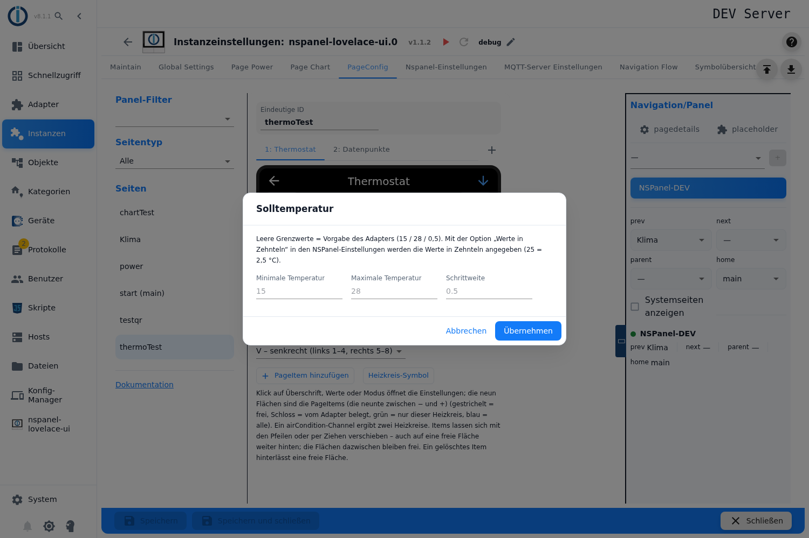

| Feld | Wirkung |
|---|---|
| **Minimale Temperatur** | Unteres Ende des Stellrings. Leer = 15. |
| **Maximale Temperatur** | Oberes Ende. Leer = 28. |
| **Schrittweite** | Schritt der Tasten − und +. Leer = 0,5. |

Der Hinweis im Dialog nennt beide Punkte: *„Leere Grenzwerte = Vorgabe des Adapters (15 / 28 / 0,5). Mit der Option ‚Werte in Zehnteln' in den NSPanel-Einstellungen werden die Werte in Zehnteln angegeben (25 = 2,5 °C)."* Die Option **Werte in Zehnteln** gilt für die ganze Instanz und nur für `cardThermo2`; sie wirkt ausschließlich auf diese drei Zahlen. Der Adapter rundet die Schrittweite auf ein Zehntelgrad auf und begrenzt den gelesenen Sollwert auf das eingestellte Fenster.

## 6. Anzeige der Werte: Symbol, Farbe, Einheit

Klick auf **Zeile 1** (Ist-Temperatur) oder **Zeile 3** (Luftfeuchte). Der Dialog enthält beide Zeilen untereinander, überschrieben mit **Zeile 1: Ist-Temperatur (Einheit gilt auch für die Solltemperatur)** und **Zeile 3: Luftfeuchte**.

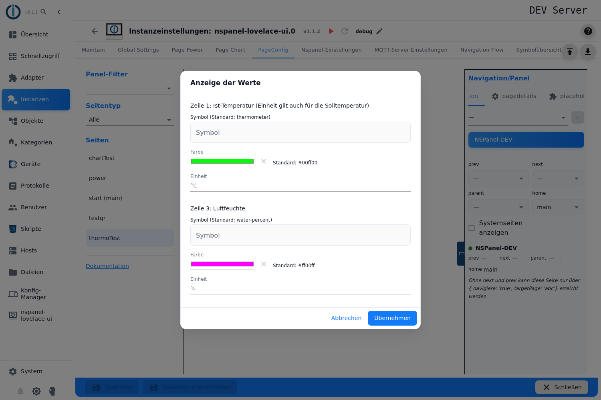

| Feld | Wirkung |
|---|---|
| **Symbol** | Symbol vor dem Wert, aus der Symbolliste. Standard `thermometer` (Zeile 1) bzw. `water-percent` (Zeile 3). |
| **Farbe** | Farbe von Symbol und Wert. Standard grün (Zeile 1) bzw. magenta (Zeile 3); **Zurück auf Standard** setzt sie zurück. |
| **Einheit** (Zeile 1) | Text hinter dem Wert. Das Feld gilt für **Zeile 1 und für die große Zahl im Stellring** (die Solltemperatur). Leer = `°C`. |
| **Einheit** (Zeile 3) | Text hinter der Luftfeuchte. Leer = `%`. |

Die Einheit neben der **großen Zahl** im Stellring kommt aus dem Feld **Einheit** der Zeile 1 – der Hinweis in der Dialogüberschrift stimmt also.

## 7. Modusanzeige

Klick auf den **Modustext** unter dem Stellring.

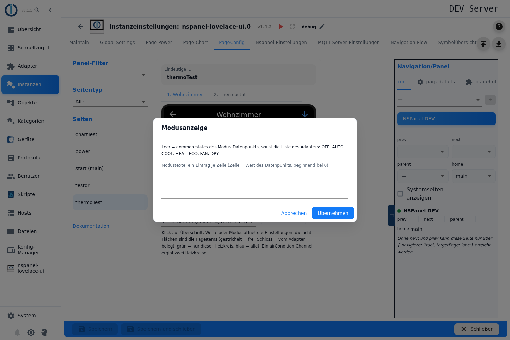

**Modustexte, ein Eintrag je Zeile (Zeile = Wert des Datenpunkts, beginnend bei 0).** Der Hinweis darunter nennt die Rangfolge: *„Leer = common.states des Modus-Datenpunkts, sonst die Liste des Adapters: OFF, AUTO, COOL, HEAT, ECO, FAN, DRY"*. Die Texte werden übersetzt, soweit der Adapter sie kennt.

Den Text liest der Adapter aus `MODE`; fehlt der Datenpunkt, tritt `MODESET` an seine Stelle. Beim Weg über **Einzelne Datenpunkte** gilt der dort angegebene Modus-Datenpunkt, und dieselbe Liste bestimmt den Text; ein Wert ungleich 0 bedeutet dort „ein".

## 8. Heizkreis-Symbol

Knopf **Heizkreis-Symbol** unter der Vorschau.

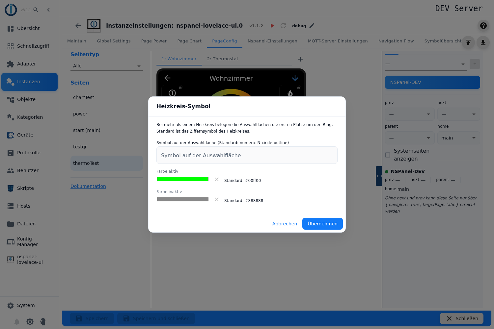

Der Hinweis im Dialog: *„Bei mehr als einem Heizkreis belegen die Auswahlflächen die ersten Plätze um den Ring; Standard ist das Ziffernsymbol des Heizkreises."*

| Feld | Wirkung |
|---|---|
| **Symbol auf der Auswahlfläche** | Standard ist die Ziffer des Heizkreises (`numeric-1-circle-outline`, `numeric-2-circle-outline` …). |
| **Farbe aktiv** | Farbe, solange dieser Heizkreis gewählt ist. Standard grün. |
| **Farbe inaktiv** | Farbe der übrigen Auswahlflächen. Standard grau. |
| **Für den Kühlkreis (airCondition)** | Bei einem `airCondition`-Channel erscheinen Symbol und beide Farben ein zweites Mal für den Kühlkreis; dort sind blau und ein dunkles Blaugrau die Vorgaben. |

## 9. PageItems: anlegen, verschieben, freie Flächen

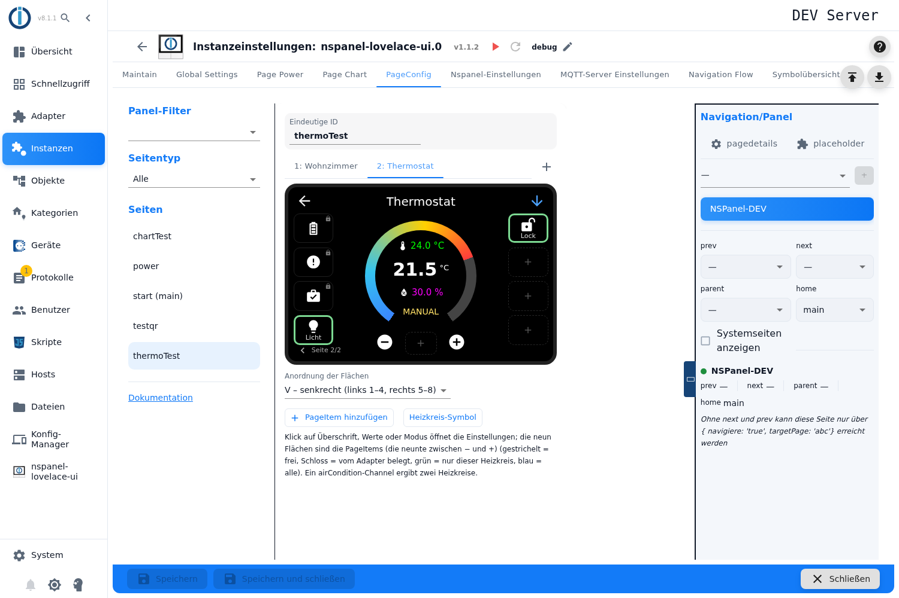

| Vorgang | Wirkung |
|---|---|
| **Klick auf eine freie Fläche** oder **PageItem hinzufügen** | Öffnet den Item-Dialog. Wird eine Fläche weiter hinten angeklickt, landet das Item genau dort; die Flächen davor bleiben als reservierte Lücken frei. |
| **Klick auf ein Item** | Öffnet den Item-Dialog zum Bearbeiten. |
| **Pfeile beim Überfahren** | Verschieben das Item eine Fläche nach links oder rechts. |
| **Ziehen auf eine belegte Fläche** | Die beiden tauschen die Plätze. |
| **Ziehen auf eine freie Fläche weiter hinten** | Das Item landet dort, die Flächen dazwischen bleiben frei. |
| **Papierkorb** | Löscht das Item; seine Fläche bleibt als reservierte Lücke frei, die übrigen Items behalten ihre Plätze. Ein zweiter Klick auf dieselbe Lücke entfernt sie. |

Der Hinweis unter der Vorschau sagt dasselbe: *„Items lassen sich mit den Pfeilen oder per Ziehen verschieben – auch auf eine freie Fläche weiter hinten; die Flächen dazwischen bleiben frei. Ein gelöschtes Item hinterlässt eine freie Fläche."* Reservierte Lücken **zwischen** Items werden mitgespeichert, Lücken **am Ende** verwirft der Adapter.

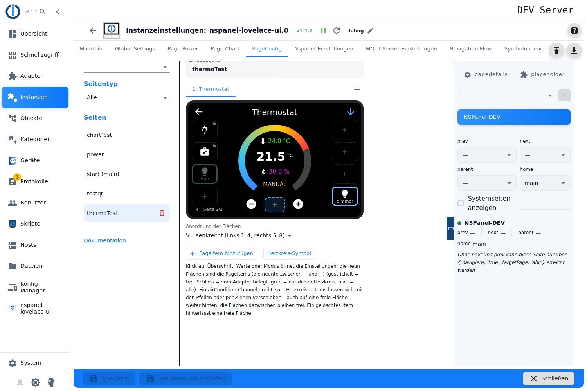

Der Item-Dialog ist der allgemeine Pageitem-Dialog, beschrieben unter [Wiederkehrende Dialoge](PageConfig-Dialoge). Drei Dinge gelten auf dieser Karte besonders:

- Das Feld **Heizkreis** gibt es nur hier: **alle Heizkreise** oder genau einen. Vorbelegt ist der gerade gewählte Heizkreis; ein gebundenes Item erscheint nur dort.
- **Der Name beschriftet die Fläche nicht.** Unter dem Namensfeld und im Hinweis des Dialogs *Dynamischer Name* steht dazu: *„Auf dieser Seite nur Titel des Popups – wird auf dem Panel nicht unter dem Icon angezeigt."* Der Name ist also ausschließlich die Überschrift des Popups, das die Fläche öffnet.
- **Einen langen Druck gibt es hier nicht** – das Feld fehlt, weil die Flächen dieser Karte am Panel keinen langen Druck melden. **Text-/Icongröße** und **Wert statt Icon verwenden** stehen dagegen zur Verfügung und werden vom Adapter auch für diese Karte ausgewertet; bei Symbolflächen bietet die Auswahl nur die Schriften mit Symbolen (1, 3 und 4).

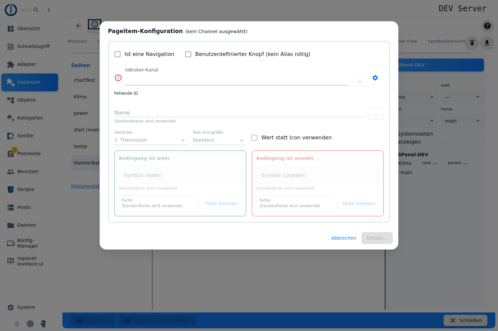

Items für **alle Heizkreise** können je Heizkreis auf **unterschiedlichen Flächen** liegen, weil jeder Heizkreis unterschiedlich viele erzeugte Schaltflächen vor sich hat. Der Editor zeigt immer die Belegung des gewählten Heizkreises.

## 10. Anordnung der Flächen

Auswahlfeld **Anordnung der Flächen** unter der Vorschau:

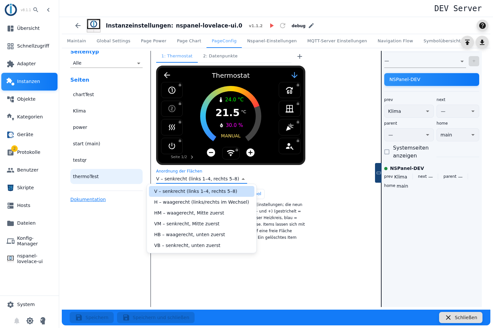

| Wert | Beschriftung im Admin | Belegung |
|---|---|---|
| **V** | senkrecht (links 1–4, rechts 5–8) | Vorgabe. Links von oben nach unten 1–4, rechts 5–8, **die neunte Fläche zwischen − und + wird mitgesendet**. |
| **H** | waagerecht (links/rechts im Wechsel) | 1 links oben, 2 rechts oben, 3 links, 4 rechts … |
| **HM** | waagerecht, Mitte zuerst | wie H, beginnt aber in der zweiten Zeile. |
| **VM** | senkrecht, Mitte zuerst | wie V, beginnt aber in der zweiten Zeile. |
| **HB** | waagerecht, unten zuerst | |
| **VB** | senkrecht, unten zuerst | |

Der Editor zeichnet die Flächen in der gewählten Anordnung. **Nur bei `V` füllt der Adapter alle neun Flächen.** Bei jeder anderen Anordnung sortiert er lediglich die acht seitlichen um, die neunte bleibt leer – der Editor zeigt sie dann ausgegraut mit Schloss und dem Hinweis *„Sortierung %s: der Adapter füllt nur die acht seitlichen Flächen – diese Fläche bleibt leer, ein Item hier erscheint nicht auf dem Panel"*.

## 11. Blättern der Flächen

Mehr als neun Flächen verteilt der Adapter auf mehrere Seiten. **Wie** geblättert wird, steht nicht im Editor, sondern rechts in der Spalte **Navigation/Panel** unter den Seitendetails (siehe [PageConfig – Übersicht](PageConfig#seitendetails)).

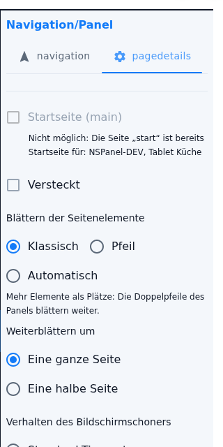

**Blättern der Seitenelemente:**

| Auswahl | Wirkung |
|---|---|
| **Klassisch** | *„Mehr Elemente als Plätze: Die Doppelpfeile des Panels blättern weiter."* – Vorgabe. Die Navigationspfeile oben am Panel werden zu Blätterpfeilen, solange es eine weitere Seite gibt. |
| **Pfeil** | *„Mehr Elemente als Plätze: Der letzte Platz zeigt einen Pfeil, der weiterblättert."* – Das ist hier die **neunte** Fläche zwischen − und +; es bleiben acht Plätze für Flächen. Der Pfeil erscheint erst, wenn mehr als neun Flächen zusammenkommen, und blättert auf der letzten Seite zurück zur ersten. |
| **Automatisch** | *„Wie klassisch, zusätzlich blättert die Seite nach der eingestellten Zeit von selbst weiter."* – dazu das Feld **Sekunden bis zur nächsten Seite** (leer = 15). |

**Weiterblättern um** (**Eine ganze Seite** / **Eine halbe Seite**) erscheint bei dieser Karte, weil sie in der Liste der halbseitenfähigen Karten steht. Die Wahl ist aber **ohne Wirkung**: Der Adapter setzt den Wert beim Bauen der Seite in beiden Richtungen auf *ganze Seite* zurück.

## 12. Panel-Zuweisung, Navigation, Speichern

- Panel, Navigationsziele (`prev`, `next`, `parent`, `home`), **Startseite (main)**, **Versteckt** und **Verhalten des Bildschirmschoners** liegen rechts in der Spalte **Navigation/Panel**, beschrieben unter [PageConfig – Übersicht](PageConfig#panelzuweisung-und-navigation). Ohne `next`/`prev` ist die Seite nur über ein gezieltes Navigationsziel erreichbar.
- Unten **Speichern** bzw. **Speichern und schließen**. Die Instanz startet danach neu und baut die Seite auf.
- Baut der Adapter die Seite nicht oder überspringt er einen Heizkreis (Objekt fehlt, falsche Rolle, `SET` nicht gefunden oder nicht beschreibbar), steht der Grund im Log der Instanz – unter anderem *invalid SET datapoint. Not exists or not writeable!*
- Die Karte wird auch im [Web-Panel](WebPanel) nachgebildet; seit 2.0.2 übernimmt es dort die Größen und Positionen der Flächen vom HMI.

## 13. Übernahme aus einem Skript

Eine `cardThermo2`-Seite aus einem Konfigurationsskript lässt sich vollständig in den Admin übernehmen, siehe [Migration](Migration). Dabei werden `thermoItems` zu Heizkreisen, `sortOrder` zur **Anordnung der Flächen**, `items` zu den PageItems und `filter` zum Feld **Heizkreis**; `id` ergibt die Datenquelle *Alias-Channel*, `set`/`thermoId1`/`thermoId2`/`modeId` die Datenquelle *Einzelne Datenpunkte*.

Ein Feld hält die Übernahme auf: **`power`** am Heizkreis – für den eigenen Ein/Aus-Datenpunkt hat der Admin kein Feld (*the admin has no power state*). Der Ein/Aus-Zustand kommt im Admin aus `MODESET` beziehungsweise aus dem Modus-Datenpunkt. Ebenso abgelehnt werden unbekannte Felder am Heizkreis, eine leere oder fehlerhafte `modeList` und ein unbekannter `sortOrder`.

## Fallstricke

- **Ohne laufende Instanz ist der Editor gesperrt.** Alle Felder sind ausgegraut, Rollen und erzeugte Buttons werden nicht geprüft.
- **Die neunte Fläche gibt es nur bei der Anordnung `V`.** Bei jeder anderen Anordnung sendet der Adapter nur die acht seitlichen Flächen; ein Item auf der neunten erscheint nicht. Der Editor markiert sie dann mit einem Schloss – wer die Anordnung nachträglich ändert, verliert also eine belegte Fläche je Seite.
- **„Blättern: Pfeil" und eine Anordnung ungleich `V` schließen sich aus.** Der Blätterpfeil liegt auf der neunten Fläche – genau der, die bei H, HM, VM, HB und VB wegfällt. Die Seite lässt sich dann nicht mehr blättern, weil in dieser Einstellung auch die Navigationspfeile nicht blättern.
- **„Weiterblättern um eine halbe Seite" wird angeboten, aber nie benutzt.** Der Adapter setzt den Wert für diese Karte immer auf *ganze Seite* zurück.
- **Bis einschließlich 2.0.2 erreichte die zweite Einheit das Panel nicht.** Der Adapter nahm für beide Wertzeilen das Feld **Einheit** der Zeile 1 – eine Luftfeuchte bekam damit `°C` angehängt, und die Solltemperatur blieb ohne Einheit. Beides ist in der Version nach 2.0.2 behoben; wer noch 2.0.2 oder älter fährt, trägt in Zeile 1 die Einheit ein, die zur Ist-Temperatur passt, und lebt bei der Luftfeuchte damit.
- **Die Platzhalter „Werte in Zehnteln" täuschen.** Ist die Option in den NSPanel-Einstellungen aktiv, bedeutet eine eingetragene 15 im Feld *Minimale Temperatur* 1,5 °C – die Platzhalter im Dialog zeigen weiter 15 / 28 / 0,5.
- **Reservierte Lücken erscheinen in jedem Heizkreis.** Der Editor merkt sich den Heizkreis einer freien Fläche, der Adapter verwirft diese Bindung beim Bauen der Seite. Eine Lücke, die nur bei Heizkreis 1 gedacht war, verschiebt die Flächen aller anderen Heizkreise um einen Platz.
- **Die Vorschau zählt einen Platz mehr als das Panel.** Der Editor hält immer eine freie Fläche zum Anlegen offen. Bei genau neun Flächen zeigt er deshalb zwei Seiten, während das Panel alles auf einer Seite unterbringt.
- **Die Vorschau kennt die Blätter-Einstellung nicht.** Sie blättert immer mit der Anzeige **Seite x** unter der Karte, auch in der Einstellung *Pfeil* – die neunte Fläche wird dort nicht zum Blätterpfeil.
- **Ein `airCondition` ohne `SET2` ergibt nur einen Heizkreis.** Der Editor zeigt trotzdem zwei Reiter, und der Adapter verwirft den Kühlkreis mit einer Warnung im Log. Alle Items, die an einen **späteren** Heizkreis gebunden sind, landen dann am falschen Heizkreis.
- **Die Grenze „acht" meint zwei verschiedene Dinge.** Das **+** sperrt nach acht gespeicherten Datenquellen, das Panel zählt dagegen Heizkreise – und ein `airCondition`-Channel zählt doppelt. Fünf `airCondition`-Channels ergeben zehn Heizkreise; der Adapter schneidet auf acht zu und meldet *Heat cycles are 10, but only 8 are supported!*
- **Fehlt `ACTUAL`, zeigt Zeile 1 den Sollwert.** Der Adapter weicht bei der Rolle `thermostat` ersatzweise auf `SET` aus und schreibt dazu eine Info ins Log (*using SET instead*). Bei `airCondition` bleibt die Zeile leer.
- **Ein Datenpunkt fehlt trotz passender Rolle.** `VACATION` und `USERICON` (und bei `airCondition` `SET` und `SET2`) müssen **genau so heißen**; die Vorschau **erzeugte Buttons** zeigt nur, was der Adapter wirklich findet.
- **Die Alias-Tabelle ist an dieser Stelle veraltet.** Der Vermerk *Not supported in cardThermo2* bei `ERROR`, `MAINTAIN`, `PARTY`, `VACATION` und `WORKING` stimmt nicht mehr – aus allen fünf entstehen Schaltflächen, die je einen der neun Plätze belegen. Wirklich ignoriert wird allein `USERICON`.
- **Schaltflächen für AUTOMATIC, MANUAL und OFF kann es nicht geben.** Der Adapter enthält Code dafür, die Alias-Definition von `thermostat` und `airCondition` kennt aber keine solchen Datenpunkte – weder die Vorschau im Heizkreis-Dialog noch das Panel zeigen sie je.
- **Die Überschrift der Seite wirkt nicht.** Was über dem Stellring steht, ist immer die **Überschrift** des gewählten Heizkreises. Ein Überschriftentext, der über eine [Verknüpfung](pageLink) auf diese Seite mitgegeben wird, bleibt deshalb ohne Folgen.
- **Für den Ein/Aus-Datenpunkt gibt es kein Feld.** Der Adapter leitet den Zustand aus `MODESET` beziehungsweise aus dem Modus-Datenpunkt ab (0 = aus). Ein `power` im Skript verhindert die Übernahme der Seite in den Admin.
