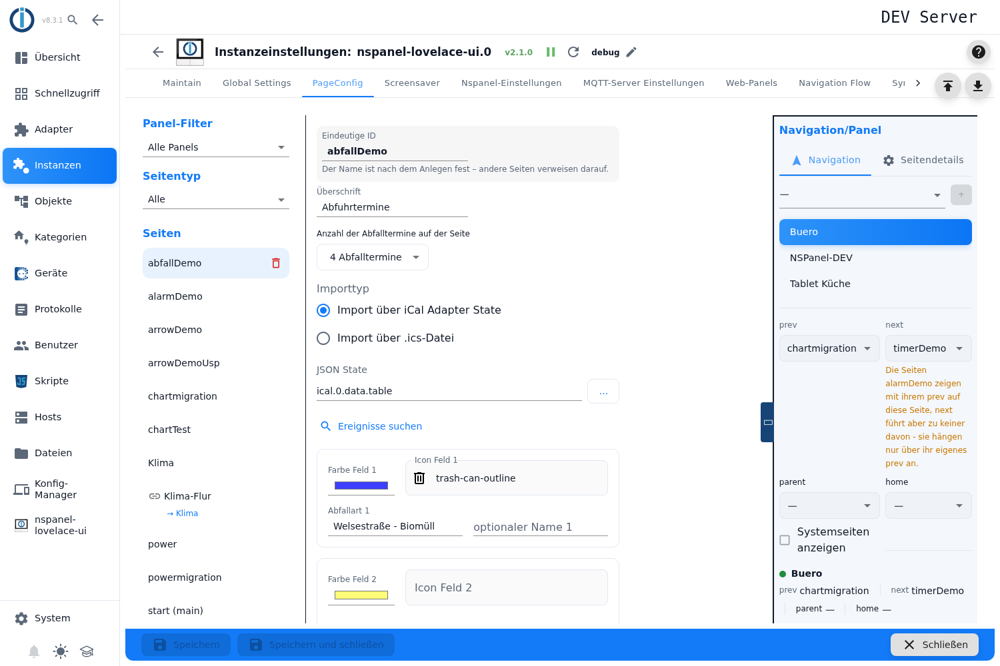
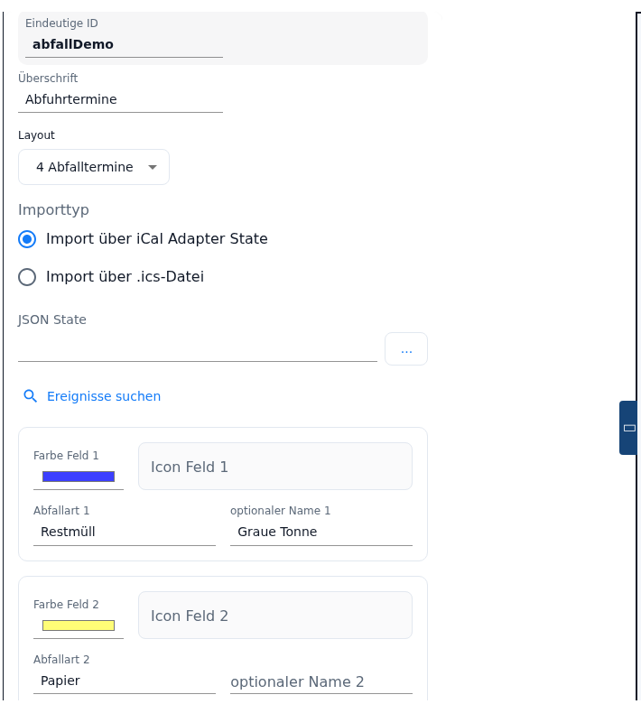

# Abfall-Seite – Konfiguration im Admin

Die Abfall-Seite zeigt die nächsten **Müllabfuhr-Termine**: je Zeile ein farbiges Symbol, der Name der Abfallart und wann abgeholt wird — „today", „tomorrow", der Wochentag oder das Datum. Die Termine kommen aus einem Datenpunkt des **ical-Adapters** oder aus einer hochgeladenen **`.ics`-Datei**.

Angelegt wird sie im Tab **PageConfig**, Seitentyp **Abfall**. Der Adapter baut daraus **keine eigene Kartenart**, sondern eine gewöhnliche Listenseite (siehe [Abschnitt 2](#2-was-der-adapter-aus-dem-eintrag-baut)).

Inhalt:
- [Seite anlegen](#1-seite-anlegen)
- [Was der Adapter aus dem Eintrag baut](#2-was-der-adapter-aus-dem-eintrag-baut)
- [Der Editor im Überblick](#3-der-editor-im-überblick)
- [Woher die Termine kommen](#4-woher-die-termine-kommen)
- [Ereignisse suchen und übernehmen](#5-ereignisse-suchen-und-übernehmen)
- [Die sechs Abfallarten](#6-die-sechs-abfallarten)
- [Wie ein Termin seine Zeile findet](#7-wie-ein-termin-seine-zeile-findet)
- [Was auf dem Panel erscheint](#8-was-auf-dem-panel-erscheint)
- [Wann die Termine aktualisiert werden](#9-wann-die-termine-aktualisiert-werden)
- [Panel-Zuweisung und Navigation](#10-panel-zuweisung-und-navigation)
- [Stand 2.0.2](#11-stand-202)
- [Fallstricke](#fallstricke)

## 1. Seite anlegen

1. Instanz-Einstellungen öffnen → Tab **PageConfig**.
2. Links als **Seitentyp** den Eintrag **Abfall** wählen, unter **Neue Seite** einen Namen eintragen, **+** drücken.
3. Die Seite erscheint in der Liste **Seiten**, rechts öffnet sich der Editor.

**Eindeutige ID** ist der Seitenname, über den andere Seiten die Seite in ihren Navigationszielen ansprechen; das Feld ist nur lesbar, der Name ist nach dem Anlegen fest. Ist die Seite als **Startseite (main)** markiert, steht darunter ihr eigener Hinweis (*„Startseite – wird unter der ID „main" veröffentlicht. …"*). Siehe [PageConfig – Übersicht](PageConfig#seiten-anlegen-und-löschen).

**Überschrift** ist die Kopfzeile am Panel; bleibt das Feld leer, zeigt das Panel `Trash`.

Unter der Seitenliste führt der Verweis **Dokumentation** direkt auf diese Seite.

> Alle Felder des Editors sind gesperrt, solange die Instanz nicht läuft. Einen Hinweis darauf gibt der Editor nicht.

## 2. Was der Adapter aus dem Eintrag baut

Eine Kartenart `cardTrash` gibt es am Panel nicht. Der Adapter erzeugt aus dem Eintrag eine gewöhnliche Listenseite auf Basis der Vorlage `entities.waste-calendar`:

| Einstellung **Layout** | Karte am Panel | Zeilen |
|---|---|---|
| *4 Abfalltermine* | `cardEntities` | 4 |
| *6 Abfalltermine* | `cardSchedule` | 6 |

Je Zeile entsteht ein Seitenelement der Rolle `text.list`, das Symbol, Farbe, Name und Datum aus einem internen Datenpunkt `pageTrash_<Eindeutige ID>` liest. Diesen Datenpunkt füllt der Adapter aus der Terminquelle (siehe [Abschnitt 9](#9-wann-die-termine-aktualisiert-werden)).

Daraus folgt:

- Die Zahl der Terminzeilen ist mit der Kartenart verkoppelt und nicht frei wählbar.
- Die Einstellung **Layout** ändert zusätzlich die Schreibweise des Datums (siehe [Abschnitt 8](#8-was-auf-dem-panel-erscheint)).
- Eine Abfall-Seite entsteht **nur im Admin**. Im Konfigurationsskript gibt es den Seitentyp nicht; eine Abfall-Seite ist dort eine selbst gebaute Listenseite mit eigenen Datenpunkten. Eine solche Skript-Seite lässt sich auch **nicht** über die [Migration](Migration) in den Seitentyp **Abfall** umwandeln — die Vorlage einer Seite kann der Admin nicht abbilden, die Migration meldet dafür *„Ein Feld der Seite lässt sich im Admin nicht abbilden"*.

## 3. Der Editor im Überblick

Der Editor ist ein Formular, von oben nach unten:

| Feld | Bedeutung |
|---|---|
| **Eindeutige ID** | Seitenname; nur lesbar, nach dem Anlegen fest. |
| **Überschrift** | Kopfzeile am Panel; leer → `Trash`. |
| **Layout** | Zahl der Terminzeilen: *4 Abfalltermine* oder *6 Abfalltermine*. |
| **Importtyp** | *Import über iCal Adapter State* oder *Import über .ics-Datei*. |
| **JSON State** bzw. **.ics-Datei inkl. Pfad** | Die Terminquelle, je nach Importtyp (siehe [Abschnitt 4](#4-woher-die-termine-kommen)). |
| **Ereignisse suchen** / **Datei hochladen** | Liest die Quelle und listet die vorkommenden Ereignisnamen auf. |
| Sechs Blöcke **Farbe/Icon/Abfallart/optionaler Name** | Je Abfallart ein Block (siehe [Abschnitt 6](#6-die-sechs-abfallarten)). |

> Die Beschriftung **Layout** ist irreführend — gemeint ist die **Anzahl** der Termine. Der zutreffende Text steckt nur im Tooltip (*Anzahl der Abfalltemine auf der Seite*, mit Tippfehler) und ist damit praktisch unsichtbar. Das Wort „Layout" ist außerdem fest englisch eingebaut und wird in keiner Sprache übersetzt.

## 4. Woher die Termine kommen

Unter **Importtyp** stehen zwei Wege:

| Auswahl | Was gebraucht wird |
|---|---|
| **Import über iCal Adapter State** | Ein Datenpunkt des ical-Adapters mit der Termintabelle. |
| **Import über .ics-Datei** | Eine Kalenderdatei, die in den Dateibereich der Instanz hochgeladen wird. |

**Weg 1 — ical-Adapter.** Das Feld **JSON State** nimmt den Datenpunkt mit der Terminliste; der ical-Adapter liefert sie üblicherweise unter `ical.<n>.data.table`. Der Inhalt muss ein JSON-Array sein (als Text oder als Objekt), und jeder Eintrag braucht die Felder **`_date`** (Termindatum) und **`event`** (Ereignisname). Termine vor dem heutigen Tag (0 Uhr) werden verworfen; sortiert wird **nicht** — es gilt die Reihenfolge, die der Adapter liefert.

> Die Objektauswahl zeigt **nur Datenpunkte, deren ID mit `ical.` beginnt**. Wer seine Termine über ein Skript oder in `0_userdata` bereitstellt, findet seinen Datenpunkt im Dialog nicht und muss die ID **von Hand in das Feld eintragen** — das funktioniert, nur weist nichts darauf hin. Die Beschriftung *JSON State* ist in allen Sprachen gleich und nennt nicht, dass die Termintabelle des ical-Adapters gemeint ist.

**Weg 2 — `.ics`-Datei.** **Datei hochladen** öffnet die Dateiauswahl (nur `.ics`). Die Datei wandert unter ihrem Namen in den **Dateibereich der Instanz** (`nspanel-lovelace-ui.0`), ihr Name trägt sich danach selbst in das Feld **.ics-Datei inkl. Pfad** ein. Eine Statuszeile meldet das Ergebnis:

- *„'datei.ics' hochgeladen – 24 Termine gefunden. Bitte die anzuzeigenden auswählen."*
- *„'datei.ics' hochgeladen, aber in der Datei wurden keine Termine gefunden."*

Der Adapter liest die Datei bei jedem Durchlauf neu aus dem Dateibereich. Auch hier zählen nur Termine ab heute; sie werden zusätzlich nach Datum **sortiert**.

> Der Hilfstext *„Pfad zur .ics-Datei im ioBroker-Dateisystem. Wird automatisch befüllt bei Datei-Upload"* meint den Dateibereich der **Instanz**, nicht das Dateisystem des Hosts. Ein von Hand eingetragener Pfad muss relativ dazu sein; ein Pfad wie `/opt/iobroker/…` findet keine Datei und das Log meldet *„File … does not exist in ioBroker files"*.

## 5. Ereignisse suchen und übernehmen

Damit die Seite etwas anzeigen kann, muss der Adapter wissen, **welcher Ereignisname zu welcher Abfallart gehört**. Dafür gibt es eine Hilfe:

1. Beim State-Weg den Knopf **Ereignisse suchen** drücken: Der Editor liest den Datenpunkt und sammelt die vorkommenden Werte von `event`, jeden einmal. Beim Datei-Weg entsteht dieselbe Liste **schon beim Hochladen**; einen Suchknopf gibt es dort nicht.
2. Die Namen erscheinen als Liste zum Ankreuzen — Überschrift **Gefundene Ereignisse, bitte auswählen** (State-Weg) bzw. **Ereignisse auswählen** (Datei-Weg). **Höchstens sechs** lassen sich ankreuzen; danach sind die übrigen Zeilen gesperrt.
3. **Auswahl übernehmen** trägt die angekreuzten Namen in die Felder *Abfallart 1* bis *6* ein — in der Reihenfolge, in der sie angekreuzt wurden, nicht in der Reihenfolge der Liste.

> ⚠️ **„Auswahl übernehmen" überschreibt alle sechs Abfallart-Felder.** Jedes Feld, zu dem es keinen angekreuzten Namen gibt, wird **geleert**. Farben, Symbole und die optionalen Namen bleiben unberührt. Wer die Abfallarten schon von Hand gepflegt hat, trägt Ergänzungen besser von Hand nach.

> Nach der Übernahme ist die Ereignisliste verschwunden (sie wird mit der Auswahl zurückgesetzt). Für einen zweiten Durchgang ist erneut zu suchen bzw. hochzuladen. Dasselbe geschieht beim Wechsel des **Importtyps**.

> Die Fehlermeldungen dieser Suche sind hartcodierte Hinweisfenster und **teils deutsch, teils englisch** — unabhängig von der Sprache des Admins: *„Bitte wählen Sie zuerst einen State aus"*, *„State enthält keine Daten"*, *„State enthält kein Array"*, dagegen *„Upload failed: …"* und *„Failed to read file"*.

## 6. Die sechs Abfallarten

Darunter stehen **sechs gleich aufgebaute Blöcke**, einer je Abfallart:

| Feld | Bedeutung |
|---|---|
| **Farbe Feld *n*** | Die Farbe des Symbols. Vorgaben einer neuen Seite: 1 blau `#3c3fff`, 2 gelb `#fffd77`, 3 hellgrau `#d2d2d2`, 4 orange `#de8900`, 5 und 6 hellgrau `#d2d2d2`. |
| **Icon Feld *n*** | Das Symbol aus der Icon-Auswahl. Ohne Angabe nimmt der Adapter `calendar-month`. |
| **Abfallart *n*** | **Der Suchbegriff**, mit dem Termine dieser Zeile zugeordnet werden — siehe [Abschnitt 7](#7-wie-ein-termin-seine-zeile-findet). |
| **optionaler Name *n*** | Was am Panel **angezeigt** wird, wenn es vom Suchbegriff abweichen soll. Praktisch, wenn der Kalender „Restabfallbehaelter 240l" liefert, am Panel aber „Restmüll" stehen soll. |

> **Es werden immer sechs Blöcke angezeigt, und alle sechs wirken** — auch bei der Einstellung *4 Abfalltermine*. Die Suche nach der passenden Zeile läuft über alle sechs Begriffe; begrenzt ist nur die Zahl der **Zeilen am Panel**. Ein Treffer in Block 5 oder 6 belegt deshalb ebenso einen der vier Plätze.

## 7. Wie ein Termin seine Zeile findet

Das ist der Kern der Einrichtung und nirgends in der Oberfläche erklärt:

- Der Adapter prüft für jeden Termin, ob der Ereignisname den Text aus **Abfallart *n*** **enthält** — es ist eine Teilstring-Suche, keine genaue Übereinstimmung, und sie unterscheidet Groß- und Kleinschreibung. „Bio" trifft also auch „Biotonne 14-täglich", „bio" dagegen nicht.
- Geprüft wird **von 1 nach 6**, der **erste Treffer gewinnt**. Bei überlappenden Begriffen entscheidet die Reihenfolge: Steht „Papier" in Feld 1 und „Altpapier" in Feld 3, landen beide in Zeile 1 mit Farbe, Symbol und Namen aus Feld 1.
- **Leere Felder werden übersprungen**, ebenso Termine ohne Ereignisnamen.
- **Termine ohne Treffer werden verworfen** — sie erscheinen gar nicht.
- Gesammelt werden **höchstens sechs** Termine, danach bricht der Adapter ab.

Daraus folgt die häufigste Ursache für eine leere Karte: Ist **keine** Abfallart eingetragen, passt kein einziger Termin, und die Seite bleibt dauerhaft leer. Eine Warnung gibt es dafür nicht.

Am besten **kurze, eindeutige Begriffe** wählen und die genaue Schreibweise über *Ereignisse suchen* abholen.

## 8. Was auf dem Panel erscheint

Je Termin eine Zeile: Symbol in der gewählten Farbe, der Name (der optionale Name, sonst die Abfallart) und rechts der Termin. Die Reihenfolge ist die der Terminquelle — beim Datei-Weg nach Datum sortiert, beim State-Weg wie geliefert.

Der Termin wird abgestuft dargestellt:

| Termin | bei *4 Abfalltermine* | bei *6 Abfalltermine* |
|---|---|---|
| heute | `today` | `today` |
| morgen | `tomorrow` | `tomorrow` |
| in 2 bis 7 Tagen | langer Wochentag (`Donnerstag`) | kurzer Wochentag (`Do`) |
| später | `15.11.2026` | `15.11.26` |

> Die Wörter für heute und morgen sind **fest englisch** eingebaut (`today`, `tomorrow`), Wochentag und Datum dagegen fest auf **Deutsch** (`de-DE`). Auf einem deutschen Panel steht also „today" über einem Datum `15.11.2026`, auf einem englischen stehen deutsche Wochentage. Die Sprache des Adapters wird an dieser Stelle nicht ausgewertet.

Der Adapter hält intern bis zu sechs Termine bereit; bei der Einstellung *4 Abfalltermine* zeigt das Panel die ersten vier.

## 9. Wann die Termine aktualisiert werden

Der Adapter holt die Termine **beim Start der Instanz** und danach in der Stundenschleife **alle sechs Stunden** — zu den vollen Stunden 0, 6, 12 und 18 Uhr —, außerdem täglich um **00:01 Uhr** Ortszeit. Eine Überwachung des ical-Datenpunkts gibt es nicht: Ein neuer Termin im Kalender oder eine neu hochgeladene Datei wird erst mit dem nächsten Durchlauf sichtbar. Wer nicht warten will, startet die Instanz neu.

Jeder Durchlauf schreibt das Ergebnis in den internen Datenpunkt `pageTrash_<Eindeutige ID>`. Probleme der Quelle stehen als Warnung oder Fehler im ioBroker-Log, etwa *„No trash state defined for entry …"*, *„Trash state … has no data ."* oder *„No trash .ics-file defined for entry …"*.

## 10. Panel-Zuweisung und Navigation

Panel, Navigationsziele, *Startseite (main)*, *Versteckt* und *Verhalten des Bildschirmschoners* liegen in der rechten Spalte, beschrieben unter [PageConfig – Übersicht](PageConfig#panelzuweisung-und-navigation).

Unten **Speichern** bzw. **Speichern und schließen**. Die Instanz startet danach neu und baut die Seite auf.

## 11. Stand 2.0.2

An der Abfall-Seite selbst hat sich in 2.0.0 bis 2.0.2 nichts geändert. Für die Einrichtung sind drei allgemeine Änderungen aus 2.0.0 wichtig:

- Ein Konfigurationsskript ist **nicht mehr nötig**. Ein Panel mit der Option *Panel benutzt kein Skript* kann allein aus Admin-Seiten bestehen, die Abfall-Seite eingeschlossen.
- Der Verweis **Dokumentation** unter der Seitenliste führt auf die Wiki-Seite des gewählten Kartentyps — für diesen Seitentyp also auf `cardTrash`.
- Der neue Seitentyp **Verknüpfung** ([pageLink](pageLink)) kann eine Abfall-Seite unter einem zweiten Namen auf einem weiteren Panel zeigen. Inhalt und Termine bleiben die der Originalseite.

## Termine auf dem Screensaver

Die Templates `text.trash.next` und `text.trash.afterNext` zeigen den nächsten und den übernächsten Termin im unteren Bereich des Screensavers, siehe [Screensaver](screensaver). Oben steht der optionale Name des Termins, sonst die Abfallart; ein langer Name kann dort abgeschnitten werden und lässt sich über den optionalen Namen kürzen. Heute, morgen und der Wochentag erscheinen wie auf der Seite, ein Datum kurz als Tag.Monat (`06.12`). Fehlt ein Termin, blendet sich das Item aus, ohne Meldung im Log. Die Template-Auswahl des Items bietet beide Termine für jede Abfall-Seite einzeln an, als *Nächster Termin (Seite)* und *Übernächster Termin (Seite)*. Die Eindeutige ID einer Seite ist fest: Wird die Seite gelöscht und neu angelegt, muss das Item die neue Seite neu auswählen.

## Fallstricke

- **Ohne laufende Instanz geht nichts.** Alle Felder sind gesperrt, Suche und Upload laufen nicht. Einen Hinweis auf den Grund gibt der Editor hier — anders als bei anderen Seitentypen — nicht.
- **„today" und „tomorrow" bleiben englisch, Wochentag und Datum bleiben deutsch.** Beides ist fest eingebaut und folgt der Sprache des Adapters nicht.
- **Keine Abfallart eingetragen = dauerhaft leere Seite.** Ohne Suchbegriff passt kein Termin; weder Editor noch Log weisen darauf hin.
- **Weniger passende Termine als Zeilen füllt das Log.** Jede Zeile liest ihren Eintrag über den Index; fehlt er, meldet der Adapter je fehlender Zeile *„Read for dp: ///pageTrash_… is invalid! … Error: TypeError …"*. Die betroffene Zeile zeigt nichts Sinnvolles. Wer das vermeiden will, wählt *4 Abfalltermine* und hält mindestens vier Abfallarten gepflegt.
- **„Auswahl übernehmen" leert, was nicht angekreuzt ist** — in allen sechs Abfallart-Feldern, auch den von Hand gefüllten. Übernommen wird in der Anklick-Reihenfolge.
- **Alle sechs Abfallarten wirken, auch bei vier Terminzeilen.** Die Blöcke 5 und 6 sind nicht wirkungslos; ein Treffer dort belegt einen der vier Plätze.
- **Die Objektauswahl filtert hart auf `ical.`.** Jede andere Quelle (Skript, `0_userdata`) ist nur durch Eintippen der ID zu erreichen.
- **Der Datenpunkt muss `_date` und `event` liefern.** Fehlt `_date` — etwa weil der Datenpunkt nur `date` kennt —, greift der Filter auf vergangene Termine nicht und am Panel steht `01.01.1970`.
- **Beim State-Weg wird nicht sortiert.** Liefert der ical-Adapter die Tabelle unsortiert, stehen die Zeilen auch am Panel in dieser Reihenfolge. Nur der Datei-Weg sortiert nach Datum.
- **Das Feld „.ics-Datei inkl. Pfad" meint den Dateibereich der Instanz**, nicht das Dateisystem des Servers. Eine Datei desselben Namens wird beim Hochladen überschrieben.
- **Bis zu sechs Stunden Verzug.** Weder eine Änderung am Kalender noch eine neu hochgeladene Datei wirkt sofort; die Termine werden nur beim Start, zu den Stunden 0, 6, 12 und 18 Uhr und täglich um 00:01 Uhr geholt.
- **Meldungen in zwei Sprachen.** Die Hinweisfenster der Ereignissuche sind teils deutsch, teils englisch hartcodiert; die Logmeldungen sind englisch.
- **Ein Eintrag aus einer älteren Admin-Version ohne die Liste der Abfallarten kommt leer an.** Der Adapter füllt in diesem Fall sechs leere Blöcke mit den Standardfarben — eine Umwandlung alter Einzelfelder gibt es nicht, die Abfallarten sind neu einzutragen.
