# Gerät mit Details und Geräteseite

Viele Geräte liefern mehr Werte, als auf eine Kachel passen: Temperatur, WLAN-Signal, Batterie, Leistung, Firmware … Ein Pageitem der Art **Gerät mit Details** zeigt ein beliebiges Gerät aus dem Objektbaum, ohne dass du für jeden Wert einen Alias anlegen musst. Ein kurzer Tipp schaltet das Gerät (oder tut, was du einstellst), ein langer Druck öffnet eine **Detailseite** mit den Werten, die du angehakt hast.

Statt der Detailseite kann der lange Druck eine **Geräteseite** öffnen: eine eigene Seite für genau dieses Gerät mit großem Icon, festen Plätzen für Werte, Knöpfe, Schalter oder einen Fortschrittsbalken und einer Statuszeile. Das passt z. B. für Saugroboter, Waschmaschine, Rasenmäher oder Auto.

Beides gibt es **nur im Admin** (Tab PageConfig), nicht im Konfigurationsskript.

Inhalt:
- [Was ist was?](#was-ist-was)
- [Schnellstart: Gerät mit Detailseite](#schnellstart-gerät-mit-detailseite)
- [Schnellstart: Geräteseite](#schnellstart-geräteseite)
- [Nachschlagen](#nachschlagen)
  - [1. Das Item anlegen und das Gerät wählen](#1-das-item-anlegen-und-das-gerät-wählen)
  - [2. Kurzer Tipp](#2-kurzer-tipp)
  - [3. Filterliste und Detailseite](#3-filterliste-und-detailseite)
  - [4. Long-Press öffnet: Detailseite oder Geräteseite](#4-long-press-öffnet-detailseite-oder-geräteseite)
  - [5. Die Geräteseite einrichten](#5-die-geräteseite-einrichten)
  - [6. Die drei Layouts](#6-die-drei-layouts)
  - [7. Was in welchen Slot passt](#7-was-in-welchen-slot-passt)
  - [8. Aussehen je Panel-Modell](#8-aussehen-je-panel-modell)
  - [9. Bedienung am Panel](#9-bedienung-am-panel)
  - [10. Grenzen](#10-grenzen)
- [Fallstricke](#fallstricke)

## Was ist was?

| Begriff | Bedeutung |
|---|---|
| **Gerät mit Details** | Eine **Art des Items** in der [Pageitem-Konfiguration](PageConfig-Dialoge#1-pageitem-konfiguration). Das Item steht wie jedes andere auf einer Grid-Seite oder einer Entities-Seite. |
| **Gerät** | Ein Objekt vom Typ *Device* oder *Channel* im Objektbaum von ioBroker, z. B. `shelly.0.SHPLG-S#123456#1` oder `0_userdata.0.Saugroboter`. Alle Datenpunkte darunter sind die „Werte des Geräts“. |
| **Detailseite** | Eine Liste mit den angehakten Werten des Geräts. Der Adapter erzeugt sie selbst, du musst sie nicht anlegen. |
| **Geräteseite** | Eine Seite mit großem Geräte-Icon und festen Plätzen. Auch sie erzeugt der Adapter; du wählst nur das Layout und was auf welchem Platz steht. |
| **Slot** | Ein Platz auf der Geräteseite. Jeder Slot hat eine feste Art: Info-Zeile, großer Wert, Fortschrittsbalken, Knopf, Schalter oder Status-Icon. |

Was du nimmst, hängt davon ab, was du am Panel sehen willst:

| Ich möchte … | nimm … |
|---|---|
| die Werte eines Geräts einfach als Liste nachsehen | **Gerät mit Details** mit der **Detailseite** – [Schnellstart](#schnellstart-gerät-mit-detailseite) |
| ein Gerät auf einer eigenen Seite bedienen: Start, Pause, Restzeit, Fortschritt, Zustand | **Gerät mit Details** mit der **Geräteseite** – [Schnellstart](#schnellstart-geräteseite) |
| auf der Geräteseite zusätzlich die ganze Werteliste erreichen | Geräteseite mit **i-Icon** – es öffnet die Detailseite |
| ein Licht, einen Rollladen oder eine Steckdose mit ihrem gewohnten Popup bedienen | ein **Standard**-Item mit Alias-Kanal, siehe [Pageitem-Konfiguration](PageConfig-Dialoge#1-pageitem-konfiguration) – ein solcher Kanal lässt sich aber auch in einen Slot der Geräteseite legen |

So sieht eine Geräteseite aus (Layout „Steuern“ am EU-Panel):

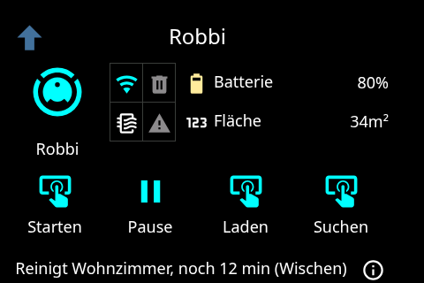

## Schnellstart: Gerät mit Detailseite

1. **Pageitem anlegen.** Im Tab **PageConfig** eine Grid-Seite (cardGrid, cardGrid2, cardGrid3) oder eine Entities-Seite öffnen und auf einen freien Platz klicken. – *Ergebnis: die Pageitem-Konfiguration ist offen.*
2. **Art wählen.** Ganz oben bei **Art des Items** **Gerät mit Details** wählen. – *Ergebnis: statt des Kanalfelds steht dort **Gerät (Objekt vom Typ Device oder Channel)**.*
3. **Gerät wählen.** Die ID eintippen oder mit **…** im Objektbaum aussuchen. – *Ergebnis: unter dem Feld steht der Name des Geräts und wie viele Einträge angehakt sind, z. B. „Robbi – 14 Einträge angehakt“.*
4. **Kurzer Tipp** einstellen: Soll ein Tipp das Gerät schalten, bleibt **Ein State des Geräts (an/aus oder Taster)** stehen; sonst **Keine (nur Details)**.
5. **Filterliste** öffnen und anhaken, was die Detailseite zeigen soll. Die Reihenfolge änderst du durch Ziehen. **Übernehmen.**
6. **Long-Press öffnet** bleibt auf **Detailseite**.
7. **Übernehmen** und danach im Tab **Speichern**. – *Ergebnis: der Adapter startet neu.*
8. **Am Panel ausprobieren:** das Item auf einer Grid-Seite lange drücken, auf einer Entities-Seite links auf Icon oder Bezeichnung tippen (das braucht eine aktuelle TFT, siehe [Grenzen](#10-grenzen)). – *Ergebnis: die Detailseite erscheint, ihre Überschrift ist der Name des Geräts.*

<!-- BILD FOLGT (BILDER.md): admin-device-item.png -->
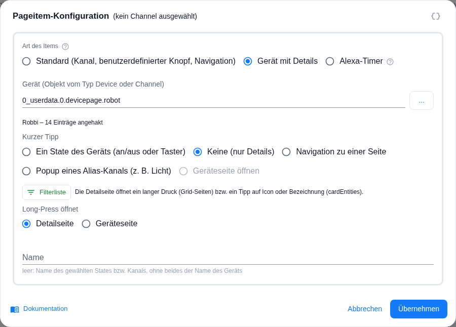

## Schnellstart: Geräteseite

Voraussetzung: ein Item der Art **Gerät mit Details** wie im Schnellstart oben. Am Hardware-Panel braucht die Geräteseite außerdem eine aktuelle TFT-Version, siehe [Grenzen](#10-grenzen).

1. Das Item im Tab **PageConfig** öffnen und bei **Long-Press öffnet** **Geräteseite** wählen. – *Ergebnis: darunter erscheint der Bereich der Geräteseite; die Info-Plätze sind schon mit den ersten angehakten Einträgen der Filterliste belegt.*
2. **Layout** wählen: **1 – Steuern**, **2 – Fortschritt** oder **3 – Werte**. Die kleinen Bilder zeigen, wo welcher Slot sitzt; die Nummern gehören zu den Zeilen darunter.
3. **Haupt-Icon** wählen, z. B. `robot-vacuum`. Leer = das Icon des Items.
4. **Statuszeile**: den Wert wählen, der unten als Text stehen soll, z. B. den Status des Geräts.
5. **Slots** belegen: je Zeile einen Wert des Geräts aussuchen. Angeboten wird nur, was zur Art des Slots passt.
6. **Übernehmen** und danach im Tab **Speichern**. – *Ergebnis: der Adapter startet neu.*
7. **Am Panel ausprobieren:** das Item lange drücken. – *Ergebnis: die Geräteseite erscheint. Das „i“ unten rechts öffnet die Detailseite.*

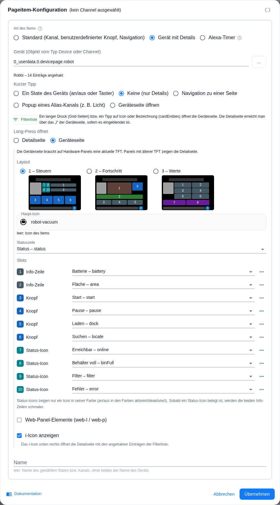

## Nachschlagen

Die folgenden Abschnitte beschreiben jede Einstellung im Einzelnen.

## 1. Das Item anlegen und das Gerät wählen

Die Art **Gerät mit Details** gibt es auf den Seiten, deren Flächen einen langen Druck oder einen Tipp auf die linke Seite melden: **cardGrid**, **cardGrid2**, **cardGrid3** und **cardEntities**. Auf anderen Seiten bietet der Dialog sie nicht an.

Im Feld **Gerät (Objekt vom Typ Device oder Channel)** steht die ID des Geräts. Der Dialog prüft sie und schreibt darunter, was er gefunden hat:

| Anzeige unter dem Feld | Bedeutung |
|---|---|
| *Wähle das Gerät, dessen Details das Item zeigt.* | Das Feld ist noch leer. |
| *Name – n Einträge angehakt* | Das Gerät ist gefunden; so viele Zeilen hat die Detailseite. |
| *Das Objekt existiert nicht.* | Tippfehler oder das Gerät wurde gelöscht. |
| *Wählbar sind nur Objekte vom Typ Device oder Channel.* | Gewählt ist z. B. ein einzelner Datenpunkt oder ein Ordner. |
| *Eine Instanz oder die Wurzel eines Adapters ist nicht wählbar.* | z. B. `shelly.0` – darunter liegen viele Geräte, nicht eines. |
| *Die Geräte dieses Adapters liegen auf einer anderen Ebene des Objektbaums.* | Bei bekannten Adaptern weiß der Dialog, auf welcher Ebene ein Gerät liegt – wähle das Objekt auf dieser Ebene. |
| *Der Info-Kanal einer Instanz ist kein Gerät.* | `<adapter>.<n>.info` ist nicht wählbar. |

Zum Gerät zählen seine Datenpunkte und die Datenpunkte **eines** Unterordners (z. B. `Relay0.Power`); bei hmip reicht es eine Ebene tiefer. Noch tiefer liegende Datenpunkte erscheinen nicht.

Für **shelly**, **sonoff**, **zigbee2mqtt**, **hm-rpc** und **hmip** bringt der Adapter eine Maske mit: Er erkennt Temperatur, Spannung, Leistung, Signal, Firmware usw. und gibt ihnen lesbare Namen und passende Icons. Bei allen anderen Adaptern ordnet er die Werte nach ihrer Rolle zu.

**Name** ganz unten ist die Beschriftung des Items auf seiner Seite. Leer: der Name des gewählten States bzw. Kanals, ohne beides der Name des Geräts.

## 2. Kurzer Tipp

Was ein kurzer Tipp auf das Item tut:

| Auswahl | Wirkung |
|---|---|
| **Ein State des Geräts (an/aus oder Taster)** | Darunter wählst du den **State des Geräts (an/aus)**. Ein An/Aus-Wert wird umgeschaltet, ein Taster wird gedrückt (in der Liste mit „Taster, schreibt true“ markiert). Hat das Gerät einen Schalter, ist er vorgewählt. Ohne gewählten State lässt sich das Item nicht übernehmen. |
| **Keine (nur Details)** | Der kurze Tipp tut nichts. Vorgabe, wenn das Gerät nichts Schaltbares hat. |
| **Navigation zu einer Seite** | Der kurze Tipp öffnet eine **Zielseite**. |
| **Popup eines Alias-Kanals (z. B. Licht)** | Der kurze Tipp bedient einen Alias-Kanal wie ein Standard-Item, z. B. mit dem Licht-Popup. Den Kanal wählst du nur in diesem Fall. |
| **Geräteseite öffnen** | Schon der kurze Tipp öffnet die Geräteseite (der lange Druck weiterhin auch). Nur wählbar, wenn bei **Long-Press öffnet** die **Geräteseite** gewählt ist; schaltest du dort zurück auf **Detailseite**, springt der kurze Tipp auf **Keine**. |

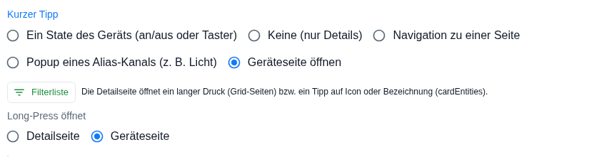

Du kannst zwischen den Auswahlen hin- und herschalten, ohne etwas zu verlieren, solange der Dialog offen ist. Gespeichert wird nur, was beim **Übernehmen** gewählt ist.

## 3. Filterliste und Detailseite

Der Knopf **Filterliste** öffnet die Liste aller Werte des Geräts.

<!-- BILD FOLGT (BILDER.md): admin-filterlist.png -->
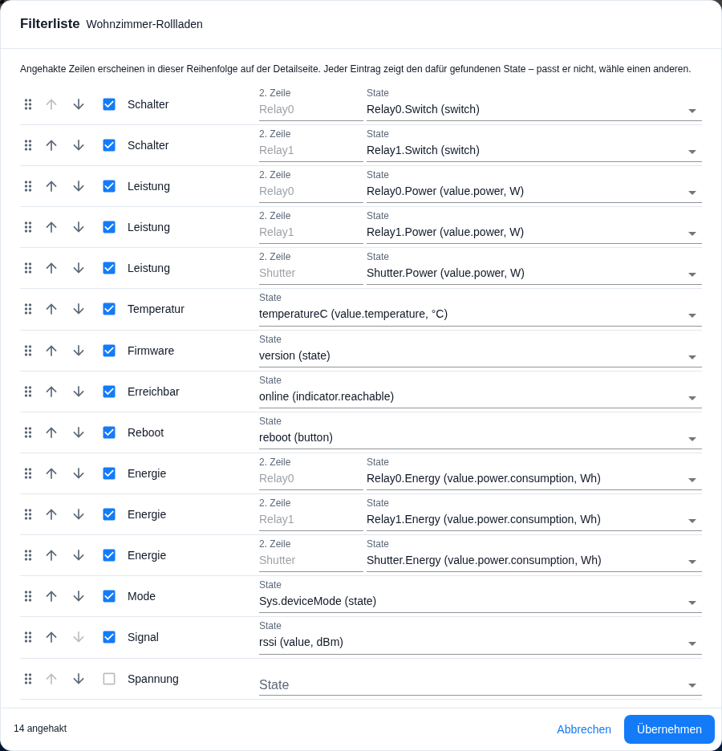

| Element | Bedeutung |
|---|---|
| **Häkchen** | Angehakte Zeilen erscheinen auf der Detailseite – in der Reihenfolge der Liste. Angehakte stehen oben, darunter die übrigen. Es wird nichts automatisch ausgeblendet: Was erscheint, bestimmst nur du. |
| **Ziehen**, **Nach oben**, **Nach unten** | ändert die Reihenfolge. |
| **Eintrag** | Der lesbare Name der Zeile (Temperatur, Spannung, Signal …). Bei Adaptern ohne Maske ordnest du hier einen State einem Eintrag zu; seine Rolle schlägt ihn vor. |
| **State** | Der Datenpunkt, den der Adapter für den Eintrag gefunden hat. Passt er nicht, wählst du einen anderen. |
| **2. Zeile** | Erscheint bei angehakten Zeilen mit **gleichem Namen** (z. B. mehrere Temperaturen). Der Adapter hängt dann automatisch an, worin sich die Datenpunkte unterscheiden („Temperatur Relay0“, „Temperatur Ext 100“). Ein eigener Text im Feld ersetzt den automatischen und gilt immer. |

Bei einem neuen Item sind die Einträge vorbelegt, die du bei einem Gerät **desselben Adapters** zuletzt angehakt hast; beim ersten Mal die Vorschläge der Maske.

**Die Detailseite** ist eine normale Entities-Seite. Ihre Überschrift ist der Name des Geräts, der Pfeil zurück führt auf die Seite, von der sie geöffnet wurde. Je Seite zeigt sie so viele Zeilen wie jede Entities-Seite des Modells (EU-/US-Querformat und Smartphone quer 4, US-Hochformat 5, Smartphone hochkant 8); mehr Zeilen blättern weiter.

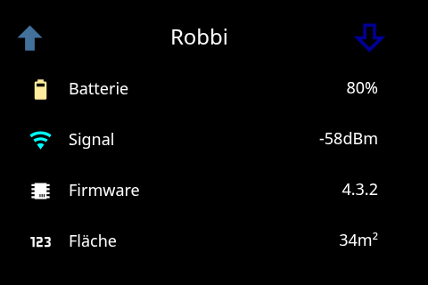

Was eine Zeile zeigt und kann, hängt vom Datenpunkt ab:

| Datenpunkt | Zeile | Bedienung |
|---|---|---|
| An/Aus, schaltbar | Schalter rechts | schaltet |
| An/Aus, nur lesbar | Text „An“ oder „Aus“ | – |
| Taster (nur schreibbar) | Knopf rechts | drückt |
| Zahl oder Text mit Werteliste, schreibbar | der Text des aktuellen Werts | Tipp öffnet die Auswahl |
| Zahl oder Text mit Werteliste, nur lesbar | der Text des aktuellen Werts | – |
| Zahl | Wert mit Einheit | – (auch schreibbare Zahlen werden hier nicht verstellt) |
| Text | der Text | – |

Ein Batterie-Füllstand in Prozent zeigt ein Batterie-Icon, das dem Füllstand in 10-%-Schritten folgt.

## 4. Long-Press öffnet: Detailseite oder Geräteseite

| Auswahl | Wirkung |
|---|---|
| **Detailseite** | Vorgabe. Der lange Druck (Grid-Seiten) bzw. der Tipp auf Icon oder Bezeichnung (Entities-Seite) öffnet die Detailseite. |
| **Geräteseite** | Er öffnet die Geräteseite. Die Detailseite erreichst du dann über das „i“ der Geräteseite, sofern es eingeblendet ist. Darunter erscheinen die Einstellungen aus [Abschnitt 5](#5-die-geräteseite-einrichten). |

Auch hier geht beim Umschalten nichts verloren, solange der Dialog offen ist. Die Geräteseite wird nur gespeichert, wenn beim **Übernehmen** **Geräteseite** gewählt ist.

## 5. Die Geräteseite einrichten

Beim ersten Einschalten belegt der Dialog die Info-Plätze (Info-Zeile, großer Wert) der Reihe nach mit den angehakten Einträgen der Filterliste. Knöpfe, Schalter, Fortschrittsbalken, Status-Icons und die Statuszeile bleiben leer – die wählst du selbst.

### Layout

Drei Layouts stehen zur Wahl, siehe [Die drei Layouts](#6-die-drei-layouts). Die Vorschau zeigt die Slots mit ihren Nummern.

Wechselst du das Layout, bleiben die Slots **nach ihrer Nummer** erhalten (Slot 1 bleibt Slot 1). Passt ein Wert danach nicht mehr zur Art des Slots, steht er rot mit „passt nicht zu diesem Slot“ da. Hat das neue Layout weniger Slots, gehen die überzähligen verloren.

### Haupt-Icon

Das große Icon oben links. Leer = das Icon des Items. Darunter steht am Panel immer der Name des Geräts.

### Statuszeile

Die breite Zeile unten zeigt einen Wert als Text – z. B. das Programm der Waschmaschine oder „Reinigt Wohnzimmer, noch 12 min“. Die Auswahl bietet **leer**, **Benutzerdefinierter Datenpunkt** und danach alle Werte des Geräts.

Mit **Benutzerdefinierter Datenpunkt** zeigt die Zeile einen beliebigen Datenpunkt, der nicht zum Gerät gehören muss – z. B. einen Text unter `0_userdata.0`, den ein Skript zusammenbaut. Darunter erscheint das Feld **Datenpunkt der Statuszeile**: ID eintippen oder mit **…** aussuchen. Solange das Feld leer ist oder es den Datenpunkt nicht gibt, bleibt die Zeile leer.

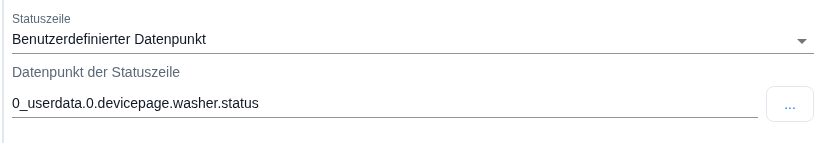

Ein Text, der nicht in die Zeile passt, wird am Panel in Abschnitten nacheinander gezeigt, siehe [Bedienung am Panel](#9-bedienung-am-panel).

### Slots belegen

Jede Zeile unter **Slots** steht für einen Platz: vorn die Nummer aus der Vorschau, dann die Art, dann die Auswahl. Die Auswahl bietet:

- **leer** – der Platz bleibt am Panel frei,
- **Benutzerdefiniert** – etwas, das nicht zum Gerät gehören muss (nächster Abschnitt),
- die **Werte des Geräts**, die zur Art des Slots passen (siehe [Was in welchen Slot passt](#7-was-in-welchen-slot-passt)). Ein Wert muss dafür nicht in der Filterliste angehakt sein.

Ein gespeicherter Wert, den es im Gerät nicht mehr gibt, steht rot mit „nicht im Gerät gefunden“ da und bleibt gespeichert, bis du ihn änderst.

### Benutzerdefiniert: Datenpunkt, Kanal oder Navigation

Nach der Wahl **Benutzerdefiniert** erscheint unter der Zeile, was der Slot stattdessen zeigt:

| Auswahl | Wirkung |
|---|---|
| **Datenpunkt** | Irgendein Datenpunkt, z. B. unter `0_userdata.0`. Er verhält sich wie ein Wert des Geräts: Name, Icon und Einheit kommen aus dem Datenpunkt. |
| **Kanal** | Ein Alias-Kanal, z. B. ein Licht, ein Rollladen oder eine Steckdose aus `alias.0`. Er sieht aus und lässt sich bedienen wie auf einer Grid-Seite: Tipp schaltet; Rollladen, Auswahl und Timer öffnen ihr Popup; ein dimmbares Licht öffnet es beim Halten. Die Objektauswahl zeigt nur Kanäle, die zur Art des Slots passen. |
| **Navigation** | Ein Platz nur zum Springen: Du wählst die **Zielseite**. Gibt es nur bei Info-Zeile, Knopf und Status-Icon. |

Passt die eingetragene ID nicht zur Art des Slots oder gibt es sie nicht, steht unter dem Feld rot „passt nicht zu diesem Slot“, „Datenpunkt nicht gefunden“ bzw. „Kanal nicht gefunden“. Speichern lässt sich das trotzdem; am Panel bleibt der Slot dann leer.

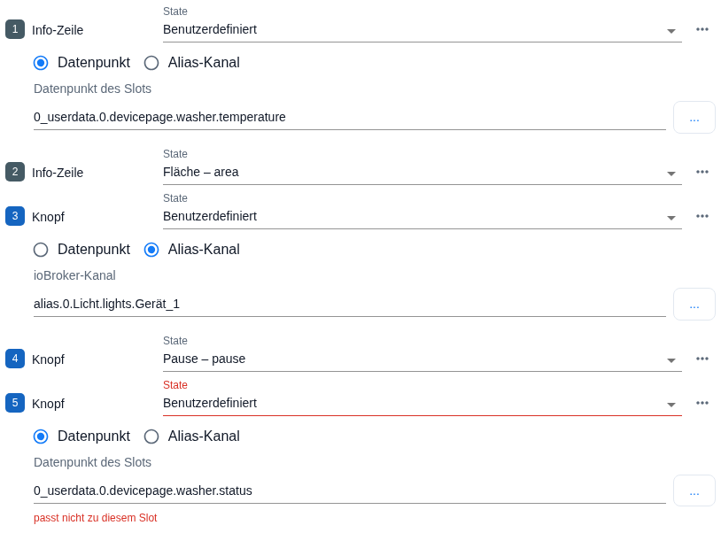

### Einstellungen des Elements

Der Knopf **…** rechts in jeder belegten Zeile öffnet die Einstellungen dieses einen Elements. Alles darin ist freiwillig; der Knopf ist **grün**, sobald etwas eingestellt ist. Wählst du danach einen anderen Wert für den Slot, bleiben die Einstellungen; ein geleerter Slot verliert sie.

Für Info-Zeile, großen Wert, Fortschrittsbalken, Knopf und Schalter ist es die bekannte [Pageitem-Konfiguration](PageConfig-Dialoge#1-pageitem-konfiguration) – ohne die Auswahl des Kanals:

<!-- BILD NEU AUFNEHMEN (BILDER.md): admin-slot-dialog.png zeigt noch den früheren kleinen Dialog -->
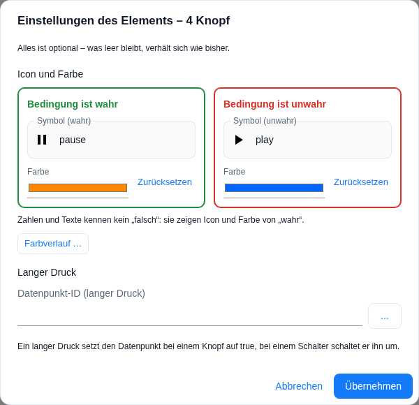

| Feld | Bedeutung |
|---|---|
| **Name** | Eigene Beschriftung des Elements. Leer = automatischer Name. Ein langer Name wird an der Feldbreite abgeschnitten. |
| **Ist eine Navigation** und **Zielseite** | Der kurze Tipp öffnet die Zielseite und tut sonst nichts, siehe [Von der Geräteseite auf eine andere Seite springen](#von-der-geräteseite-auf-eine-andere-seite-springen). |
| **Text-/Icongröße** | Die Schrift des Icons, siehe [Die Text-/Icongröße](PageConfig-Dialoge#die-text-icongröße). Nicht beim Fortschrittsbalken. |
| **Symbol und Farbe** für „wahr“ und „unwahr“ | Eigenes Icon und eigene Farbe je Zustand, siehe [Symbol und Farbe](PageConfig-Dialoge#symbol-und-farbe-für-wahr-und-unwahr). Zahlen und Texte kennen kein „unwahr“: Sie zeigen Icon und Farbe von „wahr“. |
| **Farboptionen** (Farbverlauf) | Die Farbe folgt dem Wert, siehe [Farboptionen](PageConfig-Dialoge#6-farboptionen). Beim Fortschrittsbalken ist das die Farbe des Balkens. |
| **Langer Druck** | Nur bei Knopf und Schalter: ein Datenpunkt, den ein langer Druck auf das Element schreibt. Bei einem Knopf wird er auf „wahr“ gesetzt, bei einem Schalter umgeschaltet. |

Bei einem **Kanal** kommen die Felder dazu, die seine Rolle auch auf einer Grid-Seite hat.

Ein Beispiel – ein Knopf für „läuft / Pause“: einen An/Aus-Wert in einen Knopf-Slot legen, als Icon bei wahr `pause` und bei unwahr `play` wählen. Der Tipp schaltet um, das Icon wechselt mit.

**Status-Icons** haben einen eigenen kleinen Dialog **Einstellungen des Elements**: Icon und Farbe für wahr und unwahr, **Farbverlauf …** und **Kurzer Tipp** (**Standard** oder **Navigation** mit Zielseite).

<!-- BILD FOLGT (BILDER.md): admin-slot-dialog-status.png -->
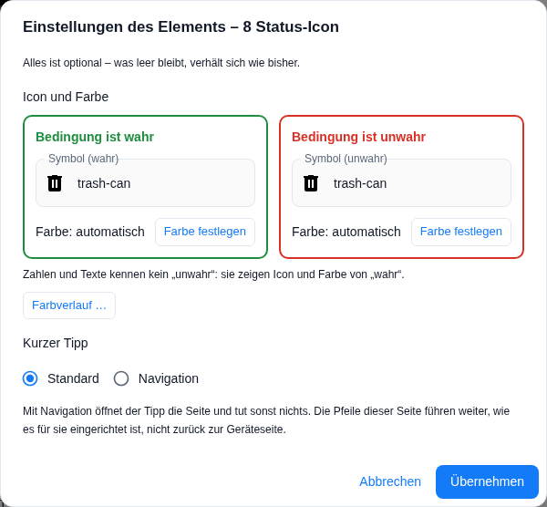

### Von der Geräteseite auf eine andere Seite springen

Zwei Wege führen von der Geräteseite auf eine andere Seite, z. B. zur Raumauswahl des Saugroboters:

- **Ein belegter Slot navigiert.** In den Einstellungen des Elements (**…**) **Ist eine Navigation** setzen und die **Zielseite** wählen (bei einem Status-Icon: **Kurzer Tipp** → **Navigation**). Der Slot sieht aus wie vorher – Icon, Name, Wert –, aber der Tipp öffnet jetzt die Seite und tut sonst nichts: Ein Knopf drückt nicht mehr, ein An/Aus-Wert schaltet nicht mehr. Beim Schalter-Slot navigiert der Tipp auf Icon und Name; der Schalter selbst schaltet weiter.
- **Ein Platz nur zum Springen.** In der Auswahl des Slots **Benutzerdefiniert** und darunter **Navigation** wählen, dann die **Zielseite**. Der Platz zeigt ein Icon und als Beschriftung den Namen der Zielseite; eigene Beschriftung, Icon und Farbe stellst du über **…** ein.

Bei Kanälen, die ihr Popup sofort öffnen (Rollladen, Tor, Schloss, Auswahl, Timer), gibt es die Navigation nicht – dort kommt immer das Popup. Licht, Ventilator und Regler öffnen ihr Popup erst beim Halten: Der kurze Tipp navigiert, das Halten öffnet weiter das Popup.

Steht unter der Zeile rot **Zielseite nicht gefunden**, gibt es die Seite nicht (mehr).

> **Zurück führt nicht automatisch zur Geräteseite.** Die Pfeile der Zielseite führen dorthin, wo du es für diese Seite eingerichtet hast. Soll „hoch“ wieder zur Seite mit dem Gerät führen, trage diese Seite bei der Zielseite als übergeordnete Seite ein; die Geräteseite öffnest du von dort wieder über das Item.

### Status-Icons

Nur Layout 1 hat vier Plätze der Art **Status-Icon** (Slots 7–10): kleine Icons in einem 2×2-Raster direkt neben dem großen Icon, z. B. für WLAN, Behälter voll, Filter, Fehler.

- Ein Status-Icon zeigt **nur ein Icon in seiner Farbe**, ohne Name und Wert.
- Das Icon kommt automatisch (dasselbe wie in einer Info-Zeile mit diesem Wert); ein eigenes wählst du über **…**, z. B. `delete-empty` für „Behälter leeren“.
- Die Farbe kommt automatisch: An/Aus-Werte in den Farben *aktiviert* / *deaktiviert* des [Farbthemas](colorTheme), andere Werte in der Farbe ihrer Gruppe.
- Sind alle vier leer, sieht die Seite aus wie ohne sie. Ist **mindestens eines** belegt, erscheint das ganze Raster; leere Felder bleiben als leere Kästchen stehen.
- Am **EU-Panel**, im **US-Querformat** und bei **Smartphone quer** stehen die Status-Icons zwischen dem großen Icon und den Info-Zeilen: Sobald das Raster erscheint, werden die beiden Info-Zeilen **schmaler** – lange Namen werden dann früher abgeschnitten. Der Dialog weist unter den Slots darauf hin. Im **US-Hochformat** und bei **Smartphone hochkant** stehen die Info-Zeilen unter dem Raster und bleiben immer gleich breit.

| Mit Status-Icons | Ohne Status-Icons |
|---|---|
|  | 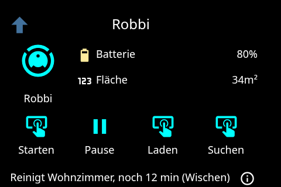 |

### i-Icon anzeigen

Vorgabe: an. Das „i“ unten rechts öffnet die Detailseite mit den angehakten Einträgen der Filterliste. Ist in der Filterliste nichts angehakt, erscheint es nicht.

### Zusätzliche Elemente für Smartphone-Web-Panels

Die Modelle **Smartphone quer** (`web-l`) und **Smartphone hochkant** (`web-p`) eines [Web-Panels](WebPanel#4-modell-wählen-format-und-plätze) haben mehr Platz und können je Layout zusätzliche Elemente zeigen:

| Layout | auf jedem Panel | zusätzlich auf Smartphone-Web-Panels | Slot-Nummern | dort zusammen |
|---|---|---|---|---|
| **1 – Steuern** | 2 Info-Zeilen, 4 Knöpfe, 4 Status-Icons | 2 Knöpfe | 11–12 | 6 Knöpfe |
| **2 – Fortschritt** | großer Wert, Fortschrittsbalken, 3 Info-Zeilen, 1 Knopf | 1 Info-Zeile, 2 Knöpfe | 7 (Info-Zeile), 8–9 (Knöpfe) | 4 Info-Zeilen, 3 Knöpfe |
| **3 – Werte** | 6 Info-Zeilen, 2 Schalter | 2 Info-Zeilen, 1 Schalter | 9–10 (Info-Zeilen), 11 (Schalter) | 8 Info-Zeilen, 3 Schalter |

Unter den Slots steht dafür das Häkchen **Web-Panel-Elemente (web-l / web-p)** (Vorgabe: aus). Sein Tooltip erklärt es: *Zusätzliche Slots dieses Layouts. Nur eigenständige Web-Panels der Modelle web-l und web-p zeigen sie, alle anderen Panels zeigen die Seite ohne sie.* Ist es gesetzt, erscheinen darunter die zusätzlichen Slots, fortlaufend weiternummeriert. Jeder wird belegt und eingestellt wie ein anderer Slot derselben Art – gleiche Auswahl, gleiches **…**. Vorbelegt ist keiner.

<!-- BILD FOLGT (BILDER.md): admin-web-extra.png -->
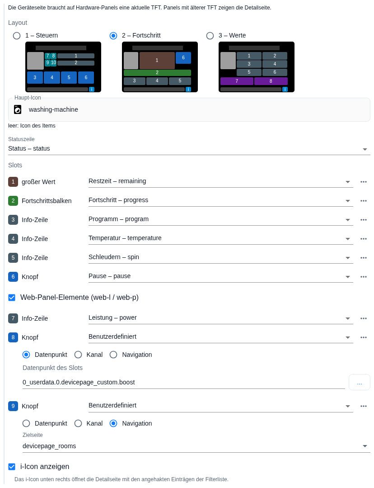

- **Das Häkchen zu entfernen blendet nur aus.** Die zusätzlichen Slots verschwinden aus dem Dialog und vom Web-Panel; ihre Belegung bleibt gespeichert und ist nach erneutem Anhaken wieder da.
- **Layoutwechsel:** Die zusätzlichen Slots bleiben unter sich in ihrer Reihenfolge – der erste zusätzliche Slot bleibt der erste. Seine Art kann dabei wechseln (in Layout 1 ein Knopf, in Layout 2 und 3 eine Info-Zeile); passt die Belegung danach nicht mehr, steht sie rot mit „passt nicht zu diesem Slot“ da. Layout 1 hat nur zwei zusätzliche Slots: Beim Wechsel dorthin geht der dritte verloren – auch wenn das Häkchen gerade nicht gesetzt ist. Aus einem Status-Icon wird nie ein zusätzlicher Slot und umgekehrt.
- **Hardware-Panels zeigen die zusätzlichen Elemente nie** – auch nicht das Browser-Bild eines echten Panels und kein Web-Panel mit einem der drei Panel-Formate. Ist dieselbe Seite einem solchen Panel und einem Smartphone-Web-Panel zugewiesen, fehlen die zusätzlichen Elemente dort einfach; alles andere ist gleich.
- Am Web-Panel verhält sich ein zusätzliches Element wie jedes andere seiner Art (Tipp, Halten, Popup). Leere zusätzliche Slots am Ende hinterlassen keine Lücke: Die Reihe wird für die belegten Elemente neu verteilt.
- Mehr Text passt dadurch nicht in ein Feld – es sind mehr Elemente, nicht längere. Namen und Werte haben überall dieselbe Höchstlänge, siehe [Grenzen](#10-grenzen).

Wie das aussieht, zeigen die Bilder unter [Smartphone quer](#smartphone-quer-web-l) und [Smartphone hochkant](#smartphone-hochkant-web-p).

## 6. Die drei Layouts

Die Bilder zeigen das EU-Panel mit den Icons, die der Adapter von sich aus wählt (eigene Icons und Farben setzt du über **…**). Die anderen Modelle folgen in [Abschnitt 8](#8-aussehen-je-panel-modell).

### 1 – Steuern

Für Geräte, die man startet und stoppt: Saugroboter, Rasenmäher.

- 2 **Info-Zeilen** neben dem Icon (Slots 1–2),
- 4 **Knöpfe** darunter (Slots 3–6),
- 4 **Status-Icons** im 2×2-Raster neben dem großen Icon (Slots 7–10), siehe [Status-Icons](#status-icons).

### 2 – Fortschritt

Für Geräte mit einem Programm, das abläuft: Waschmaschine, Trockner, Geschirrspüler.

- 1 **großer Wert** (Slot 1), z. B. die Restzeit,
- 1 **Fortschrittsbalken** über die ganze Breite (Slot 2),
- 3 **Info-Zeilen** als kleine Kacheln (Slots 3–5),
- 1 **Knopf** oben rechts (Slot 6).

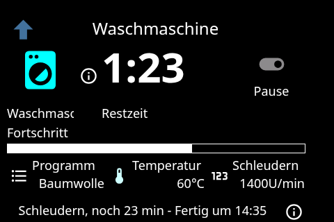

### 3 – Werte

Für Geräte mit vielen Messwerten: Auto, Sensoren.

- 6 **Info-Zeilen** als Kacheln in zwei Spalten (Slots 1–6, zeilenweise: 1 links oben, 2 rechts oben, 3 links Mitte …),
- 2 **Schalter** darunter (Slots 7–8).

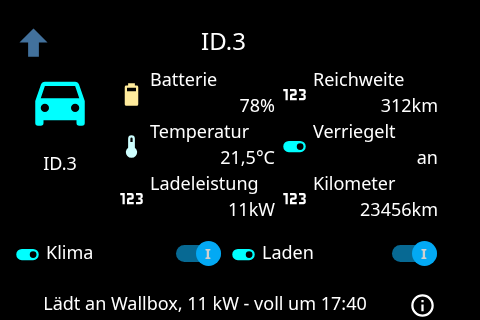

Auf allen drei Layouts gleich: oben die Überschrift (der Name des Geräts) mit den Pfeilen, oben links das große **Haupt-Icon** mit dem Namen des Geräts, unten die **Statuszeile** und rechts daneben das **i-Icon**.

## 7. Was in welchen Slot passt

| Art | Zeigt | Welche Werte (Gerät oder eigener Datenpunkt) | Welche Alias-Kanäle |
|---|---|---|---|
| **Info-Zeile** | Icon, Name, Wert | alle | alle (Licht, Steckdose, Rollladen, Auswahl, Regler, Timer, Sensoren …) |
| **großer Wert** | den Wert in großer Schrift, darunter den Namen | alle | alles mit einem lesbaren Wert: Sensoren, Regler, Auswahl, Timer, Licht/Steckdose (An/Aus) |
| **Fortschrittsbalken** | Name und Balken | Zahlen. Der Balken zeigt 0–100 %; hat der Datenpunkt Minimum und Maximum, wird damit umgerechnet. | Regler (slider), Lautstärke |
| **Knopf** | Icon und Name | Taster (nur schreibbar) oder schaltbare An/Aus-Werte | alle |
| **Schalter** | Icon, Name und Schalter | schaltbare An/Aus-Werte | Steckdose, Licht (auch dimmbar/farbig), Ventilator |
| **Status-Icon** | nur Icon und Farbe | alle | alle |

Medien-Kanäle und Fahrpläne passen in keinen Slot.

## 8. Aussehen je Panel-Modell

Die Geräteseite gibt es auf allen fünf Modellen. Was auf welchem Slot steht, ist überall gleich – nur die Anordnung folgt dem Format. Die Vorschau im Dialog des Admins zeigt die Anordnung des EU-Panels; wie die Seite auf den anderen Modellen aussieht, zeigen die Bilder hier.

Die Bilder zeigen je Modell dieselben drei Geräte: einen Saugroboter (Layout 1), eine Waschmaschine (Layout 2) und ein Auto (Layout 3), mit den Icons, die der Adapter von sich aus wählt. Aufgenommen sind sie im Web-Panel mit dem jeweiligen Modell.

### EU-Querformat (`eu`)

| 1 – Steuern | 2 – Fortschritt | 3 – Werte |
|---|---|---|
|  |  |  |

### US-Querformat (`us-l`)

Dieselbe Anordnung wie am EU-Panel. Der Inhalt sitzt 15 Pixel weiter rechts, weil der sichtbare Bereich des US-Displays dort liegt.

| 1 – Steuern | 2 – Fortschritt | 3 – Werte |
|---|---|---|
| 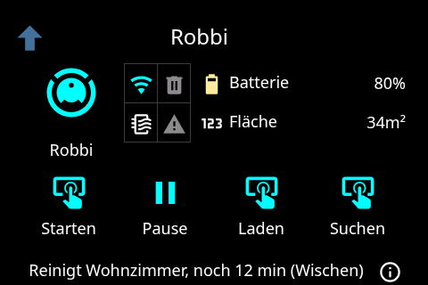 | 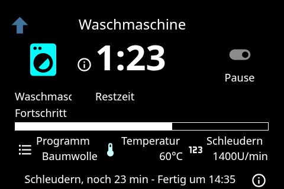 | 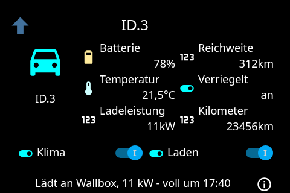 |

### US-Hochformat (`us-p`)

Hochkant sind die Elemente neu angeordnet:

- **Layout 1:** das Haupt-Icon oben links mit dem Namen darunter, rechts daneben die Status-Icons als 2×2-Block. Darunter die zwei Info-Zeilen über die volle Breite, dann die vier Knöpfe als 2×2-Block (Slot 3 oben links, 4 oben rechts, 5 unten links, 6 unten rechts). Die Info-Zeilen sind hier immer gleich breit; ohne Status-Icons bleibt der Platz neben dem Haupt-Icon frei.
- **Layout 2:** Haupt-Icon und großer Wert oben, darunter der Fortschrittsbalken. Die drei Infos sind volle Zeilen (Name links, Wert rechts) statt Kacheln, der Knopf liegt darunter über die volle Breite.
- **Layout 3:** das Haupt-Icon oben in der Mitte, sein Name darunter über die volle Breite. Die sechs Info-Kacheln in zwei Spalten, die zwei Schalter als Zeilen untereinander.

Die Statuszeile ist hier schmaler (262 statt 390 Pixel). Die Statustexte der Beispiele passen nicht mehr hinein – die Bilder zeigen ihren ersten Abschnitt, siehe [Wechselnder Statustext](#9-bedienung-am-panel).

| 1 – Steuern | 2 – Fortschritt | 3 – Werte |
|---|---|---|
| 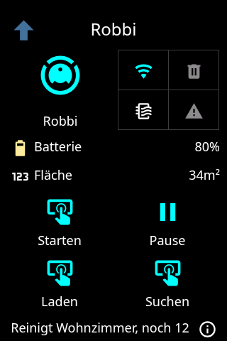 | 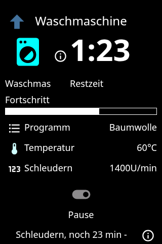 | 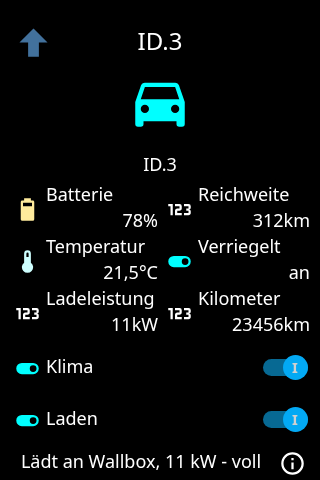 |

### Smartphone quer (`web-l`)

Ein eigenständiges Web-Panel mit diesem Modell nutzt die ganze Fläche (640 × 320). Die Anordnung ist die des EU-Panels, in die Breite gezogen: Kein Textfeld ist schmaler als dort, die Info-Zeilen von Layout 1 und die Statuszeile (580 Pixel) sind deutlich breiter. Die [zusätzlichen Elemente](#zusätzliche-elemente-für-smartphone-web-panels) reihen sich ein: in Layout 1 eine Reihe mit bis zu sechs Knöpfen, in Layout 2 bis zu drei Knöpfe oben rechts und vier Info-Kacheln in einer Reihe, in Layout 3 eine dritte Spalte Info-Kacheln und ein dritter Schalter.

| | 1 – Steuern | 2 – Fortschritt | 3 – Werte |
|---|---|---|---|
| ohne Web-Panel-Elemente | 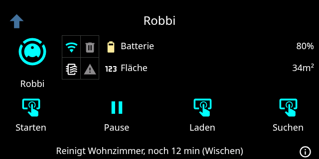 | 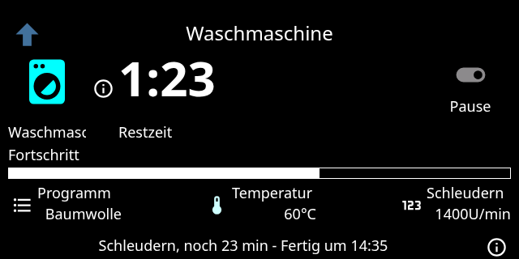 | 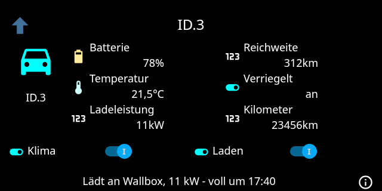 |
| mit Web-Panel-Elementen | 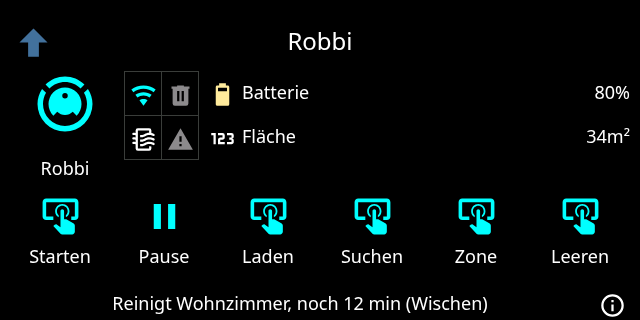 | 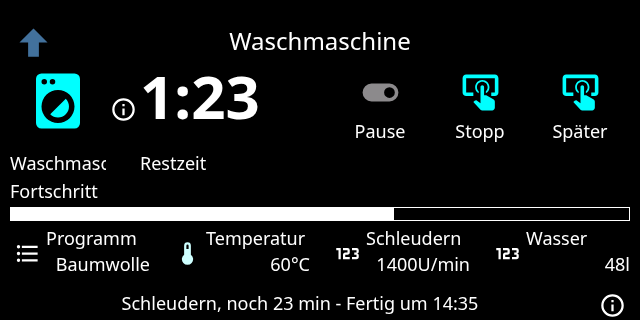 | 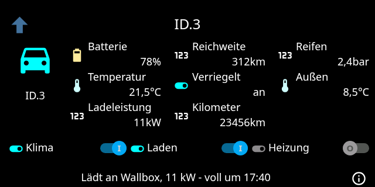 |

### Smartphone hochkant (`web-p`)

Ein eigenständiges Web-Panel mit diesem Modell nutzt die ganze Fläche (320 × 640). Die Anordnung ist die des US-Hochformats; die zusätzliche Höhe tragen die [zusätzlichen Elemente](#zusätzliche-elemente-für-smartphone-web-panels) als weitere Zeilen: in Layout 1 eine dritte Reihe mit zwei Knöpfen, in Layout 2 eine vierte Info-Zeile und bis zu drei Knöpfe in einer Reihe, in Layout 3 eine vierte Reihe Info-Kacheln und eine dritte Schalterzeile. Ohne sie verteilen sich die Zeilen mit größeren Abständen über die Höhe. Ohne Status-Icons steht das Haupt-Icon von Layout 1 in der Mitte. Die Statuszeile ist wie im US-Hochformat 262 Pixel breit.

| | 1 – Steuern | 2 – Fortschritt | 3 – Werte |
|---|---|---|---|
| ohne Web-Panel-Elemente | 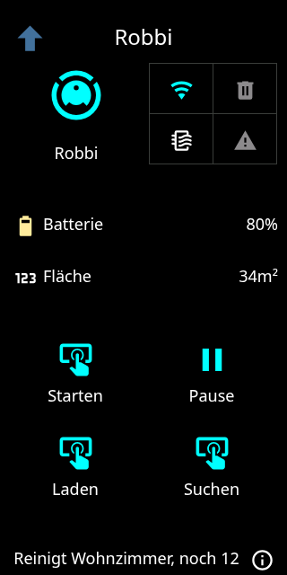 | 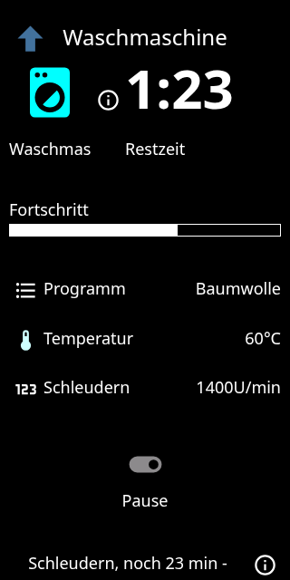 | 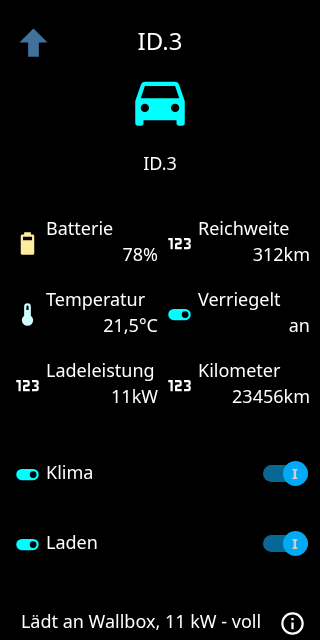 |
| mit Web-Panel-Elementen | 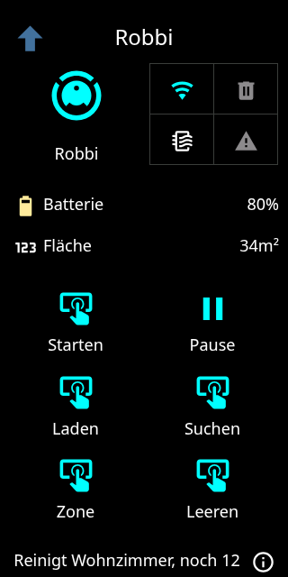 | 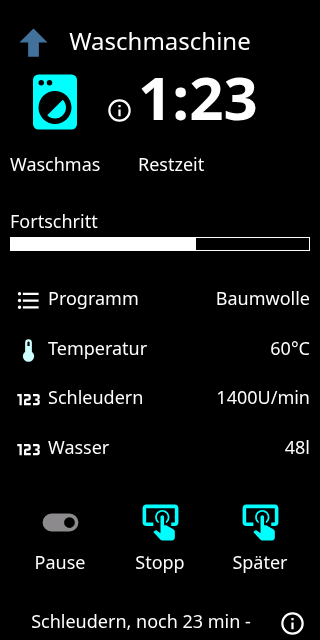 | 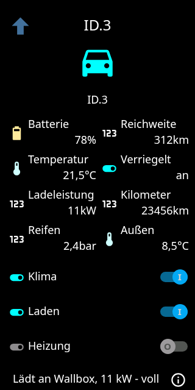 |

### Ein echtes Panel im Browser

Das [Browser-Bild eines echten Panels](WebPanel#2-ein-echtes-panel-im-browser-öffnen) und ein Web-Panel mit einem der drei Panel-Formate zeichnen die Seite wie die Hardware des jeweiligen Modells – also wie in den Abschnitten EU, US-Querformat und US-Hochformat oben und immer ohne zusätzliche Elemente.

## 9. Bedienung am Panel

**Öffnen.** Auf einer Grid-Seite das Item **lange drücken**: Nach etwa einer halben Sekunde blinkt am Hardware-Panel der Hintergrund der Kachel grün und grau – das zeigt, dass der lange Druck erkannt ist; beim **Loslassen** öffnet die Seite. Auf einer Entities-Seite genügt ein Tipp links auf Icon oder Bezeichnung. Mit dem kurzen Tipp **Geräteseite öffnen** reicht auf beiden ein kurzer Tipp.

**Zurück.** Der Pfeil oben links führt von der Geräteseite auf die Seite des Items, von der Detailseite auf die Seite, von der sie geöffnet wurde (hinter dem „i“ also zurück auf die Geräteseite).

**Tippen und Halten auf der Geräteseite:**

| Element | kurzer Tipp | Halten (etwa eine halbe Sekunde) |
|---|---|---|
| **Haupt-Icon** | wie der kurze Tipp des Items, wenn dort **Ein State des Geräts** gewählt ist (schaltet bzw. drückt); sonst nichts | nichts |
| **Info-Zeile**, **großer Wert**, **Fortschrittsbalken**, **Status-Icon** mit einem Wert | nichts – außer bei einem schreibbaren Wert mit Werteliste in einer Info-Zeile: dort öffnet der Tipp die Auswahl | nichts |
| **Knopf** | drückt den Taster bzw. schaltet den An/Aus-Wert um | schreibt den Datenpunkt aus **Langer Druck**, falls eingestellt; sonst nichts |
| **Schalter** | der Schalter rechts schaltet | wie beim Knopf (Halten auf Icon oder Name) |
| Element mit **Navigation** | öffnet die Zielseite | wie ohne Navigation |
| **Kanal**: Steckdose, einfaches Licht | schaltet | nichts; bei einer Steckdose der Datenpunkt aus **Langer Druck**, falls eingestellt |
| **Kanal**: dimmbares/farbiges Licht, Ventilator, Regler | Licht und Ventilator schalten | öffnet das Popup |
| **Kanal**: Rollladen, Tor, Schloss, Auswahl, Timer | öffnet sofort das Popup | – |
| **i-Icon** | öffnet die Detailseite | wie der kurze Tipp |
| **Statuszeile** | nichts | nichts |

Wird ein Element ohne Popup gehalten, blinkt am Hardware-Panel sein Hintergrund nach einer halben Sekunde grün und grau; ausgelöst wird beim Loslassen. Das **Web-Panel zeigt dieses Blinken nicht** – weder auf der Grid-Seite noch auf der Geräteseite; der lange Druck wirkt dort genauso, nur ohne die Rückmeldung. Ein langer Druck gilt nie als kurzer Tipp: Ist für das Element kein langer Druck eingestellt, passiert nichts.

**Popups** sind die gewohnten (Licht, Rollladen, Auswahl, Regler, Timer …). Nach dem Schließen steht wieder die Geräteseite da. Ein Popup aus einem Status-Icon hat keine Überschrift.

**Wechselnder Statustext.** Passt der Text nicht in die Statuszeile – ihre Breite hängt vom Modell ab, siehe [Grenzen](#10-grenzen) –, teilt ihn der Adapter an Wortgrenzen in höchstens **drei Abschnitte** und zeigt sie nacheinander, Wechsel alle **3 Sekunden**, immer im Kreis. Was nach dem dritten Abschnitt übrig wäre, entfällt; der dritte endet dann mit „…“. Ändert sich der Text, beginnt die Anzeige wieder beim ersten Abschnitt. Solange ein Popup offen ist, pausiert der Wechsel.

## 10. Grenzen

- **TFT-Version.** Am Hardware-Panel braucht die Geräteseite eine TFT-Version, die sie enthält – auf allen drei Hardware-Modellen. Mit einer älteren TFT öffnet der lange Druck (und der kurze Tipp **Geräteseite öffnen**) stattdessen die **Detailseite**. Der Dialog sagt es so: *Die Geräteseite braucht auf Hardware-Panels eine aktuelle TFT. Panels mit älterer TFT zeigen die Detailseite.* Auch der Tipp auf Icon oder Bezeichnung auf einer Entities-Seite und das Blinken beim langen Druck brauchen die neue TFT. Ein Web-Panel braucht keine TFT und zeigt die Geräteseite immer.
  <!-- TODO: Version folgt – die erste TFT mit den Geräteseiten steht noch nicht fest (CARD_DEVICE_MIN_TFT steht vorläufig auf 6.2.0 und wird zum Release angehoben); hier eintragen, sobald sie feststeht. -->
- **Namen und Werte: höchstens 31 Byte** – das sind 31 Zeichen, Umlaute und Sonderzeichen zählen doppelt. Längeres wird ohne „…“ abgeschnitten. Diese Grenze ist auf allen Modellen gleich, auch für die zusätzlichen Elemente der Smartphone-Web-Panels.
- **Die sichtbare Breite hängt vom Modell ab.** Meist ist das Feld zu Ende, bevor die 31 Byte erreicht sind – dann schneidet das Panel an der Feldgrenze ab, auch mitten im Buchstaben (im Bild von Layout 2 oben der Name „Waschmaschine“ unter dem Icon). Breiten in Pixeln; die Schrift ist 24 Pixel hoch, ein Buchstabe im Schnitt knapp 10 Pixel breit. Info-Zeile als *Name / Wert*:

  | Modell | Statuszeile | Layout 1 | Layout 2 | Layout 3 |
  |---|---|---|---|---|
  | **EU-Querformat**, **US-Querformat** | 390 | Gerätename 110 · Info-Zeile 164 / 110, **mit Status-Icons 86 / 110** · Knopf 104 | Gerätename 96 · großer Wert 190 · Fortschrittsbalken 429 · Info-Zeile 104 / 104 · Knopf 100 | Gerätename 100 · Info-Zeile 125 / 125 · Schalter 125 |
  | **US-Hochformat** | 262 | Gerätename 150 · Info-Zeile 156 / 104 (auch mit Status-Icons) · Knopf 148 | Gerätename 90 · großer Wert 172 · Fortschrittsbalken 300 · Info-Zeile 156 / 104 · Knopf 300 | Gerätename 300 · Info-Zeile 112 / 112 · Schalter 212 |
  | **Smartphone quer** | 580 | Gerätename 110 · Info-Zeile 354 / 110, mit Status-Icons 276 / 110 · Knopf 104 | Gerätename 96 · großer Wert 190 · Fortschrittsbalken 620 · Info-Zeile 104 / 104 · Knopf 100 | Gerätename 100 · Info-Zeile 125 / 125 · Schalter 125 |
  | **Smartphone hochkant** | 262 | Gerätename 150 (ohne Status-Icons 300) · Info-Zeile 156 / 104 · Knopf 148 | Gerätename 90 · großer Wert 172 · Fortschrittsbalken 300 · Info-Zeile 156 / 104 · Knopf 300, zu zweit je 148, zu dritt je 100 | Gerätename 300 · Info-Zeile 112 / 112 · Schalter 212 |

  Der große Wert steht in der großen Schrift: Eine Ziffer braucht dort 33 Pixel, „12:34“ 149 Pixel.
- **Einheiten stehen ohne Leerzeichen am Wert** („80%“, „34m²“, „60°C“). Das ist Absicht und spart Platz.
- **Der große Wert** hat eine eigene Schrift mit Ziffern, Buchstaben (auch ä, ö, ü) und den Zeichen `: % ° , . - /`. Ein **€** kann sie nicht zeigen.
- **Die Statuszeile** hat eine Zeile; ihre Breite steht in der Tabelle oben. Längerer Text wechselt in bis zu drei Abschnitten (jeder höchstens 63 Byte), siehe [Bedienung am Panel](#9-bedienung-am-panel).
- **Zahlen lassen sich auf der Detailseite nicht verstellen**, auch wenn der Datenpunkt schreibbar ist. Bedienbar sind Schalter, Taster und Werte mit Werteliste. Wer einen Regler braucht, legt einen Alias-Kanal (slider) in einen Slot der Geräteseite.
- **Die Art eines Slots ist fest.** Du wählst, *was* ein Slot zeigt, nicht *wie*: Anzahl, Lage und Art der Plätze gibt das Layout vor.
- **Erzeugte Seiten lassen sich nicht bearbeiten.** Geräteseite und Detailseite stehen nicht in der Seitenliste des Tabs PageConfig. Im [Navigation Flow](naviFlow) erscheint die Geräteseite schreibgeschützt (mit Schloss) unter der Seite ihres Items.

Die technischen Einzelheiten (Protokoll, Maße) stehen für Entwickler in [doc/ideas/device-details](https://github.com/ticaki/ioBroker.nspanel-lovelace-ui/tree/main/doc/ideas/device-details).

## Fallstricke

- **Statt der Geräteseite kommt die Detailseite.** Die TFT des Panels ist zu alt, siehe [Grenzen](#10-grenzen).
- **Auf der Entities-Seite passiert beim Tipp links nichts.** Auch das braucht die neue TFT. Der Schalter rechts in der Zeile funktioniert unabhängig davon.
- **Ein Slot bleibt am Panel leer.** Der Datenpunkt oder Kanal existiert nicht (mehr) oder passt nicht zur Art des Slots – im Dialog ist die Zeile dann rot. Bei einem Kanal steht beim Start des Adapters eine Warnung im Log (*Page '…', page item …: Device page slot …*).
- **Die Info-Zeilen in Layout 1 schneiden plötzlich früher ab.** Ein Status-Icon ist belegt; am EU-Panel, im US-Querformat und bei Smartphone quer sind die beiden Info-Zeilen dann schmaler (am EU-Panel der Name 86 statt 164 Pixel).
- **Nach einem Layoutwechsel fehlen Slots.** Die Slots bleiben nach ihrer Nummer. Layout 2 hat nur 6 Slots: Wer von Layout 1 dorthin und wieder zurück wechselt, hat die Status-Icons 7–10 verloren. Von den zusätzlichen Slots der Smartphone-Web-Panels geht beim Wechsel auf Layout 1 der dritte verloren.
- **Die zusätzlichen Elemente fehlen am Panel.** Sie erscheinen nur auf eigenständigen Web-Panels mit den Modellen *Smartphone quer* und *Smartphone hochkant* – und nur, solange das Häkchen **Web-Panel-Elemente (web-l / web-p)** gesetzt ist.
- **Im Web-Panel blinkt beim langen Druck nichts.** Das Blinken zeigt nur das Hardware-Panel; ausgelöst wird im Web-Panel trotzdem beim Loslassen.
- **Ein langer Druck auf einen Knopf der Geräteseite tut nichts.** Für das Element ist kein **Langer Druck** eingestellt. Das ist Absicht: Ein langer Druck wird nie als kurzer Tipp gewertet.
- **Der Tipp auf einen Navigations-Slot tut nichts.** Die Zielseite gibt es nicht mehr oder sie ist diesem Panel nicht zugeordnet. Im Log steht dazu einmal eine Warnung (*… the target page "…" of element … is not assigned to panel … - the tap does nothing!*).
- **Von der Zielseite führt kein Weg zurück zur Geräteseite.** Siehe den Hinweis unter [Von der Geräteseite auf eine andere Seite springen](#von-der-geräteseite-auf-eine-andere-seite-springen).
- **Das i-Icon fehlt, obwohl das Häkchen gesetzt ist.** In der Filterliste ist nichts angehakt – dann hätte die Detailseite keine Zeilen.
- **Die Auswahlen zeigen nur die gespeicherten Werte.** Der Adapter läuft gerade nicht; die Werte des Geräts liefert er dem Dialog. Das Item lässt sich trotzdem unverändert speichern.
- **„Übernehmen“ speichert noch nichts.** Wie bei jedem Pageitem wird alles erst mit **Speichern** im Tab PageConfig wirksam; der Adapter startet dafür neu.
