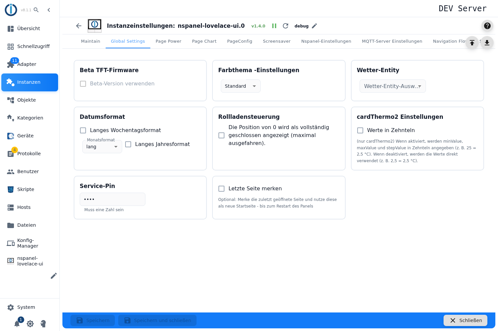

# Global Settings

Diese Einstellungen gelten für **alle Panels der Instanz** gemeinsam — anders als die Seiten- und Screensaver-Konfiguration, die je Panel festgelegt wird.

| Einstellung | Wirkung |
|---|---|
| **Beta-Firmware → Beta für TFT, Berry-Treiber und Tasmota verwenden** | Der Haken schaltet alle drei Firmware-Teile auf ihre Beta-Stände: Das *TFT UPDATE* im Tab [Maintain](Maintain) installiert die Beta-TFT statt der stabilen, die Berry-Installation nimmt den Beta-Treiber (`berry-beta`), und das *TASMOTA UPDATE* samt Versionsanzeige folgt dem Eintrag `tasmota-beta` der Versionsliste — fehlt der Eintrag, bleibt Tasmota auf der stabilen Version. Nur im **Expertenmodus** bedienbar, und der Kasten färbt sich rot, solange der Haken sitzt — eine bewusste Warnung. |
| **Farbthema** | Farbschema des Panels: Standard, Tropisch, Technisch, Sonnenuntergang, Vulkan oder eigene Farben. Mit den eigenen Farben erscheint ein zusätzlicher Tab, in dem jede Farbe einzeln gesetzt wird ([Color Themes](colorTheme)). |
| **Wetter-Entity** | Die Adapterinstanz, aus der die Wetterdaten kommen. Zur Auswahl stehen die unterstützten Wetteradapter — brightsky, OpenWeatherMap, Pirate Weather und AccuWeather. |
| **Datumsformat** | **Langes Wochentagsformat** schreibt den Wochentag aus, **Monatsformat** wählt zwischen ausgeschrieben, abgekürzt und numerisch, **Langes Jahresformat** zeigt vier statt zwei Stellen. |
| **Rollladensteuerung** | Legt fest, ob die Position 0 als *vollständig geschlossen* gilt. Diese Konvention unterscheidet sich je nach Hersteller — hier wird sie für alle Rollladen-Items umgestellt. |
| **cardThermo2 → Werte in Zehnteln** | Betrifft nur `cardThermo2`: Sind Minimum, Maximum und Schrittweite in Zehnteln angegeben (25 = 2,5 °C) oder direkt (2,5 = 2,5 °C). |
| **Service-Pin** | Zahlen-PIN für die Serviceseiten des Panels. Wird verschlüsselt gespeichert. |
| **Letzte Seite merken** | Das Panel merkt sich die zuletzt geöffnete Seite und nutzt sie als Startseite — bis zum nächsten Neustart des Panels. |

## Hinweise

- **Speichern startet die Instanz neu**, und das betrifft alle Panels gleichzeitig.
- Die Felder sind gesperrt, solange die Instanz nicht läuft.
- Die Wetterquelle muss als eigene Adapterinstanz vorhanden sein; freie Eingaben nimmt das Feld nicht an.
