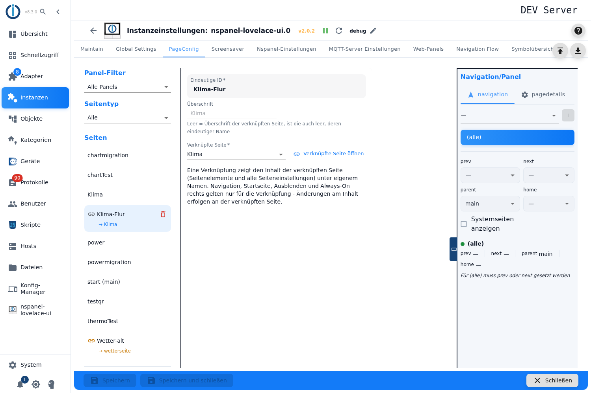
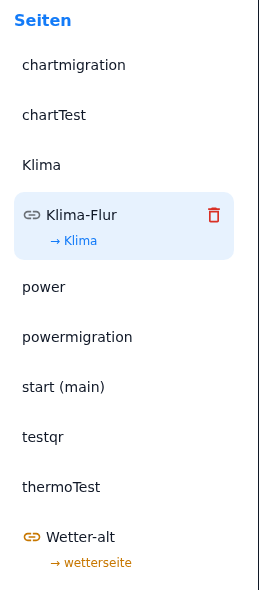
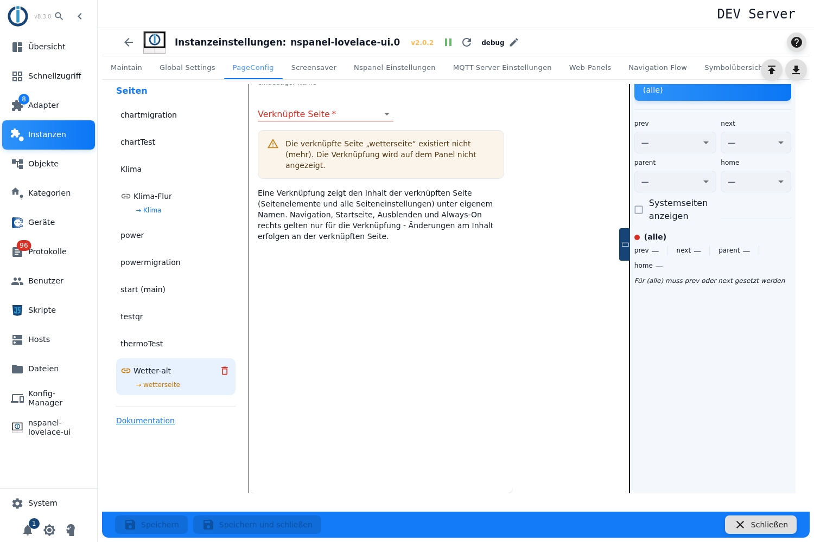

# Verknüpfung – Konfiguration im Admin

Eine **Verknüpfung** zeigt den Inhalt einer anderen Admin-Seite unter eigenem Namen, eigener Überschrift und eigener Navigation. Sie wird im Tab **PageConfig** angelegt, Seitentyp **Verknüpfung**.

Diesen Seitentyp gibt es **nur im Admin**. Ein Weg über das Konfigurationsskript existiert nicht: Der Adapter löst die Verknüpfung auf, bevor die Seiten gebaut werden, und kennt den Kartentyp beim Seitenbau gar nicht.

Inhalt:
- [Wozu dieser Seitentyp](#1-wozu-dieser-seitentyp)
- [Verknüpfung anlegen](#2-verknüpfung-anlegen)
- [Die Felder der Verknüpfung](#3-die-felder-der-verknüpfung)
- [Die Verknüpfung in der Seitenliste](#4-die-verknüpfung-in-der-seitenliste)
- [Was das Panel sieht](#5-was-das-panel-sieht)
- [Panel-Zuweisung und Navigation](#6-panel-zuweisung-und-navigation)
- [Die beiden Fehlerfälle](#7-die-beiden-fehlerfälle)
- [Fallstricke](#fallstricke)

## 1. Wozu dieser Seitentyp

Dieselbe Seite soll an **mehreren Stellen der Navigation** auftauchen — die Wetterseite einmal hinter der Startseite des Wohnzimmer-Panels und einmal im Blätterweg des Flur-Panels, die Garagen-Übersicht als normale Seite auf dem einen und als Startseite auf dem anderen Panel. Ohne Verknüpfung müsste die Seite dafür ein zweites Mal angelegt und bei jeder Änderung doppelt gepflegt werden; eine Seite lässt sich im Tab **PageConfig** auch nicht duplizieren.

Die Verknüpfung löst das: Der Inhalt bleibt **einmal** gepflegt — an der verknüpften Seite —, die Verknüpfung bringt nur ihre eigene ID, ihre eigene Überschrift und ihre eigene Einordnung in die Navigation mit. Der Hinweis unter dem Editor sagt dasselbe in einem Satz:

> Eine Verknüpfung zeigt den Inhalt der verknüpften Seite (Seitenelemente und alle Seiteneinstellungen) unter eigenem Namen. Navigation, Startseite, Ausblenden und Always-On rechts gelten nur für die Verknüpfung - Änderungen am Inhalt erfolgen an der verknüpften Seite.

Jeder Seitentyp lässt sich verknüpfen — [pageMenu](pageMenu), [cardAlarm](cardAlarm), [cardQR](cardQR), [cardPower](cardPower), [cardChart](cardChart), [cardTrash](cardTrash), [cardThermo2](cardThermo2), [cardThermo](cardThermo) und [cardMedia](cardMedia). Nur der [screensaver](screensaver) ist keine Seite dieser Liste und kommt als Ziel nicht in Frage.

## 2. Verknüpfung anlegen

1. Instanz-Einstellungen öffnen → Tab **PageConfig**.
2. Links als Seitentyp **Verknüpfung** wählen, im Feld **Neue Seite** einen Namen eintragen, **+** drücken.
3. Die Verknüpfung erscheint in der Liste **Seiten**; rechts öffnet sich ihr Editor mit drei Feldern.

Der Name ist wie bei jeder Seite die **eindeutige ID**, unter der das Panel diese Seite kennt — unter ihr sprechen andere Seiten sie in ihren Navigationszielen an. `main` ist reserviert und wird abgewiesen, ein bereits vergebener Name ebenso.

Eine neue Verknüpfung hat noch **kein Ziel**; bis eines gewählt ist, steht am Auswahlfeld der Hinweis *Wähle die Seite, deren Inhalt diese Verknüpfung zeigt.*

Wie bei allen Seitentypen gilt: Die Felder sind nur bedienbar, solange die **Instanz läuft**.

## 3. Die Felder der Verknüpfung

| Feld | Wirkung |
|---|---|
| **Eindeutige ID** | Der Name der Verknüpfung und damit der Name, unter dem diese Seite auf dem Panel liegt. Nur lesbar — wie bei jeder Seite ist der Name nach dem Anlegen fest. |
| **Überschrift** | Die Kopfzeile am Panel. **Leer** übernimmt die Überschrift der verknüpften Seite — der Hilfetext lautet *Leer = Überschrift der verknüpften Seite, ist die auch leer, deren eindeutiger Name*. Das Feld zeigt die geerbte Überschrift als blassen Platzhalter, solange nichts eingetragen ist. |
| **Verknüpfte Seite** | Das Ziel: die Seite, deren Inhalt gezeigt wird. Die Liste enthält alle Seiten der Konfiguration **außer anderen Verknüpfungen** und außer der Verknüpfung selbst, alphabetisch nach ID sortiert; die Startseite trägt den Zusatz `(main)`. |
| **Verknüpfte Seite öffnen** | Knopf neben dem Auswahlfeld: springt in der Liste auf die verknüpfte Seite, um deren Inhalt zu bearbeiten. Er erscheint erst, wenn ein gültiges Ziel gesetzt ist. |

Mehr Felder hat die Verknüpfung nicht — alles Weitere steht entweder an der verknüpften Seite oder rechts in der Spalte **Navigation/Panel**.

## 4. Die Verknüpfung in der Seitenliste

In der Liste **Seiten** ist eine Verknüpfung an zwei Dingen zu erkennen:

- Ein **Kettensymbol** vor dem Namen. Es wird **gelb**, wenn das Ziel nicht auflösbar ist.
- Darunter eine kleine Zeile **→ Zielname**. Ein Klick darauf wählt die verknüpfte Seite aus; liegt sie außerhalb des gesetzten Panel-Filters, wird der Filter dafür auf alle Panels zurückgestellt. Bei einem fehlerhaften Ziel ist die Zeile gelb und nicht anklickbar.

Der Seitentyp **Verknüpfung** im Auswahlfeld darüber filtert die Liste zusätzlich auf alle Verknüpfungen.

## 5. Was das Panel sieht

Wichtig für das Verständnis: **Das Panel bekommt keine Verknüpfung.** Beim Start der Instanz ersetzt der Adapter jede Verknüpfung durch eine **eigenständige Kopie der verknüpften Seite**, noch bevor die Seiten gebaut werden. Alles, was danach passiert — Seitenaufbau, Navigation, Protokolleinträge —, bezieht sich auf diese Kopie und nennt sie beim Namen der Verknüpfung.

Woher die Kopie ihre Angaben nimmt:

| Angabe | Quelle |
|---|---|
| Eindeutige ID | **Verknüpfung** |
| Überschrift | **Verknüpfung**, leer: die der verknüpften Seite, leer: deren eindeutige ID |
| Panel-Zuweisung und Navigationsziele (*next*, *prev*, *home*, *parent*) | **Verknüpfung** |
| **Startseite (main)** | **Verknüpfung** |
| **Versteckt** | **Verknüpfung** |
| **Verhalten des Bildschirmschoners** | **Verknüpfung** |
| Kartentyp, Seitenelemente, alle übrigen Felder der Karte | **verknüpfte Seite** |

Die Kopie ist eine echte Kopie: Die verknüpfte Seite bleibt unberührt, und beide Seiten erscheinen am Panel getrennt und gleichwertig. Genau deshalb kann dieselbe Übersicht auf einem Panel die Startseite sein und auf einem anderen eine gewöhnliche Seite im Blätterweg.

> Bei einer verknüpften **[cardChart](cardChart)**- oder **[cardPower](cardPower)**-Seite, die ihre Navigation noch aus einer alten Skripttabelle bezieht (siehe [Migration](Migration)), setzt der Adapter diese Herkunft in der Kopie zurück: Die Verknüpfung navigiert ausschließlich über die Ziele, die rechts an ihr eingetragen sind. Ohne diese Einträge ist sie nur über einen Button mit `navigate`-Befehl erreichbar.

## 6. Panel-Zuweisung und Navigation

Panel, Navigationsziele, **Startseite (main)**, **Versteckt** und **Verhalten des Bildschirmschoners** liegen wie bei jedem Seitentyp in der rechten Spalte und sind unter [PageConfig – Übersicht](PageConfig) beschrieben. Für Verknüpfungen gilt dort zusätzlich:

- Eine Verknüpfung **ohne Panel-Zuweisung** wird nicht gebaut — der Panel-Filter *Nicht zugewiesen* findet sie wieder.
- Verknüpfung und verknüpfte Seite sollten **demselben Panel in der Regel nicht beide** zugewiesen sein: Das Panel hätte dann denselben Inhalt zweimal, unter zwei Namen. Sinnvoll ist das nur, wenn die zweite Fassung bewusst anders eingeordnet ist, etwa versteckt oder als Startseite.
- Für die Startseiten-Markierung gelten die üblichen Regeln: pro Panel nur eine, und ein Panel muss zugewiesen sein.

## 7. Die beiden Fehlerfälle

**Das Ziel fehlt.** Kein Ziel gewählt oder die verknüpfte Seite wurde inzwischen gelöscht. Der Editor zeigt die Warnung *Die verknüpfte Seite „…" existiert nicht (mehr). Die Verknüpfung wird auf dem Panel nicht angezeigt.*, das Auswahlfeld ist rot, das Kettensymbol in der Liste gelb. Der Adapter überspringt die Verknüpfung beim Seitenbau und schreibt eine Warnung ins Protokoll (`target page '…' does not exist - skipping!`).

**Die Verknüpfung zeigt auf eine Verknüpfung.** Ketten sind nicht vorgesehen; auch hier wird die Verknüpfung übersprungen und protokolliert (`links of links are not supported - skipping!`). Über das Auswahlfeld lässt sich dieser Fall nicht herstellen — es bietet keine Verknüpfungen an. Entstehen kann er trotzdem, wenn die verknüpfte Seite gelöscht und später eine **Verknüpfung mit demselben Namen** angelegt wird. Der Ausweg ist immer derselbe: als Ziel die Seite wählen, die den Inhalt wirklich trägt.

In beiden Fällen gilt: Die Seite fehlt am Panel **ganz** — Navigationsziele anderer Seiten, die auf die Verknüpfung zeigen, laufen dann ins Leere.

## Fallstricke

> ⚠️ **Löschen der verknüpften Seite räumt die Verknüpfung nicht mit.** Sie bleibt mit ihrem alten Ziel stehen und ist ab sofort defekt. Die Rückfrage vor dem Löschen **nennt** die Verknüpfung immerhin unter den Seiten, die auf die gelöschte zeigen — entfernt oder umgehängt wird sie aber nicht. In der Liste ist sie an der Zeile **→ Name** zu erkennen.

> **Umbenannt wird nichts mehr:** Der Name einer Seite ist nach dem Anlegen fest — der der verknüpften Seite wie der der Verknüpfung selbst (siehe [PageConfig](PageConfig#seiten-anlegen-und-löschen)). Damit kann eine Verknüpfung ihr Ziel nicht mehr durch ein Umbenennen verlieren; nur das Löschen bricht sie.

> **Der Inhalt lässt sich an der Verknüpfung nicht ändern.** Wer am Panel etwas anpassen will, muss es an der verknüpften Seite tun — und die Änderung erscheint dann an **allen** Verknüpfungen dieser Seite. Der Knopf **Verknüpfte Seite öffnen** ist der kurze Weg dorthin.

> **Eine leere Überschrift ist kein Fehler.** Sie ist der Normalfall einer frischen Verknüpfung und bedeutet „Überschrift der verknüpften Seite übernehmen". Erst ein Eintrag macht die Kopfzeile am Panel unabhängig.

> **Im Konfigurationsskript gibt es diesen Seitentyp nicht.** Eine Verknüpfung ist ausschließlich eine Angelegenheit des Admins; sie kann auf eine Seite zeigen, die der Admin verwaltet, nicht auf eine Seite aus einem Skript.

> **Nach dem Speichern startet die Instanz neu.** Erst dann wird die Verknüpfung aufgelöst und die Kopie gebaut — Protokollwarnungen zu defekten Verknüpfungen erscheinen deshalb erst beim Start, nicht beim Speichern.
