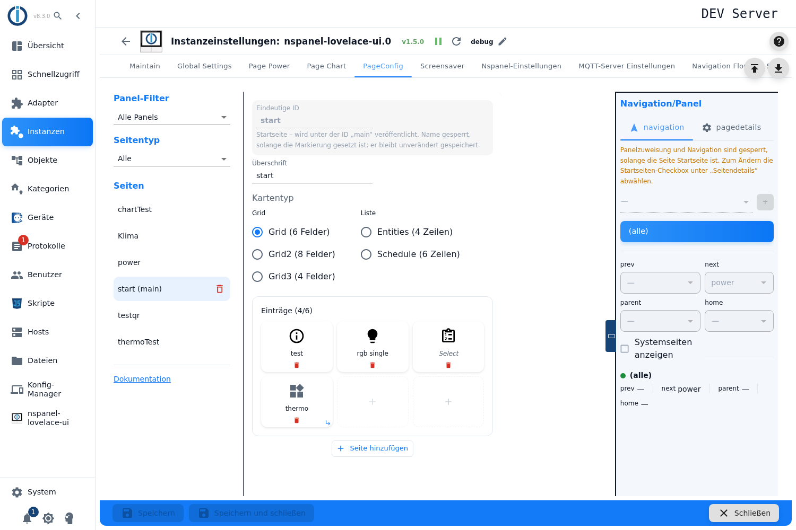
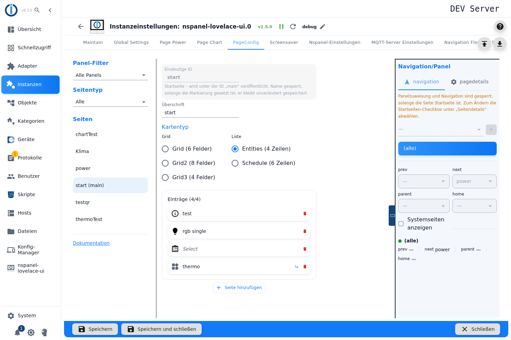
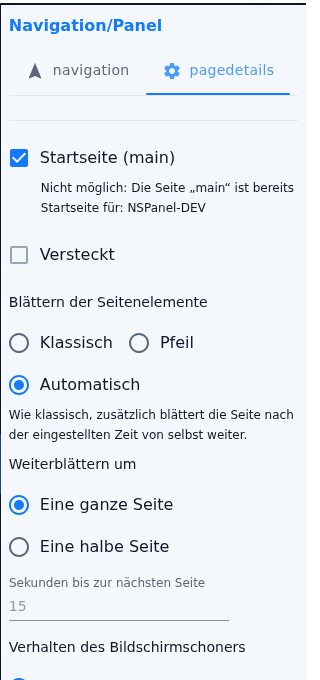

# Menü-Seiten – Konfiguration im Admin

Die Menü-Seite ist der Arbeitspferd-Kartentyp: eine Seite aus **Flächen**, die Geräte schalten, Werte zeigen oder auf andere Seiten springen. Fünf Varianten stecken dahinter — drei Raster und zwei Listen. Angelegt wird sie im Tab **PageConfig**, Seitentyp **Menü-Seite**.

Inhalt:
- [Seite anlegen](#1-seite-anlegen)
- [Die fünf Varianten](#2-die-fünf-varianten)
- [Flächen belegen](#3-flächen-belegen)
- [Flächen umsortieren](#4-flächen-umsortieren)
- [Flächen kopieren und einfügen](#5-flächen-kopieren-und-einfügen)
- [Mehr Einträge: weitere Seiten](#6-mehr-einträge-weitere-seiten)
- [Blättern der Seitenelemente](#7-blättern-der-seitenelemente)
- [Was die Flächen anzeigen](#8-was-die-flächen-anzeigen)
- [Panel-Zuweisung und Navigation](#9-panel-zuweisung-und-navigation)
- [Was sich mit 2.0.0 bis 2.0.2 geändert hat](#10-was-sich-mit-200-bis-202-geändert-hat)
- [Fallstricke](#fallstricke)

## 1. Seite anlegen

1. Instanz-Einstellungen öffnen → Tab **PageConfig**.
2. Links als Seitentyp **Menü-Seite** wählen, einen Namen eintragen, **+** drücken.
3. Die Seite entsteht als **Grid (6 Felder)** — die Variante stellt man anschließend im Editor um.

**Überschrift** ist die Kopfzeile am Panel; bleibt sie leer, nimmt das Panel den Seitennamen.

> Das Feld **Eindeutige ID** ist **nur lesbar**: Der Name einer Seite ist nach dem Anlegen fest, der Hinweis darunter sagt das auch („Der Name ist nach dem Anlegen fest – andere Seiten verweisen darauf."). Ist die Seite die Startseite, steht dort stattdessen ihr eigener Hinweis („Startseite – wird unter der ID `main` veröffentlicht"); die Startseite wird über die Markierung **Startseite (main)** in den Seitendetails gesetzt, nicht über den Namen. Warum der Name fest ist und wie eine Seite trotzdem anders heißen kann, steht unter [PageConfig – Übersicht](PageConfig#seiten-anlegen-und-löschen).

## 2. Die fünf Varianten

Unter **Kartentyp** stehen sie in zwei Gruppen:

| Gruppe | Variante | Plätze je Seite | Darstellung |
|---|---|---|---|
| **Grid** | Grid (6 Felder) | 6 | Kacheln, drei Spalten |
| | Grid2 (8 Felder) | 8, auf einem **us-p**-Panel **9** | Kacheln, vier Spalten (us-p: drei) |
| | Grid3 (4 Felder) | 4 | Kacheln, zwei Spalten |
| **Liste** | Entities (4 Zeilen) | 4, auf einem **us-p**-Panel **5** | Zeilen, eine Spalte |
| | Schedule (6 Zeilen) | 6 | Zeilen, Zeitplan-Darstellung |

**Grids** zeigen große Kacheln mit Symbol, **Listen** schmale Zeilen — für viele Werte auf einmal.

> Es sind technisch **zwei getrennte Auswahlgruppen**. Wählt man eine Liste, verschwindet die Markierung bei den Grids nur deshalb, weil die andere Gruppe dann keinen gültigen Wert hat. Optisch wirkt es wie eine Auswahl, verhält sich aber wie zwei.

**Beim Umschalten der Variante bleiben alle Flächen erhalten** — auch wenn die neue Variante weniger Plätze hat. Es wird nichts gelöscht und nicht gewarnt: Die überzähligen Flächen rutschen auf eine zweite Seite (siehe [Abschnitt 6](#6-mehr-einträge-weitere-seiten)).

**Grid2 und das Panelmodell:** Die Variante gibt es nur, wenn alle zugewiesenen Panels dasselbe Modell haben. Bei gemischten Modellen ist sie gesperrt, und ein bereits gesetztes Grid2 wird **selbsttätig auf Grid zurückgestellt** — der Hinweis „cardGrid2 ist deaktiviert: Die zugewiesenen Panels haben unterschiedliche Modelle …" erklärt das, solange der Konflikt besteht. Sind alle zugewiesenen Panels us-p, heißt der Eintrag **Grid2 (9 Felder – us-p)** und der Editor zeichnet neun Kacheln in drei Spalten. Ohne Panel-Zuweisung rechnet der Editor mit 8 Feldern.

> **Bei *Entities* unterschlägt der Editor auf einem us-p-Panel eine Zeile.** Er rechnet immer mit vier Zeilen, das Panel zeigt dort aber **fünf**. Die fünfte ist im Editor nur über eine zusätzliche Seite und Blättern erreichbar. Bei Grid2 ist die Modellabhängigkeit eingebaut, bei Entities nicht.

## 3. Flächen belegen

Ein Klick auf eine **gestrichelte, leere Fläche** öffnet die [Pageitem-Konfiguration](PageConfig-Dialoge#1-pageitem-konfiguration) — denselben Dialog, den die Thermostat- und die Medien-Seite ebenfalls benutzen. Dort entscheidet sich, ob die Fläche ein **Gerät** bedient, auf eine **andere Seite springt** oder einen **einzelnen Datenpunkt** schaltet.

Ein Klick auf eine **belegte** Fläche öffnet sie zum Bearbeiten. Das **rote Papierkorb-Symbol** in der Fläche leert sie wieder — **ohne Rückfrage und ohne Rücknahme**.

Über dem Raster steht **Einträge (*belegt* / *Plätze insgesamt*)**.

Welche Felder des Dialogs eine Menü-Seite zusätzlich anbietet, hängt an der Variante:

| Einstellung | Auf welcher Variante | Wirkung |
|---|---|---|
| **Text-/Icongröße** | nur Grid, Grid2, Grid3 | Nextion-Font 0–5 statt der Standardgröße: `0 – 24 px (nur Text)`, `1 – 32 px`, `2 – 32 px (nur Text)`, `3 – 48 px`, `4 – 80 px fett`, `5 – 128 px fett (nur ASCII)`. Solange die Fläche ein **Icon** zeigt, stehen nur die Schriften **1, 3 und 4** zur Wahl — die übrigen enthalten keine Icons. Ein bereits gespeicherter anderer Wert bleibt in der Liste und wird mit „Diese Schrift enthält keine Icons – das Icon bleibt auf dem Panel leer" angemahnt. |
| **Wert statt Icon verwenden** | nur Grid, Grid2, Grid3 | Die Fläche zeigt den Wert als Text. Dann sind alle sechs Schriften wählbar; bei Font 5 weist der Dialog auf „Nur ASCII – kein °, keine Umlaute oder andere Sonderzeichen" hin. |
| **Langer Druck (entweder State bedienen oder Navigation)** | nur Grid, Grid2, Grid3 | Zweite Funktion derselben Fläche — entweder einen Datenpunkt schalten **oder** auf eine Seite springen. Nur für Navigations-Flächen, den benutzerdefinierten Knopf und Datenpunkte mit `role=button`; ein Element mit Popup würde mit dem langen Druck zusammenstoßen. |
| **Präfix** und **Suffix** des Wertes (Zahnrad an der Kanal-ID) | nur Entities, Schedule | Der Adapter setzt sie ausschließlich auf den Listen-Karten vor und hinter den Wert. Auf einer Grid-Variante bleiben beide Eingaben wirkungslos. |

Der lange Druck fehlt auf **Entities** und **Schedule** nicht aus Nachlässigkeit: Nur die Flächen der drei Grid-Varianten melden am HMI ein `buttonPress3`; die Zeilen der Listen melden immer einen kurzen Druck.

Eine Fläche, die der Dialog nicht abbilden kann, nimmt über **Item als Rohdaten (JSON) eingeben** das rohe Element auf. Sie heißt im Raster dann **Rohdaten: …**; die Felder des Dialogs werden für sie nicht mehr verwendet.

> Eine Lücke mitten in der Reihe ist erlaubt: Klickt man eine hintere freie Fläche an, landet das Item genau dort, die Flächen davor bleiben leer. Am Panel **verbrauchen diese Lücken trotzdem ihren Platz** — der Adapter füllt sie mit leeren Elementen auf. Nur Lücken **am Ende** fallen weg.

## 4. Flächen umsortieren

Belegte Flächen lassen sich **mit der Maus aufnehmen und auf eine andere Fläche ziehen**. Das funktioniert auch über Seitengrenzen hinweg und in der Listenansicht genauso wie im Raster.

> **Das Ziehen tauscht, es verschiebt nicht.** Zieht man Fläche 1 auf Fläche 5, sitzt anschließend das Item von 5 auf Platz 1 — die Flächen dazwischen rücken **nicht** nach. Wer eine Reihenfolge umbauen will, tauscht also schrittweise. In der Oberfläche steht das nirgends.

Ziehen braucht ein Zeigegerät; auf einem Touchgerät steht es nicht zur Verfügung.

## 5. Flächen kopieren und einfügen

Eine fertig eingerichtete Fläche lässt sich übertragen, statt sie neu einzutragen — das ist bei einer Reihe gleichartiger Lampen die meiste gesparte Arbeit.

1. **Rechtsklick** auf die belegte Fläche → **Element kopieren**.
2. **Rechtsklick** auf die Zielfläche → **Element einfügen**.

Das klappt **auch von einer Menü-Seite in eine andere**: Seite wechseln, Rechtsklick, einfügen.

Was man dazu wissen muss:

- Auf einer **leeren** Fläche öffnet sich das Menü **überhaupt nur dann**, wenn vorher etwas kopiert wurde. Auf einer belegten Fläche erscheinen beide Einträge, *Element einfügen* ist ohne Zwischenspeicher ausgegraut.
- **Es gibt keine Anzeige des Zwischenspeichers.** Dass etwas darin liegt, erkennt man nur daran, dass sich das Menü auf leeren Flächen öffnet.
- **Der Zwischenspeicher hängt am Menü-Editor.** Er übersteht den Wechsel zu einer anderen **Menü**-Seite, aber **nicht** den Umweg über eine Seite anderen Typs (Thermostat, QR, Alarm …) — dann ist er weg. Ein Neuladen der Oberfläche leert ihn ebenfalls.
- **Einfügen auf eine belegte Fläche überschreibt ohne Rückfrage.** Es gibt keine Rücknahme.
- **Einfügen weiter hinten füllt die Lücken davor mit leeren Flächen** — und die verbrauchen am Panel ihren Platz.
- **Kein Lang-Druck:** Ohne Rechtsklick ist Kopieren und Einfügen **nicht erreichbar**, auf Tablet und Telefon also nicht nutzbar. Tastenkürzel wie Strg+C gibt es ebenfalls nicht.
- **Der Kartentyp wird beim Einfügen nicht geprüft.** Eine auf einem Grid kopierte Fläche nimmt ihre Grid-Einstellungen (Text-/Icongröße, *Wert statt Icon verwenden*, langer Druck) mit auf eine Entities- oder Schedule-Zeile, wo sie nichts bewirken.

## 6. Mehr Einträge: weitere Seiten

Mehr Einträge als Plätze? Dann entstehen **weitere Seiten**, durch die das Panel blättert.

- **Seite hinzufügen** legt eine weitere leere Seite an.
- Zusätzliche Seiten entstehen auch **von selbst**, sobald eine Fläche jenseits der Kapazität belegt wird.
- Ein Trenner **Seite *n* / *m*** zeigt, wo man sich befindet; eine leere letzte Seite lässt sich über **Leere Seite entfernen** wieder loswerden.
- Eine Obergrenze für die Zahl der Einträge gibt es nicht.

> **Eine per „Seite hinzufügen" angelegte leere Seite ist nicht dauerhaft.** Sie lebt nur in der Oberfläche: Beim Umschalten der Variante, beim Wechsel auf einen anderen Seitentyp und nach einem Neuladen ist sie wieder weg. Erst eine **belegte** Fläche macht eine Seite dauerhaft.
>
> Beim Wechsel auf eine **andere Menü-Seite** wandert der Zähler dagegen mit: Dort erscheint dann ebenfalls eine leere Zusatzseite, obwohl sie nie angefordert wurde. Auch sie ist nur Anzeige und verschwindet beim Neuladen.

## 7. Blättern der Seitenelemente

Wie das Panel durch mehrere Seiten blättert, steht **nicht im Editor**, sondern in der **rechten Spalte** unter den Seitendetails — zwischen **Versteckt** und **Verhalten des Bildschirmschoners**. Die Felder erscheinen bei **jeder** Menü-Seite, auch solange sie nur eine einzige Seite füllt, und ebenso bei [cardThermo2](cardThermo2) und [cardMedia](cardMedia).

Die Radiogruppe **Blättern der Seitenelemente** hat drei Werte; der Admin schreibt den passenden Hinweis darunter:

| Auswahl | Hinweis im Admin | Verhalten am Panel |
|---|---|---|
| **Klassisch** (Vorgabe) | „Mehr Elemente als Plätze: Die Doppelpfeile des Panels blättern weiter." | Die beiden Navigationsknöpfe der Kopfzeile werden zu **Aufwärts-/Abwärts-Pfeilen**. Ein **kurzer** Druck blättert innerhalb der Seite, ein **langer** Druck verlässt sie über die normale Navigation. Auf der ersten Seite bleibt der linke, auf der letzten der rechte Knopf die gewöhnliche Navigation. Alle Plätze sind belegbar. |
| **Pfeil** | „Mehr Elemente als Plätze: Der letzte Platz zeigt einen Pfeil, der weiterblättert." | Der **letzte Platz jeder Seite** wird zum Weiter-Pfeil (Kreis-Pfeil nach rechts, Text „more") und steht nicht zur Belegung bereit. Er blättert nur **vorwärts** und springt von der letzten Seite zurück auf die erste. Die Navigationsknöpfe der Kopfzeile behalten ihre gewöhnliche Funktion. Solange alle Einträge auf eine Seite passen, erscheint **kein** Pfeil und der Platz ist frei nutzbar. |
| **Automatisch** | „Wie klassisch, zusätzlich blättert die Seite nach der eingestellten Zeit von selbst weiter." | Das Fenster wandert nach der eingestellten Zeit von allein weiter, solange die Seite sichtbar und das Panel wach ist. Von Hand blättern lässt sich die Seite dabei **nicht**: Die Navigationsknöpfe bleiben die gewöhnliche Navigation. |

**Weiterblättern um** — erscheint nur bei *Klassisch* und *Automatisch* und nur dort, wo die Karte es kann: **Grid, Grid2, Grid3** (und cardThermo2). Bei **Entities**, **Schedule** und cardMedia fehlt das Feld.

| Auswahl | Wirkung |
|---|---|
| **Eine ganze Seite** (Vorgabe) | Das Fenster rückt um die volle Platzzahl weiter — Seite für Seite ohne Überlappung. |
| **Eine halbe Seite** | Das Fenster bleibt so breit wie die Karte, rückt aber nur um die **halbe** Platzzahl weiter: Grid um 3, Grid2 um 4, Grid3 um 2. Die halbe Belegung bleibt beim Blättern stehen. Die Pfeile der Kopfzeile sind dann **gefüllt** statt umrandet. |

**Sekunden bis zur nächsten Seite** — erscheint nur bei *Automatisch*. Das Feld steht leer und zeigt die Vorgabe **15** als Platzhalter; leer bedeutet also 15 Sekunden.

> Werte unter 2 Sekunden lässt das Feld zwar zu, der Adapter rechnet daraus aber **3 Sekunden**. Kleiner geht es nicht.

Ohne echtes Panel lässt sich das Blättern im [Web-Panel](WebPanel) nachsehen; Antippen und Halten verhalten sich dort seit 2.0.0 wie am HMI.

## 8. Was die Flächen anzeigen

Die Beschriftung einer Fläche im Editor folgt einer Rangfolge:

1. der **Name** aus der Pageitem-Konfiguration,
2. sonst der Name des **ioBroker-Kanals** — dann **grau und kursiv**, damit man sieht, dass er nicht selbst gesetzt ist,
3. sonst eine technische Angabe wie `3: (dimmer)` oder nur die Platznummer.

Eine Fläche mit Rohdaten trägt stattdessen **Rohdaten** samt einem Auszug aus dem JSON. Ein kleines Abzweig-Symbol markiert Flächen, die auf eine **andere Seite springen**. Der Tooltip zeigt die ioBroker-ID dahinter.

Am Panel bleiben unbelegte Felder leer. Wie viele Zeichen eine Beschriftung verträgt, hängt von Schriftgröße und Panelmodell ab und ist nicht festgelegt — im Zweifel kurz halten und am Panel prüfen.

## 9. Panel-Zuweisung und Navigation

Panel, Navigationsziele, *Startseite (main)*, *Versteckt*, die Blätter-Einstellungen aus [Abschnitt 7](#7-blättern-der-seitenelemente) und *Verhalten des Bildschirmschoners* liegen in der rechten Spalte, beschrieben unter [PageConfig – Übersicht](PageConfig#panelzuweisung-und-navigation).

Für Menü-Seiten ist die Panel-Zuweisung doppelt wichtig: Sie entscheidet nicht nur, wo die Seite erscheint, sondern über das Panelmodell auch, **wie viele Plätze** zur Verfügung stehen und ob die Variante Grid2 überhaupt wählbar ist.

## 10. Was sich mit 2.0.0 bis 2.0.2 geändert hat

| Version | Änderung an den Menü-Karten |
|---|---|
| 2.0.0 | Das **Blättern** ist im Admin einstellbar — die drei Felder aus [Abschnitt 7](#7-blättern-der-seitenelemente). Vorher kannte sie nur eine Skript-Konfiguration. |
| 2.0.0 | Der **lange Druck** wird nur noch auf Grid, Grid2 und Grid3 angeboten, wie am HMI. Auf Entities und Schedule hatte er nie eine Wirkung. |
| 2.0.0 | **Rohdaten (JSON)** für einzelne Flächen; der Platz heißt dann „Rohdaten: …". |
| 2.0.0 | Knopf-Flächen (`role=button`) nehmen eine **Zielseite** auf: schalten und danach die Seite wechseln. |
| 2.0.0 | Berichtigt: **Präfix und Suffix** des Wertes waren vertauscht. Wer sie vertauscht eingetragen hatte, muss sie zurücktauschen. |
| 2.0.0 | Berichtigt: ein langer Druck löste zusätzlich den kurzen aus. |
| 2.0.0 | Neue Icons (Material Design Icons 7.4.47); Rollladen zeigen ihre Position als Symbol — das braucht HMI/TFT 6.0.2. |
| 2.0.0 | Eine Admin-Seite, die einem Panel zugewiesen ist, verdrängt die gleichnamige Seite des globalen Skripts. |
| 2.0.2 | Die **Text-/Icongröße** nennt die Pixelgröße jeder Schrift; mit Icon stehen nur die Schriften 1, 3 und 4 zur Wahl, Schrift 5 ist als „nur ASCII" gekennzeichnet. |
| 2.0.2 | Der Knopf „…" neben dem Namen heißt **Dynamischer Name** und wird nur noch verwendet, solange das Namensfeld leer ist; Einheit und Datumsformat bietet er nicht mehr an (sie wurden ignoriert). |

## Fallstricke

> ⚠️ **Bei *Pfeil* weichen Editor und Panel auseinander, sobald es eine Liste ist.** Auf Entities und Schedule zeichnet der Editor **keinen** Pfeil-Platzhalter und teilt die Seiten in 4 bzw. 6 Zeilen, während das Panel die letzte Zeile für den Pfeil verbraucht und in 3 bzw. 5 Zeilen teilt. Verloren geht dabei nichts, aber der Seitenschnitt im Editor stimmt nicht mit dem am Panel überein. Auf den Grid-Varianten zeichnet der Editor den Platzhalter richtig — allerdings erst, sobald mehr als eine Seite vorhanden ist.

> ⚠️ **Halbe Seiten sieht man im Editor nicht.** Der Editor teilt immer in ganze Seiten; das Halbseiten-Blättern ist ausschließlich ein Verhalten des Panels. Welche Fläche nach einem Druck neben welcher steht, lässt sich nur am Panel oder im [Web-Panel](WebPanel) beurteilen.

> **„Eine halbe Seite" verschwindet mit *Pfeil*.** Wird die Darstellung auf *Pfeil* gestellt, verbirgt der Admin das Feld — der gespeicherte Wert bleibt erhalten und wirkt wieder, sobald *Klassisch* oder *Automatisch* zurückgestellt wird. Auf Karten, die keine halbe Seite können, setzt der Adapter sie beim Bauen der Seite stillschweigend auf die ganze Seite zurück.

> **Bei *Automatisch* gibt es keinen Handbetrieb.** Die Kopfzeilen-Pfeile navigieren dort zur Nachbarseite, nicht innerhalb der Seite. Wer beides will — selbst blättern *und* automatisch weiterlaufen —, bekommt es nicht; der Hinweistext „wie klassisch" meint allein den Seitenschnitt.

> **Bei *Pfeil* kommt man nur vorwärts.** Es gibt keinen Rückwärts-Pfeil in der Fläche; zurück geht es nur durch Weiterblättern bis zum Umlauf.

> **Die Überschrift ist nicht der Seitenname.** Bleibt **Überschrift** leer, nimmt das Panel die **Eindeutige ID** als Kopfzeile. Die ID lässt sich später nicht mehr ändern — wer eine andere Kopfzeile will, trägt eine **Überschrift** ein.

> **Lücken mitten in der Belegung kosten Platz.** Der Adapter füllt sie mit leeren Elementen auf; nur Lücken am Ende fallen weg. Eine „aufgeräumt" wirkende Seite mit einer Lücke in der zweiten Reihe hat am Panel also eine Fläche weniger, als die Zählung im Editor vermuten lässt.

> **Grid2 kippt still auf Grid.** Sobald die Panel-Zuweisung Modelle mischt, stellt der Editor die Variante selbsttätig zurück. Die Flächen bleiben erhalten, aber die Seitenaufteilung ändert sich — und mit ihr, was am Panel auf welcher Seite steht.

> **Aus einem Skript übernommen:** Eine Menü-Seite mit `scrollType: half` auf einer Karte, die keine halbe Seite kann (Entities, Schedule), lässt sich **nicht** übernehmen — die Vorschau der [Migration](Migration) führt sie unter den Problemen und überspringt sie. Flächen mit langem Druck auf Entities und Schedule werden übernommen, ihr langer Druck fällt dabei weg und wird unter „Langer Druck verworfen" aufgeführt.

> **Alles, was der Admin nicht anbietet**, ist nur über die [Migration](Migration) aus einem Skript erreichbar.
