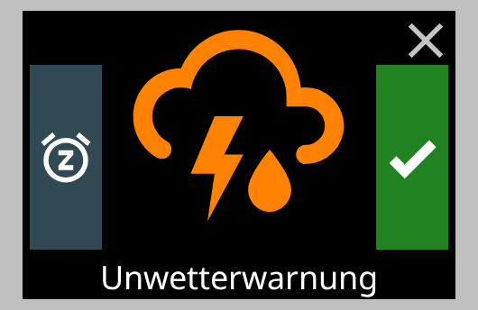
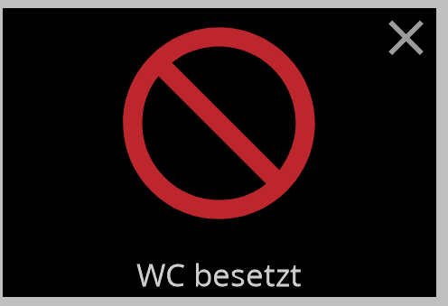
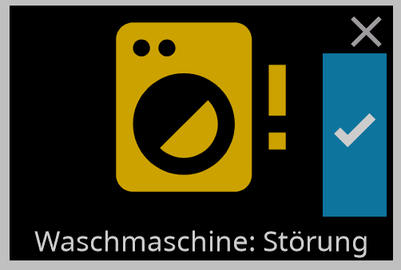
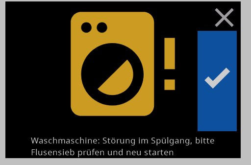

# Popups

Im Adapter heißen **zwei verschiedene Dinge** Popup:

1. **Detail-Popups einer Fläche** — Licht, Rollladen, Thermostat, Timer, Auswahlliste. Sie gehen auf, wenn
   man auf einer Seite länger oder gezielt auf eine Fläche tippt, und gehören zum jeweiligen Pageitem;
   eingestellt werden sie dort (siehe [Wiederkehrende Dialoge](PageConfig-Dialoge)). Das Timer-Popup hat
   eine eigene Seite: [Timer-Popup](popupTimer).
2. **Das Meldungs-Popup** — eine eigene Seite, die eine Nachricht über alles andere legt. Um die geht es
   hier.

> **Das Meldungs-Popup wird nirgends angelegt.** Es ist eine **Systemseite**: Jedes Panel bekommt beim
> Start zwei davon — eine für die Systemmeldungen des Adapters und eine für eigene Meldungen. Im Admin
> gibt es diesen Seitentyp nicht, im Konfigurationsskript auch nicht. Gesteuert wird die Seite
> ausschließlich über **Datenpunkte** oder über **`sendTo`**.

Inhalt:
- [Weg 1: die Datenpunkte](#1-weg-1-die-datenpunkte)
- [Weg 2: `sendTo`](#2-weg-2-sendto)
- [Die Warteschlange](#3-die-warteschlange)
- [Die drei Knöpfe, das X und die Rückmeldungen](#4-die-drei-knöpfe-das-x-und-die-rückmeldungen)
- [Darstellung am Panel](#5-darstellung-am-panel)
- [Großes Symbol (ab TFT 6.2.0)](#6-großes-symbol-ab-tft-620)
- [Schriften (textSize)](#7-schriften-textsize)
- [Fallstricke](#fallstricke)

## 1. Weg 1: die Datenpunkte

Je Panel liegt unter `nspanel-lovelace-ui.<Instanz>.panels.<Panel>.cmd.pagePopup.` ein Satz Felder.
Man füllt sie und löst dann **`activate`** aus — erst dieser Knopf liest **alle** Felder und schickt die
Meldung ab.

| Datenpunkt | Typ | Vorgabe | Bedeutung |
|---|---|---|---|
| `id` | string | leer | Name zum Wiedererkennen. **Leer löscht alle** gespeicherten Popups. |
| `global` | boolean | false | An alle Panels statt nur an dieses. |
| `activate` | button | — | Löst den Versand aus. |
| `priority` | number | 50 | Kleiner = weiter vorn. **≤ 0 löscht** das Popup mit dieser `id`, **≤ −100** alle, deren `id` damit beginnt. |
| `type` | string | `information` | `information` oder `acknowledge`. |
| `headline` / `colorHeadline` | string / json | leer / weiß | Überschrift und ihre Farbe. |
| `text` / `colorText` | string / json | leer / weiß | Meldungstext und seine Farbe. |
| `buttonLeft` / `buttonMid` / `buttonRight` (+ `colorButton…`) | string / json | leer / weiß | Beschriftung und Farbe der drei Knöpfe. |
| `icon` / `iconColor` | string / json | leer | Symbol vor der Überschrift; mit `largeIcon` das große Symbol. |
| `largeIcon` | boolean | false | Meldung mit großem Symbol zeigen, siehe [Großes Symbol](#6-großes-symbol-ab-tft-620). |
| `buttonLeftIcon` / `buttonRightIcon` | string | leer | Nur mit `largeIcon`: Symbol auf dem linken/rechten Knopf. Links ist „Nein / Weiter“, rechts „Ja / OK“ – den Haken also rechts. |
| `textSize` | number 0–5, 8 | 3 | Schrift und damit, wie viele Zeilen passen, siehe [Schriften (textSize)](#7-schriften-textsize). `6`/`7` gelten als `3`. |
| `buzzer` | boolean | false | Einmaliger Ton beim Anzeigen. |
| `alwaysOn` | boolean | **true** | Popup bleibt stehen, statt in den Bildschirmschoner zu laufen. |

Auf diesem Weg gilt:

- **Leere Felder bleiben leer.** Die Ersatztexte *Missing Headline* / *Missing Text* gibt es nur auf dem
  `sendTo`-Weg.
- **Der Summer kann hier nur an oder aus sein.** Ein eigenes Tasmota-Muster lässt sich nur über `sendTo`
  mitgeben — und gesummt wird ohnehin nur, wenn am Panel `cmd.isBuzzerAllowed` gesetzt ist.

## 2. Weg 2: `sendTo`

Aus einem Skript heraus ist das der bequemere Weg, weil alles in einem Rutsch geht:

```javascript
sendTo('nspanel-lovelace-ui.0', 'setPopupNotification', {
    id: 'test3',
    headline: 'test3',
    buttonLeft: 'weiter',
    buttonRight: 'oki',
    text: 'Es lebt!!!'
});
```

Ausführlich, mit allen Feldern, die der Adapter auswertet:

```typescript
type PagePopupDataDetails = {
    id?: string;                 // fehlt → 'missing'
    priority?: number;           // fehlt → 50
    type?: 'information' | 'acknowledge';   // fehlt → 'information'
    headline: string;            // fehlt → 'Missing Headline'
    text: string;                // fehlt → 'Missing Text'
    panel?: string | string[];   // fehlt → an alle Panels
    global?: boolean;            // nur false schaltet global ab
    colorHeadline?: { r: number; g: number; b: number } | string;
    buttonLeft?: string;
    colorButtonLeft?: { r: number; g: number; b: number } | string;
    buttonMid?: string;
    colorButtonMid?: { r: number; g: number; b: number } | string;
    buttonRight?: string;
    colorButtonRight?: { r: number; g: number; b: number } | string;
    colorText?: { r: number; g: number; b: number } | string;
    textSize?: string;           // 0–5, 8
    icon?: string;
    iconColor?: { r: number; g: number; b: number } | string;
    largeIcon?: boolean;         // true → großes Symbol (ab TFT 6.2.0)
    buttonLeftIcon?: string;     // nur mit largeIcon: Name des Symbols
    buttonRightIcon?: string;    // nur mit largeIcon: Name des Symbols
    alwaysOn?: boolean;          // fehlt → true
    buzzer?: boolean | string;   // true oder ein Tasmota-Muster
};

const message: PagePopupDataDetails = {
    id: 'test3',
    priority: 49,
    headline: 'test3',
    buttonLeft: 'weiter',
    buttonRight: 'oki',
    text: 'Es lebt!!!',
    type: 'information',
};

sendTo('nspanel-lovelace-ui.0', 'setPopupNotification', message);
```

Die Farbfelder nehmen ein `{r,g,b}`-Objekt **oder** eine Zeichenkette wie `#ff0000`. Ein unbrauchbarer
Wert fällt stillschweigend auf die Standardfarbe zurück. Ist **kein Panel online**, meldet der Adapter das
im Rückruf (`{ error: 'No Panels Online' }`); ein Panelname, den es nicht gibt, landet als Fehler im Log.

## 3. Die Warteschlange

Mehrere Meldungen liegen nebeneinander und werden **aufsteigend nach `priority`** sortiert — die kleinste
Zahl steht vorn. Das Panel zeigt immer die vorderste.

> **Höchstens zehn Popups** hält der Adapter je Panel vor; was darüber hinaus ankommt, fällt hinten weg.
> Ein fehlerhaftes JSON wird **ohne Meldung verworfen** — kein Logeintrag, keine Reaktion am Panel.

## 4. Die drei Knöpfe, das X und die Rückmeldungen

Die drei Knöpfe sind **Antwortknöpfe**: Beschriftung und Farbe kommen aus `buttonLeft`, `buttonMid`,
`buttonRight` und `colorButton…`; ein Knopf ohne Beschriftung erscheint nicht. **Welche Farbe ein Knopf ohne
Angabe bekommt, hängt am Weg:** Über `sendTo` bleibt eine nicht genannte Farbe offen, und es gelten die
Vorgaben links **gelb**, Mitte **rot**, rechts **grün**. Über die Datenpunkte stehen die drei `colorButton…`
auf **weiß** und werden immer mitgeschickt – dort sind alle Knöpfe weiß, bis du die Datenpunkte änderst. Was ein Druck tut, ist fest – und bei jedem Knopf anders:

| Knopf | Warteschlange | Danach |
|---|---|---|
| **links** | Eine `acknowledge`-Meldung wandert **ans Ende** der Warteschlange („später noch einmal"); eine `information`-Meldung ist erledigt – bei `global` auch auf den anderen Panels. | Das Popup zeigt die nächste Meldung; ist keine mehr da, geht es zur vorherigen Seite zurück. Liegt mehr als eine Meldung an und ist das Feld leer, beschriftet der Adapter den Knopf selbst mit *Next*. |
| **Mitte** | Die Meldung ist erledigt – aber **nur auf diesem Panel**; eine `global`-Meldung bleibt auf den anderen Panels stehen. | Das Popup schließt und geht zur vorherigen Seite zurück, auch wenn weitere Meldungen warten. |
| **rechts** | Die Meldung ist erledigt, bei `global` auf **allen** Panels. Bei `type: 'acknowledge'` ohne eigene Beschriftung steht dort **`ok`**. | Das Popup zeigt die nächste Meldung; ist keine mehr da, geht es zur vorherigen Seite zurück. |
| **X** | Eine `information`-Meldung ist erledigt; eine `acknowledge`-Meldung bleibt in der Warteschlange und kommt bei `alwaysOn` nach **fünf Minuten** von selbst wieder. | Schließt das Popup nur auf dem Panel, an dem gedrückt wurde. |

Einen Knopf „alle löschen" gibt es nicht – das erledigt ein Skript über die Felder oben: `id` leer lassen und
`activate` auslösen leert die ganze Warteschlange, `priority` ≤ 0 nimmt die Meldung mit dieser `id` heraus,
≤ −100 alle, deren `id` so beginnt (per `sendTo` genügt `{ id: 'test3', priority: -1 }`).

Was gedrückt wurde, steht hinterher in Datenpunkten – **nicht** unter `cmd`:

- je Panel, immer: `…panels.<Panel>.pagePopup.id` bekommt die `id` der Meldung, dazu `.buttonLeft`,
  `.buttonMid` oder `.buttonRight` – je nach Knopf – ebenfalls die `id`.
- für alle Panels zusammen, **nur bei `global`**: `nspanel-lovelace-ui.<Instanz>.pagePopup.id` bekommt
  `<Panel>.<id>` (mit dem Namen des Panels, an dem gedrückt wurde), `.buttonLeft`/`.buttonMid`/`.buttonRight`
  die reine `id`.

> Bis einschließlich 2.2.0 schrieb der **linke** Knopf den Wert mit vorangestelltem Panelnamen in den lokalen
> Datenpunkt und den globalen gar nicht. Seit der Version danach verhält er sich wie die beiden anderen – ein
> Skript, das bisher auf „endet auf meine id" geprüft hat, läuft weiter; eines, das den Panelnamen aus dem
> lokalen Wert gelesen hat, muss auf den globalen Datenpunkt wechseln.

## 5. Darstellung am Panel

- **Langer Text rotiert.** Passt der Text nicht in die Zeilen, die `textSize` erlaubt, blättert das Panel
  ihn durch (etwa 3 Sekunden je Abschnitt, bei der Rückkehr zum Anfang kürzer).
- **Nur ein leeres Symbolfeld bleibt leer.** Einen unbekannten Namen reicht der Adapter unverändert ans Panel durch; im Log steht dazu nur ein Eintrag der Stufe *debug*.
- **Eine Tilde wird zum Bindestrich.** `~` trennt die Felder in der Nachricht ans Panel. Der Adapter ersetzt sie
  deshalb in **jedem** Feld durch `-` – in Überschrift, Text und den Knopfbeschriftungen gleichermaßen.
- **`alwaysOn: true` hält das Popup offen**, sonst greift der Panel-Timeout und der Bildschirmschoner
  übernimmt. Tippt man den Bildschirmschoner an, holt das Panel ein offenes Popup zurück.

## 6. Großes Symbol (ab TFT 6.2.0)

Für Meldungen, die man aus der Entfernung erkennen soll – WC besetzt, Unwetter, Waschmaschine fertig: Mit
**`largeIcon: true`** zeigt das Panel die Meldung als großes Symbol, darunter **eine Zeile Text**, dazu das X und bis
zu zwei Knöpfe als senkrechte Spalten links und rechts; im US-Hochformat stehen sie nebeneinander am unteren Rand. Eine neue Schnittstelle gibt es nicht – es sind die Felder
aus Weg 1 und Weg 2 plus `largeIcon`. **Ohne `largeIcon` bleibt alles wie bisher**: `icon` ist dann das kleine
Symbol vor der Überschrift.

| Unwetter mit zwei Knöpfen | Besetzt, ohne Knöpfe | Langer Text in einer Zeile | 24 px in zwei Zeilen |
|---|---|---|---|
|  |  |  |  |

Voraussetzung ist ein Panel mit **TFT 6.2.0 oder neuer** oder ein Web-Panel. Ein Panel mit älterer TFT zeigt
dieselbe Meldung klassisch.

| Feld | Bedeutung |
|---|---|
| **`largeIcon`** | `true` schaltet die Darstellung mit großem Symbol ein. |
| **`icon`** / **`iconColor`** | Das große Symbol und seine Farbe (Vorgabe weiß). Das Panel hat nur die Symbole der Liste unten; ein Web-Panel ebenso, jedes andere Symbol nur mit der Instanz-Option **Web-Panel: Erweiterungen gegenüber dem Hardware-Panel erlauben** (siehe [Web-Panel](WebPanel#1-einschalten-und-adresse)); die Option bleibt ausgegraut, solange **Web-Panels aktivieren** aus ist, und sie gilt auch für den **Browser-Klon** eines Hardware-Panels – der zeigt dann jedes Symbol, obwohl das Panel selbst nur die Liste unten kann. Ohne gültiges Symbol erscheint das Info-Symbol `information-outline`. |
| **`text`** / **`colorText`** | Die Textzeile. Zu langer Text wird mit `...` gekürzt, er blättert nicht. Nach dem Umbruch gilt zusätzlich eine Grenze von **199 Byte** – gezählt werden UTF-8-Bytes, nicht Zeichen, ein Umlaut zählt also doppelt. Was darüber steht, schneidet der Adapter stillschweigend ab (kein Hinweis im Log). `headline` erscheint hier nicht. Das klassische Popup aus Abschnitt 4 hat diese Grenze **nicht**. |
| **`textSize`** | `3` (Vorgabe) = 48 px und `2` (auch `1`) = 32 px, je **eine** Zeile; `0` = 24 px in **zwei** Zeilen. `4`, `5` und `8` gelten als `3`. Das hochkant gebaute us-p zeigt mehr Zeilen. |
| **`buttonLeftIcon`** / **`colorButtonLeft`** | Linker Knopf: Symbol und Hintergrundfarbe. Wirkt wie der linke Knopf aus Abschnitt 4 – **„Nein / Weiter“**: Rückmeldung in `.buttonLeft`, eine `acknowledge`-Meldung wird **nicht** quittiert. Passend: `close-thick` oder `alarm-snooze`. |
| **`buttonRightIcon`** / **`colorButtonRight`** | Rechter Knopf: Symbol und Hintergrundfarbe. Wirkt wie der rechte Knopf aus Abschnitt 4 – **„Ja / OK“**: Rückmeldung in `.buttonRight`, die Meldung ist quittiert. Passend: `check-bold`. |

Ohne Knopf-Symbol richtet sich ein Knopf nach der Beschriftung von Abschnitt 4: Steht in `buttonLeft` ein Text,
zeigt der linke Knopf `close-thick`; steht in `buttonRight` einer (bei `acknowledge` automatisch `ok`), zeigt der
rechte `check-bold`. Warten mehrere Meldungen, zeigt der linke Knopf `arrow-right-bold` („weiter“). Sonst bleibt der
Knopf weg. Umgekehrt genügt das **Symbol allein**: Ein gesetztes `buttonLeftIcon` oder `buttonRightIcon` erzeugt den
Knopf auch ganz ohne Beschriftung – anders als im klassischen Popup, wo ein Knopf ohne Text unsichtbar bleibt. Passende Knopf-Symbole: OK `check-bold`, Bestätigen `check-circle-outline`, Später `alarm-snooze`, Öffnen
`door-open` oder `lock-open-variant-outline`, Ablehnen `close-thick`.

> **Haken nach rechts.** Die Knöpfe behalten ihre Rolle aus Abschnitt 4, egal welches Symbol darauf steht: Der
> **linke** ist „Nein / Weiter“ – er schreibt die `id` nach `.buttonLeft`, eine `acknowledge`-Meldung wird dabei
> **nicht** quittiert, sondern hinten an die Warteschlange gestellt; ist sie die einzige, erscheint sie sofort wieder.
> Der **rechte** ist „Ja / OK“ – er schreibt nach `.buttonRight` und quittiert die Meldung. Ein Haken (`check-bold`)
> gehört deshalb nach rechts, links passt `close-thick` oder `alarm-snooze`. Die Standard-Symbole sind schon so
> verteilt.

```javascript
sendTo('nspanel-lovelace-ui.0', 'setPopupNotification', {
    id: 'unwetter',
    headline: 'Unwetter',              // für Panels mit älterer TFT
    text: 'Unwetterwarnung',
    largeIcon: true,
    icon: 'weather-lightning-rainy',
    iconColor: '#ff8000',
    buttonLeftIcon: 'alarm-snooze',     // links: später noch einmal
    colorButtonLeft: '#304850',
    buttonRightIcon: 'check-bold',      // rechts: quittieren
    colorButtonRight: '#208020',
    type: 'acknowledge',
});
```

Diese Symbole kennt das Panel als großes Symbol (Namen der Material Design Icons):
`alert`, `information-outline`, `doorbell`, `package-variant-closed`, `mailbox-up`, `phone-ring`,
`shield-alert`, `alarm-light`, `window-open-variant`, `window-open-hinged-variant`, `window-shutter-alert`,
`door-open`, `garage-open`, `ev-station`, `power-socket-de`, `battery-alert-variant-outline`, `calendar`,
`calendar-alert`, `calendar-clock`, `bell-ring`, `trash-can`, `wifi-off`, `web-off`, `cloud-off-outline`,
`lan-disconnect`, `cancel`, `toilet`, `door-closed-lock`, `weather-rainy`, `weather-lightning`,
`weather-lightning-rainy`, `weather-hail`, `weather-pouring`, `weather-snowy-heavy`, `weather-windy`,
`weather-tornado`, `home-alert`, `subway-alert-variant`, `home-flood`, `snowflake-alert`, `sun-thermometer`,
`weather-fog`, `washing-machine`, `tumble-dryer`, `dishwasher`, `washing-machine-alert`, `tumble-dryer-alert`,
`dishwasher-alert`, `fridge-alert`, `water-boiler-alert`, `robot-vacuum-alert`, `radiator-off`, `water-alert`,
`smoke-detector-alert`, `fire-alert`

Diese Symbole kommen erst mit der TFT 6.3.0 (zusammen mit der Geräteseite) dazu; auf älterer TFT bleibt das
Symbol leer:
`garage-variant`, `garage-open-variant`, `chevron-triple-up`, `chevron-triple-down`, `chevron-triple-left`,
`chevron-triple-right`, `school`, `gate-open`, `door-sliding-open`, `lock-open-alert`, `car-door`,
`garage-alert-variant`, `gate-alert`, `key-alert`, `molecule-co2`, `thermometer-alert`, `heat-wave`, `fan-alert`,
`flash-alert`, `car-battery`, `battery-charging-high`, `motion-sensor`, `cctv`, `lightbulb-alert`, `leak`,
`water-pump-off`, `pill`, `pill-multiple`, `medication`, `bus-school`, `stove`, `pot-steam`

Die [Symbolübersicht](symbolOverview#große-benachrichtigung-popupnotify3) im Admin zeigt genau diese Symbole mit dem
Knopf **Große Benachrichtigung (popupNotify3)**.

## 7. Schriften (textSize)

`textSize` wählt die Schrift des Meldungstextes. Erlaubt sind `0`–`5` und `8`; `6` und `7` sind interne Schriften
der HMI und gelten wie jeder ungültige Wert als `3`. Die Zeilen gelten für das klassische Popup und für das
[Große Symbol](#6-großes-symbol-ab-tft-620).

| Wert | Schrift | Symbole | Zeichenvorrat | Typisch für | Zeilen klassisch | Zeilen großes Symbol (quer; hochkant) |
|---|---|---|---|---|---|---|
| `0` | 24 px | nein | groß: Latein, Griechisch, Kyrillisch, teils CJK | lange Meldungen | 7 (web-p 20) | 2 (4) |
| `1` | 32 px | ja | Latin-1 (kein `€`) + Symbole | Text mit eingebetteten Symbolen | 5 (web-p 15) | 1 (3), wie `2` |
| `2` | 32 px | nein | wie `0` | mittellange Meldungen | 5 (web-p 15) | 1 (3) |
| `3` | 48 px (Vorgabe) | ja | Latin-1 (kein `€`) + Symbole | kurze Meldungen | 4 (web-p 10) | 1 (2) |
| `4` | 80 px fett | ja | Latin-1 (kein `€`) + Symbole | ein, zwei Wörter | 2 (web-p 6) | 1 (2), wie `3` |
| `5` | 128 px fett | nein | nur ASCII (keine Umlaute) | Zahl oder Kürzel | 1 (web-p 3) | 1 (2), wie `3` |
| `8` | 96 px fett | nein | nur ASCII, gebaut als Uhrzeit-Schrift | Uhrzeit, Zahl | 1 (web-p 3) | 1 (2), wie `3` |

- **Modelle:** Die Schriften `1`, `3`, `4`, `5` und `8` sind auf allen Panels gleich. `0` und `2` unterscheiden sich:
  das us-l hat deutlich mehr chinesische Schriftzeichen (Kana und Hangul fehlen allen Modellen), dem us-p fehlen u. a. die Währungszeichen
  (`€`). Die Web-Panels zeichnen mit Browser-Schriften und zeigen deshalb fast alles.
- **Fehlende Zeichen erscheinen nicht.** Hat die Schrift ein Zeichen nicht, lässt das Panel es kommentarlos weg –
  ohne Lücke. Beispiel: `Größe` mit `5` wird zu `Gre`.
- **Symbole im Text** (Zeichen aus dem Symbolbereich) zeigen nur `1`, `3` und `4`.

## Fallstricke

**Ohne `largeIcon` kein großes Symbol.** Ein gesetztes `icon` allein bleibt das kleine Symbol vor der Überschrift –
so funktionieren bestehende Skripte unverändert weiter.

**Ältere TFT: klassische Darstellung.** Hat das Panel keine TFT 6.2.0, zeigt es die Meldung trotz `largeIcon`
klassisch. Der Adapter schreibt das einmal als Warnung ins Log.

**Ohne gültiges Symbol erscheint das Info-Symbol.** Fehlt `icon`, ist der Name unbekannt oder steht das Symbol nicht
in der Liste von Abschnitt 6, zeigt das Panel `information-outline` und der Adapter warnt einmal im Log. Ein
unbekanntes Knopf-Symbol meldet er ebenfalls und nimmt stattdessen das Standard-Symbol; gibt es für den Knopf keines, bleibt der Knopf weg.

**Mit großem Symbol fehlen Überschrift und mittlerer Knopf.** `headline` und `buttonMid` werden dort nicht gezeigt.
Wer auch ältere Panels bedient, füllt `headline` trotzdem aus.

**Der Haken gehört auf den rechten Knopf.** Links ist „Nein / Weiter“: Eine `acknowledge`-Meldung wird dort nicht
quittiert, sondern hinten an die Warteschlange gestellt – ist sie die einzige, steht sie sofort wieder da. Wer den
Haken links hinlegt, bekommt ein Popup, das sich scheinbar nicht wegdrücken lässt. Quittiert wird nur rechts.
