# Panel-Konfiguration exportieren und importieren

Die Konfiguration eines Panels lässt sich im Admin als Datei sichern und wieder einspielen. Zwei Knöpfe auf der Panelkachel unter [Nspanel-Einstellungen](NSPanelsetting) genügen dafür: einer schreibt eine JSON-Datei, der andere liest sie wieder ein — mit einer Übersicht vorweg, in der jede Seite einzeln steht und Konflikte von Hand entschieden werden.

Zwei Anwendungsfälle:

- **Sicherung** vor größeren Änderungen. Geht etwas schief, kommt dieselbe Datei in dasselbe Panel zurück.
- **Übertragen auf ein anderes Panel**, etwa wenn ein zweites Panel genauso aussehen soll wie das erste oder ein Panel ersetzt wird — auch in eine andere ioBroker-Installation.

Inhalt:
- [Was in der Datei steht](#1-was-in-der-datei-steht)
- [Exportieren](#2-exportieren)
- [PINs und WLAN-Passwörter](#3-pins-und-wlan-passwörter)
- [Importieren: die Teile wählen](#4-importieren-die-teile-wählen)
- [Der Importmodus](#5-der-importmodus)
- [Die Übersicht](#6-die-übersicht)
- [Namenskonflikte](#7-namenskonflikte)
- [Seiten, die auch in einem Skript vorkommen](#8-seiten-die-auch-in-einem-skript-vorkommen)
- [Die Sicherheitsabfrage bei „Komplett überschreiben"](#9-die-sicherheitsabfrage-bei-komplett-überschreiben)
- [Die Zusammenfassung](#10-die-zusammenfassung)
- [Wann die Änderungen wirken](#11-wann-die-änderungen-wirken)
- [Fehlerfälle](#12-fehlerfälle)
- [Fallstricke](#fallstricke)

## 1. Was in der Datei steht

Die Datei ist eine JSON-Datei. Ihr Kopf hält eine Formatkennung, die Formatversion, die Adapterversion, den Zeitpunkt des Exports und das Quellpanel mit Name, Topic und **Modell**. Darunter liegen drei Teile, die beim Import einzeln an- und abgewählt werden:

| Teil | Inhalt |
|---|---|
| **Seiten** | Alle Admin-Seiten, die das Panel zeigt, je mit der Navigation, die auf diesem Panel gilt (*zurück*, *weiter*, *hoch*, *Home*). Dazu die Zielseiten von **Verknüpfungsseiten**, auch wenn sie dem Panel selbst nicht zugewiesen sind — sonst wäre die Verknüpfung nach dem Import leer; das gilt aber nur **eine Ebene tief** (das Ziel eines Ziels wandert nicht mit) und nur für echte Verknüpfungsseiten, nicht für Seiten, auf die lediglich ein Element zeigt. Außerdem die Seiten für „alle Panels", die dieses Panel **ausblendet**. |
| **Screensaver** | Der Screensaver des Panels mit den Benachrichtigungen, die er benutzt. Die Panelzuweisung des Screensavers wandert nicht mit — beim Import bekommt er das Ziel-Panel. |
| **Sonstiges** | Die beiden Hardware-Tasten und die Panel-Einstellungen, also die Datenpunkte unter `panels.<ID>.cmd.`: **Panel aktiv**, Screensaver-Timeout, Layout, Wechselzeit, Doppelklick, Info-Icon, Helligkeit (Tag, Nacht, Standby, Zeitplan), Temperatur-Offset, Buzzer, Kartenanzeige, Entkopplung der Taster und der Navigationspunkt der Startseite. Dazu `Panel benutzt kein Skript` und die geänderte Navigation von Skriptseiten (Navigations-Overrides) — beides wirkt nur beim Import mit **Komplett überschreiben**. |

> **`Panel aktiv` wandert mit.** Stammt die Datei von einem abgeschalteten Panel, schaltet der Import das Ziel-Panel ab — und zwar sofort, weil Panel-Einstellungen Datenpunkte sind. Wer eine fremde Sicherung einspielt, prüft diesen Haken danach.

Die Dialogtexte der drei Teile lauten *Dem Panel zugewiesene Seiten mit ihrer Navigation*, *Screensaver des Panels mit seinen Benachrichtigungen* und *Hardware-Tasten und Panel-Einstellungen (Datenpunkte `cmd.*`); bei „Komplett überschreiben" zusätzlich die Navigations-Overrides*.

Nicht in der Datei stehen: die Kommandodatenpunkte des Panels (Buzzer, Relais, Popups, Seitensprünge), die Texte der Screensaver-Benachrichtigungen aus den Datenpunkten und — wichtig — **alles, was aus einem Skript kommt**. Export und Import betreffen ausschließlich die Seiten aus dem Tab [PageConfig](PageConfig) und den Screensaver aus dem Tab [Screensaver](screensaver). Seiten des Panel-Skripts und des globalen Skripts bleiben unberührt; sie spielen beim Import nur als Namensnachbarn eine Rolle (siehe [Abschnitt 8](#8-seiten-die-auch-in-einem-skript-vorkommen)).

## 2. Exportieren

1. In den Tab **Nspanel-Einstellungen** wechseln.
2. In der Kachel des Panels rechts oben auf den Knopf mit dem Pfeil nach unten klicken — Tooltip **Panel-Konfiguration exportieren**. Daneben sitzt der Gegenknopf **Panel-Konfiguration importieren** mit dem Pfeil nach oben.

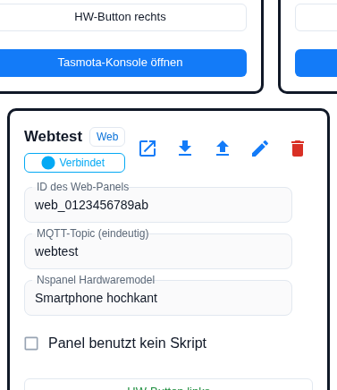

3. Enthält eine Seite des Panels eine PIN oder ein WLAN-Passwort, kommt die Rückfrage aus [Abschnitt 3](#3-pins-und-wlan-passwörter). Sonst schreibt der Admin die Datei sofort.
4. Der Browser lädt die Datei herunter. Der Name folgt dem Schema `nspanel-<Panelname>-<JJJJ-MM-TT>.json`, also zum Beispiel `nspanel-Wohnzimmer-2026-11-11.json`; Zeichen außer `A–Z`, `a–z`, `0–9`, `_` und `-` werden im Panelnamen zu `_`. Hat das Panel keinen Namen, tritt das Topic an dessen Stelle; fehlt auch das, heißt die Datei `nspanel-panel-<JJJJ-MM-TT>.json`.

Beide Knöpfe sind gesperrt, sobald dem Panel **eines von beiden** fehlt — ID oder Topic. Eine laufende Instanz braucht der Export nicht — mit einer Ausnahme: Die Panel-Einstellungen sind Datenpunkte, und was der Admin nicht lesen kann, lässt er aus der Datei weg.

Danach steht über den Kacheln eine Meldung:

| Meldung | Lage |
|---|---|
| *Panel-Konfiguration nach `<Datei>` exportiert (Seiten, Screensaver, Tasten und Panel-Einstellungen).* | Alles in Ordnung, keine Geheimnisse im Spiel. |
| *PINs und Passwörter wurden nicht exportiert, sie müssen nach einem Import auf diesen Seiten neu eingegeben werden: `<Seiten>`* | Export ohne Geheimnisse. |
| *Die Datei enthält PINs und Passwörter im Klartext – bitte sicher aufbewahren.* | Export mit Geheimnissen. |
| *Export der Panel-Konfiguration fehlgeschlagen: `<Grund>`* | Nichts geschrieben. |

## 3. PINs und WLAN-Passwörter

Die Rückfrage erscheint nur, wenn das Panel tatsächlich Seiten mit Geheimnissen zeigt: eine [Alarm- oder Entsperrseite](cardAlarm) mit eigener PIN oder eine [QR-Seite](cardQR) mit gefülltem WLAN-Passwort.

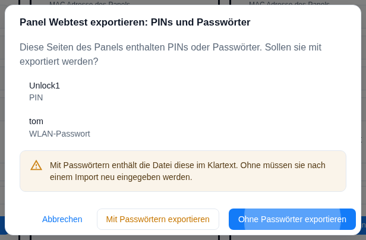

Der Dialog heißt **Panel `<Name>` exportieren: PINs und Passwörter** und sagt: *Diese Seiten des Panels enthalten PINs oder Passwörter. Sollen sie mit exportiert werden?* Darunter stehen die betroffenen Seiten mit dem jeweiligen Feld (**PIN** oder **WLAN-Passwort**) und der Hinweis *Mit Passwörtern enthält die Datei diese im Klartext. Ohne müssen sie nach einem Import neu eingegeben werden.*

| Knopf | Wirkung |
|---|---|
| **Ohne Passwörter exportieren** (Vorgabe) | Die Felder fehlen in der Datei — sie werden nicht etwa geleert, sondern weggelassen. |
| **Mit Passwörtern exportieren** | PIN und WLAN-Passwort stehen im Klartext in der Datei. |
| **Abbrechen** | Es wird nichts geschrieben. |

Eine PIN, die das **globale Passwort der Instanz** benutzt, ist kein Geheimnis: Auf der Seite steht dann kein eigener Wert, sondern nur der Verweis darauf. Diese PIN wandert immer mit, und sie löst die Rückfrage auch nicht aus. Dasselbe gilt für ein leeres WLAN-Passwort.

> **„Ohne Passwörter" heißt nicht „ohne Angaben".** Weggelassen werden genau zwei Felder: die eigene PIN einer Alarm-/Entsperrseite und das WLAN-Passwort einer QR-Seite. In der Datei bleiben unter anderem die SSID, URL oder Telefonnummer der QR-Seite, die Kennung zentral hinterlegter Zugangsdaten sowie **alle Datenpunkt-IDs und Alias-Pfade** der Anlage. Vor dem Weitergeben an Fremde lohnt ein Blick in die Datei.

Beim Import einer Datei ohne Geheimnisse bekommen **neu angelegte oder umbenannte** Seiten einen sicheren Ersatzwert: Alarm- und Entsperrseiten das globale Passwort der Instanz, QR-Seiten ein leeres WLAN-Passwort. **Vorhandene Seiten behalten ihre Geheimnisse** — auch dann, wenn sie durch den Inhalt der Datei ersetzt werden. Welche Seiten nachzutragen sind, steht in der Übersicht (*Der Import enthält keine PINs oder Passwörter. Geben Sie nach dem Import die Passwörter auf folgenden Seiten neu ein: …*) und noch einmal in der Zusammenfassung.

## 4. Importieren: die Teile wählen

Der Import-Knopf öffnet den Dialog **In Panel `<Name>` importieren**. Der erste Schritt fragt: *Welche Teile der Datei sollen importiert werden?* Alle drei Teile sind vorausgewählt.

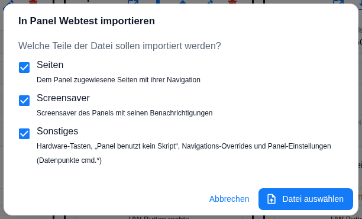

**Datei auswählen** öffnet den Dateidialog (Filter `.json`); solange kein Teil angehakt ist, bleibt der Knopf gesperrt. Danach prüft der Admin die Datei:

- Ist sie beschädigt, kein JSON oder keine Panel-Konfiguration dieses Adapters, steht die Fehlermeldung im selben Schritt und es geht nicht weiter — siehe [Abschnitt 12](#12-fehlerfälle).
- Fehlt ein **gewählter** Teil in der Datei, wird er übersprungen; oben erscheint *Nicht in der Datei, wird übersprungen: `<Teile>`*, und die Zusammenfassung nennt ihn noch einmal.
- Enthält die Datei zu den gewählten Teilen weder Seiten noch Screensaver, kommt die Meldung *Die Datei enthält für die gewählten Teile keine Seiten und keinen Screensaver.* — anders als die Fehler oben erscheint sie erst in der Übersicht, der Dialog geht also weiter.

Ist die Datei in Ordnung, öffnet sich die **Übersicht**. Bis hierhin und auch in der Übersicht wird nichts geändert.

## 5. Der Importmodus

In der Übersicht steht zuoberst die Herkunft der Datei, direkt darunter der Umschalter **Importmodus** mit zwei Stellungen.

| Modus | Was er tut |
|---|---|
| **Zusammenführen** (Vorgabe) | *Fügt die Admin-Seiten der Datei hinzu. Seiten des Panel-Skripts, Navigations-Overrides und „Panel benutzt kein Skript" bleiben unverändert.* |
| **Komplett überschreiben** | *Ersetzt alles Panel-eigene durch die Datei: eigene Seitenzuweisungen samt Navigation, Ausschlüsse, Navigations-Overrides; das Panel-Skript wird abgeschaltet. Seiten für „alle Panels" und Seiten des globalen Skripts bleiben.* |

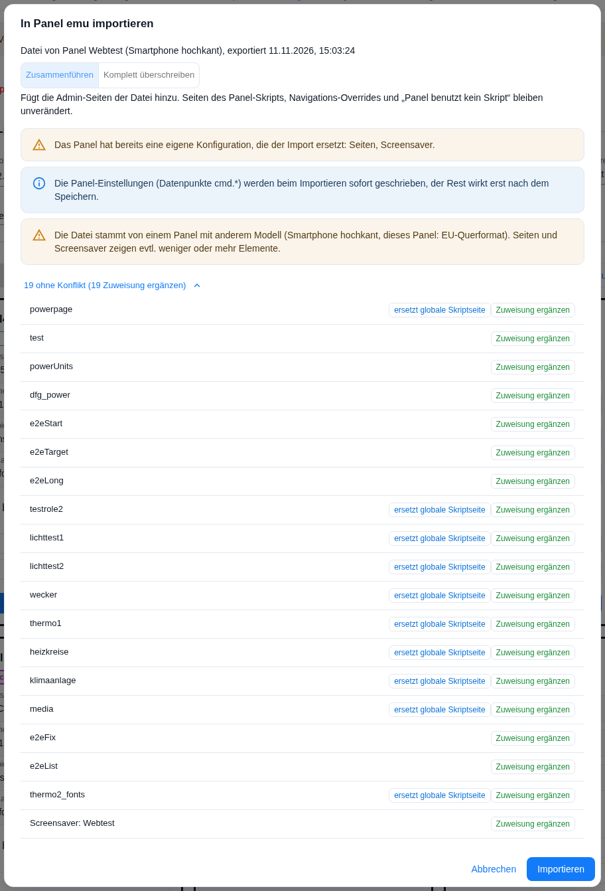

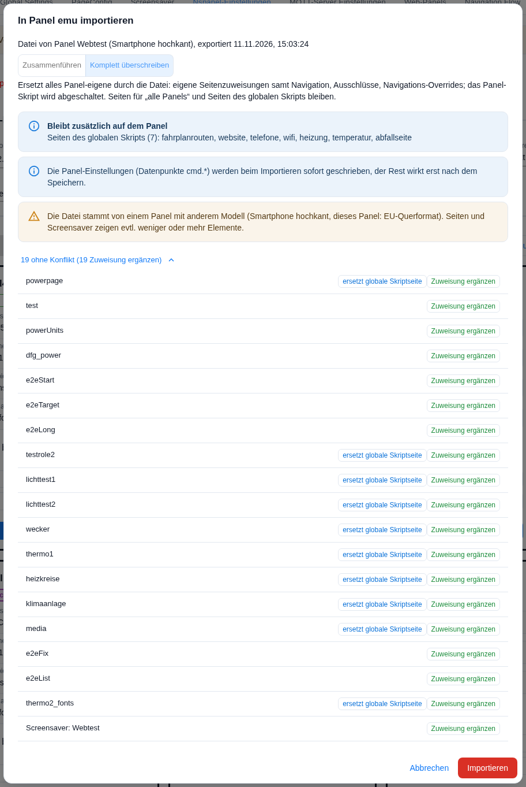

Gemeinsam ist beiden Modi zweierlei. Erstens werden die bisher **diesem Panel** zugewiesenen Admin-Seiten zuerst vom Panel **gelöst**. Die Seiten selbst bleiben erhalten und stehen weiter in der Seitenliste; sie sind nur nicht mehr diesem Panel zugeordnet. Anschließend kommen die Seiten der Datei auf das Panel. Zweitens gelten die **Ausblendungen** der Quelle: Seiten für „alle Panels", die das Quellpanel ausgeblendet hat, werden auch auf dem Ziel ausgeblendet — und eine Ausblendung, die es nur auf dem Ziel gab, wird aufgehoben. Das passiert in *beiden* Modi, nicht nur beim Überschreiben.

**Komplett überschreiben** geht darüber hinaus:

| Betroffen | Was passiert |
|---|---|
| Eigene Seiten des Panels | Alle alten Zuweisungen sind weg; auf dem Panel steht danach genau das, was die Datei mitbringt. |
| *(Ausgeblendete „alle Panels"-Seiten)* | Kein Unterschied zwischen den Modi — siehe den Absatz oben. |
| Seiten für „alle Panels" und Seiten des **globalen** Skripts | Bleiben mit ihrer Navigation auf dem Panel. Die Übersicht zählt sie unter **Bleibt zusätzlich auf dem Panel** auf; gibt es nichts, steht dort *nichts – das Panel zeigt nur die importierten Seiten*. |
| Das **Panel-Skript** | Wird abgeschaltet: der Haken `Panel benutzt kein Skript` wird gesetzt, die Seiten des Panel-Skripts verschwinden vom Panel. Die Skriptkonfiguration wird nicht gelöscht. |
| Navigations-Overrides des Panels | Werden gelöscht und durch die der Datei ersetzt. |
| Andere Panels | Ändern sich nicht. |

Der Modus ist **nur zusammen mit dem Teil „Seiten"** wählbar — und nur, wenn die **Datei** überhaupt Seiten mitbringt. Fehlt eines von beidem, ist der Knopf gesperrt und der Hinweis *„Komplett überschreiben" ist nur zusammen mit der Gruppe Seiten möglich.* steht daneben. Im Modus **Komplett überschreiben** ist auch der Knopf **Importieren** rot.

## 6. Die Übersicht

Über dem Umschalter steht die Herkunft der Datei (*Datei von Panel `<Name>` (`<Modell>`), exportiert `<Zeitpunkt>`*), unter ihm die Hinweise, die für diesen Import gelten:

| Hinweis | Wann |
|---|---|
| *Das Panel hat bereits eine eigene Konfiguration, die der Import ersetzt: `<Teile>`.* | **Nur im Modus Zusammenführen**, und nur für die Teile, die beim Ziel wirklich konfiguriert sind **und** die der Import tatsächlich verändert. Eine unveränderte Sicherung, die ins selbe Panel zurückgeht, löst den Hinweis nicht aus. Bei *Komplett überschreiben* übernimmt diese Aufgabe die Sicherheitsabfrage. |
| *Die Datei stammt von einem Panel mit anderem Modell (…, dieses Panel: …). Seiten und Screensaver zeigen evtl. weniger oder mehr Elemente.* | Das Modell der Quelle passt nicht zum Ziel. Der Import wird nicht blockiert. |
| *Der Import enthält keine PINs oder Passwörter. …* | Es gibt Seiten, die ein Geheimnis bräuchten und keines bekommen — also neu angelegte oder umbenannte Seiten, und ersetzte Seiten ohne vorhandenen Wert. Eine geheimnisfreie Sicherung, die ins selbe Panel zurückgeht, zeigt den Hinweis **nicht**, weil dort jede Seite ihren Wert behält. |
| *Die Panel-Einstellungen (Datenpunkte `cmd.*`) werden beim Importieren sofort geschrieben, der Rest wirkt erst nach dem Speichern.* | Der Teil **Sonstiges** ist dabei. |
| *Diese Seiten heißen wie Seiten des Panel-Skripts. Das Skript hat Vorrang, die importierten Seiten erscheinen auf diesem Panel nicht: `<Seiten>`* | Siehe [Abschnitt 8](#8-seiten-die-auch-in-einem-skript-vorkommen). |

Darunter steht jede Seite der Datei — und, falls mitimportiert, der Screensaver — mit ihrem Status. Seiten ohne Konflikt sind zugeklappt (**`n` ohne Konflikt**, darunter die Zählung, etwa *20 unverändert, 3 Zuweisung ergänzen*); ein Klick zeigt sie.

| Status | Bedeutung |
|---|---|
| **unverändert** | Die Seite liegt schon genau so auf dem Panel — es passiert nichts. |
| **Zuweisung ergänzen** | Die Seite gibt es schon mit gleichem Inhalt, sie wird zusätzlich diesem Panel zugeordnet. |
| **Navigation ändern** | Die Seite ist schon auf dem Panel, bekommt aber die Navigation aus der Datei. |
| **Zuweisung entfernen** | Die Seite stand in der Datei nur als Ziel einer Verknüpfung, nicht als eigene Seite des Quellpanels. Sie wird auf dem Ziel ebenfalls nicht zugewiesen. |
| **neu anlegen** | Die Seite gibt es noch nicht. Kam sie nur als Ziel einer Verknüpfung mit, wird sie zwar angelegt, aber **keinem Panel zugewiesen** — sie steht dann in der Seitenliste und wird über die Verknüpfung erreicht. |
| **unterschiedlich** | Es gibt schon eine Seite mit diesem Namen, aber mit anderem Inhalt — siehe [Abschnitt 7](#7-namenskonflikte). |
| **überspringen** | Diese Seite der Datei wird nicht übernommen (nur als gewählte Auflösung eines Konflikts). |

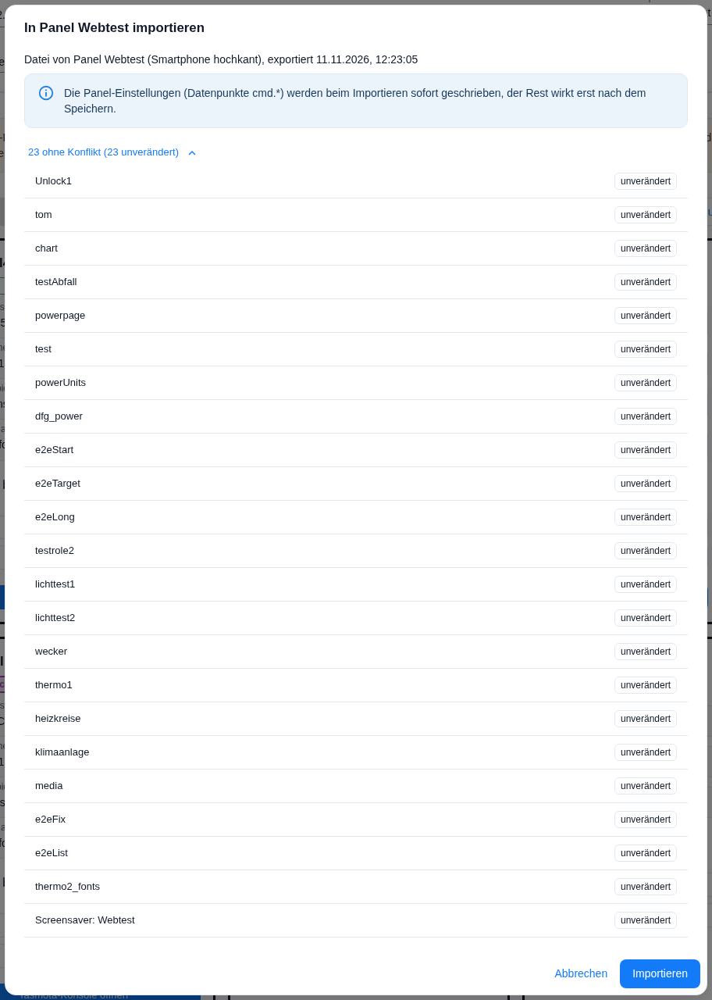

Im häufigsten Fall — Sicherung ins selbe Panel zurück oder Import in ein leeres Panel — gibt es nichts zu entscheiden: **Importieren** drücken genügt.

## 7. Namenskonflikte

Ein Konflikt entsteht, wenn in der Instanz schon eine Seite mit demselben Namen liegt, deren Inhalt von der Datei abweicht. Der Status heißt dann **unterschiedlich** und die Spalte **Aktion** bietet drei Auflösungen:

| Auflösung | Wirkung |
|---|---|
| **umbenennen** (Vorgabe) | Die Seite aus der Datei wird unter einem neuen Namen angelegt; die vorhandene Seite behält ihren Inhalt. **Eine Ausnahme:** Ist die vorhandene Seite eine Seite für „alle Panels", wird sie auf diesem Panel **ausgeblendet** — sonst wären nach dem Import beide zu sehen. Die Zusammenfassung führt sie dann unter *Seiten für alle Panels auf diesem Panel ausgeblendet*. |
| **vorhandene ersetzen** | Die vorhandene Seite bekommt den Inhalt aus der Datei. |
| **überspringen** | Die Seite aus der Datei wird nicht übernommen. |

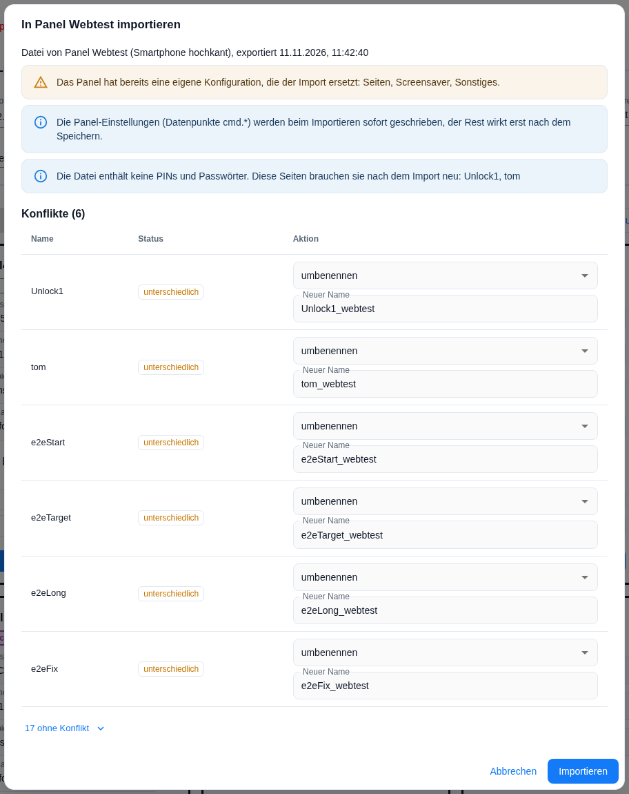

**Der Namensvorschlag** lautet `<Originalname>_<Topic>`, wobei nur der letzte Abschnitt des Ziel-Topics genommen und auf `A–Z`, `a–z`, `0–9`, `_` und `-` reduziert wird — aus `e2eLong` wird auf dem Panel mit dem Topic `nspanel/webtest` also `e2eLong_webtest`. Ist auch der vergeben, hängt der Admin `_2`, `_3` … an. Das Feld **Neuer Name** lässt sich frei überschreiben, wird aber geprüft:

| Meldung | Grund |
|---|---|
| *Name ohne Leerzeichen am Anfang/Ende eingeben* | Leer oder Leerzeichen am Rand. |
| *„main" ist für die Startseite reserviert* | `main` ist der feste Name der Startseite. |
| *Namen mit /// am Anfang sind reserviert* | Interne Ziele beginnen mit `///`. |
| *Dieser Name kommt in diesem Import zweimal vor* | Zwei Zeilen desselben Imports tragen denselben Namen. |
| *Eine Seite bzw. ein Screensaver mit diesem Namen existiert bereits* | Der Name ist in der Instanz schon vergeben. |

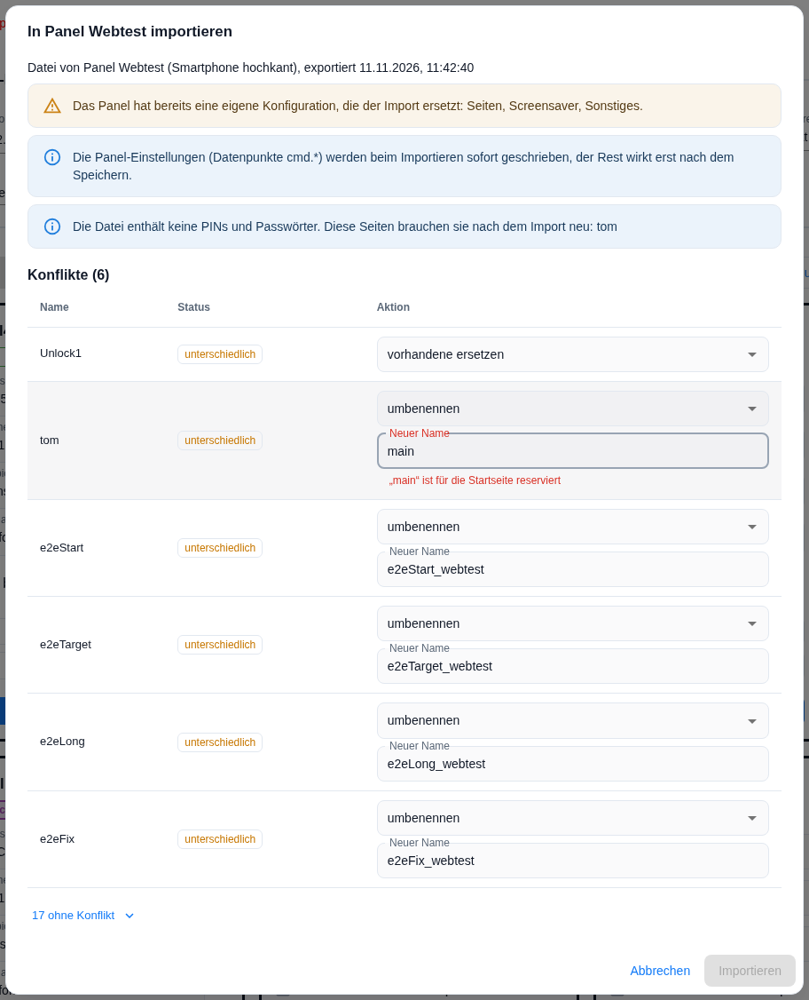

Solange ein Name ungültig ist, bleibt **Importieren** gesperrt.

**Der Blick in die Unterschiede.** Ein Klick auf den Status **unterschiedlich** öffnet den Dialog **Unterschiede: `<Seite>`** mit drei Spalten — *Was*, *Vorhanden*, *In der Datei*. Felder stehen mit ihrer Bezeichnung aus dem Editor da (*Überschrift*, *Navigation: zurück*), Listenelemente als *Element #3* mit dem Elementnamen in Klammern, falls er gesetzt ist. Ein leerer Feldwert erscheint als `–`. Die Wörter *fehlt*, *vorhanden* und *hinzugefügt* gelten dagegen ganzen Elementen: *fehlt*, wenn die Datei ein vorhandenes Element nicht hat, *vorhanden* für die Gegenseite, *hinzugefügt* für ein Element, das nur die Datei mitbringt. Felder einer Liste werden **der Reihe nach** verglichen — ein vorn eingefügtes Element lässt deshalb alle folgenden als geändert erscheinen.

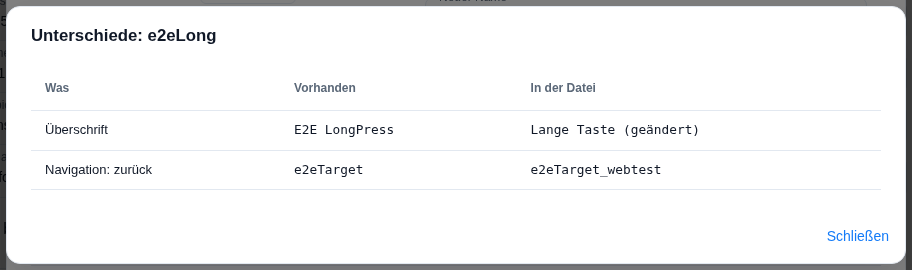

**Umbenennungen ziehen Kreise.** Wird eine Seite umbenannt, zieht der Admin den neuen Namen in allen Verweisen der importierten Daten nach: Navigation (*zurück*, *weiter*, *hoch*, *Home*), Zielseiten von Verknüpfungen und Elementen, die Seite nach dem Entsperren, Screensaver-Aktionen, die Ziele der Hardware-Tasten und der Navigationspunkt der Startseite. Seiten, die auf eine umbenannte Seite verweisen, werden dadurch selbst **unterschiedlich** — der Unterschiedsdialog sagt in diesem Fall *Nur Verweise auf umbenannte Seiten unterscheiden sich.* Das wiederholt sich, bis sich nichts mehr ändert; auch ein von Hand gewählter Name wird so weitergereicht.

**Ersetzen fragt nach.** Nutzt die vorhandene Seite auch andere Panels, fragt der Admin mit **`<Seite>` ersetzen?** noch einmal nach: *Das vorhandene `<Seite>` wird mit dem Inhalt der Datei überschrieben.* Darunter steht *Diese Panels nutzen es ebenfalls und ändern sich mit:* mit der Liste (eine Seite für „alle Panels" erscheint darin als **alle Panels**) oder *Kein anderes Panel nutzt es.* Vorausgewählt ist **Abbrechen**.

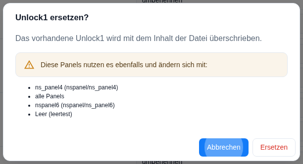

**Der Screensaver spielt dasselbe Spiel.** Er steht in derselben Tabelle wie die Seiten und kennt dieselben drei Auflösungen, samt Namensfeld, Rückfrage und Unterschiedsdialog (Titel *Screensaver: `<Name>`*). Vier Abweichungen lohnen die Kenntnis:

- **Gleich ist gleich, auch unter anderem Namen.** Findet der Admin einen vorhandenen Screensaver mit gleichem Inhalt, aber anderem Namen, gilt der Import als *unverändert* und das Panel bekommt den vorhandenen Eintrag — die Übersicht zeigt dann dessen Namen, nicht den aus der Datei.
- **Verglichen wird ohne Name und Panelzuweisung**, dafür mit aufgelösten Benachrichtigungen.
- **„vorhandene ersetzen" behält den vorhandenen Namen**, nicht den der Datei.
- **Die Namensprüfung ist kürzer:** beim Screensaver werden nur *leer* und *existiert bereits* geprüft, die übrigen drei Regeln aus der Tabelle oben gelten hier nicht.

## 8. Seiten, die auch in einem Skript vorkommen

Heißt eine Seite der Datei wie eine Seite aus einem Skript, steht neben dem Status ein zweiter Hinweis. Das ist kein Konflikt im obigen Sinn — Skriptseiten und Admin-Seiten liegen an verschiedenen Orten —, sondern eine Frage, welche der beiden das Panel zeigt.

| Hinweis | Bedeutung |
|---|---|
| **ersetzt globale Skriptseite** | Das globale Skript hat eine Seite dieses Namens. Auf diesem Panel zeigt sich die importierte Admin-Seite; andere Panels sehen weiter die Skriptseite. |
| **ersetzt Skriptseite des Panels** | Die Admin-Seite tritt an die Stelle der gleichnamigen Seite des Panel-Skripts. Das gilt immer für die **Startseite**; für alle übrigen Seiten nur, wenn die Instanzoption `adminOverridesScriptPages` gesetzt ist (Vorgabe: aus, ohne eigenes Feld im Admin). |
| **Skriptseite des Panels hat Vorrang** | Das Panel-Skript hat eine Seite dieses Namens und behält sie; die importierte Seite erscheint auf diesem Panel nicht. Abhilfe: umbenennen oder **Komplett überschreiben**. |

Die Hinweise gibt es nur im Modus **Zusammenführen** und nur, solange das Panel überhaupt ein Skript benutzt. Bei **Komplett überschreiben** ist das Panel-Skript danach aus, es bleibt nur *ersetzt globale Skriptseite*.

Kann der Admin die Skriptkonfiguration **nicht lesen**, erscheint der Satz *Skriptseiten unbekannt (Skriptkonfiguration nicht lesbar).* — allerdings nur im Block *Bleibt zusätzlich auf dem Panel* und in der Sicherheitsabfrage, also ausschließlich bei **Komplett überschreiben**. Im Modus *Zusammenführen* fehlen die Skript-Hinweise dann **ersatzlos**; einen Platzhalter gibt es dort nicht. Erst die Zusammenfassung sagt es wieder, mit dem Zusatz *Skriptseiten unbekannt – Ziele können auch Skriptseiten sein.* an den toten Navigationsverweisen.

## 9. Die Sicherheitsabfrage bei „Komplett überschreiben"

Vor dem Überschreiben kommt die Abfrage **`<Panel>` komplett überschreiben?** mit dem Satz *Die bisherige Konfiguration dieses Panels wird durch die Datei ersetzt.* und vier Blöcken:

| Block | Inhalt |
|---|---|
| Seiten | *`n` eigene Seiten werden von diesem Panel entfernt (die Seiten selbst bleiben erhalten)* — die Liste lässt sich aufklappen. Sonst: *Es werden keine eigenen Seiten von diesem Panel entfernt.* |
| Skript | *Das Panel-Skript wird abgeschaltet („Panel benutzt kein Skript"). Diese `n` Skriptseiten verschwinden vom Panel:* mit Namen. Hat das Panel schon kein Skript: *Das Panel benutzt bereits kein Skript.* |
| Navigations-Overrides | *`n` Navigations-Overrides dieses Panels werden gelöscht: …* und *Aus der Datei kommen `n` Navigations-Overrides: …*, sonst *Das Panel hat keine Navigations-Overrides.* |
| **Bleibt zusätzlich auf dem Panel** | *Seiten für alle Panels (`n`)* und *Seiten des globalen Skripts (`n`)*. |

Dazu der Satz *Seiten für „alle Panels" und Seiten des globalen Skripts bleiben auf diesem Panel unverändert, mit ihrer Navigation. Andere Panels sind nicht betroffen.* Vorausgewählt ist **Abbrechen**; der rote Knopf heißt **Komplett überschreiben**.

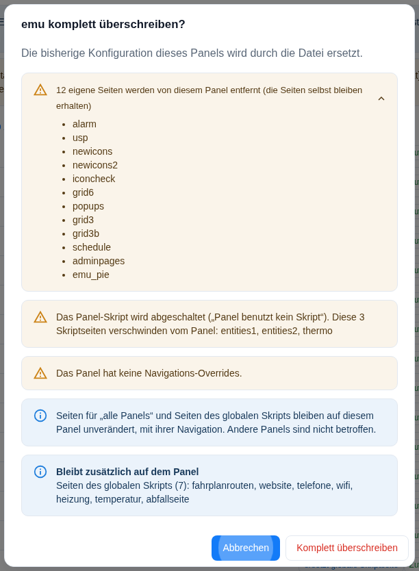

## 10. Die Zusammenfassung

Nach dem Import zeigt der Dialog **Import in Panel `<Name>`: Ergebnis**. Jede Rubrik erscheint nur, wenn sie etwas zu melden hat:

| Rubrik | Inhalt |
|---|---|
| *Das Panel-Skript wurde abgeschaltet („Panel benutzt kein Skript").* | Nur nach **Komplett überschreiben**. |
| *Navigation zeigt auf Seiten, die nicht auf diesem Panel sind (`n`)* | Je Treffer `<Seite> – <Richtung> → <Ziel>`, Einträge aus einem Override mit dem Zusatz *(Override)*. Dazu *Nicht automatisch korrigiert – bitte die Navigation dieser Seiten prüfen.* War die Skriptkonfiguration nicht lesbar, steht dahinter *Skriptseiten unbekannt – Ziele können auch Skriptseiten sein.* |
| *Bitte PIN / Passwort auf diesen Seiten neu eingeben:* | Seiten mit Ersatzwert, siehe [Abschnitt 3](#3-pins-und-wlan-passwörter). |
| *Neu angelegt* · *Umbenannt* (`alt → neu`) · *Ersetzt* · *Übersprungen* · *Unverändert* · *Zuweisung bzw. Navigation vorhandener Seiten geändert* | Die Bilanz der Seiten. |
| *Neue Startseite des Panels* · *Nicht mehr Startseite dieses Panels, andere Panels behalten sie* | Startseite. |
| *Seiten für alle Panels auf diesem Panel ausgeblendet* | Ausblendungen. |
| *Screensaver* | Name und Aktion. Bringt die Datei **keinen** Screensaver aus dem Admin mit, steht hier *keiner (das Quellpanel hat keinen Screensaver aus dem Admin)* — und das ist mehr als eine Auskunft, siehe den Hinweis unter der Tabelle. |
| *Benachrichtigungen mit neuer ID angelegt* | Benachrichtigungen des Screensavers, deren ID schon vergeben war. |
| *Navigations-Overrides gelöscht* · *Navigations-Overrides übernommen* | Nur nach **Komplett überschreiben**. |
| *Panel-Einstellungen geschrieben* · *Panel-Einstellungen nicht geschrieben, Datenpunkt existiert noch nicht* | Der Teil **Sonstiges**. Gezählt werden nur Einstellungen, die sich wirklich geändert haben — steht der Zielwert schon da, wird nichts geschrieben und nichts gemeldet. |
| *Nicht in der Datei* | Teile, die gewählt waren, aber fehlten. |

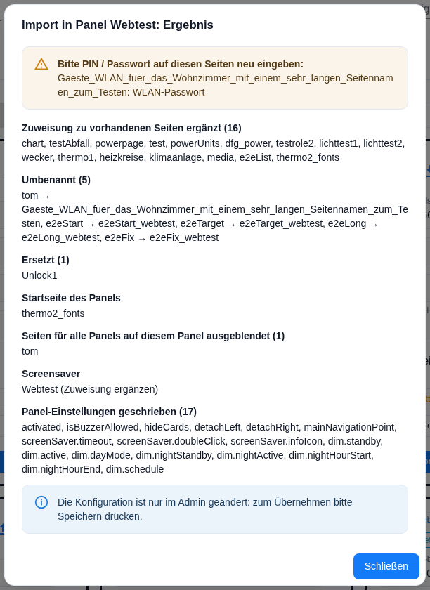

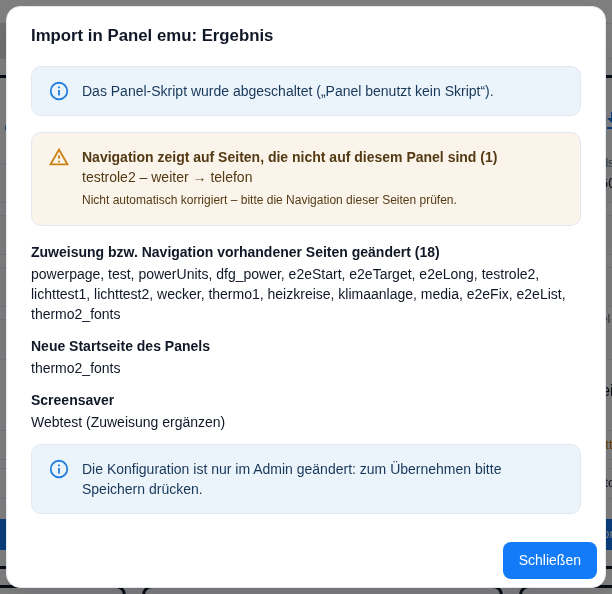

> **Eine Datei ohne Admin-Screensaver nimmt dem Ziel seinen.** Ist der Teil *Screensaver* gewählt und bringt die Datei keinen mit, wird das Ziel-Panel aus **allen** Screensaver-Einträgen gestrichen — es hat danach keinen. Die Übersicht zeigt dafür **keine** eigene Zeile; sichtbar wird es erst hier in der Zusammenfassung. Wer das nicht will, nimmt den Haken bei *Screensaver* heraus. Das gilt in beiden Importmodi.

Die Rubrik **Navigation zeigt auf Seiten, die nicht auf diesem Panel sind** verdient einen zweiten Blick: Der Admin korrigiert solche Verweise nicht, das Panel läuft dann in eine leere Richtung. Mehr zum Zusammenspiel der Verweise steht unter [Navigation Flow](naviFlow).

## 11. Wann die Änderungen wirken

| Was | Wann |
|---|---|
| Seiten, Screensaver, Benachrichtigungen, Hardware-Tasten, Navigation, `Panel benutzt kein Skript`, Navigations-Overrides | Erst mit dem **Speichern** der Instanz-Einstellungen. Bis dahin steht alles nur im Admin. |
| Panel-Einstellungen (Datenpunkte `cmd.*`) | **Sofort beim Importieren.** Sie sind Datenpunkte, kein Teil der Instanz-Konfiguration. |

Der Dialog sagt das vorher (*Die Panel-Einstellungen (Datenpunkte `cmd.*`) werden beim Importieren sofort geschrieben, der Rest wirkt erst nach dem Speichern.*) und am Ende noch einmal: *Die Konfiguration ist nur im Admin geändert: zum Übernehmen bitte Speichern drücken.*

Zwei Panel-Einstellungen lässt der Import bewusst aus, wenn das Ziel einen Screensaver aus dem Admin hat: **Layout** und **Wechselzeit** des Screensavers. Beide schreibt der Adapter ohnehin aus dem Screensaver-Eintrag. Einstellungen, deren Datenpunkt noch gar nicht existiert — etwa bei einem Panel, das noch nie gelaufen ist —, werden übersprungen und in der Zusammenfassung genannt.

## 12. Fehlerfälle

| Meldung | Lage |
|---|---|
| *Die Datei ist kein gültiges JSON: `<Grund>`* | Die Datei ließ sich nicht lesen. |
| *Die Datei ist kein Panel-Konfigurationsexport dieses Adapters.* | Die Formatkennung fehlt — etwa bei einem Adapter-Backup oder einer fremden Datei. |
| *Die Datei ist beschädigt oder unvollständig (bei `<Stelle>`).* | Die Struktur stimmt nicht; die Stelle nennt den Pfad, an dem die Prüfung gescheitert ist. |
| *Die Datei stammt von einem neueren Adapter (Formatversion `n`), bitte den Adapter aktualisieren.* | Die Datei ist jünger als der Adapter, der sie lesen soll. |
| *Die Datei ist beschädigt oder unvollständig (bei `version`).* | Die Formatversion fehlt, ist keine ganze Zahl oder kleiner als 1. Eine zu **neue** Version bekommt die eigene Meldung darüber. |

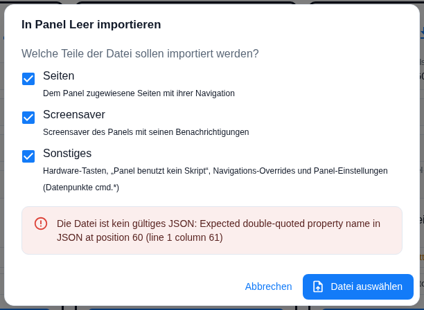

Die Stelle in Klammern ist der Pfad, an dem die Prüfung gescheitert ist — `(bei source)`, `(bei groups)` oder, wenn zwei Seiten der Datei denselben Namen tragen, `(bei groups.pages.pages[3].page.uniqueName)`.

> **Die Adapterversion in der Datei wird nicht geprüft.** Sie steht im Kopf, dient aber nur der Nachvollziehbarkeit: Es gibt weder eine Warnung noch eine Umrechnung, wenn die Datei aus einer älteren oder neueren Adapterversion stammt. Geprüft wird ausschließlich die **Formatversion** (derzeit 1).

Kein Fehler, nur eine Warnung ist die **Modell-Abweichung**: Stammt die Datei von einem Panel mit anderem Modell — etwa EU-Querformat gegen Smartphone hochkant —, passen nicht immer gleich viele Elemente auf eine Seite oder in den Screensaver. Der Import läuft trotzdem; die Seiten gehören danach durchgesehen. **Gekürzt oder umgerechnet wird nichts** — zu viele Elemente bleiben in der Konfiguration stehen und fehlen nur auf dem Panel. Verglichen wird dabei allein das Modell: ob die Datei von einem echten Gerät oder einem Web-Panel stammt, prüft der Admin **nicht**.

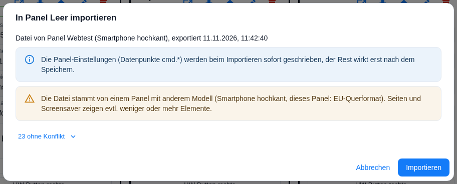

## Fallstricke

- **Der Export nimmt den Stand, der gerade im Admin steht** — einschließlich ungespeicherter Änderungen. Wer den gespeicherten Stand sichern will, speichert vorher oder lädt die Seite neu.
- **Nach dem Import speichern.** Außer den Panel-Einstellungen wirkt nichts von allein. Wer den Admin ohne Speichern verlässt, hat nichts importiert — aber die Panel-Einstellungen sind trotzdem schon geschrieben.
- **Gelöst ist nicht gelöscht.** Seiten des Ziel-Panels, die nicht in der Datei stehen, verlieren nur ihre Zuweisung zu diesem Panel. Sie bleiben in der Seitenliste und belegen weiter ihren Namen — ein späterer Import derselben Namen führt deshalb zu Konflikten.
- **„vorhandene ersetzen" wirkt über das Panel hinaus.** Alle anderen Auflösungen betreffen nur das Ziel-Panel; das Ersetzen ändert die Seite selbst und damit jedes Panel, das sie zeigt. Darum die Rückfrage mit der Liste.
- **Ein ersetzter Eintrag behält seine PIN.** Enthielt die Datei keine Geheimnisse, bleibt die PIN der vorhandenen Seite stehen — auch wenn der Rest der Seite aus der Datei kommt. Neu angelegte Seiten bekommen dagegen das globale Passwort der Instanz.
- **Komplett überschreiben löscht die Navigations-Overrides auch ohne den Teil „Sonstiges".** Ist der Teil abgewählt, werden die Overrides des Ziels entfernt und es kommen keine neuen nach.
- **Nach „Komplett überschreiben" ist der Haken `Panel benutzt kein Skript` gesetzt.** Wer das Panel-Skript zurückhaben will, entfernt den Haken in der Panelkachel und speichert; die Skriptkonfiguration ist nicht gelöscht (siehe [Migration](Migration)).
- **„Zusammenführen" ignoriert `Panel benutzt kein Skript` und die Overrides aus der Datei.** Beides steht zwar im Teil **Sonstiges**, wird in diesem Modus aber nicht angewendet — das Ziel behält seinen eigenen Stand.
- **Tote Navigationsverweise bleiben stehen.** Die Zusammenfassung zählt sie auf, korrigiert sie aber nicht.
- **Umbenennen erzeugt Folgekonflikte.** Eine umbenannte Seite ändert alle Seiten, die auf sie verweisen; die erscheinen dann ebenfalls als *unterschiedlich*. Das ist normal — der Unterschiedsdialog sagt es.
- **Ein anderes Modell ist kein Hinderungsgrund, aber eine Prüfbitte.** Der Import läuft durch; ob alle Elemente auf die Seite passen, entscheidet sich erst auf dem Panel.
- **Es gibt kein Rückgängig.** Der Ergebnis-Schritt kennt nur *Schließen*. Die einzige Rücknahme ist, die Instanz-Einstellungen **nicht** zu speichern — die Panel-Einstellungen (`cmd.*`) sind dann aber schon geschrieben.
- **Einzelne Seiten lassen sich nicht abwählen.** Konfliktfreie Zeilen sind reine Anzeige. Wer nur einen Teil übernehmen will, hat zwei Hebel: die drei Teile im ersten Schritt und *überspringen* bei Konfliktzeilen.
- **„Alle Panels" überlebt den Weg in eine andere Installation nicht.** Der Export merkt sich nur, *dass* eine Seite für alle Panels galt; der Import weist sie immer dem Ziel-Panel zu. In derselben Installation fällt das nicht auf, weil die Seite dort schon existiert — in einer fremden Installation wird aus der Seite für alle Panels eine Seite dieses einen Panels.
- **Die Hardware-Tasten ändern sich still.** Sie wandern mit und werden beim Ziel **gelöscht**, wenn die Datei keine Tastenbelegung enthält. Die Zusammenfassung sagt dazu nichts — nach einem Import also die Kachel prüfen.
- **Tote Verweise werden nur in der Navigation gesucht.** Geprüft werden *zurück*, *weiter*, *hoch* und *Home* der Seiten und der Overrides. Zielseiten von Elementen, die Seite nach dem Entsperren, Screensaver-Aktionen und Tastenziele zählt die Zusammenfassung **nicht** mit, obwohl auch sie ins Leere zeigen können.
- **Es wird nicht geprüft, ob die Datenpunkte der Seiten auf diesem System existieren.** Beim Übertragen in eine andere Installation importiert der Admin Seiten mit unbekannten Objekt-IDs anstandslos; auffallen tut es erst, wenn der Adapter die Seite aufbaut.
