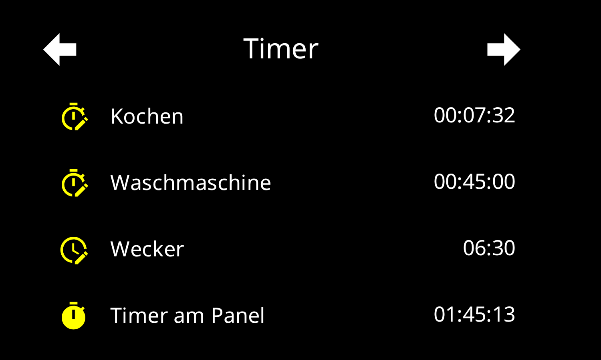
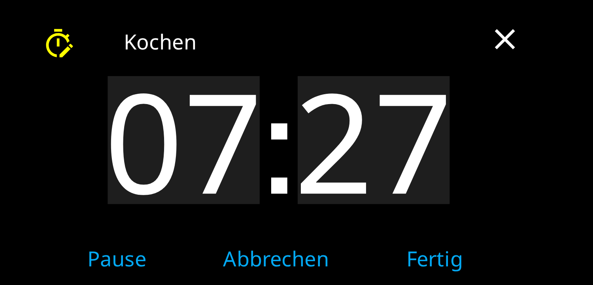
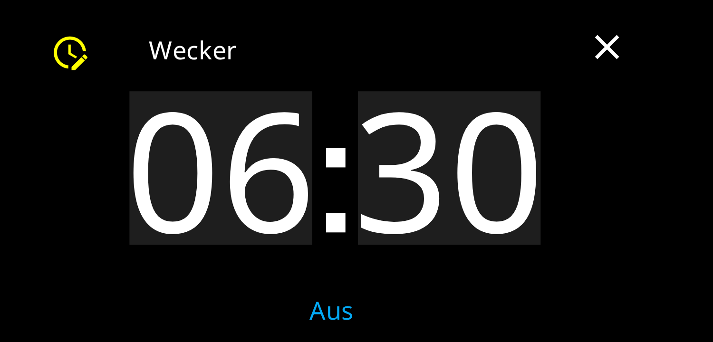
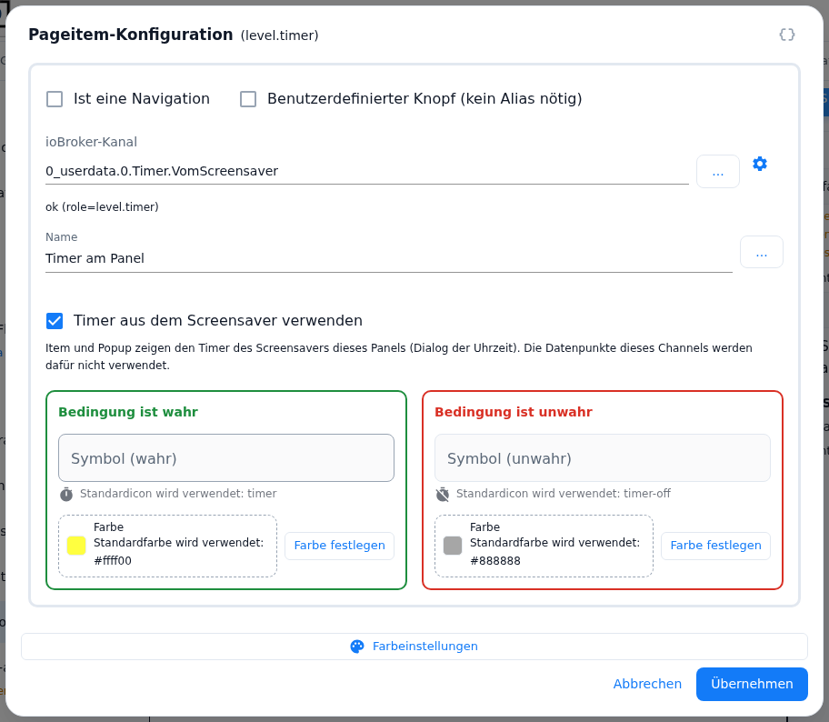

# Timer-Popup

Diese Seite erklärt Timer am Panel: zuerst in Alltagssprache, was ein Timer ist und welche Art man wofür nimmt, dann drei Anleitungen Schritt für Schritt. Ab [Nachschlagen](#nachschlagen) folgen die Einzelheiten – Datenpunkte, Tasten, Grenzen.

Inhalt:
- [Was ist ein Timer am Panel?](#was-ist-ein-timer-am-panel)
- [Welche Art brauche ich?](#welche-art-brauche-ich)
- [Schnellstart: Eieruhr (interner Timer)](#schnellstart-eieruhr-interner-timer)
- [Schnellstart: Alexa-Timer als Pageitem](#schnellstart-alexa-timer-als-pageitem)
- [Schnellstart: Restzeit im Bildschirmschoner anzeigen](#schnellstart-restzeit-im-bildschirmschoner-anzeigen)
- [Nachschlagen](#nachschlagen)
  - [1. Betriebsarten](#1-betriebsarten)
  - [2. Datenpunkte](#2-datenpunkte)
  - [3. Tasten](#3-tasten)
  - [4. Den internen Timer von außen steuern](#4-den-internen-timer-von-außen-steuern)
  - [5. Timer aus dem Screensaver verwenden](#5-timer-aus-dem-screensaver-verwenden)
  - [6. Anzeige und Grenzen](#6-anzeige-und-grenzen)
  - [7. Alexa-Timer (alexa2)](#7-alexa-timer-alexa2)
- [Fallstricke](#fallstricke)

## Was ist ein Timer am Panel?

Ein Timer ist ein **Eintrag auf einer Seite**, der eine Restzeit zeigt – zum Beispiel *Eieruhr 00:04:30*. Ein Tipp darauf öffnet das **Timer-Popup**: zwei Felder für Minuten und Sekunden und bis zu drei Tasten wie **Start**, **Pause**, **Abbrechen** oder **Fertig**. Damit stellt man die Zeit ein, startet und stoppt den Timer.

Ist die Zeit um, zeigt der Eintrag `00:00:00`, bis man **Fertig** drückt. Ein Skript kann darauf reagieren, etwa einen Ton abspielen.

Zusätzlich kann der **Bildschirmschoner** statt der Uhrzeit die Restzeit zeigen, in Orange, und abgelaufen in Rot. Das stellt man im Bildschirmschoner ein, siehe [Timer statt Uhrzeit](screensaver#timer-statt-uhrzeit).

Zwei Wörter kommen auf dieser Seite immer wieder vor:

| Begriff | Bedeutung |
|---|---|
| **Kanal** | Ein Objekt in ioBroker, das zusammengehörige Datenpunkte bündelt. Seine **Rolle** (`common.role`) sagt dem Adapter, was es ist – für einen Timer `level.timer`. Meist legt man dafür einen Alias an, siehe [Alias-Tabelle](ALIAS#leveltimer). |
| **Pageitem** | Ein Eintrag auf einer Seite des Panels, angelegt im Tab PageConfig über die [Pageitem-Konfiguration](PageConfig-Dialoge#1-pageitem-konfiguration). |

## Welche Art brauche ich?

Alle Arten sehen am Panel gleich aus. Sie unterscheiden sich darin, **wer die Zeit zählt** und was man im Admin anlegen muss:

| Ich möchte … | nimm … | wer zählt | was ich im Admin anlege | typisches Beispiel |
|---|---|---|---|---|
| am Panel eine Zeit einstellen und ablaufen lassen | **Intern** | der Adapter | einen Kanal mit der Rolle `level.timer` – Datenpunkte braucht er keine | Eieruhr in der Küche |
| die Restzeit zeigen, die ein eigenes Skript oder ein anderer Adapter zählt | **Extern** | das Skript | einen Kanal `level.timer` mit `ACTUAL` (Restzeit in Sekunden), dazu `STATUS` und `SET`, damit es Tasten gibt | Restzeit der Waschmaschine |
| eine feste Weckzeit zeigen und an- und ausschalten | **Wecker** | niemand, es ist eine Uhrzeit | einen Kanal `level.timer` mit `ACTUAL` der Rolle `date`, dazu `SET` und `STATUS` | Wecker um 6:30 |
| die Timer eines Echo-Geräts zeigen, starten und stoppen | **Alexa-Timer** | das Echo-Gerät | keinen Kanal: im Item-Dialog die Art **Alexa-Timer** und das Echo-Gerät wählen | *„Alexa, stelle einen Timer auf 10 Minuten“* und die Zeit am Panel sehen |
| auf einer Seite denselben Timer zeigen wie der Bildschirmschoner | **Vom Screensaver** | wie beim Bildschirmschoner | einen Kanal `level.timer` und das Häkchen **Timer aus dem Screensaver verwenden** | Bildschirmschoner zeigt die Restzeit, die Seite hat Start und Stopp dazu |

Wer unsicher ist: Für eine einfache Eieruhr reicht **Intern**. Die genauen Erkennungsregeln stehen unter [Betriebsarten](#1-betriebsarten).

## Schnellstart: Eieruhr (interner Timer)

1. **Kanal anlegen.** Im Tab **Objekte** von ioBroker unter `0_userdata.0` (oder unter `alias.0`) ein Objekt vom Typ **Kanal** anlegen, z. B. `0_userdata.0.Eieruhr`, und in seinen Eigenschaften die Rolle `level.timer` eintragen. Datenpunkte darunter sind nicht nötig. – *Ergebnis: ein leerer Kanal, den der Adapter als Timer erkennt.*
2. **Pageitem anlegen.** Im Tab **PageConfig** eine Seite mit Pageitems öffnen (z. B. eine cardEntities oder cardGrid) und auf einen freien Platz klicken. – *Ergebnis: die Pageitem-Konfiguration ist offen.*
3. **Kanal wählen.** Bei **Art des Items** bleibt **Standard** stehen. Im Feld **ioBroker-Kanal** den Kanal `0_userdata.0.Eieruhr` wählen. – *Ergebnis: neben dem Titel steht `(level.timer)`.*
4. **Name eintragen** (optional), z. B. *Eieruhr*. Ohne Namen nimmt der Adapter den Namen des Kanals, zuletzt *Timer*. – *Ergebnis: so heißt der Eintrag in der Liste und im Popup.*
5. **Übernehmen** und danach im Tab **Speichern**. – *Ergebnis: der Adapter startet neu, die Seite zeigt den Eintrag mit `00:00:00`.*
6. **Am Panel ausprobieren:** auf den Eintrag tippen, im Popup 5 Minuten einstellen, **Start**. – *Ergebnis: die Zeit läuft rückwärts; bei 0 bleibt `00:00:00` stehen, bis **Fertig** gedrückt wird.*

Soll ein Skript vom Ablauf erfahren, legt man im Kanal zusätzlich `STATE` an (`boolean`, Rolle `button`, beschreibbar): Er wird `true`, wenn die Zeit abläuft und wenn **Fertig** gedrückt wird.

## Schnellstart: Alexa-Timer als Pageitem

Voraussetzung: der Adapter alexa2 läuft, und in seiner Instanz ist die Option **Fragen Sie die Aktivität bei Geräteinteraktion automatisch ab** eingeschaltet (warum, steht in [Abschnitt 7](#7-alexa-timer-alexa2)).

1. Im Tab **PageConfig** eine Seite mit Pageitems öffnen und auf einen freien Platz klicken. – *Ergebnis: die Pageitem-Konfiguration ist offen.*
2. Oben bei **Art des Items** **Alexa-Timer** wählen. – *Ergebnis: statt des Kanalfelds stehen dort **alexa2-Instanz** und **Echo-Gerät**.*
3. Die **alexa2-Instanz** und das **Echo-Gerät** wählen. Angeboten werden nur Geräte, die Timer können. – *Ergebnis: Steht keine Warnung darunter, ist alles bereit.*
4. **Name** eintragen (optional), z. B. *Küche*. – *Ergebnis: so heißt der Eintrag; ohne Namen *Timer*.*
5. **Übernehmen** und im Tab **Speichern**. – *Ergebnis: die Seite zeigt den Eintrag.*
6. **Ausprobieren:** *„Alexa, stelle einen Timer auf 3 Minuten“* zum gewählten Echo sagen. – *Ergebnis: nach etwa 10 Sekunden zeigt der Eintrag die Restzeit.* Im Popup lässt er sich mit **Abbrechen** stoppen; ist kein Timer aktiv, startet **Start** einen neuen am Echo.

## Schnellstart: Restzeit im Bildschirmschoner anzeigen

Der Bildschirmschoner nimmt seinen Timer aus einer Quelle. Am einfachsten ist ein Timer-Pageitem (z. B. die Eieruhr von oben) oder direkt ein Echo-Gerät.

1. Im Tab **Screensaver** den Bildschirmschoner des Panels öffnen und im Panelbild auf die **Uhrzeit** klicken. – *Ergebnis: der Dialog der Uhrzeit ist offen.*
2. Das Häkchen **Timer anzeigen** setzen. – *Ergebnis: das Feld **Quelle des Timers** erscheint.*
3. Quelle wählen:
   - **Pageitem mit Timer-Popup** und im Feld **Pageitem** die Eieruhr wählen. Steht dort *Einige Timer sind erst auswählbar, nachdem eine Seite geändert und gespeichert wurde.*, die Seite der Eieruhr einmal ändern und speichern.
   - oder **Alexa-Timer (alexa2)** und darunter **alexa2-Instanz** und **Echo-Gerät** wählen.

   – *Ergebnis: die Warnung unter dem Feld verschwindet.*
4. **Übernehmen** und danach **Speichern**. – *Ergebnis: der Adapter startet neu.*
5. **Ausprobieren:** einen Timer starten (am Panel, oder per Sprache am Echo). – *Ergebnis: der Bildschirmschoner zeigt statt der Uhrzeit die Restzeit in Minuten, z. B. `2.5`; ein Tipp darauf schaltet zurück auf die Uhrzeit.*

Alle Einzelheiten zur Anzeige stehen unter [Timer statt Uhrzeit](screensaver#timer-statt-uhrzeit).

## Nachschlagen

Die folgenden Abschnitte beschreiben jede Art im Detail. Wer nur eine Eieruhr oder einen Alexa-Timer will, braucht sie nicht.

## 1. Betriebsarten

Die Betriebsart sagt, **wer die Zeit zählt**. Man stellt sie nirgends ein – der Adapter liest sie aus den Datenpunkten des Kanals ab:

| Betriebsart | Woran der Adapter sie erkennt | Wer zählt |
|---|---|---|
| **Intern** | kein `ACTUAL` | der Adapter |
| **Extern** | `ACTUAL` mit der Rolle `value.timer` oder `level.timer`, oder mit der Einheit `s`, `sec` oder `ms` | ein eigenes Skript |
| **Wecker** | `ACTUAL` mit der Rolle `date`, oder mit einer anderen Rolle ohne Zeiteinheit | niemand – eine feste Uhrzeit |
| **Vom Screensaver** | Häkchen **Timer aus dem Screensaver verwenden** im Item-Dialog | wie der Bildschirmschoner, siehe [Abschnitt 5](#5-timer-aus-dem-screensaver-verwenden) |
| **Alexa-Timer** | Art des Items **Alexa-Timer** im Item-Dialog, kein Kanal | das Echo-Gerät, siehe [Abschnitt 7](#7-alexa-timer-alexa2) |

Ein Kanal, der nur einen `SET` hat, ist ein interner Timer – außer `SET` trägt die Rolle `date`, dann ist es ein Wecker. Ein externer Timer oder Wecker, bei dem nichts beschreibbar ist und der keinen `STATUS` hat, ist eine reine Zeitanzeige: Das Popup zeigt die Zeit, hat aber keine Tasten.

## 2. Datenpunkte

Ein Kanal der Rolle `level.timer` kann bis zu vier Datenpunkte haben – **keiner davon ist Pflicht**. Ein Kanal ganz ohne Datenpunkte ist ein interner Timer. Die Namen sind Vorschläge: Der Adapter findet die Datenpunkte auch über ihre Rolle (Tabelle in [ALIAS](ALIAS#leveltimer)).

| Datenpunkt | Bedeutung |
|---|---|
| `ACTUAL` | Der angezeigte Wert. Beim externen Timer die Restzeit in Sekunden, bei der Einheit `ms` in Millisekunden. Beim Wecker ein Zeitstempel in Millisekunden, angezeigt als Uhrzeit `HH:MM` in Ortszeit. |
| `SET` | Dorthin schreibt der Adapter eine im Popup eingestellte Zeit, in derselben Einheit wie `ACTUAL`. Ohne `SET` schreibt er in `ACTUAL`, falls der beschreibbar ist. Beim Wecker steht in `SET` der nächste Zeitpunkt dieser Uhrzeit als Zeitstempel in Millisekunden. |
| `STATUS` | `0` = aus, `1` = Pause, `2` = läuft. Beim externen Timer und beim Wecker nötig, damit es die Tasten Start, Pause und An/Aus gibt – sonst weiß das Skript nicht, dass es zählen soll. |
| `STATE` | Wird `true`, wenn ein interner Timer abläuft und wenn **Fertig** gedrückt wird – nie bei **Abbrechen** oder **Löschen**. |

Von außen geschriebene Werte wirken nur, wenn sie bestätigt sind (`ack` = der Wert ist ein gemeldeter Zustand, kein Befehl) oder der Datenpunkt unter `0_userdata.0` oder `alias.0` liegt.

## 3. Tasten

Welche Tasten das Popup zeigt und ob sich die Zeit bearbeiten lässt, hängt an Betriebsart und Zustand:

| Betriebsart und Zustand | Tasten | Zeit bearbeitbar |
|---|---|---|
| Intern, keine Zeit | **Start** | ja |
| Intern, Zeit gesetzt, nicht gestartet | **Start**, **Abbrechen** | ja |
| Intern, läuft | **Pause**, **Abbrechen**, **Fertig** | nein |
| Intern, pausiert | **Weiter**, **Abbrechen** (nach dem Bearbeiten: **Start**) | ja |
| Intern, abgelaufen | **Fertig**, Anzeige `00:00` | nein |
| Extern, `STATUS` 0 | **Start**, **Löschen** | wenn beschreibbar |
| Extern, `STATUS` 1 | **Weiter**, **Löschen** | wenn beschreibbar |
| Extern, `STATUS` 2, Rest > 0 | **Pause**, **Abbrechen**, **Fertig** | nein |
| Extern, `STATUS` 2, Rest 0 | **Fertig**, Anzeige `00:00` | nein |
| Extern ohne `STATUS` | **Löschen**, falls etwas beschreibbar ist | wenn beschreibbar |
| Wecker, aus | **An** (schreibt `STATUS` 2) | wenn beschreibbar |
| Wecker, an | **Aus** (schreibt `STATUS` 1) | nein |
| Wecker ohne `STATUS` | keine | wenn beschreibbar |
| Vom Screensaver, kein Timer | **Start**, wenn ein freier Slot beschreibbar ist | ja, wenn Start möglich ist |
| Vom Screensaver, läuft oder pausiert | **Abbrechen** | nein |
| Vom Screensaver, abgelaufen | **Fertig** | nein |
| Vom Screensaver, nicht beschreibbar | keine | nein |
| Alexa-Timer, kein Timer | **Start** | ja |
| Alexa-Timer, läuft | **Abbrechen** | nein |
| Alexa-Timer, klingelt | **Fertig** | nein |

Das Schließen der Zeitfelder startet nichts. Beim externen Timer und beim Wecker schreibt der Adapter die Zeit sofort in `SET` (oder `ACTUAL`); beim internen Timer merkt er sie sich und schreibt sie zusätzlich in `SET`, falls es den gibt; bei *Vom Screensaver* und beim Alexa-Timer merkt er sie sich nur. Gestartet wird erst mit **Start**.

**Abbrechen** und **Löschen** setzen `STATUS` auf 0 und beim externen Timer `SET` und `ACTUAL` auf 0; `STATE` bleibt unberührt. **Fertig** tut dasselbe und setzt zusätzlich `STATE` auf `true`.

## 4. Den internen Timer von außen steuern

Das braucht nur, wer den Timer des Panels zusätzlich aus einem Skript oder einem anderen Adapter stellen oder starten will. Der interne Timer läuft im Adapter, auch wenn seine Seite nie geöffnet wurde. Über `SET` und `STATUS` lässt er sich aus einem Skript steuern:

| Schreiben | Wirkung |
|---|---|
| `SET` > 0, Timer steht oder pausiert | stellt die Zeit, startet nicht |
| `SET` > 0, Timer läuft | neue Restzeit, läuft weiter |
| `SET` = 0 | wie **Abbrechen** |
| `STATUS` = 2 | Start oder Weiter; steht der Zähler auf 0, nimmt er die Zeit aus `SET` |
| `STATUS` = 1 | Pause, falls er läuft |
| `STATUS` = 0 | Abbrechen, ohne `STATE` |

Der Adapter spiegelt jeden Zustandswechsel in `STATUS`. Beim Ablauf bleibt `STATUS` auf 2, bis **Fertig** gedrückt wird – wie ein externer Timer, der mit `ACTUAL` 0 bei `STATUS` 2 steht. Die Restzeit eines internen Timers ist von außen nicht lesbar. Nach einem Neustart des Adapters ist ein interner Timer weg; ein übrig gebliebener `STATUS` wird dann berichtigt.

## 5. Timer aus dem Screensaver verwenden

Damit zeigt ein Pageitem genau den Timer, den auch der Bildschirmschoner zeigt – praktisch, um ihn auf einer Seite zu sehen, zu starten oder zu stoppen. Woher der Bildschirmschoner seinen Timer nimmt (Datenpunkte, ein anderes Pageitem oder ein Echo-Gerät), stellt man im Bildschirmschoner ein, nicht hier.

Das Häkchen **Timer aus dem Screensaver verwenden** steht in der Pageitem-Konfiguration nur bei einem Kanal der Rolle `level.timer`. Darunter steht: *Item und Popup zeigen den Timer des Screensavers dieses Panels (Dialog der Uhrzeit). Die Datenpunkte dieses Channels werden dafür nicht verwendet.* Gemeint ist der Timer, der im [Screensaver-Editor](screensaver#timer-statt-uhrzeit) über die Uhrzeit eingestellt wird.

- Liste und Popup zeigen denselben Timer wie der Bildschirmschoner dieses Panels – auch, wenn er dort weggetippt ist; bei Slot-Mustern den dort gerade gewählten Slot.
- Die Datenpunkte des Kanals wertet das Item nicht aus – es braucht sie nicht. Der Admin prüft den Kanal aber wie jeden anderen: Hat er die Pflicht-Datenpunkte der Rolle `level.timer` nicht, steht am Feld das rote ✖ (siehe [Prüfzeichen](PageConfig-Dialoge#der-iobroker-kanal-und-seine-prüfzeichen)). Am Panel arbeitet das Item trotzdem.
- Das Häkchen ist gesperrt, wenn der Bildschirmschoner dieses Panels genau dieses Item als Quelle seines Timers nutzt: *Nicht möglich: Der Screensaver dieses Panels nutzt genau dieses Item als Quelle seines Timers, das wäre ein Kreis.*

**Start** schreibt zuerst den Daten-Datenpunkt des Bildschirmschoner-Timers und dann den An/Aus-Datenpunkt. Welcher Wert in die Daten kommt, richtet sich nach dem Datenpunkt: die Restzeit bei der Einheit `s`, `sec` oder `ms` oder der Rolle `value.timer` oder `level.timer`, ein ISO-Datum bei einem Text-Datenpunkt, sonst die Endzeit als Zeitstempel in Millisekunden. Bei Slot-Mustern nimmt Start den niedrigsten Slot, dessen An/Aus nicht wahr ist – gibt es keinen, ist kein Start möglich. **Abbrechen** und **Fertig** setzen An/Aus des angezeigten Slots auf falsch. Eine Pause gibt es hier nicht. Ist die Quelle des Bildschirmschoners ein Pageitem, startet und beendet das Häkchen-Item dieses Pageitem.

Hat der Bildschirmschoner des Panels keinen vollständigen Timer, warnt das Log einmal je Panel, und das Item bleibt ohne Tasten.

## 6. Anzeige und Grenzen

Was Liste und Popup darstellen können – für alle Arten gleich:

- In der Liste steht die Zeit als `HH:MM:SS`, beim Wecker als `HH:MM`. Das Popup zeigt Minuten und Sekunden, höchstens `99:59`; beim Wecker Stunde und Minute.
- Die beiden Eingabefelder des Panels gehen jeweils bis 59, eingegeben werden kann also höchstens `59:59`.
- Bei laufendem Timer wird die Liste alle 2 Sekunden aufgefrischt, das offene Popup jede Sekunde. Das ist Absicht – schneller staut sich der Verkehr zum Panel.
- Das Popup bleibt bei laufendem Timer offen, und das Panel dunkelt nicht ab, weil jede Auffrischung seinen Schlaf-Zähler zurücksetzt. Das ist gewollt.

## 7. Alexa-Timer (alexa2)

Ein Timer-Item kann statt eines Kanals die Timer eines **Echo-Geräts** zeigen. Die Timer kommen aus dem Adapter **alexa2**, der die Echo-Geräte in ioBroker abbildet. Ein Kanal wird nicht gebraucht.

### Voraussetzungen

| Was | Warum |
|---|---|
| eine laufende **alexa2-Instanz** | Sie liest die Timer aus dem Amazon-Konto und nimmt die Befehle entgegen. |
| ein Echo-Gerät, das **Timer kann** | Der Dialog bietet nur Geräte an, deren `Info.capabilities` `TIMERS_AND_ALARMS` enthält – Gruppen und reine Lautsprecher fehlen. |
| in der alexa2-Instanz die Option **Fragen Sie die Aktivität bei Geräteinteraktion automatisch ab** (`autoQueryActivityOnTrigger`) | Ohne sie fragt alexa2 nach einem Sprachbefehl nicht nach, was sich geändert hat: Per Sprache gestellte Timer erscheinen dann **nie** in alexa2 und damit nie am Panel. Ist sie aus, warnt der Dialog. |

### Im Admin anlegen

Oben in der [Pageitem-Konfiguration](PageConfig-Dialoge#1-pageitem-konfiguration) steht die **Art des Items**: **Standard (Kanal, benutzerdefinierter Knopf, Navigation)** oder **Alexa-Timer**. Die Wahl gibt es auf allen Seiten mit Pageitems (cardGrid, cardGrid2, cardGrid3, cardEntities, cardSchedule, cardThermo2, cardMedia). Ist **Ist eine Navigation** gesetzt, ist **Alexa-Timer** gesperrt – eine Navigation kann kein Timer sein.

Bei **Alexa-Timer** wählt man **alexa2-Instanz** und **Echo-Gerät**, dazu **Name**, Symbole und Farben für *Bedingung ist wahr* (ein Timer ist aktiv) und *Bedingung ist unwahr*. Ohne Namen heißt der Eintrag *Timer*. **Übernehmen** bleibt gesperrt, bis Instanz und Gerät gewählt sind.

Meldungen des Dialogs:

| Meldung | Bedeutung |
|---|---|
| *In dieser alexa2-Instanz ist die Option „…“ aus: per Sprache gestellte Timer erscheinen dann nie.* | Option in den Einstellungen der alexa2-Instanz einschalten. |
| *Es ist keine alexa2-Instanz installiert.* | alexa2 installieren und einrichten. |
| *Diese Instanz hat kein Echo-Gerät mit Timern.* | Andere Instanz wählen, oder alexa2 hat die Geräte noch nicht gelesen. |
| *Das gewählte Gerät gibt es in dieser Instanz nicht mehr oder es hat keine Timer.* | Ein anderes Gerät wählen. |

Wechselt man im offenen Dialog zwischen den beiden Arten, bleiben die Felder der anderen Art bis zum Schließen erhalten; gespeichert wird nur die gewählte Art.

### Was am Panel passiert

| Situation | Was man sieht |
|---|---|
| Timer per Sprache gestellt | Nach etwa 10 Sekunden zeigt der Eintrag die Restzeit – so lange braucht alexa2, bis es den Timer kennt. |
| **Start** im Popup | Der Adapter schickt dem Echo den Text *stelle einen Timer auf 5 Minuten* (ganze Minuten, bei genau einer *1 Minute*) bzw. *stelle einen Timer auf 90 Sekunden*. Das Echo spricht die Bestätigung. Am Panel erscheint der Timer nach etwa 8 bis 10 Sekunden. |
| **Abbrechen** (läuft) oder **Fertig** (klingelt) | Der Timer verschwindet sofort vom Panel; bei Amazon wird er im Hintergrund gelöscht – auch während er klingelt. |
| Zeit abgelaufen | `00:00:00`, im Popup nur **Fertig**, bis der Timer gestoppt ist. |

- Die Restzeit rechnet der Adapter selbst aus der Endzeit des Timers; alexa2 zählt nicht mit.
- **Start** gibt es nur, wenn gerade kein Timer des Geräts aktiv ist.
- Eine **Pause** gibt es nicht.
- Ist die Systemsprache von ioBroker nicht Deutsch, geht der Text englisch hinaus (*set a timer for 5 minutes*). Diese Form ist noch nicht an einem Echo erprobt.
- Den Namen eines Timers (*„Nudeltimer“*) zeigt das Panel nicht.

### Mehrere Timer

Ein Echo kann mehrere Timer gleichzeitig haben. Angezeigt wird **ein klingelnder**, sonst **der laufende mit der kürzesten Restzeit**. **Abbrechen** und **Fertig** betreffen genau diesen angezeigten Timer; danach zeigt der Eintrag den nächsten.

Ein Echo-Gerät kann gleichzeitig Quelle des [Bildschirmschoner-Timers](screensaver#quelle-alexa-timer-alexa2) und mehrerer Items sein; alle zeigen denselben Stand. Wird der Timer über eines davon gestoppt, verschwindet er überall.

### Fallstricke beim Alexa-Timer

- **Der Timer erscheint nicht:** Meist ist in alexa2 die Option **Fragen Sie die Aktivität bei Geräteinteraktion automatisch ab** aus – der Dialog warnt dann. Sonst ist ein anderes Echo gewählt als das, zu dem man gesprochen hat. Findet der Adapter das Gerät gar nicht, schreibt er ins Log: *Alexa timer: … Timer.activeTimerList does not exist - is the device or the alexa2 instance correct?*
- **Nach einem Stopp per Sprache bleibt kurz `0.0` bzw. `00:00:00` stehen:** alexa2 hat den Stopp dann nicht gemeldet und räumt den Timer erst etwa eine Minute später selbst auf. Am Panel gestoppte Timer betrifft das nicht – die blendet der Adapter sofort aus.
- **Das Echo spricht beim Start vom Panel:** Das ist so; der Timer wird wie per Sprache gestellt.

## Fallstricke

- **Alexa-Timer:** eigene Fallstricke siehe [Abschnitt 7](#fallstricke-beim-alexa-timer).
- **Das Item hat keine Tasten:** Entweder ist nichts beschreibbar und es gibt keinen `STATUS` (reine Anzeige), oder das Item nutzt den Timer des Bildschirmschoners, der keinen vollständigen Timer hat – das Log nennt es einmal. Auch ein Kreis (das Item ist zugleich Quelle des Bildschirmschoner-Timers) lässt das Item ohne Tasten.
- **Das Skript bekommt den Start nicht mit:** Ohne `STATUS` gibt es bei externem Timer und Wecker keine Start-, Pause- und An/Aus-Tasten. Den Datenpunkt anlegen, beschreibbar und mit `ack` lesen.
- **Nach einem Neustart zählt der interne Timer nicht weiter.** Er lebt nur im Adapter; wer das braucht, zählt im Skript und gibt `ACTUAL` und `STATUS` an den Adapter.
- **Das Popup zeigt `99:59`, obwohl mehr Zeit bleibt:** Die beiden Felder sind auf 99 Minuten begrenzt; die Liste zeigt mit `HH:MM:SS` die volle Zeit.
- **`STATE` kommt nicht:** Nur der Ablauf eines internen Timers und die Taste **Fertig** setzen ihn. **Abbrechen** und **Löschen** sollen gerade keinen Ablauf melden.
