# Screensaver – Konfiguration im Admin

Der Bildschirmschoner wird im Admin angelegt: Tab **Screensaver** in den Instanz-Einstellungen. Ein Eintrag beschreibt einen Bildschirmschoner – seine Version, die Panels, die ihn zeigen, und die Items auf den Plätzen. Der Editor zeichnet das Panel so, wie die gewählte Version es darstellt; jeder Platz ist anklickbar und öffnet die passenden Einstellungen.

Unter der Liste der Einträge führt der Verweis **Dokumentation** auf diese Seite. Die Meldungen, die sich über den Bildschirmschoner legen, stehen unter [Screensaver-Notify](Screensaver-Notify). Einen bereits eingerichteten Bildschirmschoner übernimmt der Admin nicht von selbst – das geht nur über die [Migration](Migration) aus einem Skript.

Inhalt:
- [Bildschirmschoner anlegen](#1-bildschirmschoner-anlegen)
- [Der Editor im Überblick](#2-der-editor-im-überblick)
- [Version und Panels](#3-version-und-panels)
- [Items: der Item-Dialog](#4-items-der-item-dialog)
- [Templates als Item](#5-templates-als-item)
- [Rohdaten (JSON)](#6-rohdaten-json)
- [Mehr Items als Plätze: Fenster und Blättern](#7-mehr-items-als-plätze-fenster-und-blättern)
- [Indikatoren und Tasten](#8-indikatoren-und-tasten)
- [Statussymbole](#9-statussymbole)
- [Uhrzeit und Datum](#10-uhrzeit-und-datum)
  - [Timer statt Uhrzeit](#timer-statt-uhrzeit)
- [Wetter](#11-wetter)
- [Optionen: Rotation, Wischen, Indikator-Tasten](#12-optionen-rotation-wischen-indikator-tasten)
- [Benachrichtigungen](#13-benachrichtigungen)
- [Speichern – was der Adapter daraus macht](#14-speichern--was-der-adapter-daraus-macht)
- [Bildschirmschoner sofort anzeigen](#15-bildschirmschoner-sofort-anzeigen)
- [Fallstricke](#fallstricke)

## 1. Bildschirmschoner anlegen

1. Instanz-Einstellungen öffnen → Tab **Screensaver**.
2. Links im Feld **Neuer Bildschirmschoner** einen Namen eintippen und auf **+** klicken (oder Eingabetaste). Der Name muss eindeutig sein – sonst meldet das Feld *Ein Bildschirmschoner mit diesem Namen existiert bereits* und der Knopf bleibt gesperrt. Der Name dient nur der Liste und dem Log.
3. Der Eintrag erscheint in der Liste, rechts öffnet sich der Editor. Ein neuer Eintrag startet als Version **Standard** ohne Panel – die Plätze erscheinen erst, wenn ein Panel gewählt ist (siehe [Version und Panels](#3-version-und-panels)).

Jede Zeile der Liste nennt unter dem Namen die Version und die zugeordneten Panels, bei keinem Panel *kein Panel*. Der Papierkorb am Listeneintrag erscheint beim Überfahren und löscht ihn mit Rückfrage. Unter der Liste stehen die **Panels ohne Eintrag (behalten den Bildschirmschoner des Skripts)**.

## 2. Der Editor im Überblick

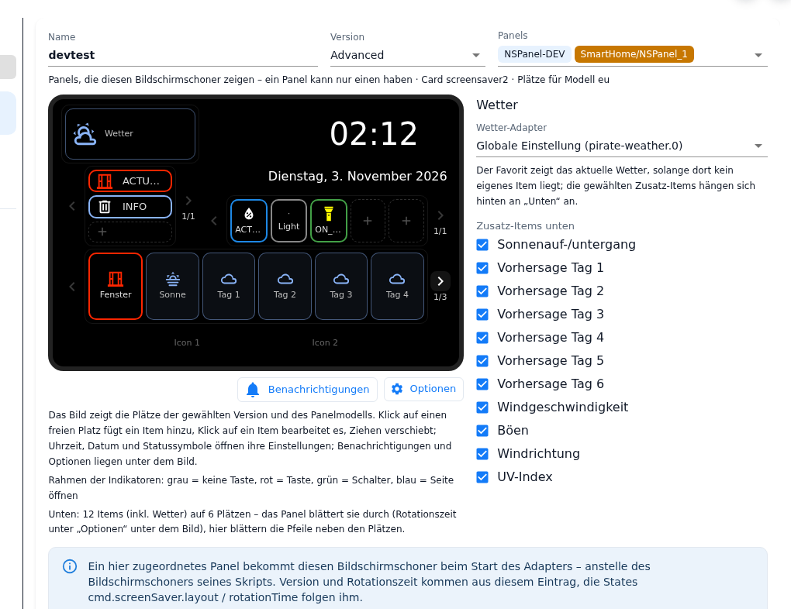

| Element | Bedeutung |
|---|---|
| **Name** | Name des Eintrags (umbenennen möglich, muss eindeutig bleiben). |
| **Version** | `Standard`, `Alternate`, `Advanced` oder `Easyview` – die Card (`screensaver`, `screensaver2`, `screensaver3`) folgt daraus. Die Zeile darunter nennt Card und Panelmodell, für das die Plätze gezeichnet werden. |
| **Panels** | Mehrfachauswahl der Panels, die diesen Bildschirmschoner zeigen. Ein Panel kann nur einen haben. |
| **Panelbild** | Die Plätze der gewählten Version und des Panelmodells: **Favorit**, **Links**, **Unten**, **Indikatoren** bzw. **Alternate**. Gestrichelt mit **+** = frei (Klick legt ein Item an), belegt = Klick bearbeitet. |
| **Ziehen** | Ein Item lässt sich auf einen anderen Platz ziehen – auch in einen anderen Bereich. Liegt dort schon ein Item, **tauschen** die beiden die Plätze. |
| **Beschriftung eines Items** | Symbol in seiner Farbe und darunter ein lesbarer Name (siehe unten). Der Tooltip nennt den vollen Namen und die Bedienhinweise. |
| **Papierkorb am Item** | Erscheint beim Überfahren in der rechten obere Ecke und löscht das Item vom Platz. |
| **Auge an einem Item** | Kleines gelbes Augen-Symbol: das Item wird nur unter einer Bedingung gezeigt. Der Tooltip des Platzes nennt sie im Klartext – *Nur sichtbar, solange … wahr ist* bzw. *Nur sichtbar, wenn: …*. |
| **`{ }` vor der Beschriftung** | Das Item ist über [Rohdaten](#6-rohdaten-json) konfiguriert. |
| **Blätterpfeile** | Hat ein Listenbereich mehr als ein Fenster, stehen links und rechts (bei schmalen Spalten darüber und darunter) Pfeile mit einem Zähler – siehe [Fenster und Blättern](#7-mehr-items-als-plätze-fenster-und-blättern). |
| **Rahmen der Indikatoren** | grau = keine Taste, rot = Taste, grün = Schalter, blau = Seite öffnen. Grau steht auch, wenn die Option **Indikatoren wirken als Tasten** aus ist (siehe [Indikatoren](#8-indikatoren-und-tasten)). |
| **Uhrzeit**, **Datum** | Klick öffnet den Dialog für 12h/24h und den [Timer statt Uhrzeit](#timer-statt-uhrzeit) bzw. das Datumsformat. |
| **Zwei Statussymbole** | `mrIcon1` und `mrIcon2`; Klick öffnet ihren Dialog, grau = nicht belegt. Ihre Lage hängt von der Version ab: bei Standard, Alternate und Easyview in den oberen Ecken, bei Advanced unten neben dem Datum. |
| **Knopfleiste unter dem Bild** | **Benachrichtigungen** (mit der Zahl der auf diesem Bildschirmschoner eingeschalteten Meldungen) und **Optionen** (Rotationszeit, Wischgesten, Indikator-Tasten). Beide Knöpfe lagen bis 2.0.2 als Glocke und Zahnrad **im** Panelbild. |
| **Wetter** (rechte Spalte) | Wetter-Adapter und seine Zusatz-Items, siehe [Wetter](#11-wetter). |

Die Beschriftung eines Items im Panelbild folgt einer Rangfolge – eine Regex wird dabei **nie** als solche angezeigt:

1. die **Überschrift** des Items (bei einem Rohdaten-Item sein `ScreensaverEntityText`),
2. der **Name des Objekts** (`common.name`), solange er geladen ist, sonst der letzte Teil der ID,
3. der **Vorlagenname ohne Typ** (`text.pirate-weather.favorit` → `pirate-weather favorit`),
4. der letzte Teil des lesbaren Anfangs eines Suchmusters (`/^pirate-weather\.0\.weather\.currently\./` → `currently`).

Der Tooltip zeigt den Volltext in der Form *Kurzname (Vorlage · Datenpunkt)*, z. B. `Fenster Küche (window isOpen · alias.0.Window)`. Ist nichts davon gesetzt, steht `?`.

Der Hinweis unter dem Panelbild erinnert daran, dass ein hier zugeordnetes Panel diesen Bildschirmschoner beim Start des Adapters bekommt – anstelle des Bildschirmschoners seines Skripts.

## 3. Version und Panels

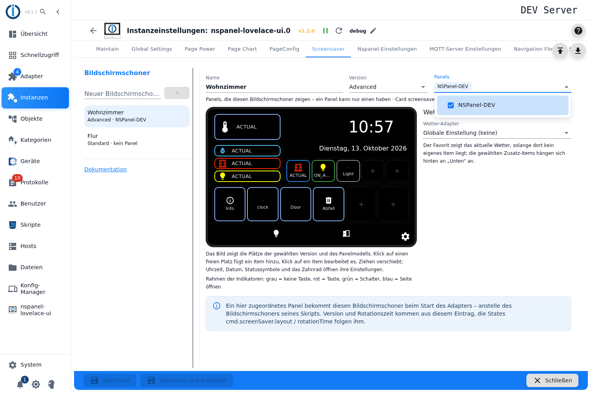

- **Panels**: Die Liste zeigt alle Panels der Instanz (Tooltip mit Topic, IP und Modell). Das **Modell des ersten gewählten Panels** bestimmt, wie viele Plätze die Bereiche haben – `eu` und `us-l` im Querformat, `us-p` im Hochformat mit eigenem Layout. Haben die gewählten Panels verschiedene Modelle, sagt der Editor, für welches er zeichnet. Steht ein Panel in zwei Einträgen, gewinnt der erste in der Liste; der Editor und das Log warnen. Ohne Panel meldet der Editor *Kein Panel gewählt – dieser Bildschirmschoner wird nicht verwendet*.
- **Version wechseln**: Items, die in der neuen Version keinen Bereich mehr haben, bleiben erhalten und werden oben gemeldet – mit dem Knopf **Entfernen** lassen sie sich auf einmal löschen. Wer zurück zur alten Version wechselt, hat sie wieder.

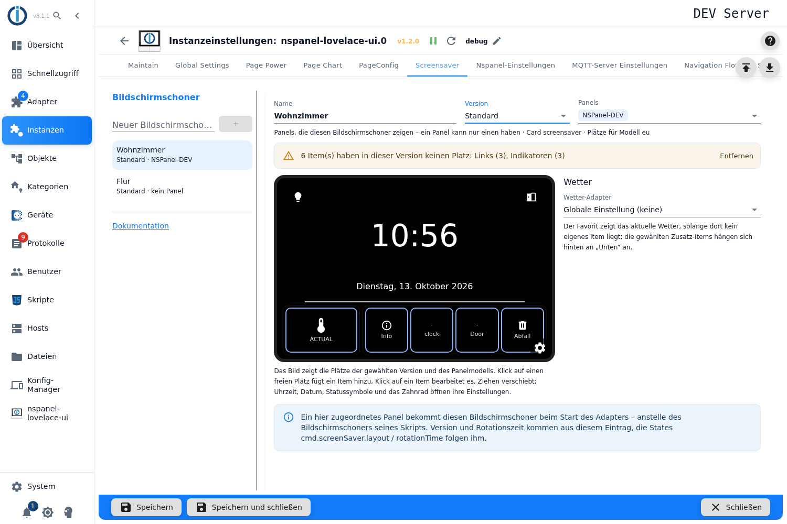

Plätze je Version (Modell `eu`, abweichende Werte in Klammern):

| Version | Favorit | Alternate | Links | Unten | Indikatoren | Statussymbole |
|---|---|---|---|---|---|---|
| **Standard** | 1 | – | – | 4 | – | 2 |
| **Alternate** | 1 | 1 | – | 3 | – | 2 |
| **Advanced** | 1 | – | 3 | 6 | 5 | 2 |
| **Easyview** | – | – | – | 3 (`us-p`: 4) | – | 2 |

Die Zahl gilt je Fenster: **Links**, **Unten** und **Indikatoren** nehmen mehr Items auf, als sie Plätze haben (siehe [Fenster und Blättern](#7-mehr-items-als-plätze-fenster-und-blättern)). **Favorit** und **Alternate** halten genau ein Item.

## 4. Items: der Item-Dialog

Klick auf einen freien Platz öffnet den Item-Dialog, Klick auf ein belegtes Item bearbeitet es. Der Titel nennt Bereich und Platz (*Item · Unten · Platz 2 von 4*). Die Felder richten sich nach dem Platz und nach dem Typ des Datenpunkts; rechts zeigt eine Vorschau das Item so, wie der Platz es darstellt (als Beispielwert rechnet sie mit 23,456 × Faktor).

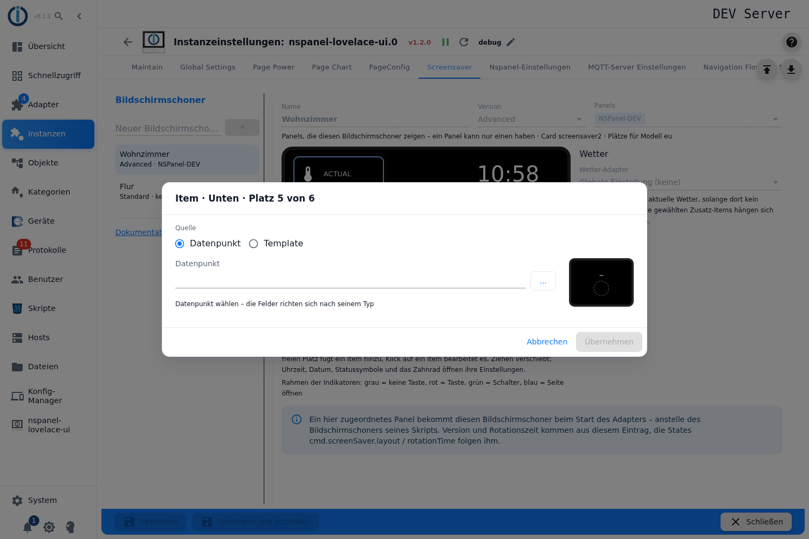

**Quelle**: *Datenpunkt* (ein State mit eigenen Feldern) oder *Template* (ein PageItem-Template des Adapters, siehe [Templates](#5-templates-als-item)). Rechts oben im Titel sitzt zusätzlich der Knopf `{ }` für [Rohdaten](#6-rohdaten-json).

**Datenpunkt**: Die ID lässt sich eintippen oder über **...** aus dem Objektbaum wählen. Es muss ein **Datenpunkt** sein (`type: state`) – ein Kanal oder Gerät wird mit Hinweis abgelehnt, ebenso eine ID, die es nicht gibt. Sobald der Datenpunkt bekannt ist, zeigt der Dialog *Name · Typ · Einheit* sowie die Rolle und blendet die Felder ein, die zum Typ passen:

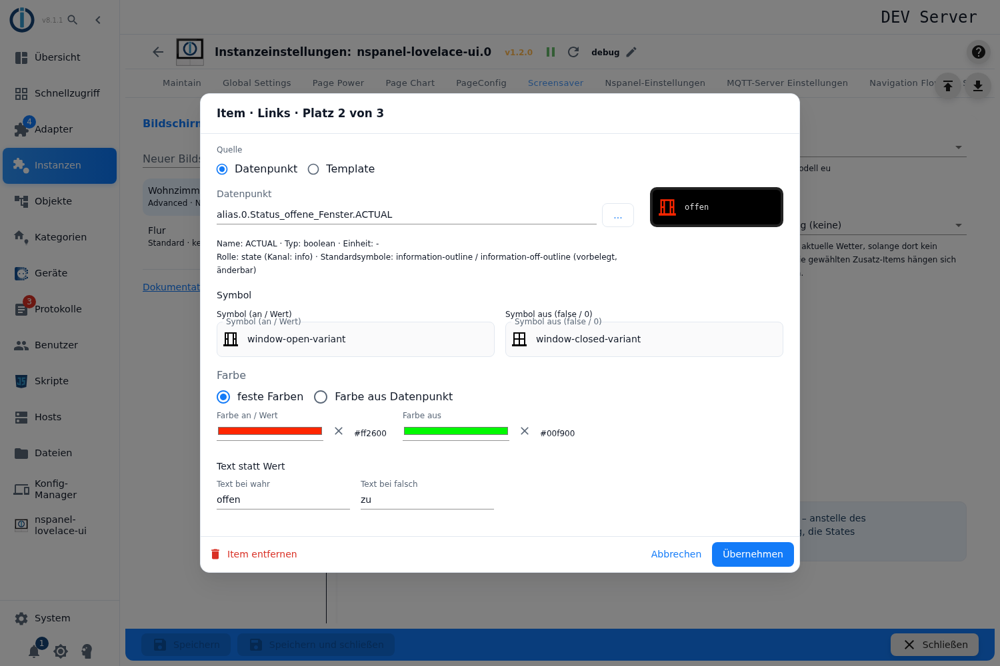

| Typ des Datenpunkts | Felder |
|---|---|
| **boolean** | **Symbol (an / Wert)** und **Symbol aus (false / 0)**, **Farbe an / Wert** und **Farbe aus**, **Text bei wahr** / **Text bei falsch** |
| **number** | Symbol, zusätzlich **Icon je Wert…**, feste Farbe oder **Farbskala nach Wert**, **Einheit (leer = vom Datenpunkt)**, **Faktor**, **Nachkommastellen** |
| Datum/Zeit (Rolle `date`/`time`) | Symbol, Farbe, **Datumsformat** (sieben Vorgaben zur Auswahl, Vorbelegung *Adapter-Standard (Datum kurz)*; im **Expertenmodus** zusätzlich *Eigenes (JSON)* mit einem Feld für freie `Intl.DateTimeFormatOptions`) |
| sonst (string …) | Symbol, Farbe |

Je nach Platz kommen Felder dazu oder fallen weg: **Unten** hat die **Überschrift (leer = Name des Datenpunkts)**, **Indikatoren** zeigen nur das Symbol und haben dafür die **Aktion beim Drücken** (siehe [Indikatoren](#8-indikatoren-und-tasten)); Wert- und Textfelder entfallen dort.

**Symbol**: Ein Item braucht ein Symbol – ohne Symbol und ohne Icon-Liste kann das Panel es nicht darstellen, der Dialog meldet *Ohne Symbol kann das Panel das Item nicht darstellen* und lässt **Übernehmen** nicht zu. Aus der Rolle werden **Standardsymbole vorbelegt** (und bleiben änderbar): zuerst zählt die Rolle des Kanals über dem Datenpunkt (ein `light`-Kanal gibt die Glühbirne auch für seinen `.ACTUAL`), sonst die Rolle des Datenpunkts selbst (`value.humidity`, `switch.light`, `sensor.door`, `value.temperature` …). Die Zeile „Rolle: …“ nennt beides. Kennt die Rolle keine Symbole, sagt der Dialog es.

**Farbe**: *feste Farben* (bei boolean getrennt an/aus, Pipette oder Hex-Wert), bei Zahlen alternativ *Farbskala nach Wert* – **Skala bearbeiten…** öffnet den Dialog mit Skala, Minimum/Maximum, Bestwert und Modus (wie bei den Seiten-Items, siehe [PageConfig-Dialoge](PageConfig-Dialoge)):

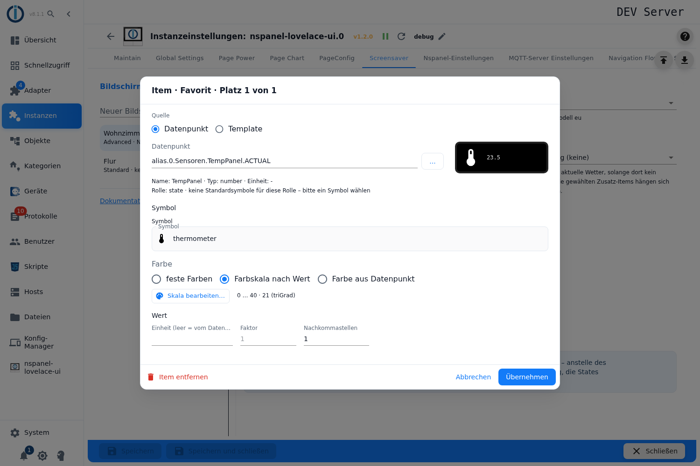

Dritte Möglichkeit *Farbe aus Datenpunkt*: ein State, dessen Wert die Farbe ist – `#rrggbb`, `{"r":…,"g":…,"b":…}` (auch als JSON-String) oder eine Dezimalzahl. Bei Ein/Aus-Datenpunkten gilt er für „an“, „aus“ nimmt die Standardfarbe. Der State muss existieren und ein Datenpunkt sein.

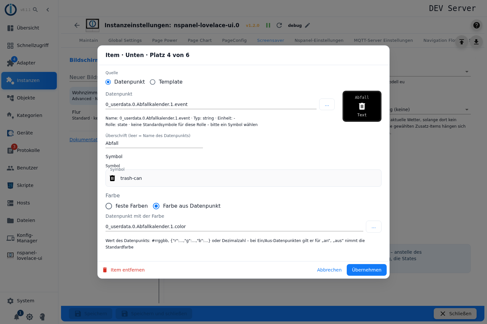

**Icon je Wertebereich** (nur Zahlen): Statt eines festen Symbols kann eine Liste „bis Wert → Symbol“ hinterlegt werden – das Panel wechselt das Icon dann mit dem Wert. Der Knopf **Icon je Wert…** steht unter dem Symbolfeld, sobald der Datenpunkt eine Zahl ist; ein Expertenmodus ist dafür nicht nötig. Eine gespeicherte Liste wird daneben mit ihren Symbolen und der Zahl der Einträge angezeigt und lässt sich über **Icon-Liste entfernen** (Papierkorb) wieder löschen.

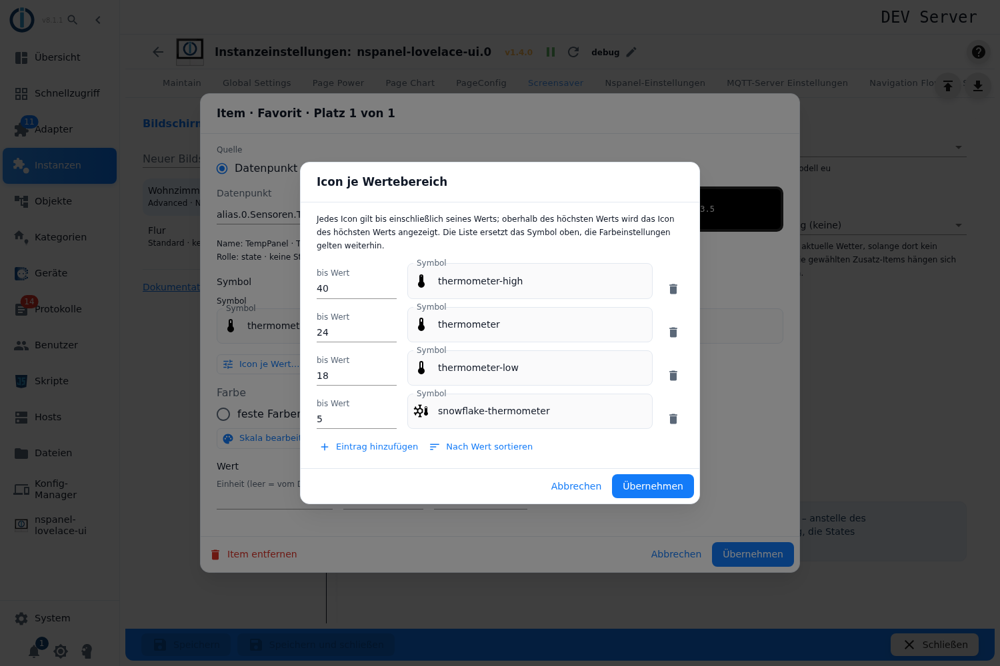

- Jede Zeile besteht aus **bis Wert** und einem **Symbol**. Ein Icon gilt **bis einschließlich** seines Werts, oberhalb des höchsten Werts bleibt dessen Icon stehen. Im Bild: bis 5 `snowflake-thermometer`, bis 18 `thermometer-low`, bis 24 `thermometer`, darüber `thermometer-high` – 23,5 °C zeigt also das mittlere Symbol (siehe Vorschau).
- **Eintrag hinzufügen** hängt eine Zeile an, der Papierkorb rechts entfernt sie. **Nach Wert sortieren** (ab zwei Zeilen) ordnet die Liste nur für die Übersicht – auf die Reihenfolge kommt es nicht an, der Adapter sortiert selbst.
- **Übernehmen** bleibt gesperrt, solange eine angefangene Zeile unvollständig ist (*Jeder Eintrag braucht einen Zahlenwert und ein Symbol*); Zeilen ohne Wert **und** ohne Symbol werden ignoriert. Kommt ein Wert doppelt vor, meldet der Dialog es – wirksam ist dann nur einer der Einträge, gesperrt wird deswegen nicht. Eine leere Liste löscht die Einstellung.
- Die Liste **ersetzt das Symbol** aus dem Feld darüber und zählt als Symbol: ein Item mit Icon-Liste braucht kein eigenes Symbol. Farbe bzw. Farbskala, Einheit, Faktor und Nachkommastellen gelten unverändert weiter.

**Text statt Wert** (boolean): Statt `true`/`false` zeigt das Panel den **Text bei wahr** bzw. **Text bei falsch**. In jedes Feld kann auch die **ID eines Datenpunkts** – dann wird dessen Wert gezeigt. Ein leeres Feld lässt den Rohwert stehen.

**Sichtbarkeit**: Dieser Block steht unter den übrigen Feldern, sobald der Datenpunkt bekannt ist (bei einem Template, sobald Vorlage und – falls nötig – Objekt eingetragen sind). Auch er braucht **keinen Expertenmodus**. Er hat zwei Felder:

| Feld | Wirkung |
|---|---|
| **Datenpunkt, der das Item bei false ausblendet** | Solange dieser State `false` ist, erscheint das Item nicht auf dem Panel. |
| **Bedingung über val (sichtbar, solange wahr)** | JavaScript-Ausdruck über `val`, den Wert des Item-Datenpunkts – `val > 0` zeigt das Item also nur bei positiven Werten. |

Ein Item mit Bedingung trägt im Panelbild das Augen-Symbol und **belegt auf dem Panel keinen Platz**, solange die Bedingung nicht erfüllt ist – die übrigen Items rücken nach.

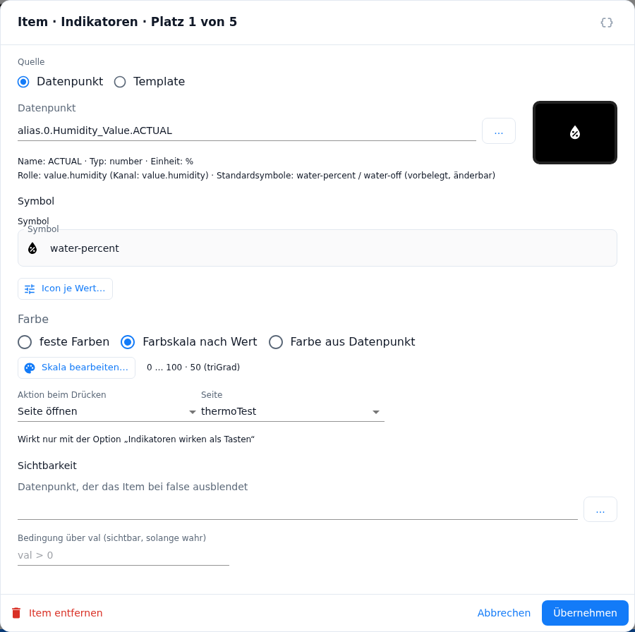

Der **Expertenmodus** (Symbol unten links in der Admin-Leiste) wirkt im Item-Dialog nur noch an einer Stelle: bei einem Datums- oder Zeit-Datenpunkt bietet das Feld **Datumsformat** dann zusätzlich *Eigenes (JSON)* und darunter ein Feld für freie `Intl.DateTimeFormatOptions`. Alle anderen Felder stehen ohne ihn offen.

**Item entfernen** links unten löscht das Item vom Platz.

## 5. Templates als Item

Mit der Quelle **Template** nimmt ein Platz ein PageItem-Template des Adapters (z. B. `text.clock`, `text.lock`, `script.light`, `shutter.basic`, die `pirate-weather.*`-Templates). Das Template bringt Symbol, Farben und Texte selbst mit – Symbol-, Farb-, Text- und Wertfelder entfallen darum; die **Sichtbarkeits**-Einstellungen gelten auch für Template-Items.

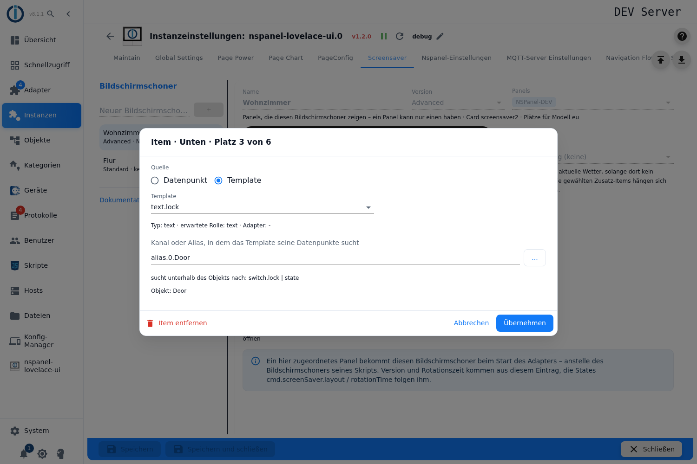

- Die Liste der Templates liefert der **laufende Adapter** (gruppiert nach Präfix). Läuft die Instanz nicht, meldet der Dialog *Die Template-Liste liefert der laufende Adapter – er ist gerade nicht erreichbar*.
- Unter der Auswahl stehen *Typ · erwartete Rolle · Adapter*.
- Die meisten Templates suchen ihre Datenpunkte **unterhalb eines Objekts**: Dann wird ein **Kanal oder Alias, in dem das Template seine Datenpunkte sucht** gewählt (der Objektbaum zeigt Kanäle, Geräte und Ordner), und der Dialog nennt, wonach das Template darunter sucht (z. B. `.ACTUAL`, `switch.lock | state`). Ein einzelner Datenpunkt an dieser Stelle wird als Warnung gemeldet.
- Templates ohne Objekt (`text.clock`, `text.wlan`, `button.service.*` …) brauchen keines – dann steht *Dieses Template braucht kein Objekt – es bringt seine Daten selbst mit*.
- Die Liste bietet **je Platz nur passende Templates** an: Text- und Tasten-Templates passen auf jeden Platz, sofern das Template die Plätze nicht selbst einschränkt; ein bereits gespeichertes Template bleibt wählbar. Der getippte Text findet einen Eintrag auch über seinen technischen Namen.
- Liegen die Datenpunkte unter einer **Adapter-Instanz** – etwa `text.battery.bydhvs` unter `bydhvs.0` –, stehen die passenden Instanzen hinter *Instanzen des Adapters:* als Knöpfe unter dem Objektfeld; gibt es genau eine und das Feld ist leer, trägt der Dialog sie gleich ein. So eine Instanz existiert oft nicht als eigenes Objekt – das Feld ist trotzdem richtig ausgefüllt, der Dialog warnt in diesem Fall nicht.
- Templates mit **Optionen** zeigen eigene Felder unter der Auswahl, zum Beispiel **SOC-Untergrenze (%)** und **SOC-Obergrenze (%)** bei `text.battery.bydhvs` (der Füllstand wird auf diesen Bereich gestreckt). Ein leeres Feld entfernt die Option wieder; beim Wechsel des Templates gehen die Optionen des alten verloren.
- Auf einem **Indikator**-Platz hat auch ein Template die **Aktion beim Drücken** (siehe [Indikatoren](#8-indikatoren-und-tasten)) – zum Beispiel **Seite öffnen** zur [Energie-Seite](cardPower). Sie wirkt nur mit der Option **Indikatoren wirken als Tasten**.
- Im Panelbild heißt ein Template-Item nach seinem Template ohne den Typ, zum Beispiel `battery bydhvs`; eine Instanz wie `bydhvs.0` gibt keinen Namen her.
- `text.trash.next` und `text.trash.afterNext` (nur im Bereich **unten**) zeigen den nächsten und den übernächsten Termin einer [Abfall-Seite](cardTrash): Symbol und Farbe des Termins, darüber der Name des Termins (der optionale Name, sonst die Abfallart), darunter heute, morgen oder der Wochentag wie auf der Seite, ein Datum kurz als Tag.Monat (`06.12`). In der Template-Auswahl erscheinen sie als *Nächster Termin (Seite)* und *Übernächster Termin (Seite)*, je einmal pro Abfall-Seite, der technische Name steht im Tooltip des Eintrags und im Hilfstext darunter; ohne Abfall-Seite gibt es diese Einträge nicht. Ein älteres Item ohne Seitenangabe zeigt weiter die erste konfigurierte Abfall-Seite und steht in der Auswahl als deren Eintrag. Ein Item, dessen Seite es nicht mehr gibt, bleibt als eigener Eintrag mit der gespeicherten ID sichtbar (*unbekannte Seite: ID*) und wird nicht auf eine andere Seite umgestellt. Gibt es keinen Termin oder ist die Seite unbekannt, blendet sich das Item aus. Ein langer Name kann im unteren Bereich abgeschnitten werden; der optionale Name der Abfallart kann ihn kürzen. Eine eigene **Sichtbarkeits**-Einstellung ersetzt dieses Ausblenden.

## 6. Rohdaten (JSON)

Für Items, die der Dialog nicht in Felder fasst, nimmt der Item-Dialog die Konfiguration **als JSON** – genauso wie bei den Seiten-Items (siehe [PageConfig-Dialoge](PageConfig-Dialoge)). Hier landen auch die Items, die die [Migration](Migration) aus einem Skript als Rohdaten übernommen hat.

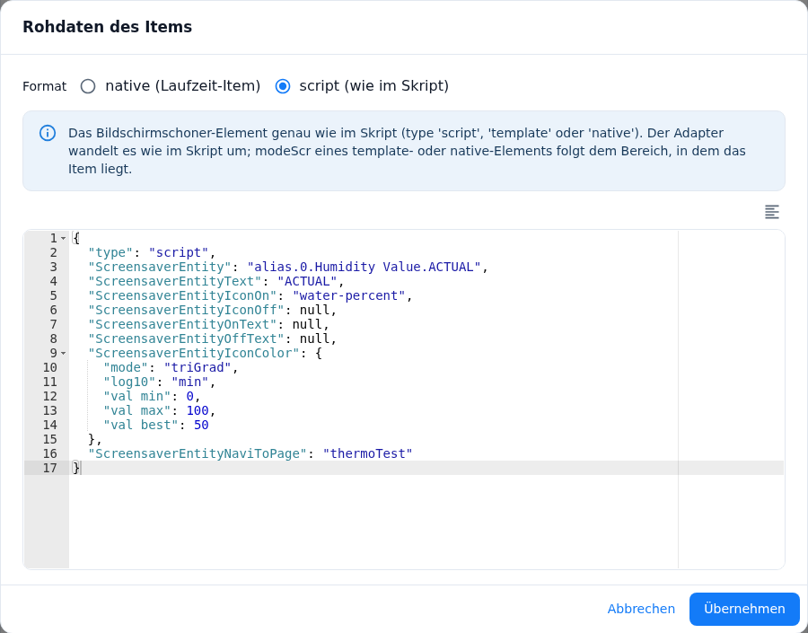

- **Der Knopf**: `{ }` rechts oben im Titel des Item-Dialogs, Tooltip *Item als Rohdaten (JSON) eingeben*. Er ist blass, solange das Item über die Felder konfiguriert ist, und **orange**, sobald Rohdaten aktiv sind.
- **Der Dialog** heißt **Rohdaten des Items**. Oben die Formatwahl, darunter ein Hilfetext zum gewählten Format, dann ein JSON-Editor mit **JSON formatieren**. Ungültiger Text wird rot umrandet und mit *Ungültiges JSON: …* bzw. *Die Konfiguration muss ein JSON-Objekt { ... } sein* gemeldet; **Übernehmen** bleibt dann gesperrt.
- **Vorbelegung**: Sind die Standardfelder vollständig gefüllt, öffnet der Dialog das Element, das der Adapter daraus bauen würde, im Format **script**. Sonst startet er leer (`{}`) im Format **native**.

| Format | Was hinein gehört |
|---|---|
| **native (Laufzeit-Item)** | Das Laufzeit-Item des Bildschirmschoners, z. B. `{ template, dpInit, data }`. Es wird unverändert übernommen. |
| **script (wie im Skript)** | Das Bildschirmschoner-Element mit `type` `'script'`, `'template'` oder `'native'`. Der Adapter wandelt es genauso um wie ein Element einer Skript-Konfiguration. |

Beispiel im Format **native** – eine Vorlage mit Suchmuster:

```json
{
  "template": "text.pirate-weather.favorit",
  "dpInit": "/^pirate-weather\\.0\\.weather\\.currently\\./"
}
```

Beispiel im Format **script** – ein einzelner Datenpunkt mit eigenen Feldern:

```json
{
  "type": "script",
  "ScreensaverEntity": "hm-rpc.0.ABC.1.TEMPERATURE",
  "ScreensaverEntityText": "Außen",
  "ScreensaverEntityIconOn": "thermometer",
  "ScreensaverEntityUnitText": "°C"
}
```

Beispiel im Format **script** – ein Template mit Option auf einem Indikator-Platz, dessen Tipp die Energie-Seite `cardPower_Haus` öffnet (so stünde es auch im Konfigurationsskript):

```json
{
  "type": "template",
  "template": "text.battery.bydhvs",
  "dpInit": "bydhvs.0",
  "readOptions": { "min": 5 },
  "modeScr": "indicator",
  "ScreensaverEntityNaviToPage": "cardPower_Haus"
}
```

- **Der Bereich kommt vom Platz**: `modeScr` wird immer auf den Bereich gesetzt, in dem das Item im Editor liegt. Ein abweichendes `modeScr` in der Eingabe wird überschrieben – sonst stünde das Item auf dem Panel woanders als im Editor. Bei einem `script`-Element vom Typ `'script'` ergibt sich der Bereich ohnehin aus der Liste.
- **Standardfelder gelten nicht**: Solange Rohdaten aktiv sind, verschwinden die Quellenumschalter und alle Felder; an ihrer Stelle steht der Hinweis *Rohkonfiguration aktiv (Format …)* mit dem Knopf **Rohdaten bearbeiten**. Ein Rohdaten-Item braucht weder Datenpunkt noch Symbol – **Übernehmen** ist nie gesperrt.
- **Rückweg**: **Rohdaten entfernen (zurück zum Standard)** im Dialog. Danach gelten wieder die Standardfelder; ein Item, das von Anfang an als Rohdaten angelegt wurde, hat dort nichts stehen – auch keine Sichtbarkeits-Bedingung – und muss neu ausgefüllt werden.
- **Im Panelbild**: Die Beschriftung beginnt mit `{ }` (`{ } Außen`, ohne erkennbaren Namen nur `{ }`). Der Editor liest `enabled` / `ScreensaverEntityEnabled` und `visibleCondition` / `ScreensaverEntityVisibleCondition` auch aus den Rohdaten (bis zu zehn Ebenen tief) und setzt das Augen-Symbol.

## 7. Mehr Items als Plätze: Fenster und Blättern

Die Listenbereiche **Links**, **Unten** und **Indikatoren** zeichnet der Editor in **Fenstern** von so vielen Plätzen, wie die Version und das Panelmodell hergeben. Ist das letzte Fenster voll, hängt er ein weiteres an – es lassen sich also beliebig viele Items über die Platzzahl hinaus anlegen.

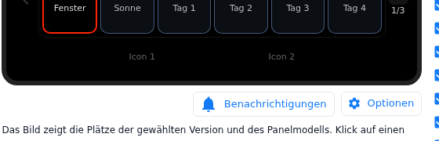

- **Blättern im Editor**: Ab dem zweiten Fenster stehen Pfeile neben den Plätzen (bei schmalen Spalten darüber und darunter), Tooltips *Vorherige Plätze* und *Nächste Plätze*. Daneben steht der Zähler `1/3`, dessen Tooltip ihn ausschreibt: *Plätze 1-4 · Seite 1 von 3*.
- **Items zwischen Fenstern verschieben**: Ein Item über einen Pfeil ziehen – der Editor blättert dabei weiter (etwa ein Fenster pro Dreivierteltelsekunde) und das Item lässt sich im Zielfenster ablegen.
- **Hinweis unter dem Panelbild**: Je Bereich mit mehr Items als Plätzen eine Zeile, z. B. *Unten: 7 Items auf 4 Plätzen – nur sichtbare Einträge (Bedingung erfüllt) belegen Plätze, das Panel blättert durch. Hier blättern die Pfeile neben den Plätzen.*
- **Blättern auf dem Panel**: Das Panel wechselt das Fenster im Takt der **Rotationszeit** (siehe [Optionen](#12-optionen-rotation-wischen-indikator-tasten)).
- **Bedingte Items belegen keinen Platz**: Ein Item, dessen Sichtbarkeits-Bedingung nicht erfüllt ist, fällt ganz heraus – die Zahl der Fenster auf dem Panel richtet sich nur nach den sichtbaren Items.

Überzählige Items sind damit **kein Fehler**. Die Warnung *… Item(s) haben in dieser Version keinen Platz* gilt nur für Bereiche, die die gewählte Version **gar nicht hat** – etwa Indikatoren nach dem Wechsel von Advanced auf Standard.

## 8. Indikatoren und Tasten

Die Indikatoren (Version Advanced) zeigen nur ein Symbol. Im Item-Dialog gibt es dafür die **Aktion beim Drücken**:

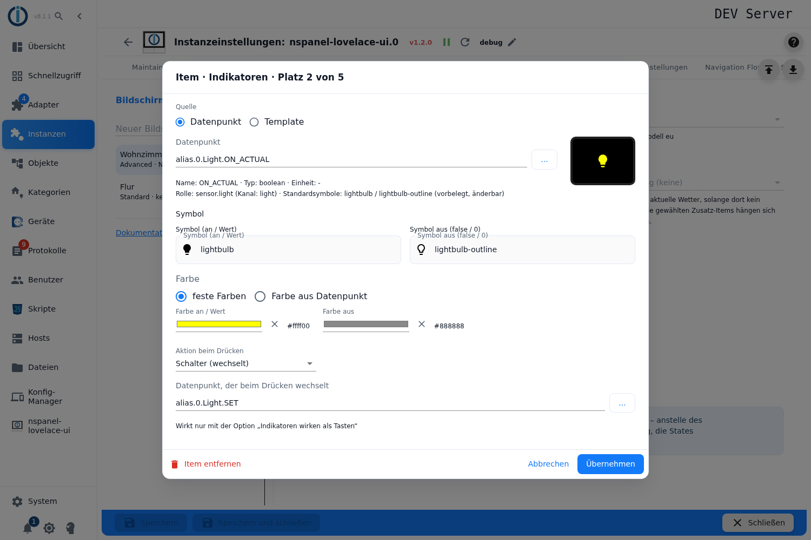

| Aktion | Wirkung |
|---|---|
| **keine** | Tipp führt zur Hauptseite. |
| **Taste (schreibt true)** | schreibt `true` in den gewählten Datenpunkt. |
| **Schalter (wechselt)** | kippt den gewählten Datenpunkt zwischen `true` und `false`. |
| **Seite öffnen** | öffnet die gewählte Seite der Instanz. |

Taste und Schalter brauchen einen **beschreibbaren** Datenpunkt; ist er das nicht, meldet der Dialog *… ist nicht beschreibbar (common.write) – Taste und Schalter brauchen einen beschreibbaren Datenpunkt* und lässt nicht übernehmen. Unter dem Feld steht der Hinweis *Wirkt nur mit der Option „Indikatoren wirken als Tasten“*. Im Panelbild zeigt der Rahmen die Aktion: rot = Taste, grün = Schalter, blau = Seite, grau = keine oder Option aus. Auch ein [Template](#5-templates-als-item) auf einem Indikator-Platz bekommt die Aktion – sein Symbol wird damit zur Taste.

**Ein State je Indikator.** Der Adapter legt für jedes Indikator-Item einen eigenen Datenpunkt an: `panels.<Panel>.buttons.indicator-1`, `-2`, `-3` … in der Reihenfolge, in der die Items im Bereich **Indikatoren** stehen. Die States sind `boolean`, nur lesbar und tragen die Rolle `button.press`. Ein Tipp auf den Indikator schreibt **immer** `true` in seinen State – unabhängig von der Option. Damit taugen sie als Auslöser für eigene Skripte, auch ohne eine Aktion im Dialog.

Die Option **Indikatoren wirken als Tasten** entscheidet nur, was *danach* passiert: ist sie an, läuft der konfigurierte Befehl (Taste, Schalter, Seite); ist sie aus, springt das Panel auf die Hauptseite.

## 9. Statussymbole

Die beiden Statussymbole (`mrIcon1`, `mrIcon2`) folgen je einem Datenpunkt: **Symbol an** bei `true`, sonst **Symbol aus**, jeweils mit eigener **Farbe an** / **Farbe aus**. Ein optionaler zweiter **Datenpunkt als Wert daneben** wird mit **Nachkommastellen** und **Einheit** gezeigt. Ohne Datenpunkt bleibt das Symbol ungenutzt und steht im Panelbild grau.

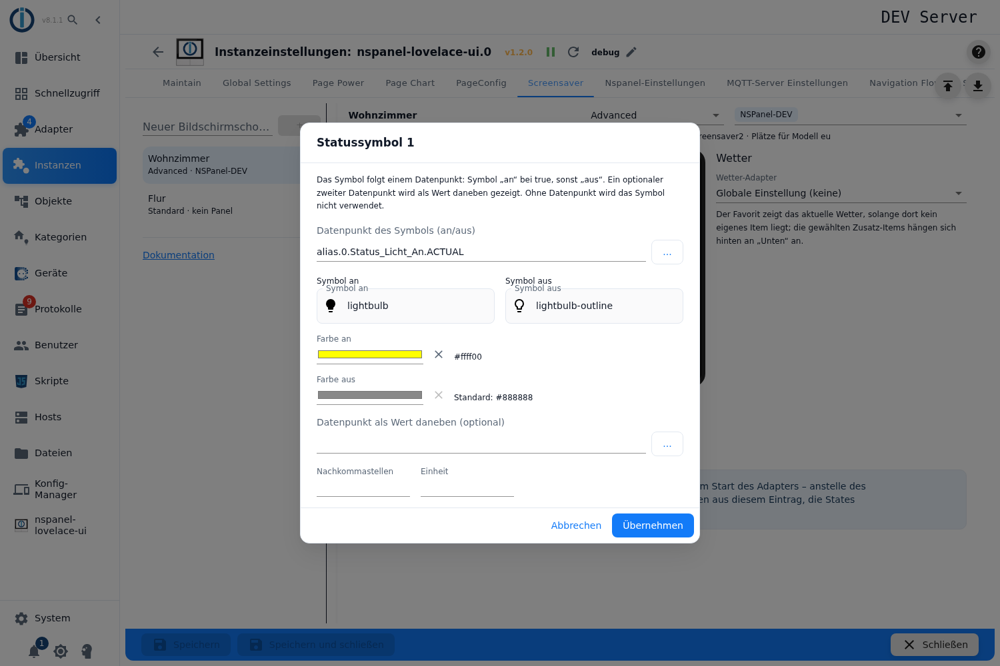

## 10. Uhrzeit und Datum

Klick auf die Uhrzeit: **Adapter-Standard**, **24 Stunden** oder **12 Stunden**, mit Vorschau.


### Timer statt Uhrzeit

Im Dialog der Uhrzeit steht unter der Formatwahl das Häkchen **Timer anzeigen**. Solange ein Timer aktiv ist, zeigt das Panel an der Stelle der Uhrzeit seine Restzeit; ohne aktiven Timer steht dort die Uhrzeit wie gewohnt. Das gilt für alle Versionen des Bildschirmschoners und auch im [Web-Panel](WebPanel).

Mit dem Häkchen erscheint das Feld **Quelle des Timers** mit zwei Möglichkeiten:

| Quelle | Was dahinter steckt |
|---|---|
| **Datenpunkte oder Slot-Muster** | Zwei Datenpunkte, die ein eigenes Skript pflegt – oder, hinter **Erweitert**, zwei Muster für Timer in wechselnden Slots. |
| **Pageitem mit Timer-Popup** | Ein Timer-Item von einer Seite dieses Panels, siehe [Timer-Popup](popupTimer). |

**Übernehmen** bleibt gesperrt, solange der Timer unvollständig ist – der Dialog meldet *Ein Timer braucht beide Datenpunkte oder zwei gültige Muster.*

#### Quelle: zwei Datenpunkte

| Feld | Bedeutung |
|---|---|
| **An/Aus-Datenpunkt (true = Timer aktiv)** | Nur solange dieser Datenpunkt wahr ist, gibt es einen Timer. Ist er falsch, gilt der Timer als erledigt – egal, was in den Daten steht – und es gibt keinen Alarm. |
| **Daten-Datenpunkt (Endzeit oder Restzeit)** | Wann der Timer endet oder wie lange er noch läuft. Das Format erkennt der Adapter selbst. |

Was im Daten-Datenpunkt stehen darf:

| Wert | Bedeutung |
|---|---|
| Zahl ab 100 000 000 000 | Endzeit als Zeitstempel in Millisekunden |
| Zahl ab 1 000 000 000 | Endzeit als Zeitstempel in Sekunden |
| kleinere Zahl über 0 | verbleibende Sekunden eines Datenpunkts, der selbst herunterzählt – mit der Einheit `ms` Millisekunden |
| Text | ein ISO-Datum (`2026-11-07T18:30`) oder eine Uhrzeit `HH:MM`; ist die Uhrzeit heute schon vorbei, gilt sie für morgen |
| leer oder anderer Text | kein Timer |

**Der Wert 0 bei wahrem An/Aus:** Hat der Timer seit dem Start des Adapters schon einmal gezählt, gilt er mit 0 als abgelaufen. Trägt der Datenpunkt die Einheit `s`, `sec` oder `ms` oder die Rolle `value.timer` oder `level.timer`, heißt 0 immer abgelaufen – auch direkt nach einem Neustart des Adapters. Sonst heißt 0 „noch kein Timer“, und das Panel zeigt die Uhrzeit.

Der Hilfstext im Dialog fasst das zusammen: *Die Formate werden automatisch erkannt: Endzeit als Unix-ms oder Unix-Sekunden (0 = kein Timer), verbleibende Sekunden eines herunterzählenden States (Einheit ms: Millisekunden), ISO-Datum oder HH:MM. Ist die Zeit vorbei: 0.0 mit Alarm-Icon, bis der An/Aus-Datenpunkt false ist. Die Anzeige zeigt die Restzeit in Minuten, z. B. 125.5, ab 1000 Minuten 1234.*

**Erweitert – Timer in wechselnden Slots:** Der Knopf **Erweitert** öffnet den Dialog **Timer in wechselnden Slots**, einen Sonderfall für Skripte, die ihre Timer unter einem festen Pfad in wechselnden Unterordnern ablegen. Statt der beiden Datenpunkte werden zwei Muster eingetragen, **Muster An/Aus** und **Muster Daten**, jedes mit genau einem `*` und einem Pfad davor:

```text
javascript.0.timer.global.*.aktiv
javascript.0.timer.global.*.targetTs
```

- An/Aus und Daten gehören zusammen, wenn der Teil an der Stelle des `*` gleich ist.
- Angezeigt wird ein abgelaufener aktiver Slot, sonst der laufende Slot mit der kürzesten Restzeit. Slots, die erst später entstehen, erkennt der Adapter von selbst.
- Der Dialog prüft die Muster und meldet *Beide Muster sind nötig.*, *Jedes Muster braucht genau ein \*.*, *Vor dem \* muss ein Pfad stehen, z. B. adapter.0.\*.* oder *Die beiden Muster müssen sich unterscheiden.* Beide Felder leer lassen, um wieder die zwei Datenpunkte zu nutzen.
- Sind Muster gesetzt, sagt es der Uhrzeit-Dialog: *Unter Erweitert sind Slot-Muster gesetzt - sie ersetzen die beiden Datenpunkte oben.*

#### Quelle: Pageitem mit Timer-Popup

Das Feld **Pageitem** listet die Timer-Items auf den Seiten der Panels dieses Bildschirmschoners, als *Seite - Name des Items* (bei gleichen Namen auf einer Seite mit der Platznummer dahinter). Angeboten werden nur Items, die wirklich herunterzählen: interne Timer und externe Timer mit `STATUS`. Wecker, reine Zeitanzeigen und Items mit dem Häkchen **Timer aus dem Screensaver verwenden** fehlen in der Liste. Das gewählte Item arbeitet auch, wenn seine Seite nie geöffnet wurde.

- *Einige Timer sind erst auswählbar, nachdem eine Seite geändert und gespeichert wurde.* – ältere Items bekommen ihre interne Kennung erst beim nächsten Speichern im Tab PageConfig und erscheinen dann in der Liste.
- Der Bezug bleibt beim Umsortieren und Umbenennen des Items bestehen. Ein Item lässt sich nicht auf eine andere Seite verschieben, nur kopieren – die Kopie ist ein neues Item und muss neu gewählt werden.
- Wird das Item gelöscht, zeigt das Panel die Uhrzeit, das Log warnt einmal, und der Dialog meldet *Das gewählte Item gibt es nicht mehr oder es passt nicht mehr. Am Panel bleibt die Uhrzeit, bis ein anderes gewählt wird.*
- Gibt es kein passendes Item, steht dort *Kein passendes Pageitem auf den Seiten der Panels dieses Screensavers.*

**Kein Kreis:** Ein Bildschirmschoner kann kein Item als Quelle nehmen, das selbst den Timer dieses Bildschirmschoners verwendet. Der Dialog bietet solche Items nicht an, und im Item-Dialog ist das Häkchen gesperrt, sobald der Bildschirmschoner dieses Item als Quelle nutzt. Käme es trotzdem dazu, zeigt das Panel die Uhrzeit, das Log warnt, und das Item hat keine Tasten. Erlaubt ist die Kette: Item A nutzt den Bildschirmschoner, der Bildschirmschoner nutzt ein anderes Item B.

#### Anzeige am Panel

Die Restzeit steht in **Minuten mit Punkt**, damit sie sich nicht mit der Uhrzeit verwechseln lässt:

| Restzeit | Anzeige |
|---|---|
| unter 1000 Minuten | eine Nachkommastelle, immer mit Punkt, aufgerundet auf 6 Sekunden: 90 s → `1.5`, 7 s → `0.2`, die letzten 6 s → `0.1`, 125 min 30 s → `125.5` |
| ab 1000 Minuten | aufgerundete ganze Minuten, z. B. `1234`, höchstens `9999` |
| abgelaufen | `0.0` |

| Zustand | Uhrzeit-Feld | Infoicon |
|---|---|---|
| läuft | Restzeit in Orange | `timer-sand` in Orange |
| pausiert (nur mit einem Pageitem als Quelle) | stehende Restzeit in Orange | `timer-pause` in Orange |
| abgelaufen | `0.0` in Rot | `timer-alert` in Rot |
| weggetippt | Uhrzeit in ihrer normalen Farbe | bleibt stehen, solange der Timer aktiv ist |

- Das Infoicon des Timers hat Vorrang vor dem eigenen Infoicon und vor den Update-Symbolen.
- Eine AM/PM-Angabe gibt es beim Timer nicht, auch nicht im 12-Stunden-Format.
- In der Version **Advanced** behalten Uhrzeit und Infoicon ihre gewohnte Farbe – diese Seite des Panels kennt den Farbbefehl nicht.

**Abgelaufen** bleibt stehen, bis der An/Aus-Datenpunkt falsch wird. Neue Daten beenden den Alarm nur, wenn sie in der Zukunft liegen.

**Tippen:** Der erste Tipp auf einen angezeigten Timer schaltet auf die Uhrzeit um – auch ohne Doppelklick und noch vor dem Wegtippen einer Benachrichtigung. Er löst weder eine Geste noch einen Seitenwechsel aus. Das Panel zählt die Tipps aber weiter, bis das Display abdunkelt: Ist der Doppelklick aktiv (`cmd.screenSaver.doubleClick`), führt deshalb der nächste Tipp zur Hauptseite, sobald er mehr als eine Sekunde später kommt. Der Timer erscheint wieder, sobald der Bildschirmschoner neu startet oder ein neuer Timer beginnt.

Klick auf das Datum: Format von **Wochentag**, **Monat** und **Jahr** (lang, kurz, numerisch, zweistellig …). *Globale Einstellung* nimmt das Format aus den Instanzeinstellungen; ein Wert hier gilt nur für diesen Bildschirmschoner. Die Vorschau zeigt das Ergebnis mit dem heutigen Datum.

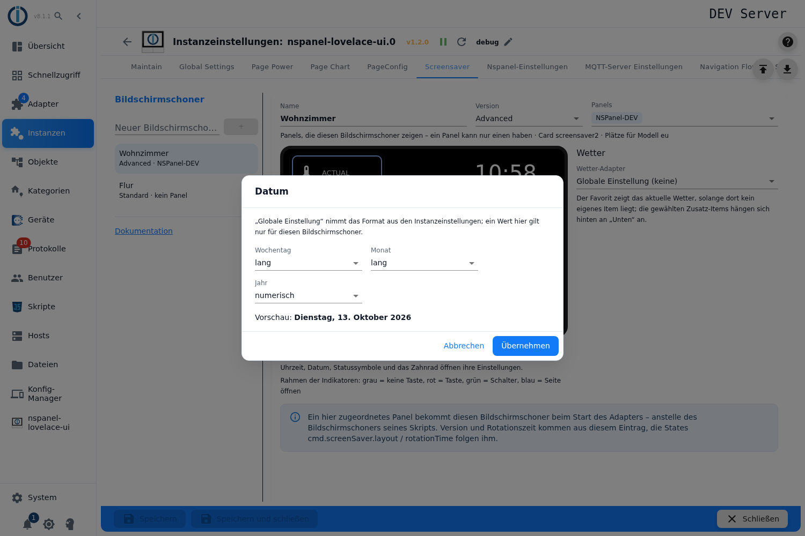

## 11. Wetter

Rechts neben dem Panelbild steht der **Wetter-Adapter** dieses Bildschirmschoners:

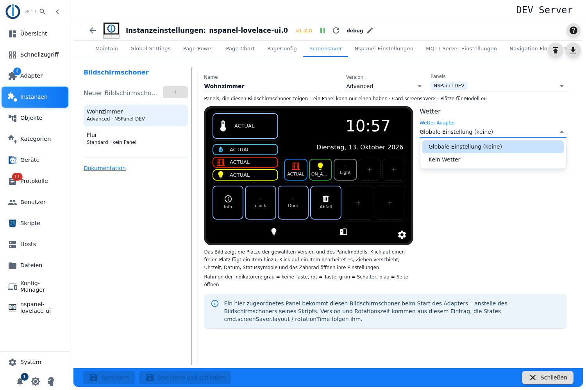

- **Globale Einstellung** – die Wetter-Instanz aus den Instanzeinstellungen (in Klammern genannt), **Kein Wetter**, oder eine der installierten Wetter-Instanzen. Unterstützt werden `accuweather`, `openweathermap`, `pirate-weather` und `brightsky`; ist keine davon installiert, sagt der Editor es.
- Mit gewähltem Adapter erscheinen Häkchen für seine **Zusatz-Items unten** (Sonnenauf-/untergang, Vorhersage Tag …, Windgeschwindigkeit, Böen, Windrichtung, UV-Index, Solarstrahlung). Sie hängen sich **hinter das letzte eigene Item** im Bereich **Unten**; passt beides nicht mehr auf die Plätze, blättert das Panel sie durch (Rotationszeit hinter dem Knopf **Optionen**) und der Editor zeigt an dieser Stelle eine Scrollleiste mit der Zahl der Items.
- Der **Favorit** zeigt das aktuelle Wetter, solange dort kein eigenes Item liegt – ein eigenes Item verdrängt es.
- Eine eingetragene, aber nicht mehr installierte Instanz wird gemeldet (*Die Instanz „…“ ist nicht (mehr) installiert.*).

## 12. Optionen: Rotation, Wischen, Indikator-Tasten

Der Knopf **Optionen** unter dem Panelbild öffnet drei Einstellungen (bis 2.0.2 war es das Zahnrad im Bild):

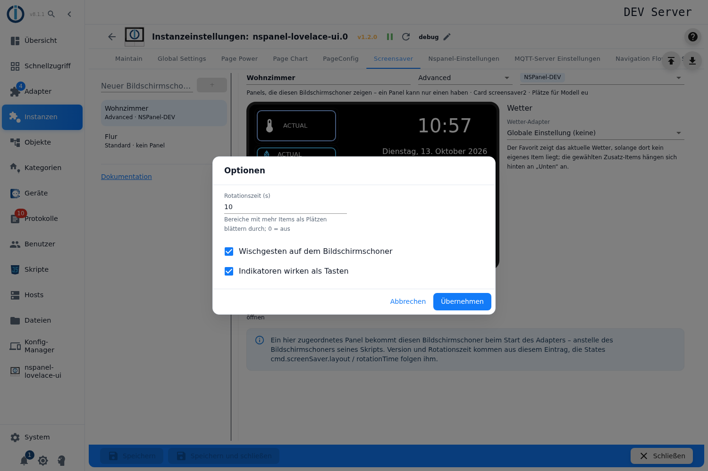

| Feld | Wirkung |
|---|---|
| **Rotationszeit (s)** | Takt, in dem das Panel die Fenster eines Bereichs mit mehr Items als Plätzen weiterblättert. `0` = aus; Werte von 1 und 2 Sekunden behandelt der Adapter als 3 Sekunden. |
| **Wischgesten auf dem Bildschirmschoner** | Eine Geste auf dem Bildschirmschoner schreibt ihre Kennzahl in `panels.<Panel>.buttons.screensaverGesture`: `2` = Verlassen (bExit), `3` = nach oben, `4` = nach unten, `5` = nach links, `6` = nach rechts. |
| **Indikatoren wirken als Tasten** | Voraussetzung dafür, dass die Aktion eines Indikators ausgeführt wird (siehe [Indikatoren](#8-indikatoren-und-tasten)). |

Die Gesten-Kennzahl kommt nur an, wenn zusätzlich der State `panels.<Panel>.cmd.screenSaver.doubleClick` des Panels an ist (Vorgabe: an). Ist er aus, setzt der Adapter `buttons.screensaverGesture` beim Start auf `0` (`inactive`) und schreibt danach nichts mehr hinein.

## 13. Benachrichtigungen

Der Knopf **Benachrichtigungen** unter dem Panelbild (bis 2.0.2 die Glocke im Bild) öffnet sie: zwei Zeilen, die sich über den Bildschirmschoner legen, solange ein Datenpunkt „an“ ist. Alle Bildschirmschoner teilen sich eine gemeinsame Liste; das Häkchen **Auf diesem Bildschirmschoner anzeigen** entscheidet, wo eine Benachrichtigung erscheint. Die Zahl am Knopf nennt, wie viele auf diesem Bildschirmschoner eingeschaltet sind. Der Knopf ist nur bei laufender Instanz bedienbar.

> Alles Weitere – Inhalt, Bedingungen, Priorität, Quittieren und Summer – steht auf der eigenen Seite [Screensaver-Notify](Screensaver-Notify).

## 14. Speichern – was der Adapter daraus macht

Unten **Speichern** bzw. **Speichern und schließen**; die Instanz startet neu. Beim Start sucht der Adapter für jedes Panel den ersten Eintrag, der sein Topic enthält, und baut daraus den Bildschirmschoner. Im Log steht dann z. B.:

```
Screensaver 'Wohnzimmer' (advanced) from the admin configuration replaces the script screensaver of panel 'NSPanel-Wohnzimmer'
```

Hatte das Panel vorher keinen eigenen Bildschirmschoner, endet die Zeile mit `is used by panel '…'`. Steht ein Panel in mehreren Einträgen, warnt das Log zusätzlich (*… is listed in several screensavers (…) – '…' is used*).

- Der Bildschirmschoner des Skripts wird für dieses Panel ersetzt; Panels ohne Eintrag behalten ihn.
- Version, Rotationszeit, Wischgesten und Indikator-Tasten kommen aus dem Eintrag; die States `panels.<Panel>.cmd.screenSaver.layout` und `…rotationTime` folgen ihm (sie überschreiben den Eintrag nicht).
- Ein Item ohne Symbol und ohne Icon-Liste bekommt die Standardsymbole seiner Rolle, ohne bekannte Rolle `help-circle-outline` – der Dialog lässt es allerdings gar nicht erst ohne Symbol zu.
- Für jedes Indikator-Item entsteht `panels.<Panel>.buttons.indicator-<n>`.
- Ein Timer auf der Uhrzeit, der nicht laufen kann (Datenpunkt fehlt, Muster ungültig, Item nicht mehr da), wird mit einer Warnung im Log verworfen – das Panel zeigt dann die Uhrzeit.
- `panels.<Panel>.cmd.screenSaver.activate` zeigt den Bildschirmschoner sofort (siehe [Abschnitt 15](#15-bildschirmschoner-sofort-anzeigen)).
- Ein [Web-Panel](WebPanel) ist eine Kopie seines Panels: der Eintrag wird über das Topic des echten Panels gefunden und gilt für beide.
- Die gespeicherte Form liegt unter `native.screensaverConfig` der Instanz (ein Objekt je Eintrag). Die **Benachrichtigungen** stehen getrennt davon unter `native.screensaverNotify`; der Eintrag merkt sich nur die IDs derjenigen, die auf ihm erscheinen sollen.

## 15. Bildschirmschoner sofort anzeigen

Der Bildschirmschoner lässt sich auch aufrufen, ohne den Timeout des Panels abzuwarten – mit demselben Verhalten wie beim Ablauf des Timeouts. Vier Wege führen dorthin:

| Weg | Wo |
|---|---|
| **Fläche einer Seite** | In der [Pageitem-Konfiguration](PageConfig-Dialoge#1-pageitem-konfiguration) steht in der Auswahl der **Zielseite** – auch beim langen Druck – der Eintrag **Screensaver**. |
| **Navigation einer Seite** | Die vier Felder *prev*, *next*, *home* und *parent* unter [Panelzuweisung und Navigation](PageConfig#panelzuweisung-und-navigation) bieten ebenfalls **Screensaver** an. Der Pfeil auf dem Panel zeigt dafür das Symbol `power-sleep`. |
| **Datenpunkt** | `panels.<Panel>.cmd.screenSaver.activate` (Rolle `button`) auf `true` setzen; der Adapter setzt ihn danach selbst auf `false` zurück. |
| **Navigation Flow** | Im [Navigation Flow](naviFlow) erscheint ein eigener Knoten **Screensaver**, sobald etwas dorthin führt – nur als Ziel, nicht bearbeitbar. |

Grenzen: Als Startseite gibt es das Ziel nicht, und für die Aktion eines Indikators auf dem Bildschirmschoner selbst wird es nicht angeboten. Ist das Panel offline oder zeigt es den Bildschirmschoner bereits, passiert nichts.

> **Zwei schnelle Tipps auf einen Navigationspfeil:** Der zweite Tipp kann ankommen, bevor die neue Seite fertig gezeichnet ist, und trifft dann das Symbol an derselben Stelle der neuen Seite. Führt dieses Symbol zum Bildschirmschoner, wirkt es, als hätte er sich von selbst aktiviert. Beobachtet mit 0,26 s zwischen zwei Tipps – der Adapter verwirft nur Tipps, die innerhalb von 0,2 s nach dem Seitenwechsel eintreffen.

## Fallstricke

- **Der Tab Screensaver fehlt:** Er erscheint erst, wenn die MQTT-Einstellungen vollständig sind (Server bzw. IP, Port und Zugangsdaten) **und mindestens ein Panel** in der Panel-Tabelle unter [NSPanelsetting](NSPanelsetting) steht. Zentrale Zugangsdaten zählen nur, solange der Adapter **nicht** selbst den MQTT-Server stellt – im Server-Betrieb müssen Benutzername und Passwort in den Feldern stehen.
- **Alles ausgegraut:** Die Instanz läuft nicht. Der Editor ist nur bei laufender Instanz bedienbar, auch die Template-Liste kommt vom laufenden Adapter.
- **Keine Plätze im Panelbild:** Noch kein Panel gewählt.
- **Übernehmen bleibt gesperrt:** Datenpunkt fehlt oder ist kein Datenpunkt (Kanal gewählt?), kein Symbol und keine Icon-Liste, bei Taste/Schalter kein beschreibbarer Datenpunkt, bei *Farbe aus Datenpunkt* kein gültiger State, bei einem Template die fehlende Vorlage oder das fehlende Objekt – der Dialog nennt den Grund in einer gelben Zeile. Ein Rohdaten-Item ist davon nicht betroffen.
- **Das Symbol wechselt nicht mit dem Wert:** Eine Icon-Liste gibt es nur für Zahlen-Datenpunkte, und jedes Icon gilt bis einschließlich seines Werts – oberhalb des höchsten Werts bleibt dessen Symbol stehen. Doppelte Werte meldet der Dialog, wirksam ist dann nur einer.
- **Falsches Symbol vorbelegt:** Die Rolle des Kanals über dem Datenpunkt zählt zuerst – einfach das Symbol ändern.
- **Panel zeigt den Skript-Screensaver:** Das Panel steht in keinem Eintrag, oder es steht in einem zweiten Eintrag weiter unten (der erste gewinnt) – siehe Log.
- **Das Panel zeigt immer dieselben Items, obwohl mehr angelegt sind:** Bei **Rotationszeit 0** blättert das Panel nicht – es bleibt beim ersten Fenster. Für überzählige Items eine Rotationszeit setzen.
- **Ein Item fehlt auf dem Panel, hat im Editor aber einen Platz:** Trägt es das Augen-Symbol, ist seine Bedingung nicht erfüllt – der Tooltip des Platzes nennt sie.
- **Items werden nach einem Versionswechsel gemeldet:** Sie liegen in Bereichen, die die neue Version nicht hat (Meldung oben im Editor); Version zurückstellen oder **Entfernen**. Mehr Items als Plätze **in einem vorhandenen** Bereich löst diese Meldung nicht aus.
- **Easyview hat keinen Favoriten:** Der Editor zeichnet für Easyview nur den Bereich **Unten**. Ein Favorit-Item aus einer anderen Version wird darum beim Wechsel als Item ohne Platz gemeldet.
- **Indikator reagiert nicht auf die Aktion:** Der State `panels.<Panel>.buttons.indicator-<n>` kommt trotzdem – das Panel springt nur auf die Hauptseite, statt den Befehl auszuführen. Dann fehlt die Option **Indikatoren wirken als Tasten**.
- **`buttons.screensaverGesture` bleibt leer:** Entweder ist **Wischgesten auf dem Bildschirmschoner** aus oder der State `cmd.screenSaver.doubleClick` des Panels.
- **Nach „Rohdaten entfernen“ ist das Item leer:** Die Standardfelder kommen zurück, nicht die Inhalte des JSON – ein ursprünglich als Rohdaten angelegtes Item muss danach neu ausgefüllt werden. Vor dem Entfernen das JSON sichern.
- **Das Panel zeigt die Uhrzeit statt des Timers:** Der An/Aus-Datenpunkt ist nicht wahr, der Daten-Datenpunkt ist leer oder enthält unbekannten Text, oder er steht auf 0, ohne dass der Timer seit dem Adapterstart gezählt hätte (bei einer Zahl ohne Zeiteinheit heißt 0 „kein Timer“). Bei der Quelle *Pageitem* gibt es das Item nicht mehr – das Log warnt einmal, der Uhrzeit-Dialog meldet es. Siehe [Timer statt Uhrzeit](#timer-statt-uhrzeit).
- **Der Timer bleibt auf `0.0` in Rot:** Das ist der Alarm. Er endet erst, wenn der An/Aus-Datenpunkt falsch wird oder neue Daten in der Zukunft liegen; ein Tipp blendet nur die Uhrzeit ein, das rote Infoicon bleibt.
- **Übernehmen im Uhrzeit-Dialog ist gesperrt:** *Timer anzeigen* ist gesetzt, aber ein Datenpunkt fehlt, ein Muster ist ungültig oder kein Pageitem gewählt. Häkchen abwählen oder die Felder füllen.
- **Ein Timer-Item auf einer Seite hat keine Tasten:** Es nutzt den Timer des Bildschirmschoners, der aber keinen vollständigen Timer hat – oder es ist zugleich dessen Quelle (Kreis). Das Log nennt den Grund einmal; Einzelheiten unter [Timer-Popup](popupTimer).
