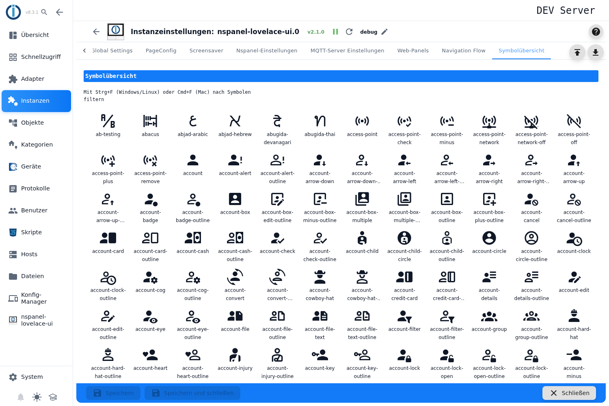

# Symbolübersicht

Eine Nachschlagehilfe: Hier stehen alle Symbole, die der Adapter mitbringt, mit ihrem Namen. Diesen Namen trägt man in den Symbolfeldern der Seiten- und Screensaver-Konfiguration ein.

## Suchen und übernehmen

- **Suchfeld einblenden:** `Strg + F` (Windows/Linux) beziehungsweise `Cmd + F` (Mac). Über der Liste steht derselbe Hinweis: *Mit Strg+F (Windows/Linux) oder Cmd+F (Mac) nach Symbolen filtern*. Das Feld heißt **Symbole filtern** und filtert die Liste nach einem Namensteil, Groß- und Kleinschreibung spielen keine Rolle. Das **X** im Feld leert den Filter und blendet das Feld wieder aus.
- **Name kopieren:** Ein Klick auf ein Symbol legt **den Namen** in die Zwischenablage (nicht das Bild). Der Tooltip am Symbol lautet `Zum Kopieren klicken: <Name>`, nach dem Klick bestätigt kurz die Meldung `<Name> kopiert`. Von dort lässt sich der Name in jedes Symbolfeld einfügen.
- Die Übersicht ist reine Anzeige — ein Klick verändert nichts an der Konfiguration.

## Hinweise

- Die Sammlung ist groß (mehrere tausend Symbole); der Filter ist der schnellste Weg. Tippt man etwa `thermometer`, bleiben die Varianten für Temperatur übrig.
- Die Symbole übernehmen die Textfarbe der Oberfläche, sind also auch im dunklen Erscheinungsbild zu erkennen. Welche Farbe ein Symbol auf dem Panel bekommt, wird dort eingestellt, wo es verwendet wird.
- Solange dieser Tab offen ist, fängt `Strg + F` die Suche der Oberfläche ab — die Browsersuche steht erst wieder zur Verfügung, wenn man den Tab verlässt.
- Neben den Material Design Icons gibt es einige eigene Symbole: Fenster- und Rollladen-Varianten (z. B. `window-tilt-variant`, `window-shutter-50`) und ab TFT 6.1.0 die Mediaplayer `alexa`, `mpd`, `sonos`, `bose` und `volumio` (`spotify` und `dlna` stammen aus MDI). Eine TFT vor 6.1.0 zeigt die Mediaplayer-Symbole nicht an.
