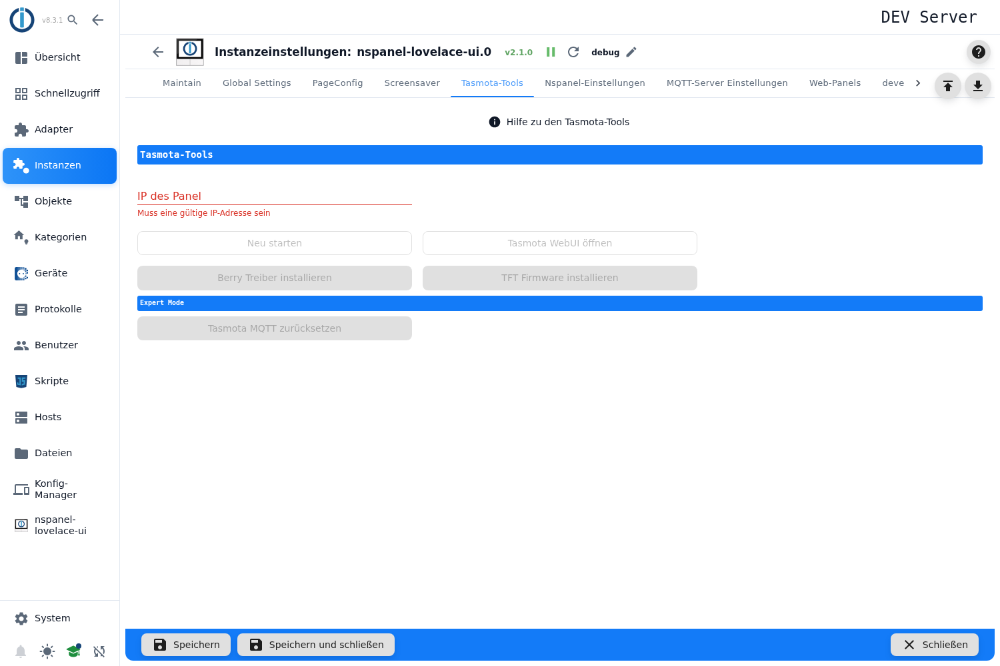

# Tasmota-Tools

Werkzeugkasten für den Fehlerfall. Hier lässt sich ein Panel neu starten, seine Weboberfläche öffnen, der **Berry-Treiber** oder die **TFT-Firmware** einzeln neu installieren und — im Expertenmodus — das Tasmota auf Werkseinstellungen zurücksetzen.

> **Der Tab ist nur im Expertenmodus sichtbar.** Umschalten über das Kopf-Symbol unten links in der Seitenleiste des Admin; die Einstellung gilt nur für die laufende Browsersitzung. Dauerhaft lässt sie sich in den ioBroker-Systemeinstellungen setzen.

Über den Werkzeugen steht der rote Knopf **Hilfe zu den Tasmota-Tools**; er öffnet diese Seite im Browser.

**Für den Normalbetrieb wird hier nichts gebraucht.** Beim Einrichten eines Panels erledigt die [Nspanel-Initialisierung](Adapter-Installation) all das automatisch; die Werkzeuge sind für den Fall gedacht, dass davon etwas nachgeholt oder wiederholt werden muss.

## Die Werkzeuge

Zuerst im Feld **IP des Panel** das Gerät auswählen — die Liste schlägt die bekannten Panels vor, eine fremde IP lässt sich auch eintippen. Erst danach werden die Knöpfe aktiv.

| Knopf | Wirkung |
|---|---|
| **Neu starten** | Startet das Tasmota auf dem Panel neu. Rückfrage vorher, siehe [Die Rückfragen](#die-rückfragen). |
| **Tasmota WebUI öffnen** | Öffnet die Weboberfläche des Panels in einem neuen Tab. |
| **Berry Treiber installieren** | Spielt den Berry-Treiber erneut auf. Dafür lädt das Panel die Datei **selbst aus dem Internet** — ohne Internetzugang schlägt es fehl. |
| **TFT Firmware installieren** | Installiert die Display-Firmware neu, passend zum Hardwaremodell und zur Einstellung *Beta-TFT*. Dauert einige Minuten, das Panel startet dabei neu. |
| **Tasmota MQTT zurücksetzen** (Abschnitt *Expert Mode*) | ⚠️ **Werksreset der Tasmota-Konfiguration.** Der Admin fragt vorher nach, siehe [Die Rückfragen](#die-rückfragen). Die WLAN-Zugangsdaten bleiben erhalten, alles andere — MQTT, Topic, Template — ist danach weg und das Panel muss neu initialisiert werden. Genau das ist der Befehl, den man braucht, wenn ein Panel vorher an einem anderen Host hing. |

## Die Rückfragen

Zwei Knöpfe fragen vor dem Ausführen nach. Beide Dialoge stehen in der Sprache des Admin:

| Knopf | Titel | Text |
|---|---|---|
| **Neu starten** | *Tasmota neu starten* | *Das NSPanel mit Tasmota neu starten?* |
| **Tasmota MQTT zurücksetzen** | *NSPanel zurücksetzen* | *Setzt die Tasmota-Konfiguration des Panels auf die Werkseinstellungen zurück (WLAN bleibt erhalten).* |

## Wenn etwas nicht klappt

- **Knöpfe bleiben grau:** Es ist keine IP ausgewählt, oder die Instanz läuft nicht.
- **Berry-Installation ohne Erfolgsmeldung:** Das Panel kommt nicht ins Internet, oder die Weboberfläche ist passwortgeschützt und das Passwort fehlt in den [MQTT-Server Einstellungen](General).
- **Nach dem Werksreset meldet sich das Panel nicht mehr:** Das ist erwartet — es muss über [Nspanel-Einstellungen](NSPanelsetting) neu initialisiert werden.
