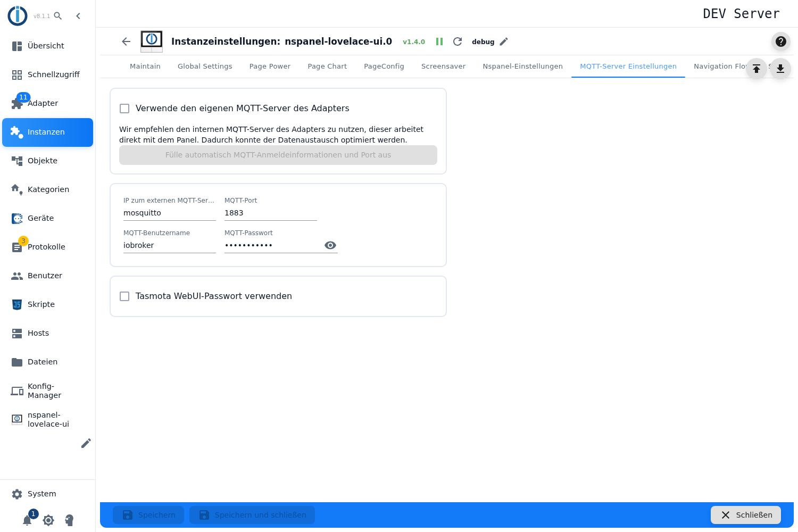
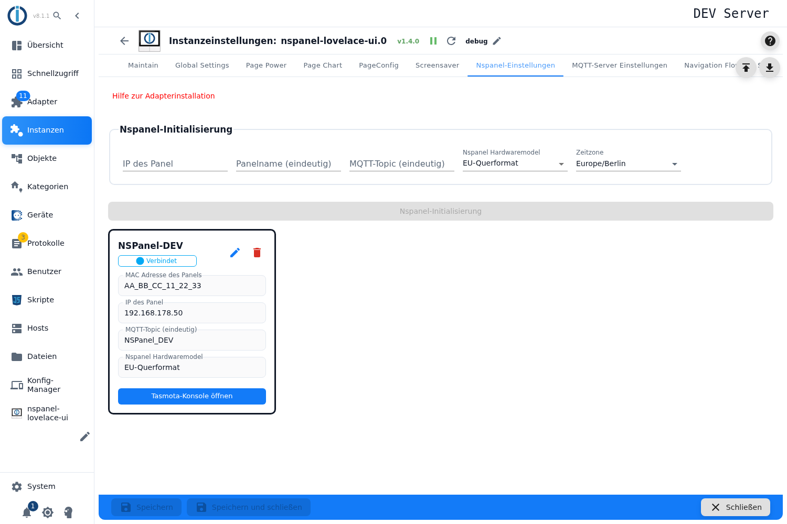

# Adapter installation and putting the panel into service

Only **Tasmota** is flashed by hand. Everything else is done by the adapter: it pushes the MQTT and Tasmota settings to the panel, installs the **Berry driver** and uploads the **TFT firmware** to the display. All the panel needs is an MQTT connection and internet access of its own.

Contents:
- [1. Prerequisites](#1-prerequisites)
- [2. Setting up the MQTT connection](#2-setting-up-the-mqtt-connection)
- [3. Creating and initialising the panel](#3-creating-and-initialising-the-panel)
- [4. What the initialisation does](#4-what-the-initialisation-does)
- [5. After the initialisation](#5-after-the-initialisation)
- [6. When it does not work](#6-when-it-does-not-work)

## 1. Prerequisites

- **Tasmota** is running on the panel. Do **not** install the Berry driver or the TFT firmware by hand.
- The panel has a **fixed IP** (reserve it in the router) and **internet access** — it downloads the Berry driver and the TFT file itself.
- An **MQTT broker** is reachable: either the adapter's built-in server or an external one (Mosquitto, MQTT adapter).
- The adapter is installed and an instance exists.

> ⚠️ **Was the panel connected to a different host before?** Run `reset 4` once on the Tasmota console so the old connection is forgotten.
> **After restoring an ioBroker backup**, delete the panels from the configuration and create them again — the TLS certificates are regenerated, otherwise pairing fails.

## 2. Setting up the MQTT connection

Instance settings → tab **MQTT server settings**.

- **The adapter's own MQTT server** (recommended): tick the box and press **fill in the MQTT credentials and port automatically**. The adapter picks a free port so it does not clash with other adapters (Shelly, Sonoff …). During the later initialisation **all** MQTT settings in Tasmota are overwritten and pointed at this server.
- **External broker** (Mosquitto or the MQTT adapter): fill in the four fields yourself.
  - *IP of the external MQTT server* — with the MQTT adapter, the IP of the ioBroker host.
  - *MQTT port* — the port the external broker listens on: usually 1883 with Mosquitto, or whatever is configured in the MQTT adapter.
  - *MQTT user name* and *MQTT password* — the panel uses them to log in to the broker.
- **Use the Tasmota WebUI password**: only needed if the panel's web interface is password protected. The adapter needs that access to install the Berry driver.

Save, then switch to the *NSPanel settings* tab.

## 3. Creating and initialising the panel

Instance settings → tab **NSPanel settings**.

Fill in the **NSPanel initialisation** section:

| Field | Meaning |
|---|---|
| *IP of the panel* | the panel's fixed IP on the network |
| *Panel name (unique)* | free to choose, later used for the script and the states |
| *MQTT topic (unique)* | the topic the panel publishes and listens on |
| *NSPanel hardware model* | EU landscape, US portrait or US landscape |
| *Time zone* | the panel's time zone |

Then press **NSPanel initialisation**. When it has finished, the panel appears as a card in the list below — with connection state, MAC address, IP, topic and model, plus a pencil to edit, a bin to delete and **open Tasmota console** to jump straight into the panel's web interface.

## 4. What the initialisation does

The admin reports the progress in **three steps**; the whole run takes about **ten minutes**, most of it for the TFT firmware.

| Message | What happens behind it |
|---|---|
| **Step 1 of 3 done: MQTT credentials transferred, the panel has restarted** | The adapter writes the MQTT credentials into Tasmota and restarts it. |
| **Step 2 of 3 done: basic settings and time zone transferred** | The remaining Tasmota options and the chosen time zone go to the panel. |
| **Panel initialised successfully** (step 3) | The long one: fetch the version list, **check the panel's internet access** (it must reach `raw.githubusercontent.com`), **install the Berry driver** (the existing `autoexec.be` is kept as `autoexec.old`, Tasmota downloads the matching version itself via `UrlFetch`, followed by a restart), **upload the TFT firmware** (`FlashNextionAdv0` with the `.tft` file for the model), **create and start the scripts**, activate the panel. |

Every sub-step can be followed in the instance **log**. Once it is done, the panel shows the screensaver.

## 5. After the initialisation

- The **Maintain** tab shows the installed **Tasmota version**, **TFT version** and **script version** per panel, each with a button to update; *update scripts for all panels* does them in one go. These buttons are also the way to reinstall the Berry driver or the TFT firmware later.
- Create pages: either in the admin ([standard pages](Pages)) or in the configuration script.
- Set up the screensaver: [screensaver – admin](Screensaver-Admin).
- Example script to get started: [example_sendTo_script_iobroker.ts](https://github.com/ticaki/ioBroker.nspanel-lovelace-ui/blob/main/script/example_sendTo_script_iobroker.ts).

## 6. When it does not work

| Symptom | Cause and remedy |
|---|---|
| The panel does not connect to the broker | It was attached to another host before → run `reset 4` on the Tasmota console, then initialise again. |
| No connection after restoring an ioBroker backup | Delete the panels from the configuration and create them again (the TLS certificates are regenerated). |
| The installation stalls at the Berry driver | The panel has no internet access (DNS, firewall, guest Wi-Fi) — the adapter checks this beforehand with a ping to `raw.githubusercontent.com`. |
| Message *no download confirmation from Tasmota after the Berry install* | Tasmota did not fetch the file — check internet access and, with a protected WebUI, the stored password, then repeat step 3. |
| Message *TFT firmware version could not be determined online* | The **adapter** itself cannot reach the version list (internet or proxy on the ioBroker host). |
| The adapter cannot reach the Tasmota interface | Enable **use the Tasmota WebUI password** in the *MQTT server settings* tab and store the password. |
| You want a test build of the TFT firmware | The *Global settings* tab has the **beta TFT** switch. For testing only, leave it off in normal operation. |
| Versions in the *Maintain* tab stay at `???` | The panel is not answering over MQTT — check the connection, the topic and the power supply. |

Questions: [ioBroker forum](https://forum.iobroker.net/topic/80055/alphatest-nspanel-lovelace-ui-v0-1-1) or [GitHub issues](https://github.com/ticaki/ioBroker.nspanel-lovelace-ui/issues).
