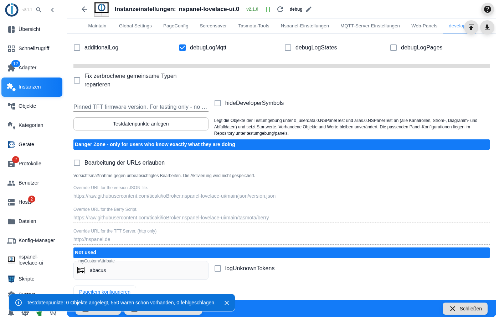
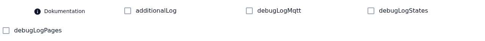
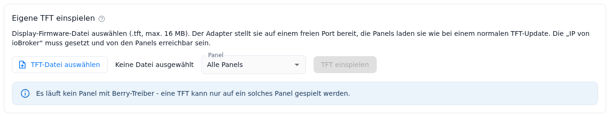

# Developer

Switches for troubleshooting, flashing your own display firmware, and an area where the built-in download addresses can be overridden.

> **The tab is only visible in expert mode.** Toggle it with the head icon at the bottom left of the admin sidebar; the setting applies to the current browser session only.

At the top of the tab sits the button **Documentation** — it opens this page in a new tab.

## Logging

| Switch | Effect |
|---|---|
| **additionalLog** | Extra messages about messages sent to a panel that are still pending. |
| **debugLogMqtt** | Logs the MQTT traffic in detail — useful when a panel stays silent. |
| **debugLogStates** | Logs changes to states. |
| **debugLogPages** | Logs how pages are built and switched. |
| **logUnknownTokens** | Reports placeholders in texts that the adapter could not resolve. In the user interface the switch sits further down under **Not used**, but it does take effect. |

These switches produce a lot of log output. Turn them on for troubleshooting and off afterwards — and set the instance log level to `debug`, otherwise most of it stays invisible.

## Tools

| Setting | Effect |
|---|---|
| **Fix broken common types** | A one-off repair: on the next start the adapter corrects alias objects whose type is wrongly `state` instead of `mixed` (a known issue from the devices adapter). Afterwards it clears the tick itself. |
| **Pinned TFT firmware version** | Forces a specific TFT version instead of the one determined online. **For testing only**, without support — the adapter warns on every start while something is entered here. |
| **hideDeveloperSymbols** | Hides the cog the screensaver shows while a developer build of the display firmware is running. An own info icon takes precedence over the cog anyway. |
| **Create test states** | Creates the states of the test environment — every channel role at once, without building objects yourself. Existing objects stay untouched. See [Test environment](Testumgebung). |

## Flashing a custom TFT

Since 2.3.0 the box **Flash custom TFT** sits below the tools: it puts a display firmware (`.tft`) you built yourself or obtained elsewhere on one panel or on all panels, without having to place it on a web server first — the adapter serves it.

This is how it works:

1. **Select TFT file** — `.tft` only, 16 MB at most (that is the size of the display flash of the NSPanel). The file name appears next to the button; the same file can be selected again.
2. **Panel** — *All panels* or a single one. The admin fetches the list from the running adapter; it only contains panels with a real Berry driver: no web panels, no emulator and no panel that has not reported a driver version yet.
3. **Flash TFT** — the admin sends the file to the adapter in chunks of 512 KB (the button shows the progress in percent). The adapter stores it in the temporary directory of the system, opens a **free port** for it and sends the selected panels the same command over MQTT as a regular TFT update, only with its own address (`FlashNextionAdv0 http://<IP of the ioBroker>:<port>/<file>`). The message *Flash started* only means that the command is out — the flash itself is shown by the card of the panel in the [Maintain](Maintain) tab (`flashing`, progress in percent).

What to keep in mind:

- **The "IP of the ioBroker" has to be set and reachable by the panels** — the field of the *MQTT server* tab (see [NSPanelsetting](NSPanelsetting)). The adapter takes the value currently entered in the admin, even unsaved; if it is missing or reads `127.0.0.1`, it reports *The "IP of the ioBroker" is not set*.
- **The server lives only briefly.** It stops five minutes after the last access, 45 minutes at the latest, and then deletes the file again; an adapter restart cleans up as well. A panel that has not fetched the file by then gets none.
- **Only panels that are running.** For a selected panel the adapter is not operating, the answer is *No running panel found for this selection*.
- **No check against the hardware model.** The adapter checks extension and size, not whether the firmware fits the panel. A developer build reports itself as TFT `0.0.0` after the flash — the card in the Maintain tab turns orange and offers *TFT UPDATE*, the screensaver shows the cog (see **hideDeveloperSymbols** above). *TFT UPDATE* brings back the official firmware at any time.

| Message | Reason |
|---|---|
| *The file must have the extension .tft* / *is empty* / *is too large (max. 16 MB)* | The adapter rejects the file before anything happens. |
| *The upload was interrupted - please start again* | A chunk did not arrive, or a second upload displaced the first — there is only ever one. |
| *The adapter is not running or does not answer* | Without a running instance there is no panel list and no server. |
| *No panel with the berry driver is running* | None of the panels can load a TFT, see point 2. |
| *The TFT could not be provided - see the adapter log* | The server could not start or the file could not be stored; the log names the reason. |

## Danger zone

The section is labelled exactly that, and it is meant seriously: these are the addresses the version list, the Berry driver and the TFT firmware are loaded from.

The fields stay locked until **allow editing of the URLs** is switched on — a safeguard against accidental typing. **That tick is not saved**: after reloading the page it is off again, while changed addresses do persist.

| Field | Default |
|---|---|
| Version list | `…/ioBroker.nspanel-lovelace-ui/main/json/version.json` |
| Berry driver | `…/ioBroker.nspanel-lovelace-ui/main/tasmota/berry` |
| TFT server | `http://nspanel.de` |

Changing anything here means firmware from a different source — when in doubt, leave the defaults. The section below is headed **Not used**. That is not true for everything in it: `myCustomAttribute` really has no function, **whereas `logUnknownTokens` is evaluated** (see Logging).
